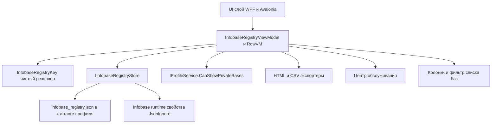

# Функция 1. «Паспорт базы» и реестр ответственности

Статус: план (реализация не начата)
Редакция: бесплатная (не ПРО)
Платформы: Windows/WPF (`net10.0-windows`) и Linux/Avalonia 11 (`net10.0`, `LINUX`)

> Примечание: путь `docs/plans/` исключён правилом `plans/` в `.codeassistantignore`,
> поэтому план сохранён как `docs/feature-01-infobase-registry.md`. После ослабления
> правила файл можно перенести в `docs/plans/` без изменения содержимого.

## 1. Цель

Дать структурный ответ на вопросы «кто владелец базы», «насколько она критична», «кто её
поддерживает», «какой SLA», «когда введена и когда выводится» — и использовать эти данные
в мониторинге, обслуживании и отчётах по парку баз.

Ключевой принцип: паспорт живёт **отдельно** от списка баз, в отдельном файле
`infobase_registry.json`, поэтому:

* формат [`infobases.json`](Workspace1C/Services/InfobaseRepository.cs) не меняется;
* экспорт/импорт списка баз не затирает паспорт;
* заметки ([`NoteStore`](Workspace1C/Services/NoteStore.cs)) не дублируются и не изменяются.

## 2. Границы

### Входит

1. Модель паспорта `InfobaseRegistryEntry` + enum `Criticality` (Low/Normal/High/Critical).
2. Хранилище `IInfobaseRegistryStore` / `InfobaseRegistryStore` (атомарная запись, терпимое чтение).
3. Резолвинг ключа базы: `Infobase.Id`, fallback — каноническая строка подключения.
4. Перепривязка при смене `Id` и сверка реестра со списком баз.
5. Вью-модель редактирования одной базы и массового заполнения выбранных.
6. UI на WPF и Avalonia: окно «Паспорт базы…», окно «Реестр баз», точки входа в свойствах,
   контекстном меню мультивыделения и палитре команд.
7. Колонки «Владелец»/«Критичность» в списке баз (опционально, через настройки колонок)
   и фильтр по критичности.
8. Интеграции: «Центр обслуживания» (колонка/фильтр/сортировка), HTML- и CSV-отчёты
   с секцией «Ответственные и SLA».
9. Тесты: хранилище, ключи, валидация, массовое редактирование, отчёты, приватность,
   source-гварды обеих платформ, паритет локализации.

### Не входит

* COM-интеграции и любые внешние сервисы (включая автоопределение владельца из AD).
* Изменение формата `infobases.json`, `groups.json`, `settings.json` (кроме новых
  опциональных полей настроек колонок — обратно совместимо).
* Изменение [`NoteStore`](Workspace1C/Services/NoteStore.cs), [`BaseNotesWindow`](Workspace1C/Views/BaseNotesWindow.xaml.cs)
  и шифрования секретов.
* Платная редакция и любые проверки `EditionService.IsPro`.
* Синхронизация реестра между машинами/профилями, напоминания и уведомления по SLA.

## 3. Архитектура слоёв



Слои и ответственность:

| Слой | Что делает | Чего не делает |
|---|---|---|
| `Models/` | Модель записи, enum, документ-обёртка, runtime-свойства `Infobase` | I/O, UI, локализация формата |
| `Services/` | Чистый резолвер ключа, хранилище JSON, расширение экспортёров | Знание про WPF/Avalonia |
| `ViewModels/` | Валидация, массовые операции, сводка, фильтрация, приватность | Прямая работа с контролами |
| `Views/` | Только ввод/вывод и привязки, два файла-близнеца на платформу | Бизнес-логика и запись файла |

## 4. Модель данных

### 4.1. Новый файл [`Models/InfobaseRegistryEntry.cs`](Workspace1C/Models/InfobaseRegistryEntry.cs)

```csharp
public sealed class InfobaseRegistryEntry
{
    public string InfobaseId { get; set; } = string.Empty;      // Id 1С, если есть
    public string ConnectionKey { get; set; } = string.Empty;   // канонический fallback-ключ
    public string NameHint { get; set; } = string.Empty;        // имя на момент записи (диагностика)
    public string Owner { get; set; } = string.Empty;           // ФИО или команда
    public string Department { get; set; } = string.Empty;
    public InfobaseCriticality Criticality { get; set; } = InfobaseCriticality.Normal;
    public string SupportContact { get; set; } = string.Empty;  // почта/чат/телефон
    public int? SlaHours { get; set; }                          // часы реакции
    public int? SlaPercent { get; set; }                        // альтернатива: % доступности
    public DateTime? CommissionedDate { get; set; }             // только дата
    public DateTime? DecommissionDate { get; set; }
    public string Note { get; set; } = string.Empty;            // только паспортные сведения
    public DateTime UpdatedAt { get; set; } = DateTime.UtcNow;
    public string UpdatedBy { get; set; } = string.Empty;

    [JsonIgnore] public bool HasContent { get; }  // пустая запись не сохраняется
    [JsonIgnore] public string Key { get; }       // id:... либо conn:...
}
```

Правила:

* `HasContent` — есть хотя бы одно смысловое поле (владелец, отдел, контакт, SLA, даты,
  заметка паспорта, критичность ≠ Normal). Пустые записи удаляются, как в `NoteStore`.
* **Паролей и секретов в модели нет** — по контракту и по source-гварду.
* `Note` — это паспортный комментарий (ответственный за обновление, окно обслуживания),
  **не** замена markdown-карточке заметок. Пересечение полей запрещено и проверяется
  тестом на отсутствие `Secrets`/`Markdown` в модели.

### 4.2. Новый файл [`Models/InfobaseCriticality.cs`](Workspace1C/Models/InfobaseCriticality.cs)

```csharp
public enum InfobaseCriticality { Low = 0, Normal = 1, High = 2, Critical = 3 }
```

Плюс:

* `Rank` (1..4) для сортировки «сначала критичные»;
* ключи локализации `Registry.Criticality.Low/Normal/High/Critical`;
* `InfobaseCriticalityConverter : JsonConverter<InfobaseCriticality>` — строковое
  представление, неизвестное значение → `Normal` + предупреждение (терпимое чтение).

### 4.3. Формат `infobase_registry.json`

```json
{
  "Version": 1,
  "Entries": [
    {
      "InfobaseId": "0f1e2d3c-1111-2222-3333-444455556666",
      "ConnectionKey": "conn:srvr=1c-srv;port=1541;ref=bp_prod",
      "NameHint": "Бухгалтерия (прод)",
      "Owner": "Иванов И.И.",
      "Department": "Бухгалтерия",
      "Criticality": "Critical",
      "SupportContact": "1c-support@example.ru",
      "SlaHours": 4,
      "SlaPercent": null,
      "CommissionedDate": "2024-02-01",
      "DecommissionDate": null,
      "Note": "Закрытие периода, окно обслуживания после 20:00",
      "UpdatedAt": "2026-11-15T10:00:00Z",
      "UpdatedBy": "Иванов И.И."
    }
  ]
}
```

Требования к сериализации:

* `WriteIndented = true`, `Encoder = JavaScriptEncoder.UnsafeRelaxedJsonEscaping`;
* `JsonStringEnumConverter` (enum строками), `PropertyNameCaseInsensitive = true`;
* `DefaultIgnoreCondition = WhenWritingNull` — чтобы файл был читаемым;
* никаких логинов/паролей/строк подключения с `Pwd=`.

## 5. Стратегия ключа и перепривязка

Новый чистый класс [`Services/InfobaseRegistryKey.cs`](Workspace1C/Services/InfobaseRegistryKey.cs)
(без I/O, полностью покрыт юнит-тестами).

### 5.1. Приоритет ключа

1. `Infobase.Id` не пуст → ключ `id:<Id.Trim()>`, сравнение `OrdinalIgnoreCase`.
2. Иначе → ключ `conn:<каноническая строка подключения>`.

### 5.2. Канонизация строки подключения (fallback)

| Тип | Формат ключа | Правила нормализации |
|---|---|---|
| File | `conn:file=<path>` | `Trim`, унификация разделителей, снятие хвостового разделителя, `ToLowerInvariant`, `GetFullPath` в `try/catch` (без обращения к диску) |
| ClientServer | `conn:srvr=<host>;port=<port>;ref=<db>` | host/ref — `Trim().ToLowerInvariant()`; порт `0` или `1541` нормализуется в `1541`; IPv6 в `[ ]` сохраняется |
| WebServer | `conn:ws=<url>` | схема и host в нижнем регистре, снятие хвостового `/`, без query/fragment |

В ключ **не попадают**: `User`, `Password`, `AuthenticationMode`, `BlockScheduledJobs`,
`ForbidSpeechRecognition`, `UseOsAuthentication`. Это отдельный тест-гвард.

### 5.3. Миграция и перепривязка

* `InfobaseRegistryKey.For(Infobase)` → `(Key, InfobaseId, ConnectionKey)`.
* `Reconcile(IEnumerable<Infobase> bases, IReadOnlyList<InfobaseRegistryEntry> entries)`:
  1. точное совпадение по `InfobaseId`;
  2. иначе совпадение по `ConnectionKey` → запись «привязывается» (проставляется `InfobaseId`);
  3. несовпавшие записи **не удаляются** (пометка «не привязано», `NameHint` для UI);
  4. возвращает `ReconcileResult { Bound, Rebound, Unbound }`.
* `Rebind(oldId, newId)` — при ручной смене `Id` в свойствах базы; вызывается из VM
  сохранения, чтобы паспорт не «потерялся».
* Перепривязка выполняется в памяти при загрузке и сохраняется **только если были
  изменения** — не переписываем файл на каждом старте.

## 6. Хранилище

### 6.1. Контракт [`Services/IInfobaseRegistryStore.cs`](Workspace1C/Services/IInfobaseRegistryStore.cs)

```csharp
public interface IInfobaseRegistryStore
{
    string FilePath { get; }
    IReadOnlyList<InfobaseRegistryEntry> GetAll();          // кэш на экземпляр
    InfobaseRegistryEntry? Get(Infobase infobase);          // по ключу, null если нет
    void Upsert(InfobaseRegistryEntry entry);               // UpdatedAt = UtcNow
    bool Delete(Infobase infobase);
    ReconcileResult Reconcile(IEnumerable<Infobase> bases);
    void SaveAll(IReadOnlyList<InfobaseRegistryEntry> entries);
}
```

### 6.2. Реализация [`Services/InfobaseRegistryStore.cs`](Workspace1C/Services/InfobaseRegistryStore.cs)

Повторяет проверенный паттерн [`NoteStore`](Workspace1C/Services/NoteStore.cs) и
[`FeatureDataStore`](Workspace1C/Services/FeatureDataStore.cs):

* `public const string FileName = "infobase_registry.json"`;
* конструктор `(string? directoryOverride = null, IAppLogger? logger = null)`;
* каталог: override (тесты) → `FeatureDataStore.DataDirectory` (каталог активного профиля);
* запись: `Directory.CreateDirectory` → `File.WriteAllText(path + ".tmp", json)` →
  `File.Move(tmp, path, overwrite: true)`; `.tmp` после успеха отсутствует;
* чтение:
  * файла нет → пустой реестр без Warn;
  * битый JSON / неизвестный enum / `Entries == null` → пустой реестр + `Warn`,
    **файл не перезаписывается** (пользователь может починить вручную);
  * дубликаты ключей → остаётся первая запись, остальные отбрасываются с `Warn`;
  * нормализация: `Trim` строк, пустые → `string.Empty`, `SlaHours < 0` → `null`,
    `SlaPercent` вне 0..100 → `null`, `CommissionedDate > DecommissionDate` → дата
    деактивации обнуляется + `Warn`;
* кэш на экземпляр, `SaveAll` обновляет кэш;
* `InfobaseRegistryStoreAccess.GetOrCreate()` — по образцу `NoteStoreAccess` для
  контекстов без DI (CLI, тесты).

### 6.3. DI

В [`AppServices.cs`](Workspace1C/AppServices.cs) рядом с `NoteStore`:

```csharp
services.AddSingleton<IInfobaseRegistryStore>(sp => new InfobaseRegistryStore(
    null, sp.GetService<IAppLogger>()));
```

## 7. Вью-модели

### 7.1. [`ViewModels/InfobaseRegistryViewModel.cs`](Workspace1C/ViewModels/InfobaseRegistryViewModel.cs)

Чистый .NET, без WPF/Avalonia, обе платформы используют один класс.

Режим одной базы:

* `Load(Infobase)` — читает запись (или значения по умолчанию), заполняет редактируемые
  свойства: `Owner`, `Department`, `Criticality`, `SupportContact`, `SlaHoursText`,
  `SlaPercentText`, `CommissionedDateText`, `DecommissionDateText`, `Note`;
* `Validate()` → `IReadOnlyList<RegistryValidationError>` (поле + ключ локализации);
* `Save()` — `Upsert` + `UpdatedAt`/`UpdatedBy`, возвращает `bool` (false при ошибках);
* `SummaryText` — «Заполнено {0} из {1}» по видимым базам;
* `IsDirty` — предупреждение о несохранённых изменениях при закрытии окна.

Режим массового заполнения:

* `BulkEdit(IEnumerable<Infobase> targets, InfobaseRegistryBulkUpdate update)`;
* `InfobaseRegistryBulkUpdate` — **tri-state** по каждому полю:
  `NotSet` (не менять) / `Set(value)` / `Clear`;
* результат `BulkEditResult { Updated, SkippedPrivate, SkippedOrphan, Errors }`;
* приватность: базы с `IsPrivate == true` пропускаются, если
  `IProfileService.CanShowPrivateBases == false` (дополнительно к фильтрации в UI);
* пустые значения в `Set` трактуются как `Clear` (явная очистка — только `Clear`).

### 7.2. Правила валидации

| Правило | Уровень | Ключ локализации |
|---|---|---|
| `SlaHours` не число / отрицательное / > 8760 | Ошибка | `Registry.Validation.SlaHours` |
| `SlaPercent` не число / вне 0..100 | Ошибка | `Registry.Validation.SlaPercent` |
| Заполнены и `SlaHours`, и `SlaPercent` | Ошибка | `Registry.Validation.SlaExclusive` |
| `DecommissionDate < CommissionedDate` | Ошибка | `Registry.Validation.DateOrder` |
| Некорректный формат даты (`dd.MM.yyyy` или ISO) | Ошибка | `Registry.Validation.DateFormat` |
| `CommissionedDate` в будущем | Предупреждение | `Registry.Validation.DateFuture` |
| `Owner` пуст при `Criticality` = High/Critical | Предупреждение | `Registry.Validation.OwnerRecommended` |
| `SupportContact` пуст при `Criticality` = Critical | Предупреждение | `Registry.Validation.ContactRecommended` |

Предупреждения не блокируют сохранение и не блокируют массовую операцию.

### 7.3. [`ViewModels/InfobaseRegistryRowViewModel.cs`](Workspace1C/ViewModels/InfobaseRegistryRowViewModel.cs)

* строка окна «Реестр баз»: `Infobase`, `OwnerDisplay`, `DepartmentDisplay`,
  `CriticalityDisplay`, `CriticalityRank`, `SlaDisplay`, `SupportContact`, даты, `IsFilled`;
* `InfobaseRegistryFilter` — чистый фильтр: набор критичностей, текст по
  владельцу/отделу/контакту, «только незаполненные», «только не привязанные»;
* `CompareForProblems` — сначала `Critical`, затем `High`, затем остальные.

## 8. UI (обе платформы)

### 8.1. Окно «Паспорт базы…»

* WPF: [`Views/BasePassportWindow.xaml`](Workspace1C/Views/BasePassportWindow.xaml) +
  [`Views/BasePassportWindow.xaml.cs`](Workspace1C/Views/BasePassportWindow.xaml.cs).
* Avalonia: [`Views/BasePassportWindow.Avalonia.cs`](Workspace1C/Views/BasePassportWindow.Avalonia.cs)
  (код-построение, как [`MaintenanceCenterWindow.Avalonia.cs`](Workspace1C/Views/MaintenanceCenterWindow.Avalonia.cs),
  наследование `ModalWindowBase`, Esc/Enter, `MinWidth`/`MinHeight`).
* Поля: владелец, отдел, критичность (ComboBox), контакт поддержки, SLA (часы и % —
  взаимоисключающе), даты ввода/вывода, паспортный комментарий.
* Блок ошибок/предупреждений, кнопки «Сохранить»/«Отмена», подпись «Обновлено: дата, кто».

Точки входа:

1. Кнопка «Паспорт…» на вкладке «База» окна свойств
   ([`ConnectionSettingsWindow.xaml`](Workspace1C/Views/ConnectionSettingsWindow.xaml),
   [`ConnectionSettingsWindow.Avalonia.cs`](Workspace1C/Views/ConnectionSettingsWindow.Avalonia.cs)).
   Вкладки не добавляем — индексы в [`InfobasePropertiesTabs`](Workspace1C/Models/InfobasePropertiesTabs.cs)
   не меняются, риск регрессии минимален.
2. Контекстное меню базы: пункт `Passport` рядом с `Notes`
   ([`ContextMenuCatalog`](Workspace1C/Services/ContextMenuCatalog.cs)).
3. Палитра команд: `palette.passport` для выбранной базы.

### 8.2. Окно «Реестр баз: ответственные и SLA»

* WPF: `Views/InfobaseRegistryWindow.xaml` + `.xaml.cs`.
* Avalonia: `Views/InfobaseRegistryWindow.Avalonia.cs`.
* Содержимое: таблица всех видимых баз (имя, группа, владелец, отдел, критичность, SLA,
  контакт, даты, «заполнено»), фильтры (критичность, текст, только незаполненные),
  сводка «Заполнено N из M», панель массового заполнения для мультивыделения,
  кнопка «Экспорт отчёта».
* Приватные базы при заблокированном профиле в таблицу не попадают вообще.

Точки входа:

1. Контекстное меню мультивыделения, блок «Для выделенных»:
   `ContextMenuCommandKind.BatchPassport` → «Паспорт для выделенных…».
2. Палитра команд: `palette.registry` → «Реестр баз…».
3. Меню «Утилиты» (по образцу «Центра обслуживания»).

### 8.3. Колонки списка баз

* [`Models/AppSettings.cs`](Workspace1C/Models/AppSettings.cs):
  `ShowOwnerColumn` (default `false`), `OwnerColumnWidth`, `ShowCriticalityColumn`
  (default `false`), `CriticalityColumnWidth`; ключи `Owner`/`Criticality` в `ColumnOrder`.
* [`Models/Infobase.cs`](Workspace1C/Models/Infobase.cs): runtime-свойства
  `[JsonIgnore] RegistryOwner`, `[JsonIgnore] RegistryCriticality`,
  `[JsonIgnore] RegistryCriticalityDisplay`, метод `ApplyRegistry(entry)` с
  `OnPropertyChanged`. **Формат `infobases.json` не меняется** (гвард-тест на round-trip).
* Гидратация: `MainViewModel` при загрузке списка, после `Save`, импорта и синхронизации
  вызывает `ApplyRegistry` по данным стора (новый partial `MainViewModel.Registry.cs`).
* WPF: [`Views/MainWindow.Columns.cs`](Workspace1C/Views/MainWindow.Columns.cs) +
  `MainWindow.xaml`; Avalonia: [`Views/MainWindow.Avalonia.Columns.cs`](Workspace1C/Views/MainWindow.Avalonia.Columns.cs).
* Настройки: [`Views/SettingsWindow.Display.cs`](Workspace1C/Views/SettingsWindow.Display.cs),
  [`Views/SettingsWindow.Avalonia.cs`](Workspace1C/Views/SettingsWindow.Avalonia.cs),
  ключи `Settings.Columns.ShowOwner`, `Settings.Columns.ShowCriticality`.
* Фильтр по критичности: [`ViewModels/InfobaseListFilter.cs`](Workspace1C/ViewModels/InfobaseListFilter.cs)
  + состояние в `MainViewModel.Display.cs` и `MainViewModel.Avalonia.Display.cs`.

## 9. Интеграции

### 9.1. «Центр обслуживания»

[`ViewModels/MaintenanceCenterViewModel.cs`](Workspace1C/ViewModels/MaintenanceCenterViewModel.cs):

* в `MaintenanceCenterRowViewModel` добавить `CriticalityText`, `CriticalityRank`,
  `OwnerText`, `IsCritical`, `IsRegistryFilled`;
* фильтр `OnlyCritical` рядом с `OnlyProblems`; комбинируется по И;
* сортировка `Rows`: `CriticalityRank` по убыванию → `HasProblem` по убыванию → имя;
* WPF [`Views/MaintenanceCenterWindow.xaml`](Workspace1C/Views/MaintenanceCenterWindow.xaml)
  + `.xaml.cs`; Avalonia `MaintenanceCenterWindow.Avalonia.cs` — новая колонка
  «Критичность» и чекбокс «Только критичные».

### 9.2. Отчёты

HTML:

* [`Models/HtmlReportDocument.cs`](Workspace1C/Models/HtmlReportDocument.cs): поля
  `Owner`, `Department`, `Criticality`, `Sla`, `SupportContact`, `CommissionedDate`,
  `DecommissionDate` в `HtmlReportRow`; новый `HtmlReportRegistryRow` и список
  `RegistryRows`; новые подписи в `HtmlReportLabels`.
* [`Services/HtmlReportExporter.cs`](Workspace1C/Services/HtmlReportExporter.cs): секция
  «Ответственные и SLA» — таблица с бейджами критичности, подсветкой Critical/High,
  экранирование через существующий `Escape`.
* [`ViewModels/MainViewModel.HtmlReport.cs`](Workspace1C/ViewModels/MainViewModel.HtmlReport.cs):
  заполнение из стора по видимым базам (приватные уже отфильтрованы вызывающей стороной).

CSV:

* [`Services/InfobaseCsvExportService.cs`](Workspace1C/Services/InfobaseCsvExportService.cs):
  добавить колонки «Владелец», «Отдел», «Критичность», «SLA», «Контакт поддержки»,
  «Введена», «Выведена». Порядок прежних колонок не меняется (аддитивная совместимость).

### 9.3. Приватность

Три рубежа защиты:

1. UI работает только с уже отфильтрованными базами (`IsVisibleForPrivateFilter`).
2. `InfobaseRegistryViewModel.BulkEdit` и построение отчёта дополнительно проверяют
   `IProfileService.CanShowPrivateBases` и пропускают `IsPrivate`.
3. Тесты: приватная база отсутствует в HTML/CSV, в массовой операции и в окне реестра
   при заблокированном профиле; появляется после `UnlockPrivateBases`.

### 9.4. Палитра команд и контекстное меню

* [`ViewModels/MainViewModel.Commands.cs`](Workspace1C/ViewModels/MainViewModel.Commands.cs)
  и [`ViewModels/MainViewModel.Avalonia.Commands.cs`](Workspace1C/ViewModels/MainViewModel.Avalonia.Commands.cs):
  команды `ShowBasePassportCommand`, `ShowInfobaseRegistryCommand`, элементы
  `palette.passport`, `palette.registry` и обработка в `ExecutePaletteCommand`.
* [`Services/ContextMenuCatalog.cs`](Workspace1C/Services/ContextMenuCatalog.cs):
  `ContextMenuCommandKind.Passport`, `ContextMenuCommandKind.BatchPassport`, пункты
  `Passport` (группа «Верхние») и `BatchPassport` (блок «Для выделенных»).
* Резолвинг — в существующих платформенных построителях меню (WPF/Avalonia), без новой логики.

## 10. Перечень новых и изменяемых файлов

### Новые

| Файл | Назначение |
|---|---|
| `Workspace1C/Models/InfobaseCriticality.cs` | enum, ранги, ключи локализации, JSON-конвертер |
| `Workspace1C/Models/InfobaseRegistryEntry.cs` | запись паспорта, документ-обёртка, `HasContent` |
| `Workspace1C/Services/InfobaseRegistryKey.cs` | чистый резолвер и канонизация ключа |
| `Workspace1C/Services/IInfobaseRegistryStore.cs` | контракт хранилища |
| `Workspace1C/Services/InfobaseRegistryStore.cs` | JSON-хранилище + `Access` |
| `Workspace1C/ViewModels/InfobaseRegistryViewModel.cs` | валидация, сохранение, массовые операции, сводка |
| `Workspace1C/ViewModels/InfobaseRegistryRowViewModel.cs` | строки и фильтр реестра |
| `Workspace1C/ViewModels/MainViewModel.Registry.cs` | гидратация, команды, хелперы |
| `Workspace1C/Views/BasePassportWindow.xaml` + `.xaml.cs` | WPF окно паспорта |
| `Workspace1C/Views/BasePassportWindow.Avalonia.cs` | Avalonia окно паспорта |
| `Workspace1C/Views/InfobaseRegistryWindow.xaml` + `.xaml.cs` | WPF окно реестра |
| `Workspace1C/Views/InfobaseRegistryWindow.Avalonia.cs` | Avalonia окно реестра |
| `Workspace1C.Tests/InfobaseRegistryKeyTests.cs` | ключи и нормализация |
| `Workspace1C.Tests/InfobaseRegistryStoreTests.cs` | I/O, атомарность, терпимость |
| `Workspace1C.Tests/InfobaseRegistryViewModelTests.cs` | валидация и массовые операции |
| `Workspace1C.Tests/InfobaseRegistryReportTests.cs` | HTML/CSV секции и колонки |
| `Workspace1C.Tests/InfobaseRegistryPrivacyTests.cs` | приватность |
| `Workspace1C.Tests/InfobaseRegistrySourceGuardTests.cs` | гварды обеих платформ и локализации |

### Изменяемые

| Файл | Изменение |
|---|---|
| `Workspace1C/Models/Infobase.cs` | `[JsonIgnore]` runtime-свойства + `ApplyRegistry` |
| `Workspace1C/Models/AppSettings.cs` | настройки колонок «Владелец»/«Критичность» |
| `Workspace1C/Models/HtmlReportDocument.cs` | поля и секция «Ответственные и SLA» |
| `Workspace1C/Services/HtmlReportExporter.cs` | рендер новой секции |
| `Workspace1C/Services/InfobaseCsvExportService.cs` | 7 новых колонок |
| `Workspace1C/Services/ContextMenuCatalog.cs` | пункты паспорта и массового паспорта |
| `Workspace1C/AppServices.cs` | регистрация стора |
| `Workspace1C/ViewModels/MainViewModel.Commands.cs` | команды, палитра, меню (WPF) |
| `Workspace1C/ViewModels/MainViewModel.Avalonia.Commands.cs` | то же (Avalonia) |
| `Workspace1C/ViewModels/MainViewModel.BatchCommands.cs` + `.Avalonia.BatchCommands.cs` | массовый паспорт |
| `Workspace1C/ViewModels/MainViewModel.Display.cs` + `.Avalonia.Display.cs` | колонки и фильтр критичности |
| `Workspace1C/ViewModels/MainViewModel.Launch.cs` | сохранение настроек колонок |
| `Workspace1C/ViewModels/MainViewModel.HtmlReport.cs` | данные реестра в отчёт |
| `Workspace1C/ViewModels/MaintenanceCenterViewModel.cs` | критичность, фильтр, сортировка |
| `Workspace1C/ViewModels/InfobaseListFilter.cs` | фильтр по критичности |
| `Workspace1C/Views/ConnectionSettingsWindow.xaml` / `.xaml.cs` / `.Avalonia.cs` | кнопка «Паспорт…» |
| `Workspace1C/Views/MainWindow.xaml` + `MainWindow.Columns.cs` | колонки списка (WPF) |
| `Workspace1C/Views/MainWindow.Avalonia.Columns.cs` | колонки списка (Avalonia) |
| `Workspace1C/Views/SettingsWindow.Display.cs` / `.Avalonia.cs` | переключатели колонок |
| `Workspace1C/Views/MaintenanceCenterWindow.xaml` / `.xaml.cs` / `.Avalonia.cs` | колонка и фильтр |
| `Workspace1C/Localization/Languages/ru.json` + `en.json` | новые ключи |
| `Workspace1C.Tests/InfobaseCsvExportTests.cs` | новые колонки |
| `Workspace1C.Tests/HtmlReportExporterTests.cs` | новая секция |
| `Workspace1C.Tests/InfobaseNoteTests.cs` | гвард «паспорт не дублирует заметки» |
| Тесты локализации/колонок | паритет ключей и настроек |

## 11. Пошаговая декомпозиция

Оценка — сложность (XS/S/M/L) и число затрагиваемых точек, без оценки времени.

1. **Модель и резолвер ключа** (S, 2 новых файла).
   `InfobaseCriticality`, `InfobaseRegistryEntry`, `InfobaseRegistryKey` + юнит-тесты
   нормализации (file/server/web, порт 1541, регистр, отсутствие секретов).
2. **Хранилище и DI** (M, 3 новых + 1 изменяемый).
   `IInfobaseRegistryStore`, `InfobaseRegistryStore`, `Access`, регистрация в `AppServices`.
   Атомарная запись, терпимое чтение, нормализация, дубликаты, `Reconcile`/`Rebind`.
3. **Гидратация в `Infobase` и `MainViewModel`** (M, 3 изменяемых + 1 новый partial).
   `[JsonIgnore]`-свойства, `ApplyRegistry`, вызовы при загрузке/сохранении/импорте/синхронизации.
4. **VM одиночного паспорта** (M, 1 новый файл).
   Загрузка, валидация (таблица из п.7.2), сохранение, `UpdatedAt`/`UpdatedBy`, `IsDirty`.
5. **VM массового заполнения** (M, тот же файл).
   Tri-state, `BulkEditResult`, приватность, сводка «Заполнено N из M», фильтр реестра.
6. **WPF: окно паспорта и точки входа** (M, 2 новых + 3 изменяемых).
   `BasePassportWindow`, кнопка в свойствах, пункт контекстного меню, команда палитры.
7. **Avalonia: окно паспорта и точки входа** (M, 1 новый + 3 изменяемых).
   Код-построение, `ModalWindowBase`, Esc/Enter, те же точки входа.
8. **Окно реестра на обеих платформах** (L, 4 новых + 2 изменяемых).
   Таблица, фильтры, мультивыделение, панель массового заполнения, сводка, экспорт.
9. **Колонки списка и фильтр критичности** (M, 6 изменяемых).
   Настройки, WPF/Avalonia колонки, сохранение, фильтр, обновление после правки паспорта.
10. **«Центр обслуживания»** (S, 3 изменяемых).
    Колонка «Критичность», чекбокс «Только критичные», сортировка проблем по критичности.
11. **Отчёты HTML и CSV** (M, 4 изменяемых).
    Поля документа, секция «Ответственные и SLA», CSV-колонки, обновление существующих тестов.
12. **Локализация, палитра и полный пакет тестов/гвардов** (M, 6+ изменяемых).
    ru/en ключи, паритет, source-гварды обеих платформ, приватность, регресс-гвард
    неизменности `infobases.json`, проверка «фича бесплатная».

## 12. Матрица тестов

| Область | Тест-файл | Проверки |
|---|---|---|
| Ключ: Id | `InfobaseRegistryKeyTests` | приоритет `Id`, регистронезависимость, `Trim` |
| Ключ: file | `InfobaseRegistryKeyTests` | разделители, хвостовой слэш, регистр, `GetFullPath`-фолбэк |
| Ключ: server | `InfobaseRegistryKeyTests` | порт 1541 по умолчанию, IPv6, `Ref` в нижнем регистре |
| Ключ: web | `InfobaseRegistryKeyTests` | схема/host, хвостовой `/`, query/fragment |
| Ключ: секреты | `InfobaseRegistryKeyTests` | `User`/`Password` не влияют на ключ |
| Хранилище: I/O | `InfobaseRegistryStoreTests` | сохранение, чтение, кэш, `FileName` |
| Хранилище: атомарность | `InfobaseRegistryStoreTests` | нет `.tmp`, перезапись `overwrite: true` |
| Хранилище: битый JSON | `InfobaseRegistryStoreTests` | пустой реестр, файл не перезаписан, Warn |
| Хранилище: enum | `InfobaseRegistryStoreTests` | enum строками, неизвестное значение → Normal |
| Хранилище: нормализация | `InfobaseRegistryStoreTests` | отрицательный SLA, SLA% > 100, порядок дат, дубликаты |
| Перепривязка | `InfobaseRegistryStoreTests` | `Reconcile` по `ConnectionKey`, `Rebind`, несвязанные не теряются |
| Валидация | `InfobaseRegistryViewModelTests` | все строки таблицы п.7.2, предупреждения не блокируют |
| Массовое заполнение | `InfobaseRegistryViewModelTests` | tri-state, только заданные поля, счётчики, `Clear` |
| Сводка | `InfobaseRegistryViewModelTests` | «Заполнено N из M», пустой список |
| Приватность | `InfobaseRegistryPrivacyTests` | массовая операция и окно реестра без приватных баз |
| Отчёт HTML | `InfobaseRegistryReportTests` | секция «Ответственные и SLA», экранирование, бейджи |
| Отчёт CSV | `InfobaseRegistryReportTests` | новые колонки, порядок старых колонок сохранён |
| Список баз | `InfobaseRegistrySourceGuardTests` | колонки в WPF и Avalonia, ключи настроек |
| Центр обслуживания | `InfobaseRegistrySourceGuardTests` | колонка/фильтр/сортировка в обеих версиях |
| Палитра/меню | `InfobaseRegistrySourceGuardTests` | `palette.passport`/`palette.registry` в обоих VM |
| Формат `infobases.json` | `InfobaseRegistrySourceGuardTests` | runtime-свойства `[JsonIgnore]`, round-trip без новых полей |
| Бесплатная редакция | `InfobaseRegistrySourceGuardTests` | нет ссылок на `EditionService.IsPro` в фиче |
| Локализация | `InfobaseRegistrySourceGuardTests` | ключи есть в ru и en, паритет |
| Заметки не тронуты | `InfobaseNoteTests` (доп.) | `NoteStore`/`InfobaseNote` без паспортных полей |

## 13. Риски и способы снижения

| Риск | Вероятность | Влияние | Снижение |
|---|---|---|---|
| Случайное изменение формата `infobases.json` | Средняя | Высокое | Только `[JsonIgnore]`-свойства, round-trip тест, source-гвард |
| Потеря паспорта при смене `Id` (импорт общих списков) | Высокая | Высокое | `Reconcile` по `ConnectionKey`, `Rebind`, записи не удаляются, `NameHint` |
| Утечка приватных баз в отчёт/массовую операцию | Средняя | Высокое | Три рубежа фильтрации + отдельные тесты приватности |
| Массовая операция затирает чужие поля | Средняя | Среднее | Tri-state `NotSet/Set/Clear`, предпросмотр количества, отмена до сохранения |
| Расхождение WPF/Avalonia | Высокая | Среднее | Общая VM и общие сервисы, платформенные только представления, source-гварды |
| Пропуски локализации | Средняя | Низкое | Тест паритета ru/en |
| Дубликаты ключей после нормализации | Низкая | Среднее | Приоритет `Id`, первая запись + Warn, отображение «не привязано» |
| Одновременная запись двумя экземплярами приложения | Низкая | Среднее | Атомарная замена файла, перечитывание перед merge, документированное last-write-wins |
| Замедление списка баз на большом парке | Низкая | Среднее | Кэш стора и словарь по ключу, гидратация один раз на загрузку/сохранение |
| Неоднозначность SLA (часы или %) | Средняя | Низкое | Взаимоисключающая валидация и явные подписи в UI |

## 14. Критерии приёмки

1. `infobase_registry.json` создаётся в каталоге данных активного профиля (включая
   портативный режим `Workspace1C-Data`), пишется атомарно, `.tmp` не остаётся.
2. Битый или отсутствующий файл не роняет приложение: пустой реестр + предупреждение
   в журнале, исходный файл не перезаписывается.
3. Ключ паспорта: сначала `Infobase.Id`, при пустом `Id` — каноническая строка
   подключения; порт 1541 нормализуется; логин/пароль в ключ не попадают.
4. При смене `Id` паспорт перепривязывается по строке подключения и не теряется.
5. Формат `infobases.json` не изменился; экспорт/импорт списка баз не затрагивает паспорт.
6. Одиночное редактирование и массовое заполнение работают на обеих платформах;
   валидация блокирует отрицательный SLA, конфликт «часы + %», обратный порядок дат.
7. Сводка «Заполнено N из M» корректна для пустого, частично и полностью заполненного парка.
8. Колонки «Владелец»/«Критичность» включаются в настройках колонок, сохраняются между
   запусками и работают в WPF и Avalonia; фильтр по критичности фильтрует список.
9. «Центр обслуживания» показывает критичность, фильтрует по ней и сортирует проблемы
   так, что критичные базы идут первыми.
10. HTML-отчёт содержит секцию «Ответственные и SLA», CSV — новые колонки; старые
    колонки и их порядок не изменились.
11. Приватные базы при заблокированном профиле отсутствуют в списке реестра, массовых
    операциях и отчётах; после разблокировки появляются.
12. Паспорт доступен из свойств базы, контекстного меню, мультивыделения и палитры команд.
13. Все новые ключи локализации есть в ru и en.
14. Функция доступна в бесплатной редакции, без проверок ПРО.
15. Существующие >5500 тестов проходят; новые тесты покрывают п.12; source-гварды
    обеих платформ зелёные.

## 15. Локализация

Группы ключей (обязательны в `ru.json` и `en.json`):

* `Registry.Title`, `Registry.PassportTitle`, `Registry.SummaryFormat`, `Registry.Empty`,
  `Registry.Unbound`, `Registry.Save`, `Registry.Cancel`, `Registry.ExportReport`;
* `Registry.Field.Owner/Department/Criticality/SupportContact/SlaHours/SlaPercent/`
  `CommissionedDate/DecommissionDate/Note/UpdatedAt/UpdatedBy`;
* `Registry.Criticality.Low/Normal/High/Critical`;
* `Registry.Validation.*` (по таблице п.7.2);
* `Registry.Bulk.*` (заголовок, tri-state подписи, результат, пропущено приватных);
* `Registry.Filter.*` (критичность, текст, только незаполненные, только не привязанные);
* `Main.BasePassport`, `Main.BatchPassport`, `Main.RegistryTitle`;
* `Column.Owner`, `Column.Criticality`;
* `Settings.Columns.ShowOwner`, `Settings.Columns.ShowCriticality`;
* `Maintenance.Criticality`, `Maintenance.OnlyCritical`;
* `ExportHtml.ColOwner/ColDepartment/ColCriticality/ColSla/ColSupport/ColCommissioned/`
  `ColDecommissioned/RegistryHeader/RegistryEmpty`;
* `ExportCsv.ColOwner/ColDepartment/ColCriticality/ColSla/ColSupport/ColCommissioned/`
  `ColDecommissioned`.

## 16. Принятые решения по умолчанию

1. Паспорт — отдельное окно, а не новая вкладка свойств: не меняются индексы вкладок
   и существующие тесты `InfobasePropertiesTabs`.
2. SLA хранится двумя опциональными полями (часы и процент) с взаимоисключением —
   это покрывает обе формулировки требования без миграции схемы.
3. Колонки «Владелец»/«Критичность» по умолчанию выключены (опциональность из требования).
4. Записи реестра для отсутствующих баз не удаляются автоматически: показываются как
   «не привязано», чтобы не терять данные при временном исчезновении базы из общих списков.
5. «Оценка» шагов — сложность XS/S/M/L, без временных оценок.
