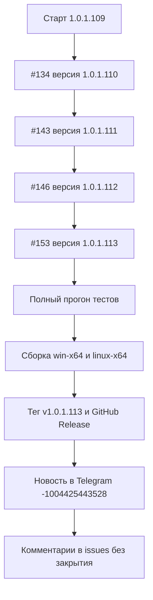

# План исправления открытых issues и выпуска 1.0.1.113

Дата: 2026-11-23. Репозиторий: `g:/h/Workspace1C/Workspace1C` (origin `https://github.com/sivatorov/Workspace1C.git`, ветка `main`). Корень воркспейса `g:/h/Workspace1C` git-репозиторием не является: все git/gh-команды выполнять с `cwd = g:/h/Workspace1C/Workspace1C`.

Текущая версия — **1.0.1.109** ([`Workspace1C.csproj`](../Workspace1C/Workspace1C.csproj:62)). Целевой выпуск — **1.0.1.113** после последовательного исправления четырёх issues.

## 1. Границы работы и правила выпуска

### 1.1. Issues в работе

| Issue | Последний комментарий | Автор последнего | Решение |
|---|---|---|---|
| **#134** Завершение процессов 1С | 2026-11-23T07:50:36Z | 7OH | **Цель** |
| **#143** Резервные копии средствами СУБД | 2026-11-23T08:55:06Z | RafaIS | **Цель** |
| **#146** Сломанное меню Утилиты | 2026-11-23T07:48:24Z | 7OH | **Цель** |
| **#153** Путаница в меню Действия | 2026-11-23T09:01:15Z | RafaIS | **Цель** |
| #139 Обрезано окно | последний — sivatorov | sivatorov | Пропустить |
| #136 Access to the path is denied | последний — sivatorov | sivatorov | Пропустить |

Issues **не закрывать**. Комментарий с версией и ссылкой на релиз добавляется только после публикации релиза (задача 8).

### 1.2. Трактовка версионирования

Требование «после каждого изменения изменять версию» и «финальный релиз — последняя версия» выполняется так:

1. **#134** → `1.0.1.110` — отдельный коммит, версия во всех четырёх полях csproj, раздел CHANGELOG, обновление README.
2. **#143** → `1.0.1.111` — отдельный коммит, версия, CHANGELOG, README.
3. **#146** → `1.0.1.112` — отдельный коммит, версия, CHANGELOG, README.
4. **#153** → `1.0.1.113` — отдельный коммит, версия, CHANGELOG, README, итоговые `rel_notes_1.0.1.113.md` и `docs/_telegram_msg_v1.0.1.113.txt`.

Промежуточные версии `1.0.1.110`–`1.0.1.112` **не тегируются и не публикуются** как GitHub Releases: это внутренние проверяемые сборки. Публикуется только финальный `v1.0.1.113`, в который входят все четыре исправления. Так соблюдаются оба требования: версия меняется после каждого исправления, а пользователь получает один релиз с полным набором исправлений.

Файл плана назван `plan-v1.0.1.110.md` как точка старта; фактический релиз — `1.0.1.113`.

### 1.3. Обязательные требования к каждой задаче

- Сначала исследовать код и воспроизвести причину, затем менять код; «косметические» правки запрещены.
- На каждое исправление — регрессионные тесты, которые падали бы без исправления.
- После каждого issue: увеличить только четвёртое число версии, обновить `CHANGELOG.md` и `README.md`.
- Issues не закрывать.
- Сборка — self-contained single-file: `win-x64` → `Workspace1C.exe`, `linux-x64` → `Workspace1C-linux-x64`.
- Релиз — GitHub Release по тегу `v1.0.1.113` с двумя asset-ами.
- После релиза — новость в Telegram-канал `-1004425443528`.

### 1.4. Общая схема



---

## 2. Задача 1 — issue #134. Фокус инспектора процессов

### 2.1. Последнее замечание

7OH, 2026-11-23T07:50:36Z: «Увы и ах - НЕТ. Открываю инспектор - нажимаю вниз - фокус на кнопке "Колонки".» Ранее, в комментарии 36: «При открытии окна - нажатие вниз срабатывает не с первого раза. После удаления процесса (2 раза ENTER) фокус всё ещё на кнопке "Колонки"».

Фикс 1.0.1.107 (`ProcessInspectorFocusPolicy`, 12 попыток по 120 мс, `FocusManager.SetFocusedElement`) не сработал.

### 2.2. Вероятная причина

1. **WPF: фокус ставится на `DataGrid`, а не на `DataGridCell`.** В [`ProcessInspectorWindow.xaml.cs`](../Workspace1C/Views/ProcessInspectorWindow.xaml.cs:161) `FocusGridWithRetry` вызывает `ProcessesGrid.Focus()` и `Keyboard.Focus(ProcessesGrid)`. В WPF клавиатурный фокус `DataGrid` обычно принадлежит ячейке; фокус на «оболочке» таблицы не делает `CurrentCell` валидной. Первое `↓` обрабатывает стандартная навигация WPF и переводит фокус на первый элемент вне таблицы — кнопку `ColumnsButton` ([`ProcessInspectorWindow.xaml`](../Workspace1C/Views/ProcessInspectorWindow.xaml:161)).
2. **Признак `_focusApplied` выставляется слишком рано.** `GotKeyboardFocus`/`FocusGridWithRetry` считают фокус установленным по `ProcessesGrid.IsKeyboardFocusWithin`, даже если фокус на контейнере таблицы, а не на ячейке. После этого повторные попытки прекращаются.
3. **`OnWindow_PreviewKeyDown` не перехватывает `↓`, если фокус уже внутри `DataGrid`, но вне ячейки.** Условие `ShouldRedirectNavigation(!ProcessesGrid.IsKeyboardFocusWithin, ...)` ([`ProcessInspectorWindow.xaml.cs`](../Workspace1C/Views/ProcessInspectorWindow.xaml.cs:227)) возвращает `false`, и клавиша уходит в стандартную навигацию.
4. **После завершения процесса фокус возвращается до/во время закрытия диалога.** `KillSelectedAndRestoreFocus` → `QueueGridFocusAfterKill` ([`ProcessInspectorWindow.xaml.cs`](../Workspace1C/Views/ProcessInspectorWindow.xaml.cs:302)) планирует фокус через `DispatcherPriority.Input`, а WPF после закрытия модального диалога восстанавливает фокус на кнопку, которая его открыла. При удалении последней строки таблица теряет фокус полностью.
5. **Avalonia: фокус ставится на `ListBox`, а не на `ListBoxItem`.** [`ProcessInspectorWindow.Avalonia.cs`](../Workspace1C/Views/ProcessInspectorWindow.Avalonia.cs:268) вызывает `_grid.Focus(NavigationMethod.Directional)`, но при `SelectedIndex = -1`/нереализованных контейнерах фокус может остаться на кнопке. `OnWindow_KeyDown` ([`ProcessInspectorWindow.Avalonia.cs`](../Workspace1C/Views/ProcessInspectorWindow.Avalonia.cs:325)) проверяет только `_grid.IsKeyboardFocusWithin`, а не фактический контейнер строки.

### 2.3. Что менять

- [`ProcessInspectorFocusPolicy.cs`](../Workspace1C/Services/ProcessInspectorFocusPolicy.cs:29): добавить чистые методы:
  - `ShouldHandleNavigationKey(bool gridHasFocus, bool currentCellIsValid, InspectorNavigationKey key)`;
  - `ShouldApplyFocusRetry(bool cellHasKeyboardFocus, int itemCount, int attempt)`;
  - `ResolveFocusTargetIndex(int selectedIndex, int itemCount)`.
- WPF [`ProcessInspectorWindow.xaml.cs`](../Workspace1C/Views/ProcessInspectorWindow.xaml.cs:161):
  - заменить `ProcessesGrid.Focus()`/`Keyboard.Focus(ProcessesGrid)` на `FocusFirstCell()`: выбрать строку 0, задать `CurrentCell`, вызвать `ScrollIntoView`, получить `DataGridCell` через `ItemContainerGenerator.ContainerFromIndex`, вызвать `cell.Focus()` и `Keyboard.Focus(cell)`;
  - `_focusApplied` выставлять только при `ProcessesGrid.CurrentCell.IsValid && ProcessesGrid.IsKeyboardFocusWithin`;
  - в `OnWindow_PreviewKeyDown` перенаправлять навигацию, если фокус не в ячейке (`!CurrentCell.IsValid`), а не только если он вне `DataGrid`;
  - после `KillSelectedAndRestoreFocus` ставить фокус через `DispatcherPriority.ApplicationIdle` и повторно — по `SelectionRestored`/`CollectionChanged`; для пустого списка оставлять фокус на `DataGrid` и не отдавать его кнопке;
  - не вызывать `Activate()` внутри обработчика `PreviewKeyDown` без необходимости; сначала пытаться синхронно перевести фокус в ячейку, затем повторять.
- Avalonia [`ProcessInspectorWindow.Avalonia.cs`](../Workspace1C/Views/ProcessInspectorWindow.Avalonia.cs:268):
  - `FocusGridAttempt` должен выбирать первый элемент и фокусировать `ListBoxItem` через `ContainerFromIndex(0)` (после `ScrollIntoView`), а не только `ListBox`;
  - `_focusApplied` — только при фокусе на контейнере строки;
  - `OnWindow_KeyDown` — перехватывать навигацию, если фокус не на `ListBoxItem`;
  - после kill — `Dispatcher.UIThread.Post` с приоритетом `Background`/`Loaded` и повтор по `SelectionRestored`.
- Обе платформы: `Ctrl+A` и `Enter` должны работать сразу после открытия и после kill; `Enter`/2×Enter не должны уводить фокус на кнопку.

### 2.4. Тесты

- Обновить [`Issue134ProcessInspectorFocusTests.cs`](../Workspace1C.Tests/Issue134ProcessInspectorFocusTests.cs:1) и [`Issue134ProcessInspectorFollowupTests.cs`](../Workspace1C.Tests/Issue134ProcessInspectorFollowupTests.cs:1): новые методы политики, проверки `CurrentCell`, `DataGridCell`, `ContainerFromIndex`, `DispatcherPriority.ApplicationIdle`.
- Добавить тест, что `ShouldHandleNavigationKey` возвращает `true` при фокусе на таблице без валидной ячейки.
- Ручная матрица (WPF и Avalonia): 0, 1 и много процессов; `↓` сразу после открытия; `Ctrl+A`; `Enter`; `2×Enter`; удаление последней строки; клик по «Колонки», затем `↓`; после автообновления списка.

### 2.5. Критерии готовности

- Первое `↓` после открытия перемещает по строкам, а не на «Колонки».
- После завершения процесса (включая последний) фокус в таблице, `↓`/`Ctrl+A` работают без клика мышью.
- Поведение одинаково в WPF и Avalonia; тесты зелёные.
- Версия `1.0.1.110`; записи в `CHANGELOG.md` и `README.md`; черновик `docs/_comment_134_v101113.md`.

---

## 3. Задача 2 — issue #143. Резервные копии средствами СУБД

### 3.1. Последнее замечание

RafaIS, 2026-11-23T08:55:06Z: «Проверил на 108 версии, желтая полоса пропала при открытии, кнопка Сохранить, Проверить.... вешает наглухо, ожидания 15 секунд, 30 секунд бесполезны, ждал по три минуты, приходится сбрасывать диспетчером задач. может какие настройки профиля старые влияют?»

Замечание относится к 1.0.1.108; в 1.0.1.109 уже есть часть фиксов, поэтому первым шагом задачи — воспроизвести на актуальном коде и зафиксировать, что осталось.

### 3.2. Вероятные причины

1. **Загрузка профиля на UI-потоке.** [`DbmsBackupViewModel.cs`](../Workspace1C/ViewModels/DbmsBackupViewModel.cs:71): `_data = data ?? DbmsBackupService.Load()`. Конструктор вызывается из [`MainViewModel.Features.cs`](../Workspace1C/ViewModels/MainViewModel.Features.cs:199) на UI-потоке. `DbmsBackupService.Load` → [`FeatureDataStore.Load`](../Workspace1C/Services/FeatureDataStore.cs:50) делает `File.Exists`/`File.ReadAllText` в каталоге профиля. Если профиль перенесён на сетевой/перенаправленный путь, окно может зависнуть ещё до показа или при первом обращении.
2. **Проверки вызываются на UI-потоке.** [`DbmsBackupViewModel.RunCheckAsync`](../Workspace1C/ViewModels/DbmsBackupViewModel.cs:448) вызывает `check(profile, CancellationToken.None)` напрямую. Асинхронный метод выполняет синхронную часть до первого `await` на UI-потоке: DNS-резолв, `TcpClient.ConnectAsync`, `Process.Start`/`pg_isready`/`sqlcmd` в [`DbmsBackupService.CheckConnectionAsync`](../Workspace1C/Services/DbmsBackupService.cs:297). `WaitAsync(CheckTimeout)` не спасает, если вызов не вернул `Task`; `CancellationToken.None` не отменяет работу.
3. **Сохранение и файловые операции без реальной отмены.** [`SaveAsync`](../Workspace1C/ViewModels/DbmsBackupViewModel.cs:342) использует `Task.Run(Save).WaitAsync(SaveTimeout)`, но [`Save`](../Workspace1C/ViewModels/DbmsBackupViewModel.cs:309) → [`FeatureDataStore.Save`](../Workspace1C/Services/FeatureDataStore.cs:65) не принимает `CancellationToken`; при зависании `File.WriteAllText`/`File.Move` фоновый поток остаётся занят, а `IsBusy` сбрасывается только по таймауту. Нужно проверить все вызовы `Save()` (включая `RunAsync` и возможные внешние вызовы), чтобы на UI-потоке не осталось синхронного пути.
4. **Проверка каталога игнорирует отмену.** [`CheckOutputDirectoryAsync`](../Workspace1C/Services/DbmsBackupService.cs:265) оборачивает `CheckOutputDirectoryCore` в `Task.Run`, но `CheckOutputDirectoryCore` не проверяет `CancellationToken`; `Directory.CreateDirectory`/`File.WriteAllText` на недоступном UNC могут висеть.
5. **Старые настройки профиля.** `DbmsBackupProfile` из `dbms_backups.json` может содержать `OutputDirectory`/`ToolsDirectory` на недоступный сетевой путь, `TimeoutMinutes = 0`, пустые/устаревшие поля. `Validate` проверяет только строки, поэтому профиль проходит валидацию и уходит в блокирующую операцию. Нужна нормализация/миграция и явная диагностика, а не молчаливое зависание.
6. **Слабые тесты.** [`Issue143ResponsivenessTests.cs`](../Workspace1C.Tests/Issue143ResponsivenessTests.cs:14) проверяет наличие строк в исходниках, а не фактическую отзывчивость. Нужны поведенческие тесты с блокирующей заглушкой.

### 3.3. Что менять

- [`DbmsBackupService.cs`](../Workspace1C/Services/DbmsBackupService.cs:124):
  - добавить `LoadAsync`/`SaveAsync` с `CancellationToken` и асинхронным `FileStream`;
  - `CheckOutputDirectoryAsync` должен принимать `ct` и проверять его до/после каждой файловой операции;
  - `CheckConnectionAsync` — не выполнять синхронную часть на вызывающем потоке: вызывающий оборачивает всю проверку в `Task.Run`;
  - `Validate`/`Normalize` — нормализовать старые профили (пути, таймаут, тип СУБД), не выполняя сетевых операций.
- [`DbmsBackupViewModel.cs`](../Workspace1C/ViewModels/DbmsBackupViewModel.cs:63):
  - убрать синхронный `Load()` из конструктора: либо принять уже загруженные данные, либо `InitializeAsync` с фоновой загрузкой;
  - `SaveAsync`: `await Task.Run(() => SaveCore(), cts.Token).WaitAsync(SaveTimeout, cts.Token)`, `SaveCore` не трогает UI и не пишет в лог напрямую; результат/ошибка логируются после `await` на UI-контексте;
  - `RunCheckAsync`: `await Task.Run(() => check(profile, cts.Token), cts.Token).Unwrap().WaitAsync(CheckTimeout, cts.Token)`; связанный `CancellationTokenSource` с `CancelAfter(CheckTimeout)`; таймаут должен реально отменять проверку;
  - `RunAsync`: убрать синхронный `Save` с UI-пути, использовать `SaveAsync`/`SaveCore` в фоне;
  - `IsBusy`/`IsIdle` менять только на UI-контексте.
- [`DbmsBackupWindow.cs`](../Workspace1C/Views/DbmsBackupWindow.cs:81) и [`DbmsBackupWindow.Avalonia.cs`](../Workspace1C/Views/DbmsBackupWindow.Avalonia.cs:88):
  - все кнопки — `async` обработчики без `.Result`/`.Wait()`;
  - окно открывается сразу, загрузка профиля — в фоне с индикатором;
  - при таймауте — понятное сообщение `Dbms.SaveTimeout`/`Dbms.CheckTimeout`, кнопки снова активны.
- [`FeatureDataStore.cs`](../Workspace1C/Services/FeatureDataStore.cs:65): добавить перегрузки с `CancellationToken`/асинхронной записью; не менять формат JSON.
- [`MainViewModel.Features.cs`](../Workspace1C/ViewModels/MainViewModel.Features.cs:199) и Avalonia-аналог: загрузку `DbmsBackupData` выполнять до показа окна в фоне или передавать в VM уже загруженные данные.

### 3.4. Тесты

- Заменить/дополнить `Issue143ResponsivenessTests` поведенческими тестами:
  - `SaveAsync` возвращает управление не позже таймаута при блокирующем saver; `IsBusy` сбрасывается; UI-поток не блокируется (проверка через отдельный `SynchronizationContext`/`Task.Run` + `Stopwatch`);
  - `CheckConnectionAsync`/`CheckDirectoryAsync` возвращают таймаут при блокирующей заглушке `RunToolOverride`/файловой операции; `CancellationToken` доходит до заглушки;
  - загрузка профиля не выполняется в конструкторе на UI-потоке (source + behavior с счётчиком вызовов);
  - старый `dbms_backups.json` без новых полей и с недоступным `OutputDirectory` загружается без исключения, показывает диагностику;
  - `ProcessRunner` не ждёт вывод бесконечно (уже есть `OutputDrainTimeout`, проверить регрессию).
- Ручная проверка: профиль на локальном диске, на сетевом пути, с недоступным каталогом; «Сохранить», «Проверить подключение», «Проверить каталог», «Сделать копию сейчас», «Отмена», закрытие окна во время операции; Windows и Linux.

### 3.5. Критерии готовности

- Открытие окна не блокирует UI; старый профиль не приводит к зависанию.
- «Сохранить» завершается успехом или сообщением о таймауте не позже 15 с; проверки — не позже 30 с; окно остаётся отзывчивым, «Отмена» работает.
- Ни одна операция окна не выполняет файловый/сетевой/процессный вызов на UI-потоке.
- Версия `1.0.1.111`; CHANGELOG/README; черновик `docs/_comment_143_v101113.md`.

---

## 4. Задача 3 — issue #146. Меню «Утилиты»

### 4.1. Последние замечания

7OH, 2026-11-23T07:48:24Z:

1. «Иконка в правке группы и иконка в отображаемой структуре - одинаковые. Справа в настройке иконки - уже вторая иконка. В самом отображаемом меню - вообще третья иконка. А должная быть одна везде.»
2. «И, не смотря на настройку "С надписью" - подменю на панели отображается просто иконкой.»
3. «Добавленная для теста группа верхнего уровня ... После сохранения не отображается, а почему-то автоматом переносится в группу "Утилиты". Добиться нескольких групп, как без правки меню - не выходит.»

### 4.2. Вероятные причины

1. **Новая группа верхнего уровня мигрирует в «Утилиты».** [`UtilitiesMenuLayouts.MoveUserRootNodesIntoUtilities`](../Workspace1C/Services/UtilitiesMenuCatalog.cs:1192) переносит любой корневой узел, для которого [`IsMovableUserRootNode`](../Workspace1C/Services/UtilitiesMenuCatalog.cs:1250) вернул `true`. Группа, созданная [`AddGroup`](../Workspace1C/ViewModels/UtilitiesMenuEditorViewModel.cs:363), имеет `GroupId = null` и попадает в `movable`. [`NeedsMigration`](../Workspace1C/Services/UtilitiesMenuCatalog.cs:1269) возвращает `true` при наличии такого корневого узла, поэтому перенос повторяется при каждой загрузке/сохранении. Отсюда «после сохранения не отображается, а переносится в Утилиты» и невозможность нескольких групп верхнего уровня.
2. **Планировщик кнопок не знает пользовательские группы верхнего уровня.** [`UtilitiesSectionMenuPlanner.Build`](../Workspace1C/Services/UtilitiesMenuCatalog.cs:1607) добавляет кнопки только для `IsSectionGroupId` (стандартные разделы). Группа с `GroupId = null` не даёт кнопку; если в компоновке есть стандартные разделы, пользовательская группа вообще не видна на панели, а если разделов нет — открывается одна кнопка «Утилиты» с полной компоновкой.
3. **Открытие раздела идёт по `GroupId`, а у пользовательской группы его нет.** [`UtilitiesMenuLayouts.ExtractSection`](../Workspace1C/Services/UtilitiesMenuCatalog.cs:1434) ищет раздел по `GroupId`; для `GroupId = null` вернёт `null`. Нужен стабильный идентификатор узла (`NodeId`) и извлечение по нему.
4. **Кнопки панели всегда только с иконкой.** WPF: статические кнопки `ServersSectionButton`/`MaintenanceSectionButton`/`ToolsSectionButton`/`MoreSectionButton`/`UtilitiesFallbackButton` и [`UpdateSectionButtonsVisibility`](../Workspace1C/Views/MainWindow.UtilitiesMenu.cs:480) только переключают видимость, не применяют `DisplayMode`. Avalonia: [`TopBarIconButton`](../Workspace1C/Views/MainWindow.Avalonia.cs:1128) всегда иконка + tooltip. Настройка «С надписью» применяется только к пунктам внутри меню ([`AppendNodes`](../Workspace1C/Views/MainWindow.UtilitiesMenu.cs:124)), но не к кнопке раздела на панели.
5. **Иконки рисуются разными путями.**
   - Правка группы WPF: [`UtilitiesGroupEditWindow.xaml`](../Workspace1C/Views/UtilitiesGroupEditWindow.xaml:57) использует `IconKeyToGeometryConverter`, который отображает PackIcon-ключ на геометрию.
   - Дерево редактора: [`DisplayIconGeometryKey`](../Workspace1C/ViewModels/UtilitiesMenuEditorViewModel.cs:810) заранее отображает ключ на `Icon*`.
   - Реальное меню WPF: [`CreateMenuIcon`](../Workspace1C/Views/MainWindow.UtilitiesMenu.cs:240) отображает ключ на геометрию, **но** для `GroupNewItems` есть особый путь [`GroupIcon`](../Workspace1C/Views/MainWindow.UtilitiesMenu.cs:163), который рисует MaterialDesign `PackIcon` (`CreateRowMenuIcon`), а не геометрию.
   - Редактор Avalonia: [`BuildIconRow`](../Workspace1C/Views/UtilitiesMenuEditorWindow.Avalonia.cs:356) вызывает `IconHelper.MakeIcon(option.Key)` без отображения PackIcon → `Icon*`; для ключей каталога вроде `Apps`/`NewBox` геометрия не находится и показывается пустая/запасная иконка. В [`UtilitiesGroupEditWindow.Avalonia.cs`](../Workspace1C/Views/UtilitiesGroupEditWindow.Avalonia.cs:179) отображение уже делается правильно.
   - Итог: в правке группы, дереве, поле выбора и реальном меню могут быть три разные иконки.

### 4.3. Что менять

1. **Модель компоновки.**
   - [`UtilitiesMenuLayout.cs`](../Workspace1C/Models/UtilitiesMenuLayout.cs:39): добавить `NodeId` (стабильный идентификатор пользовательской группы) и `IsTopLevel`/`Section` (явный признак группы верхнего уровня). Поднять `CurrentSchemaVersion` до 5.
   - `AddGroup` при `parent is null` выставляет `IsTopLevel = true` и генерирует `NodeId`; при вложении — `IsTopLevel = false`.
   - `ToNode`/`BuildTree` сохраняют новые поля.
2. **Миграция.**
   - `MoveUserRootNodesIntoUtilities` выполняет перенос только для легаси-схем (до появления явного `IsTopLevel`) и **не трогает** узлы с `IsTopLevel = true`.
   - `NeedsMigration` не должен возвращать `true` только из-за нового корневого пользовательского узла с `IsTopLevel = true`.
   - `IsMovableUserRootNode` возвращает `false` для `IsTopLevel = true`.
   - Сохранить совместимость старых файлов: группы без `IsTopLevel` из схем < 5 по-прежнему переносятся один раз.
3. **Планировщик и открытие разделов.**
   - `UtilitiesSectionMenuPlanner.Build` возвращает кнопку для каждого видимого корневого `group`: стандартный раздел — по `GroupId`, пользовательский — по `NodeId`/`CustomTitle`; `UtilitiesSectionButton` получает `NodeId`, `Title`, `IsCustom`.
   - Добавить `ExtractSectionByNodeId` (или перегрузку `ExtractSection(layout, UtilitiesMenuNode)`) и использовать её в WPF [`BuildUtilitiesMenu`](../Workspace1C/Views/MainWindow.UtilitiesMenu.cs:39) и Avalonia [`BuildUtilitiesMenu`](../Workspace1C/Views/MainWindow.Avalonia.Tree.cs:2704).
   - WPF: заменить статический набор кнопок на динамическую панель, которая перестраивается по `UtilitiesMenuEvents.LayoutChanged`; каждая кнопка открывает свой раздел/группу. Сохранить стандартные кнопки и их порядок.
   - Avalonia: `BuildSectionButtons` уже динамический — добавить пользовательские группы и открытие по `NodeId`.
4. **Режим «С надписью» на панели.**
   - Для кнопки раздела использовать `UtilitiesMenuGroupPresentation.Build(node, title, isTopLevel: true)`.
   - `ShowLabel = true` → кнопка с иконкой и подписью; `ShowLabel = false` → только иконка + tooltip.
   - Стандартные разделы по умолчанию оставить компактными (`DisplayMode = Icon` в `UtilitiesMenuLayouts.Default`), чтобы не менять текущий вид; пользователь может явно выбрать «С надписью» в редакторе. Пользовательские группы по умолчанию — `IconWithLabel`.
   - Убедиться, что `ExtractSection` не превращает вложенные группы в «верхнеуровневые»: при открытии раздела передавать `isTopLevel: false` для его детей, чтобы подписи вложенных групп не терялись.
5. **Единая иконка.**
   - Добавить в `UtilitiesIconOption` вычисляемый `GeometryKey => UtilitiesMenuCatalog.WpfIconGeometryKey(Key)` и использовать его во всех превью.
   - WPF `UtilitiesGroupEditWindow.xaml` — привязывать `Path.Data` к `GeometryKey` (или оставить конвертер, но он уже отображает; проверить, что выбранный `Key` — эффективный).
   - Avalonia `UtilitiesMenuEditorWindow.BuildIconRow` — использовать `WpfIconGeometryKey(option.Key)` перед `IconHelper.MakeIcon`.
   - Убрать особый путь `GroupNewItems` в `MainWindow.UtilitiesMenu.GroupIcon`: рисовать через `UtilitiesMenuGroupPresentation`/`CreateMenuIcon`, как остальные группы.
   - `UtilitiesMenuNodeItem.EffectiveIconKey` нормализовать: если сохранённый ключ не резолвится, возвращать стандартный ключ группы/каталога; `HasDisplayIcon` проверять по `DisplayIconGeometryKey`.
   - Все четыре поверхности (правка группы, дерево, поле выбора, реальное меню) и обе платформы должны использовать один резолвер.

### 4.4. Тесты

- [`Issue146UtilitiesMenuTests.cs`](../Workspace1C.Tests/Issue146UtilitiesMenuTests.cs:19):
  - новая группа верхнего уровня с `IsTopLevel = true` после `Save`/`Load`/`Migrate` остаётся в корне и не попадает в `GroupUtilities`;
  - можно создать и сохранить несколько групп верхнего уровня;
  - старый layout (схема < 5) по-прежнему мигрирует пользовательские узлы в «Утилиты» один раз;
  - `UtilitiesSectionMenuPlanner.Build` возвращает кнопки для стандартных и пользовательских групп, скрытые не возвращает;
  - `ExtractSectionByNodeId` открывает пользовательскую группу.
- [`Issue146GroupDisplayModeTests.cs`](../Workspace1C.Tests/Issue146GroupDisplayModeTests.cs:16): `ShowLabel` для кнопки панели и для подменю; стандартные разделы по умолчанию `Icon`, пользовательские — `IconWithLabel`; явный выбор сохраняется.
- Новый тест иконок: для всех `UtilitiesMenuEditorViewModel.BuildCatalogIcons()` `WpfIconGeometryKey(Key)` непуст; `IconHelper`/`IconKeyToGeometryConverter`/`CreateMenuIcon` дают одинаковый ключ геометрии; `GroupNewItems` больше не использует отдельный PackIcon-путь.
- Source-тесты: WPF/Avalonia используют `UtilitiesMenuGroupPresentation` для кнопок разделов; `AddGroup` выставляет `IsTopLevel`; `MoveUserRootNodesIntoUtilities` не трогает `IsTopLevel`.

### 4.5. Критерии готовности

- Иконка группы одинакова в правке группы, дереве, поле выбора и реальном меню; на Windows и Linux.
- «С надписью» реально применяется к кнопке раздела/подменю на панели; «Иконка» — только иконка с tooltip.
- Новая группа верхнего уровня после сохранения остаётся отдельной группой, не переносится в «Утилиты»; можно создать несколько групп верхнего уровня без ручной правки JSON.
- Старые компоновки мигрируют без потери пользовательских настроек.
- Версия `1.0.1.112`; CHANGELOG/README; черновик `docs/_comment_146_v101113.md`.

---

## 5. Задача 4 — issue #153. Разные учётные записи одной базы

### 5.1. Последнее замечание

RafaIS, 2026-11-23T09:01:15Z: «проверил на 108, при запуске любой базы индикатор появляется СРАЗУ на двух строках и щелчок на любой строке только открывает существующее окно, но не запускает другую базу (под другой учеткой). ... На вкладке запущенные "всплыла" еще одна "лишняя" база ) хотя запущена лишь одна».

### 5.2. Вероятная причина

1. [`FindDirectOwners`](../Workspace1C/Services/RunningInfobaseMatcher.cs:162) возвращает **все** записи с одинаковым подключением.
2. [`MatchProcesses`](../Workspace1C/Services/RunningInfobaseMatcher.cs:558) добавляет один и тот же процесс ко всем владельцам. В результате [`ApplyRunningProcesses`](../Workspace1C/ViewModels/MainViewModel.Running.cs:94) ставит `IsRunning`/`IsEnterpriseRunning` обеим записям.
3. Обработчик двойного клика [`ActivateInfobaseByDoubleClickAction`](../Workspace1C/Views/MainWindow.Events.cs:591) видит у второй записи `IsEnterpriseRunning = true` и вызывает [`ActivateRunningEnterpriseOrLaunch`](../Workspace1C/Views/MainWindow.Events.cs:692) вместо запуска нового экземпляра под её учётными данными.
4. Вкладка «Запущенные» фильтрует по `IsRunning` ([`MainViewModel.Launch.cs`](../Workspace1C/ViewModels/MainViewModel.Launch.cs:424)), поэтому показывает обе записи.
5. Тест 1.0.1.107 [`Issue153SharedConnectionTests`](../Workspace1C.Tests/Issue153SharedConnectionTests.cs:34) закрепил неверное поведение: «обе записи получают процесс». Его нужно переписать.

### 5.3. Что менять

- В [`RunningInfobaseMatcher.cs`](../Workspace1C/Services/RunningInfobaseMatcher.cs:162):
  - оставить `FindDirectOwners` для диагностики/инспектора, но **не использовать его напрямую** для индикатора запуска;
  - добавить чистую функцию `SelectOwnerForProcess(IReadOnlyList<Infobase> candidates, string commandLine, Func<Infobase, string?> resolveEnterpriseUser)`:
    1. извлечь `/N` через [`ProcessCommandLineUserParser.ExtractUserName`](../Workspace1C/Services/ProcessCommandLineUserParser.cs:24);
    2. если `/N` задан — выбрать записи, у которых эффективный пользователь Предприятия совпадает (без учёта регистра, с trim/кавычками); если одна — вернуть её; если несколько — детерминированно первую по ключу базы;
    3. если `/N` нет — выбрать записи с авторизацией ОС (`AuthenticationMode.Windows`/`UseOsAuthentication`) или без явных учётных данных; если одна — вернуть её; иначе — первую;
    4. никогда не возвращать больше одной записи на процесс.
  - эффективного пользователя получать через [`InfobaseAuthResolver.Resolve`](../Workspace1C/Services/InfobaseAuthResolver.cs:89) с `OneCLaunchMode.Enterprise` (учитывать `EnterpriseAuth`, `Connection`, общую авторизацию). Если резолвер недоступен в чистом матчере — передавать делегат из `MainViewModel`, чтобы не тянуть UI/статические настройки в сервис.
  - `MatchProcesses` использует `SelectOwnerForProcess`; fallback `FindOwner` — только если кандидатов нет.
- [`MainViewModel.Running.cs`](../Workspace1C/ViewModels/MainViewModel.Running.cs:94): после матчинга каждая запись получает только свой процесс; `IsRunning`/`IsEnterpriseRunning`/`IsConfiguratorRunning` считаются по её собственному списку. Убедиться, что `before/after` для режима «Только запущенные» использует ключ базы, а не `Id` (сейчас `after` строится по `i.Id` — у баз без Id это ломает сравнение).
- [`MainWindow.Events.cs`](../Workspace1C/Views/MainWindow.Events.cs:591) и [`MainViewModel.Launch.cs`](../Workspace1C/ViewModels/MainViewModel.Launch.cs:232): проверить, что активация существующего окна выполняется только для той записи, у которой `IsEnterpriseRunning` истинно; для второй записи — обычный запуск с её учётными данными. Аудит `TryActivateConfiguratorWindow`/`GetRunningWindows` на предмет смешивания записей одной базы.
- Не менять `FindDirectOwners` публичную сигнатуру без необходимости; если она больше не нужна для индикатора, пометить комментарием «только диагностика».

### 5.4. Тесты

- Переписать [`Issue153SharedConnectionTests.cs`](../Workspace1C.Tests/Issue153SharedConnectionTests.cs:14):
  - процесс без `/N` → только запись с авторизацией ОС;
  - процесс `/N "Салихов Администратор"` → только запись с явными учётными данными;
  - два процесса под разными учётками → у каждой записи ровно один процесс;
  - дубликат записи с тем же `Id` не даёт дублей;
  - разные подключения не смешиваются;
  - `/N` с пробелами/кавычками/в разном регистре;
  - запись с `Prompt`/неизвестным пользователем — детерминированный fallback.
- Добавить тест `MatchProcesses` «один процесс — максимум одна запись» и тест `ApplyRunningProcesses` (если возможно с фейковым сервисом) «вкладка Запущенные содержит одну строку».
- Source-тест: `ActivateInfobaseByDoubleClickAction` не активирует окно по общему флагу, а использует флаг текущей записи.

### 5.5. Критерии готовности

- Индикатор запуска — только у той записи, под чьими учётными данными запущен процесс.
- Щелчок по второй записи запускает новый экземпляр под её учётными данными, а не активирует чужое окно.
- На вкладке «Запущенные» нет дублей: одна запущенная база — одна строка.
- Несколько процессов одной базы под разными учётками корректно распределяются по записям.
- Версия `1.0.1.113`; CHANGELOG/README; итоговые `rel_notes_1.0.1.113.md` и `docs/_telegram_msg_v1.0.1.113.txt`; черновик `docs/_comment_153_v101113.md`.

---

## 6. Задача 5 — полный прогон тестов и сборка артефактов

### 6.1. Проверки перед сборкой

- Убедиться, что версия `1.0.1.113` во всех четырёх полях [`Workspace1C.csproj`](../Workspace1C/Workspace1C.csproj:62), в бейдже и тексте [`README.md`](../Workspace1C/README.md:3), в разделе [`CHANGELOG.md`](../Workspace1C/CHANGELOG.md:14), в `rel_notes_1.0.1.113.md`.
- Полный прогон тестов (как в CI):
  - `dotnet test "Workspace1C.Tests/Workspace1C.Tests.csproj" -c Release -p:RuntimeIdentifier= -p:SelfContained=false -p:PublishSingleFile=false`
  - при необходимости локально: `dotnet test Workspace1C.slnx -c Debug`.
- Зафиксировать фактическое число тестов в CHANGELOG/README (не выдумывать; взять из вывода).

### 6.2. Windows

Из `g:/h/Workspace1C/Workspace1C/Workspace1C`:

```powershell
pwsh ./build-windows-single-file.ps1 -Configuration Release
```

Результат: `dist/win-x64/Workspace1C.exe`. Проверить `FileVersion` = `1.0.1.113`, запуск и открытие главного окна.

### 6.3. Linux

Авторитетная сборка — CI на `ubuntu-latest` по тегу/`workflow_dispatch`:

```bash
cd Workspace1C
./build-linux-single-file.sh Release
```

Результат: `dist/linux-x64/Workspace1C`; в релиз кладётся как `Workspace1C-linux-x64`. Локально на Windows допустима кросс-сборка `FORCE_LINUX=1 ./build-linux-single-file.sh`, но запуск проверяется только на Linux/в CI. Smoke-тест workflow — 15 секунд под `xvfb` (см. [`release.yml`](../.github/workflows/release.yml:229)).

### 6.4. Критерии готовности

- Полный прогон зелёный; падений нет.
- Оба бинаря собраны, версии совпадают, Windows-бинарь открывает окно, Linux-бинарь проходит smoke-тест.
- Артефакты готовы к публикации; тег ещё не создан.

### 6.5. Выполнено (2026-11-23)

- Версия `1.0.1.113` подтверждена во всех четырёх полях [`Workspace1C.csproj`](../Workspace1C/Workspace1C.csproj:62), в [`README.md`](../README.md:3), в верхнем разделе [`CHANGELOG.md`](../CHANGELOG.md:14) и в `rel_notes_1.0.1.113.md`; расхождений не было.
- Полный прогон `dotnet test Workspace1C.Tests/Workspace1C.Tests.csproj -c Release -p:RuntimeIdentifier= -p:SelfContained=false -p:PublishSingleFile=false` — **7856** тестов, **0** падений, **0** пропущено (4 м 27 с). Лог: `docs/_test_101113.log`.
- Windows: `build-windows-single-file.ps1 -Configuration Release` → `dist/win-x64/Workspace1C.exe`, 85 646 527 Б (81,68 МБ), `FileVersion` = `1.0.1.113`, `ProductVersion` = `1.0.1.113+474dfb65…`. Лог: `docs/_build_win_101113.log`.
- Linux: кросс-сборка `build-linux-single-file.ps1 -Configuration Release` (`-p:ForceLinux=true`, linux-x64) → `dist/linux-x64/Workspace1C`, 53 939 117 Б (51,44 МБ), ошибок компиляции нет. Лог: `docs/_build_linux_101113.log`. Запуск/smoke-тест Linux-бинаря — только в CI на `ubuntu-latest` (локально Linux-рантайма нет).
- Smoke-проверка Windows-бинаря: `Workspace1C.exe --list` → код 0 и список баз из профиля (лог `docs/_smoke_win_101113.txt`). Открытие главного окна локально не проверялось: уже запущен экземпляр 1.0.1.109, сработал single-instance-гейт (новый процесс передал активацию и завершился с кодом 0).
- `dist/` в `.gitignore`, поэтому артефакты в репозиторий не попадают; тег и релиз не создавались.

---

## 7. Задача 6 — GitHub Release `v1.0.1.113`

### 7.1. Подготовка

- `rel_notes_1.0.1.113.md` — сводный текст по #134, #143, #146, #153 (workflow берёт его, если файл есть; иначе — раздел CHANGELOG).
- `docs/_telegram_msg_v1.0.1.113.txt` — короткий анонс со ссылкой на релиз.
- Коммит всех изменений и `git push origin main` из `g:/h/Workspace1C/Workspace1C`.

### 7.2. Тег и workflow

```powershell
cd g:/h/Workspace1C/Workspace1C
git tag v1.0.1.113
git push origin v1.0.1.113
```

Альтернатива при необходимости пересборки:

```powershell
gh workflow run release.yml -f tag=v1.0.1.113
```

Workflow [`release.yml`](../.github/workflows/release.yml:19) собирает Windows и Linux, создаёт GitHub Release, прикрепляет `Workspace1C.exe` и `Workspace1C-linux-x64`, затем выполняет шаг «Новость в Telegram».

### 7.3. Проверка

- `gh run list --workflow release.yml --limit 1` и `gh run watch <id>` — jobs `windows`, `linux`, `release` успешны.
- `gh release view v1.0.1.113 --json tagName,name,isLatest,assets,body`:
  - `tagName = v1.0.1.113`, `isLatest = true`;
  - assets: `Workspace1C.exe`, `Workspace1C-linux-x64`;
  - body содержит исправления всех четырёх issues.
- Скачать оба asset-а, проверить размеры и версию Windows-бинаря; Linux — smoke-тест в CI.
- При падении — прочитать лог job, исправить, повторить `workflow_dispatch` с тем же тегом (workflow перезаписывает asset-ы).

### 7.4. Критерии готовности

- GitHub Release `v1.0.1.113` опубликован, помечен latest, оба asset-а на месте и скачиваются.
- Текст релиза соответствует фактическим изменениям.

---

## 8. Задача 7 — новость в Telegram

### 8.1. Штатный путь

Workflow уже содержит шаг «Новость в Telegram» ([`release.yml`](../.github/workflows/release.yml:334)):

- канал зафиксирован: `-1004425443528`;
- токен — секрет `TELEGRAM_BOT_TOKEN` (в прогоне 1.0.1.109 секрет задан, шаг вернул `Telegram HTTP 200`, `"ok":true`);
- текст — `docs/_telegram_msg_v1.0.1.113.txt` (или `docs/_telegram_msg_1.0.1.113.txt`);
- если файла нет — первые строки `rel_notes`/CHANGELOG и ссылка на релиз.

### 8.2. Проверка

- В логе job `release` найти `Текст новости: docs/_telegram_msg_v1.0.1.113.txt`, `Telegram HTTP 200`, `"ok":true`.
- Убедиться, что сообщение появилось в канале и содержит ссылку `https://github.com/sivatorov/Workspace1C/releases/tag/v1.0.1.113`.

### 8.3. Резервный путь

Если шаг пропущен/упал:

```powershell
cd g:/h/Workspace1C/Workspace1C
pwsh ./tools/publish-release.ps1 -Version 1.0.1.113
```

Скрипт берёт токен из `WORKSPACE1C_TG_BOT_TOKEN` или `notifications.json` активного профиля и отправляет `sendMessage` в `-1004425443528`. Альтернатива — прямой Bot API `sendMessage` с `chat_id=-1004425443528`. Не отправлять повторно, если автоматический шаг уже дал `ok:true`.

### 8.4. Критерии готовности

- Новость в канале `-1004425443528` опубликована один раз, со ссылкой на релиз.
- Дублей нет.

---

## 9. Задача 8 — комментарии в issues

После успешного релиза добавить по одному комментарию в #134, #143, #146, #153 из черновиков:

- `docs/_comment_134_v101113.md`
- `docs/_comment_143_v101113.md`
- `docs/_comment_146_v101113.md`
- `docs/_comment_153_v101113.md`

Команды:

```powershell
cd g:/h/Workspace1C/Workspace1C
gh issue comment 134 -F docs/_comment_134_v101113.md
gh issue comment 143 -F docs/_comment_143_v101113.md
gh issue comment 146 -F docs/_comment_146_v101113.md
gh issue comment 153 -F docs/_comment_153_v101113.md
```

В каждом комментарии:

- версия `1.0.1.113` и ссылка на релиз;
- что именно исправлено (по последнему замечанию);
- что проверить пользователю;
- issues **не закрывать**.

#139 и #136 не комментировать: последний комментарий там мой, они вне цели.

### 9.1. Критерии готовности

- Во всех четырёх issues есть комментарий с версией и ссылкой на релиз.
- Issues остаются открытыми.
- #139/#136 не тронуты.

---

## 10. Риски и меры

| Риск | Проявление | Мера |
|---|---|---|
| Расхождение версий | csproj/README/CHANGELOG/тег/asset-ы называют разные версии | Единый чек-лист версии в задаче 5; проверка `FileVersion` и `gh release view` |
| WPF-фокус не воспроизводится тестами | Тесты зелёные, пользователь снова видит «Колонки» | Фокусировать именно `DataGridCell`/`ListBoxItem`, а не контейнер; ручная матрица WPF/Avalonia; повтор после `ApplicationIdle` |
| Скрытая синхронная блокировка UI | Таймауты не срабатывают, окно висит | Обернуть всю операцию в `Task.Run`, связанный `CancellationTokenSource`, `WaitAsync`; поведенческие тесты с блокирующей заглушкой |
| Старый профиль ломает загрузку | Окно не открывается/зависает | Асинхронная загрузка, нормализация старых полей, диагностика вместо молчаливого зависания |
| Миграция меню снова переносит группы | Новая группа верхнего уровня исчезает | Явный `IsTopLevel`/`NodeId`, миграция только легаси-схем, тест save/load |
| Разные иконки | Пользователь видит «вторую/третью» иконку | Единый резолвер `WpfIconGeometryKey` + `UtilitiesMenuGroupPresentation`, тест на все поверхности |
| Неверное сопоставление учёток | Индикатор не на той записи или не запускается вторая учётка | Чистая функция `SelectOwnerForProcess`, тесты на `/N`, OS-auth, Prompt, несколько процессов |
| Linux-сборка недоступна локально | Не проверить Linux-бинарь на Windows | Авторитетная сборка и smoke-тест в CI; локально — только `FORCE_LINUX=1` для проверки компиляции |
| Дубли новости в Telegram | Два сообщения | Сначала проверить автоматический шаг; ручную отправку выполнять только при отсутствии `ok:true` |
| Комментарии до релиза | Ссылка на несуществующий релиз | Комментарии — только задача 8 после `gh release view` |

---

## 11. Итоговый чек-лист готовности

- [ ] #134: первое `↓` и `Ctrl+A` работают сразу после открытия; после kill фокус в таблице; WPF и Avalonia; тесты.
- [ ] #143: окно не блокируется; «Сохранить» ≤ 15 с, проверки ≤ 30 с; старый профиль не вешает; тесты.
- [ ] #146: единая иконка везде; «С надписью» на панели; новая группа верхнего уровня сохраняется; несколько групп; тесты.
- [ ] #153: индикатор только у правильной записи; вторая учётка запускается; нет дублей на «Запущенных»; тесты.
- [x] Версия `1.0.1.113` в csproj (4 поля), README, CHANGELOG, rel_notes, Telegram-тексте.
- [x] Полный прогон тестов зелёный; число тестов зафиксировано (7856, 0 падений, 0 пропущено).
- [x] Собраны `Workspace1C.exe` и `Workspace1C-linux-x64`, версии совпадают (Linux — кросс-сборка; smoke-тест в CI).
- [ ] GitHub Release `v1.0.1.113` с двумя asset-ами и корректным текстом.
- [ ] Новость в Telegram `-1004425443528` (`ok:true`, без дублей).
- [ ] Комментарии в #134/#143/#146/#153; issues открыты; #139/#136 не тронуты.

---

## 12. Декомпозиция на отдельные задачи

Каждый пункт — отдельный `new_task` в режиме `code`. Задачи выполняются строго по порядку; каждая следующая опирается на предыдущую.

### Задача 1. issue #134 — фокус инспектора процессов → 1.0.1.110

**Режим:** `code`.
**Что сделать:** реализовать раздел 2 плана; изменить `ProcessInspectorFocusPolicy`, `ProcessInspectorWindow.xaml.cs`, `ProcessInspectorWindow.Avalonia.cs`; обновить тесты #134; версия `1.0.1.110`; CHANGELOG/README; черновик `docs/_comment_134_v101113.md`; коммит и push `main` (без тега).
**Проверка:** `dotnet test` по затронутым тестам + полный прогон перед коммитом; ручная проверка WPF (и Avalonia, если доступна).

### Задача 2. issue #143 — отзывчивость окна резервных копий СУБД → 1.0.1.111

**Режим:** `code`.
**Что сделать:** реализовать раздел 3; изменить `DbmsBackupViewModel`, `DbmsBackupService`, `FeatureDataStore`, окна WPF/Avalonia, `MainViewModel.Features`/Avalonia-аналог; поведенческие тесты; версия `1.0.1.111`; CHANGELOG/README; черновик `docs/_comment_143_v101113.md`; коммит и push.
**Проверка:** тесты с блокирующими заглушками; ручная проверка локального/сетевого профиля.

### Задача 3. issue #146 — меню «Утилиты» → 1.0.1.112

**Режим:** `code`.
**Что сделать:** реализовать раздел 4; изменить `UtilitiesMenuLayout`, `UtilitiesMenuCatalog`, `UtilitiesMenuResolver`, `UtilitiesMenuEditorViewModel`, `UtilitiesSectionMenuPlanner`, `MainWindow.UtilitiesMenu.cs`, `MainWindow.Avalonia.cs`/`.Tree.cs`, `UtilitiesGroupEditWindow` (WPF/Avalonia), `UtilitiesMenuEditorWindow.Avalonia.cs`; тесты; версия `1.0.1.112`; CHANGELOG/README; черновик `docs/_comment_146_v101113.md`; коммит и push.
**Проверка:** тесты миграции/планировщика/иконок; ручная проверка WPF и Avalonia.

### Задача 4. issue #153 — разные учётные записи одной базы → 1.0.1.113

**Режим:** `code`.
**Что сделать:** реализовать раздел 5; изменить `RunningInfobaseMatcher`, `MainViewModel.Running.cs`, при необходимости `MainWindow.Events.cs`/`MainViewModel.Launch.cs`; переписать `Issue153SharedConnectionTests`; версия `1.0.1.113`; CHANGELOG/README; `rel_notes_1.0.1.113.md`; `docs/_telegram_msg_v1.0.1.113.txt`; черновик `docs/_comment_153_v101113.md`; коммит и push.
**Проверка:** тесты сопоставления; ручная проверка двух записей одной базы.

### Задача 5. Полный прогон тестов и сборка артефактов

**Режим:** `code`.
**Что сделать:** выполнить раздел 6; полный `dotnet test`; собрать Windows `build-windows-single-file.ps1`; проверить Linux-сборку в CI/локально; проверить `FileVersion`; зафиксировать число тестов; при необходимости поправить тесты/документацию; коммит и push.
**Проверка:** оба бинаря существуют, версия `1.0.1.113`, Windows открывает окно, Linux smoke-тест.

**Статус: выполнено** — см. раздел 6.5. Тесты: 7856/7856 зелёные. Артефакты:
`dist/win-x64/Workspace1C.exe` (81,68 МБ, `FileVersion` 1.0.1.113) и
`dist/linux-x64/Workspace1C` (51,44 МБ, кросс-сборка без ошибок). Тег и релиз не создавались.

### Задача 6. GitHub Release `v1.0.1.113`

**Режим:** `code`.
**Что сделать:** выполнить раздел 7; проверить `rel_notes_1.0.1.113.md`; поставить тег `v1.0.1.113`; push тега; дождаться workflow; проверить `gh release view` и оба asset-а; при падении — исправить и перезапустить.
**Проверка:** release latest, assets на месте, текст корректен.

### Задача 7. Новость в Telegram

**Режим:** `code`.
**Что сделать:** выполнить раздел 8; проверить автоматический шаг `release.yml` (`Telegram HTTP 200`, `"ok":true`); при отсутствии — отправить через `tools/publish-release.ps1 -Version 1.0.1.113` или Bot API; убедиться в отсутствии дублей.
**Проверка:** сообщение в канале `-1004425443528` со ссылкой на релиз.

### Задача 8. Комментарии в issues

**Режим:** `code`.
**Что сделать:** выполнить раздел 9; отправить `gh issue comment` для #134/#143/#146/#153 из черновиков; проверить, что issues открыты; #139/#136 не трогать.
**Проверка:** четыре комментария с версией `1.0.1.113` и ссылкой на релиз; issues открыты.

---

## 13. Справочные команды

```powershell
# Рабочий каталог git-репозитория
cd g:/h/Workspace1C/Workspace1C

# Полный прогон тестов
dotnet test "Workspace1C.Tests/Workspace1C.Tests.csproj" -c Release `
  -p:RuntimeIdentifier= -p:SelfContained=false -p:PublishSingleFile=false

# Windows single-file
cd Workspace1C
pwsh ./build-windows-single-file.ps1 -Configuration Release

# Linux single-file (на Linux/CI)
cd Workspace1C
./build-linux-single-file.sh Release

# Релиз
cd g:/h/Workspace1C/Workspace1C
git tag v1.0.1.113
git push origin v1.0.1.113

# Проверка релиза
gh release view v1.0.1.113 --json tagName,name,isLatest,assets,body

# Комментарии
gh issue comment 134 -F docs/_comment_134_v101113.md
gh issue comment 143 -F docs/_comment_143_v101113.md
gh issue comment 146 -F docs/_comment_146_v101113.md
gh issue comment 153 -F docs/_comment_153_v101113.md
```
