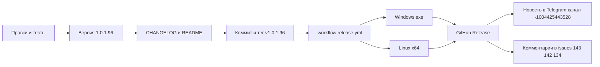

# План релиза Workspace 1C v1.0.1.96

Дата планирования: 2026-11-20. Базовая версия: **1.0.1.95**.
Область: issues **#143**, **#142**, **#134** (WPF + Avalonia, общий слой сервисов).
Issues #139, #138, #136, #116, #106 не трогаем (последний комментарий в них — автора проекта).

> Примечание: файл сохранён в `docs/plan-v1.0.1.96.md`, а не в `docs/plans/`, потому что
> каталог `plans/` перечислен в `.codeassistantignore` и запись в него блокируется.
> Соглашение совпадает с существующим `docs/plan-v1.0.1.84.md`.

Документ описывает только исследование и порядок работ: код приложения, версия и `CHANGELOG.md`
на этапе планирования не изменяются.

---

## 1. Подтверждённые причины дефектов

### 1.1. #142 — NRE в Центре обслуживания (найдено точно)

Стек из issue: `MaintenanceCenterWindow.OnHistoryPeriodChanged` →
`ToggleButton.OnIsCheckedChanged` → `RaiseEvent`.

- [`Workspace1C/Views/MaintenanceCenterWindow.xaml.cs`](../Workspace1C/Views/MaintenanceCenterWindow.xaml.cs:38) — сначала `InitializeComponent()`, и только на строке 39 создаётся ViewModel: `_vm = new MaintenanceCenterViewModel(...)`.
- [`Workspace1C/Views/MaintenanceCenterWindow.xaml`](../Workspace1C/Views/MaintenanceCenterWindow.xaml:142) — у `Period30Radio` стоит `IsChecked="True"` **и** `Checked="OnHistoryPeriodChanged"`.
- WPF применяет `IsChecked="True"` **во время** `InitializeComponent()` и сразу поднимает `Checked`; обработчик попадает в [`MaintenanceCenterWindow.xaml.cs:69`](../Workspace1C/Views/MaintenanceCenterWindow.xaml.cs:69) `_vm.SetHistoryPeriod(days)` при `_vm == null` → `NullReferenceException` на строке 69 (совпадает со стеком issue).
- Avalonia-версия этим не страдает: ViewModel присваивается в [`MaintenanceCenterWindow.Avalonia.cs:66`](../Workspace1C/Views/MaintenanceCenterWindow.Avalonia.cs:66), а подписка на `IsCheckedChanged` идёт позже — [`MaintenanceCenterWindow.Avalonia.cs:178`](../Workspace1C/Views/MaintenanceCenterWindow.Avalonia.cs:178).

Вывод: дефект — **порядок инициализации** (событие из XAML раньше присваивания поля), а не DataContext и не гонка `Loaded`.

### 1.2. #143 — зависание при «Сделать копию сейчас» (причины по коду)

Точка входа: [`DbmsBackupWindow.cs:80`](../Workspace1C/Views/DbmsBackupWindow.cs:80) и
[`DbmsBackupWindow.Avalonia.cs:87`](../Workspace1C/Views/DbmsBackupWindow.Avalonia.cs:87) —
`async (_, _) => await _vm.RunAsync()`.

Цепочка: `DbmsBackupViewModel.RunAsync` ([`DbmsBackupViewModel.cs:292`](../Workspace1C/ViewModels/DbmsBackupViewModel.cs:292)) →
`Save()` ([`:259`](../Workspace1C/ViewModels/DbmsBackupViewModel.cs:259)) →
`DbmsBackupService.RunAsync` ([`DbmsBackupService.cs:181`](../Workspace1C/Services/DbmsBackupService.cs:181)) →
`ProcessRunner.RunAsync` ([`ProcessRunner.cs:99`](../Workspace1C/Services/ProcessRunner.cs:99)).

Причины, упорядоченные по вероятности:

1. **Синхронный пролог выполняется на UI-потоке.** До первого настоящего `await` в `DbmsBackupService.RunAsync` успевают пройти `Validate`, `Path.Combine`, `Directory.CreateDirectory(profile.OutputDirectory)` ([`:196`](../Workspace1C/Services/DbmsBackupService.cs:196) и [`:208`](../Workspace1C/Services/DbmsBackupService.cs:208)), запись профиля в JSON ([`FeatureDataStore.cs:65`](../Workspace1C/Services/FeatureDataStore.cs:65)) и `Process.Start` внутри `ProcessRunner` ([`ProcessRunner.cs:137`](../Workspace1C/Services/ProcessRunner.cs:137)). Если `C:\Backup\SQL` — отключённый сетевой диск/шара, а `pg_dump.exe` проверяется антивирусом, UI-поток блокируется на десятки секунд/минуты: окно не перерисовывается, «Отмена» не нажимается — снаружи это «наглухо зависло».
2. **Нет управляемого таймаута и прерываемого чтения.** Таймаут копии — `TimeSpan.FromHours(6)` ([`DbmsBackupService.cs:202`](../Workspace1C/Services/DbmsBackupService.cs:202), [`:211`](../Workspace1C/Services/DbmsBackupService.cs:211)); `ReadToEndBytesAsync`/`SafeReadOutput` ([`ProcessRunner.cs:186`](../Workspace1C/Services/ProcessRunner.cs:186), [`:197`](../Workspace1C/Services/ProcessRunner.cs:197)) не принимают `CancellationToken`; `Kill` вызывается только из `catch` вокруг `WaitForExitAsync` ([`ProcessRunner.cs:164`](../Workspace1C/Services/ProcessRunner.cs:164)), а сам `Kill` обёрнут в пустой `catch`. Отмена и таймаут не гарантируют завершение.
3. **Не перенаправлён stdin.** В `ProcessStartInfo` нет `RedirectStandardInput` ([`ProcessRunner.cs:111`](../Workspace1C/Services/ProcessRunner.cs:111)). Любой интерактивный запрос дочерней утилиты (пароль `pg_dump` без корректного `PGPASSWORD`, `sqlcmd` без `-P`/`-E`, подтверждение) превращается в вечное ожидание. `-w` в аргументах ([`DbmsBackupService.cs:139`](../Workspace1C/Services/DbmsBackupService.cs:139)) спасает только при рабочем `pg_dump` и неверном/пустом пароле — остаются другие сценарии.
4. **Нет прогресса.** Даже корректно работающий дамп большой базы идёт минуты/часы: UI «жив», но пользователь видит только `IsBusy`, и состояние неотличимо от зависания. Прогресс/этап/таймер отсутствуют.
5. **Побочный синхронный ввод-вывод:** ротация (`BackupRotation.Apply`, [`BackupRotation.cs:39`](../Workspace1C/Services/BackupRotation.cs:39)) и `WebDavUploader` ([`DbmsBackupService.cs:237`](../Workspace1C/Services/DbmsBackupService.cs:237), `HttpClient.Timeout = 6 ч`). Должны исполняться вне UI-потока и с отменой.

Диагностический шаг (обязателен перед правкой): воспроизвести и снять стек UI-потока
(`dotnet-stack`/Process Explorer → Threads → Stack) — он подтвердит пункт 1 или 2 и попадёт в комментарий issue.

### 1.3. #134 — галочки в меню «Колонки» (почему не сработали 1.0.1.84 и 1.0.1.95)

Текущая реализация: [`ProcessInspectorWindow.xaml.cs:95-163`](../Workspace1C/Views/ProcessInspectorWindow.xaml.cs:95) и
[`ProcessInspectorWindow.Avalonia.cs:412-490`](../Workspace1C/Views/ProcessInspectorWindow.Avalonia.cs:412).

- WPF: индикатор — `Path` в `MenuItem.Icon`, видимость — привязка `IsChecked` через `RelativeSource FindAncestor` + `BooleanToVisibilityConverter` ([`:148-155`](../Workspace1C/Views/ProcessInspectorWindow.xaml.cs:148)). Шаблон `ModernMenuItem` действительно выводит `Icon` ([`DarkTheme.xaml:1030`](../Workspace1C/Themes/DarkTheme.xaml:1030)), но геометрия и кисть берутся из резолверов ([`:139-140`](../Workspace1C/Views/ProcessInspectorWindow.xaml.cs:139)): при наборе иконок Outline/Glass/MacOS/WindowsXP/Material, отсутствии ресурса или `Application.Current == null` `Path.Data`/`Fill` остаются пустыми/прозрачными (`WpfBrushes.FromSpec` при отсутствии кисти отдаёт `Transparent`, [`ThemeBrushes.Wpf.cs:37`](../Workspace1C/Themes/ThemeBrushes.Wpf.cs:37)) — пользователь видит пустое место.
- Avalonia: `ModernMenuItem` наследует Fluent ([`Controls.axaml:1168`](../Workspace1C/Themes/Controls.axaml:1168)), индикатор снова в `Icon` и снова на привязке `RelativeSource FindAncestor` к `IsChecked` ([`:471-482`](../Workspace1C/Views/ProcessInspectorWindow.Avalonia.cs:471)); `ThemeBrushes` прямо предупреждает, что `MenuItem.Icon` у неоткрытого меню — ловушка привязки к ресурсам ([`ThemeBrushes.Avalonia.cs:28`](../Workspace1C/Themes/ThemeBrushes.Avalonia.cs:28)). Плюс `ToggleType = CheckBox` добавляет собственный индикатор Fluent, который в этой версии не отображается.
- Общий корень: **индикатор зависит от шаблона, набора иконок, темы и привязки**, то есть от факторов, которые в конкретной сборке пользователя не гарантированы.

---

## 2. Правки по issues

### 2.1. #142 — Центр обслуживания

Файлы:

- [`Workspace1C/Views/MaintenanceCenterWindow.xaml`](../Workspace1C/Views/MaintenanceCenterWindow.xaml:139)
- [`Workspace1C/Views/MaintenanceCenterWindow.xaml.cs`](../Workspace1C/Views/MaintenanceCenterWindow.xaml.cs:32)
- [`Workspace1C/ViewModels/MaintenanceCenterViewModel.cs`](../Workspace1C/ViewModels/MaintenanceCenterViewModel.cs:344)
- тесты: `Workspace1C.Tests/Issue142MaintenanceCenterTests.cs` (новый)

Решение:

1. Убрать `Checked="OnHistoryPeriodChanged"` у трёх `RadioButton` в XAML (`:140`, `:142`, `:144`). `IsChecked="True"` у `Period30Radio` оставить.
2. В конструкторе после `_vm = new MaintenanceCenterViewModel(...)` и после `HistoryList.ItemsSource` подписаться программно:
   `Period7Radio.Checked += OnHistoryPeriodChanged; Period30Radio.Checked += OnHistoryPeriodChanged; Period90Radio.Checked += OnHistoryPeriodChanged;`
3. В обработчике ([`:64`](../Workspace1C/Views/MaintenanceCenterWindow.xaml.cs:64)) добавить защиту `if (_vm is null) return;` и комментарий, что событие может прийти из `InitializeComponent` — это регрессионный барьер.
4. Проверить `MaintenanceCenterViewModel.SetHistoryPeriod` ([`:344`](../Workspace1C/ViewModels/MaintenanceCenterViewModel.cs:344)) на пустом списке баз и при `SelectedHistoryRow == null` — добавить guard, если он отсутствует.
5. Avalonia: поведение уже корректное; зафиксировать паритет комментарием и тестом-гвардом (подписка после создания `_vm`).

Тесты (`Issue142MaintenanceCenterTests`):

- source-guard: в `MaintenanceCenterWindow.xaml` **нет** `Checked="OnHistoryPeriodChanged"`;
- source-guard: в `.xaml.cs` есть программная подписка и проверка `if (_vm is null)`;
- source-guard Avalonia: индекс `_vm = new MaintenanceCenterViewModel` меньше индекса `IsCheckedChanged += OnHistoryPeriodChanged`;
- VM: `SetHistoryPeriod(7/30/90)` на пустом списке и на списке с базами не бросает, `HistoryRows`/`HistoryChart` согласованы;
- VM: `SetHistoryPeriod` до выбора базы не бросает (`SelectHistoryById(null)`).

### 2.2. #143 — резервные копии средствами СУБД

Файлы:

- [`Workspace1C/Services/ProcessRunner.cs`](../Workspace1C/Services/ProcessRunner.cs:99)
- [`Workspace1C/Services/DbmsBackupService.cs`](../Workspace1C/Services/DbmsBackupService.cs:169)
- [`Workspace1C/ViewModels/DbmsBackupViewModel.cs`](../Workspace1C/ViewModels/DbmsBackupViewModel.cs:292)
- [`Workspace1C/Views/DbmsBackupWindow.cs`](../Workspace1C/Views/DbmsBackupWindow.cs:79)
- [`Workspace1C/Views/DbmsBackupWindow.Avalonia.cs`](../Workspace1C/Views/DbmsBackupWindow.Avalonia.cs:86)
- локализация: `Workspace1C/Localization/ru.json`, `Workspace1C/Localization/en.json`
- тесты: `Workspace1C.Tests/Issue143DbmsBackupTests.cs`, `Workspace1C.Tests/ProcessRunnerTests.cs` (новые)

#### 2.2.1. `ProcessRunner`: предсказуемый запуск дочернего процесса

- Всегда `RedirectStandardInput = true` и сразу `process.StandardInput.Close()` — утилита не может ждать консоль.
- Чтение stdout/stderr с `CancellationToken`: `CopyToAsync(buffer, ct)` / `ReadToEndAsync(ct)`; таймаут чтения = таймаут процесса + 5 с.
- `Kill(entireProcessTree: true)` в `finally` при `ct.IsCancellationRequested` или `TimedOut`, затем `WaitForExit(2000)`; результат — явные флаги `TimedOut`/`Canceled` в `ProcessRunResult`.
- Перегрузка `ProbeAsync(fileName, args, timeout, ct)` для проверок окружения (версия утилиты, `pg_isready`).
- Внутренняя точка подмены для тестов (по образцу `RingLicenseService.RunProcessAsync`): `internal static Func<...> RunProcessOverride`.

#### 2.2.2. `DbmsBackupService`: проверки и безопасное выполнение

Новые чистые/асинхронные методы (результат — `DbmsCheckResult { Success, MessageKey, Detail }`):

- `CheckTools(profile, ct)` — поиск `pg_dump`/`sqlcmd`: `ToolsDirectory` → PATH → типовые каталоги (`C:\Program Files\PostgreSQL\*\bin`, `/usr/bin`, `/usr/lib/postgresql/*/bin`); проверка `--version` с таймаутом 10 с.
- `CheckOutputDirectory(profile, ct)` — существует/создаётся, пробная запись и удаление файла `.w1c_write_test`, свободное место (PostgreSQL); для MS SQL — предупреждение, что путь должен быть доступен серверу.
- `CheckConnectionAsync(profile, ct)` — TCP-проверка `host:port` (5 с); PostgreSQL — `pg_isready`, если найден; MS SQL — `sqlcmd -Q "SELECT 1"` (10 с, `-E` или `-U/-P`); WebDAV — `MKCOL`/`PROPFIND` (10 с), если URL задан.
- `Validate` ([`:169`](../Workspace1C/Services/DbmsBackupService.cs:169)) расширить: пустой пароль PostgreSQL — предупреждение, порт 0 — подставить 5432/1433, несовпадение типа СУБД с портом — предупреждение.

`RunAsync`:

- убрать синхронный ввод-вывод с вызывающего потока: `Directory.CreateDirectory`, ротация и запись профиля — через `Task.Run`/`ConfigureAwait(false)`;
- новый параметр `IProgress<DbmsBackupProgress>? progress` (этапы: `Prepare`, `Check`, `Dump`, `Rotate`, `Upload`, `Done`; проценты только там, где измеримо, иначе — время и размер файла);
- таймаут из профиля (`DbmsBackupProfile.TimeoutMinutes`, по умолчанию 360, минимум 5) вместо жёстких 6 часов; отмена между этапами и внутри процесса;
- при отмене/таймауте — удалить недописанный целевой файл (`try { File.Delete(target); } catch { }`);
- сохранить текущую сигнатуру для `SchedulerService` ([`SchedulerService.cs:434`](../Workspace1C/Services/SchedulerService.cs:434)) — новый прогресс добавить перегрузкой, поведение задания не менять.

#### 2.2.3. `DbmsBackupViewModel`: защита от повторного запуска, прогресс, отмена

- `RunAsync`: `Interlocked.Exchange`-флаг вместо проверки `IsBusy` после `Save()`; `IsBusy = true` до любой работы; `Save()` и запись JSON — вне UI-потока.
- Новые команды `CheckConnectionCommand`, `CheckDirectoryCommand` (или методы `CheckConnectionAsync`/`CheckDirectoryAsync`) с `CanExecute = IsIdle`; результат — в журнал и в `StatusText`.
- Состояние прогресса: `ProgressStageText`, `ProgressPercent`, `IsProgressIndeterminate`, `ElapsedText` (обновление 1 раз в секунду через `PeriodicTimer` с маршалингом в `_ui`).
- `Cancel()` — отмена + запись «Отмена…» в журнал; `Closed` уже вызывает `Cancel()` ([`DbmsBackupWindow.cs:93`](../Workspace1C/Views/DbmsBackupWindow.cs:93)).
- `_ui` брать лениво при первом обращении с UI-потока (если окно создано вне контекста, `AppendLog` не должен писать в UI из фонового потока).
- Валидация перед запуском: собрать все замечания `Validate`/`CheckTools`/`CheckOutputDirectory` и показать их в журнале до старта дампа.

#### 2.2.4. Окна WPF и Avalonia (паритет)

- Добавить кнопки «Проверить подключение» и «Проверить каталог» рядом с «Сделать копию сейчас»; все три — `IsEnabled = IsIdle` (как сейчас у `save`/`run`, [`:81-84`](../Workspace1C/Views/DbmsBackupWindow.cs:81)).
- Добавить строку прогресса: `ProgressBar` (`IsIndeterminate` на этапе дампа) + `TextBlock` этапа/таймера; для этого расширить `WpfUi.Rows(...)`/`AvaloniaUi.Rows(...)` на один ряд.
- Блокировать поля формы на время работы (`IsEnabled = IsIdle` на карточках), «Отмена» — активна только при `IsBusy`.
- Не менять размеры окна (960×760) и текущую компоновку карточек.
- Кроссплатформенность: имена утилит и пути по умолчанию уже учитывают ОС ([`DbmsBackupService.cs:117`](../Workspace1C/Services/DbmsBackupService.cs:117), [`:99`](../Workspace1C/Services/DbmsBackupService.cs:99)); проверки должны работать и на Linux (права каталога, `/usr/bin`, `pg_isready`, отсутствие `sqlcmd` — ошибка проверки, не падение).
- Новые ключи локализации (ru+en): `Dbms.CheckConnection`, `Dbms.CheckDirectory`, `Dbms.CheckOk`, `Dbms.CheckFailed`, `Dbms.ToolNotFound`, `Dbms.NoWriteAccess`, `Dbms.Progress.Prepare/Check/Dump/Rotate/Upload/Done`, `Dbms.TimedOut`, `Dbms.Cancelled`, `Dbms.Reentrancy`.

Тесты:

- `ProcessRunner`: таймаут и отмена завершают процесс за отведённое время (`sh -c 'sleep 30'` / `cmd /c ping -n 30 127.0.0.1`), закрытый stdin, флаги `TimedOut`/`Canceled`, чтение вывода после kill не виснет.
- `CheckOutputDirectory`: временный каталог — успех; путь к файлу — ошибка; вложенный несуществующий — создаётся; каталог без прав (Linux) — ошибка с ключом.
- `CheckTools`: подменный runner с версией — успех; отсутствие — ошибка с ключом.
- `CheckConnectionAsync`: открытый TCP-listener — успех; закрытый порт — ошибка быстрее 5 с.
- `RunAsync_ReturnsIncompleteTaskImmediately` — вызов из синхронного контекста не блокирует (stub-runner с задержкой, `!task.IsCompleted` сразу).
- `RunAsync_Cancellation_ReportsCancelled_AndDeletesPartialFile`.
- `RunAsync_SecondInvocationIgnored` — повторный запуск игнорируется.
- `RunAsync_Timeout_ReportsTimedOut`.
- `RunAsync_ReportsStageSequence` — порядок этапов прогресса.
- source-guards: оба окна содержат кнопки проверок и `ProgressBar`; VM содержит `Interlocked` и `ConfigureAwait(false)`; `ProcessRunner` содержит `RedirectStandardInput` и `CopyToAsync(..., ct)`; локализация ru/en содержит все новые ключи.
- регресс: `NewFeaturesServicesTests` (аргументы `pg_dump`/`sqlcmd`) и тесты `SchedulerService` не меняются.

### 2.3. #134 — меню «Колонки» инспектора процессов

Файлы:

- [`Workspace1C/ViewModels/ProcessInspectorViewModel.cs`](../Workspace1C/ViewModels/ProcessInspectorViewModel.cs:204)
- [`Workspace1C/Views/ProcessInspectorWindow.xaml.cs`](../Workspace1C/Views/ProcessInspectorWindow.xaml.cs:95)
- [`Workspace1C/Views/ProcessInspectorWindow.Avalonia.cs`](../Workspace1C/Views/ProcessInspectorWindow.Avalonia.cs:412)
- тесты: `Workspace1C.Tests/Issue134ProcessInspectorTests.cs` (переписать блок 1.0.1.95), `Workspace1C.Tests/Issue134ColumnMenuIndicatorTests.cs` (новый)

Решение — индикатор, не зависящий ни от шаблона, ни от темы, ни от привязок:

1. В ViewModel добавить единую модель меню: `IReadOnlyList<ProcessInspectorColumnMenuItem> GetColumnMenuItems()` c `(Column, TitleKey, IsVisible)`; `ToggleColumn` уже есть ([`:225`](../Workspace1C/ViewModels/ProcessInspectorViewModel.cs:225)). Источник истины — `IsColumnVisible` ([`:208`](../Workspace1C/ViewModels/ProcessInspectorViewModel.cs:208)), она же управляет `ApplyColumnVisibility` ([`ProcessInspectorWindow.xaml.cs:170`](../Workspace1C/Views/ProcessInspectorWindow.xaml.cs:170)).
2. `Header` пункта — `Grid` из двух колонок: индикатор 16×16 и `TextBlock` подписи. Индикатор: `Border` 16×16 (`CornerRadius = 3`, рамка `TextSecondaryBrush` с HEX-фолбэком) и внутри `Path` галочки.
3. Геометрия галочки — приватная константа в коде (`CheckGeometry`, та же строка, что `IconCheck` в `Icons.axaml`), `Geometry.Parse`/`StreamGeometry.Parse`. Никакого `IconKeyToGeometryConverter`/`IconHelper` — набор иконок и `Application.Current` больше не влияют.
4. Кисть — `WpfBrushes.Get("AccentBrush") ?? Brushes.DodgerBlue`, `ThemeBrushes.Get("AccentBrush", "#2D6CDF")` — видима даже без ресурса темы.
5. Видимость галочки задаётся **явно**: `check.Visibility = _vm.IsColumnVisible(column) ? Visible : Hidden` (WPF) / `check.IsVisible = _vm.IsColumnVisible(column)` (Avalonia) при построении меню. Никаких `BooleanToVisibilityConverter`, `FuncValueConverter`, `RelativeSource FindAncestor`, `nameof(MenuItem.IsChecked)`.
6. Отказаться от `IsCheckable`/`ToggleType = CheckBox` (WPF — `IsCheckable = false`, Avalonia — `MenuItemToggleType.None`), чтобы шаблон не рисовал второй индикатор. Клик: переключить через VM и **сразу** обновить галочку и подпись доступности в этом же пункте.
7. `StaysOpenOnClick = true` — можно переключить несколько колонок, не открывая меню заново; после `ColumnsChanged` состояние галочек перечитывается из VM.
8. Доступность: `AutomationProperties.Name` = «заголовок: видима/скрыта» (WPF) и `AutomationProperties.Name` (Avalonia).
9. Паритет: один порядок `AllColumns`, одни ключи локализации, одинаковый вид (пустой бокс у скрытой колонки — ширина не «прыгает»).

Тесты:

- VM: `GetColumnMenuItems()` — 7 пунктов, по умолчанию все `IsVisible`, после `SetColumnVisible(column, false)` состояние пункта меняется; `ToggleColumn` синхронизирован с `IsColumnVisible` и с сохранением в настройках.
- source-guard WPF: `Header = BuildColumnHeader(`/`BuildColumnMenuItem(`, `IsCheckable = false`, `StaysOpenOnClick = true`, геометрия из константы (`Geometry.Parse`), видимость через `_vm.IsColumnVisible(column)`, **нет** `BooleanToVisibilityConverter` и `nameof(MenuItem.IsChecked)` в индикаторе.
- source-guard Avalonia: `Header = ...`, `ToggleType = MenuItemToggleType.None`, `StaysOpenOnClick = true`, `IsVisible = _vm.IsColumnVisible(column)`, **нет** `RelativeSource`, `FindAncestor`, `FuncValueConverter` в индикаторе.
- общий guard: индикатор всегда занимает 16×16 (`Border` с рамкой), поэтому подписи не сдвигаются; в обоих файлах нет `PART_ToggleIconPresenter`.
- удалить/переписать тесты 1.0.1.95, фиксирующие прежний подход (`Issue134ProcessInspectorTests.cs:431-550`).
- сохранить тесты на сохранение скрытых колонок, перестроение таблицы и сохранение выделения (они уже есть).

---

## 3. Порядок выполнения

1. Диагностика #143: воспроизвести зависание, снять стек UI-потока, зафиксировать результат в комментарии issue.
2. #142: XAML + программная подписка + guard; тесты `Issue142MaintenanceCenterTests`.
3. #143, шаг 1: `ProcessRunner` (stdin, отмена чтения, kill в `finally`, `ProbeAsync`, подмена для тестов) + `ProcessRunnerTests`.
4. #143, шаг 2: `DbmsBackupService` — `CheckTools`/`CheckOutputDirectory`/`CheckConnectionAsync`, `RunAsync` без синхронного ввода-вывода, прогресс, таймаут профиля, удаление недописанного файла; `Issue143DbmsBackupTests`.
5. #143, шаг 3: `DbmsBackupViewModel` — защита от повторного запуска, прогресс, отмена, проверки; тесты VM.
6. #143, шаг 4: оба окна — кнопки проверок, прогресс, блокировка формы, локализация ru/en; source-guards.
7. #134: модель меню в VM, новый `Header`-индикатор в WPF и Avalonia, отказ от `Icon`/`IsChecked`; тесты и переписывание прежних гвардов.
8. Полный прогон тестов, сборка Windows и Linux, ручная проверка трёх сценариев в обеих оболочках.
9. Только теперь: версия 1.0.1.96, `CHANGELOG.md`, `README.md`, `rel_notes_1.0.1.96.md`, `docs/_telegram_msg_v1.0.1.96.txt`.
10. Коммит, тег `v1.0.1.96`, публикация через `.github/workflows/release.yml`.
11. Комментарии в #143, #142, #134 (issues не закрывать), новость в Telegram-канал `-1004425443528`.

---

## 4. Релизный процесс v1.0.1.96

1. Версия — **только последним числом**, после всех правок: [`Workspace1C/Workspace1C.csproj:62-65`](../Workspace1C/Workspace1C.csproj:62) — `Version`, `AssemblyVersion`, `FileVersion`, `InformationalVersion` → `1.0.1.96`.
2. `CHANGELOG.md`: новый раздел `## [1.0.1.96] — 2026-11-20` сразу после `---` ([`CHANGELOG.md:12-14`](../CHANGELOG.md:12)) с секциями «Исправлено» (#143, #142, #134) и «Тесты» (фактическое число тестов после прогона).
3. `README.md`: бейдж версии ([`:3`](../README.md:3)), строка «актуальная версия — … (поддерживается N юнит-тестов)» ([`:11`](../README.md:11)), новый пункт в разделе «Что нового» сверху ([`:208`](../README.md:208)).
4. `rel_notes_1.0.1.96.md` — по образцу [`rel_notes_1.0.1.94.md`](../rel_notes_1.0.1.94.md); workflow берёт текст релиза из этого файла.
5. `docs/_telegram_msg_v1.0.1.96.txt` — по образцу [`docs/_telegram_msg_v1.0.1.95.txt`](_telegram_msg_v1.0.1.95.txt): заголовок, 3–4 пункта, имена артефактов, ссылка на тег.
6. Коммит, тег `v1.0.1.96`, `git push origin v1.0.1.96`. Workflow [`release.yml`](../.github/workflows/release.yml:19) собирает `Workspace1C.exe` (Windows single-file) и `Workspace1C-linux-x64`, создаёт GitHub Release, затем шаг «Новость в Telegram» ([`:248-290`](../.github/workflows/release.yml:248)) отправляет анонс в канал `-1004425443528` (чат зафиксирован, секрет `TELEGRAM_CHAT_ID` не читается).
7. Если автоматический запуск не сработал — `workflow_dispatch` с `tag: v1.0.1.96`; если не сработал Telegram-шаг — отправить вручную `sendMessage` в `-1004425443528` со ссылкой на релиз.
8. Комментарии в #143, #142, #134: версия, ссылка на релиз, что именно проверять; issues **не закрывать**. Образец стиля — [`docs/_comment_134.md`](_comment_134.md).

Схема релиза:

---

## 5. Риски

- **#143, окружение.** Реальный сценарий пользователя (сетевой каталог, антивирус, версия `pg_dump`) не воспроизводится в CI. Митигация: диагностический стек, закрытие всех четырёх гипотез, проверки окружения до запуска, таймауты и гарантированный kill.
- **#143, регресс планировщика.** `DbmsBackupService.RunAsync` используется `SchedulerService`; сигнатуру сохранить, прогресс добавить перегрузкой.
- **#143, платформенные тесты процессов.** Запуск `sh`/`cmd` зависит от ОС; тесты размечать по `OperatingSystem.IsWindows()`/`IsLinux()` и не требовать наличия `pg_dump`.
- **#143, недописанные файлы.** После отмены/таймаута целевой файл удаляется; при неудалении — предупреждение в журнале, ротация не должна удалять чужие копии.
- **#142.** WPF-окно нельзя создать в кроссплатформенных тестах — защита строится на source-guard + тестах VM; риск повторного события из XAML закрывается удалением атрибута `Checked`.
- **#134.** Изменения касаются только состава `Header` пунктов меню «Колонки»; шаблон `ModernMenuItem` и остальные меню не трогаем. Риск «пользователь ждёт системную галочку» снимается явным чекбокс-индикатором с рамкой.
- **Релиз.** Версия и число тестов в `README.md`/`CHANGELOG.md` должны совпасть с фактическим прогоном; версия поднимается последним коммитом, иначе тег соберёт сборку с чужим номером.
- **Локализация.** Новые ключи обязательны в `ru.json` и `en.json` (есть тест-гвард на совпадение наборов).

---

## 6. Критерии готовности

- #142: переключение периодов 7/30/90 в Центре обслуживания не бросает исключений; в WPF-разметке нет `Checked="OnHistoryPeriodChanged"`; `Issue142MaintenanceCenterTests` зелёные.
- #143: «Сделать копию сейчас» не блокирует UI (окно перетаскивается и отвечает), показываются этап/таймер, «Отмена» прерывает дамп и удаляет недописанный файл, таймаут срабатывает, повторный запуск игнорируется; «Проверить подключение» и «Проверить каталог» дают понятный результат; поведение одинаково в WPF и Avalonia, сборка Linux работает.
- #134: у видимой колонки в меню «Колонки» видна галочка в чекбокс-боксе, у скрытой — пустой бокс; состояние совпадает с фактической видимостью колонки и сохраняется между запусками; WPF и Avalonia выглядят одинаково; тесты-гварды не фиксируют зависимость от шаблона/иконок/привязок.
- Полный прогон `dotnet test` зелёный, Linux-ветка компилируется, число тестов зафиксировано в `CHANGELOG.md` и `README.md`.
- Версия `1.0.1.96` проставлена в `Workspace1C.csproj`, релиз опубликован workflow по тегу, артефакты `Workspace1C.exe` и `Workspace1C-linux-x64` доступны, новость ушла в Telegram `-1004425443528`, комментарии с версией добавлены в #143, #142, #134 (issues открыты).
