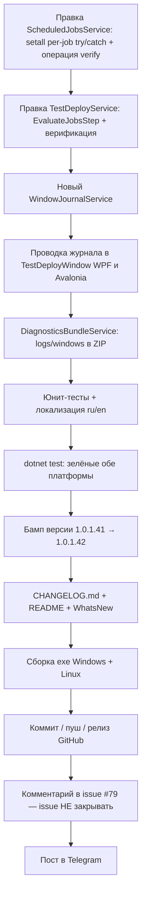

# План: issue #79 «Развернуть тестовую копию» — v1.0.1.42

Диагностика 7OH (`diagnostics_20261106_235635.zip`, распакована в `_issue79_diag_235635/`):
- Журнал окна развёртывания в ZIP НЕ попал → причину «Внутренней ошибки» видно только пользователю, не поддержке.
- Из наблюдений 7OH: блокировка регламентов фактически применяется, но на месте «странная ошибка — что-то не может прочитать».

## 1. Установленная причина

### 1.1 «Внутренняя ошибка» в шаге регламентных заданий

Цепочка: [`ScheduledJobsService.OperationBody`](Workspace1C/Services/ScheduledJobsService.cs:85) → операция `setall` (строки 109–115) → [`ComScriptRunner`](Workspace1C/Services/ComScriptRunner.cs:61).

- В цикле `setall` для КАЖДОГО задания читается `$name=[string](G (G $j 'Metadata') 'Name')` — БЕЗ try/catch.
- Если COM-чтение `Metadata`/`Name` хотя бы одного задания падает (клиент-серверная база сразу после RestoreIB: метаданные «прогреваются», COMException «Внутренняя ошибка»), весь скрипт уходит в общий catch в [`ComScriptRunner.Main`](Workspace1C/Services/ComScriptRunner.cs:94) → `ok=false; code='op'` → `ScheduledJobsResult.Fail`.
- При этом задания, обработанные ДО сбойного, уже выключены (`S $j 'Use' $false` + `Write` уже выполнены) — это в точности совпадает с наблюдением 7OH: «блокировка установлена по факту, но ошибка на месте».
- Результат показывается как warning [`TestDeploy.JobsDisableWarning`](Workspace1C/Services/TestDeployService.cs:564) с «Внутренней ошибкой» — пользователь видит ошибку, хотя цель шага достигнута.

Дополнительно `JInfo` (строки 87–96) мягко читает только `Synonym`/`Schedule`/`LastJob`; чтение `$md=G $j 'Metadata'` и `name=[string](G $md 'Name')` — жёсткое, та же уязвимость в операциях `list` и `verify`.

### 1.2 Журнал окна TestDeploy не попадает в ZIP-диагностику

[`DiagnosticsBundleService.CreateBundle`](Workspace1C/Services/DiagnosticsBundleService.cs:51) собирает только: `logs/app-*.log`, `cm_modal_trace.log`, `trace.json`, `systeminfo.txt`. Журнал окна (`_logList` в [`TestDeployWindow.cs:767`](Workspace1C/Views/TestDeployWindow.cs:767) и [`TestDeployWindow.Avalonia.cs:621`](Workspace1C/Views/TestDeployWindow.Avalonia.cs:621)) живёт только в памяти UI → в ZIP не попадает никогда. Комментарий v1.0.1.40 «стек попадёт в ZIP-диагностику» оказался неверен.

## 2. Правки по файлам

### 2.1 `Workspace1C/Services/ScheduledJobsService.cs` — устойчивый COM-скрипт

1. **`OperationBody`, операция `setall`** — цикл per-job в try/catch:
   - сбой чтения `Metadata`/`Use` одного задания → задание пропускается, в `$errors` добавляется `@{uuid=…;name='(чтение недоступно)';error=(Err $_)}`;
   - остальные задания продолжают обрабатываться;
   - ответ: `@{changed=$ch; total=$n; errors=$errList}` вместо текущего `@{changed=$ch; total=$n}`.
   - Повторная запись уже выключенного задания безопасна: `if Use -ne $q.use` — пропускает, поэтому перезапуск операции не «портит» счётчик.
2. **Новая операция `verify`** (только чтение, ничего не пишет):
   - обходит `GetScheduledJobs`, считает задания с `Use=$true` (мягкое чтение через try/catch per job);
   - ответ: `@{enabled=$en; total=$n; errors=$errList}`.
3. **`JInfo`** — обернуть `$md=G $j 'Metadata'` и чтение `Name` в try/catch (мягкое чтение, `name=''` при сбое) — чтобы операция `list` в окне «Регламентные задания» тоже не падала целиком.
4. **Модель [`ScheduledJobsResult`](Workspace1C/Services/ScheduledJobsService.cs:51)** — добавить:
   - `public IReadOnlyList<string> Errors { get; init; } = Array.Empty<string>();` — тексты сбоев per-job;
   - `public int Enabled { get; init; }` — число оставшихся включённых (для verify).
5. **`SetAllAsync` / новый `VerifyAsync`**:
   - `SetAllAsync`: при `result.Success` дополнительно разобрать `errors` (через `ComScriptRunner.GetObjectList` + `GetString`) в `Errors`.
   - Новый `public static Task<ScheduledJobsResult> VerifyAsync(Infobase, CancellationToken)` — операция `verify`, маппинг `enabled/total/errors`.
   - Обёртка для тестов: `internal static Func<Infobase, CancellationToken, Task<ScheduledJobsResult>>? VerifyOverride` (nullable, по умолчанию null; реальный вызов — `VerifyAsync`).

### 2.2 `Workspace1C/Services/TestDeployService.cs` — классификация исхода шага регламентов

[`DisableScheduledJobsAsync`](Workspace1C/Services/TestDeployService.cs:547) перестроить на три исхода (шаг по-прежнему НЕ прерывает развёртывание — ошибки только в `result.Warnings`/`result.Log`):

| Исход | Условие | Действие |
|---|---|---|
| Успех | `jobs.Success && jobs.Errors.Count == 0` | `TestDeploy.JobsDisabled` как сейчас |
| Успех с предупреждением | `jobs.Success` и есть `Errors` | строка `TestDeploy.JobsDisabledWithSkips` (изменено N, пропущено M) + перечень сбоев в `result.Log` |
| Неудача чтения | `!jobs.Success` | **верификация**: `VerifyAsync` → если `enabled == 0` и `total > 0` (все выключены фактически) → warning `TestDeploy.JobsDisabledVerified` + детали исходной ошибки в `result.Log`; иначе — warning `TestDeploy.JobsDisableWarning` как сейчас (реальный сбой) |
| Исключение/таймаут COM | catch | та же верификация, что и в строке 3 |

- Новые ключи локализации (`Localization/ru.json`, `en.json`):
  - `TestDeploy.JobsDisabledWithSkips` = «Регламентные задания в «{0}» выключены (изменено: {1}). При чтении {2} заданий возникла ошибка — детали в журнале.»
  - `TestDeploy.JobsDisabledVerified` = «Регламентные задания в «{0}» выключены. Во время операции возникла ошибка чтения COM, но повторная проверка подтвердила: все задания выключены. Детали: {1}»
  - `TestDeploy.JobsVerifyHint` = «Повторная проверка не удалась: {0}»
- Вся логика исходов выносится в чистую тестируемую функцию:
  `internal static JobsStepOutcome EvaluateJobsStep(JobsStepInput input, Func<CancellationToken, Task<ScheduledJobsResult>>? verify)` с рекордами `JobsStepInput(bool Success, IReadOnlyList<string> Errors, string? Error, int Changed)` и `JobsStepOutcome(bool Disabled, string? WarningLine, List<string> LogLines)` — покрывается юнит-тестами без COM.

### 2.3 Новый `Workspace1C/Services/WindowJournalService.cs` — журналы окон на диск

- Статический потокобезопасный сервис (lock на запись, `SemaphoreSlim` не нужен — lock+File.AppendAllText):
  - `public static void Append(string windowKey, string line)` — строка с префиксом `HH:mm:ss` в `PlatformPaths.LogDirectory/windows/<windowKey>-YYYYMMDD.log` (UTF-8 без BOM);
  - `public static IReadOnlyList<string> EnumerateJournalFiles()` — файлы `windows/*.log` (сортировка по имени);
  - ограничение: при превышении ~5 МБ файл переименовывается в `<name>-prev.log`, старый `*-prev.log` удаляется (по образцу ротации app-логов);
  - все сбои IO — глотаются (журнал не должен ломать UI), опционально `_logger?.Warn`.
- Журнал переживает падение приложения и попадает в ZIP независимо от состояния окна.

### 2.4 `Workspace1C/Views/TestDeployWindow.cs` и `TestDeployWindow.Avalonia.cs` — проводка журнала

- В обоих окнах каждое добавление строки в `_logList` (в т.ч. циклы `foreach (var line in result.Log)` на [767](Workspace1C/Views/TestDeployWindow.cs:767) и [621](Workspace1C/Views/TestDeployWindow.Avalonia.cs:621), pre-валидационные строки rac-пробы, `TestDeploy.FinalizeFailed` со стеком) провести через локальный хелпер:
  ```csharp
  private void LogLine(string line)
  {
      _logList.Items.Add(line); // WPF / Avalonia: _logList.Items.Add или TextBlock-аппендер — по месту
      WindowJournalService.Append("testdeploy", line);
  }
  ```
- Поиск всех точек: в `TestDeployWindow.cs` / `TestDeployWindow.Avalonia.cs` заменить все `_logList.Items.Add(` на `LogLine(` (grep по файлам), чтобы ни одна строка не ушла мимо файла.

### 2.5 `Workspace1C/Services/DiagnosticsBundleService.cs` — включение журналов окон в ZIP

- В [`CreateBundle`](Workspace1C/Services/DiagnosticsBundleService.cs:51) добавить пункт 2.5: перечислить `WindowJournalService.EnumerateJournalFiles()` и добавить в `entries` под именем `logs/windows/<filename>`; недоступный файл — в `warnings`.
- Для тестируемости: перегрузка `CreateBundle(..., IReadOnlyList<string>? windowJournalFiles = null)` — при null берутся реальные файлы, в тестах передаются временные.

## 3. Юнит-тесты (`Workspace1C.Tests`)

### 3.1 Новый файл `Issue79ScheduledJobsResilienceTests.cs`

1. `OperationBody_SetAll_HasPerJobTryCatch` — страж исходников: `setall` содержит `try{...}catch{...}` per job, собирает `$errors`, возвращает ключ `errors` (Assert.Contains по `ScheduledJobsService.OperationBody`).
2. `OperationBody_VerifyOperation_Present` — в `OperationBody` есть ветка `'verify'`, отвечающая `enabled/total/errors`.
3. `OperationBody_JInfo_MetadataReadIsSoft` — `JInfo` оборачивает чтение `Metadata` в try/catch.
4. `Parse_SetAllResponse_ParsesErrors` — разбор JSON-ответа `@{ok=$true;changed=3;total=5;errors=@{...}}` через `ComScriptRunner.ParseOutput` + маппинг `ScheduledJobsResult` → `Errors.Count == 2` (JSON-фикстура строкой).
5. `EvaluateJobsStep_*` — табличные тесты чистой функции из 2.2:
   - успех без ошибок → warning null;
   - успех с Errors → строка JobsDisabledWithSkips;
   - failure + verify enabled=0 → JobsDisabledVerified (Disabled=true);
   - failure + verify enabled>0 → JobsDisableWarning (Disabled=false);
   - failure + verify сам упал → JobsDisableWarning + JobsVerifyHint.
6. `Service_VerificationHookPresent` — страж: в `DisableScheduledJobsAsync` вызывается verify-путь (Assert.Contains `EvaluateJobsStep`/`VerifyAsync`).

### 3.2 `DiagnosticsBundleServiceTests.cs` — дополнить

- `CreateBundle_IncludesWindowJournals` — временный файл `windows/testdeploy-20261106.log` попадает в ZIP как `logs/windows/testdeploy-20261106.log`, `FileCount` растёт; при передаче несуществующего пути — в `Warnings`.

### 3.3 `Issue79TestDeployWindowTests.cs` — дополнить (стражи исходников)

- WPF и Avalonia окна не содержат прямых `_logList.Items.Add(` вне хелпера `LogLine` (grep-подобный Assert).
- Хелпер вызывает `WindowJournalService.Append("testdeploy"`.

### 3.4 Локализация

- `LocalizationCoverageServicesTests` / аналогичный механизм: новые ключи `TestDeploy.JobsDisabledWithSkips`, `TestDeploy.JobsDisabledVerified`, `TestDeploy.JobsVerifyHint` присутствуют в ru.json и en.json (по образцу тестов `Localization_CollectDiagnosticsKeys_Present`).

## 4. Порядок работ



### 4.1 Исполнительные контрольные пункты (выполняются в отдельных задачах)

- [ ] Версия: [`Workspace1C/Workspace1C.csproj:62-65`](Workspace1C/Workspace1C.csproj:62) — все четыре поля `1.0.1.41` → `1.0.1.42`.
- [ ] `CHANGELOG.md` — запись v1.0.1.42 (issue #79: ложная «Внутренняя ошибка» при выключении регламентов; журналы окон в ZIP-диагностике).
- [ ] `README.md` — по необходимости (состав ZIP-диагностики, если он там описан).
- [ ] `WhatsNew`-запись, если механизм требует ([`WhatsNewService`](Workspace1C/Services/WhatsNewService.cs)).
- [ ] Сборка exe Windows и Linux (скрипт по образцу `_build_v100141.ps1` → `_build_v100142.ps1`).
- [ ] Коммит (сообщение по образцу `_commit_msg_v100141.txt`), пуш, GitHub-релиз v1.0.1.42 с артефактами.
- [ ] Комментарий в issue #79 (файл `_issue79_comment_v100142.md`) — issue НЕ закрывать (7OH должен подтвердить на своей диагностике).
- [ ] Пост в Telegram (по образцу предыдущих анонсов).

## 5. Риски и меры

| Риск | Мера |
|---|---|
| PowerShell-скрипт «наощупь» не проверяется юнит-тестами (COM недоступен в CI) | Стражи исходников по `OperationBody` + чистая функция `EvaluateJobsStep` с табличными тестами; ручная проверка на клиент-серверной базе откладывается на 7OH |
| `verify` тоже может упасть «Внутренней ошибкой» (метаданные не прогрелись) | Если verify упал — остаётся прежний warning `JobsDisableWarning`; в сообщении уже есть подсказка `ExplainComInternalError`. Плюс небольшой retry verify (однократный, задержка ~2 с) перед сдачей — реализуется внутри `EvaluateJobsStep`-обвязки в сервисе |
| Перезапуск `setall` после частичного сбоя меняет `Changed` | Перезапуск не делается автоматически; частичный сбой уже является успехом с предупреждением, повторная блокировка не нужна |
| Журнал окон пишет секреты (строки подключения/пароли) | В журнал окна такие строки не попадают (проверить точки `LogLine`); `ComScriptRunner` уже маскирует секреты в ошибках ([`MaskSecrets`](Workspace1C/Services/ComScriptRunner.cs:172)); при сомнении — маскирование в `WindowJournalService.Append` не добавлять, но проверить содержимое pre-валидационных строк rac-пробы |
| Регрессия существующих тестов issue #79 ([`Issue79StepFailureTests`](Workspace1C.Tests/Issue79StepFailureTests.cs), `Issue79TestDeployWindowTests`) | Прогнать весь набор `dotnet test` до бампа версии |
| Изменение `OperationBody` ломает окно «Регламентные задания» (операция `list` используется отдельно) | `JInfo` делаем только мягче, контракт JSON `jobs` не меняется; тесты `ParseJobs` не трогаем |
| ZIP-диагностика: файл журнала может быть дописан во время архивации | Копия не делается — дописывание построчное, конкурентный риск минимален; сбой чтения уходит в `warnings` |

## 6. Вне рамок этой задачи (не трогать)

- Автоудаление/самоисцеление кеша COM-коннектора, «прогрев» метаданных после RestoreIB — root cause «Внутренней ошибки» на стороне платформы 1С не устраним из приложения; задача делает шаг устойчивым и диагностируемым.
- Закрытие issue #79.
- Включение журналов ДРУГИХ немодальных окон в ZIP — `WindowJournalService` готов к этому (windowKey — параметр), но в v1.0.1.42 проводим только TestDeploy (минимальный дифф, issue #79).
