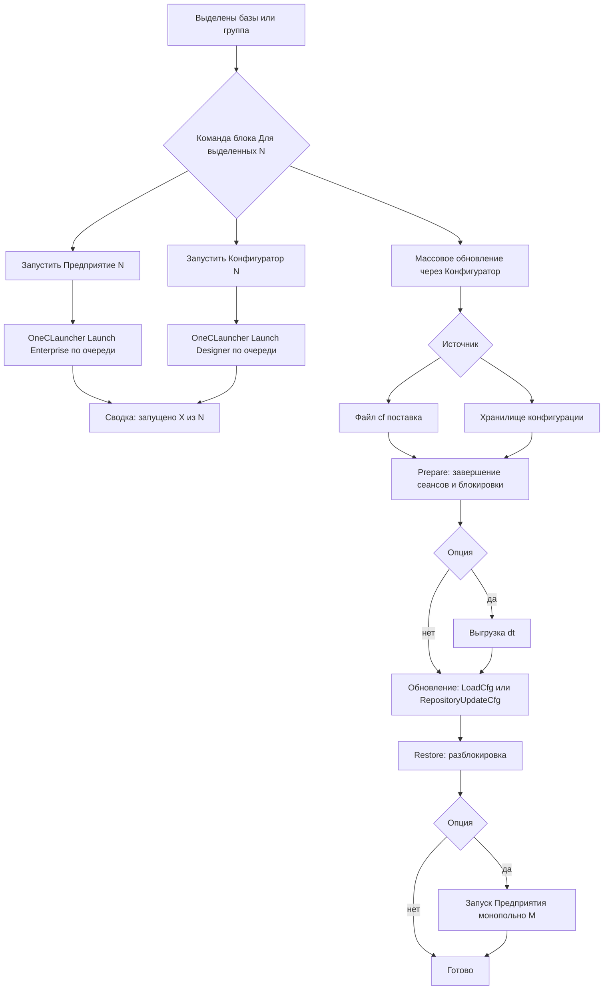

# План выпуска v1.0.1.43 — issue #85 «Групповое применение. Не доступны команды для групп»

Репозиторий: https://github.com/sivatorov/Workspace1C
Версия: **v1.0.1.42 → v1.0.1.43** (4-частная версия в [`Workspace1C.csproj`](Workspace1C/Workspace1C.csproj:62): `Version`, `AssemblyVersion`, `FileVersion`, `InformationalVersion`).
Issue: #85 (последний комментарий leonvlas, 2026-11-07, на v1.0.1.42).

---

## 1. Постановка задачи (из последнего комментария)

leonvlas подтвердил, что пакетные операции v1.0.1.32 работают, но:

1. **«Для запуска предприятий и конфигуратора не работает ?»** — группового запуска нет: нет пунктов «Запустить Предприятие»/«Запустить Конфигуратор» в блоке «Для выделенных (N)…»/«Для группы (N)…».
2. **Сценарий консультанта (10–20 баз ежедневно)** — нужен пакетный сценарий обновления:
   1. Обновление через поставку (.cf-поставка) **или** получение из хранилища (загрузка cf «не подходит — тут только применение, доп. действий не требуется»);
   2. Запись изменённой конфигурации;
   3. Блокировка сеансов, обновление (применение изменений);
   4. Патчи для релиза (если есть) или удаление ненужных;
   5. Применение изменений конфигурации — запуск Предприятия **монопольно**;
   6. Разблокировка;
   7. Доп. действия после обновления (печ. формы, обработки — запускаются вручную).

Открытие «сразу всех нужных баз» — тоже пожелание, но закрывается групповым запуском (п. 1 ниже): последовательный запуск всех баз Предприятием открывает их все.

---

## 2. Анализ существующего покрытия

| Шаг сценария leonvlas | Статус | Где реализовано |
|---|---|---|
| Групповой запуск Предприятие/Конфигуратор | ❌ **нет** | — |
| Обновление из поставки .cf (+ опции: выгрузка .dt, завершение сеансов, блокировки) | ✅ есть | [`MassLoadCfService.cs`](Workspace1C/Services/MassLoadCfService.cs:73), окно [`MassLoadCfWindow.Avalonia.cs`](Workspace1C/Views/MassLoadCfWindow.Avalonia.cs:36) / [`MassLoadCfWindow.xaml.cs`](Workspace1C/Views/MassLoadCfWindow.xaml.cs:23) |
| Обновление из хранилища (/ConfigurationRepositoryUpdateCfg /UpdateDBCfg) | ⚠️ **аргументы есть, UI нет** | [`OneCLauncher.Arguments.Shared.cs`](Workspace1C/Services/OneCLauncher.Arguments.Shared.cs:385) (`BuildRepositoryUpdateArgument`), [`DesignerBatchOperation.RepositoryUpdateCfg`](Workspace1C/Services/OneCLauncher.DesignerBatch.cs:36) — пакетное обновление из хранилищ (0.3.9.88) не покрыто UI и в блок «Для выделенных…» не входит |
| Блокировка/разблокировка сеансов для группы/выделенных | ✅ есть | [`BatchOperationsViewModel.cs`](Workspace1C/ViewModels/BatchOperationsViewModel.cs:325), [`ExecuteBatchLockSessionsForSelected`](Workspace1C/ViewModels/MainViewModel.Avalonia.Tools.cs:1733) |
| Запись изменённой конфигурации (DumpCfg в файл) | ✅ есть (выгрузка .cf) | `BatchOperationKind.DumpCf`, [`DesignerBatchOperation.DumpCfg`](Workspace1C/Services/OneCLauncher.DesignerBatch.cs:36) |
| Патчи (расширения .cfe) для группы | ❌ есть только для ОДНОЙ базы | [`ConfigExtensionService.cs`](Workspace1C/Services/ConfigExtensionService.cs:26) (`/LoadCfg -Extension` + `/UpdateDBCfg`), окна `ExtensionsViewModel` — одиночные |
| Запуск Предприятия **монопольно** (/M) | ❌ **нет** | [`OneCRunMode`](Workspace1C/Services/OneCLauncher.cs:30) имеет только Managed/Ordinary; ключа /M нет |
| Разблокировка после обновления | ✅ есть | `BatchOpsPreparationService` (undo-фаза в MassLoadCfService) |
| Доп. действия после обновления | ⚠️ частично | «Пользовательские действия» ([`CustomActionsWindow`](Workspace1C/Views/CustomActionsWindow.xaml)), «Скрипты» ([`ScriptScenariosWindow`](Workspace1C/Views/ScriptScenariosWindow.xaml)) — вручную по базе; в пакетный сценарий не встроены |

Целевой набор блока (источник целей): [`BatchOperationTargetsIncludingGroup`](Workspace1C/ViewModels/MainViewModel.Batch.cs:268) — уже поддерживает мультивыделение, группу и «Без группы». Новые команды просто берут цели оттуда.

---

## 3. Дизайн MVP

### 3.1. Этап A — групповой запуск Предприятие/Конфигуратор (ядро выпуска)

**Принцип**: это интерактивный запуск, а не пакетная операция с ожиданием завершения — окно прогресса не нужно. Достаточно подтверждения и итоговой сводки (как «Проверка доступности» — статус-бар + журнал).

**UX**:
- В блоке «Для выделенных (N)…»/«Для группы (N)…» два новых пункта вверху (после «Избранное», перед «Резервирование»):
  - «Запустить Предприятие (N)» — `Main.BatchRunEnterprise`;
  - «Запустить Конфигуратор (N)» — `Main.BatchRunConfigurator`.
- Подтверждение: «Запустить Предприятие для N баз? Базы запускаются последовательно.»
- Последовательный запуск: для каждой цели [`OneCLauncher.Launch(ib, OneCLaunchMode.Enterprise|Designer)`](Workspace1C/Services/OneCLauncher.cs:346) с индивидуальными настройками базы (клиент, разрядность, run-mode — резолвятся внутри лаунчера, как при одиночном запуске).
- Ошибки запуска (не найдена платформа, ошибка старта) собираются; итог — сводка в статус-бар и диалог «Запущено: X из N, ошибки: …» при наличии сбоев. Ошибка одной базы не прерывает остальные.
- Мультивыделение очищается после подтверждения (как у существующих пунктов блока — [`OnBatchMassLoadCfClick`](Workspace1C/Views/MainWindow.Avalonia.Tree.cs:2905)).
- Опциональная пауза между запусками: настройка `Settings.BatchLaunchDelayMs` (по умолчанию 0; для старых машин — 500–1000 мс, чтобы платформа успевала стартовать). Хранится в общих настройках, поле редактируется в «Настройки → Общие» (или MVP: без настройки, константа 300 мс — решить на реализации).

**Ограничения (осознанно, зафиксировать в CHANGELOG)**:
- Конфигуратор открывается интерактивно для каждой базы; параллельно можно открыть несколько конфигураторов — ограничений 1С на это нет. Проверку «уже запущенного конфигуратора этой базы» не выполняем (иначе сценарий «открыть все базы в конфигураторе» не работает).
- Групповой запуск **не ждёт** закрытия процессов.

### 3.2. Этап B — массовое обновление из хранилища (закрытие «источника обновления»)

Расширить [`MassLoadCf`](Workspace1C/ViewModels/MassLoadCfViewModel.cs:22) (окно «Массовая загрузка cf через Конфигуратор» → переименовать/дополнить до «Массовое обновление конфигурации через Конфигуратор»):

- **Источник обновления** (переключатель в окне):
  - «Файл .cf (поставка)» — как сейчас ([`DesignerBatchOperation.LoadCfg`](Workspace1C/Services/OneCLauncher.DesignerBatch.cs:27));
  - «Хранилище конфигурации» — новый путь: [`DesignerBatchOperation.RepositoryUpdateCfg`](Workspace1C/Services/OneCLauncher.DesignerBatch.cs:36); адрес/логин/пароль хранилища — из свойств базы ([`Infobase.Repository`](Workspace1C/Models/Infobase.cs), [`InfobaseAuthResolver.ResolveRepository`](Workspace1C/Services/InfobaseAuthResolver.cs:264)); базы без настроенного хранилища получают понятную ошибку валидации до старта ([`MassLoadCfPlanner.Validate`](Workspace1C/Services/MassLoadCfPlanner.cs:149)).
- Опции «Перед загрузкой» (выгрузка .dt, завершение сеансов, блокировки) работают одинаково для обоих источников — они уже в [`BatchOpsPreparationService`](Workspace1C/Services/BatchOpsPreparationService.cs).
- План шагов базы: `Prepare → [DumpDt] → (LoadCf | RepositoryUpdate) → Restore` — расширяется в [`MassLoadCfPlanner.PlanSteps`](Workspace1C/Services/MassLoadCfPlanner.cs:93) и [`MassLoadCfService.RunAsync`](Workspace1C/Services/MassLoadCfService.cs:105).

### 3.3. Этап C — запуск Предприятия монопольно (/M)

- Добавить в [`OneCLaunchMode`]-инфраструктуру поддержку монопольного режима: новый параметр/флаг `monopol` в [`Launch`](Workspace1C/Services/OneCLauncher.cs:346) (Windows + Linux частичные классы) и в построители аргументов (`/M` в конце строки запуска Предприятия; для Конфигуратора игнорируется).
- Опция «Запустить Предприятие после обновления (монопольно)» в окне MassLoadCf: после успешного обновления базы (и снятия блокировок Restore) запускается Предприятие с /M. Ошибка запуска — предупреждение в журнале, не ошибка обновления.
- Для совместимости: одиночный запуск «Предприятие (монопольно)» можно добавить в контекстное меню одной базы отдельным пунктом **если дёшево** — иначе отложить (отметить как следующий шаг).

### 3.4. Что НЕ входит в MVP (следующие шаги)

- **Мастер полного сценария обновления** (единое окно с чекбоксами всех шагов leonvlas: поставка → запись → блокировка → патчи → монопольно → разблокировка → доп. действия) — отдельный выпуск; сейчас каждый шаг закрывается существующими/новыми командами вручную по порядку.
- **Патчи (расширения .cfe) в массовом режиме** — [`ConfigExtensionService`](Workspace1C/Services/ConfigExtensionService.cs) пока одиночный; пакетная установка/удаление расширений по списку баз — следующий выпуск.
- **Доп. действия после обновления** (автозапуск обработок) — следующий выпуск; сейчас закрывается «Пользовательскими действиями» и сценариями скриптов вручную.
- Одиночный пункт «Предприятие (монопольно)» в контекстном меню базы.

---

## 4. Диаграмма сценария (после MVP)

---

## 5. Файлы для изменения / новые файлы

### Этап A — групповой запуск

| Файл | Изменение |
|---|---|
| [`Workspace1C/ViewModels/MainViewModel.Avalonia.Tools.cs`](Workspace1C/ViewModels/MainViewModel.Avalonia.Tools.cs:1733) | Новые методы `ExecuteBatchLaunchEnterpriseForSelected()` / `ExecuteBatchLaunchConfiguratorForSelected()` — подтверждение, цикл по [`BatchOperationTargetsIncludingGroup`](Workspace1C/ViewModels/MainViewModel.Batch.cs:268), сбор ошибок, сводка |
| [`Workspace1C/ViewModels/MainViewModel.Tools.cs`](Workspace1C/ViewModels/MainViewModel.Tools.cs:2927) | То же для WPF-версии (дублирование платформенных диалогов `_dialog`/`_dialogs`) |
| [`Workspace1C/Views/MainWindow.Avalonia.Tree.cs`](Workspace1C/Views/MainWindow.Avalonia.Tree.cs:2680) | В [`PopulateRowAvaloniaBatchMenu`](Workspace1C/Views/MainWindow.Avalonia.Tree.cs:2680) два новых пункта + обработчики `OnBatchRunEnterpriseClick` / `OnBatchRunConfiguratorClick` |
| [`Workspace1C/Views/MainWindow.ContextMenu.cs`](Workspace1C/Views/MainWindow.ContextMenu.cs:379) | В `PopulateBatchOperationsMenu` — те же пункты (WPF) |
| [`Workspace1C/Views/MainWindow.Events.cs`](Workspace1C/Views/MainWindow.Events.cs:1196) | WPF-обработчики кликов |
| [`Workspace1C/Localization/Languages/ru.json`](Workspace1C/Localization/Languages/ru.json:1084) | Ключи: `Main.BatchRunEnterprise`, `Main.BatchRunConfigurator`, `BatchLaunch.ConfirmEnterprise`, `BatchLaunch.ConfirmConfigurator`, `BatchLaunch.SummaryFormat`, `BatchLaunch.PartialErrorsFormat` (+ en-аналоги в [`en.json`](Workspace1C/Localization/Languages/en.json:1084)) |

### Этап C — монопольный запуск (/M)

| Файл | Изменение |
|---|---|
| [`Workspace1C/Services/OneCLauncher.cs`](Workspace1C/Services/OneCLauncher.cs:346) | Перегрузка/параметр `monopol` в `Launch(...)` (Windows) |
| [`Workspace1C/Services/OneCLauncher.Linux.cs`](Workspace1C/Services/OneCLauncher.Linux.Process.cs:40) | То же (Linux частичный класс) |
| [`Workspace1C/Services/OneCLauncher.Arguments.Shared.cs`](Workspace1C/Services/OneCLauncher.Arguments.Shared.cs:502) | Добавление ключа `/M` в построение аргументов Предприятия (`BuildEnterprise*`/общий конвейер) |
| [`Workspace1C/Services/OneCLauncher.Linux.Arguments.cs`](Workspace1C/Services/OneCLauncher.Linux.Arguments.cs) | Аналогично для Linux |

### Этап B — массовое обновление из хранилища

| Файл | Изменение |
|---|---|
| [`Workspace1C/Services/MassLoadCfPlanner.cs`](Workspace1C/Services/MassLoadCfPlanner.cs) | Новое `MassLoadCfSource { CfFile, Repository }` в [`MassLoadCfOptions`](Workspace1C/Services/MassLoadCfPlanner.cs:38), новый шаг `RepositoryUpdate` в enum, расширение `PlanSteps`/`Validate` (для хранилища — требовать настроенный `Infobase.Repository`; файл .cf не требуется) |
| [`Workspace1C/Services/MassLoadCfService.cs`](Workspace1C/Services/MassLoadCfService.cs:164) | В `RunOperationStepsAsync` — ветка `RepositoryUpdateCfg` (запуск через [`RunDesignerStepAsync`](Workspace1C/Services/MassLoadCfService.cs:205), путь-заглушка не нужен) |
| [`Workspace1C/ViewModels/MassLoadCfViewModel.cs`](Workspace1C/ViewModels/MassLoadCfViewModel.cs:44) | Свойство источника, опция `LaunchEnterpriseMonopol`, расширение `BuildOptions`, сводка |
| [`Workspace1C/Views/MassLoadCfWindow.Avalonia.cs`](Workspace1C/Views/MassLoadCfWindow.Avalonia.cs:36) | UI: переключатель источника, чекбокс «Запустить Предприятие монопольно после обновления», проверка доступности кнопки «Выполнить» |
| [`Workspace1C/Views/MassLoadCfWindow.xaml(.cs)`](Workspace1C/Views/MassLoadCfWindow.xaml.cs:23) | То же для WPF |
| [`Workspace1C/ViewModels/MainViewModel.Avalonia.Tools.cs`](Workspace1C/ViewModels/MainViewModel.Avalonia.Tools.cs:1761) / [`MainViewModel.Tools.cs`](Workspace1C/ViewModels/MainViewModel.Tools.cs:2955) | Обновить `ExecuteMassLoadCfCore` при смене названия/подтверждения |

### Тесты (`Workspace1C.Tests/`)

| Файл | Содержание |
|---|---|
| Новый `Issue85MassUpdatePlannerTests.cs` | `PlanSteps` для источника «хранилище» (с/без prepare, с/без dump); `Validate` требует хранилище у всех целей и не требует .cf; `ToPreparationOptions` |
| Новый `Issue85MonopolArgumentsTests.cs` | Построение аргументов Предприятия с /M и без (Windows/Linux билдеры) |
| Существующие тесты MassLoadCfPlanner | Актуализировать (новый источник не ломает прежние планы) |

### Прочее

| Файл | Изменение |
|---|---|
| [`Workspace1C/Workspace1C.csproj`](Workspace1C/Workspace1C.csproj:62) | Бамп 4 полей версии: `1.0.1.42` → `1.0.1.43` |
| [`CHANGELOG.md`](CHANGELOG.md:14) | Новая секция `## [1.0.1.43] — 2026-11-XX` → `### Добавлено` (групповой запуск, обновление из хранилища, монопольный запуск), `### Изменено` (переименование окна MassLoadCf, если делаем) — стиль: как у [1.0.1.42], со ссылками на файлы и issue |
| [`README.md`](README.md) | Обновить раздел возможностей (блок «Для выделенных/Для группы»: групповой запуск, массовое обновление из поставки/хранилища); сверить формат существующих пунктов |

---

## 6. Декомпозиция по шагам реализации

1. **Локализация**: ключи этапов A/B/C в `ru.json`/`en.json`.
2. **Этап A (VM)**: методы группового запуска в `MainViewModel.Avalonia.Tools.cs` + `MainViewModel.Tools.cs` (общий алгоритм: подтверждение → цикл → сводка; для юнит-тестов вынести чистую часть в сервис `BatchLaunchService` или хелпер с `RunnerOverride`-точкой по образцу [`MassLoadCfService.RunnerOverride`](Workspace1C/Services/MassLoadCfService.cs:95)).
3. **Этап A (UI)**: пункты меню в Avalonia ([`PopulateRowAvaloniaBatchMenu`](Workspace1C/Views/MainWindow.Avalonia.Tree.cs:2680)) и WPF ([`PopulateBatchOperationsMenu`](Workspace1C/Views/MainWindow.ContextMenu.cs:379) + [`MainWindow.Events.cs`](Workspace1C/Views/MainWindow.Events.cs:1196)).
4. **Этап C**: `/M` в лаунчере (Windows + Linux, партиальные классы аргументов) + тесты билдеров.
5. **Этап B (сервисы)**: `MassLoadCfSource`/шаг `RepositoryUpdate` в planner/service + валидация + тесты.
6. **Этап B (UI)**: переключатель источника и чекбокс монопольного запуска в окне MassLoadCf (обе платформы).
7. **Тесты**: новые + актуализация существующих; прогон `dotnet test`.
8. **Версия/документация**: бамп csproj до 1.0.1.43, CHANGELOG.md, README.md.
9. **Сборка/проверка**: `dotnet build` (Windows + `dotnet build /p:BuildLinux=true`), ручная проверка сценария на 2–3 базах: групповой запуск, обновление из хранилища, монопольный запуск.

---

## 7. Риски и ограничения

- **/M и клиент-серверные базы**: монопольный режим не совмещается с открытыми сеансами — окно MassLoadCf уже умеет завершать сеансы/ставить блокировки перед загрузкой; в журнале писать подсказку, что /M требует отсутствия сеансов (ключ `MassLaunch.MonopolHintLog`).
- **Хранилище у части баз**: если в группе часть баз без `Infobase.Repository` — валидация блокирует старт с перечнем баз (аналог [`MassLoadCfPlanner.Validate`](Workspace1C/Services/MassLoadCfPlanner.cs:149)).
- **Параллельный конфигуратор**: групповой запуск Конфигуратора сознательно не проверяет «уже открытый конфигуратор» (иначе сценарий «открыть все базы» не работает); трекинг [`ActiveDesignerOperations`](Workspace1C/Services/OneCLauncher.cs:81) не затрагивается (он только для пакетных выгрузок).
- **Маскирование пароля**: [`SensitiveDataMasker`](Workspace1C/Services/SensitiveDataMasker.cs:33) уже маскирует `/ConfigurationRepositoryP` — ветка хранилища идёт через ту же механику `DesignerBatchInfo`, ничего дополнительно не требуется.
- **WPF-дублирование**: все пункты блока добавляются в двух местах (Avalonia + WPF) — не забыть `MainWindow.ContextMenu.cs`/`MainWindow.Events.cs`.

---

## 8. Критерии готовности

- [ ] В блоке «Для выделенных (N)…»/«Для группы (N)…» есть «Запустить Предприятие» и «Запустить Конфигуратор»; работают для мультивыделения, группы и «Без группы».
- [ ] Массовое обновление конфигурации через Конфигуратор: источник «.cf» и «Хранилище»; опции подготовки работают для обоих источников.
- [ ] Опция «Запустить Предприятие монопольно» после успешного обновления (ключ /M в командной строке виден в журнале запусков).
- [ ] Тесты: новые planner/arguments-тесты зелёные; существующие не сломаны.
- [ ] CHANGELOG.md содержит секцию [1.0.1.43]; README отражает новые возможности; csproj = 1.0.1.43.
- [ ] Ответ в issue #85: указать, что групповой запуск и обновление из поставки/хранилища сделаны; мастер полного сценария, пакетные патчи и автозапуск доп. действий — в следующих выпусках.
