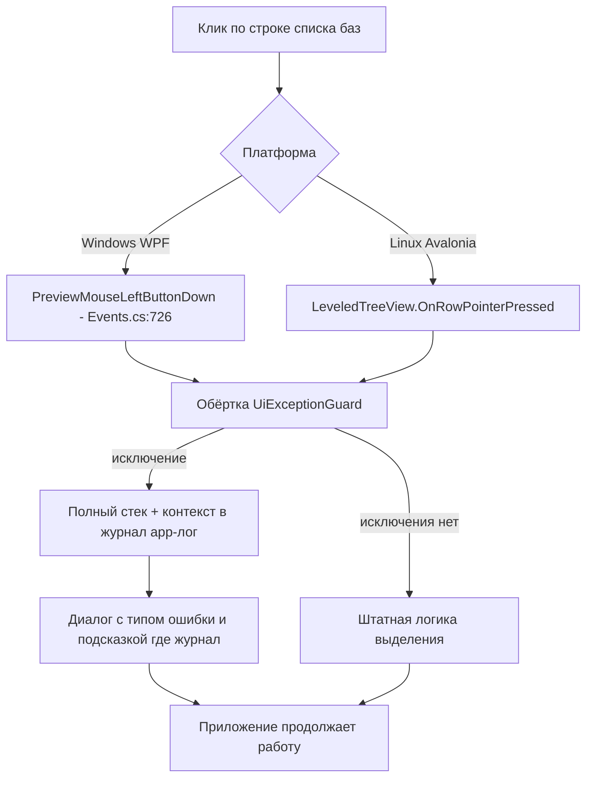

# План v1.0.1.18 — issue #96 «Ошибка интерфейса» (клики по строкам списка баз)

> Issue: https://github.com/sivatorov/Workspace1C/issues/96 — OPEN, причина не локализована,
> данных от пользователя нет (скриншот не открывается, журнал/версия не присланы).
> Владелец подтвердил: решать в v1.0.1.18, ждать ответа нельзя. Стратегия — **проактивная
> диагностика + защитные фиксы**: чтобы при следующем возникновении у пользователя в журнале
> был полный стек с контекстом, а самые вероятные точки сбоя были закрыты null-защитой.
>
> Версия: 1.0.1.17 → **1.0.1.18** (только последний номер).
> Код в этом цикле НЕ меняется — это план. Сводка по issue: `_issue96_to_work.md`.

---

## 0. Результаты анализа кода (сводка)

### 0.1 Что такое окно «Ошибка интерфейса» и что уже логируется

Единственное место в коде, где фигурирует текст «Ошибка интерфейса» — **глобальный
перехват необработанных UI-исключений**. То есть окно, которое увидел пользователь, —
это сработавший глобальный обработчик, а не локальный catch.

| Платформа | Обработчик | Что делает |
|---|---|---|
| **Windows / WPF** | [`App.xaml.cs:41-52`](Workspace1C/App.xaml.cs:41) `DispatcherUnhandledException` | [`LogFatal`](Workspace1C/App.xaml.cs:512) пишет полный стек через `IAppLogger.Error` (всегда, без зависимостей от CM_ON) + [`ShowFatalError`](Workspace1C/App.xaml.cs:531) показывает диалог (заголовок «Workspace 1C — ошибка», тело начинается с «Ошибка интерфейса», тип исключения + стек, **обрезанный до 1200 символов**) + `RemoveBrokenWindows` |
| **Linux / Avalonia** | [`App.axaml.cs:81-85`](Workspace1C/App.axaml.cs:81) `Dispatcher.UIThread.UnhandledException` | Только [`ShowFatalError`](Workspace1C/App.axaml.cs:664): stderr + файл `errors.log` + `IAppLogger.Error`. **Диалог пользователю НЕ показывается** (комментарий в коде: «Полноценный диалог ошибок появится вместе с портом окон — Этап 3») |

**Ключевой диагностический вывод:** видимое окно «Ошибка интерфейса» может показать
только WPF-версия. На Avalonia та же ошибка проходит молча (только файлы).
⇒ репортер с вероятностью ~всюду — **Windows-пользователь**, искать надо в первую
очередь в WPF-ветке дерева.

Куда пишет журнал:
- `IAppLogger` → `FileAppLogger`, файл `logs/app-YYYYMMDD.log`; записи **Error/Warn пишутся всегда**, INFO — только при включённых категориях ([`LogCategory.cs:16-17`](Workspace1C/Services/LogCategory.cs:16)).
- Отдельной категории «CM_MAIN» в коде нет; ближайшая — `CM_MAIN_WINDOW` ([`LogCategory.cs:33`](Workspace1C/Services/LogCategory.cs:33), запуск/завершение). В комментарии issue владелец упомянул «CM_MAIN» как общий журнал — фактически пользователю нужно приложить `logs/app-*.log` (и `errors.log` на Linux).
- Уже есть трассировка кликов: `MenuCloseTrace` + флаги `CM_MENUCLICK` / `CM_MENUCLOSE` в `trace.json` ([`LogCategory.cs:88-89`](Workspace1C/Services/LogCategory.cs:88)); с 0.3.9.311 WPF-обработчик **безусловно** пишет MouseDown/MouseUp в trace (B-1) — но только когда флаг включён.

### 0.2 Обработчики кликов/взаимодействия со строками списка баз

**Windows / WPF (главное дерево `MainTree`):**

| Обработчик | Место | Защита |
|---|---|---|
| [`OnInfobaseTree_PreviewMouseLeftButtonDown`](Workspace1C/Views/MainWindow.Events.cs:726) | одиночный/Ctrl/Shift-клик по строке, выделение, стабилизация после закрытия меню (issue #340), drag-payload | **НЕТ try/catch** — любое исключение уходит в `DispatcherUnhandledException` → окно «Ошибка интерфейса» |
| [`OnInfobaseTree_PreviewMouseLeftButtonUp`](Workspace1C/Views/MainWindow.Events.cs:995) | сброс снимка клика | **НЕТ try/catch** |
| [`ApplySelection`](Workspace1C/Views/MainWindow.Tree.cs:999) / [`ApplyGroupSelection`](Workspace1C/Views/MainWindow.Tree.cs:982) | установка выделения на контейнер TreeViewItem | нет проверки, что `item.DataContext` в момент применения всё ещё та же база (рециклинг контейнеров) |
| [`OnInfobaseRowGrid_Loaded/Unloaded`](Workspace1C/Views/MainWindow.Columns.cs:430) / [`:492`](Workspace1C/Views/MainWindow.Columns.cs:492), то же для групп [`:467`](Workspace1C/Views/MainWindow.Columns.cs:467), [`:502`](Workspace1C/Views/MainWindow.Columns.cs:502) | подписки строк при генерации/утилизации контейнеров | DataContext может отсутствовать/меняться при рециклинге — защиты нет |
| `OnColumnResize_MouseDown/Up` ([`MainWindow.Columns.cs:1263,1340`](Workspace1C/Views/MainWindow.Columns.cs:1263)) | ресайз колонок | защиты нет |
| [`OnBaseContextMenu_Opened`](Workspace1C/Views/MainWindow.Columns.cs:74) | правый клик → контекстное меню | защиты нет; сценарий «правый клик по строке» входит в вопрос владельца пользователю |

**Linux / Avalonia:**

| Обработчик | Место | Защита |
|---|---|---|
| [`LeveledTreeView.OnRowPointerPressed`](Workspace1C/Controls/LeveledTreeView.Avalonia.cs:85) | туннельный обработчик клика по строке: SelectRow, Ctrl/Shift-мультивыделение, Cmd-разворот | частично защищён (`DataContext is MainViewModel vm`), но try/catch нет |
| [`LeveledTreeView.SelectRow`](Workspace1C/Controls/LeveledTreeView.Avalonia.cs:257) | установка выделения, гашение подсветки прежней строки | работы с `_selectedRow` — ссылка может быть на утилизированный контейнер (комментарий на :916 подтверждает проблему) |
| [`card.DoubleTapped`](Workspace1C/Views/MainWindow.Avalonia.Tree.cs:589) | двойной клик — запуск базы | **уже исправлен по образцу #97**: база берётся из DataContext карточки через [`ResolveRowBase`](Workspace1C/Views/MainWindow.Avalonia.Tree.cs:641), а не из замыкания |
| [`card.PointerPressed`](Workspace1C/Views/MainWindow.Avalonia.Tree.cs:615) | Ctrl+клик — закладка | аналогично #97, без try/catch |
| [`OnTreeMenuCloseClickDedup_PointerPressed/Released`](Workspace1C/Views/MainWindow.Avalonia.Events.cs:499) | дедупликация клика, закрывшего меню (issue #340, Avalonia) | без try/catch, сложная логика стабилизации |
| [`OnTreeDragPointerPressed`](Workspace1C/Views/MainWindow.Avalonia.DragDrop.cs:100) | туннельный DnD-перехват | без try/catch |

История-ориентир: **#97** (клик по второй найденной базе открывал окно другой базы из-за
переиспользования контейнеров, фикс в 1.0.1.17) и **#340/#326** (выделение «уезжало»
после закрытия контекстного меню из-за VirtualizingStackPanel Recycling) — обе
истории прямо говорят: **рециклинг контейнеров дерева уже дважды приводил к дефектам
в кликах по строкам**. Issue #96 с высокой вероятностью — третий случай того же класса.

### 0.3 Наиболее вероятные причины «Ошибка интерфейса» (гипотезы, по убыванию)

1. **NRE/рассинхрон при рециклинге контейнеров в WPF-клик-конвейере** —
   [`OnInfobaseTree_PreviewMouseLeftButtonDown`](Workspace1C/Views/MainWindow.Events.cs:726):
   `UnwrapInfobase(treeViewItem.DataContext)` / `ApplySelection(treeViewItem, infobase)` /
   стабилизация [`EnsureSelectionStable`](Workspace1C/Views/MainWindow.Tree.cs:1065)
   (подписка на `LayoutUpdated` с замыканием на контейнер) — если контейнер между
   MouseDown и стабилизацией переиспользован под другую строку, ссылка указывает на
   чужие/осиротевшие данные.
2. **`ApplySelection`/`ApplyGroupSelection`** ([`MainWindow.Tree.cs:982-1063`](Workspace1C/Views/MainWindow.Tree.cs:982)):
   установка `IsSelected`/поиск дочерних элементов на контейнере, чей DataContext уже
   заменён панелью виртуализации.
3. **Loaded/Unloaded строк** ([`MainWindow.Columns.cs:430-509`](Workspace1C/Views/MainWindow.Columns.cs:430)):
   клик по пустой области вызывает генерацию контейнера → `Loaded` → подписки на
   DataContext, которого при рециклинге может не быть.
4. **Правый клик / контекстное меню** ([`OnBaseContextMenu_Opened`](Workspace1C/Views/MainWindow.Columns.cs:74)):
   построение меню по выделению; если выделенная база в этот момент null/осиротевшая —
   NRE. Владелец прямо спрашивал пользователя «правый клик?» — этот путь тоже закрываем.
5. **Ctrl/Shift-мультивыделение**: `ToggleBatchSelection(..., currentRowSectionIsPinned:
   IsPinnedSection(treeView.SelectedItem))` — `SelectedItem` может быть null/обёрткой
   (`PinnedInfobaseItem`) в момент первой выборки секции.
6. **Двойной клик → запуск базы** (`LaunchEnterprise`/`LaunchConfigurator`): ошибки старта
   процесса у пользователя (файл платформы не найден и т.п.), если путь всплывает через UI.
7. Маловероятно для «Ошибка интерфейса», но отметить: Avalonia-путь молча пишется в
   `errors.log` — у Linux-пользователей окно не появляется, поэтому Linux-ветка чинится
   «в складчину» (те же классы защиты + диалог).

---

## 1. Изменения (что делать в v1.0.1.18)

### 1.1 Новый хелпер: [`Workspace1C/Services/UiExceptionGuard.cs`](Workspace1C/Services/UiExceptionGuard.cs) (новый файл, обе платформы)

Единая точка перехвата для UI-обработчиков (вместо разрозненных try/catch):

- `Guard(string handlerName, Action body, Func<string>? context = null)` — выполняет
  `body`; при исключении:
  1. пишет в `IAppLogger.Error` **полный стек** + `VersionInfo.Display()` + ОС +
     имя обработчика + контекст (Id выбранной базы, модификаторы, ClickCount);
  2. дублирует в `errors.log` (как делает Avalonia-`ShowFatalError`);
  3. показывает диалог ошибки с **содержательным текстом**: тип исключения, сообщение,
     имя обработчика, путь к журналу — вместо голого «Ошибка интерфейса»;
  4. подавляет повторные диалоги той же ошибки в течение N секунд (анти-спам),
     но пишет каждый случай в журнал.
- Не меняет `e.Handled`: вызывающий решает сам, событие уже помечено штатно.
- Реализация без привязки к WPF/Avalonia-типам (диалог — через `IDialogService`).

### 1.2 Защитные исправления WPF

- [`MainWindow.Events.cs:726`](Workspace1C/Views/MainWindow.Events.cs:726) — обернуть
  тело `OnInfobaseTree_PreviewMouseLeftButtonDown` в `UiExceptionGuard` (контекст:
  цель клика, модификаторы, ClickCount). **Поведение без исключения — байт-в-байт прежнее**
  (не трогаем тонкую логику #340/#326/#97).
- [`MainWindow.Events.cs:995`](Workspace1C/Views/MainWindow.Events.cs:995) — то же для
  `PreviewMouseLeftButtonUp`.
- [`MainWindow.Tree.cs:999`](Workspace1C/Views/MainWindow.Tree.cs:999) `ApplySelection` —
  перед применением выделения проверить `ReferenceEquals(item.DataContext, infobase)`
  (или `UnwrapInfobase(item.DataContext) == infobase`): контейнер мог быть переиспользован.
  Несовпадение → тихо перезапустить поиск контейнера или выйти без исключения + trace-запись.
- [`EnsureSelectionStable`](Workspace1C/Views/MainWindow.Tree.cs:1065) (и Avalonia-близнец
  [`MainWindow.Avalonia.Events.cs:850`](Workspace1C/Views/MainWindow.Avalonia.Events.cs:850)) —
  в колбэке `LayoutUpdated` проверять, что контейнер жив (`IsLoaded`/всё ещё в дереве) и
  DataContext по-прежнему целевая база; иначе отписаться и выйти.
- [`MainWindow.Columns.cs:430-509`](Workspace1C/Views/MainWindow.Columns.cs:430) —
  null-guard на DataContext в Loaded/Unloaded строк и групп; исключение в подписках
  не должно ронять UI.
- [`OnBaseContextMenu_Opened`](Workspace1C/Views/MainWindow.Columns.cs:74) — guard +
  null-безопасное построение меню при пустом/осиротевшем выделении.
- Ресайз колонок ([`MainWindow.Columns.cs:1263,1340`](Workspace1C/Views/MainWindow.Columns.cs:1263)) — guard.

### 1.3 Защитные исправления Avalonia (Linux)

- [`LeveledTreeView.OnRowPointerPressed`](Workspace1C/Controls/LeveledTreeView.Avalonia.cs:85)
  и [`SelectRow`](Workspace1C/Controls/LeveledTreeView.Avalonia.cs:257) — guard; в
  `SelectRow` проверять валидность прежней `_selectedRow` перед гашением подсветки
  (см. комментарий :916).
- [`MainWindow.Avalonia.Tree.cs:589,615`](Workspace1C/Views/MainWindow.Avalonia.Tree.cs:589)
  (DoubleTapped/PointerPressed карточки) — guard вокруг запуска базы.
- [`MainWindow.Avalonia.Events.cs:499`](Workspace1C/Views/MainWindow.Avalonia.Events.cs:499)
  (дедупликация клика меню) и [`MainWindow.Avalonia.DragDrop.cs:100`](Workspace1C/Views/MainWindow.Avalonia.DragDrop.cs:100)
  (DnD) — guard.

### 1.4 Централизованное логирование фатальных UI-исключений (главное требование владельца)

Цель: при следующем возникновении у пользователя в журнале — полный стек, а владелец
не просит данные «вслепую».

- **WPF** [`App.xaml.cs`](Workspace1C/App.xaml.cs):
  - [`LogFatal`](Workspace1C/App.xaml.cs:512) дополнить: версия приложения
    (`VersionInfo.Display()`), ОС, разрядность, время; полный стек (без обрезки) — в
    журнал, обрезанный — только в диалог;
  - в текст диалога [`ShowFatalError`](Workspace1C/App.xaml.cs:531) добавить строку
    «Полный отчёт: logs/app-ГГГГММДД.log (файл рядом с настройками приложения)» —
    чтобы пользователь сам мог приложить журнал;
  - рассматривается: копия отчёта в `errors.log` в каталоге данных (унификация с Avalonia).
- **Avalonia** [`App.axaml.cs`](Workspace1C/App.axaml.cs):
  - [`ShowFatalError`](Workspace1C/App.axaml.cs:664) дополнить показом диалога через
    `IDialogService` (если контейнер поднят и есть окно) — сейчас Linux-пользователь
    вообще не видит ошибку;
  - в `AppDomain.CurrentDomain.UnhandledException` (:69) и
    `TaskScheduler.UnobservedTaskException` (:87) добавить запись через `IAppLogger`
    (сейчас только AppDomain идёт в ShowFatalError, и тот логирует — проверить полноту).
- **Контекст в записи**: в guard (п. 1.1) всегда писать «что делал пользователь»:
  имя обработчика, Id выбранной базы, модификаторы, секция (закреплённая/обычная) —
  это закрывает пункт 4 вопросов владельца (действия перед ошибкой).
- **Документирование** (в будущий комментарий к #96 после релиза): пользователю
  указать точные пути журналов: `logs/app-YYYYMMDD.log` (всегда содержит ERROR-записи
  независимо от CM_ON) и `errors.log` (Linux); и предложить включить трассировку
  кликов `CM_MENUCLICK`/`CM_MENUCLOSE` (Настройки → Логирование) для trace.json.

### 1.5 Версия и CHANGELOG

- [`Workspace1C.csproj:62-65`](Workspace1C/Workspace1C.csproj:62): `Version`,
  `AssemblyVersion`, `FileVersion`, `InformationalVersion` → **1.0.1.18**.
- [`CHANGELOG.md`](CHANGELOG.md): запись `[1.0.1.18]` — «Диагностика и защита UI:
  необработанные исключения при кликах по строкам баз пишутся в журнал с полным стеком,
  версией и контекстом; диалог ошибки содержит путь к журналу; защитные null-проверки
  конвейера клика по дереву (issue #96)».

---

## 2. Тесты ([`Workspace1C.Tests/`](Workspace1C.Tests/))

1. **UiExceptionGuardTests** (новый): тело бросает → guard не пробрасывает, пишет в лог
   (фейковый `IAppLogger`) имя обработчика + стек; без исключения — ничего; анти-спам диалогов.
2. **RowResolverTests**: извлечь чистую логику разворота строки (аналог `UnwrapInfobase`
   [`MainWindow.Tree.cs:766`](Workspace1C/Views/MainWindow.Tree.cs:766) и
   `ResolveRowBase` [`MainWindow.Avalonia.Tree.cs:641`]) в общий сервис и покрыть:
   `Infobase` / `PinnedInfobaseItem` / `GroupNodeViewModel` / null / чужой тип.
3. **ApplySelection guard**: логика проверки «DataContext контейнера всё ещё целевая
   база» — да/нет (после выделения логики в тестируемый хелпер).
4. **BatchSelectionHelper** — добить покрытие стабилизационных предикатов
   (`ShouldStabilizeAfterMenuClose`, `IsSameClick`, `IsPinnedSection`), т.к. конвейер
   клика трогается снова — регресс-сетка на #340/#326/#97.

## 3. Риски

- **Не сломать #340/#97**: обёртки guard обязаны быть «прозрачными» — поведение при
  отсутствии исключения идентично; catch только логирует. Обязателен ручной регресс:
  выделение после закрытия контекстного меню; клик по второй найденной базе в поиске;
  Ctrl/Shift-мультивыделение; двойной клик-запуск.
- Диалог ошибки не должен сам падать (UI в полуразобранном состоянии) — уже глушится
  try/catch, сохраняем.
- Avalonia-диалог поверх отсутствующего окна — показывать только при наличии
  `Application.Current.Windows` / поднятого контейнера.
- Анти-спам не должен съедать события из журнала: глушим только диалоги, не записи.
- Журнал может быть недоступен (диск/права) — все попытки логирования в try/catch
  (по образцу текущего `LogFatal`).

## 4. Критерии проверки (Definition of Done)

- [ ] Искусственное исключение в клик-конвейере (отладочная точка) на Windows:
      приложение живо, диалог с типом ошибки и путём к журналу, в `logs/app-*.log` —
      полный стек + версия + ОС + имя обработчика + Id базы.
- [ ] То же на Linux: запись в `logs/app-*.log` + `errors.log`, диалог (где возможно).
- [ ] Ручной регресс Windows: одиночный/двойной клик, Ctrl/Shift, правый клик-меню,
      ресайз колонок, поиск (#97), выделение после закрытия меню (#340).
- [ ] Ручной регресс Linux: те же сценарии в Avalonia-сборке.
- [ ] Все новые тесты зелёные; версия 1.0.1.18 в заголовке окна; запись CHANGELOG.

## 5. Файлы, планируемые к изменению

| Файл | Изменение |
|---|---|
| `Workspace1C/Services/UiExceptionGuard.cs` | **новый** — общий guard UI-обработчиков |
| `Workspace1C/Views/MainWindow.Events.cs` | guard клик-конвейера дерева (WPF) |
| `Workspace1C/Views/MainWindow.Tree.cs` | guard ApplySelection/EnsureSelectionStable + ref-check |
| `Workspace1C/Views/MainWindow.Columns.cs` | guard Loaded/Unloaded строк, контекстное меню, ресайз |
| `Workspace1C/App.xaml.cs` | LogFatal: версия/ОС/полный стек; текст диалога с путём к журналу |
| `Workspace1C/App.axaml.cs` | ShowFatalError: диалог на Linux; полнота логирования AppDomain/Task |
| `Workspace1C/Controls/LeveledTreeView.Avalonia.cs` | guard OnRowPointerPressed/SelectRow |
| `Workspace1C/Views/MainWindow.Avalonia.Tree.cs` | guard DoubleTapped/PointerPressed карточки |
| `Workspace1C/Views/MainWindow.Avalonia.Events.cs` | guard дедупликации клика меню |
| `Workspace1C/Views/MainWindow.Avalonia.DragDrop.cs` | guard DnD-перехвата |
| `Workspace1C/Workspace1C.csproj` | версия → 1.0.1.18 |
| `CHANGELOG.md` | запись 1.0.1.18 |
| `Workspace1C.Tests/UiExceptionGuardTests.cs` и др. | новые тесты (п. 2) |
