# План релиза v1.0.1.25 — issues #101, #98, #92, #89, #83, #79

> Репозиторий: [sivatorov/Workspace1C](https://github.com/sivatorov/Workspace1C).
> Источник репортов: `_issues_to_work_2026-11-02_new.md` (снимок от 2026-11-02 19:35 UTC3).
> Issues: [#101](https://github.com/sivatorov/Workspace1C/issues/101) (иконки на выделенной строке — Вариант 4 + крупнее + по центру),
> [#98](https://github.com/sivatorov/Workspace1C/issues/98) (порядок кнопок в «Назначить теги» — повторный репорт, окно найдено),
> [#92](https://github.com/sivatorov/Workspace1C/issues/92) (раскладка окон массовых операций v2, снятие галочки, ibcmd/сеансы, идентификация базы),
> [#89](https://github.com/sivatorov/Workspace1C/issues/89) (цикл обновления на Linux — пользователь ждёт релиз для проверки),
> [#83](https://github.com/sivatorov/Workspace1C/issues/83) (вкладка «Лицензии» пуста: «занято 0 из 2»),
> [#79](https://github.com/sivatorov/Workspace1C/issues/79) (pre-валидация мастера «Развернуть тестовую копию» падает на rac для защищённой базы).
>
> Версия: 1.0.1.24 → **1.0.1.25** (только последний номер).
> Версия задаётся в 4 строках [`Workspace1C/Workspace1C.csproj:62`](Workspace1C/Workspace1C.csproj:62) —
> `Version`, `AssemblyVersion`, `FileVersion`, `InformationalVersion` (строки 62–65).

---

## 0. Сводка и порядок работ

| # | Заголовок | Последний комментарий (автор) | Корневая причина (по коду) | Объём в v1.0.1.25 |
|---|---|---|---|---|
| 98 | Поменять местами кнопки | ArtyoZ: окно «Назначить теги», версия 1.0.1.22 указана на скрине | WPF [`TagPickWindow.xaml:70-91`](Workspace1C/Views/TagPickWindow.xaml:70): «Отмена» ПЕРВАЯ (слева), «ОК» вторая; Avalonia-версия корректна (использует `ModalWindowBase.BuildButtons`, «отмена в конце») | **Полное** — маленькая UI-правка |
| 101 | Сделать красиво ) | 7OH: «пробуем вариант 4 + увеличиваем значок Предприятия + центрируем» | Чип 16×16 в [`MainWindow.xaml:1893`](Workspace1C/Views/MainWindow.xaml:1893) и [`MainWindow.Avalonia.Tree.cs:415-480`](Workspace1C/Views/MainWindow.Avalonia.Tree.cs:415); глиф Play 10×10 мелкий и не центрирован; чип не реагирует на статус | **Полное** — Вариант 4 (чип + красный при зависании) + размер/центрирование |
| 92 | Выгрузка списка баз в *.dt | 7OH (3 комментария от 2026-11-02 15:14–15:21): список не на ВСЮ высоту, окна шире/уже, поиск, журнал, снятие галочки, ibcmd+сеансы, «не тот кластер» | Раскладка [`BatchOperationsWindow.Avalonia.cs:363-388`](Workspace1C/Views/BatchOperationsWindow.Avalonia.cs:363): список в Star-строке 1 ДЕЛИТ высоту с журналом (Star-строка 3); поиск без иконки/очистки; галочки не снимаются при успехе; кластер-резолв берёт «не тот» кластер | **Частично**: UI-пункты и снятие галочки — полностью; «не тот кластер» — улучшение матчинга/диагностики; вопрос про ibcmd+сеансы — проверка и ответ (код менять не обязательно) |
| 89 | Скачивание EXE на Линукс | 7OH: «пререлиза не нашёл, обновился на 1.0.1.24 и жду следующий релиз для проверки» | Фикс перезапуска (helper, чистое окружение, откат) УЖЕ в v1.0.1.24; нового репорта о сбое нет | **Проверка, без кода**: гарантированно собрать prerelease `v1.0.1.25-test1` (пониженная версия) И проверять его видимость — в прошлый раз 7OH его не нашёл |
| 83 | Лицензии в Серверы 1С | 7OH: «ошибок нет, но таблица пуста; занято 0 из 2; при использовании разработчика — 0 из 1» | [`RingLicenseParser`](Workspace1C/Services/RingLicenseService.cs:70) строит Total (счёт установленных), но строки таблицы не заполняются фактическим форматом ring; «занято» из `rac session list --licenses` — lic-type не приходит/теряется | **Частично**: диагностика сырого вывода ring в лог, доводка парсера под реальный формат, сопоставление «занято» по сеансам; без репродукции с реальным выводом — диагностика + защита от «тихой пустоты» |
| 79 | Развернуть тестовую копию | 7OH: «rac завершился с кодом -1. Недостаточно прав пользователя на информационную базу Demo_8.3.27» + «что на форме не хватает, чтобы не создавать профиль?» | [`ClusterInfobaseCredentialsResolver.cs:213`](Workspace1C/Services/ClusterInfobaseCredentialsResolver.cs:213): rac-проба `infobase info` идёт с `infobaseUser: null` — защищённая база (авторизация ИБ) отвечает «Недостаточно прав», резолв возвращает пусто, pre-валидация требует профиль СУБД, хотя креды есть в свойствах базы | **Полное**: передавать креды ИБ из свойств базы в rac-пробу (обе цепочки: pre-валидация и резолв перед выгрузкой) + понятные сообщения |

**Порядок реализации** (от независимых UI-правок к сложной логике rac):

1. #98 (точечная XAML-правка) → 2. #101 (UI, обе платформы) → 3. #92 (UI + снятие галочки) → 4. #79 (rac-креды) → 5. #92-«не тот кластер» (общая логика с #79, один файл) → 6. #83 (парсер/диагностика) → 7. #89 (только релизная механика + prerelease) → 8. Версия/CHANGELOG/README → сборка/тесты/релиз → комментарии в issues → Telegram.

```mermaid
flowchart LR
    A[Issue 98 - порядок кнопок TagPickWindow] --> B[Issue 101 - чип Вариант 4 WPF+Avalonia]
    B --> C[Issue 92 - раскладка v2 + снятие галочки]
    C --> D[Issue 79 - креды ИБ в rac-пробу]
    D --> E[Issue 92 - матчинг кластера + диагностика]
    E --> F[Issue 83 - парсер ring + сырой вывод в лог]
    F --> G[Issue 89 - prerelease test1 для проверки]
    G --> H[Версия 1.0.1.25 - CHANGELOG - README]
    H --> I[Сборка - тесты - релиз - комментарии]
```



---

## 1. Issue #98 — порядок кнопок: окно «Назначить теги»

### 1.1 Факт по коду

- **WPF — ошибка подтверждена**: [`TagPickWindow.xaml:70-91`](Workspace1C/Views/TagPickWindow.xaml:70) —
  панель кнопок `StackPanel Grid.Row="3"`: сначала кнопка **«Отмена»** (`IsCancel`, строки 72–81),
  потом **«ОК»** (`x:Name="OkButton"`, `IsDefault`, строки 82–90). Порядок нарушает конвенцию
  («подтверждение слева, отмена справа/последней»). Размер окна `Width=460 Height=440` (строка 10)
  совпадает со скриншотом ArtyoZ (463×492) — окно опознано точно.
- **Avalonia — корректно**: [`TagPickWindow.Avalonia.cs:182`](Workspace1C/Views/TagPickWindow.Avalonia.cs:182)
  использует `BuildButtons(onOk: SaveResult)` из [`ModalWindowBase.cs:941`](Workspace1C/Views/ModalWindowBase.cs:941),
  где «Отмена» всегда последняя — не трогать.

### 1.2 Изменения

1. **[`TagPickWindow.xaml`](Workspace1C/Views/TagPickWindow.xaml)** — поменять местами блоки кнопок:
   сначала `OkButton` (слева), затем «Отмена» (справа). Отступ `Margin="0,0,8,0"` перенести
   с «Отмены» на «ОК» (разделитель между кнопками).
2. **Аудит-хвост**: быстрый проход по оставшимся WPF-окнам с ручной раскладкой кнопок, которые
   не входили в аудит v1.0.1.22 (поиск по `IsCancel="True"` в `.xaml`, где кнопка стоит раньше
   `IsDefault`). Найденные окна — править там же (кандидаты: окна из `Views/*.xaml` с ручной
   панелью Row="Last"). В план фиксации включать только фактические находки.
3. **Тесты**: расширить [`Issue98ButtonOrderTests`](Workspace1C.Tests) (по образцу проверки
   `PlatformOldVersionsWindow` из `Release100124Tests`): в `TagPickWindow.xaml` индекс кнопки
   `OkButton` в панели < индекса кнопки «Отмена».

### 1.3 Критерии приёмки

- «Назначить теги» (из «Для выделенных (N)…»): «ОК» слева, «Отмена» справа — Windows и Linux.
- Юнит-тест порядка кнопок проходит; ни одно другое окно аудит-хвоста не нарушает конвенцию.

### 1.4 Риски

- Минимальные. Единственный риск — зацепить другие окна при массовом аудите; править только
  фактически найденные нарушения, без рефакторинга.

---

## 2. Issue #101 — иконки «Предприятие/Конфигуратор»: Вариант 4 + крупнее + по центру

### 2.1 Как устроено сейчас

- **WPF**: [`MainWindow.xaml:1886-1937`](Workspace1C/Views/MainWindow.xaml:1886) — чип `Border`
  16×16, `CornerRadius=8`, `Padding=3`, внутри `materialDesign:PackIcon Kind="Play"` /
  `Kind="Wrench"` **10×10**. Жалобы 7OH: значок «Предприятие» мелкий и «не по центру кружка»
  (глиф Play у PackIcon имеет встроенные поля и визуально смещён вправо-вниз).
- **Avalonia**: [`MainWindow.Avalonia.Tree.cs:415-480`](Workspace1C/Views/MainWindow.Avalonia.Tree.cs:415) —
  чип `Border` 16×16 (`UiMetrics.Scaled`), `Padding=3`, внутри `Path` с
  `Data = IconHelper.Geometry("IconRunning")`, `Stretch=Uniform` — без явного выравнивания
  и без масштабирования под размер чипа.
- Конвертер [`RunningDotColorConverter`](Workspace1C/Converters/RunningDotColorConverter.cs)
  перекрашивает ГЛИФ по статусу (#310) — чип (фон) не трогает.

### 2.2 Целевое поведение (Вариант 4)

1. **Чип-подложка** остаётся (Вариант 1 из v1.0.1.24): круглый, `CardBackgroundBrush`,
   обводка `BorderBrushColor`.
2. **Красный чип при проблеме процесса**: когда `RunningStatus` = `Hung` или `Critical`,
   ФОН чипа перекрашивается в красный (`ErrorBrush`), глиф — в белый/контрастный
   (`TextOnAccentBrush` или фиксированный светлый). Пока процесс отвечает штатно — фон карточки,
   глиф своего цвета (синий/янтарный). Реализация:
   - **WPF**: в [`MainWindow.xaml`](Workspace1C/Views/MainWindow.xaml:1893) к `Border` чипа
     добавить `Style` с `DataTrigger Binding={Binding RunningStatus} Value="Hung"/"Critical"` →
     `Background=ErrorBrush`; глифу — триггеры на белый `Foreground` в тех же состояниях.
   - **Avalonia**: в [`MainWindow.Avalonia.Tree.cs`](Workspace1C/Views/MainWindow.Avalonia.Tree.cs:415)
     — `Border.BackgroundProperty` привязать к `Infobase.RunningStatus` через конвертер
     (расширить [`RunningDotColorConverter.Avalonia.cs`](Workspace1C/Converters/Avalonia/RunningDotColorConverter.Avalonia.cs)
     параметром режима «фон чипа», НЕ ломая существующее использование «цвет глифа»; либо новый
     `ChipBackgroundConverter`), аналогично перекраска глифа.
   - Чипы обоих значков перекрашиваются независимо — каждый по своему `RunningStatus`
     (статус общий на базу, так что оба одновременно — допустимо и ожидаемо).
3. **Значок «Предприятие» крупнее и по центру**:
   - **WPF**: увеличить глиф Play с 10×10 до **13×13**, задать
     `HorizontalAlignment="Center" VerticalAlignment="Center"`; компенсировать встроенную
     асимметрию глифа Play (при необходимости `Margin` с отрицательным сдвигом влево на 1 px —
     проверить визуально по скриншоту «до/после»); чип оставить 16×16 (или 18×18, если 13 не
     влезает с Padding=3 — тогда Padding уменьшить до 2).
   - **Avalonia**: `Path` — задать `Width/Height` (13), `HorizontalAlignment/VerticalAlignment=Center`,
     `Stretch=Uniform`; проверить, что геометрия `IconRunning` центрируется (`Stretch=Uniform`
     центрирует в пределах заданного размера). Размер чипа синхронизировать с WPF.
   - Значок «Конфигуратор» оставить текущего размера (жалоба только на «Предприятие»),
     но центрирование применить к обоим для симметрии.
4. Размер/отступы завязать на `UiMetrics.Scaled` (масштабирование шрифта/компактный режим) —
   как сейчас в Avalonia; в WPF зафиксировать числа 16/13 (строка и так фиксирует 16).

### 2.3 Файлы

- [`Workspace1C/Views/MainWindow.xaml:1886-1937`](Workspace1C/Views/MainWindow.xaml:1886) (WPF);
- [`Workspace1C/Views/MainWindow.Avalonia.Tree.cs:410-480`](Workspace1C/Views/MainWindow.Avalonia.Tree.cs:410) (Avalonia);
- [`Workspace1C/Converters/Avalonia/RunningDotColorConverter.Avalonia.cs`](Workspace1C/Converters/Avalonia/RunningDotColorConverter.Avalonia.cs)
  (новый режим «фон чипа» или новый конвертер);
- тесты: layout-тесты чипов (наличие триггеров/привязки фона к `RunningStatus`, размер глифа)
  по образцу тестов v1.0.1.24 на чипы.

### 2.4 Критерии приёмки

- На выделенной строке (зелёный и синий акцент) оба значка читаются — чип даёт контраст.
- При зависании процесса чип красный, глиф светлый — индикация статуса видна периферийным зрением.
- Значок «Предприятие» визуально крупнее и центрирован в кружке (сравнение скриншотов до/после).
- Обе платформы; тёмная и светлая темы; масштаб 100/125/150%.

### 2.5 Риски

- `ErrorBrush`-триггеры на фоне Border в WPF конфликтуют с `DynamicResource`-фоном — решается
  `Style.Triggers` с `Setter` приоритетом (проверить в тёмной теме).
- Перекраска глифа в белый при красном чипе должна не конфликтовать с #310-конвертером
  (он уже переключает цвет на Warning/Error при Hung/Critical — при красном фоне янтарный/красный
  глиф нечитаем; поэтому при активации красного чипа глиф форсируется светлым).
- Смещение глифа Play в WPF подбирается вручную — зафиксировать результат скриншотом.

---

## 3. Issue #92 — окна массовых операций: раскладка v2, снятие галочки, ibcmd/сеансы, кластер

### 3.1 Пункты из последних комментариев 7OH (2026-11-02 15:14–15:21)

1. «Список баз на ВСЮ высоту окна — на ВСЮ» + «список можно сделать в 2 раза уже».
2. В поле поиска placeholder «Поиск по данным баз»; текст не должен наезжать на иконку;
   нужна кнопка очистки поиска в конце поля.
3. Справа должны нормально влезать каталог, шаблон и подписи галочек; высоту журнала
   уменьшить либо увеличить окно.
4. Галочку с базы снимать при удачной выгрузке.
5. Вопрос: разве ibcmd не позволяет выгрузку в DT при активных сеансах (под ответственность
   пользователя)?
6. «С идентификацией базы всё ещё проблема… не тот кластер для списка баз взят».

### 3.2 Раскладка v2 (обе платформы, оба окна — выгрузка и загрузка)

Текущая раскладка ([`BatchOperationsWindow.Avalonia.cs:363-388`](Workspace1C/Views/BatchOperationsWindow.Avalonia.cs:363)):
внешний `Grid` — строки hint(0, Auto) / columns(1, Star) / logHeader(2) / **logList(3, Star)** /
summary(4) / buttons(5); список баз находится ВНУТРИ колонок в Star-строке — т.е. делит высоту
с журналом. Целевая раскладка:

```
┌──────────────────────────────────────────────────────────────┐
│ Подсказка (компактно, 1-2 строки)                             │
├──────────────────┬───────────────────────────────────────────┤
│ [Поиск|✕]        │ Каталог: [______________] […]             │
│ [Всё] [Снять]    │ Шаблон: [______]  (R)DT ( )CF             │
│ ┌──────────────┐ │ ─ Перед операцией ─                       │
│ │ ☑ База 1     │ │ ☑ завершить сеансы                        │
│ │ ☑ База 2     │ │ ☐ блокировка сеансов [код]                │
│ │ ☐ База 3     │ │ ☐ блокировка регл. заданий                │
│ │ …   Star     │ │ (всю оставшуюся высоту — параметры)       │
│ │   НА ВСЮ     │ ├───────────────────────────────────────────┤
│ │   ВЫСОТУ     │ │ Журнал — фиксированная высота ~140-160 px │
│ │   окна       │ │ (внутренний скролл)                       │
│ └──────────────┘ │                                           │
├──────────────────┴───────────────────────────────────────────┤
│ Сводка                              [Остановить][Закрыть][▶] │
└──────────────────────────────────────────────────────────────┘
```

- **Avalonia** ([`BatchOperationsWindow.Avalonia.cs`](Workspace1C/Views/BatchOperationsWindow.Avalonia.cs:363)):
  - левая колонка списка должна растягиваться на всю высоту окна: журнал перенести В ПРАВУЮ
    колонку (под параметры) с **фиксированной** высотой (например `GridLength(160)` или
    `Auto`+`MaxHeight`), а не отдельной Star-строкой общего грида; общий `Grid` — 3 строки
    (hint / columns=Star / summary+buttons);
  - левую колонку сузить: колонки 2* : 1* → список **Fixed/40%** (или `GridLength(320)`), правой
    отдать остальное — подписи галочек и поля каталога/шаблона перестанут резаться;
  - высоту окна поднять: `Height = 620` → **700**, `MinHeight = 480` → **560** (строка 60–62).
- **WPF** ([`BatchOperationsWindow.xaml`](Workspace1C/Views/BatchOperationsWindow.xaml)) —
  симметричная переверстка.
- **Поиск**: placeholder ключа `BatchOps.SearchHint` локализовать как «Поиск по данным баз»
  ([`ru.json`](Workspace1C/Localization/Languages/ru.json) / `en.json`); текст — с отступом слева
  (`Padding`/`TextLeft`), чтобы не наезжал; добавить кнопку очистки «✕» в конце поля —
  образец: [`MainWindow.Avalonia.cs:1334`](Workspace1C/Views/MainWindow.Avalonia.cs:1334)
  `BuildSearchBox` (иконка слева + кнопка очистки справа) и WPF-аналог в главном окне.
  Кнопка видна только при непустом тексте.
- Окно `TagPickWindow` и поиск не связаны; для тестов — расширить layout-тесты окна
  (наличие кнопки очистки, список слева в корневой Star-колонке, журнал фиксированной высоты).

### 3.3 Снятие галочки при удачной выгрузке

- [`BatchOperationsViewModel.cs`](Workspace1C/ViewModels/BatchOperationsViewModel.cs):
  после успешного завершения операции по базе (`BatchOperationsItem` статус «успех» для
  DumpDt/DumpCf) устанавливать `IsChecked = false` — база считается обработанной, повторный
  прогон её не возьмёт. Для LoadCf — тоже снимать (загрузка удачна → обработана).
  При «Остановить» и ошибках галочки НЕ трогать.
- Логика — чистая функция в VM (список имён успешно обработанных → обновление `Items`),
  покрыть юнит-тестом: успех снимает, ошибка/отмена сохраняет выбор.
- Фильтр поиска не мешает: снимается галочка у элемента `Items` (не у `FilteredItems` view).

### 3.4 ibcmd и активные сеансы (проверка + ответ, код — по результату)

- Задача-исследование: проверить фактическое поведение `ibcmd infobase dump` при наличии
  активных сеансов (ibcmd выполняет выгрузку без монопольного режима, если сеансы не
  блокируют таблицы конфигурации; формально `infobase dump` не требует exclusive, в отличие
  от выгрузки через Конфигуратор — проверить на тестовом стенде с открытым сеансом).
- Если подтверждается — в issue ответить: «да, ibcmd может выгружать при активных сеансах,
  галочки „завершить сеансы“ опциональны и по умолчанию выключены»; если выгрузка при сеансах
  падает с ошибкой — добавить текст ошибки в журнал с подсказкой включить завершение сеансов.
- Код менять не обязательно; допустимый минимум — подсказка в сообщении об ошибке выгрузки.

### 3.5 Идентификация базы: «не тот кластер для списка баз взят»

- Текущий механизм: [`ClusterInfobaseCredentialsResolver.ResolveAsync`](Workspace1C/Services/ClusterInfobaseCredentialsResolver.cs)
  перебирает кластеры сервера (по адресу RAS), матчит базу по имени
  ([`NormalizedNamesEqual`](Workspace1C/Services/ClusterInfobaseCredentialsResolver.cs)).
  Репорт 7OH: база найдена в кластере, но параметры взяты не те / «не тот кластер» —
  из лога 2026-11-01 видно: `cluster list` вернул кластер на порту **27541** при адресе
  RAS **27545**, и резолв работал по нему.
- Изменения (общие с #79, см. §5.2):
  1. в журнал писать ПОЛНЫЙ список кластеров (`cluster list`: id, имя, порт) и по какому
     кластеру шли пробы на каждом шаге — сразу видно «тот/не тот»;
  2. матчинг по имени базы продолжать по ВСЕМ кластерам (не останавливаться на первом,
     где имя совпало частично), и при совпадении в нескольких кластерах — писать
     предупреждение и брать первый с валидным профилем;
  3. если в `infobase summary list` кластера имя не совпало ни с чем — журнал уже пишет
     содержимое кластера ([`BuildClusterContents`](Workspace1C/Services/ClusterInfobaseCredentialsResolver.cs:179));
     усилить: добавить сравнение нормализованных имён (регистр/пробелы/подчёркивания уже
     нормализуются в v1.0.1.22 — проверить покрытие тестами).
- Тесты: матчинг при нескольких кластерах, журнал выбора кластера.

### 3.6 Критерии приёмки

- Список баз занимает всю высоту окна, правая колонка показывает каталог/шаблон/подписи
  полностью; журнал — фиксированная высота со скроллом.
- Поиск: placeholder «Поиск по данным баз», текст правее иконки, кнопка очистки работает.
- После удачной выгрузки галочка базы снимается (скриншот/тест).
- В журнале видно, по какому кластеру выполнялся резолв каждой базы.

### 3.7 Риски

- Переверстка двух окон × двух платформ — самый объёмный UI-пункт итерации; держать
  симметрию WPF/Avalonia, тесты раскладки обновлять вместе.
- Снятие галочки может удивить при повторных прогонах — явно отразить в подсказке окна
  («успешно обработанные базы снимаются с выбора»).

---

## 4. Issue #89 — самоперезапуск на Linux: релизная проверка (без изменений кода)

### 4.1 Состояние

- В v1.0.1.24 перезапуск переписан полностью (helper дожидается выхода, бэкап, чистое
  окружение, лог `update-restart.log`, liveness + автооткат, CI-смок-тест xvfb) — см.
  [`plan-issues-89-98-92-101-v100124.md`](plan-issues-89-98-92-101-v100124.md) §1 и
  комментарий sivatorov от 2026-11-02 14:06.
- 7OH (2026-11-02 15:23): «пререлиза я не нашёл; обновился на 1.0.1.24 и жду следующий
  релиз для проверки» — НОВЫХ сбоев нет, нужна только возможность проверки.

### 4.2 Что делаем (без правок кода)

1. **Обязательно собрать prerelease `v1.0.1.25-test1`** (скрипт по образцу
   [`_build_v100124_test1.ps1`](_build_v100124_test1.ps1): версия артефакта понижена до
   1.0.1.24, ссылка на релиз v1.0.1.25, все 4 свойства версии — фикс v1.0.1.23 из issue #89).
2. **Убедиться, что prerelease виден**: в прошлый раз 7OH его не нашёл — проверить, что релиз
   опубликован с флагом prerelease на вкладке Releases (не только тег в Actions), и дать в
   комментарии ПРЯМУЮ ссылку на страницу релиза + инструкцию «установить вручную, обновление
   придёт сразу после запуска».
3. В комментарии к #89 приложить обе ссылки: `v1.0.1.25-test1` (проверка цикла) и
   стабильный `v1.0.1.25`; попросить прислать `update-helper.log`/`update-restart.log`
   при сбое.
4. **Критерий закрытия**: 7OH подтверждает полный цикл (скачивание → замена → автозапуск)
   на Linux. Если снова сбой — диагностика по логам helper'а (в v1.0.1.24 она уже достаточна),
   отдельный план доработки; в этой итерации код не трогаем.

### 4.3 Риски

- Если проверка выявит новый сбой — исправление уйдёт в v1.0.1.26; в v1.0.1.25 это фиксируется
  честным комментарием «механизм уже в 1.0.1.24, ждём подтверждение; тест-сборка прилагается».

---

## 5. Issue #79 — pre-валидация: «rac завершился с кодом -1. Недостаточно прав…»

### 5.1 Диагноз по коду

- Лог 7OH: `rac (localhost:27545) завершился с кодом -1. Недостаточно прав пользователя на
  информационную базу Demo_8.3.27` — сообщение формируется в
  [`RacClient.cs:1158-1161`](Workspace1C/Services/RacClient.cs:1158) с деталями stderr.
- Место: [`ClusterInfobaseCredentialsResolver.cs:211-216`](Workspace1C/Services/ClusterInfobaseCredentialsResolver.cs:211) —
  когда `infobase summary list` отдал пустой `dbms`, резолв вызывает
  `GetInfobaseInfoAsync(parameters, cluster.Id, match.InfobaseId, infobaseUser: null, infobasePassword: null, …)`.
  База защищена авторизацией ИБ → rac отклоняет вызов → `null` → профиль не собран →
  pre-валидация (`TestDeployPlanner.ValidateAsync`) возвращает «нужен профиль СУБД», хотя
  креды лежат в свойствах базы (7OH: «в свойствах базы сохранены и логин и пароль»).
- Тот же механизм используется в мастере на шаге резолва перед выгрузкой
  ([`TestDeployService.ResolveSourceDumpProfileAsync`](Workspace1C/Services/TestDeployService.cs:461))
  и в массовых операциях (#92) — фикс в одном месте чинит все три сценария.

### 5.2 Изменения

1. **[`ClusterInfobaseCredentialsResolver`](Workspace1C/Services/ClusterInfobaseCredentialsResolver.cs)**:
   - в `ResolveAsync` передать учётные данные ИБ из свойств базы (`Infobase`: общая авторизация
     «Конфигуратора» и legacy-общая — тот же источник, что использует
     `AutofillCredentialFromSource` мастера, см. issue #79 v1.0.1.5) в
     `GetInfobaseInfoAsync(..., infobaseUser, infobasePassword, …)`;
   - если у базы кредов нет — текущее поведение (null + понятное сообщение);
   - при ошибке «Недостаточно прав» с переданными кредами — в журнал: «база защищена,
     переданы креды из свойств; проверьте их корректность» вместо голого rac-текста;
   - усилить журналирование выбора кластера (см. §3.5 — общий пункт).
2. **UX-вопрос 7OH («что на форме не хватает, чтобы не создавать профиль?»)** — ответ:
   профиль НЕ нужен; нужен либо доступный rac, либо поля формы, описывающие ИСТОЧНИК.
   После фикса rac-проба для защищённой базы пройдёт с кредами из свойств базы — профиль
   не потребуется вовсе. В сообщение ошибки `TestDeploy.DbmsProfileNotFound` добавить
   явную строку «профиль не требуется: база резолвится через rac, если у rac хватает прав
   (креды берутся из свойств базы)».
3. **Подсказка в окне мастера** (опционально, если сообщение всё ещё запутывает): в
   блоке «Данные для выгрузки через ibcmd» тултип с коротким деревом решений
   «профиль СУБД — ИЛИ — доступный rac».
4. **Тесты** ([`Workspace1C.Tests`](Workspace1C.Tests), по образцу `Issue79TestDeployWindowTests`):
   - резолв передаёт креды ИБ в `GetInfobaseInfoAsync` (мок rac-клиента фиксирует аргументы);
   - при пустых кредах поведение не изменилось;
   - `ValidateAsync` проходит для защищённой базы с сохранёнными кредами.

### 5.3 Критерии приёмки

- Сценарий 7OH (серверная база Demo_8.3.27, авторизация ИБ, креды в свойствах, без профиля
  СУБД): pre-валидация проходит, выгрузка выполняется по параметрам из rac; при неверных
  кредах — понятное сообщение, а не «заполните профиль».
- Журнал показывает кластер, по которому резолвили, и факт передачи кредов (без паролей).

### 5.4 Риски

- `GetInfobaseInfoAsync` с кредами может вернуть другой набор полей (личные свойства базы
  доступны только администратору ИБ) — принять как успех резолва: цель пробы — dbms/server/name.
- rac 8.5.4 quirks: параметры `--infobase-user/--infobase-pwd` работают и там
  (подтверждено issue #69/#92, [`IRacClient.cs:146`](Workspace1C/Services/IRacClient.cs:146)).

---

## 6. Issue #83 — вкладка «Лицензии»: таблица пуста, «занято 0 из 2»

### 6.1 Диагноз (гипотезы по коду)

- Сводка «занято 0 из 2»: [`LicenseCalculator.ComputeSnapshot`](Workspace1C/Services/LicenseManager.cs:68) —
  `TotalInstalled` строится по разобранным `ProgramLicense`, `TotalUsed` — по сеансам rac с
  непустым `LicType`. «Из 2» означает, что 2 лицензии распознаны; «занято 0» — либо rac не
  вернул `lic-type` у сеансов (нет прав/кредов кластера), либо сопоставление не выполнено.
  Но пользователь видит «в таблице пусто» при этом «из 2» — противоречие, которое надо
  воспроизвести: возможно, «из 2» считается от каталога файлов `*.lic` (запасной источник в
  [`RingLicenseService`](Workspace1C/Services/RingLicenseService.cs:342)), а парсер
  `ring license list` возвращает пусто, и таблица «Установленные лицензии» пуста.
- Реальный формат вывода `ring license list` у пользователя (из ответа на вкладке):
  `499459654270590-500000000037 (Имя файла: "20260907085731.lic")` — строки вида
  «номер (Имя файла: "...lic")», возможно с локализованными полями, mojibake-остатками
  и переносами. Парсер [`RingLicenseParser`](Workspace1C/Services/RingLicenseService.cs:70)
  распознаёт такие строки структурно (`IsRingLicenseStructureLine`), но поля (тип, версия,
  мест) пустые — в таблице строка есть, но «пустая», либо строки не проходят из-за
  отличий формата (кавычки/скобки/многострочность).
- «Занято 0» при том, что пользователь в базе: `rac session list --licenses` требует
  прав кластера; если у подключённого кластера нет кредов — lic-type пустой, сеансы в
  таблицу «Используемые лицензии» фильтруются
  ([`ServerMonitorViewModel.cs:2838-2840`](Workspace1C/ViewModels/ServerMonitorViewModel.cs:2838)
  — `.Where(s => !string.IsNullOrWhiteSpace(s.LicType))`).

### 6.2 Изменения (частичное исправление + диагностика)

1. **Диагностика сырого вывода**: в [`RingLicenseService`](Workspace1C/Services/RingLicenseService.cs:342)
   при непустом выводе `ring license list` писать ВЕСЬ сырой вывод (усечённо, ~2000 символов)
   в лог `CM_RAC` — по нему следующий репорт закроет вопрос парсера сразу.
2. **Парсер**: добавить разбор формата ring «NNNN…-NNNNN (Имя файла: "X.lic")»:
   - заполнить `Module` именем файла (уже делается), `SerialNumber` — номер лицензии;
   - распознавать следом идущие поля (тип/версия/срок) на соседних строках, если формат
     многострочный (реальный вывод ring известен только по скринам — реализовать по
     фактическому дампу из п.1; в этой итерации минимум: строка попадает в таблицу с
     заполненными «Номер» и «Файл лицензии», остальные колонки пустыми — это уже лучше
     пустой таблицы);
   - покрыть юнит-тестами на основе фактического вывода (попросить в issue приложить лог
     `CM_RAC` с сырым выводом — после п.1).
3. **«Занято 0»**: в таблицу «Используемые лицензии» добавить диагностическую строку
   статуса (как сделано для установленных): если rac вернул 0 сеансов с lic-type — показать
   причину (нет сеансов / rac вернул lic-type пустым / нет прав) вместо молчаливой пустоты.
4. **Сопоставление Total↔Used** не форсировать: если rac не даёт lic-type — сводка честно
   показывает «занято 0» + статус с причиной.

### 6.3 Критерии приёмки

- При доступном ring вкладка всегда показывает ЛИБО заполненные строки, ЛИБО понятный
  статус с сырым ответом ring; «тихая пустота» невозможна (покрыто тестом).
- В логе `CM_RAC` есть сырой вывод `ring license list` — по нему можно довести парсер до
  полного заполнения колонок в следующей итерации (явно пометить в issue как частичный фикс).

### 6.4 Риски

- Без реального вывода ring на руках парсер доводится «вслепую» — поэтому шаг 1 (дамп в лог)
  ключевой; в issue просить ZIP диагностики на v1.0.1.25.

---

## 7. Версия, CHANGELOG, README

1. **[`Workspace1C/Workspace1C.csproj:62-65`](Workspace1C/Workspace1C.csproj:62)** —
   1.0.1.24 → **1.0.1.25** во всех четырёх свойствах.
2. **[`CHANGELOG.md`](CHANGELOG.md)** — новая секция `## [1.0.1.25] — 2026-11-xx` над
   `[1.0.1.24]`:
   - Исправлено: #98 («Назначить теги»: ОК слева, Отмена справа; аудит-хвост), #79
     (rac-проба с кредами ИБ — protected-базы проходят pre-валидацию без профиля СУБД),
     #92 (раскладка v2 окон массовых операций, снятие галочки после успеха, поиск
     с очисткой, диагностика кластера), #83 (таблица лицензий без «тихой пустоты»,
     сырой вывод ring в лог);
   - Изменено/UI: #101 (Вариант 4 — красный чип при зависании + крупный центрированный
     значок «Предприятие»);
   - Отмечено: #89 — ждёт подтверждения цикла обновления на Linux (prerelease v1.0.1.25-test1).
3. **[`README.md`](README.md)** — бейдж версии и «актуальная версия» → 1.0.1.25,
   краткая сводка «Что нового».
4. **Тесты релиза**: `Release100125Tests` (версия в csproj, ключи локализации
   `BatchOps.SearchHint`, порядок кнопок `TagPickWindow`), полный прогон `dotnet test`.

---

## 8. Сборка, prerelease, релиз

1. **Скрипты** (копии по образцу v1.0.1.24):
   - `_build_v100125.ps1` — версия 1.0.1.25, логи `_publish_100125.log` /
     `_build_linux_100125.log`, выход `publish\out-1.0.1.25\`;
   - `_build_v100125_test1.ps1` — prerelease **v1.0.1.25-test1**, артефакт с пониженной
     версией **1.0.1.24** (для проверки автообновления, issue #89) — проверить, что все
     4 свойства версии понижены (регресс v1.0.1.23-test1).
2. **Проверка артефактов**: FileVersion+ProductVersion+SHA-256 (скрипт), вручную —
   ELF-заголовок Linux-бинаря.
3. **Тесты**: `dotnet test` — все зелёные.
4. **Релиз**: коммит `_commit_msg_v100125.txt` (Release 1.0.1.25: #98 #101 #92 #79 #83, #89 test1),
   пуш → тег `v1.0.1.25` → [`release.yml`](.github/workflows/release.yml); отдельно
   prerelease `v1.0.1.25-test1` — убедиться, что он виден на странице Releases.
5. **Комментарии в issues** (по образцу `_issue89_comment_v100123.md`):
   - **#98**: «Исправлено в v1.0.1.25» — признать ошибку (окно упустили в аудите v1.0.1.22),
     скриншоты; не закрывать до подтверждения;
   - **#101**: «Вариант 4 реализован в v1.0.1.25» + скриншоты (штатно/зависание/центрирование);
   - **#92**: скриншоты новых раскладок, снятие галочки, ответ про ibcmd+сеансы, просьба ZIP
     при «не тот кластер»; частичный статус по идентификации указать явно; не закрывать;
   - **#79**: «Исправлено в v1.0.1.25» — причина (rac-проба без кредов ИБ), что сделано,
     ответ на «что не хватает» (ничего — профиль не нужен); не закрывать;
   - **#83**: частичный фикс + просьба ZIP с сырым выводом ring (теперь он в логе);
   - **#89**: ссылки на v1.0.1.25 и v1.0.1.25-test1 с инструкцией (прямой URL на страницу
     prerelease — в прошлый раз не нашёл).
6. **Telegram**: `_telegram_msg_v100125.txt` + `_send_telegram_v100125.ps1` (канал
   `-1004425443528`; [`docs/telegram-dev-bridge.md`](docs/telegram-dev-bridge.md)) после публикации.

---

## 9. Порядок реализации (checklist)

- [ ] **#98**: поменять кнопки в [`TagPickWindow.xaml`](Workspace1C/Views/TagPickWindow.xaml) (ОК слева); аудит-хвост `IsCancel`-окон; тест порядка кнопок
- [ ] **#101**: WPF [`MainWindow.xaml`](Workspace1C/Views/MainWindow.xaml:1886) — Вариант 4 (триггеры фона чипа + светлый глиф при Hung/Critical), Play 13×13 по центру
- [ ] **#101**: Avalonia [`MainWindow.Avalonia.Tree.cs`](Workspace1C/Views/MainWindow.Avalonia.Tree.cs:415) — то же через конвертер фона чипа; центрирование/размер Path
- [ ] #101: layout-тесты чипов + скриншоты «до/после» для комментария
- [ ] **#92**: раскладка v2 [`BatchOperationsWindow.Avalonia.cs`](Workspace1C/Views/BatchOperationsWindow.Avalonia.cs:363) — список на всю высоту, журнал фиксированной высоты справа, окно выше, список уже
- [ ] **#92**: та же раскладка в [`BatchOperationsWindow.xaml`](Workspace1C/Views/BatchOperationsWindow.xaml)
- [ ] **#92**: поиск: placeholder «Поиск по данным баз», отступ от иконки, кнопка очистки (обе платформы; образец `BuildSearchBox`)
- [ ] **#92**: снятие галочки при успехе в [`BatchOperationsViewModel`](Workspace1C/ViewModels/BatchOperationsViewModel.cs) + тест
- [ ] **#92**: журнал выбора кластера в резолве + матчинг по всем кластерам + тесты (совместно с #79)
- [ ] **#92**: проверка ibcmd dump при активных сеансах; текст для ответа в issue
- [ ] **#79**: креды ИБ в rac-пробу [`ClusterInfobaseCredentialsResolver`](Workspace1C/Services/ClusterInfobaseCredentialsResolver.cs) + понятные сообщения; тесты с моком rac
- [ ] **#79**: текст `TestDeploy.DbmsProfileNotFound` — «профиль не требуется, если rac доступен»
- [ ] **#83**: сырой вывод `ring license list` в лог CM_RAC + тест «нет тихой пустоты»
- [ ] **#83**: парсер формата «номер (Имя файла: *.lic)» — строки в таблице с заполненными номером/файлом + тесты
- [ ] **#83**: статус-строка причины пустых «используемых» лицензий
- [ ] **#89**: без правок кода; prepare prerelease-скрипта и прямые ссылки для проверки
- [ ] Версия 1.0.1.25 в [`Workspace1C.csproj`](Workspace1C/Workspace1C.csproj:62) (4 строки), [`CHANGELOG.md`](CHANGELOG.md), [`README.md`](README.md)
- [ ] `Release100125Tests` + полный `dotnet test`
- [ ] Скрипты `_build_v100125.ps1`, `_build_v100125_test1.ps1`; сборка; проверка артефактов
- [ ] Коммит (`_commit_msg_v100125.txt`), тег `v1.0.1.25`, prerelease `v1.0.1.25-test1` (проверить видимость!)
- [ ] Комментарии в issues #98/#101/#92/#79/#83/#89
- [ ] Telegram-пост (`_telegram_msg_v100125.txt`, `_send_telegram_v100125.ps1`)
