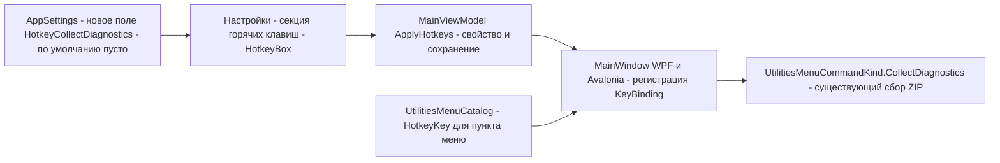
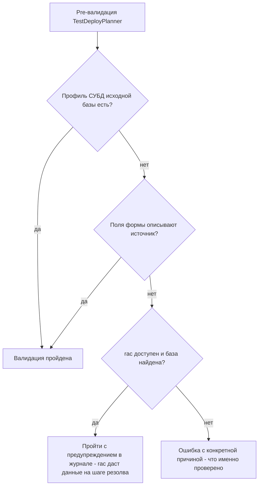

# План v1.0.0.123 (фактическая версия 1.0.1.23) — issues #79, #83, #89, #99

> Issues: [79](https://github.com/sivatorov/Workspace1C/issues/79), [83](https://github.com/sivatorov/Workspace1C/issues/83),
> [89](https://github.com/sivatorov/Workspace1C/issues/89), [99](https://github.com/sivatorov/Workspace1C/issues/99) — все OPEN.
> Отобраны по правилу: последний комментарий в issue НЕ от владельца (sivatorov) — последний комментарий
> во всех четырёх оставлен пользователями **7OH** / подтверждение после фикса в v1.0.1.22.
> Все четыре уже частично исправлены в v1.0.1.22; в этом цикле закрываются **остаточные** замечания.
>
> Версия: 1.0.1.22 → **1.0.1.23** (только последний номер; пользовательская схема — «v1.0.0.123»).
> Версия задаётся в 4 строках [`Workspace1C/Workspace1C.csproj`](Workspace1C/Workspace1C.csproj:62) —
> `Version`, `AssemblyVersion`, `FileVersion`, `InformationalVersion` (строки 62–65).
>
> Ограничения цикла: issues НЕ закрывать и комментарии в GitHub НЕ добавлять (отдельная задача позже).

---

## 0. Сводка по отобранным issues и результатам анализа

| # | Заголовок | Последний комментарий (автор) | Что осталось сделать |
|---|---|---|---|
| 99 | Сбор диагностики | 7OH: «Ну отлично — так уже удобнее» | Пункты 1–2 (окно «О программе») и пункт меню «Утилиты→Информация→Собрать диагностику» сделаны в v1.0.1.22 и подтверждены. **Остался пункт 3: настраиваемый хоткей «Собрать диагностику»** (владелец обещал его на v1.0.1.23) |
| 83 | Информация о лицензиях в Серверы 1С | 7OH: «Уже ближе… "шь Їрщыр" вместо "Имя файла"… в таблице при этом пусто» | v1.0.1.22 добавил общий [`ConsoleOutputDecoder`](Workspace1C/Services/ConsoleOutputDecoder.cs), но: (а) в сообщении об ошибке вывод ring всё ещё декодирован НЕ той кодировкой; (б) из-за этого парсер не распознаёт лицензии — таблица пустая |
| 89 | Скачивание EXE на Линукс | 7OH: «Скачал "-test1", но увы версию показывает полную 22 и не видит обновления» | Фикс потока загрузки сделан в v1.0.1.22, но проверка сорвалась: в prerelease v1.0.1.22-test1 **версия не понизилась** (показывает «полную 22») — автообновление не предлагает стабильный v1.0.1.22. Нужно чинить тестовый скрипт и проверять цикл на v1.0.1.23 |
| 79 | Развернуть тестовую копию | 7OH: «Вот ЧТО я делаю НЕ ТАК??? … хочу вручную указать данные на форме. RAC доступен. В логах ничего нет» | Журналирование резолва добавлено в v1.0.1.22, но pre-валидация всё ещё **блокирует сценарий, проходящий через rac**: поля формы засчитываются только при точном совпадении имени SQL-БД с исходной базой. Сообщение валидации длинное и не объясняет, что именно не совпало |

---

## 1. Issue #99 — настраиваемый хоткей «Собрать диагностику»

### 1.1 Как устроена система хоткеев (по результатам анализа)

- Строки жестов хранятся в [`AppSettings`](Workspace1C/Models/AppSettings.cs:586) — свойства `HotkeyXxx` (формат HotkeyBox: «F3», «Ctrl+Alt+S», пусто = не назначено).
- Окно настроек редактирует их контролом [`HotkeyBox`](Workspace1C/Controls/HotkeyBox.cs) (WPF) / [`HotkeyBox.Avalonia`](Workspace1C/Controls/HotkeyBox.Avalonia.cs:17).
- Применение: [`MainViewModel.ApplyHotkeys`](Workspace1C/ViewModels/MainViewModel.Display.cs:509) (Avalonia-вариант) и WPF-эквиваленты; событие `HotkeysChanged` перерегистрирует привязки окна.
- Матчинг нажатий — [`HotkeyMatcher`](Workspace1C/Services/HotkeyMatcher.cs:33) (физические клавиши, платформонезависимо).
- Пункт меню «Собрать диагностику» уже есть: [`UtilitiesMenuCatalog`](Workspace1C/Services/UtilitiesMenuCatalog.cs:513) — с комментарием «Хоткей пока не назначается (по умолчанию пусто — решение по хоткею отложено)»; обработчики — [`MainWindow.UtilitiesMenu.cs:350`](Workspace1C/Views/MainWindow.UtilitiesMenu.cs:350) (WPF) и [`MainWindow.Avalonia.Tree.cs:2152`](Workspace1C/Views/MainWindow.Avalonia.Tree.cs:2152) (Avalonia).

### 1.2 Изменения

1. **[`Workspace1C/Models/AppSettings.cs`](Workspace1C/Models/AppSettings.cs:586)** — новое свойство
   `public string HotkeyCollectDiagnostics { get; set; } = "";` (по умолчанию ПУСТО — решение 7OH:
   «можно не ставить ничего по умолчанию»), рядом с блоком `HotkeyXxx`.
2. **[`Workspace1C/Services/UtilitiesMenuCatalog.cs:513`](Workspace1C/Services/UtilitiesMenuCatalog.cs:513)** —
   пункту меню «CollectDiagnostics» передать `HotkeyKey = "HotkeyCollectDiagnostics"` вместо null
   (подпись хоткея на пункте меню появится автоматически по образцу остальных пунктов).
3. **MainViewModel (обе платформы)**:
   - WPF: свойство `HotkeyCollectDiagnostics` + включение в загрузку
     ([`MainViewModel.cs:613-686`](Workspace1C/ViewModels/MainViewModel.cs:613)), сохранение
     ([`MainViewModel.Launch.cs:707-760`](Workspace1C/ViewModels/MainViewModel.Launch.cs:707)),
     ApplyHotkeys и список `OnPropertyChanged`;
   - Avalonia: свойство-делегат `_settings.HotkeyCollectDiagnostics` + параметр в
     [`ApplyHotkeys`](Workspace1C/ViewModels/MainViewModel.Display.cs:509) + `OnPropertyChanged`.
4. **Окно настроек (секция «Горячие клавиши»)** — WPF XAML + code-behind и Avalonia-версия настроек:
   строка с [`HotkeyBox`](Workspace1C/Controls/HotkeyBox.cs), привязанная к новому свойству,
   локализация «Горячая клавиша "Собрать диагностику"».
5. **Регистрация нажатия** — WPF: в конвейере `RegisterHotkeys`/`TryParseKeyGesture` главного окна
   (по образцу `HotkeyServicesMenu`); Avalonia: в `MainWindow.Avalonia` KeyBindings через
   [`HotkeyMatcher.Matches`](Workspace1C/Services/HotkeyMatcher.cs:130) → вызов существующего
   `UtilitiesMenuCommandKind.CollectDiagnostics` ([`MainWindow.UtilitiesMenu.cs:350`](Workspace1C/Views/MainWindow.UtilitiesMenu.cs:350)).
6. **Защита от конфликтов** — добавить `settings.HotkeyCollectDiagnostics` в список системных хоткеев
   [`GetKnownSystemHotkeys`](Workspace1C/ViewModels/CustomActionEditViewModel.cs:169), чтобы пользовательские
   действия не могли занять то же сочетание.
7. **Локализация** — ключи в [`ru.json`](Workspace1C/Localization/Languages/ru.json) / `en.json`
   (рядом с существующими `Hotkey.*`): подпись в настройках + подпись хоткея пункта меню.
8. **Тесты** — по образцу `Workspace1C.Tests/EtapHotkeysFavoritesTests.cs`: разбор/нормализация жеста,
   отсутствие конфликта с зарезервированными Alt+1…9.

---

## 2. Issue #83 — лицензии ring: кракозябры в сообщении и пустая таблица

### 2.1 Диагноз по коду

- Цепочка: [`GetInstalledLicensesAsync`](Workspace1C/Services/RingLicenseService.cs:397) запускает
  `ring license list` через [`ProcessRunner`](Workspace1C/Services/ProcessRunner.cs) (в v1.0.1.22 вывод
  проходит через общий `ConsoleOutputDecoder`) → при 0 лицензий `lastCandidateOutput = result.CombinedOutput`
  ([`RingLicenseService.cs:448`](Workspace1C/Services/RingLicenseService.cs:448)) →
  [`BuildNoLicensesMessage`](Workspace1C/Services/RingLicenseService.cs:561) вставляет этот вывод в Warning.
- Симптом 7OH: «…Ответ последней проверенной команды: 499459654270590-500000000037 (шь Їрщыр: "20260907085731.lic")».
  Строка «шь Їрщыр» — это «Имя файла», записанное в cp866 и декодированное как cp1251. Значит
  авто-детектор [`ConsoleOutputDecoder`](Workspace1C/Services/ConsoleOutputDecoder.cs) на этом выводе
  выбрал cp1251 вместо cp866 (метрика «минимум U+FFFD» неоднозначна на коротком выводе с латиницей/цифрами).
- Симптом «в таблице при этом пусто» — следствие того же корня: парсер
  [`RingLicenseOutputParser`](Workspace1C/Services/RingLicenseService.cs:52) ищет маркеры локализованного
  вывода ring («Имя файла: …»), которые после неверного декодирования превратились в «шь Їрщыр: …» —
  паттерн не сматчился, лицензий 0.

### 2.2 Изменения

1. **[`Workspace1C/Services/ConsoleOutputDecoder.cs`](Workspace1C/Services/ConsoleOutputDecoder.cs)** —
   усилить выбор кодировки для вывода консольных утилит 1С в Windows:
   - при неоднозначной метрике (U+FFFD одинаково/нет замен ни в cp866, ни в cp1251) предпочитать **cp866** —
     это фактическая кодировка консоли 1С в русской локали Windows;
   - добавить валидационную эвристику: вариант, в котором распознаётся хотя бы один известный маркер
     вывода ring/1С («Имя файла», «Файл лицензии», «Лицензия», date-time-суффикс `.lic`), считается верным
     даже при равной метрике U+FFFD.
2. **[`Workspace1C/Services/RingLicenseService.cs`](Workspace1C/Services/RingLicenseService.cs:52)** —
   сделать парсер лицензий устойчивым к локали/кодировке: помимо текстового маркера «Имя файла», распознавать
   структуру строки по не-локальным признакам — номер лицензии `NNNNNNNNNNNN-NNNNNNNNNNNN` (дефис, 12+10 цифр)
   и путь/имя файла `*.lic` в кавычках. Это гарантирует заполнение таблицы даже если локаль вывода изменится.
3. **`BuildNoLicensesMessage`** ([`RingLicenseService.cs:561`](Workspace1C/Services/RingLicenseService.cs:561)) —
   перед вставкой `lastCandidateOutput` в сообщение прогонять через повторную нормализацию (если в тексте
   есть характерные mojibake-последовательности — переставить декодирование: raw→cp866) и/или показывать
   только цифробуквенные фрагменты; кракозябры в UI-сообщении недопустимы.
4. **Тесты** (`Workspace1C.Tests`, рядом с существующими тестами RingLicense/ConsoleOutputDecoder):
   - реальный пример 7OH: строка с номером «499459654270590-500000000037 (Имя файла: "20260907085731.lic")»
     → парсер должен вернуть лицензию (таблица не пустая);
   - байтовый вывод ring в cp866 → декодер выбирает cp866 (а не cp1251);
   - `BuildNoLicensesMessage` не содержит U+FFFD и кириллического mojibake.
5. **Проверка смежных потребителей** — `rac`, `ibcmd`, `webinst` (всё идёт через `ProcessRunner`):
   регресс-тесты не должны сломаться от смены приоритета кодировки (правка делается консервативно,
   только для неоднозначных случаев).

---

## 3. Issue #89 — автообновление на Linux: prerelease с пониженной версией не работает

### 3.1 Диагноз

- v1.0.1.22-test1 собирался скриптом [`_build_v100122_test1.ps1`](_build_v100122_test1.ps1) с
  `-p:Version=1.0.1.21`. Но 7OH видит «полную 22» и предложение обновления не приходит.
- Причина: в [`Workspace1C.csproj:62-65`](Workspace1C/Workspace1C.csproj:62) версия задана ЧЕТЫРЬМЯ
  отдельными свойствами, в т.ч. **явным** `InformationalVersion`. `-p:Version=1.0.1.21` переопределяет
  `Version`/`FileVersion`, но НЕ явное `InformationalVersion` — сборка показывает в заголовке
  (и, судя по симптомам, использует при сравнении версий) 1.0.1.22. Сравнение
  [`GitHubReleaseService.IsNewerThan`](Workspace1C/Services/GitHubReleaseService.cs) (Version.TryParse,
  4 части) видит «22 ≥ 22» — обновление не предлагается.
- Выбор ассета на Linux корректен и трогать его не нужно:
  [`GitHubReleaseService.cs:24-27`](Workspace1C/Services/GitHubReleaseService.cs:24) — Windows:
  `Workspace1C.exe`, Linux: `Workspace1C-linux-x64` (`#if` по платформе); индикатор загрузок —
  [`UpdateService.Avalonia.cs:850`](Workspace1C/Services/UpdateService.Avalonia.cs:850).
  Исходный репорт «скачивает EXE на Linux» относится к версиям до этой схемы и проверяется фактом:
  на 1.0.1.22-test1 Linux-клиент уже скачивал правильный ассет (загрузка дошла до «скачано байт=…»).

### 3.2 Изменения

1. **Новый скрипт `_build_v100123_test1.ps1`** (по образцу [`_build_v100122_test1.ps1`](_build_v100122_test1.ps1)):
   - пониженная версия передаётся **всеми четырьмя** свойствами:
     `-p:Version=1.0.1.22 -p:AssemblyVersion=1.0.1.22 -p:FileVersion=1.0.1.22 -p:InformationalVersion=1.0.1.22`;
   - в `Show-Artifact` дополнительно проверять `ProductVersion` (InformationalVersion), а не только
     `FileVersion` — чтобы mismatch ловился на этапе сборки, а не пользователем.
2. **`Workspace1C/Workspace1C.csproj:62-65`** — версия релиза 1.0.1.22 → **1.0.1.23** во всех четырёх строках.
3. **Проверка полного цикла на Linux** (после публикации v1.0.1.23): установить prerelease
   v1.0.1.23-test1 (версия 1.0.1.22) → приложение предлагает v1.0.1.23 → скачивание
   `Workspace1C-linux-x64` → замена → перезапуск. Ожидание 7OH: «Подождём следующий релиз — на нём уже и проверю».
4. **CHANGELOG.md** — запись [1.0.1.23] с фиксами #79/#83/#89/#99 (в т.ч. причина сбоя проверки test1).

---

## 4. Issue #79 — мастер «Развернуть тестовую копию» блокирует ручной ввод при доступном rac

### 4.1 Диагноз по коду

- Pre-валидация [`TestDeployPlanner.Validate`](Workspace1C/Services/TestDeployPlanner.cs:250): для
  клиент-серверного источника с движком ibcmd ошибка `TestDeploy.NeedDbmsProfile` добавляется, если
  НЕТ сохранённого профиля СУБД **И** поля формы не «описывают источник»
  ([`FormFieldsDescribeSource`](Workspace1C/Services/TestDeployPlanner.cs:313): имя SQL-БД на форме должно
  точь-в-точь совпасть с `DatabaseName` исходной базы или её профилем).
- Автоподстановка поля «Имя базы данных в СУБД» из имени ЦЕЛЕВОЙ базы («источник_t») делает совпадение
  невозможным → валидация падает, мастер не стартует, хотя **rac доступен** и мог бы отдать данные СУБД
  (rac-попытка сейчас выполняется позже, в `TestDeployService`, до шага «Выгрузка» —
  [`TestDeployService`](Workspace1C/Services/TestDeployService.cs)).
- Сообщение [`TestDeploy.NeedDbmsProfile`](Workspace1C/Localization/Languages/ru.json:4289) перечисляет
  варианты, но не говорит, ЧТО конкретно проверено и что не совпало — отсюда «Вот ЧТО я делаю НЕ ТАК?».
- «В логах ничего нет» — пользователь, вероятно, был ещё на версии до v1.0.1.22 (журналирование
  pre-валидации добавлено именно там); тем не менее проверяем, что после фикса журнал реально пишется
  в окно мастера, а ошибка pre-валидации показывается в UI.

### 4.2 Изменения

1. **[`TestDeployPlanner.cs:286-301`](Workspace1C/Services/TestDeployPlanner.cs:286)** — добавить третью
   «ветку проходимости»: если профиля нет и поля формы не описывают источник, ошибка
   `TestDeploy.NeedDbmsProfile` НЕ добавляется, когда доступен кластер rac с искомой базой (лёгкая проба
   через существующий резолв [`ClusterInfobaseCredentialsResolver`](Workspace1C/Services/ClusterInfobaseCredentialsResolver.cs));
   в этом случае pre-валидация проходит с записью в журнал «профиль не найден — данные СУБД будут получены
   из кластера rac на шаге резолва». Если rac-проба недоступна (rac не настроен/ошибка запуска) — ошибка
   остаётся, но с расширенной конкретикой (п.3).
   Альтернатива при риске задержки pre-валидации (rac-запуск ~секунды): не выполнять пробу в валидаторе,
   а понизить ошибку до предупреждения и пустить сценарий дальше — решается на этапе реализации;
   предпочтителен вариант с пробой, т.к. сохраняет «ошибку до старта операций» из истории #79.
2. **[`TestDeployService.cs`](Workspace1C/Services/TestDeployService.cs)** — убедиться (и закрепить тестом),
   что rac-фоллбек до шага «Выгрузка» журналирует в окно мастера каждый шаг (список кластеров, поиск базы,
   результат) и что неудача rac при отсутствии профиля даёт в UI ту же конкретную причину.
3. **Локализация [`ru.json:4289`](Workspace1C/Localization/Languages/ru.json:4289) / `en.json`** —
   переписать `TestDeploy.NeedDbmsProfile` на конкретику: «Проверено: профиль СУБД исходной базы — нет;
   поля формы (сервер X, база Y) не совпадают с исходной базой (Z); кластер rac — …». Формат-строка
   с подстановками вместо статического текста.
4. **[`TestDeployWindow.cs:565`](Workspace1C/Views/TestDeployWindow.cs:565) /
   [`TestDeployWindow.Avalonia.cs:465`](Workspace1C/Views/TestDeployWindow.Avalonia.cs:465)** —
   автосбор профиля СУБД из формы: при подстановке имени целевой базы («источник_t») не затирать
   пользовательский ввод исходной базы, если он уже заполнен и совпадает с Ref источника (сейчас
   автоподстановка может перезаписать корректные данные и «сломать» совпадение для валидатора).
5. **Тесты** (`Workspace1C.Tests`, рядом с тестами `FormFieldsDescribeSource`):
   - профиль пуст, поля «источник_t» ≠ Ref, rac-проба успешна → валидация проходит;
   - профиль пуст, rac-проба неуспешна → ошибка с конкретной причиной;
   - автоподстановка не затирает корректный ручной ввод.

---

## 5. Прочие обязательные шаги релиза

1. **Версия** — [`Workspace1C/Workspace1C.csproj:62-65`](Workspace1C/Workspace1C.csproj:62):
   1.0.1.22 → 1.0.1.23 (`Version`, `AssemblyVersion`, `FileVersion`, `InformationalVersion`).
2. **CHANGELOG.md** — новая секция `[1.0.1.23] — 2026-11-xx` по образцу `[1.0.1.22]`:
   #99 (хоткей), #83 (кодировка ring + парсер), #79 (pre-валидация + сообщение), #89 (test-скрипт/цикл обновления).
3. **Сборка** — `_build_v100123.ps1` по образцу [`_build_v100122.ps1`](_build_v100122.ps1) (Windows + Linux,
   single-file); при необходимости — `_build_v100123_test1.ps1` для prerelease-проверки #89 (см. п.3.2).
4. **Комментарии/закрытие issues** — НЕ в этом цикле (отдельная задача): после сборки подготовить
   тексты комментариев по образцу `_issue<N>_comment_v100123.md` и отпустить релиз v1.0.1.23.

## 6. Порядок реализации (checklist)

- [ ] Поднять версию до 1.0.1.23 в [`Workspace1C.csproj`](Workspace1C/Workspace1C.csproj:62) (4 строки)
- [ ] #99: `AppSettings.HotkeyCollectDiagnostics` + UtilitiesMenuCatalog + MainViewModel (WPF/Avalonia) + ApplyHotkeys + окно настроек + регистрация в окнах + GetKnownSystemHotkeys + локализация + тесты
- [ ] #83: приоритет cp866/эвристика в [`ConsoleOutputDecoder`](Workspace1C/Services/ConsoleOutputDecoder.cs) + locale-независимый парсер лицензий + чистка mojibake в `BuildNoLicensesMessage` + тесты на примере 7OH
- [ ] #79: rac-ветка в pre-валидации [`TestDeployPlanner`](Workspace1C/Services/TestDeployPlanner.cs:286) + конкретное сообщение `TestDeploy.NeedDbmsProfile` (ru/en) + фикс автоподстановки в окнах мастера + тесты
- [ ] #89: `_build_v100123_test1.ps1` с переопределением всех 4 свойств версии + проверка ProductVersion в артефактах
- [ ] Прогнать тесты Workspace1C.Tests
- [ ] CHANGELOG.md [1.0.1.23]
- [ ] Сборка Windows + Linux (`_build_v100123.ps1`), проверка ассетов релиза (Workspace1C.exe / Workspace1C-linux-x64)
