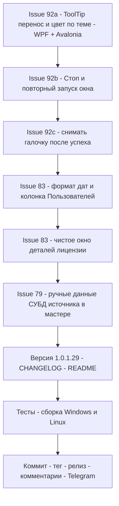

# План релиза v1.0.1.29 — issues #79, #83, #92

> Репозиторий: [sivatorov/Workspace1C](https://github.com/sivatorov/Workspace1C).
> Источник репортов: `_issues_to_work_2026-11-03.md` (снимок от 2026-11-03, комментарии
> по 2026-11-03 14:30 включительно).
> Issues: [#79](https://github.com/sivatorov/Workspace1C/issues/79) (после v1.0.1.28 rac всё
> равно отдаёт пустые свойства базы — `dbms=«», db-server=«», db-name=«», db-user=«»` — и ibcmd
> отвергает СУБД при развёртывании тестовой копии),
> [#83](https://github.com/sivatorov/Workspace1C/issues/83) (после v1.0.1.28 остались: формат
> даты с AM/PM, пустая колонка «Пользователей», мусор в окне деталей лицензии),
> [#92](https://github.com/sivatorov/Workspace1C/issues/92) (после v1.0.1.28 остались: подсказки
> без переносов и нечитаемые в светлой теме, «Остановить не работает и заново выгрузить уже
> невозможно», снимать галочку базы после успешной выгрузки).
>
> Версия: 1.0.1.28 → **1.0.1.29** (увеличивается ТОЛЬКО последнее число; GitHub-тег — `v1.0.129`).
> Версия задаётся в 4 строках [`Workspace1C/Workspace1C.csproj:62`](Workspace1C/Workspace1C.csproj:62) —
> `Version`, `AssemblyVersion`, `FileVersion`, `InformationalVersion` (строки 62–65). Прочие места
> версию не хранят: [`package/linux/deb/DEBIAN/control`](package/linux/deb/DEBIAN/control) —
> плейсхолдер `@VERSION@`, [`package/linux/appimage.sh`](package/linux/appimage.sh) читает
> `InformationalVersion` из csproj. Пример прошлой сборки — `_build_v100128.ps1`.

---

## 0. Сводка и порядок работ

| # | Заголовок | Последний комментарий | Корневая причина (по коду) | Объём в v1.0.1.29 |
|---|---|---|---|---|
| 79 | Развернуть тестовую копию | 7OH 2026-11-03 14:30: лог «Свойства базы из „infobase summary list": dbms=«»…», «тип СУБД «» не поддерживается утилитой ibcmd», «Всё ещё не удачно» | rac 8.5.4 в «infobase summary list» отдаёт ВСЕ поля СУБД пустыми ([`ClusterInfobaseCredentialsResolver.ResolveAsync:248-269`](Workspace1C/Services/ClusterInfobaseCredentialsResolver.cs:248)); fallback «infobase info» падает «Недостаточно прав пользователя» (WARN 7OH 2026-11-02 13:14), кластерный fallback не срабатывает (`parameters.User` пуст, [`ResolveAsync:281-290`](Workspace1C/Services/ClusterInfobaseCredentialsResolver.cs:281)); [`ToProfileWithFallbackDbms:679`](Workspace1C/Services/ClusterInfobaseCredentialsResolver.cs:679) требует непустой db-server — при пустых db-server/db-name из rac профиль НЕ собирается, а полей формы «Данные СУБД источника» в мастере НЕТ (поля `scenario.Dbms/DbServer/DbName` описывают ЦЕЛЕВУЮ базу, берутся для источника только эвристикой [`FormFieldsDescribeSource`](Workspace1C/Services/TestDeployPlanner.cs:388)) | **Полное**: явный ручной блок «Данные СУБД источника» в мастере + приоритет ручных данных в [`ResolveSourceDumpProfileAsync`](Workspace1C/Services/TestDeployService.cs:466) + честные сообщения с подсказкой «движок Конфигуратор» |
| 83 | Информация о лицензиях | 7OH 2026-11-03 14:12: «Информации стало больше — да, клики заработали», 4 уточнения | (1) Срок действия выводится как `dd.MM.yyyy` без времени ([`BuildReadableDetails:331`](Workspace1C/Services/RingLicenseService.cs:331), колонка [`ServerMonitorWindow.Avalonia.cs:718`](Workspace1C/Views/ServerMonitorWindow.Avalonia.cs:718)); (2) колонка «Пользователей» пустая — [`FindValue`](Workspace1C/Services/RingLicenseService.cs) не находит «Количество пользователей» в реальном файле (регистр/формат ключа после длинного ключа); (3) окно деталей показывает «лишние поля» — начало файла до длинного ключа и сам ключ; 7OH просит оставить «Файл лицензии» + поля в формате файла | **Полное**: время в датах (dd.MM.yyyy HH:mm:ss), устойчивый поиск «Количество пользователей», очистка окна деталей от мусора, решение по колонкам «Пользователь»/«Состояние» |
| 92 | Выгрузка списка баз в *.dt | 7OH 2026-11-03 14:27: «подсказки остальных элементов — с переносами; цвет текста подсказок при светлой теме не виден; конфигуратор базу с фоновыми заданиями не выгрузил — ошибки про пустой тип базы в RAC; остановить не работает и заново выгрузить уже невозможно» | (а) строковые ToolTip без переноса и с «тёмным на сером» в светлой теме; (б) финальное состояние окна: после ошибки/отмены `IsRunning` не сбрасывается, «Стоп» не гасит процесс 1cv8 Конфигуратора, повторный запуск требует переоткрытия окна; (в) галочка базы не снимается после успешной выгрузки (пожелание 15:17) | **Полное**: обёртка всех ToolTip + цвет по теме (обе платформы), починка Stop/повтора, снятие галочки после успеха |

**Порядок реализации** (от UI-мелочей к сервисным изменениям):

1. #92-а (ToolTip перенос + цвет, обе платформы) → 2. #92-б (Stop/повтор) → 3. #92-в (галочка) →
4. #83 (даты/«Пользователей»/детали) → 5. #79 (ручные данные СУБД источника в мастере) →
6. Версия 1.0.1.29 / CHANGELOG / README → тесты → сборка Win+Linux → релиз → комментарии → Telegram.



---

## 1. Issue #79 — «Развернуть тестовую копию»: пустые свойства СУБД от rac

### 1.1 Факт по коду (диагноз по логам 7OH)

- Лог 7OH 2026-11-03 14:30: `Свойства базы «Demo_8.3.27» из «infobase summary list»:
  dbms=«», db-server=«», db-name=«», db-user=«»` — это диагностика
  [`ResolveAsync:248-250`](Workspace1C/Services/ClusterInfobaseCredentialsResolver.cs:248) при
  УСПЕШНОМ `match`: rac 8.5.4 нашёл базу, но НЕ отдал ни одного поля СУБД.
- Далее резолвер делает fallback «infobase info» с кредами ИБ
  ([`ResolveAsync:264-306`](Workspace1C/Services/ClusterInfobaseCredentialsResolver.cs:264)) —
  по WARN 7OH 2026-11-02 13:14 rac отвечает `код -1. Недостаточно прав пользователя` даже с
  «верными данными»; fallback на кластерные креды не срабатывает — у записи «Сервера управления»
  нет логина (`parameters.User` пуст).
- Последний шанс — [`ToProfileWithFallbackDbms:679-701`](Workspace1C/Services/ClusterInfobaseCredentialsResolver.cs:679):
  тип СУБД можно взять с формы (`FallbackDbms = scenario.Dbms`,
  [`TestDeployService.cs:496`](Workspace1C/Services/TestDeployService.cs:496)), НО требуется
  непустой db-server ([`ToProfileWithFallbackDbms:685-687`](Workspace1C/Services/ClusterInfobaseCredentialsResolver.cs:685)),
  а rac его не отдал → `null` → итог `TestDeploy.DbmsProfileNotFound`.
- В мастере «Развернуть тестовую копию» поля СУБД (`scenario.Dbms/DbServer/DbName/DbUser/DbPassword`,
  [`TestDeployScenario.cs:153-169`](Workspace1C/Models/TestDeployScenario.cs:153)) описывают
  ЦЕЛЕВУЮ базу; для ИСТОЧНИКА они используются только если
  [`FormFieldsDescribeSource`](Workspace1C/Services/TestDeployPlanner.cs:388) признает их
  «источником» (имя SQL-БД совпадает с Ref источника). Места, где пользователь мог бы ЯВНО
  задать данные СУБД источника, в мастере нет — отсюда «ЧТО я делаю НЕ ТАК???????» (7OH
  2026-11-02 11:16).
- Движок выгрузки Конфигуратор уже есть ([`TestDeployScenario.DumpEngine:192`](Workspace1C/Models/TestDeployScenario.cs:192),
  по умолчанию `BackupEngine.Designer`, [`DumpAsync:328-357`](Workspace1C/Services/TestDeployService.cs:328))
  и не требует СУБД — но ibcmd-путь с ручными данными должен тоже работать.

### 1.2 Изменения

1. **Модель** ([`TestDeployScenario.cs`](Workspace1C/Models/TestDeployScenario.cs)):
   добавить опциональный блок «ручные данные СУБД источника»: `UseSourceDbmsOverride` (bool,
   по умолчанию false), `SourceDbms/SourceDbServer/SourceDbName/SourceDbUser/SourceDbPassword`
   (string). Хранится в JSON сценария (как `DbPassword`); в журнал пароли не выводятся.
2. **UI мастера** ([`TestDeployWindow.cs`](Workspace1C/Views/TestDeployWindow.cs) — окно
   кодовое, общая верстка для WPF/Avalonia): в блоке «Данные СУБД» добавить чекбокс
   «Указать данные СУБД источника вручную (для выгрузки через ibcmd)» и при нём — поля:
   Тип СУБД (ComboBox PostgreSQL/MSSQLServer), Сервер СУБД, Имя базы данных СУБД, Пользователь,
   Пароль. Автозаполнение при включении: Тип/Сервер/Пользователь — из целевых полей формы,
   Имя БД — Ref исходной базы (`source.Connection.DatabaseName`). Стиль полей — единый
   (замечание 7OH 2026-10-28 07:51 про «одни поля серые, вторые с окантовкой» — применить
   одинаковый стиль; заодно в [`ApplyModernStyles`](Workspace1C/Views/TestDeployWindow.cs:627)
   добавить ветку для PasswordBox — регресс-ошибка «TargetType TextBox не соответствует
   PasswordBox» из лога 7OH 2026-10-29 19:41: рекурсия стилизации заходит в PasswordBox и
   применяет TextBox-стиль — проверить и исключить).
3. **Сервис** ([`TestDeployService.ResolveSourceDumpProfileAsync:466`](Workspace1C/Services/TestDeployService.cs:466)):
   приоритет резолва становится: 1) сохранённый профиль источника (как сейчас) →
   2) **явный override формы** (`scenario.UseSourceDbmsOverride && поля заполнены` —
   строится профиль напрямую, без эвристики [`FormFieldsDescribeSource`](Workspace1C/Services/TestDeployPlanner.cs:388))
   → 3) автоподстановка из rac → 4) старая эвристика формы-как-источника. Override
   журналируется («данные СУБД источника заданы вручную»).
4. **Pre-валидация** ([`ResolveRacProfileForValidationAsync:564`](Workspace1C/Services/TestDeployService.cs:564)):
   при активном override rac-проба не требуется — валидация считает данные СУБД заданными;
   при выключенном override поведение прежнее (v1.0.1.26–v1.0.1.28).
5. **Резолвер — честное сообщение** ([`ResolveAsync:346-368`](Workspace1C/Services/ClusterInfobaseCredentialsResolver.cs:346)):
   когда база найдена, но профиль не собран (пустые свойства rac + ошибка «infobase info»),
   дополнить причину подсказкой: «rac не отдал параметры СУБД; задайте данные СУБД источника
   вручную в мастере или выберите движок „Конфигуратор" (не требует пароля СУБД)» — новый
   ключ `TestDeploy.DbmsResolveAdviseManual` (ru/en).
6. **(малое) Fallback кред ИБ по всем источникам** ([`InfobaseAdminCredentialsWithSource:528`](Workspace1C/Services/ClusterInfobaseCredentialsResolver.cs:528)):
   если авторизация «Конфигуратора» пуста — пробовать авторизацию «Предприятия» явно
   (сейчас fallback уходит в общую авторизацию приложения; проверить покрытие тестом и
   журналировать фактический источник второй пробы).
7. **Тесты** ([`Workspace1C.Tests`](Workspace1C.Tests)):
   - приоритет резолва: override формы > rac > эвристика; override не требует
     `FormFieldsDescribeSource`;
   - pre-валидация с override проходит без rac-проб;
   - сообщение `DbmsResolveAdviseManual` добавляется при пустых свойствах rac;
   - JSON-круговорот новых полей `TestDeployScenario`;
   - [`ApplyModernStyles`](Workspace1C/Views/TestDeployWindow.cs:627) не применяет TextBox-стиль
     к PasswordBox (регресс из лога 7OH).

### 1.3 Критерии приёмки

- Сценарий 7OH (серверная база, rac отдаёт пустые свойства, «infobase info» — «Недостаточно прав»):
  пользователь включает «Данные СУБД источника вручную», вводит тип/сервер/имя/пользователя/пароль —
  выгрузка через ibcmd выполняется.
- При движке «Конфигуратор» сценарий работает как раньше, без СУБД.
- Сообщение об ошибке объясняет ОБА пути (ручные данные / Конфигуратор).

### 1.4 Риски

- Новый блок увеличивает и без того плотную форму мастера — схлопывать поля в expander/
  показывать только при чекбоксе; проверить обе платформы и минимальную ширину окна.
- Пароль `SourceDbPassword` в JSON сценария — как у `DbPassword` (уже принято), маскирование
  в журнале не нарушать.
- Override «затирает» безопасную эвристику — приоритет override только при явном чекбоксе,
  в журнале писать источник данных (уже сделано для rac-источника).

---

## 2. Issue #83 — лицензии: 4 уточнения от 7OH (2026-11-03 14:12)

### 2.1 Факт по коду

- Даты: `IssueDate`/`ExpiryDate` — `DateTime`; вывод — `dd.MM.yyyy`
  ([`BuildReadableDetails:328-331`](Workspace1C/Services/RingLicenseService.cs:328),
  колонка «Срок действия» [`ServerMonitorWindow.Avalonia.cs:718`](Workspace1C/Views/ServerMonitorWindow.Avalonia.cs:718),
  WPF-двойник в [`ServerMonitorWindow.xaml.cs`](Workspace1C/Views/ServerMonitorWindow.xaml.cs),
  CSV [`ServerMonitorViewModel.FormatLicenseExpiry:1965`](Workspace1C/ViewModels/ServerMonitorViewModel.cs:1965)).
  В реальном файле 7OH дата содержит время — на экране AM/PM (локаль ОС) и без времени.
- «Пользователей»: парсер ищет ключи «количество пользователей/рабочих мест…»
  ([`ParseLicFile:204-212`](Workspace1C/Services/RingLicenseService.cs:204)) → `LicenseCount`;
  колонка «LicenseCount» уже проброшена ([`ServerMonitorWindow.Avalonia.cs:719`](Workspace1C/Views/ServerMonitorWindow.Avalonia.cs:719)).
  Пусто — значит [`FindValue`](Workspace1C/Services/RingLicenseService.cs) не находит ключ в
  реальном файле (вероятно: регистр, ключ внутри скобок/после точки с запятой, или ключ стоит
  В ОДНОЙ строке с длинным ключом в начале файла). Сэмпл формата — вывод деталей 7OH.
- Окно деталей: [`BuildReadableDetails:308-355`](Workspace1C/Services/RingLicenseService.cs:308)
  уже добавляет распознанные поля + `RawFullText` через
  [`StripLeadingKey`](Workspace1C/Services/RingLicenseService.cs:361). Замечания 7OH:
  «лишние поля — прежде всего весь ключ», «начальная часть до ключа тоже не нужна — только
  „Файл лицензии" оставить», «остальные строки есть под ключом и в более корректном формате».

### 2.2 Изменения

1. **Время в датах**: парсер — при дате в файле распознавать и время
   (`dd.MM.yyyy HH:mm[:ss]`, компактная `yyyyMMddHHmmss` уже есть); отображение —
   `dd.MM.yyyy HH:mm:ss` (без AM/PM, инвариантная/русская локаль) в:
   [`BuildReadableDetails:328-331`](Workspace1C/Services/RingLicenseService.cs:328),
   Avalonia-колонка [`ServerMonitorWindow.Avalonia.cs:717-719`](Workspace1C/Views/ServerMonitorWindow.Avalonia.cs:717),
   WPF-колонка/конвертер в [`ServerMonitorWindow.xaml.cs`](Workspace1C/Views/ServerMonitorWindow.xaml.cs),
   CSV-экспорт [`FormatLicenseExpiry`](Workspace1C/ViewModels/ServerMonitorViewModel.cs:1965).
   Если время в файле не указано — оставить `dd.MM.yyyy`.
2. **«Количество пользователей»**: сделать [`FindValue`](Workspace1C/Services/RingLicenseService.cs)
   устойчивым к реальному формату — регистронезависимое сравнение уже проверить, добавить
   варианты ключей («кол-во пользователей», «число пользователей», «users count», «seats»)
   и поиск ключа НЕ только в начале строки (ключ после `(`/`;`/внутри строки). Юнит-тест на
   сэмпле формата 7OH (фрагмент реального файла, замаскированный) — точка:
   [`ParseLicFile`](Workspace1C/Services/RingLicenseService.cs:147).
3. **Окно деталей без мусора** ([`BuildReadableDetails`](Workspace1C/Services/RingLicenseService.cs:308)):
   - НЕ выводить нераспознанную «шапку» файла (всё до первой содержательной строки
     «ключ=значение») — расширить [`StripLeadingKey`](Workspace1C/Services/RingLicenseService.cs:361)
     до `StripFileNoise`: срезать ведущий длинный ключ И предшествующие/служебные строки;
   - секция содержимого: строки «ключ=значение» как в файле (7OH: «в более корректном
     формате (в том, как оно указано в файле)»), служебные пустые/декоративные строки убрать;
   - строка «Файл лицензии» остаётся (7OH: «только „Файл лицензии" оставить строку»);
   - если распознанных полей 0 и содержимое не парсится — прежний явный текст «файл не
     прочитан/пуст» + путь.
4. **Колонки «Пользователь»/«Состояние»** (вопрос 7OH 2026-11-03 06:50: «откуда данные и
   нужны ли»): «Пользователь» — заполняется из ring-вывода/файла (ключи
   «пользовател/user» уже парсятся); «Состояние» — из ring (`license list`, состояние
   выданной лицензии). Оставить обе колонки, но если у файла-лицензии поле отсутствует —
   пустая ячейка (как сейчас); в подсказке колонки указать источник данных (ring / файл *.lic).
5. **Тесты**: парсер — время в датах, «Количество пользователей» в реальном формате,
   `StripFileNoise` на сэмпле 7OH; [`BuildReadableDetails`](Workspace1C/Services/RingLicenseService.cs:308)
   — отсутствие ключа/шапки в выводе.

### 2.3 Критерии приёмки

- «Срок действия» в формате `dd.MM.yyyy HH:mm:ss` (когда есть время), без AM/PM.
- Колонка «Пользователей» заполнена числом из файла 7OH.
- Окно деталей: «Файл лицензии» + читаемые поля файла; длинный ключ и шапка файла — отсутствуют.

### 2.4 Риски

- Формат *.lic не документирован — эвристики расширять толерантно, юнит-тесты на замаскированном
  сэмпле; нераспознанное не терять (остаётся в полной секции содержимого).
- CSV-экспорт: смена формата даты — потребители (Excel) не ломаются, разделитель прежний.

---

## 3. Issue #92 — массовая выгрузка DT/CF: подсказки, Stop/повтор, галочки

### 3.1 (а) Подсказки: переносы и цвет в светлой теме

**Факт.** В v1.0.1.28 многострочным стал ToolTip только у «Выгружать и запущенные» и пароля
СУБД; остальные элементы — строковые ToolTip. В светлой теме текст подсказок тёмный на сером
фон — нечитаемо (репорт 14:27). Точка: строковые ToolTip в
[`BatchOperationsWindow.xaml.cs`](Workspace1C/Views/BatchOperationsWindow.xaml.cs) /
[`BatchOperationsWindow.Avalonia.cs`](Workspace1C/Views/BatchOperationsWindow.Avalonia.cs)
(`ToolTip.SetTip(check, <строка>)`).

**Изменения.**
1. Хелпер (уже появившийся в v1.0.1.28, напр. `UiHelpers.MakeWrappingToolTip`) применить ко
   ВСЕМ строковым ToolTip окна (шаблон, каталог, поиск и т.д.) — обе платформы.
2. Цвет/стиль ToolTip по теме: WPF — стиль `ToolTip` в ресурсах тем
   (Foreground из темы, фон — как у всплывающих подсказок); Avalonia — в `ControlTheme` для
   ToolTip задать Foreground контрастный для светлой/тёмной темы. Проверить в обеих темах
   ([`App.axaml`](Workspace1C/App.axaml) / темы WPF).
3. В окне мастера/настроек аналогичные строковые подсказки, о которых писал 7OH («Подсказки
   для остальных элементов») — пройтись по окнам массовых операций; остальное приложение не
   трогать (объём).

### 3.2 (б) «Остановить не работает и заново выгрузить уже невозможно»

**Факт.** Репорт 14:27 (скрин): после ошибки в конце прогона кнопка «Стоп» не срабатывает,
повторный «Выполнить» недоступен — только переоткрытие окна. По коду:
- исполнитель — [`DefaultExecutorAsync:805`](Workspace1C/ViewModels/BatchOperationsViewModel.cs:805),
  Designer-ветка ждёт событие [`WaitForDesignerBatchAsync:842`](Workspace1C/ViewModels/BatchOperationsViewModel.cs:842);
  отмена — CancellationToken, но процесс 1cv8, запущенный
  [`OneCLauncher.RunDesignerBatch`](Workspace1C/Services/OneCLauncher.DesignerBatch.cs), при
  «Стоп» не гасится (в отличие от ibcmd-ветки) — Конфигуратор продолжает работать, окно висит.
- финальное состояние: `IsRunning`/кнопки должны сбрасываться в `finally` — проверить путь
  раннего выхода (исключение в цикле по базам) — точка: цикл выполнения
  [`BatchOperationsViewModel.cs:560-760`](Workspace1C/ViewModels/BatchOperationsViewModel.cs:560).

**Изменения.**
1. Designer-ветка: хранить запущенный `Process` (возвращать из
   [`OneCLauncher.RunDesignerBatch`](Workspace1C/Services/OneCLauncher.DesignerBatch.cs) или
   реестр активных процессов) и при отмене — `Kill(entireProcessTree: true)` по образцу
   прерывания из резервного копирования ([`BackupService.cs`](Workspace1C/Services/BackupService.cs));
   в журнале — «процесс Конфигуратора остановлен».
2. Гарантированный сброс состояния в `finally`: `IsRunning=false`, кнопки «Выполнить/Стоп»
   снова доступны, итог по журналу — даже при исключении/отмене. Юнит-тест: executor бросил
   исключение → состояние окна восстановлено.
3. Повторный запуск без переоткрытия окна: очищать per-run состояние (журнал — по кнопке,
   прогресс — сброс, отметка текущей базы).

### 3.3 (в) Снимать галочку базы после успешной выгрузки

**Факт/изменение.** Пожелание 7OH 2026-11-03 15:17. В цикле после успешного результата базы —
снять её выбор (`IsChecked=false` / убрать из выбранных, не трогая пользовательский фильтр
поиска); в журнале это видно по итоговой строке. Точка: после `result.Success` в цикле
[`BatchOperationsViewModel.cs:690-710`](Workspace1C/ViewModels/BatchOperationsViewModel.cs:690).

### 3.4 Тесты и риски

- Тесты: `StripFileNoise` не входит сюда; здесь — сброс состояния после исключения, снятие
  галочки после успеха (VM-тест с мок-исполнителем).
- Риски: убийство процесса 1cv8 — убивать ТОЛЬКО процесс своей базы (реестр по
  infobase/outputPath), не чужие; `Kill(entireProcessTree)` на Linux —
  `Process.Kill(true)` поддержан; при «Стоп» между базами — не ронять общий цикл.

---

## 4. Версия, CHANGELOG, README

1. **Версия**: [`Workspace1C/Workspace1C.csproj:62-65`](Workspace1C/Workspace1C.csproj:62) —
   `Version`, `AssemblyVersion`, `FileVersion`, `InformationalVersion` → **1.0.1.29** (4 строки).
2. **CHANGELOG.md** ([`CHANGELOG.md:14`](CHANGELOG.md:14)) — новая секция
   `## [1.0.1.29] — 2026-11-03` по формату Keep a Changelog (как [1.0.1.28]):
   - **Исправлено**: #79 (пустые свойства СУБД от rac — ручные данные СУБД источника в мастере
     + честные сообщения), #83 (формат даты «Срок действия», колонка «Пользователей», мусор в
     окне деталей), #92 (подсказки: переносы и цвет в светлой теме; «Стоп» гасит Конфигуратор,
     окно снова работоспособно после ошибки/отмены).
   - **Добавлено**: #79 — блок «Данные СУБД источника» в мастере; #92 — снятие галочки базы
     после успешной выгрузки.
3. **README.md**: строка 3 (бейдж версии), строка 11 («актуальная версия — 1.0.1.29»),
   раздел «Что нового» — краткий абзац по v1.0.1.29.
4. **Скрипты релиза**: скопировать `_build_v100128.ps1` → `_build_v100129.ps1`
   (`$Version = '1.0.1.29'`, логи `_publish_100129.log`/`_build_linux_100129.log`,
   `publish\out-1.0.1.29`); по образцу прошлых циклов — Telegram-скрипт и сообщение.

---

## 5. Проверки и сборка

1. **Юнит-тесты**: `dotnet test Workspace1C.Tests` (из решения `Workspace1C.slnx`) — все
   существующие зелёные; новые:
   - #79: приоритет override-профиля, pre-валидация с override, `DbmsResolveAdviseManual`,
     JSON-круговорот `TestDeployScenario`, `ApplyModernStyles`/PasswordBox;
   - #83: время в датах, «Количество пользователей» на сэмпле 7OH, `StripFileNoise`,
     `BuildReadableDetails` без ключа/шапки;
   - #92: сброс состояния после исключения, снятие галочки после успеха.
2. **Сборка Windows**: `dotnet build Workspace1C.slnx -c Debug` — без новых предупреждений.
3. **Сборка Linux-конфигурации на Windows**:
   `Workspace1C\build-linux-single-file.ps1 -p:ForceLinux=true` — правки обеих платформ
   компилируются ([`TestDeployWindow.cs`](Workspace1C/Views/TestDeployWindow.cs),
   [`ServerMonitorWindow.Avalonia.cs`](Workspace1C/Views/ServerMonitorWindow.Avalonia.cs),
   [`BatchOperationsWindow.Avalonia.cs`](Workspace1C/Views/BatchOperationsWindow.Avalonia.cs)).
4. **Релизная сборка**: `_build_v100129.ps1` (Windows + Linux single-file), проверка
   `FileVersion/ProductVersion == 1.0.1.29` в артефактах.
5. **Ручная проверка** (чек-лист):
   - мастер: сценарий 7OH — rac с пустыми свойствами + ручные данные СУБД источника →
     ibcmd-выгрузка и развёртывание проходят;
   - мастер: PasswordBox не падает («TargetType TextBox…»), поля в едином стиле;
   - лицензии: срок действия `dd.MM.yyyy HH:mm:ss`, «Пользователей» заполнена, в деталях нет
     длинного ключа/шапки;
   - массовая выгрузка: подсказки переносятся и читаются в светлой теме; «Стоп» гасит 1cv8
     Конфигуратора; после ошибки окно снова позволяет запустить прогон; галочка успешной базы
     снимается.

---

## 6. Черновики комментариев для GitHub issues (после релиза; issues НЕ трогать до выпуска)

### #79
> **Исправлено в [v1.0.1.29](https://github.com/sivatorov/Workspace1C/releases/tag/v1.0.129)**
>
> @7OH, диагностика показала: rac 8.5.4 в «infobase summary list» не отдаёт НИ ОДНОГО поля СУБД
> (dbms/db-server/db-name/db-user — пустые), а «infobase info» на вашей базе отвечает
> «Недостаточно прав пользователя» — собрать профиль СУБД для ibcmd программе попросту не из
> чего. Поэтому:
> 1. В мастере «Развернуть тестовую копию» появился блок **«Данные СУБД источника»** —
>    включите «указать вручную», поля подставятся автоматически (тип/сервер — из целевых полей,
>    имя БД — из Ref источника), поправьте при необходимости — и выгрузка через ibcmd пойдёт.
> 2. Сообщение об ошибке теперь прямо советует оба выхода: ручные данные СУБД источника ИЛИ
>    движок «Конфигуратор» (пароль СУБД не нужен в принципе).
> 3. Заодно исправлено падение окна со стилем PasswordBox («TargetType TextBox…»).

### #83
> **Исправлено в [v1.0.1.29](https://github.com/sivatorov/Workspace1C/releases/tag/v1.0.129)**
>
> @7OH, по четырём пунктам:
> 1. «Срок действия» — в формате `dd.MM.yyyy HH:mm:ss`, без AM/PM.
> 2. Колонка «Пользователей» — теперь заполняется из «Количество пользователей» файла (парсер
>    стал устойчивее к реальному формату файла).
> 3. Окно просмотра лицензии очищено: длинный начальный ключ и «шапка» файла убраны — остались
>    строка «Файл лицензии» и поля в том виде, как в файле.
> 4. Колонки «Пользователь»/«Состояние» берутся из вывода ring; если поля нет — пустая ячейка.

### #92
> **Исправлено в [v1.0.1.29](https://github.com/sivatorov/Workspace1C/releases/tag/v1.0.129)**
>
> @7OH:
> 1. Все подсказки окна переносятся на несколько строк; цвет текста подсказок исправлен для
>    светлой темы (теперь контрастный, читается).
> 2. «Стоп» теперь гасит процесс Конфигуратора (1cv8); после ошибки/остановки окно снова
>    работоспособно — повторный запуск без переоткрытия.
> 3. Галочка базы снимается автоматически после успешной выгрузки.

---

## 7. Коммит

Сообщение (по образцу `_commit_msg_v100128.txt`):

```
v1.0.1.29: manual source DBMS, license details, batch window fixes

- #79: manual source DBMS override in test-deploy master; clear rac
  empty-properties message; PasswordBox style crash fix
- #83: expiry date with time, license seats column, clean details view
- #92: wrapping/contrasting tooltips, working Stop + reusable window,
  uncheck base after successful dump
```

Тег: `v1.0.129` (полный тег короче 4-частной версии — как `v1.0.128`).
