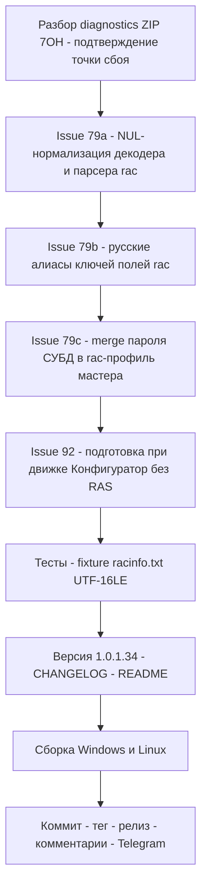

# План релиза v1.0.1.34 — issues #79, #92

> Репозиторий: [sivatorov/Workspace1C](https://github.com/sivatorov/Workspace1C).
> Источник: [_issues_to_work_v100134.md](_issues_to_work_v100134.md) — 2 issues с последним
> комментарием не от sivatorov:
> [#79](https://github.com/sivatorov/Workspace1C/issues/79) «Развернуть тестовую копию»
> (7OH 2026-11-04 21:24 МСК: «Форма — отлично. Основная задача — нет» + [racinfo.txt](https://github.com/user-attachments/files/34386889/racinfo.txt)
> и `diagnostics_20261104_211845.zip`),
> [#92](https://github.com/sivatorov/Workspace1C/issues/92) «выгрузка списка баз в файл *.dt»
> (7OH 2026-11-04 21:48 МСК: при выключенном RAS выгрузка движком «Конфигуратор» падает
> с rac-ошибкой, хотя Конфигуратору RAS не нужен).
>
> **НЕ дублировать уже сделанное** (v1.0.1.14–v1.0.1.33): таймауты 90 с + повтор rac-команд,
> перебор форматов `--cluster` (0/1/2), UTF-16/BOM-декодер + fallback «infobase info» в файл,
> preview сырого вывода в CM_RAC, ручной блок «Данные СУБД источника», перекомпоновка мастера,
> ComboBox СУБД без MySQL/MariaDB, движок «ibcmd/Конфигуратор» в массовой выгрузке,
> статичный заголовок «Выгрузка в DT/CF», пункт «Список выгрузок» в контекстном меню
> ([ContextMenuCatalog.cs:359](Workspace1C/Services/ContextMenuCatalog.cs:359), GroupBackup).
>
> Версия: 1.0.1.33 → **1.0.1.34** (только последний номер). Версия задаётся в 4 строках
> [`Workspace1C/Workspace1C.csproj:62-65`](Workspace1C/Workspace1C.csproj:62) — `Version`,
> `AssemblyVersion`, `FileVersion`, `InformationalVersion`. Прочие места версию не хранят:
> [`package/linux/deb/DEBIAN/control`](package/linux/deb/DEBIAN/control) — плейсхолдер `@VERSION@`,
> [`package/linux/appimage.sh`](package/linux/appimage.sh) читает `InformationalVersion`.
> GitHub-тег — `v1.0.134`.

---

## 0. Сводка и порядок работ

| # | Заголовок | Последний комментарий | Корневая причина (по коду и данным 7OH) | Объём в v1.0.1.34 |
|---|---|---|---|---|
| 79 | Развернуть тестовую копию | 7OH 2026-11-04 21:24: форма открывается, выгрузка тестовой копии — нет; приложен racinfo.txt | **rac 8.5.4.1878 у 7OH пишет вывод `infobase info` в UTF-16LE** (racinfo.txt — посимвольно с NUL-байтами). Декодер справляется, но (а) зачистка NUL сделана только в [`ParseInfo`](Workspace1C/Services/RacOutputParser.cs:172) — в [`LooksLikeKeyValueOutput`](Workspace1C/Services/RacOutputParser.cs:362)/[`TryParseKeyValueBlocks`](Workspace1C/Services/RacOutputParser.cs:288)/`LooksLikeUsageHelp` её нет; (б) rac ЛОКАЛИЗУЕТ вывод («Использование:» — прецедент в [`LooksLikeUsageHelp`](Workspace1C/Services/RacClient.cs:378)) — русские ключи полей (`информационная база`, `имя`, `субд`, `сервер бд`, …) парсер не знает; (в) профиль из rac всегда с пустым паролем СУБД, ручной пароль мастера в него НЕ подмешивается ([TestDeployService.cs:514-521](Workspace1C/Services/TestDeployService.cs:514)) — даже при успешном парсинге ibcmd падает на авторизации `sa` | **Полное**: NUL-нормализация на уровне декодера/парсера, русские алиасы ключей, fixture-тест на реальном racinfo.txt, merge пароля из ручных полей в rac-профиль |
| 92 | выгрузка списка баз в файл *.dt | 7OH 2026-11-04 21:48: «если выключить службы RAS — выгрузка через конфигуратор всегда с ошибкой поиска данных в сервере. Хотя этого происходить не должно» | Движок «Конфигуратор» не требует rac, но фаза «Перед операцией» ([`ApplyBeforeAsync`](Workspace1C/Services/BatchOpsPreparationService.cs) — завершение сеансов/блокировки через rac) выполняется и для Designer; при недоступном RAS rac-ошибка → база Skipped → выгрузка не выполняется ([BatchOperationsViewModel.cs:596-638](Workspace1C/ViewModels/BatchOperationsViewModel.cs:596)). rac-резолв профиля для Designer уже исключён (строка 671) — осталась фаза подготовки | **Средний**: для Designer сбой rac-подготовки не прерывает выгрузку (предупреждение в журнал); rac-опции подготовки для Designer скрываются; проверка одиночного пути «Выгрузить в dt» на rac-зависимости; тесты |

**Порядок реализации**:

1. Разобрать `diagnostics_20261104_211845.zip` — подтвердить фактическую точку сбоя #79
   (лог теперь содержит preview первых 500 символов вывода `infobase info`, строка
   `RAC: infobase info — stdout=N симв., начало вывода: …` — по ней сразу видно
   mojibake/UTF-16/чистый текст/пустоту). Скорректировать пп. 1–3 при иной картине.
2. #79-а: NUL-нормализация декодера и парсера → 3. #79-б: русские алиасы ключей →
4. #79-в: merge пароля СУБД в rac-профиль → 5. #92: подготовка при движке Designer →
6. Тесты → 7. Версия/CHANGELOG/README → 8. Сборка Win+Linux → 9. Релиз →
10. Комментарии в #79/#92 (после публикации) → 11. Telegram.

---

## 1. Issue #79 — «Развернуть тестовую копию»: парсинг вывода rac

### 1.1 Факты по коду и данным пользователя

1. **racinfo.txt (7OH) — UTF-16LE.** Файл содержит вывод `rac infobase info` посимвольно
   с NUL-байтами (`i\0n\0f\0o\0b\0a\0s\0e\0 … : \04\02\05…`). Ключи — английские
   (`infobase`, `name`, `dbms`, `db-server`, `db-name`, `db-user`), значения заполнены
   (`MSSQLServer`, `localhost`, `Demo_8.3.27`, `sa`), разделитель ` : `, кавычек нет.
   Вывод rac **сам по себе валиден** — проблема в приёме/разборе на стороне приложения.
2. **Цепочка приёма**: [`RacClient.RunAsync`](Workspace1C/Services/RacClient.cs:1321) читает
   stdout **сырыми байтами** ([`ReadToEndBytesAsync`](Workspace1C/Services/RacClient.cs:1490)) →
   [`DecodeRacOutput`](Workspace1C/Services/RacClient.cs:1506) →
   [`ConsoleOutputDecoder.Decode`](Workspace1C/Services/ConsoleOutputDecoder.cs:49):
   BOM UTF-16 → эвристика NUL-байтов → строгий UTF-8 → cp866/cp1251. v1.0.1.31 добавил
   UTF-16-поддержку и зачистку `"\0"` — но **только в [`ParseInfo`](Workspace1C/Services/RacOutputParser.cs:182)**.
3. **Лог-строка «Свойства базы … dbms=«»…»** — это
   [`BatchOps.DbmsResolveSummaryFieldsFormat`](Workspace1C/Services/ClusterInfobaseCredentialsResolver.cs:256):
   печатает поля из **«infobase summary list»**, где rac 8.5.4 заведомо отдаёт пустые
   dbms/db-server/db-name/db-user (известное поведение, учтено в v1.0.1.30: профиль из
   summary принимается только при непустом DbServer, иначе — гарантированный fallback
   на «infobase info»). То есть пустая строка в логе — не обязательно точка сбоя; сбой —
   дальше, в разборе «infobase info» или на шаге выгрузки.
4. **Оставшиеся пробоины**:
   - (а) NUL-зачистка только в `ParseInfo`. Если вывод где-либо проходит как
     «декодированный, но с NUL-символами» (двойное декодирование, другой путь чтения,
     el runtime-поведение пайпа), ключи в
     [`LooksLikeKeyValueOutput`](Workspace1C/Services/RacOutputParser.cs:362),
     [`TryParseKeyValueBlocks`](Workspace1C/Services/RacOutputParser.cs:306),
     `LooksLikeUsageHelp`, а также сопоставление имён баз
     ([`NormalizeInfobaseName`](Workspace1C/Services/ClusterInfobaseCredentialsResolver.cs:497))
     ломаются: `"db\0m\0s"` ≠ `"dbms"`.
   - (б) rac локализует вывод (прецедент: русская справка «Использование:» обрабатывается
     в `LooksLikeUsageHelp`). На машинах с русской локалью сообщений rac ключи полей
     могут приходить русскими (`информационная база`, `имя`, `субд`, `сервер бд`,
     `имя базы данных`, `пользователь бд`, `описание`) — парсер их не знает → все поля
     пустые при валидном выводе. Это ровно симптом из issue.
   - (в) Даже при успешном парсинге: [`ToProfile`](Workspace1C/Services/ClusterInfobaseCredentialsResolver.cs:731)
     возвращает профиль с `Password = string.Empty` (rac пароль СУБД не возвращает никогда),
     а в [`TestDeployService.ResolveSourceDbmsProfileAsync`](Workspace1C/Services/TestDeployService.cs:514)
     rac-профиль возвращается «как есть» — ручной пароль из мастера
     (`scenario.SourceDbPassword`, поле блока «Данные СУБД источника») подмешивается
     ТОЛЬКО при включённом override целиком. У 7OH MS SQL с `sa`+паролем: ibcmd без пароля
     падает на подключении → «основная задача — нет».

### 1.2 Изменения

1. **NUL-нормализация на уровне декодера**
   ([`ConsoleOutputDecoder.Decode`](Workspace1C/Services/ConsoleOutputDecoder.cs:49)):
   после выбора кодировки, если строка содержит `'\0'` (остатки «чужой» декодировки
   UTF-16 как однобайтовой кодировки) — вычистить `'\0'` и `\uFEFF` из строки
   (новый приватный хелпер `SanitizeDecodedText`). Валидный вывод консольных утилит
   NUL не содержит — преобразование безопасно. Это чинит ВСЕХ потребителей
   (rac, ibcmd, ring) одной точкой, вместо дублирования `Replace("\0", …)`.
2. **Защита парсера** ([`RacOutputParser.cs`](Workspace1C/Services/RacOutputParser.cs)):
   - в `LooksLikeKeyValueOutput` и `TryParseKeyValueBlocks` — та же зачистка
     `'\0'`/`\uFEFF`, что в `ParseInfo` (строка 182), чтобы поведение было одинаковым
     при любом пути попадания текста;
   - сравнение ключей уже OrdinalIgnoreCase — добавить нормализацию ключа
     (Trim + удаление `'\0'`) в одном месте.
3. **Русские алиасы ключей** (`ToInfobaseInfo`, `ToInfobaseSummaries`, `ToClusterInfo`):
   - расширить `Get`/`GetAny`: искать значение сначала по английскому ключу, затем по
     русским алиасам. Маппинг для `infobase info`/summary:
     `infobase` ← `информационная база`; `name` ← `имя`; `descr` ← `описание`;
     `dbms` ← `субд`, `тип субд`; `db-server` ← `сервер бд`, `сервер субд`;
     `db-name` ← `имя базы данных`, `база данных`; `db-user` ← `пользователь бд`,
     `пользователь субд`; `locale` ← `локаль`; `sessions-deny` ← `блокировка начала сеансов`;
     `scheduled-jobs-deny` ← `блокировка регламентных заданий`.
   - Алиасы применяются ТОЛЬКО когда английский ключ не найден/пуст — исключает
     коллизии с англоязычными значениями.
   - Предусмотреть mojibake-вариант русских ключей: добавить эвристику
     «перезакодировать ключ cp1251→cp866 и проверить алиасы» по образцу
     [`FixCp1251ToCp866Mojibake`](Workspace1C/Services/ConsoleOutputDecoder.cs:167)
     (для ключей, а не значений — ключи короткие и известные).
4. **Fixture-тест на реальных данных**: в `Workspace1C.Tests` добавить ресурс/inline
   массив байтов, повторяющий racinfo.txt (UTF-16LE): `ConsoleOutputDecoder.Decode(bytes)`
   → `RacOutputParser.ToInfobaseInfo` → Dbms=`MSSQLServer`, DbServer=`localhost`,
   DbName=`Demo_8.3.27`, DbUser=`sa`. Плюс кейсы: UTF-16LE без BOM, текст с NUL-символами,
   русские ключи, значения в двойных кавычках, разделитель ` : `.
5. **Merge пароля СУБД в rac-профиль**
   ([`TestDeployService.ResolveSourceDbmsProfileAsync`](Workspace1C/Services/TestDeployService.cs:514)):
   если `fromRac` получен, а `scenario.SourceDbPassword`/`SourceDbUser` заполнены —
   дополнить профиль пустыми полями из ручных полей мастера (пароль/пользователь),
   с записью в журнал «пароль СУБД источника взят из полей мастера». Правило:
   rac-значения приоритетны, ручные поля заполняют только ПУСТЫЕ (пароль всегда пуст).
   Аналогично в массовом окне проблема уже решена
   ([`BatchOperationsViewModel.cs:710-716`](Workspace1C/ViewModels/BatchOperationsViewModel.cs:710)
   — `SqlPassword` подставляется в resolvedProfile) — мастер был последним местом разрыва.
6. **Диагностика**: preview сырого вывода `infobase info` в CM_RAC уже есть
   ([`RacClient.cs:1056-1058`](Workspace1C/Services/RacClient.cs:1056)) — оставить как есть;
   при нераспознавании добавить в WARN первые ~100 символов + признак «есть NUL-символы».

### 1.3 Как проверить (#79)

1. Юнит-тесты: fixture racinfo.txt (UTF-16LE, с BOM и без), русские ключи, NUL-текст,
   кавычки, merge пароля (`TestDeployService` — чистые хелперы).
2. Ручной сценарий (машина с rac 8.5.4.1878): мастер «Развернуть тестовую копию» на
   серверной базе MSSQLServer → в журнале `infobase info — stdout=N симв., начало вывода…`
   показывает чистые ключи; профиль собран `MSSQLServer/localhost/Demo…/sa`; выгрузка .dt
   через ibcmd проходит (пароль подставлен из полей мастера); тестовая база создаётся
   и заполняется.

**Риски.**
- Русские алиасы: ложное срабатывание исключено приоритетом английских ключей; риск
  только в неверном маппинге — покрыть тестами.
- Санкция NUL в декодере: теоретически изменит существующий mojibake-вывод (стал бы
  «читаемее») — на парсинг английских ключей влияет положительно.
- Merge пароля: не перезаписывать непустые rac-значения; пароль только из явных полей.

---

## 2. Issue #92 — массовая выгрузка: движок «Конфигуратор» без RAS

### 2.1 Факт по коду

- Движок «Конфигуратор» для DumpDt/DumpCf уже реализован (v1.0.1.28):
  [`DefaultExecutorAsync`](Workspace1C/ViewModels/BatchOperationsViewModel.cs:902) →
  `OneCLauncher.RunDesignerBatch` (1cv8 DESIGNER /DumpIB /DumpCfg) — авторизация ИБ из
  свойств базы, rac и пароль СУБД не нужны.
- rac-резолв профиля для Designer уже пропущен
  ([`BatchOperationsViewModel.cs:670-671`](Workspace1C/ViewModels/BatchOperationsViewModel.cs:670)).
- НО фаза «Перед операцией»
  ([`BatchOperationsViewModel.cs:596-638`](Workspace1C/ViewModels/BatchOperationsViewModel.cs:596) →
  [`BatchOpsPreparationService.ApplyBeforeAsync`](Workspace1C/Services/BatchOpsPreparationService.cs)):
  завершение сеансов/блокировки через rac (`session terminate`, `infobase update`) —
  выполняется и при движке Designer. При выключенных службах RAS rac-ошибка
  («Ошибка соединения с сервером») → `prepareUndo.Success = false` → база **Skipped**,
  выгрузка не выполняется. Это ровно репорт 7OH («ошибка поиска данных в сервере»)
  и скриншоты aepkugesi от 2026-11-04 17:43–18:09.
- Для Designer сейчас дизейблится только строка блокировок
  ([`PrepareDenyRow.IsEnabled = !designerEngine`](Workspace1C/Views/BatchOperationsWindow.xaml.cs:150)),
  чекбоксы «Завершать сеансы»/«Блокировать новые сеансы» остаются активными.

### 2.2 Изменения

1. **Подготовка при движке Designer не блокирует выгрузку**
   ([`BatchOperationsViewModel.cs:596`](Workspace1C/ViewModels/BatchOperationsViewModel.cs:596)):
   - если `Kind is DumpDt/DumpCf && DumpEngine == Designer`:
     rac-фаза подготовки либо не запускается вовсе, либо её сбой НЕ переводит базу в
     Skipped — в журнал пишется предупреждение «подготовка через rac не выполнена
     (RAS недоступен/ошибка) — выгрузка Конфигуратором продолжается; rac не требуется»,
     операция идёт дальше. Рекомендуемый вариант: НЕ запускать `ApplyBeforeAsync`
     для Designer-выгрузок вообще (завершение сеансов rac-ом для Конфигуратора
     неприменимо — Конфигуратор сам держит монопольный доступ к файловой базе),
     а чекбоксы подготовки скрыть/дизейблить по аналогии с `PrepareDenyRow`
     (обе платформы: [`BatchOperationsWindow.xaml.cs`](Workspace1C/Views/BatchOperationsWindow.xaml.cs),
     [`BatchOperationsWindow.Avalonia.cs`](Workspace1C/Views/BatchOperationsWindow.Avalonia.cs)).
   - для движка ibcmd поведение прежнее (подготовка обязательна, сбой → Skipped).
2. **Проверить одиночный путь** «Резервирование → Выгрузить в dt»
   ([`MainViewModel.Avalonia.Launch.cs:279`](Workspace1C/ViewModels/MainViewModel.Avalonia.Launch.cs:279) и
   WPF-двойник → [`OneCLauncher.DesignerBatch.cs`](Workspace1C/Services/OneCLauncher.DesignerBatch.cs)):
   убедиться, что на пути нет rac-запросов (валидация профиля/кластера). Если есть —
   убрать/обернуть: путь должен работать при выключенном RAS (репорт 7OH «всегда с
   ошибкой поиска данных в сервере» может относиться и к нему).
3. **Локализация**: новый ключ `BatchOps.PrepareSkippedDesigner`
   («Фаза подготовки через rac пропущена: движок „Конфигуратор" не требует RAS») —
   `ru.json`/`en.json`.
4. **Тесты** (`Workspace1C.Tests`):
   - Designer + выброс `RacClientException` из фейковой подготовки → операция
     выполняется, статус не Skipped, журнал содержит предупреждение;
   - ibcmd + сбой подготовки → прежнее поведение (Skipped);
   - чекбоксы подготовки неактивны при Designer (по платформам — по образцу
     существующих тестов окон).

### 2.3 Как проверить (#92)

1. Юнит-тесты выше; полный прогон `Workspace1C.Tests`.
2. Ручной сценарий: остановить службы RAS → массовая выгрузка 2 серверных баз движком
   «Конфигуратор» → обе выгружаются, в журнале предупреждение о пропуске подготовки;
   переключение на ibcmd → прежнее поведение с понятной ошибкой rac.

**Риски.**
- Пользователь, реально хотевший завершить сеансы перед выгрузкой Конфигуратором,
  потеряет эту возможность для Designer — компенсация: явная подпись/подсказка у
  чекбоксов при Designer («недоступно для Конфигуратора»); ibcmd-путь сохраняет опции.
- Не ломать issue #85 (массовые блокировки) — правки только в ветке DumpDt/DumpCf+Designer.

---

## 3. Файлы для изменения

| Файл | Что меняется |
|---|---|
| [`Workspace1C/Services/ConsoleOutputDecoder.cs`](Workspace1C/Services/ConsoleOutputDecoder.cs) | NUL/BOM-санкция декодированного текста (#79-а) |
| [`Workspace1C/Services/RacOutputParser.cs`](Workspace1C/Services/RacOutputParser.cs) | NUL-зачистка в `LooksLikeKeyValueOutput`/`TryParseKeyValueBlocks`; русские алиасы ключей (#79-а/б) |
| [`Workspace1C/Services/TestDeployService.cs`](Workspace1C/Services/TestDeployService.cs) | merge пароля/пользователя СУБД из полей мастера в rac-профиль (#79-в) |
| [`Workspace1C/ViewModels/BatchOperationsViewModel.cs`](Workspace1C/ViewModels/BatchOperationsViewModel.cs) | подготовка при движке Designer: пропуск/не-блокировка (#92) |
| [`Workspace1C/Views/BatchOperationsWindow.xaml.cs`](Workspace1C/Views/BatchOperationsWindow.xaml.cs), [`Workspace1C/Views/BatchOperationsWindow.Avalonia.cs`](Workspace1C/Views/BatchOperationsWindow.Avalonia.cs) | скрытие/дизейбл rac-опций подготовки при Designer (#92) |
| [`Workspace1C/ViewModels/MainViewModel.Avalonia.Launch.cs`](Workspace1C/ViewModels/MainViewModel.Avalonia.Launch.cs) / WPF-двойник | проверка одиночного пути «Выгрузить в dt» на rac-зависимости (#92, при необходимости) |
| [`Workspace1C/Localization/Languages/ru.json`](Workspace1C/Localization/Languages/ru.json), [`en.json`](Workspace1C/Localization/Languages/en.json) | ключи `BatchOps.PrepareSkippedDesigner`, при необходимости текст предупреждений #79 |
| [`Workspace1C.Tests/…`](Workspace1C.Tests) | fixture racinfo.txt, тесты декодера/парсера/merge пароля/подготовки Designer |
| [`Workspace1C/Workspace1C.csproj:62-65`](Workspace1C/Workspace1C.csproj:62) | версия → 1.0.1.34 (4 строки) |
| [`CHANGELOG.md`](CHANGELOG.md), [`README.md`](README.md) | см. п.4 |

**Оценка рисков**: низкая/средняя. Основные — см. пп. 1.2/2.2; обратная совместимость
ibcmd-путей сохраняется полностью, изменения #92 изолированы веткой Designer+Dump.

**Порядок реализации**: п.0 (ZIP) → #79-а → #79-б → #79-в → #92 → тесты →
версия/CHANGELOG/README → сборка → релиз → комментарии → Telegram.

---

## 4. Версия, CHANGELOG, README

1. **Версия**: [`Workspace1C/Workspace1C.csproj:62-65`](Workspace1C/Workspace1C.csproj:62) —
   `1.0.1.33` → `1.0.1.34` в 4 строках (Version/AssemblyVersion/FileVersion/InformationalVersion).
2. **CHANGELOG.md**: новая секция `## [1.0.1.34] — 2026-11-05` (дата релиза уточнить)
   по формату записи [1.0.1.33] (строки 14–33):
   - **Исправлено** — «Развернуть тестовую копию» (issue #79): разбор вывода rac 8.5.4
     в UTF-16 и с русскими ключами полей — свойства базы СУБД (dbms/db-server/db-name/
     db-user) снова распознаются из валидного вывода rac; пароль СУБД из полей мастера
     подставляется в профиль, собранный из rac; массовая выгрузка (issue #92): движок
     «Конфигуратор» больше не блокируется ошибками rac при выключенных службах RAS.
3. **README.md**: обновить бейдж версии (строка ~3), строку «актуальная версия»
   (строка ~11) и абзац «Что нового» (по образцу прошлых релизов).
4. **Скрипты релиза**: по образцу `_build_v100133.ps1` создать `_build_v100134.ps1`
   (`$Version = '1.0.1.34'`, логи `_publish_100134.log`/`_build_linux_100134.log`,
   артефакты `publish\out-1.0.1.34\`); известная особенность: первая WPF-сборка после
   очистки obj может упасть — повторить прогон.

## 5. Тесты и сборка

1. `dotnet test Workspace1C.Tests` — полный набор зелёный; новые кейсы:
   - декодер: UTF-16LE с BOM/без BOM, NUL-текст, русский ключ, кавычки;
   - парсер: fixture racinfo.txt → полные свойства СУБД; русские алиасы; summary-блоки;
   - `TestDeployService`: merge пароля (заполнен/пуст/override включён);
   - `BatchOperationsViewModel`: Designer + сбой rac-подготовки → операция идёт;
     ibcmd — прежнее поведение.
2. Сборка: `Workspace1C.slnx -c Debug` (WPF) + `build-linux-single-file.ps1 -p:ForceLinux=true`
   (Avalonia) — обе платформы компилируются (правки в парных файлах *.cs / *.Avalonia.cs).
3. Релизная сборка `_build_v100134.ps1`, проверка FileVersion/ProductVersion артефактов.

## 6. Комментарии в issues (ТОЛЬКО после публикации релиза; issue НЕ закрывать до подтверждения)

### #79 (черновик)
> **Исправлено в v1.0.1.34**
>
> @7OH, спасибо за racinfo.txt — он показал ключевое: ваш rac 8.5.4 отдаёт вывод
> `infobase info` в кодировке UTF-16 (каждый символ с нулевым байтом). Программа часть
> таких ответов не дочитывала до корректных полей. В v1.0.1.34:
> - декодирование/разбор вывода rac приведены к устойчивости к UTF-16 и «мусорным»
>   нулевым символам на всех этапах (плюс автотест на вашем же файле racinfo.txt);
> - добавлена поддержка русскоязычных имён полей в выводе rac (часть сборок rac
>   локализует вывод — тогда вместо `dbms` приходит «субд» и т.п.);
> - если rac отдал данные СУБД, но без пароля (rac пароль не возвращает никогда),
>   мастер теперь подставляет пароль/пользователя СУБД из полей формы «Развернуть
>   тестовую копию» — раньше профиль уходил в ibcmd с пустым паролем, и подключение
>   к MS SQL падало даже при правильно распознанных данных.
>
> Проверьте, пожалуйста, на v1.0.1.34: если снова не взлетит — свежий ZIP диагностики
> (в лог теперь пишется начало сырого вывода rac — сразу видно, что вернула утилита).

### #92 (черновик)
> **Исправлено в v1.0.1.34**
>
> @7OH, @aepkugesi — согласен, для движка «Конфигуратор» RAS не требуется: выгрузка
> идёт через 1cv8 DESIGNER с авторизацией из свойств базы. В v1.0.1.34 фаза «Перед
> операцией» (завершение сеансов/блокировки через rac) при движке «Конфигуратор» больше
> не блокирует выгрузку: при недоступном RAS в журнал пишется предупреждение, базы
> выгружаются; для движка ibcmd поведение прежнее. Проверьте, пожалуйста.

## 7. Чеклист релиза

- [ ] Скачать и разобрать `diagnostics_20261104_211845.zip` — подтвердить точку сбоя #79 (preview-строка `infobase info`)
- [ ] #79-а: NUL/FEFF-санкция в [`ConsoleOutputDecoder`](Workspace1C/Services/ConsoleOutputDecoder.cs) + парсер [`RacOutputParser`](Workspace1C/Services/RacOutputParser.cs)
- [ ] #79-б: русские алиасы ключей (infobase info / summary / cluster info) + тесты
- [ ] #79-в: merge пароля/пользователя СУБД из полей мастера в rac-профиль ([TestDeployService.cs:514](Workspace1C/Services/TestDeployService.cs:514))
- [ ] #92: подготовка при движке Designer — не блокирует выгрузку, опции скрыты, обе платформы
- [ ] #92: проверка одиночного пути «Выгрузить в dt» на rac-зависимости
- [ ] Fixture-тест racinfo.txt (UTF-16LE) — поля СУБД распознаются
- [ ] Полный прогон `dotnet test Workspace1C.Tests`
- [ ] Версия 1.0.1.34: [`Workspace1C.csproj:62-65`](Workspace1C/Workspace1C.csproj:62), [`CHANGELOG.md`](CHANGELOG.md), [`README.md`](README.md)
- [ ] Сборка `_build_v100134.ps1` — Windows exe + Linux binary, проверка версий артефактов
- [ ] Коммит → push → тег `v1.0.134` → GitHub Release (2 asset'а)
- [ ] Комментарии в #79 и #92 (после релиза; issue не закрывать)
- [ ] Telegram-пост о релизе
