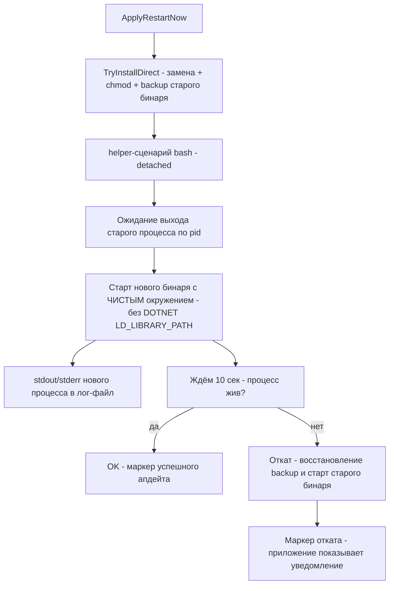

# План релиза v1.0.1.24 — issues #89, #98, #92, #101

> Репозиторий: [sivatorov/Workspace1C](https://github.com/sivatorov/Workspace1C).
> Issues: [#89](https://github.com/sivatorov/Workspace1C/issues/89) (регресс самоперезапуска на Linux),
> [#98](https://github.com/sivatorov/Workspace1C/issues/98) (порядок кнопок — повторный репорт),
> [#92](https://github.com/sivatorov/Workspace1C/issues/92) (переименования меню + раскладка окон + поиск),
> [#101](https://github.com/sivatorov/Workspace1C/issues/101) (видимость иконок на выделенной строке — сначала варианты).
>
> Версия: 1.0.1.23 → **1.0.1.24** (только последний номер).
> Версия задаётся в 4 строках [`Workspace1C/Workspace1C.csproj`](Workspace1C/Workspace1C.csproj:62) —
> `Version`, `AssemblyVersion`, `FileVersion`, `InformationalVersion` (строки 62–65). Это единственное
> место в коде; в заголовок окна версия выводится из `InformationalVersion` (см. `VersionInfo.cs`).

---

## 0. Сводка

| # | Заголовок | Последний комментарий | Корневая причина (по анализу кода) | Что делаем |
|---|---|---|---|---|
| 89 | Скачивание EXE на Линукс | 7OH: обновление до v1.0.1.23 установилось (бинарник заменён, 0755), но перезапуск не удался: `FileNotFoundException: System.IO.Pipes, Version=10.0.0.0` — запуск вручную | См. §1: перезапуск нового процесса из живого старого (`StartDetached`) + наследование окружения + отсутствие диагностики вывода дочернего процесса | Переделать перезапуск: helper-сценарий после выхода старого процесса, чистое окружение, перехват stdout/stderr, liveness-проверка, откат; смок-тест сборки на CI |
| 98 | Поменять местами кнопки | ArtyoZ: «ИИ наобещал, но ничего не сделал» + скриншот | В коде фикс ЕСТЬ (оба окна: WPF XAML:79-88 и Avalonia:142-144) — либо пользователь проверял старую версию, либо на скриншоте другое окно | Воспроизвести на v1.0.1.24, аудит смежных диалогов платформенных окон, ответ в issue |
| 92 | выгрузка списка баз в файл *.dt | 7OH: переименования пунктов меню, пункт «Массовая загрузка из CF» в «Для выделенных», раскладка окон (список слева на всю высоту), поиск-фильтр | Подписи — ключи локализации; раскладка окон — вертикальный стек; поиска нет | Переименования, новый пункт меню, переверстка обоих окон (WPF+Avalonia), фильтр |
| 101 | Сделать красиво ) | 7OH (без комментариев): иконки в строке списка баз плохо видны на зелёном/синем акценте | Значки режимов запуска привязаны к фиксированным кистям темы (`@InfoBrush`/`@WarningBrush`) и не контрастируют с акцентом выделения | СНАЧАЛА: варианты + мокапы + комментарий в issue. Реализация лучшего варианта в v1.0.1.24 (или дефолтный вариант, если нет ответа) |

Порядок работ: #89 → #92 → #98 (аудит/ответ) → #101 (мокапы в issue сразу, реализация по ответу) → версия/CHANGELOG → сборка → релиз → комментарии → Telegram.

---

## 1. Issue #89 — самоперезапуск после обновления на Linux (регресс v1.0.1.23)

### 1.1 Как устроен механизм сейчас (по коду)

- Скачивание: [`UpdateService.Avalonia.cs:843`](Workspace1C/Services/UpdateService.Avalonia.cs) —
  `DownloadNewBinaryAsync` проверяет размер (строго ожидаемый, issue #302) и ELF-сигнатуру
  ([`UpdatePayload.RejectWrongPlatformFile`](Workspace1C/Services/UpdatePayload.cs)). Скачанный файл валиден.
- Установка: [`UpdateService.Avalonia.cs:1065`](Workspace1C/Services/UpdateService.Avalonia.cs) —
  `ApplyRestartNow` → `TryInstallDirect` (строка 1109): staged-копия рядом с целью, `chmod 0755`,
  атомарный `File.Move` поверх работающего бинаря → затем `StartDetached(target)` (строка 1165):
  **новый процесс запускается, пока старый ещё работает** (замечания в issue: «бинарник заменён,
  права 0755» — эта часть отработала).
- Запасной путь: bash-помощник `CreateUpdaterScript` (замена после выхода) — сейчас используется
  только если прямая замена не удалась.

### 1.2 Диагноз (гипотезы, отсортированные по правдоподобию)

Факт 7OH: **тот же бинарник, запущенный вручную, работает**. Значит сам бандл валиден, а ломается
именно контекст запуска дочернего процесса:

- **Г1 — гонка с lock одиночного экземпляра (почти наверняка часть проблемы).**
  [`App.axaml.cs:570`](Workspace1C/App.axaml.cs) — `TryAcquireSingleInstanceLock` открывает файл-лок
  `FileShare.None`. Старый процесс держит лок **в момент запуска нового** → новый экземпляр не берёт
  лок, делает `SignalExistingInstance` и **мгновенно завершается**. Пользователь видит «перезапуск
  не удался». В v1.0.1.22 перезапуск шёл через bash-помощника ПОСЛЕ выхода приложения — гонки не было.
  Регресс введён переходом на прямую замену + `StartDetached` в v1.0.1.23.
- **Г2 — наследование изменённого окружения.** Дочерний процесс (`UseShellExecute=false`) наследует
  окружение родителя целиком, включая изменения [`LinuxProcessEnvironment`](Workspace1C/Services/LinuxProcessEnvironment.cs)
  (`PATH`/`LD_LIBRARY_PATH` с монтированиями 1С) и любые `DOTNET_*`. Ручной запуск — с чистым
  окружением. Возможный след: сбой резолва сборок/нативных библиотек в single-file host.
- **Г3 — `System.IO.Pipes, Version=10.0.0.0`.** Прямых ссылок на `System.IO.Pipes` в коде нет
  (поиск по репозиторию — 0 результатов); ссылка идёт транзитивно от одной из зависимостей
  (Avalonia/SDK). Проверить факт сборки: если сборки нет в single-file бандле, любой «нестандартный»
  контекст запуска проявит FNF. Требует проверки (см. п. 1.3 шаг 1).
- **Г4 — нулевая наблюдаемость.** [`StartDetached`](Workspace1C/Services/UpdateService.Avalonia.cs:1165)
  не перенаправляет stdout/stderr дочернего процесса — crash нового процесса теряется; в журнале
  остаётся только «перезапуск не удался». Без логов пользователя диагноз невозможен (7OH и показал
  только голое сообщение).

### 1.3 Изменения



1. **[`Workspace1C/Services/UpdateService.Avalonia.cs`](Workspace1C/Services/UpdateService.Avalonia.cs)**
   — `ApplyRestartNow` (строка 1065) перевести на схему «замена → helper → старт после выхода»:
   - `TryInstallDirect` перед `File.Move` копировать текущий бинарь в `<target>.cm-update-backup`
     (замена старого backup). Файл-бэкап удаляется новым процессом после успешного старта (п. 3).
   - убрать немедленный `StartDetached`; вместо этого запускать bash-помощник
     (переиспользовать/расширить `CreateUpdaterScript` + `LaunchUpdater`, строки 1092–1101):
     сценарий: `while kill -0 <pid>; sleep 0.2` → старт нового бинаря `exec` с очищенным окружением
     (`unset DOTNET_ROOT DOTNET_* LD_LIBRARY_PATH LD_PRELOAD`, сохранить `DISPLAY`/`WAYLAND_DISPLAY`/
     `XAUTHORITY`/`HOME`/`TMPDIR`/`XDG_*`) → перенаправление stdout/stderr нового процесса в
     лог-файл рядом с журналами обновления (`update-restart.log`).
   - лiveness-проверка в сценарии: через 10 с после старта проверить `kill -0 <newpid>`; если
     процесс умер — восстановить `*.cm-update-backup` на место, снять бэкап, перезапустить старый
     бинарь, дописать в лог строку `ROLLBACK`. Чистые функции генерации сценария (построение строк
     env-очистки, выбор ветки) вынести в тестируемый статический класс.
   - удалить ветку «бинарник заменён, но перезапуск не удался — запустить вручную» как штатную:
     она остаётся только при невозможности запустить помощник.
2. **Диагностика Г3 (`System.IO.Pipes`)** — обязательный проверочный шаг до релиза:
   - локально разобрать `dist/linux-x64/Workspace1C` (ILSpy / `strings <бинарник> | grep System.IO.Pipes`)
     и убедиться, что `System.IO.Pipes.dll` входит в бандл; результат зафиксировать в журнале сборки;
   - если сборки нет — добавить прямую ссылку, чтобы бандлер включил её
     (`<PackageReference Include="System.IO.Pipes" Version="10.0.0" />` в Linux-ItemGroup
     [`Workspace1C.csproj`](Workspace1C/Workspace1C.csproj:172)), и повторить проверку;
   - смок-тест в CI: в job `linux` [`release.yml`](.github/workflows/release.yml:108) после сборки
     запустить бинарь под `xvfb-run` на 15 секунд и проверить, что процесс жив (fail job при падении).
     Это ловит «FNF на старте» до публикации релиза.
3. **Маркер успешного апдейта + чистка бэкапа** —
   [`App.axaml.cs`](Workspace1C/App.axaml.cs) (Avalonia) и [`App.xaml.cs`](Workspace1C/App.xaml.cs)
   (WPF — по симметрии): после успешной инициализации, если задан env `CM_UPDATE_CHILD=1`, удалить
   `<target>.cm-update-backup` и записать «успешно» в `update-restart.log`.
4. **Тесты** (`Workspace1C.Tests`, по образцу `UpdatePayloadTests` / `Release100123Tests`):
   - генератор helper-сценария: содержит ожидание pid, очистку `DOTNET_*`/`LD_LIBRARY_PATH`,
     сохранение `DISPLAY`/`WAYLAND_DISPLAY`, redirect вывода, ветку отката;
   - функция решения «откатывать/не откатывать» по коду завершения/таймауту;
   - регресс: `ApplyRestartNow` больше не вызывает `Process.Start(target)` напрямую.

---

## 2. Issue #98 — порядок кнопок: «Выбрать» слева, «Отмена» справа

### 2.1 Факт по коду

Исправление v1.0.1.22 в коде **есть**:
- WPF: [`PlatformDistributionPickerWindow.xaml:79-88`](Workspace1C/Views/PlatformDistributionPickerWindow.xaml) —
  «Выбрать» (ModernButton, IsDefault) слева, «Отмена» справа, с комментарием «issue #98»;
- Avalonia: [`PlatformDistributionPickerWindow.Avalonia.cs:142`](Workspace1C/Views/PlatformDistributionPickerWindow.Avalonia.cs) —
  тот же порядок;
- смежные: [`PlatformVersionPickerWindow.Avalonia.cs:267`](Workspace1C/Views/PlatformVersionPickerWindow.Avalonia.cs)
  (аудит v1.0.1.22), [`ModalWindowBase.cs:941`](Workspace1C/Views/ModalWindowBase.cs) (общий построитель
  кнопок, «отмена всегда в конце»), [`LoginWindow.Avalonia.cs:221`](Workspace1C/Views/LoginWindow.Avalonia.cs).

### 2.2 Что делаем

1. **Определить окно на втором скриншоте ArtyoZ** (ссылка на приватный image с JWT истекла; при
   реализации — скачать изображение из issue #98 заново и опознать окно). Кандидаты, не покрытые
   прошлым аудитом:
   - [`PlatformDownloadWindow`](Workspace1C/Views/PlatformDownloadWindow.Avalonia.cs) («Скачивание
     версии платформы») — проверить ряд кнопок в обоих вариантах;
   - [`PlatformUpdateWindow.Avalonia.cs:616`](Workspace1C/Views/PlatformUpdateWindow.Avalonia.cs) —
     нижние панели; [`PlatformOldVersionsWindow`](Workspace1C/Views/PlatformOldVersionsWindow.xaml) —
     «Удалить/Отмена»;
   - диалоги цепочек [`UpdateCheckWindow`](Workspace1C/Views/UpdateCheckWindow.Avalonia.cs) —
     «Скачать цепочку/Выбрать…/Открыть».
2. **Ручная проверка на v1.0.1.24**: открыть окно выбора дистрибутива (Обновление платформы →
   «Скачать дистрибутив» и путь из issue #55) на Windows и Linux — порядок «Выбрать» слева /
   «Отмена» справа.
3. **Тесты**: расширить [`Issue98ButtonOrderTests`](Workspace1C.Tests) на найденные окна
   (по образцу проверки порядка в `PlatformDistributionPickerWindow`).
4. **Комментарий в issue #98**: если на текущей сборке порядок корректен — приложить скриншот
   v1.0.1.24 (Windows и Linux) и вежливо уточнить версию сборки, на которой сделан скриншот
   (v1.0.1.22 и v1.0.1.23 вышли в один день — вероятно, проверялась старая версия). Issue не закрывать
   до подтверждения.

---

## 3. Issue #92 — переименования, пункт в «Для выделенных», раскладка, поиск

### 3.1 Переименования пунктов меню «Утилиты»

Подписи берутся из ключей локализации — правки только в словарях:
- [`ru.json:977`](Workspace1C/Localization/Languages/ru.json): `BatchOps.DumpDtTitle`
  «Массовая выгрузка в .dt» → **«Массовая выгрузка в DT/CF»**;
- [`ru.json:978`](Workspace1C/Localization/Languages/ru.json): `BatchOps.LoadCfTitle`
  «Загрузка конфигурации из .cf по списку баз» → **«Массовая загрузка из CF»**;
- аналогично в [`en.json`](Workspace1C/Localization/Languages/en.json) (`Batch Dump to DT/CF`,
  `Bulk Load from CF`);
- проверить потребители ключей: [`UtilitiesMenuCatalog.cs:572-578`](Workspace1C/Services/UtilitiesMenuCatalog.cs)
  (пункты «Утилиты») и заголовки окон (`BatchOps.TitleDumpDt` / `TitleLoadCf` — не трогаем, там
  полный текст уместен). Тест `Issue99DiagnosticsMenuTests`-подобные проверки подписей обновить.

### 3.2 «Массовая загрузка из CF» в подменю «Для выделенных (N)…»

Сейчас в подменю только «Выгрузить в DT\CF…»:
- WPF: [`MainWindow.ContextMenu.cs:330`](Workspace1C/Views/MainWindow.ContextMenu.cs) —
  `PopulateBatchOperationsMenu` добавляет `Main.BatchRunBackup` и `Main.BatchDumpDtCf`;
  обработчик [`MainWindow.Events.cs:1163`](Workspace1C/Views/MainWindow.Events.cs) `OnBatchDumpDtCf_Click`;
- Avalonia: [`MainWindow.Avalonia.Tree.cs:2495`](Workspace1C/Views/MainWindow.Avalonia.Tree.cs) —
  `PopulateRowAvaloniaBatchMenu`, обработчик строки 2661.

Изменения (обе платформы, симметрично):
1. локализация: ключ `Main.BatchLoadCf` = «Загрузить из CF…» (ru/en);
2. добавить пункт подменю после «Выгрузить в DT\CF…» с обработчиком, вызывающим окно с
   `BatchOperationKind.LoadConfig` для **выделенных** баз: в VM уже есть перегрузка
   [`MainViewModel.Tools.cs:2824`](Workspace1C/ViewModels/MainViewModel.Tools.cs) /
   [`MainViewModel.Avalonia.Tools.cs:1618`](Workspace1C/ViewModels/MainViewModel.Avalonia.Tools.cs)
   (`ExecuteBatchDumpCore(bases, kind)`) — вызвать с `kind = LoadConfig`;
3. тест: пункт присутствует в каталоге подменю, вид операции — LoadConfig.

### 3.3 Раскладка окон массовых операций (список слева, на всю высоту) + поиск-фильтр

Текущая компоновка — вертикальный стек: подсказка → список баз → «Выделить все/Снять все» →
путь → опции выгрузки → блок «Перед операцией» → журнал → сводка → кнопки
([`BatchOperationsWindow.Avalonia.cs:60-279`](Workspace1C/Views/BatchOperationsWindow.Avalonia.cs);
WPF-разметка [`BatchOperationsWindow.xaml`](Workspace1C/Views/BatchOperationsWindow.xaml)).

Целевая раскладка (обе платформы, **оба** вида операций — выгрузка и загрузка):

```
┌─────────────────────────────────────────────────────────────┐
│ Подсказка (сверж Kopf, компактно)                           │
├───────────────────────────────┬─────────────────────────────┤
│ [Поиск-фильтр_______________] │ Путь: [____________] […]    │
│ ┌───────────────────────────┐ │ Шаблон: [______] DT / CF    │
│ │ ☑ База 1        статус    │ │ ─ Перед операцией ─         │
│ │ ☑ База 2        …         │ │ ☑ завершить сеансы          │
│ │ ☐ База 3        …         │ │ ☑ блокировки  [код]         │
│ │ …            (Star, скролл│ │ …                           │
│ └───────────────────────────┘ │ [Выделить все] [Снять все]  │
│            ← на всю высоту    ├─────────────────────────────┤
│                               │ Журнал (лог) — скролл       │
├───────────────────────────────┴─────────────────────────────┤
│ Сводка                     [Старт] [Отмена]                 │
└─────────────────────────────────────────────────────────────┘
```

- Avalonia: переверстать `BuildContent` [`BatchOperationsWindow.Avalonia.cs:60`](Workspace1C/Views/BatchOperationsWindow.Avalonia.cs):
  корневой `Grid` 2 колонки (левая `*` — поиск + список на всю высоту; правая Auto/40% — путь,
  опции, «Перед операцией», кнопки выделения), нижняя строка — журнал и сводка. Минимальный размер
  окна поднять (сейчас `MinWidth`/`MinHeight=460`), «Отмена» справа (конвенция issue #98).
- WPF: те же колонки в [`BatchOperationsWindow.xaml`](Workspace1C/Views/BatchOperationsWindow.xaml).
- **Поиск/фильтр** над списком баз (обе платформы):
  - [`BatchOperationsViewModel.cs`](Workspace1C/ViewModels/BatchOperationsViewModel.cs): поле
    `SearchText` + логика фильтрации списка `Items` (чистая функция `ApplyFilter(items, query)` —
    без I/O, покрыть тестами; фильтр по подстроке имени базы без учёта регистра; при пустом
    запросе — полный список; фильтр НЕ сбрасывает выбор галочек);
  - добавить TextBox «Поиск…» над списком (Avalonia — `Watermark`/WPF — стиль как в
    [`ServicesPickerWindow`](Workspace1C/Views/ServicesPickerWindow.xaml.cs), там поиск уже есть —
    образец реализации);
- Тесты: `ApplyFilter` (регистр, пустая строка, спецсимволы, сохранение выбора), обновить тесты
  раскладки (наличие поиска, список слева) по образцу `Issue55AdaptiveLayoutTests`.

---

## 4. Issue #101 — видимость иконок на выделенной строке (сначала варианты!)

### 4.1 Как устроено сейчас

- Значки режимов запуска в строке базы: Avalonia —
  [`MainWindow.Avalonia.Tree.cs:410-451`](Workspace1C/Views/MainWindow.Avalonia.Tree.cs): Path
  «IconRunning» (Предприятие) с базовой кистью `@InfoBrush` (синяя), «IconWrench» (Конфигуратор)
  с `@WarningBrush` (янтарная); цвет перекрашивается конвертером
  [`RunningDotColorConverter.Avalonia.cs`](Workspace1C/Converters/Avalonia/RunningDotColorConverter.Avalonia.cs)
  только при зависании/критическом статусе (issue #310). WPF-аналог —
  [`RunningDotColorConverter.cs`](Workspace1C/Converters/RunningDotColorConverter.cs) и шаблон строки
  [`MainWindow.xaml:1230`](Workspace1C/Views/MainWindow.xaml).
- Выделенная строка: фон `ItemSelectedBrush` + граница `AccentBrush`
  ([`MainWindow.Avalonia.Tree.cs:229`](Workspace1C/Views/MainWindow.Avalonia.Tree.cs)); в зелёной
  схеме акцент зелёный, в синей — синий. Синяя иконка на синем акценте не видна, янтарная на зелёном —
  плохо видна. Жалоба корректна.

### 4.2 Варианты для предложения 7OH (ничего в коде не менять до ответа)

| Вариант | Суть | Плюсы | Минусы |
|---|---|---|---|
| **1. Подложка-бейдж (рекомендуемый)** | Под каждым значком — круглый чип (кружок `CardBackgroundBrush` с прозрачностью ~0.85 + тонкая обводка `BorderBrushColor`), значок сверху своим цветом | Работает на ЛЮБОМ акценте и в любой теме; значки сохраняют семантику цветов (синий/янтарный); дешёвая реализация | Немного «тяжелее» визуально |
| **2. Динамический цвет глифа** | При выделенной строке перекрашивать значки в `TextOnAccentBrush` (контрастный к акценту), вне выделения — обычные цвета | Минимум визуального шума | Теряется различие Предприятие/Конфигуратор при выделении (оба одного цвета); нужна двусторонняя привязка на выделение строки |
| **3. Обводка/тень глифа** | Тонкая светлая обводка или `DropShadow` вокруг Path | Значки остаются на месте | На мелком размере (10 px) обводка «замыливает» глиф; дорогая отрисовка теней |
| **4. Комбинированный** | Вариант 1 + при критическом статусе (#310) чип перекрашивается в красный | Покрывает и issue #310 | Чуть больше работы |

Деливераблы по issue (этап «предложить»):
1. сгенерировать превью-мокапы: HTML-страница/скриншоты строки списка в 3 состояниях
   (зелёный акцент, синий акцент, без выделения) × 3 варианта — сохранить в `screenshots/`
   (например `screenshots/issue101_variant1_green.png` и т.п.); генерация — простая HTML-страница
   с inline-SVG глифов `IconRunning`/`IconWrench` (геометрия из [`IconHelper`](Workspace1C/Views)) + скриншот;
2. текст комментария в issue #101 с картинками и вопросом «какой вариант?» —
   черновик `_issue101_comment_variants.md` по образцу `_issue89_comment_v100123.md`.

### 4.3 Решение по реализации в v1.0.1.24

- Если 7OH ответил к моменту сборки — реализовать выбранный вариант.
- Если ответа нет — реализовать **Вариант 1 (подложка-бейдж)** по умолчанию: он безопасен, не меняет
  семантику цветов и в комментарии явно указать, что легковесно откатывается/меняется по выбору.
- Точка изменений: обёртка значков в `Border` в
  [`MainWindow.Avalonia.Tree.cs:410-451`](Workspace1C/Views/MainWindow.Avalonia.Tree.cs) и
  WPF-шаблоне [`MainWindow.xaml:1230`](Workspace1C/Views/MainWindow.xaml) (одна и та же правка
  для Play и wrench-иконок; конвертер issue #310 не трогаем).
- Тесты: наличие подложки у обоих значков (layout-тест), цвет чипа привязан к теме.

---

## 5. Версия, CHANGELOG, README

1. **[`Workspace1C/Workspace1C.csproj:62-65`](Workspace1C/Workspace1C.csproj:62)** —
   1.0.1.23 → **1.0.1.24** во всех четырёх свойствах (`Version`, `AssemblyVersion`,
   `FileVersion`, `InformationalVersion`).
2. **[`README.md`](README.md)** — бейдж «Версия-1.0.1.23» (строка 3) и текст «актуальная версия —
   1.0.1.23» (строка 11) → 1.0.1.24; дополнить раздел «Что нового» краткой сводкой релиза.
3. **[`CHANGELOG.md`](CHANGELOG.md)** — новая секция `## [1.0.1.24] — 2026-11-xx` над `[1.0.1.23]`:
   - Исправлено: #89 (переписан перезапуск: helper после выхода, чистое окружение, логи, откат),
     #98 (аудит/фикс найденного окна — по результату),
     #92 (переименования, пункт подменю, раскладка, поиск);
   - Изменено/UI: #101 (подложка иконок или выбранный вариант).
4. **Тест релиза**: обновить `Release100123Tests` → добавить `Release100124Tests`
   (или переименовать по образцу): версии в csproj, ключи локализации, новые ключи `Main.BatchLoadCf`.

---

## 6. Сборка, проверка цикла обновления, релиз

1. **Скрипты** (по образцу v1.0.1.23):
   - `_build_v100124.ps1` (копия [`_build_v100123.ps1`](_build_v100123.ps1), `$Version='1.0.1.24'`,
     логи `_publish_100124.log` / `_build_linux_100124.log`, выход `publish\out-1.0.1.24\`);
   - `_build_v100124_test1.ps1` (копия [`_build_v100123_test1.ps1`](_build_v100123_test1.ps1):
     prerelease **v1.0.1.24-test1** с пониженной версией **1.0.1.23**, всеми четырьмя свойствами —
     для проверки полного цикла автообновления на Linux).
2. **Проверка артефактов**: скрипт уже проверяет FileVersion+ProductVersion+SHA-256; дополнительно
   вручную — проверка наличия `System.IO.Pipes` в Linux-бинаре (ILSpy/`strings`, см. §1.3 п. 2).
3. **Проверка цикла на Linux** (issue #89): установить prerelease `v1.0.1.24-test1` (версия 1.0.1.23)
   → получить предложение v1.0.1.24 → скачать → заменить → перезапуск. Критерий успеха: приложение
   перезапустилось само, в `update-restart.log` — «OK», без ручного запуска. Попросить 7OH повторить
   его сценарий (он уже ждал «следующий релиз, на нём и проверю»).
4. **Прогнать тесты** `Workspace1C.Tests` (`dotnet test`, образец — все 5500+ проходят).
5. **Коммит**: сообщение в `_commit_msg_v100124.txt` по образцу
   [`_commit_msg_v100123.txt`](_commit_msg_v100123.txt) (Release 1.0.1.24: … #89, #98, #92, #101,
   CHANGELOG, README, версия).
6. **Релиз на GitHub**: push коммита и тега `v1.0.1.24` →
   [`release.yml`](.github/workflows/release.yml) собирает и прикрепляет
   `Workspace1C.exe` + `Workspace1C-linux-x64`; текст релиза берётся из секции `[1.0.1.24]` CHANGELOG.md
   (или подготовить `_rel_notes_v100124.md` по образцу `_rel_notes_v100122.md`).
7. **Комментарии к issues** (по образцу `_issue89_comment_v100123.md`):
   - **#89**: «Исправлено в v1.0.1.24» — причина (перезапуск из живого процесса + наследование
     окружения + потерянный вывод), что сделано (helper, чистое окружение, лог `update-restart.log`,
     автооткат), просьба проверить на Linux; issue не закрывать до подтверждения;
   - **#92**: «Исправлено в v1.0.1.24» со скриншотами новых окон и подменю; не закрывать до подтверждения;
   - **#98**: подтверждение/скриншот v1.0.1.24 + вопрос о версии сборки со скриншота;
   - **#101**: комментарий с вариантами и мокапами (см. §4.2) — отправить **до** релиза, реализацию
     выбранного/дефолтного варианта включить в v1.0.1.24 (см. §4.3).
8. **Telegram**: `_telegram_msg_v100124.txt` + `_send_telegram_v100124.ps1` (копии
   [`_send_telegram_v100123.ps1`](_send_telegram_v100123.ps1), канал `-1004425443528`; см.
   [`docs/telegram-dev-bridge.md`](docs/telegram-dev-bridge.md)) — пост после публикации релиза.

---

## 7. Порядок реализации (checklist)

- [ ] **#89**: проверить наличие `System.IO.Pipes` в бандле (ILSpy/strings на текущем dist)
- [ ] #89: `TryInstallDirect` — бэкап старого бинаря; helper-сценарий (ожидание выхода, чистое окружение, redirect stdout/stderr, liveness, откат) + чистые функции + тесты
- [ ] #89: смок-тест Linux-бинаря в `release.yml` (xvfb, 15 с)
- [ ] #89: маркер успешного апдейта + чистка бэкапа в `App.axaml.cs`/`App.xaml.cs`
- [ ] **#92**: переименования в `ru.json`/`en.json` (`BatchOps.DumpDtTitle`, `BatchOps.LoadCfTitle`)
- [ ] #92: пункт «Загрузить из CF…» в подменю «Для выделенных» (WPF `MainWindow.ContextMenu.cs` + Avalonia `MainWindow.Avalonia.Tree.cs`) + обработчики + тест
- [ ] #92: `ApplyFilter` в `BatchOperationsViewModel` + тесты
- [ ] #92: переверстка `BatchOperationsWindow.xaml` и `BatchOperationsWindow.Avalonia.cs` (список слева на всю высоту, опции справа, лог снизу) + поиск над списком (образец — ServicesPickerWindow)
- [ ] **#98**: скачать скриншот из issue #98, опознать окно; аудит `PlatformDownloadWindow`/`PlatformUpdateWindow`/`PlatformOldVersionsWindow`; фикс при необходимости + расширение `Issue98ButtonOrderTests`
- [ ] **#101**: мокапы 3 вариантов (HTML→PNG в `screenshots/`), черновик `_issue101_comment_variants.md`, отправка в issue; реализация дефолтного Варианта 1 (подложка-бейдж) в `MainWindow.Avalonia.Tree.cs` + `MainWindow.xaml` + тест
- [ ] Версия 1.0.1.24 в `Workspace1C.csproj` (4 строки), `README.md`, `CHANGELOG.md`
- [ ] Тесты релиза (`Release100124Tests`) + полный прогон `dotnet test`
- [ ] Скрипты `_build_v100124.ps1`, `_build_v100124_test1.ps1`; сборка; проверка артефактов
- [ ] Проверка цикла автообновления на Linux через prerelease v1.0.1.24-test1
- [ ] Коммит (`_commit_msg_v100124.txt`), тег `v1.0.1.24`, релиз на GitHub
- [ ] Комментарии в issues #89/#92/#98 (+ #101 — варианты до релиза)
- [ ] Telegram-пост (`_telegram_msg_v100124.txt`, `_send_telegram_v100124.ps1`)
