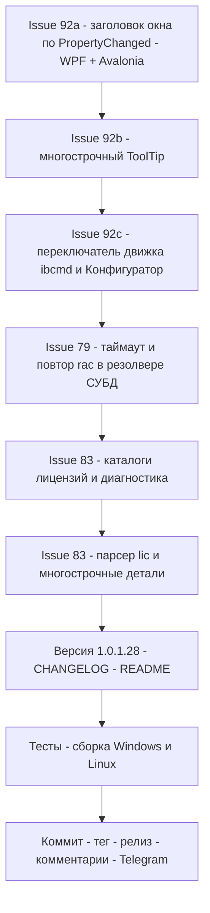

# План релиза v1.0.1.28 — issues #92, #83, #79

> Репозиторий: [sivatorov/Workspace1C](https://github.com/sivatorov/Workspace1C).
> Источник репортов: `_issues_to_work_2026-11-03.md` (снимок от 2026-11-03 15:31 UTC+3).
> Issues: [#92](https://github.com/sivatorov/Workspace1C/issues/92) (массовая выгрузка в DT/CF:
> заголовок окна, многострочная подсказка, движок Конфигуратор/ibcmd при неизвестном пароле СУБД),
> [#83](https://github.com/sivatorov/Workspace1C/issues/83) (лицензии: «Файл не найден», пустая
> таблица, окно деталей только с именем файла), [#79](https://github.com/sivatorov/Workspace1C/issues/79)
> (мастер «Развернуть тестовую копию»: программа не вычитывает свойства базы — подозрение на
> таймаут/асинхронность rac).
>
> Версия: 1.0.1.27 → **1.0.1.28** (только последний номер; GitHub-тег — `v1.0.128`).
> Версия задаётся в 4 строках [`Workspace1C/Workspace1C.csproj:62`](Workspace1C/Workspace1C.csproj:62) —
> `Version`, `AssemblyVersion`, `FileVersion`, `InformationalVersion` (строки 62–65). Прочие места
> версию не хранят: [`package/linux/deb/DEBIAN/control`](package/linux/deb/DEBIAN/control) —
> плейсхолдер `@VERSION@`, [`package/linux/appimage.sh`](package/linux/appimage.sh) читает
> `InformationalVersion` из csproj. Пример прошлой сборки — `_build_v100127.ps1` (`$Version = '1.0.1.27'`,
> строка 32).

---

## 0. Сводка и порядок работ

| # | Заголовок | Последний комментарий | Корневая причина (по коду) | Объём в v1.0.1.28 |
|---|---|---|---|---|
| 92 | Выгрузка списка баз в *.dt | 7OH 2026-11-03 07:09 | (а) Заголовок: в обоих окнах [`OnKindChecked → UpdateKindDependentUi → Title`](Workspace1C/Views/BatchOperationsWindow.Avalonia.cs:498) формально вызывается, но реакция завязана ТОЛЬКО на события радиокнопок — изменения `VM.Kind` из кода и пограничные случаи (восстановление вида из настроек, событие unchecked соседней радио) не покрыты. Надёжное решение — обновлять UI по `PropertyChanged` от `Kind` (в [`OnVmPropertyChanged`](Workspace1C/Views/BatchOperationsWindow.xaml.cs:123) сейчас обрабатываются только `IsRunning`/`PathLabel`). (б) Подсказка «Выгружать и запущенные» — WPF: `ToolTip` задан строкой ([`BatchOperationsWindow.xaml.cs:70`](Workspace1C/Views/BatchOperationsWindow.xaml.cs:70)), Avalonia: `ToolTip.SetTip` строкой ([`BatchOperationsWindow.Avalonia.cs:268`](Workspace1C/Views/BatchOperationsWindow.Avalonia.cs:268)) — одна строка без переноса. (в) Пароль СУБД неизвестен: исполнитель жёстко ibcmd ([`DefaultExecutorAsync`](Workspace1C/ViewModels/BatchOperationsViewModel.cs:762)) — нужен переключатель движка ibcmd/Конфигуратор с путём через `OneCLauncher.RunDesignerBatch(DumpIB)` (как в контекстном меню, [`MainViewModel.Avalonia.Launch.cs:279`](Workspace1C/ViewModels/MainViewModel.Avalonia.Launch.cs:279)) | **Полное**: реактивный заголовок/подсказка на обеих платформах, многострочный ToolTip, переключатель движка + настройка в AppSettings + тесты |
| 83 | Информация о лицензиях | 7OH 2026-11-03 11:30 | (а) Статус «Файл не найден: …» — это [`ServerMonitor.Licenses.FileNotFound`](Workspace1C/Views/ServerMonitorWindow.Avalonia.cs:742), показанный по клику на «Модуль» при пустом/битом `FilePath`, и он ОСТАЁТСЯ в строке статуса навсегда (затирается только следующей загрузкой вкладки). (б) Пустая таблица: [`LicenseDirectories()`](Workspace1C/Services/RingLicenseService.cs:1270) на Windows проверяет только `%ProgramData%\1C\1Cv8\licenses` (2 варианта регистра) — у 1С есть ещё `%ProgramData%\1C\licenses` и ПЕР-ПОЛЬЗОВАТЕЛЬСКИЕ `%LOCALAPPDATA%\1C\1cv8\licenses`; если ring снова не дал вывод, а каталог не найден — таблица пуста. (в) Детали только с именем файла: [`TryReadLicFile`](Workspace1C/Services/RingLicenseService.cs:1307) при сбое возвращает заглушку (только имя), а [`ParseLicFile`](Workspace1C/Services/RingLicenseService.cs:138) не распознаёт реальные поля файла; плюс [`BuildReadableDetails`](Workspace1C/Services/RingLicenseService.cs:270) склеивает RawDetails в ОДНУ строку с обрезкой на 400 символов | **Полное**: расширить каталоги лицензий + диагностика (лог/статус с перечнем проверенных каталогов), многострочное окно деталей с полным содержимым файла при нераспознанных полях, не залипающий статус, тесты парсера |
| 79 | Развернуть тестовую копию | 7OH 2026-11-03 07:14 | Цепочка: [`TestDeployService.ResolveSourceDbmsProfileAsync`](Workspace1C/Services/TestDeployService.cs:486) → [`ClusterInfobaseCredentialsResolver.ResolveAsync`](Workspace1C/Services/ClusterInfobaseCredentialsResolver.cs:114) → rac «infobase summary list» + «infobase info». Все rac-команды жёстко обрезаются [`CommandTimeout = 30 с`](Workspace1C/Services/RacClient.cs:26): холодный rac/загруженный сервер не укладывается → `RacClientException` → резолвер глотает исключение → «база не найдена»/пустые свойства. Повтора нет (в отличие от [`ClusterImportViewModel.GetInfobasesWithRetryAsync`](Workspace1C/ViewModels/ClusterImportViewModel.cs:468)), таймаут не настраивается, отличие «таймаут» от «база не найдена» в журнал не попадает | **Полное**: повтор + увеличенный таймаут для «infobase info», явное сообщение про таймаут в журнал/итог, диагностика сырого вывода, тесты |

**Порядок реализации** (от быстрых UI-фиксов к сервисным изменениям):

1. #92-а/б (заголовок + ToolTip, обе платформы) → 2. #92-в (переключатель движка ibcmd/Конфигуратор) →
3. #79 (таймаут/повтор rac в резолвере) → 4. #83 (каталоги лицензий + парсер + окно деталей) →
5. Версия 1.0.1.28 / CHANGELOG / README → тесты → сборка Win+Linux → релиз → комментарии → Telegram.



---

## 1. Issue #92 — массовая выгрузка в DT/CF: три пункта из последнего комментария

### 1.1 (а) Заголовок окна не меняется при переключении DT/CF

**Факт по коду.** Логика переключения уже есть и выглядит корректной:
- Avalonia: события радио [`IsCheckedChanged`](Workspace1C/Views/BatchOperationsWindow.Avalonia.cs:237) →
  [`OnKindChecked`](Workspace1C/Views/BatchOperationsWindow.Avalonia.cs:525) →
  [`UpdateKindDependentUi`](Workspace1C/Views/BatchOperationsWindow.Avalonia.cs:498) (Title, подсказка,
  подпись поля пути, видимость опций).
- WPF: [`OnKindDt_Checked`/`OnKindCf_Checked`](Workspace1C/Views/BatchOperationsWindow.xaml.cs:111) →
  тот же [`UpdateKindDependentUi`](Workspace1C/Views/BatchOperationsWindow.xaml.cs:85).

Раз репортер видит «меняется только при запуске», причина — в узком месте этой цепочки:
события `Checked`/`IsCheckedChanged` радиокнопок ненадёжны как единственный триггер
(подавление через `_suppressKindEvents`, очередность uncheck/check соседних радио,
восстановление вида из настроек). `OnVmPropertyChanged` обрабатывает только
`IsRunning` и `PathLabel`.

**Изменения.**
1. **Avalonia** ([`BatchOperationsWindow.Avalonia.cs:487`](Workspace1C/Views/BatchOperationsWindow.Avalonia.cs:487),
   [`OnVmPropertyChanged`](Workspace1C/Views/BatchOperationsWindow.Avalonia.cs) рядом с 487):
   в обработчике `_vm.PropertyChanged` добавить ветку `nameof(BatchOperationsViewModel.Kind)` →
   вызвать `UpdateKindDependentUi()`. В `UpdateKindDependentUi` при программной установке радио
   оставить подавление событий, чтобы не зациклить. Title/подсказку обновлять и при `Kind`,
   установленном из ViewModel.
2. **WPF** ([`BatchOperationsWindow.xaml.cs:123`](Workspace1C/Views/BatchOperationsWindow.xaml.cs:123)):
   та же ветка в `OnVmPropertyChanged`.
3. **Проверка места открытия окна**: [`MainViewModel.Tools.cs:2825`](Workspace1C/ViewModels/MainViewModel.Tools.cs:2825)
   и [`MainViewModel.Avalonia.Tools.cs:1619`](Workspace1C/ViewModels/MainViewModel.Avalonia.Tools.cs:1619)
   («Выгрузить в DT/CF») передают сохранённый `BatchDumpKind` — убедиться, что при восстановлении
   вида из настроек Title совпадает с выбранным радио (сейчас конструктор
   [`BatchOperationsWindow.Avalonia.cs:96`](Workspace1C/Views/BatchOperationsWindow.Avalonia.cs:96)
   выбирает подсказку тернарником `DumpDt → HintDumpDt : HintLoadCf` — для `DumpCf` неверная
   подсказка до первого `UpdateKindDependentUi`; заодно исправить на switch по Kind).
4. Юнит-тест: `BatchOperationsService`-логика вида уже покрыта; добавить тест на соответствие
   ключа заголовка виду операции (ключи `BatchOps.TitleDumpDt/TitleDumpCf/TitleLoadCf` в
   `Workspace1C/Localization/Languages/ru.json`), чтобы переключение ключей не разъезжалось.

**Риски.** Низкие: чисто UI-правка. Следить, чтобы `UpdateKindDependentUi` не вызывался рекурсивно
(событие Kind → установка радио с подавлением — уже учтено `_suppressKindEvents`).

### 1.2 (б) Многострочная подсказка «Выгружать и запущенные»

**Факт по коду.** Текст — [`BatchOps.AllowRunningBasesHint`](Workspace1C/Localization/Languages/ru.json);
WPF: `AllowRunningCheck.ToolTip = <строка>` ([`BatchOperationsWindow.xaml.cs:70`](Workspace1C/Views/BatchOperationsWindow.xaml.cs:70)),
Avalonia: `ToolTip.SetTip(allowRunningCheck, <строка>)` ([`BatchOperationsWindow.Avalonia.cs:268`](Workspace1C/Views/BatchOperationsWindow.Avalonia.cs:268)).
Строковый ToolTip не переносится и уезжает за экран.

**Изменения.**
1. **WPF**: вместо строки — `new ToolTip { Content = new TextBlock { TextWrapping = TextWrapping.Wrap, MaxWidth = 360, Text = ... } }`.
   Сделать маленький общий хелпер (например, статический метод `UiHelpers.MakeWrappingToolTip(string)`),
   т.к. строки-подсказки длинные ещё в нескольких местах окна (`SqlPasswordHint`, шаблон).
2. **Avalonia**: `ToolTip.SetTip(check, new TextBlock { TextWrapping = TextWrapping.Wrap, MaxWidth = 360, Text = ... })` —
   то же самое для [`allowRunningCheck`](Workspace1C/Views/BatchOperationsWindow.Avalonia.cs:268).
3. Заодно перенести на многострочный ToolTip подсказку поля «Пароль пользователя СУБД»
   (`SqlPasswordHint`, [`BatchOperationsWindow.xaml.cs:73`](Workspace1C/Views/BatchOperationsWindow.xaml.cs:73)) —
   она той же природы.
4. Текст `BatchOps.AllowRunningBasesHint` можно разбить на смысловые предложения (перенос
   обеспечит Wrap) — проверить ru/en словари.

**Риски.** Минимальные. В Avalonia TextBlock в ToolTip должен наследовать тему — проверить в тёмной
схеме (ToolTip стилизуется ControlThemes — при необходимости задать стиль явно).

### 1.3 (в) Переключатель движка «Конфигуратор / ibcmd» (неизвестный пароль СУБД)

**Факт по коду.**
- Исполнитель сейчас один — ibcmd: [`DefaultExecutorAsync`](Workspace1C/ViewModels/BatchOperationsViewModel.cs:762)
  → [`IbcmdService.DumpAsync`/`SaveConfigAsync`/`LoadConfigAsync`](Workspace1C/Services/IbcmdService.cs),
  для серверных баз требуются креды СУБД (профиль от rac или форма; пароль rac не отдаёт —
  v1.0.1.26 добавил лишь понятное сообщение [`BatchOps.DbmsPasswordMissing`](Workspace1C/ViewModels/BatchOperationsViewModel.cs:706)).
- Рабочий путь «Конфигуратора» уже есть в приложении: контекстное меню «Резервирование →
  Выгрузить в dt» — [`OneCLauncher.RunDesignerBatch(ib, DesignerBatchOperation.DumpIB, path)`]
  (см. [`MainViewModel.Avalonia.Launch.cs:279`](Workspace1C/ViewModels/MainViewModel.Avalonia.Launch.cs:279),
  [`OneCLauncher.DesignerBatch.cs:260`](Workspace1C/Services/OneCLauncher.DesignerBatch.cs:260),
  WPF-двойник [`OneCLauncher.Linux.DesignerBatch.cs`](Workspace1C/Services/OneCLauncher.Linux.DesignerBatch.cs)).
  Designer использует авторизацию ИБ из свойств базы ([`ClusterInfobaseCredentialsResolver.InfobaseAdminCredentials`](Workspace1C/Services/BatchOpsPreparationService.cs:189))
  — пароль СУБД не нужен. Это ровно то, что работает у aepkugesi («по этому же принципу»).
- Ожидание завершения batch — паттерн [`TestDeployService.WaitForBatchAsync`](Workspace1C/Services/TestDeployService.cs:355)
  с таймаутом `BatchTimeout = 60 мин` ([`TestDeployService.cs:27`](Workspace1C/Services/TestDeployService.cs:27)).

**Изменения.**
1. **Настройка**: в [`AppSettings.cs`](Workspace1C/Models/AppSettings.cs:772) рядом с
   `BatchDumpTemplate/BatchDumpDirectory/BatchDumpKind` добавить `BatchDumpEngine` (строка
   «Ibcmd»|«Designer», по умолчанию «Ibcmd» — сохранение в окне, как у остальных параметров #92).
2. **ViewModel** ([`BatchOperationsViewModel.cs`](Workspace1C/ViewModels/BatchOperationsViewModel.cs)):
   - свойство `DumpEngine` (enum `BatchDumpEngine { Ibcmd, Designer }`) с `SetProperty` и
     сохранением после закрытия окна (как `Kind`/`Template`);
   - в `DefaultExecutorAsync` для `DumpDt`/`DumpCf` при `Designer` — ветка:
     `OneCLauncher.RunDesignerBatch(infobase, DumpIB/DumpCfg, targetPath)` + ожидание по образцу
     `TestDeployService.WaitForBatchAsync` (длинная операция: последовательный прогон, в журнал —
     старт/завершение/exit code). `LoadConfig` оставить только ibcmd (загрузка Конфигуратором
     не входит в пункт; в подписи переключателя это указать);
   - «Выгружать и запущенные» для Designer НЕ действует (Конфигуратор требует монопольный
     доступ к файловой базе; серверная база — по состоянию) — при Designer в журнале помечать
     запущенные базы как пропущенные, пояснение в подсказке;
   - при Designer поля профиля СУБД (пароль) не запрашивать: блок «Данные СУБД» показывать только
     для ibcmd.
3. **UI (обе платформы)**: в `dumpOptionsRow`/`DumpOptionsPanel` добавить строку радио
   «Движок: ibcmd / Конфигуратор» (новые ключи локализации `BatchOps.EngineLabel`,
   `BatchOps.EngineIbcmd`, `BatchOps.EngineDesigner`, `BatchOps.EngineHint` — в подсказке:
   «Конфигуратор не требует пароля СУБД, но медленнее и не выгружает запущенные файловые базы»).
4. **Сервис** ([`BatchOperationsService.cs`](Workspace1C/Services/BatchOperationsService.cs)):
   парсинг/сохранение движка в строке настроек по образцу `ParseKind` (строки 77–84).
5. **Тесты**: `Workspace1C.Tests` — парсинг/сохранение `BatchDumpEngine`, выбор исполнителя
   по движку (чистая функция-резолвер), пропуск запущенных баз при Designer.

**Риски.**
- Designer-прогон ДЛИТЕЛЬНЫЙ (минуты на базу): отмена по кнопке «Стоп» должна гасить процесс
  1cv8 — переиспользовать механизм прерывания из резервного копирования
  ([`BackupService.cs:68`](Workspace1C/Services/BackupService.cs:68)), не оставлять висящие процессы.
- Parallelism: ibcmd-ветка гоняет базы по очереди — Designer тоже строго последовательно
  (одна копия 1cv8 на базу).
- Не ломать существующую строку настроек: неизвестное значение → Ibcmd (как `ParseKind`).
- Названия файлов Designer-выгрузки формируются тем же `BuildDumpFilePath` — путь с шаблоном
  передавать в `RunDesignerBatch` как есть.

---

## 2. Issue #79 — «Развернуть тестовую копию»: не вычитываются свойства базы (rac)

**Факт по коду.**
- Все rac-команды выполняются с жёстким [`CommandTimeout = 30 с`](Workspace1C/Services/RacClient.cs:26)
  (`CancelAfter(CommandTimeout)`, [`RacClient.cs:1165-1170`](Workspace1C/Services/RacClient.cs:1165)).
- Резолвер свойств источника: [`ClusterInfobaseCredentialsResolver.ResolveAsync`](Workspace1C/Services/ClusterInfobaseCredentialsResolver.cs:114)
  — «infobase summary list» → при пустом dbms догрузка «infobase info» с кредами ИБ
  (строки 265–350). Таймаут/исключение rac глотается, наружу — «база не найдена»/пустой профиль.
- В мастере: [`TestDeployService.ResolveSourceDbmsProfileAsync`](Workspace1C/Services/TestDeployService.cs:486)
  ловит исключение и пишет в журнал только `ex.Message`.
- Повтора нет, хотя прецедент есть: [`ClusterImportViewModel.GetInfobasesWithRetryAsync`](Workspace1C/ViewModels/ClusterImportViewModel.cs:468)
  (issue #25 — первая команда холодного rac падает).

**Изменения.**
1. **Таймаут на команду** ([`RacClient.cs:26`](Workspace1C/Services/RacClient.cs:26)): сделать
   перегрузку `RunAsync(..., TimeSpan? timeout = null)` (и для `GetInfobaseInfoAsync`/
   `GetInfobaseSummariesAsync` в [`IRacClient.cs`](Workspace1C/Services/IRacClient.cs)) с
   дефолтом `CommandTimeout`. Значение по умолчанию оставить 30 с (не менять поведение всех
   вкладок), а для «infobase info»/«infobase summary list» в резолвере — 90 с
   (`internal static readonly TimeSpan InfobaseInfoTimeout`).
2. **Повтор**: в `ClusterInfobaseCredentialsResolver` обернуть «infobase summary list» и
   «infobase info» однократным повтором по образцу `GetInfobasesWithRetryAsync` (issue #25):
   первая упавшая попытка повторяется тихо, вторая — с честным сообщением. Повторять ТОЛЬКО
   таймаут/стартовые сбои (`RacClientException` с timeout/exit=-1 без текста прав доступа);
   «Недостаточно прав пользователя» не повторять (это не таймаут).
3. **Честные сообщения**: при таймауте в журнал/`LastActionError` — «Не дождались ответа rac
   (N с) — увеличьте таймаут или проверьте сервер», вместо «база не найдена»
   ([`profileFailureReason`](Workspace1C/Services/ClusterInfobaseCredentialsResolver.cs:347));
   новый ключ локализации `BatchOps.RacTimeout` / `TestDeploy.SourceDbmsRacTimeout`.
4. **Диагностика**: при неудаче «infobase info» логировать сырой вывод (усечённо, до ~2000
   символов, категория `LogCategory.Rac`) — это уже сделано для ряда команд в `RacClient`
   (stdout/stderr в INFO-логе строка 1214) — убедиться, что путь таймаута тоже попадает в лог
   (сейчас при CancelAfter исключение уходит без вывода: зафиксировать в журнале elapsed).
5. **Тесты**: `RacClient` — перегрузка таймаута (аргументы/CTS); резолвер — повтор при
   таймауте первой попытки и отсутствие повтора при «Недостаточно прав»; текст сообщения.

**Риски.**
- Увеличение таймаута тормозит UI-потоки, которые ждут rac синхронно? — резолвер вызывается
  await'ом из VM (не блокирует UI), но пользовательский фидбек: в журнале мастера появится
  строка «операция может занять до 90 с».
- Повтор удваивает время при реальных ошибках прав — фильтр повторов по типу ошибки обязателен.
- Не менять таймауты остальных команд rac (session list, job list) — только per-call параметр.

---

## 3. Issue #83 — лицензии: «Файл не найден», пустая таблица, пустые детали

**Факт по коду.**
- Статус «Файл не найден: {0}» — [`ServerMonitor.Licenses.FileNotFound`](Workspace1C/Localization/Languages/ru.json),
  показывается кликом по «Модуль» ([`ServerMonitorWindow.Avalonia.cs:741-743`](Workspace1C/Views/ServerMonitorWindow.Avalonia.cs:741),
  WPF [`ServerMonitorWindow.xaml.cs:345-347`](Workspace1C/Views/ServerMonitorWindow.xaml.cs:345),
  окна деталей: [`LicenseDetailsWindow.Avalonia.cs:75`](Workspace1C/Views/LicenseDetailsWindow.Avalonia.cs:75))
  когда `LicenseFolderOpener.TryOpenFolderWithFile(license.FilePath)` вернул false
  (путь пуст или файл отсутствует) — и этот статус ЗАЛИПАЕТ в `LicenseStatusText`.
- Каталоги *.lic: [`LicenseDirectories()`](Workspace1C/Services/RingLicenseService.cs:1270) —
  Windows: только `%ProgramData%\1C\1Cv8\licenses` (2 регистра). Реальные места 1С:
  `%ProgramData%\1C\licenses` и пер-пользовательские `%LOCALAPPDATA%\1C\1cv8\licenses`
  / `%APPDATA%\1C\1cv8\licenses`. Если каталог не найден — файловых лицензий 0
  ([`EnumerateLicFiles`](Workspace1C/Services/RingLicenseService.cs:1288)), и при недоступном ring
  таблица пустая.
- Чтение/парс: [`TryReadLicFile`](Workspace1C/Services/RingLicenseService.cs:1307) при ЛЮБОЙ
  ошибке молча возвращает заглушку (только имя файла) — «по клику показывает только имя файла»;
  [`ParseLicFile`](Workspace1C/Services/RingLicenseService.cs:138) ищет пары «ключ=значение»
  ([`LicKeyValueRegex`](Workspace1C/Services/RingLicenseService.cs:121)), а реальные *.lic 1С —
  это строки с длинным ключом и комментариями в скобках, многие поля там НЕ в формате
  «ключ: значение» → почти всё уходит в `RawDetails`, который в
  [`BuildReadableDetails`](Workspace1C/Services/RingLicenseService.cs:270) склеивается в ОДНУ
  строку и обрезается на 400 символов.
- Загрузка вкладки: [`ServerMonitorViewModel.cs:2291-2293`](Workspace1C/ViewModels/ServerMonitorViewModel.cs:2291)
  (ring result → `Warning` → `LicenseStatusText`), обогащение —
  [`EnrichWithLicFiles`](Workspace1C/Services/RingLicenseService.cs:1359).

**Изменения.**
1. **Каталоги лицензий** ([`LicenseDirectories()`](Workspace1C/Services/RingLicenseService.cs:1270)):
   Windows добавить `%ProgramData%\1C\licenses`, `%LOCALAPPDATA%\1C\1cv8\licenses`,
   `%APPDATA%\1C\1cv8\licenses` (до существующих; обходить ВСЕ существующие каталоги, а не
   только первый — снять `break` в [`EnumerateLicFiles`](Workspace1C/Services/RingLicenseService.cs:1298)
   или собрать union с дедупликацией по имени файла). Linux — без изменений.
2. **Диагностика вместо тишины**:
   - `TryReadLicenseDirectory` логировать (категория RING): какие каталоги проверены, сколько
     файлов найдено/прочитано;
   - когда ring недоступен И файлов 0 — `Warning`-статус вкладки перечисляет проверенные
     каталоги (обновить [`BuildUnavailableMessage`](Workspace1C/Services/RingLicenseService.cs:767));
   - при сбое чтения конкретного файла НЕ молчать: в `RawDetails` писать «файл не прочитан:
     {тип ошибки}».
3. **Незалипающий статус**: клик по «Модуль»/ошибка открытия папки — показывать сообщение
   во временном статусе (например, слить с существующим `ShowTransientLicenseStatus`:
   либо автосброс по таймеру 5–10 с, либо показывать его ТОЛЬКО в момент клика и перезатирать
   при следующей загрузке вкладки; вариант — выводить в диалог/туст вместо статус-строки).
   Метод точечный: [`ServerMonitorWindow.Avalonia.cs:741`](Workspace1C/Views/ServerMonitorWindow.Avalonia.cs:741),
   [`ServerMonitorWindow.xaml.cs:345`](Workspace1C/Views/ServerMonitorWindow.xaml.cs:345),
   оба окна деталей.
4. **Окно деталей — многострочно и полно** ([`BuildReadableDetails`](Workspace1C/Services/RingLicenseService.cs:270)
   + оба окна деталей):
   - RawDetails НЕ схлопывать в одну строку: хранить исходный текст с переводами строк
     ([`ParseLicFile` строки 224-231] — добавить поле/флаг «raw multi-line» либо хранить в
     `RawDetails` с `\n` и в тултипе по-прежнему схлопывать);
   - в окне деталей показывать: распознанные поля + разделитель + ПОЛНОЕ содержимое файла
     (ScrollViewer, перенос строк, моноширинный шрифт), а не «до 400 символов»;
   - если полей 0 и содержимое пусто — явный текст «файл не прочитан/пуст» + путь.
5. **Парсер**: добавить эвристики реального формата *.lic — значения в круглых скобках после
   длинного ключа (описание/версия), строки «Дата: …», даты вида `20260907085731` (yyyyMMdd
   в имени/содержимом) — как в репорте 7OH «20260907085731.lic». Разбор дополнить юнит-тестами
   на реальных сэмплах (замаскированные) — точка: [`RingLicenseParser`](Workspace1C/Services/RingLicenseService.cs:70),
   `FindValue`/`ParseLicFile`/`StripLeadingKey`.
6. **Формат вывода rac/ring**: сверить с выводом `ring license list` 0.20.x (репорт: строки вида
   «499459654270590-500000000037 (Имя файла: "20260907085731.lic") …») —
   [`LicenseNumberRegex`](Workspace1C/Services/RingLicenseService.cs:82)/[`ParseFreeForm`]
   уже покрывают номер+файл; проверить, что при mojibake-локали сопоставление с файлом
   ([`EnrichWithLicFiles`](Workspace1C/Services/RingLicenseService.cs:1375-1392)) работает по
   имени из кавычек — дописать тест с искажённой локалью.

**Риски.**
- Union нескольких каталогов может показать дубли лицензии (одна и та же .lic у всех
  пользователей) — дедупликация по RegNumber/имени файла обязательна.
- Полное содержимое *.lic содержит ключи защиты — это уже показывалось и раньше (RawDetails);
  окно деталей только локальное, риск тот же, что в v1.0.1.27.
- Изменение `LicenseDirectories` затрагивает и уведомления ([`ServerAlertsService.cs:312`](Workspace1C/Services/ServerAlertsService.cs:312),
  [`LicenseManager`](Workspace1C/Services/LicenseManager.cs)) — прогнать их тесты: больше
  лицензий = меньше ложных алертов «нехватка».

---

## 4. Версия, CHANGELOG, README

1. **Версия**: [`Workspace1C/Workspace1C.csproj:62-65`](Workspace1C/Workspace1C.csproj:62) —
   `Version`, `AssemblyVersion`, `FileVersion`, `InformationalVersion` → **1.0.1.28** (4 строки).
2. **CHANGELOG.md** ([`CHANGELOG.md:14`](CHANGELOG.md:14)) — новая секция `## [1.0.1.28] — 2026-11-03`
   по формату Keep a Changelog (как [1.0.1.27]):
   - **Исправлено**: #92-а (заголовок окна массовой выгрузки), #92-б (подсказка), #79 (таймаут/повтор
     rac — «свойства базы не вычитываются»), #83 (статус «Файл не найден», пустая таблица, детали).
   - **Добавлено**: #92-в — переключатель движка ibcmd/Конфигуратор в массовой выгрузке.
3. **README.md**: строка 3 (бейдж Версия-1.0.1.28), строка 11 («актуальная версия — 1.0.1.28»),
   раздел «Что нового» (строка ~204) — краткий абзац по v1.0.1.28.
4. **Скрипты релиза**: скопировать `_build_v100127.ps1` → `_build_v100128.ps1`
   (`$Version = '1.0.1.28'`, логи `_publish_100128.log`/`_build_linux_100128.log`,
   `publish\out-1.0.1.28`); по образцу прошлых циклов — `_send_telegram_v100128.ps1` +
   `_telegram_msg_v100128.txt`.

---

## 5. Проверки и сборка

1. **Юнит-тесты**: `dotnet test Workspace1C.Tests` (из корня решения `Workspace1C.slnx`) —
   все существующие (5 500+) зелёные; новые тесты:
   - #92: `BatchDumpEngine` парсинг/сохранение; выбор исполнителя; пропуск запущенных при Designer;
     соответствие ключей заголовка виду.
   - #79: перегрузка таймаута `RacClient`; повтор и фильтр ошибок резолвера.
   - #83: `LicenseDirectories` (Windows-ветка — через рефлексию/условную компиляцию),
     `ParseLicFile` на новых форматах, дедупликация каталогов, `BuildReadableDetails` multiline.
2. **Сборка Windows**: `dotnet build Workspace1C.slnx -c Debug` (WPF) — без предупреждений новых.
3. **Сборка Linux-конфигурации на Windows**: `Workspace1C\build-linux-single-file.ps1 -p:ForceLinux=true`
   (Avalonia) — убедиться, что правки обеих платформ компилируются (`BatchOperationsWindow.Avalonia.cs`,
   `ServerMonitorWindow.Avalonia.cs`, `LicenseDetailsWindow.Avalonia.cs`).
4. **Релизная сборка**: `_build_v100128.ps1` (Windows + Linux single-file) — проверка
   `FileVersion/ProductVersion == 1.0.1.28` в артефактах (функция `Show-Artifact` уже в скрипте).
5. **Ручная проверка** (чек-лист для тестера/репортеров):
   - окно «Выгрузить в DT/CF»: переключение радио меняет заголовок окна мгновенно (WPF и Linux);
   - ToolTip «Выгружать и запущенные» переносится на несколько строк;
   - движок «Конфигуратор»: серверная база без пароля СУБД выгружается в .dt, журнал показывает
     ход, «Стоп» убивает процесс 1cv8;
   - «Развернуть тестовую копию» на медленном сервере: в журнале видна повторная попытка rac и
     понятное сообщение при таймауте;
   - «Серверы 1С → Лицензии»: таблица заполнена из *.lic из per-user каталога, клик по «Модуль»
     открывает папку, статус не залипает, окно деталей показывает поля + полное содержимое файла.

---

## 6. Комментарии для GitHub issues (черновики)

### #92
> **Исправлено в [v1.0.1.28](https://github.com/sivatorov/Workspace1C/releases/tag/v1.0.128)**
>
> @7OH, спасибо, все три пункта сделаны:
> 1. **Заголовок окна теперь меняется сразу** при переключении DT/CF — реакция переведена с
>    событий радиокнопок на изменение вида операции в модели (заодно исправлена подсказка,
>    которая при открытии на CF показывалась от загрузки).
> 2. **Подсказка «Выгружать и запущенные» многострочная** — переносится в пределах окна.
> 3. **Добавлен переключатель движка «ibcmd / Конфигуратор»** в окне массовой выгрузки.
>    Конфигуратор не требует пароля СУБД (использует авторизацию ИБ из свойств базы) — это тот
>    же принцип, что у «Резервирование → Выгрузить в dt». Выбор запоминается; для Конфигуратора
>    опция «выгружать и запущенные» не применяется (Конфигуратору нужен монопольный доступ к
>    файловой базе), поля профиля СУБД при этом движке скрываются.

### #83
> **Исправлено в [v1.0.1.28](https://github.com/sivatorov/Workspace1C/releases/tag/v1.0.128)**
>
> @7OH, спасибо за скриншот, разобрался:
> 1. «Файл не найден» сверху — это сообщение от клика по колонке «Модуль», когда путь к файлу
>    пуст; оно теперь показывается только в момент клика и не залипает в строке статуса.
> 2. Пустая таблица — программа искала файлы лицензий только в `%ProgramData%\1C\1Cv8\licenses`.
>    Добавлены `%ProgramData%\1C\licenses` и пользовательские каталоги
>    `%LOCALAPPDATA%\1C\1cv8\licenses`; в лог пишется, какие каталоги проверены и сколько
>    файлов прочитано.
> 3. Окно деталей по клику на «Серийный номер» теперь показывает все распознанные поля И полное
>    содержимое файла лицензии (многострочно, с прокруткой), а не одну строку. Улучшен разбор
>    формата *.lic (значения после длинного ключа, даты вида 20260907085731).
>
> Если таблица всё ещё пуста — пришлите, пожалуйста, ZIP диагностики: добавил в лог перечень
> проверенных каталогов лицензий.

### #79
> **Исправлено в [v1.0.1.28](https://github.com/sivatorov/Workspace1C/releases/tag/v1.0.128)**
>
> @7OH, вы были правы — программа не дожидалась ответа rac. Все команды rac обрезались таймаутом
> 30 секунд; на загруженном/холодном сервере «infobase summary list»/«infobase info» не
> укладывались, результат отбрасывался, и мастер показывал «база не найдена». Теперь:
> - для чтения свойств базы таймаут увеличен до 90 с;
> - первая неудачная попытка повторяется автоматически (как в импорте из кластера, issue #25);
> - при таймауте в журнале честное сообщение «не дождались ответа rac (N с)» вместо «не найдена».

---

## 7. Тексты для релиза (черновик)

**Заголовок**: Workspace 1C v1.0.1.28 — массовая выгрузка: движок на выбор, лицензии и rac стабильнее

**Release notes (кратко)**:
- **Массовая выгрузка в DT/CF (issue #92)**: заголовок окна обновляется при переключении DT/CF;
  многострочная подсказка у «Выгружать и запущенные»; новый переключатель движка
  **ibcmd / Конфигуратор** — Конфигуратор выгружает серверные базы без пароля СУБД.
- **Серверы 1С → Лицензии (issue #83)**: поиск файлов *.lic расширен (ProgramData\1C\licenses и
  пользовательские каталоги); окно деталей показывает все поля из файла лицензии и его полное
  содержимое; сообщение «Файл не найден» больше не залипает в статусе; диагностика каталогов в логе.
- **Развернуть тестовую копию (issue #79)**: чтение свойств базы из rac теперь надёжно — таймаут
  90 с и автоматический повтор; при медленном ответе в журнале понятное сообщение вместо
  «база не найдена».

**Telegram** (по образцу `_telegram_msg_v100127.txt`): три блока с эмодзи + ссылка на релиз
`https://github.com/sivatorov/Workspace1C/releases/tag/v1.0.128`, упоминание репортеров @7OH,
@aepkugesi.

---

## 8. Коммит

Сообщение (по образцу `_commit_msg_v100127.txt`):

```
v1.0.1.28: mass dump engine switch, license files, rac timeouts

- #92: batch dump window title follows DT/CF switch; multi-line tooltip;
  new dump engine option Designer/ibcmd (no DBMS password needed)
- #83: license *.lic search in per-user directories; full multi-line
  details window; non-sticky status message; parser improvements
- #79: rac infobase info timeout 90s + single retry; clear timeout message
```

Тег: `v1.0.128` (как прошлые: полный тег короче 4-частной версии).
