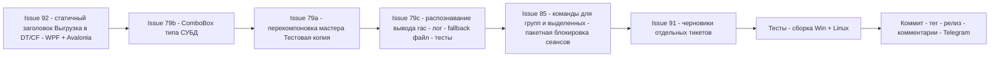

# План релиза v1.0.1.32 — issues #79, #85, #91, #92

> Репозиторий: [sivatorov/Workspace1C](https://github.com/sivatorov/Workspace1C).
> Источник: открытые issues на 2026-11-04 13:20 UTC+3 (6 шт: #79, #85, #87, #91, #92, #102).
> Отобраны issues, где последний комментарий НЕ от sivatorov:
> [#79](https://github.com/sivatorov/Workspace1C/issues/79) (7OH 2026-11-04 09:55),
> [#85](https://github.com/sivatorov/Workspace1C/issues/85) (leonvlas 2026-10-29 04:52),
> [#91](https://github.com/sivatorov/Workspace1C/issues/91) (7OH 2026-10-30 13:48),
> [#92](https://github.com/sivatorov/Workspace1C/issues/92) (7OH 2026-11-04 10:01).
> Issues с последним комментарием от sivatorov в работу не включены: #102 (исправлено в
> v1.0.1.27, ждём проверки), #87 (исправлено в v1.0.1.3, ждём проверки).
> Промежуточные данные: [_issues_to_work_v100132.md](_issues_to_work_v100132.md).
>
> Версия: 1.0.1.31 → **1.0.1.32** (только последний номер). Смена версии — ОТДЕЛЬНАЯ
> задача (в этой подзадаче код не трогаем); в коде задаётся в 4 строках
> [`Workspace1C/Workspace1C.csproj:62-65`](Workspace1C/Workspace1C.csproj:62) —
> `Version`, `AssemblyVersion`, `FileVersion`, `InformationalVersion`.
>
> НЕ дублировать уже сделанное: v1.0.1.28–v1.0.1.31 закрыли по #79 ручной блок «Данные СУБД
> источника», перебор форматов `--cluster`, 90-секундный таймаут и ретраи rac; по #92 — движок
> «Конфигуратор/ibcmd», поле пароля СУБД, синхронизацию кнопок Выполнить/Остановить,
> многострочные подсказки, снятие галочек после успешной выгрузки; по #91 — пункты dt/cf
> реализованы в v1.0.1.7+.

---

## 0. Сводка и порядок работ

| # | Заголовок | Последний комментарий | Суть проблемы (по коду) | Объём в v1.0.1.32 | Сложность |
|---|---|---|---|---|---|
| 92 | выгрузка списка баз в файл *.dt | 7OH 2026-11-04 10:01: «Кнопки по окончанию пришли в себя — хорошо. **Не переключается заголовок** … Может быть просто сделать заголовок не изменяемым "Выгрузка в DT/CF"? Будет единообразно с кнопками вызова инструмента» | Динамический заголовок, введённый в v1.0.1.31 ([`BatchOperationsViewModel.cs:314-319`](Workspace1C/ViewModels/BatchOperationsViewModel.cs:314) `TitleKeyForKind`, применяется в [`BatchOperationsWindow.xaml.cs:121-123`](Workspace1C/Views/BatchOperationsWindow.xaml.cs:121) и [`BatchOperationsWindow.Avalonia.cs:89-91, 570-572`](Workspace1C/Views/BatchOperationsWindow.Avalonia.cs:89)), у пользователя по-прежнему не переключается при смене DT/CF. Репортёр предлагает статичный заголовок — это надёжнее (не зависит от канала PropertyChanged) и единообразно с кнопками вызова | **Малый**: статичный заголовок окна для обоих видов выгрузки (DT и CF), обе платформы | Низкая |
| 79 | Развернуть тестовую копию | 7OH 2026-11-04 09:55: перекомпоновать окно (4 пункта раскладки), «СУБД — почему-то поле ввода, а не список выбора», «лечим ошибки распознавания вывода дальше» + diagnostics ZIP | (а) Разметка мастера — многострочные поля по одной строке на поле ([`TestDeployWindow.cs`](Workspace1C/Views/TestDeployWindow.cs), [`TestDeployWindow.Avalonia.cs`](Workspace1C/Views/TestDeployWindow.Avalonia.cs)). (б) Тип СУБД — свободный TextBox вместо ComboBox. (в) rac 8.5.4: «infobase info» при exit=0 отдаёт все поля (подтверждено консольным выводом 7OH), но программа получает пустые — парсинг [`RacOutputParser.ToInfobaseInfo`](Workspace1C/Services/RacOutputParser.cs:764) / чтение stdout процесса ([`RacClient.cs:1059-1121`](Workspace1C/Services/RacClient.cs:1059)) не справляется (кодировка/пустой stdout при перенаправлении) | **Большой**: перекомпоновка (обе платформы) + ComboBox СУБД + диагностика/фикс распознавания вывода rac + тесты | Высокая |
| 85 | Групповое применение. Не доступны команды для групп | leonvlas 2026-10-29 04:52: «команда "Блокировка"/"разблокировка" сеансов могла применяться к группам или к выделенным строкам» + «при выполнении групповой команды, процесс применение был в отдельном окне» (04:52 — последний) | Контекстное меню группы не предлагает массовых команд; пакетная блокировка/разблокировка сеансов есть только как подготовка внутри окна массовых операций ([`BatchOpsPreparationService.cs`](Workspace1C/Services/BatchOpsPreparationService.cs)) и в «Серверы 1С», но не в списке баз для группы/выделения. Инфраструктура окна с журналом «N из M» уже есть ([`BatchOperationsWindow.*`](Workspace1C/Views/BatchOperationsWindow.Avalonia.cs), [`BatchOperationsService.cs`](Workspace1C/Services/BatchOperationsService.cs)) — переиспользовать | **Большой**: пункты «Для группы…»/«Для выделенных…» + новая пакетная операция «Блокировка/разблокировка сеансов» + прогресс в окне массовых операций | Высокая |
| 91 | Пожелания по новому функционалу | 7OH 2026-10-30 13:48: «Лучше отдельными тикетами сделать и хорошо расписать (про dt\cf и отчеты\обработки). Тикеты нейронка исполняет» | Пункты 1–2 (выгрузка dt, загрузка cf по списку) уже реализованы в v1.0.1.7+ и доработаны в цикле #92. Остался пункт 3 — загрузка внешних отчётов/обработок (БСП) по списку баз: требует программного доступа к ИБ (COM/HTTP-сервис), отдельный крупный функционал | **Без кода**: подготовить тексты отдельных тикетов (черновики — раздел 5 этого плана); реализация — в следующих версиях | Низкая |

**Порядок реализации** (от простого к сложному):

1. #92 (статичный заголовок, обе платформы) → 2. #79-б (ComboBox СУБД) → 3. #79-а (перекомпоновка мастера, обе платформы) →
4. #79-в (распознавание вывода rac: логирование + fallback вывода в файл + толерантный парсер + тесты) →
5. #85 (массовые команды для групп/выделенных + пакетная блокировка сеансов) →
6. #91 (черновики тикетов в плане/комментарии) → 7. Тесты → сборка Win+Linux → релиз → комментарии в issues → Telegram.

---

## 1. Issue #92 — статичный заголовок окна массовой выгрузки «DT/CF»

### 1.1 Факт по коду

- Заголовок окна для видов выгрузки пересчитывается по `Kind` через
  `TitleKeyForKind` ([`BatchOperationsViewModel.cs:314-319`](Workspace1C/ViewModels/BatchOperationsViewModel.cs:314)):
  `DumpDt → "BatchOps.TitleDumpDt"`, `DumpCf → "BatchOps.TitleDumpCf"`. Тексты в
  [`ru.json:981-982`](Workspace1C/Localization/Languages/ru.json:981) —
  «Массовая выгрузка баз в файлы .dt» / «Массовая выгрузка конфигураций в файлы .cf».
- Применение заголовка: [`BatchOperationsWindow.xaml.cs:121-123`](Workspace1C/Views/BatchOperationsWindow.xaml.cs:121),
  [`BatchOperationsWindow.Avalonia.cs:89-91`](Workspace1C/Views/BatchOperationsWindow.Avalonia.cs:89)
  и при перестроении вида [`BatchOperationsWindow.Avalonia.cs:570-572`](Workspace1C/Views/BatchOperationsWindow.Avalonia.cs:570).
- По v1.0.1.31 смена заявлена исправленной, но у 7OH (последний комментарий после релиза)
  заголовок по-прежнему не меняется. Репортёр прямо просит статичный вариант — принимаем его
  предложение: заголовок выгрузки один для DT и CF («Выгрузка в DT/CF»), единообразно с
  кнопками вызова инструмента. Подсказка окна (`HintKeyForKind`) остаётся динамической —
  она переключается корректно (в баге не упоминалась).

### 1.2 Изменения

1. **Локализация**: в [`ru.json`](Workspace1C/Localization/Languages/ru.json) / `en.json`
   добавить ключ `BatchOps.TitleDumpBoth`:
   - ru: «Массовая выгрузка в DT/CF»;
   - en: «Batch dump to DT/CF».
2. **ViewModel**: в `TitleKeyForKind` ([`BatchOperationsViewModel.cs:314-319`](Workspace1C/ViewModels/BatchOperationsViewModel.cs:314))
   `DumpDt` и `DumpCf` → `"BatchOps.TitleDumpBoth"`; `LoadCf` — без изменений
   (`"BatchOps.TitleLoadCf"`). Метод internal — покрыт юнит-тестами.
3. **Окна**: менять ничего не требуется (они уже вызывают `TitleKeyForKind` в тех же местах);
   проверить, что в WPF-окне заголовок обновляется и при смене Kind в рантайме
   ([`BatchOperationsWindow.xaml.cs:121-123`](Workspace1C/Views/BatchOperationsWindow.xaml.cs:121)) —
   для выгрузок он теперь статичен, реакция на `PropertyChanged(Kind)` сохраняется для подсказки.
4. **Тесты**: в [`Workspace1C.Tests/Issue92BatchDumpTests.cs`](Workspace1C.Tests/Issue92BatchDumpTests.cs)
   обновить/добавить проверку: `TitleKeyForKind(DumpDt) == TitleKeyForKind(DumpCf) == "BatchOps.TitleDumpBoth"`.

**Файлы**: `Workspace1C/ViewModels/BatchOperationsViewModel.cs`, `Workspace1C/Localization/Languages/ru.json`,
`Workspace1C/Localization/Languages/en.json`, `Workspace1C.Tests/Issue92BatchDumpTests.cs`.

### 1.3 Оценка

Сложность: **низкая**. Обе платформы затрагиваются только через общий метод VM.

---

## 2. Issue #79 — мастер «Развернуть тестовую копию»: перекомпоновка, ComboBox СУБД, распознавание вывода rac

### 2.1 Факт по коду

- Мастер: WPF [`TestDeployWindow.cs`](Workspace1C/Views/TestDeployWindow.cs) (поля добавляются
  последовательно в `panel`, «Движок выгрузки» — строка 302+; «Каталог файловой базы» — 749+)
  и Avalonia [`TestDeployWindow.Avalonia.cs`](Workspace1C/Views/TestDeployWindow.Avalonia.cs)
  (движок — `_engineCombo`, строка 254+; блок «Данные для выгрузки через ibcmd» — 269+).
  Сейчас каждое поле занимает отдельную строку — по просьбе 7OH нужна раскладка в 4 строки.
- Тип СУБД источника — свободный TextBox (локализация `TestDeploy.*` в
  [`ru.json:4261-4263`](Workspace1C/Localization/Languages/ru.json:4261)); состояние в
  [`TestDeployViewModel.cs`](Workspace1C/ViewModels/TestDeployViewModel.cs) (движок `EngineIndex` — 117+).
- Распознавание вывода: v1.0.1.30 уже берёт данные из «infobase info» с перебором форматов
  `--cluster` ([`RacClient.cs:1059-1121`](Workspace1C/Services/RacClient.cs:1059),
  [`ClusterInfobaseCredentialsResolver.cs`](Workspace1C/Services/ClusterInfobaseCredentialsResolver.cs)),
  но 7OH дважды подтвердил «пустые поля при наличии данных» и приложил diagnostics ZIP
  (2026-11-04). Вручную rac 8.5.4 отдаёт все поля (полный вывод приложен в
  [комментарии 7OH от 2026-11-03](https://github.com/sivatorov/Workspace1C/issues/79#issuecomment-6609833628)):
  формат «ключ<много пробелов>: значение». Подозрительные места:
  [`RacOutputParser.ToInfobaseInfo`](Workspace1C/Services/RacOutputParser.cs:764) (разбор key-value)
  и чтение stdout процесса ([`RacClient.cs:1401+`](Workspace1C/Services/RacClient.cs:1401)) —
  известный нюанс rac.exe: при перенаправлении stdout часть версий выводит пусто/в другой
  кодировке (вопрос 7OH «Нужен ли вывод в файл этой команды?»).

### 2.2 Изменения

#### 2.2-а. Перекомпоновка окна (обе платформы)

Раскладка по 7OH (строки из полей мастера):

1. «Сервер 1С»/«Файловая база» + **«Движок выгрузки»** — в одной строке (движок переносится сюда);
2. «Сервер 1С» (адрес) + «Имя базы на сервере» — одна строка;
3. «СУБД» + «Сервер СУБД» — одна строка;
4. «Имя базы данных в СУБД» + «Пользователь СУБД» + «Пароль СУБД» — одна строка.

- WPF: перестроить сетку в [`TestDeployWindow.cs`](Workspace1C/Views/TestDeployWindow.cs)
  (переход с вертикального `panel` на `Grid` c колонками; пары label+поле уже возвращаются
  фабрикой `MakeLabel` — сгруппировать в общие строки, ширины колонок звездой).
- Avalonia: аналогично в [`TestDeployWindow.Avalonia.cs`](Workspace1C/Views/TestDeployWindow.Avalonia.cs)
  (блок «Данные для выгрузки через ibcmd», строки 269+).
- Движок выгрузки (`_engineCombo` / блок 302+ в WPF) перенести в строку с переключателем типа
  источника; подпись `TestDeploy.Engine` сохранить.
- Локализация не меняется (тексты те же), проверка минимальных ширин окна (720/760).

#### 2.2-б. ComboBox типа СУБД

- Заменить TextBox «СУБД» на ComboBox со списком типов, поддерживаемых ibcmd:
  MSSQLServer, PostgreSQL, IBM Db2, OracleDatabase, MySQL, MariaDB (список согласован с
  `ParseDbms` в [`ClusterInfobaseCredentialsResolver.cs:781`](Workspace1C/Services/ClusterInfobaseCredentialsResolver.cs:781)).
  Использовать существующий паттерн пар «ключ/текст» [`TestDeployEngineOption.cs`](Workspace1C/Models/TestDeployEngineOption.cs)
  (чтобы в выпадающем списке был человекочитаемый текст, а не CLR-имя типа).
- В [`TestDeployViewModel.cs`](Workspace1C/ViewModels/TestDeployViewModel.cs) — свойство типа
  СУБД источника + подстановка из rac-резолва сохраняется (если rac вернул тип — он
  выбирается в списке; если неизвестный — добавляется текущим значением, чтобы не терять ввод).
- Обе платформы: WPF `ComboBox` (editable не нужен) и Avalonia `ComboBox` в
  `TestDeployWindow.cs` / `TestDeployWindow.Avalonia.cs`.

#### 2.2-в. Распознавание вывода rac (главная боль, обе платформы)

1. **Диагностика**: при выполнении «infobase info»/«infobase summary list» писать в CM_RAC
   первые 300–500 символов сырого stdout ПРИ exit=0, если после парсинга поля СУБД пустые
   ([`RacClient.cs`](Workspace1C/Services/RacClient.cs), рядом с `TruncatePreview` из строки 1086) —
   по следующей диагностике ZIP сразу видно, что реально приходит процессу.
2. **Fallback «вывод в файл»** (вопрос 7OH — да, нужен): если exit=0, а stdout пуст/не содержит
   ключа `dbms` — повторить команду rac с перенаправлением во временный файл и прочитать файл
   с автодетектом кодировки (UTF-16 LE/BOM → OEM 866 → UTF-8 → UTF-8 с BOM). Оформить как
   метод в [`RacClient.cs`](Workspace1C/Services/RacClient.cs) рядом с `InfobaseInfoWithFormatFallbackAsync`.
3. **Толерантный парсер**: ужесточить/толерантизировать
   [`RacOutputParser.ToInfobaseInfo`](Workspace1C/Services/RacOutputParser.cs:764) и
   `ToInfobaseSummaries` ([строка 828](Workspace1C/Services/RacOutputParser.cs:828)): ключ — всё до
   «первого двоеточия» при любом количестве пробелов/табуляций вокруг него; учесть значения
   с двоеточием внутри. Зафиксировать разбор реального вывода rac 8.5.4 (образец — комментарий
   7OH 6609833628: `dbms  : MSSQLServer`, `db-server  : localhost` и т.д.) юнит-тестами.
4. **Тесты**: новые кейсы в [`Workspace1C.Tests`](Workspace1C.Tests) (по образцу существующих
   rac-тестов): реальный вывод 8.5.4 — все поля СУБД распознаны; пустой stdout при exit=0 →
   срабатывает fallback файла (файл с выводом читается в UTF-16 и в OEM 866).

**Файлы**: `Workspace1C/Views/TestDeployWindow.cs`, `Workspace1C/Views/TestDeployWindow.Avalonia.cs`,
`Workspace1C/ViewModels/TestDeployViewModel.cs`, `Workspace1C/Models/TestDeployEngineOption.cs`
(или новый option-класс для СУБД), `Workspace1C/Services/RacClient.cs`,
`Workspace1C/Services/RacOutputParser.cs`, `Workspace1C/Services/ClusterInfobaseCredentialsResolver.cs`,
тесты `Workspace1C.Tests`.

### 2.3 Оценка

Сложность: **высокая**. Перекомпоновка — ручная разметка на двух платформах; распознавание
вывода требует анализа diagnostics ZIP 7OH ([diagnostics_20261104_125500.zip](https://github.com/sivatorov/Workspace1C/issues/79#issuecomment-6627882839)).

---

## 3. Issue #85 — команды для групп и выделенных баз + пакетная блокировка сеансов

### 3.1 Факт по коду

- Контекстное меню группы/выделенных строк: пункты «Для выделенных (N)…» уже существуют для
  массовой выгрузки DT/CF (точки входа
  [`MainViewModel.Tools.cs:2849-2871`](Workspace1C/ViewModels/MainViewModel.Tools.cs:2849) и
  [`MainViewModel.Avalonia.Tools.cs:1643-1662`](Workspace1C/ViewModels/MainViewModel.Avalonia.Tools.cs:1643)),
  но команды запуска/блокировки для групп недоступны (скрин leonvlas в issue).
- Пакетная блокировка сеансов/регламентных заданий уже реализована как ПОДГОТОВКА внутри окна
  массовых операций ([`BatchOpsPreparationService.cs`](Workspace1C/Services/BatchOpsPreparationService.cs):
  `TerminateSessions`, `DenyNewSessions`, `PermissionCode`, `DenyScheduledJobs`) — в v1.0.1.30
  плюс ретраи «session terminate» в [`RacClient.cs`](Workspace1C/Services/RacClient.cs).
- Окно с журналом «N из M», кнопкой «Остановить» и прогрессом по базам уже есть —
  отдельное окно прогресса, о котором просит leonvlas, де-факто совпадает с окном массовых
  операций ([`BatchOperationsWindow.*`](Workspace1C/Views/BatchOperationsWindow.Avalonia.cs)).

### 3.2 Изменения

1. **Новые виды операций**: добавить в enum `BatchOperationKind` (файл сервиса
   [`BatchOperationsService.cs`](Workspace1C/Services/BatchOperationsService.cs)) значения
   `LockSessions` («Блокировка сеансов» — rac `infobase update --sessions-deny=on`,
   опционально `--scheduled-jobs-deny=on` и завершение сеансов) и `UnlockSessions`
   («Разблокировка» — `--sessions-deny=off`). Реализовать ветки в
   [`BatchOperationsService.cs`](Workspace1C/Services/BatchOperationsService.cs) на базе
   существующего кода подготовки (`BatchOpsPreparationService`) — без нового движка.
2. **Заголовки/подсказки/поля**: в `TitleKeyForKind`/`HintKeyForKind`
   ([`BatchOperationsViewModel.cs:314-327`](Workspace1C/ViewModels/BatchOperationsViewModel.cs:314))
   добавить ветки; локализация `BatchOps.TitleLockSessions`, `BatchOps.HintLockSessions`,
   `BatchOps.TitleUnlockSessions`, `BatchOps.HintUnlockSessions` (ru/en). Для этих операций
   скрыть неприменимые поля (шаблон/каталог/файл cf/переключатели движка) — по образцу
   видозависимой разметки окна.
3. **Точки входа «Для группы…»**:
   - контекстное меню узла группы (WPF [`MainWindow.xaml.cs`](Workspace1C/Views/MainWindow.xaml.cs)
     + [`MainViewModel.Commands.cs`](Workspace1C/ViewModels/MainViewModel.Commands.cs), Avalonia
     [`MainViewModel.Avalonia.Commands.cs`](Workspace1C/ViewModels/MainViewModel.Avalonia.Commands.cs))
     — пункт «Для группы (N)…» → открывает окно массовых операций с предотмеченными базами
     группы и выбранным видом операции (подготовка: метод конструктора VM уже принимает
     `IEnumerable<Infobase>` + `kind` — [`BatchOperationsViewModel.cs:329`](Workspace1C/ViewModels/BatchOperationsViewModel.cs:329));
   - пункт «Для выделенных (N)…» расширить с выгрузки DT/CF на все новые операции
     (единый диалог выбора операции).
4. **Групповые команды запуска** (запрос «разрешить выполнять команды для группы», скрин):
   на первой итерации в v1.0.1.32 включаем в «Для группы…» безопасный набор: Блокировка/Разблокировка
   сеансов, Выгрузка DT/CF, Загрузка CF. Запуск баз группы (по одной/последовательно) —
   отдельный пункт, при объёме вынести в следующий релиз (указать в комментарии к issue).
5. **Окно прогресса**: отдельное окно не создаём — используется окно массовых операций с
   журналом «N из M» и кнопкой «Остановить»; в комментарии к issue объяснить это как реализацию
   пожелания «процесс в отдельном окне».
6. **Тесты**: `Workspace1C.Tests` — аргументы rac для lock/unlock, разбор «session list»
   при пакетной блокировке, выборка баз группы/выделения для предотметки.

**Файлы**: `Workspace1C/Services/BatchOperationsService.cs`, `Workspace1C/Services/BatchOpsPreparationService.cs`,
`Workspace1C/ViewModels/BatchOperationsViewModel.cs`, `Workspace1C/Views/BatchOperationsWindow.xaml.cs`,
`Workspace1C/Views/BatchOperationsWindow.xaml`, `Workspace1C/Views/BatchOperationsWindow.Avalonia.cs`,
`Workspace1C/ViewModels/MainViewModel.Commands.cs`, `Workspace1C/ViewModels/MainViewModel.Avalonia.Commands.cs`,
`Workspace1C/ViewModels/MainViewModel.Tools.cs`, `Workspace1C/ViewModels/MainViewModel.Avalonia.Tools.cs`,
локализация `ru.json`/`en.json`, тесты.

### 3.3 Оценка

Сложность: **высокая**. Новый вид пакетных операций + расширение контекстного меню на двух
платформах; риски — ветвление видозависимой разметки окна массовых операций (WPF XAML + Avalonia code-behind).

---

## 4. Issue #91 — отдельные тикеты вместо кода

### 4.1 Факт

Пункты 1–2 (выгрузка в .dt по списку, загрузка .cf по списку) реализованы в v1.0.1.7
([`BatchOperationsService.cs`](Workspace1C/Services/BatchOperationsService.cs),
[`BatchOperationsWindow.cs`](Workspace1C/Views/BatchOperationsWindow.cs),
[`BatchOperationsWindow.Avalonia.cs`](Workspace1C/Views/BatchOperationsWindow.Avalonia.cs))
и далее доработаны в цикле #92 (v1.0.1.8–v1.0.1.31). Остался только пункт 3 —
**загрузка внешних отчётов/обработок в дополнительные отчеты и обработки (БСП) по списку баз**.

По последнему комментарию 7OH («Лучше отдельными тикетами сделать и хорошо расписать»)
в v1.0.1.32 код по #91 не пишем — готовим тексты отдельных тикетов (публикация на GitHub —
отдельным шагом, не в этой подзадаче).

### 4.2 Черновики тикетов (для публикации)

**Тикет А — «Загрузка внешних отчётов и обработок по списку баз (БСП)»**
- Сценарий: пользователь указывает один файл `.erf`/`.epf` или каталог с файлами
  (соответствие «файл ↔ база» по имени), отмечает базы (или группу) — приложение загружает
  файлы в справочник «Дополнительные отчеты и обработки» (БСП).
- Технические варианты (указать в тикете для обсуждения):
  1. COM-соединение (только Windows): `ВнешниеОбработки.Подключить` / запись в справочник
     `ДополнительныеОтчетыИОбработки` через `ДополнительныеОтчетыИОбработкиПереопределяемый`;
  2. HTTP-сервис/обработка-загрузчик, публикуемая в базе (кросс-платформенно, требует
     однократной установки компонента в базу);
  3. для клиент-серверных баз — пакетное выполнение через `1cv8 DESIGNER /Execute` нельзя
     (нет API БСП) — этот вариант исключить и написать об этом в тикете.
- Критерии приёмки: журнал по каждой базе, отчёт «база → статус», поддержка групп,
  работа на Windows и Linux.

**Тикет Б (опционально) — «Запуск баз группы как команды»** — из #85: пункт «Для группы (N)…»
для запуска баз (последовательно, по выбору: Enterprise/Конфигуратор).

### 4.3 Изменения

- Код НЕ меняется. В комментарий к #91 (после релиза) — короткое резюме: пункты dt/cf закрыты
  (v1.0.1.7–v1.0.1.31), оставшийся пункт оформлен отдельным тикетом (ссылка), issue можно закрыть.

### 4.4 Оценка

Сложность: **низкая** (текст + комментарий, без кода).

---

## 5. Что НЕ входит в эту подзадачу

- Смена версии в [`Workspace1C.csproj:62-65`](Workspace1C/Workspace1C.csproj:62), CHANGELOG.md,
  README.md — отдельная задача релиза (в предыдущих планах выполнялась тем же циклом, сейчас
  вынесена по условию).
- Закрытие issues и комментарии на GitHub — после релиза.
- Реализация внешних отчётов/обработок (тикет А из раздела 4) — следующий релиз.

## 6. Чек-лист приёмки

- [ ] Окно «Выгрузить в DT\CF»: заголовок статичен «Массовая выгрузка в DT/CF» для обоих видов выгрузки (WPF + Avalonia).
- [ ] Мастер «Развернуть тестовую копию»: раскладка 7OH (4 строки), движок выгрузки в строке с типом источника (WPF + Avalonia).
- [ ] Тип СУБД в мастере — ComboBox с поддерживаемыми ibcmd типами; ввод из rac-резолва выбирается в списке.
- [ ] «infobase info» rac 8.5.4: сырой вывод пишется в CM_RAC при пустых полях; при пустом stdout — fallback чтения вывода из файла; реальные поля СУБД распознаются (юнит-тест на образец 7OH).
- [ ] Контекстное меню группы и выделенных строк: «Для группы (N)…»/«Для выделенных (N)…» с операциями Блокировка/Разблокировка сеансов, Выгрузка DT/CF, Загрузка CF.
- [ ] Пакетная блокировка/разблокировка сеансов работает по списку баз с журналом «N из M» и «Остановить».
- [ ] Черновики тикетов по #91 подготовлены (раздел 4).
- [ ] Юнит-тесты зелёные; сборка Windows и Linux успешна.
