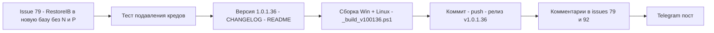

# План релиза v1.0.1.36 — issues #79, #92

> Репозиторий: [sivatorov/Workspace1C](https://github.com/sivatorov/Workspace1C).
> Источник: [_issues_to_work_new.md](_issues_to_work_new.md) — открытые issues на 2026-11-05
> (7 шт: #103, #102, #92, #91, #87, #85, #79). К отработке только два (последний
> комментарий не от sivatorov):
> [#79](https://github.com/sivatorov/Workspace1C/issues/79) (7OH 2026-11-05 10:01),
> [#92](https://github.com/sivatorov/Workspace1C/issues/92) (7OH 2026-11-05 09:54).
> #103, #102, #91, #87, #85 — последний комментарий от sivatorov, ждём проверки пользователей.
>
> Версия: 1.0.1.35 → **1.0.1.36** (только последний номер). Смена версии — ОТДЕЛЬНАЯ
> задача, в коде задаётся в 4 строках [`Workspace1C/Workspace1C.csproj:62-65`](Workspace1C/Workspace1C.csproj:62) —
> `Version`, `AssemblyVersion`, `FileVersion`, `InformationalVersion`.
>
> НЕ дублировать уже сделанное: v1.0.1.33–v1.0.1.35 закрыли по #79 падение окна
> (двойной `_refBox`), список СУБД без MySQL/MariaDB, единый алгоритм кредов СУБД
> (fallback из основных полей СУБД мастера), по #92 — статичный заголовок «Выгрузка в
> DT/CF» и синхронизацию движка при восстановлении из настроек (подтверждено 7OH).

---

## 0. Сводка и порядок работ

| # | Заголовок | Последний комментарий | Суть проблемы (по коду) | Объём в v1.0.1.36 | Сложность |
|---|---|---|---|---|---|
| 79 | Развернуть тестовую копию | 7OH 2026-11-05 10:01: «Уже лучше — выгрузило и создало новую базу в СУБД... На этапе загрузки в копию — "Пользователь ИБ не идентифицирован" — причём дважды окно было. А в пустую базу под старым логином паролем зачем лезть? Там же пусто на предмет пользователей.» + ZIP `diagnostics_20261105_125751.zip` | [`RestoreAsync`](Workspace1C/Services/TestDeployService.cs:367) запускает DESIGNER `/RestoreIB` с `credential: null` → [`BuildAuthArgument`](Workspace1C/Services/OneCLauncher.Arguments.Shared.cs:488) резолвит креды целевой базы (созданной в [`CreateTarget`](Workspace1C/Services/TestDeployService.cs:318), где `target.Connection.User/Password` наследованы от ИСТОЧНИКА, а также common-авторизации из `InfobaseAuthResolver`). Для ТОЛЬКО ЧТО созданной пустой базы пользователей ИБ нет → платформа отвечает «Пользователь ИБ не идентифицирован» и показывает модальное окно (7OH видел его дважды) | **Малый**: для новой базы (Restore) запускать `/RestoreIB` без `/N`/`/P`; для обновления существующей копии (Update) поведение не менять | Низкая |
| 92 | выгрузка списка баз в файл *.dt | 7OH 2026-11-05 09:54: «Да — теперь норм. Проверил выгрузкой конфигом, а потом опять через ibcmd. Оба раза корректно.» | Фикс v1.0.1.35 (синхронизация `DumpEngine` при восстановлении из настроек) подтверждён 7OH. Активных багов нет — ожидается реакция aepkugesi. **Кода не требуется — только комментарий** (НЕ закрывать) | **Без кода**: комментарий с номером релиза после публикации | Низкая |

**Порядок реализации** (каждый пункт — отдельная задача/режим):

1. (Code) #79: в [`RestoreAsync`](Workspace1C/Services/TestDeployService.cs:367) — при создании новой
   базы (`existing is null`, т.е. `result.TargetCreated`) передавать в `RunDesignerBatch`
   подавляющие учётные данные: `new BackupCredential { UseInfobaseAuth = false, User = "", Password = "" }` —
   тогда в [`RunDesignerBatch`](Workspace1C/Services/OneCLauncher.DesignerBatch.cs:252)
   `authArg = BuildCredentialsArg("", "") = ""` (проверено: `IsSafeCliValue("")` → `false`,
   [`OneCLauncher.Arguments.Shared.cs:98-115`](Workspace1C/Services/OneCLauncher.Arguments.Shared.cs:98)),
   т.е. `/N`/`/P` в командную строку НЕ попадают и платформа не пытается аутентифицироваться
   в пустой базе. Для `Update` (существующая копия) — `credential: null` как раньше.
   Дополнительно: в [`CreateTarget`](Workspace1C/Services/TestDeployService.cs:318) наследование
   кредов источника оставить (после `RestoreIB` пользователи приходят из .dt — creds источника
   валидны для шагов 5-6).
2. (Code) Тесты: в [`Issue79TestDeployWindowTests.cs`](Workspace1C.Tests/Issue79TestDeployWindowTests.cs)
   добавить тест на сценарий «Restore в новую базу — учётные данные ИБ подавляются»
   (через извлекаемый внутренний хелпер `TestDeployService.BuildRestoreCredential(bool isNewBase)`).
3. (Code) Версия 1.0.1.36 в [`Workspace1C.csproj:62-65`](Workspace1C/Workspace1C.csproj:62) +
   запись в [CHANGELOG.md](CHANGELOG.md) + раздел «Что нового»/версия в [README.md](README.md).
4. (Code) Сборка Windows + Linux по образцу [_build_v100135.ps1](_build_v100135.ps1)
   → новый скрипт `_build_v100136.ps1`, лог `_build_linux_100136.log`.
5. (Code) Коммит, push, GitHub Release `v1.0.1.36` (Windows + Linux артефакты).
6. (Code) Комментарии в #79 и #92 (после публикации релиза, с номером версии; issues
   НЕ закрывать). В #79 ответить и на вопрос про «папку для новой базы»: группа создаётся
   на шаге 2, а запись в списке баз появляется после успешного завершения всех шагов —
   это штатное поведение.
7. (Code) Telegram-пост о релизе в канал `-1004425443528` (по образцу
   [_send_telegram_v100135.ps1](_send_telegram_v100135.ps1)).

---

## 1. Issue #79 — «Пользователь ИБ не идентифицирован» на шаге «Загрузка в копию»

### 1.1 Факт по коду (корень найден при анализе)

- Мастер создаёт целевую базу (шаг 3, [`CreateTarget`](Workspace1C/Services/TestDeployService.cs:318)):
  для серверной — через `ibcmd --create`, для файловой — `CreateInfoBase`.
  Строки 318-322: **авторизации записи наследуются от источника**
  (`target.Connection.User = source.Connection?.User` и т.д.).
- Шаг 4 — [`RestoreAsync`](Workspace1C/Services/TestDeployService.cs:367): `RunDesignerBatch(target,
  RestoreIB, dtPath, credential: null)`. При `credential: null` в
  [`RunDesignerBatch`](Workspace1C/Services/OneCLauncher.DesignerBatch.cs:248-253) берётся
  `BuildAuthArgument(target)` → `InfobaseAuthResolver.Resolve` → креды целевой записи
  (унаследованные от источника) и/или общие авторизации приложения.
- В только что созданной пустой базе **нет ни одного пользователя ИБ** — любая пара
  логин/пароль даёт «Пользователь ИБ не идентифицирован», причём платформа в пакетном
  режиме показывает своё модальное окно (7OH: «дважды окно было» — по одному на попытку).
- В сценарии `Update` (существующая копия) пользователи в копии есть (пришли из .dt
  прошлой загрузки) — текущее поведение там корректно, НЕ трогаем.
- После успешного `RestoreIB` пользователи приходят из .dt — наследованные креды источника
  снова становятся валидными для шагов «Выключение регламентных заданий» (COM) и маркеров.

### 1.2 Изменения

1. [`TestDeployService.cs`](Workspace1C/Services/TestDeployService.cs):
   - извлечь внутренний хелпер `internal static BackupCredential? BuildRestoreCredential(bool isNewBase)`
     — для `isNewBase == true` возвращает подавляющий credential
     (`UseInfobaseAuth = false`, пустые User/Password), иначе `null`;
   - в [`RestoreAsync`](Workspace1C/Services/TestDeployService.cs:367) добавить параметр
     `bool isNewBase` и передавать `credential: BuildRestoreCredential(isNewBase)`;
   - в точке вызова (строка 187) — `isNewBase: result.TargetCreated`.
2. Проверить симметрию в Linux-лаунчере
   [`OneCLauncher.Linux.DesignerBatch.cs`](Workspace1C/Services/OneCLauncher.Linux.DesignerBatch.cs)
   — ветка `credential is { UseInfobaseAuth: false }` должна работать так же (факт подтверждается
   на этапе реализации чтением кода).
3. Тесты ([`Issue79TestDeployWindowTests.cs`](Workspace1C.Tests/Issue79TestDeployWindowTests.cs)):
   - `RestoreCredential_NewBase_SuppressesAuth` — хелпер возвращает credential с пустым
     User/Password и `UseInfobaseAuth == false`;
   - `RestoreCredential_ExistingBase_KeepsBaseAuth` — для существующей базы возвращается `null`;
   - при необходимости — тест, что `BuildCredentialsArg("", "")` даёт пустую строку
     (если такого ещё нет в тестах лаунчера).
4. Опциональная верификация (до фикса): скачать ZIP
   `diagnostics_20261105_125751.zip` из комментария 7OH, убедиться по логу, что сбой
   именно на шаге «Загрузка» (ожидаемо — да, судя по формулировке).

---

## 2. Issue #92 — комментарий без кода

- Последний комментарий 7OH подтверждает фикс v1.0.1.35. В v1.0.1.36 по этому issue
  кодовых правок нет. После публикации релиза — короткий комментарий: благодарность за
  проверку, отметка, что вопрос «массовая загрузка из .cf через Конфигуратор (без доступа
  к SQL)» зафиксирован как отдельное пожелание и будет рассмотрен в следующих релизах,
  просьба к aepkugesi подтвердить решение на v1.0.1.35+. Issue НЕ закрывать.

---

## 3. Релизный цикл v1.0.1.36

1. **Версия** — 4 строки в [`Workspace1C.csproj:62-65`](Workspace1C/Workspace1C.csproj:62) → `1.0.1.36`.
2. **CHANGELOG.md** — новая запись `## [1.0.1.36] — 2026-11-05` в топ: фикс #79 (RestoreIB
   без аутентификации в пустую новую базу), тесты.
3. **README.md** — обновить номер версии/дату в шапке и список изменений релиза (по образцу
   прошлых релизов).
4. **Сборка** — новый [_build_v100136.ps1](_build_v100136.ps1) на базе v100135:
   Windows win-x64 single-file + Linux linux-x64 (лог `_build_linux_100136.log`), smoke-проверка
   файлов, юнит-тесты (`dotnet test`).
5. **Коммит/push/релиз** — commit message по образцу [_commit_msg_v100135.txt](_commit_msg_v100135.txt);
   tag `v1.0.1.36`; `gh release create` с двумя артефактами и примечаниями из CHANGELOG.
6. **Комментарии в issues** — #79 и #92 (после публикации; НЕ закрывать).
7. **Telegram** — пост в канал `-1004425443528` (текст релиза + ссылка), скрипт по образцу
   [_send_telegram_v100135.ps1](_send_telegram_v100135.ps1).
