# План релиза v1.0.1.15 — Workspace1C

_Дата плана: 2026-11-01. База: 1.0.1.14 (последний релиз 2026-11-01T07:56Z, тег `v1.0.1.14`)._

**Правило версионирования:** 1.0.1.14 → **1.0.1.15** — только последняя цифра
([`Workspace1C/Workspace1C.csproj`](Workspace1C/Workspace1C.csproj): `Version`,
`AssemblyVersion`, `FileVersion`, `InformationalVersion` — 4 места, строка 62–65).

---

## 1. Сводный анализ шести issues

Исходные данные: `_issues_to_work_new.md` (анализ от 2026-11-01 12:02 UTC+3).

| Issue | Суть последнего репорта | Решение в 1.0.1.15 |
|-------|--------------------------|--------------------|
| #57 | 7OH: «Во - теперь заходит» — подтверждено | Без правок кода — комментарий |
| #79 | 7OH не понял сообщение о «найденной» базе | Без правок кода — комментарий-объяснение |
| #83 | 7OH: ring найден в логе, в окне «Не найдена» | Без правок кода — комментарий (закрыто в 1.0.1.14) |
| #92 | 7OH: тёмная тема в WPF, старый шаблон при открытии, профиль СУБД | **Правки кода (2 фикса)** + комментарий |
| #94 | 7OH: зависание «Отмены» на Linux, новые логи | Без правок кода — комментарий (ждём проверки 1.0.1.14) |
| #96 | leonvlas: ошибка интерфейса при щелчках по строкам баз, 0 комментариев | **Требует уточнения** — не трогаем, задать вопрос |

Важный факт: релиз **1.0.1.14 уже содержал реакции на последние комментарии 7OH**
от 2026-10-31 (rac-автоподстановка СУБД для #92, тематизация и дефолтный шаблон
для #92, null-защита `BuildIdTab` для #94, подробная диагностика ring для #83,
переформулировки мастера для #79 — см. [`CHANGELOG.md`](CHANGELOG.md) [1.0.1.14]).
Поэтому 1.0.1.15 — маленький патч-релиз: два точечных кодовых фикса по #92
и комментарии по всем шести issues.

---

## 2. Issue-by-issue: проблема, файлы, план, риски

### Issue #57 — общая авторизация → **только комментарий**

- **Состояние:** цепочка фиксов завершена в 1.0.1.11; последний комментарий 7OH
  (2026-10-31 16:22): «Во - теперь заходит. Решение - за @ixijixi».
- **Правки кода:** не требуются.
- **Действие:** комментарий в issue — поблагодарить 7OH за проверку, зафиксировать,
  что общая раздельная авторизация работает (v1.0.1.11+), и что финальное решение
  за автором issue @ixijixi; спросить у ixijixi, закрывать ли issue.
- **Риски:** нет.

### Issue #79 — «Развернуть тестовую копию» → **только комментарий**

- **Состояние:** последний комментарий 7OH (2026-10-31 16:24) — недоумение по
  сообщению о «найденной» целевой базе («Мы же в неё копию делаем»). Скриншот из
  комментария недоступен для локального анализа (GitHub user-attachments, 403).
- **Что уже сделано в 1.0.1.14:** формулировки мастера переписаны —
  `TestDeploy.PreviewUpdateFormat` («Тестовая база «{0}» уже есть (найдена в
  списке баз) — она станет целью копирования…») и `TestDeploy.ActionUpdate`
  ([`Workspace1C/Localization/Languages/ru.json`](Workspace1C/Localization/Languages/ru.json:4211–4215)).
- **Действие:** комментарий — объяснить механику: «найдена» = в списке баз
  приложения уже есть база с именем целевой копии (от прошлого развёртывания),
  мастер обновит её данные вместо создания новой; галочка «Создать базу данных
  на сервере СУБД» означает создание физической БД на СУБД и не влияет на
  поиск записи в списке; попросить проверить формулировки 1.0.1.14 и прислать
  скриншот, если что-то всё ещё сбивает.
- **Риски:** скриншот не проанализирован — возможно, 7OH про другое сообщение;
  уточнение запрошено в комментарии.

### Issue #83 — лицензии ring → **только комментарий**

- **Состояние:** последний репорт 7OH (2026-10-31 16:21): в логе
  «where.exe ring — найдено: …ring.cmd», в окне «Не найдена». Уже закрыт в
  **1.0.1.14**: логируется результат каждого кандидата
  ([`RingLicenseService.GetInstalledLicensesAsync`](Workspace1C/Services/RingLicenseService.cs:397)),
  а на вкладке при «ring найдена и запускалась, но лицензий нет» показывается
  ответ последней команды — [`BuildNoLicensesMessage`](Workspace1C/Services/RingLicenseService.cs:566)
  вместо вводящего в заблуждение «утилита не найдена».
- **Правки кода:** не требуются.
- **Действие:** комментарий — ответ на «Что дальше делать будем?»: установить
  1.0.1.14, открыть вкладку «Лицензии» — теперь там будет либо список лицензий,
  либо ответ ring на «license list» (вместо «не найдена»); если ответ выглядит
  ошибочным — прислать лог категории `CM_RAC`.
- **Риски:** нет.

### Issue #92 — массовая выгрузка DT/CF → **правки кода (2 фикса) + комментарий**

Большая часть закрыта в 1.0.1.14 (rac-автоподстановка СУБД, тёмная тема
Avalonia-версии, дефолтный шаблон с датой, подсказка построчно). Остаточные
пункты последнего комментария 7OH (2026-10-31 16:34):

**Фикс 1 — тёмная тема полей в WPF-версии окна.**
[`Workspace1C/Views/BatchOperationsWindow.xaml`](Workspace1C/Views/BatchOperationsWindow.xaml)
не содержит тематизации `TextBox`: поля `PathBox` (каталог) и `TemplateBox`
(шаблон) рисуются системным стилем — в тёмной теме «чёрный на тёмном».
В Avalonia-версии тематизация сделана
([`BatchOperationsWindow.Avalonia.cs:133–155`](Workspace1C/Views/BatchOperationsWindow.Avalonia.cs:133)),
в WPF — нет.

- **Правка:** в `Window.Resources` добавить implicit-стиль
  `<Style TargetType="TextBox" BasedOn="{StaticResource ModernTextBox}"/>`
  (паттерн других WPF-окон: [`ProfilesPanel.xaml:18`](Workspace1C/Views/ProfilesPanel.xaml:18),
  [`SettingsWindow.xaml:76`](Workspace1C/Views/SettingsWindow.xaml:76)).
- **Риск:** минимальный; ModernTextBox — темированный стиль из
  `DarkTheme.xaml`/`LightTheme.xaml`, конфликтов нет.

**Фикс 2 — миграция старого сохранённого шаблона.**
7OH: «он по прежнему при открытии окна - {Имя}_{Дата}». Причина: дефолт
[`DefaultDumpTemplate`](Workspace1C/Services/BatchOperationsService.cs:53) заменён
на `{Имя}_{Дата:yyyy-MM-dd_HH-mm}` только для новых установок; у существующих
пользователей в `settings.json` сохранён старый дефолт `{Имя}_{Дата}`, который
загружается при открытии окна
([`MainViewModel.Tools.cs:2816+`](Workspace1C/ViewModels/MainViewModel.Tools.cs:2816),
[`MainViewModel.Avalonia.Tools.cs:1631+`](Workspace1C/ViewModels/MainViewModel.Avalonia.Tools.cs:1631)).

- **Правки:**
  1. В [`BatchOperationsService`](Workspace1C/Services/BatchOperationsService.cs):
     константа `LegacyDumpTemplate = "{Имя}_{Дата}"` и чистый метод
     `NormalizeSavedTemplate(string?)` — возвращает `DefaultDumpTemplate`, если
     сохранённое значение пустое, null либо равно `LegacyDumpTemplate`
     (равенство — Ordinal, с Trim); иначе — сохранённое значение как есть
     (пользовательский шаблон не трогаем).
  2. Вызов `NormalizeSavedTemplate(settings.BatchDumpTemplate)` при построении
     окна в `ExecuteBatchDumpCore` обеих платформ
     ([`MainViewModel.Tools.cs`](Workspace1C/ViewModels/MainViewModel.Tools.cs),
     [`MainViewModel.Avalonia.Tools.cs`](Workspace1C/ViewModels/MainViewModel.Avalonia.Tools.cs)).
  3. Тесты в [`Workspace1C.Tests/Issue92BatchDumpTests.cs`](Workspace1C.Tests/Issue92BatchDumpTests.cs):
     legacy-шаблон → новый дефолт; пусто → новый дефолт; пользовательский
     `{Имя}_{Дата:dd.MM.yyyy}` — не изменяется.
- **Риск:** минимальный; меняется только стартовое значение поля, сохранение
  после закрытия — прежнее.

**Без правок (в комментарии):**
- «Пункты меню с раздельной выгрузкой тоже на месте (смотри …)» — неоднозначный
  пункт, ссылка не расшифровывается локально: спросить у 7OH, какие именно
  пункты убрать/объединить (возможно, дубль «Массовая выгрузка в .dt» из
  «Утилит» после появления «Выгрузить в DT\CF…»).
- Запрос aepkugesi (2026-10-31 17:43): завершение сеансов, блокировка сеансов
  с кодом разрешения, блокировка регламентных заданий перед выгрузкой/загрузкой
  dt/cf — **большая отдельная фича**, в 1.0.1.15 не входит. В комментарии
  зафиксировать: принято к рассмотрению как отдельная задача, технически
  реализуемо (rac session list/terminate, блокировки через ibcmd/Designer),
  нужны уточнения по UX (отдельные пункты меню vs автоматический режим).

### Issue #94 — зависание закрытия окна Свойств на Linux → **только комментарий**

- **Состояние:** стек NRE из терминала указывал на лямбду
  `FuncDataTemplate` в `BuildIdTab`
  ([`ConnectionSettingsWindow.Avalonia.cs:1452`](Workspace1C/Views/ConnectionSettingsWindow.Avalonia.cs:1452))
  — null-защита `row is null` **уже добавлена в 1.0.1.14** (см. комментарии в
  коде 1450–1457 и [`CHANGELOG.md`](CHANGELOG.md) [1.0.1.14]). Второй
  `cm_modal_trace.log` пользователя (от 1.0.1.11) показывает, что цепочка
  закрытия доводится до конца через `ShowDialogSync.finally`
  ([`ModalWindowBase.cs:455–478`](Workspace1C/Views/ModalWindowBase.cs:455)).
- **Правки кода:** не требуются (чинить «наугад» нельзя — не воспроизводится
  стабильно).
- **Действие:** комментарий — попросить проверить на 1.0.1.14 (null-защита
  включена, NRE пишется в журнал с полным стеком); если зависание повторится —
  журнал приложения + `cm_modal_trace.log` (`CM_MODAL_TRACE=1`), по стеку
  сделаем точечный фикс в следующей версии.
- **Риски:** дефект может не быть закрыт — issue остаётся открытым до
  подтверждения.

### Issue #96 — ошибка интерфейса при щелчках по строкам баз → **требует уточнения, не трогаем**

- **Состояние:** 0 комментариев; описание — «щёлкал по строкам с базами,
  вылетела ошибка интерфейса» + скриншот. Скриншот недоступен локально
  (GitHub user-attachments отдаёт 403 без контекста сессии), текст ошибки/стек
  неизвестны; платформа (WPF/Avalonia) неизвестна.
- **Решение:** без диагностики править нельзя. В комментарии запросить:
  версию приложения и платформу, точный текст/скриншот окна «Ошибка
  интерфейса», журнал (категория `CM_MAIN`/общий) на момент ошибки, действия
  перед ошибкой (двойной клик? правый клик? перетаскивание?).
- **Риски:** нет (правок нет).

---

## 3. Список файлов релиза v1.0.1.15

### Код и тесты
| Файл | Изменение |
|------|-----------|
| [`Workspace1C/Views/BatchOperationsWindow.xaml`](Workspace1C/Views/BatchOperationsWindow.xaml) | implicit-стиль `TextBox` на `ModernTextBox` (тёмная тема WPF, #92) |
| [`Workspace1C/Services/BatchOperationsService.cs`](Workspace1C/Services/BatchOperationsService.cs) | `LegacyDumpTemplate` + `NormalizeSavedTemplate()` (#92) |
| [`Workspace1C/ViewModels/MainViewModel.Tools.cs`](Workspace1C/ViewModels/MainViewModel.Tools.cs) | нормализация сохранённого шаблона при открытии окна (#92, WPF) |
| [`Workspace1C/ViewModels/MainViewModel.Avalonia.Tools.cs`](Workspace1C/ViewModels/MainViewModel.Avalonia.Tools.cs) | то же (#92, Avalonia) |
| [`Workspace1C.Tests/Issue92BatchDumpTests.cs`](Workspace1C.Tests/Issue92BatchDumpTests.cs) | тесты миграции шаблона |

### Версия и документация
| Файл | Изменение |
|------|-----------|
| [`Workspace1C/Workspace1C.csproj`](Workspace1C/Workspace1C.csproj) | 1.0.1.14 → 1.0.1.15 (Version/AssemblyVersion/FileVersion/InformationalVersion) |
| [`CHANGELOG.md`](CHANGELOG.md) | новая запись `[1.0.1.15] — 2026-11-01` |
| [`README.md`](README.md) | бейдж версии и «актуальная версия — **1.0.1.15**» (строки 3, 11) |

### Служебные (по образцу предыдущих релизов)
| Файл | Назначение |
|------|-----------|
| `plan-v100115.md` | этот план |
| `_build_v100115.ps1` | копия `_build_v100114.ps1` с `$Version='1.0.1.15'` (лог `_publish_100115.log`, выход `publish\out-1.0.1.15\`) |
| `_commit_msg_v100115.txt` | текст commit-сообщения |
| `_rel_notes_v100115.md` | заметки для `gh release create --notes-file` |
| `_telegram_msg_v100115.txt` | текст сообщения в Telegram (UTF-8) |
| `_send_telegram_v100115.ps1` | копия `_send_telegram_v100114.ps1` с заменой имени файла сообщения и `ReleaseUrl` на `v1.0.1.15` |

---

## 4. Тексты для CHANGELOG.md и README.md (рус.)

### CHANGELOG.md

```markdown
## [1.0.1.15] — 2026-11-01

### Исправления

- **Массовая выгрузка: поля окна в тёмной теме в Windows (Windows и Linux).**
  WPF-версия окна массовой выгрузки DT/CF: поля «Каталог выгрузки» и
  «Шаблон имени файла» переведены на тематический стиль `ModernTextBox` —
  в тёмной теме больше не «чёрный на тёмном» (issue #92,
  [`BatchOperationsWindow.xaml`](Workspace1C/Views/BatchOperationsWindow.xaml)).

- **Массовая выгрузка: старый сохранённый шаблон имени файла (Windows и
  Linux).** Если в настройках сохранён прежний шаблон по умолчанию
  `{Имя}_{Дата}`, при открытии окна он заменяется на актуальный
  `{Имя}_{Дата:yyyy-MM-dd_HH-mm}` — пример даты виден сразу; собственные
  шаблоны пользователей не затрагиваются (issue #92,
  [`BatchOperationsService.NormalizeSavedTemplate`](Workspace1C/Services/BatchOperationsService.cs)).

### Тесты

- Новые тесты миграции шаблона массовой выгрузки
  ([`Issue92BatchDumpTests`](Workspace1C.Tests/Issue92BatchDumpTests.cs)):
  legacy-шаблон → актуальный дефолт, пользовательский шаблон — без изменений.
```

### README.md

- Строка 3: бейдж `Версия-1.0.1.14` → `Версия-1.0.1.15`.
- Строка 11: «актуальная версия — **1.0.1.14**» → «актуальная версия — **1.0.1.15**».
- Раздел недавних изменений (блок «1.0.1.14», строки ~205): добавить сверху
  краткий абзац: «**Тёмная тема окна массовой выгрузки и миграция шаблона
  имени файла (1.0.1.15, Windows и Linux)** — поля каталога и шаблона в
  Windows-версии окна тематизированы; сохранённый старый шаблон
  `{Имя}_{Дата}` при открытии окна заменяется на
  `{Имя}_{Дата:yyyy-MM-dd_HH-mm}` (issue #92)».

---

## 5. Порядок правок (чек-лист реализации)

1. [ ] `BatchOperationsWindow.xaml` — implicit-стиль TextBox (фикс 1, #92).
2. [ ] `BatchOperationsService.cs` — `LegacyDumpTemplate` + `NormalizeSavedTemplate` (фикс 2, #92).
3. [ ] `MainViewModel.Tools.cs` и `MainViewModel.Avalonia.Tools.cs` — вызов нормализации.
4. [ ] `Issue92BatchDumpTests.cs` — тесты миграции шаблона.
5. [ ] `dotnet test` (WPF-профиль) и `BuildLinux=true dotnet test` — весь набор зелёный.
6. [ ] `csproj` — версия 1.0.1.15 (4 свойства).
7. [ ] `CHANGELOG.md`, `README.md` — тексты из раздела 4.
8. [ ] Создать `_build_v100115.ps1` (копия v100114, замена `$Version` и путей) — запускать сборку им.

```mermaid
flowchart LR
  A[Код: два фикса issue 92] --> B[Тесты: весь набор зелёный]
  B --> C[Версия 1.0.1.15 в csproj]
  C --> D[CHANGELOG + README]
  D --> E[Сборка Windows + Linux: _build_v100115.ps1]
  E --> F[git commit + tag v1.0.1.15 + push]
  F --> G[gh release create v1.0.1.15]
  G --> H[Комментарии в issues 57 79 83 92 94 96]
  H --> I[Telegram: _send_telegram_v100115.ps1]
```



---

## 6. Сборка Windows + Linux

По существующему процессу ([`_build_v100114.ps1`](_build_v100114.ps1) — сборка без git/release):

1. Создать `_build_v100115.ps1`: копия `_build_v100114.ps1` с заменами
   `$Version = '1.0.1.15'`, `$LogFile = _publish_100115.log`,
   `$OutDir = publish\out-1.0.1.15`.
2. Запуск: `powershell -NoProfile -ExecutionPolicy Bypass -File .\_build_v100115.ps1`
   (или через cmd-обёртку по образцу `_publish_v10014.cmd`).
3. Скрипт выполняет:
   - Windows: `Workspace1C\build-windows-single-file.ps1 -Configuration Release`
     → `Workspace1C\dist\win-x64\Workspace1C.exe` (WPF, net10.0-windows, self-contained single-file);
   - Linux: `Workspace1C\build-linux-single-file.ps1 -Configuration Release`
     → `Workspace1C\dist\linux-x64\Workspace1C` (Avalonia, cross-compile, ForceLinux);
   - проверку `FileVersion == 1.0.1.15`;
   - копирование в `publish\out-1.0.1.15\Workspace1C.exe` и
     `publish\out-1.0.1.15\Workspace1C-linux-x64`.
4. Известная особенность: первая сборка WPF после очистки `obj` может упасть
   (особенность .NET 10 RC SDK temp-project) — повторить прогон скрипта.
5. Лог: `_publish_100115.log`.

---

## 7. Git: commit / push / релиз

1. `git add` — изменённые файлы кода, тесты, `csproj`, `CHANGELOG.md`, `README.md`,
   `plan-v100115.md`, `_build_v100115.ps1`, `_commit_msg_v100115.txt`,
   `_rel_notes_v100115.md` (паттерн предыдущих релизов — см.
   `_commit_msg_v100114.txt`).
2. `git commit -F _commit_msg_v100115.txt` — текст сообщения:

```text
Release 1.0.1.15: тёмная тема окна массовой выгрузки в Windows и миграция старого шаблона имени файла (#92)

- #92 массовая выгрузка DT/CF: WPF-окно — поля «Каталог выгрузки» и
  «Шаблон имени файла» переведены на тематический ModernTextBox —
  в тёмной теме больше не «чёрный на тёмном» (BatchOperationsWindow.xaml);
- #92 миграция: сохранённый старый дефолт шаблона {Имя}_{Дата} при
  открытии окна заменяется на {Имя}_{Дата:yyyy-MM-dd_HH-mm}; собственные
  шаблоны пользователей не затрагиваются (BatchOperationsService.cs —
  NormalizeSavedTemplate, MainViewModel.Tools.cs,
  MainViewModel.Avalonia.Tools.cs);
- тесты: новые тесты миграции шаблона (Issue92BatchDumpTests);
- версия 1.0.1.14 → 1.0.1.15 (csproj: Version/AssemblyVersion/
  FileVersion/InformationalVersion), CHANGELOG.md, README.md,
  план plan-v100115.md, скрипт сборки _build_v100115.ps1,
  заметки _rel_notes_v100115.md.
```

3. `git tag v1.0.1.15` → `git push origin main --tags`.
4. GitHub-релиз:
   `gh release create v1.0.1.15 publish\out-1.0.1.15\Workspace1C.exe publish\out-1.0.1.15\Workspace1C-linux-x64 --title "v1.0.1.15" --notes-file _rel_notes_v100115.md`
5. Проверить релиз-страницу и скачивание обоих ассетов.

### Шаблон `_rel_notes_v100115.md` (для gh release)

```markdown
# Workspace1C 1.0.1.15

Точечный патч по issue #92: тёмная тема окна массовой выгрузки в Windows и
миграция старого сохранённого шаблона имени файла (Windows и Linux).

## Исправления

- **Массовая выгрузка: поля окна в тёмной теме в Windows.** WPF-версия окна
  массовой выгрузки DT/CF: поля «Каталог выгрузки» и «Шаблон имени файла»
  переведены на тематический стиль — в тёмной теме больше не «чёрный на
  тёмном» (issue #92).
- **Массовая выгрузка: старый сохранённый шаблон имени файла.** Если в
  настройках сохранён прежний шаблон по умолчанию `{Имя}_{Дата}`, при
  открытии окна он заменяется на актуальный `{Имя}_{Дата:yyyy-MM-dd_HH-mm}`;
  собственные шаблоны пользователей не затрагиваются (issue #92).

---

- Тесты: полный набор пройден.
- Полный список изменений — в [CHANGELOG.md](https://github.com/sivatorov/Workspace1C/blob/main/CHANGELOG.md).

## Ассеты

| Файл | Платформа |
|------|-----------|
| `Workspace1C.exe` | Windows (self-contained) |
| `Workspace1C-linux-x64` | Linux x64 (self-contained) |
```

---

## 8. Комментарии в issues (после публикации релиза)

Каждый комментарий — по образцу предыдущих релизов (заголовок
«Исправлено/Доработано в версии …», ссылка на релиз, что сделано, что проверить).

- **#57** — без версии: поблагодарить 7OH за подтверждение («Во — теперь
  заходит»), зафиксировать, что фикс общей раздельной авторизации — в
  v1.0.1.11+, финальное решение за @ixijixi; спросить, закрывать ли issue.
- **#79** — «Уточнено в v1.0.1.14»: объяснить смысл сообщения о найденной базе
  (найдена запись в списке баз от прошлого развёртывания — её данные будут
  обновлены; «Создать базу данных на сервере СУБД» — про физическую БД на
  СУБД), попросить проверить формулировки 1.0.1.14/1.0.1.15 и прислать скрин,
  если что-то ещё сбивает.
- **#83** — «Исправлено в v1.0.1.14»: на вкладке теперь показывается ответ
  ring на `license list` вместо «утилита не найдена»; результат каждого
  кандидата пишется в лог `CM_RAC`; попросить прислать лог, если ответ
  выглядит ошибочным.
- **#92** — «Доработано в v1.0.1.15»: тёмная тема полей в Windows-версии окна
  и миграция старого шаблона `{Имя}_{Дата}` → `{Имя}_{Дата:yyyy-MM-dd_HH-mm}`;
  напомнить, что автоподстановка СУБД из rac — в 1.0.1.14; ответить aepkugesi:
  запрос на завершение сеансов/блокировки принят как отдельная задача
  (в 1.0.1.15 не входит); спросить 7OH про «пункты меню с раздельной
  выгрузкой» — какие именно пункты убрать/объединить.
- **#94** — «Проверьте, пожалуйста, v1.0.1.14/1.0.1.15»: null-защита в
  `BuildIdTab` включена, NRE теперь пишется в журнал с полным стеком; если
  зависание повторится — журнал + `cm_modal_trace.log` (`CM_MODAL_TRACE=1`).
- **#96** — вопрос без версии: платформа и версия приложения, текст/скриншот
  ошибки, журнал на момент ошибки, действия перед появлением (issue не
  закрывать).

---

## 9. Telegram-публикация

Механизм по образцу [`_send_telegram_v100114.ps1`](_send_telegram_v100114.ps1):

1. Создать `_telegram_msg_v100115.txt` (UTF-8), текст:

```
🚀 Workspace 1C — релиз v1.0.1.15

Что исправлено:

• Массовая выгрузка DT/CF: в Windows-версии окна поля «Каталог выгрузки» и «Шаблон имени файла» корректно отображаются в тёмной теме (#92).

• Массовая выгрузка: сохранённый старый шаблон имени файла {Имя}_{Дата} при открытии окна заменяется на {Имя}_{Дата:yyyy-MM-dd_HH-mm} — пример даты виден сразу; собственные шаблоны не затрагиваются (#92).

Сборки доступны для Windows (Workspace1C.exe) и Linux (Workspace1C-linux-x64). Полный набор тестов пройден.

Скачать: https://github.com/sivatorov/Workspace1C/releases/tag/v1.0.1.15
```

2. Создать `_send_telegram_v100115.ps1`: копия v100114-скрипта с заменой
   `$MessageFile = _telegram_msg_v100115.txt` и
   `$ReleaseUrl = https://github.com/sivatorov/Workspace1C/releases/tag/v1.0.1.15`.
3. Запуск: `powershell -NoProfile -ExecutionPolicy Bypass -File .\_send_telegram_v100115.ps1`
   (бот-токен — из `WORKSPACE1C_TG_BOT_TOKEN` либо из
   `%APPDATA%\Workspace1C\profiles\...\notifications.json`; канал
   `-1004425443528` зашит в скрипте; текст читается строго как UTF-8,
   отправка — percent-encoding через `sendMessage`).

---

## 10. Риски релиза (сводно)

| Риск | Митигация |
|------|-----------|
| Скриншоты #79/#96 недоступны для анализа (403) | По обоим issues — комментарии с уточняющими вопросами, правок «наугад» нет |
| WPF-стиль TextBox теоретически меняет вид полей в светлой теме | ModernTextBox темирован обеими темами; визуальная проверка окна до коммита |
| Миграция шаблона может затереть пользовательский шаблон | Нормализация заменяет ТОЛЬКО точное совпадение `{Имя}_{Дата}` и пустое значение; покрыто тестами |
| #94 может не закрыться | Issue остаётся открытым до подтверждения 7OH; фикс «наугад» не делается |
| Первая WPF-сборка падает (известная особенность .NET 10 RC) | Повторный прогон `_build_v100115.ps1` |

## 11. Критерий готовности релиза

- Все тесты зелёные (WPF + Linux-профили), в т.ч. новые по #92.
- `publish\out-1.0.1.15\` содержит оба ассета с `FileVersion = 1.0.1.15`.
- Релиз v1.0.1.15 на GitHub с двумя ассетами и заметками.
- Комментарии опубликованы во всех 6 issues.
- Сообщение опубликовано в Telegram-канале.
