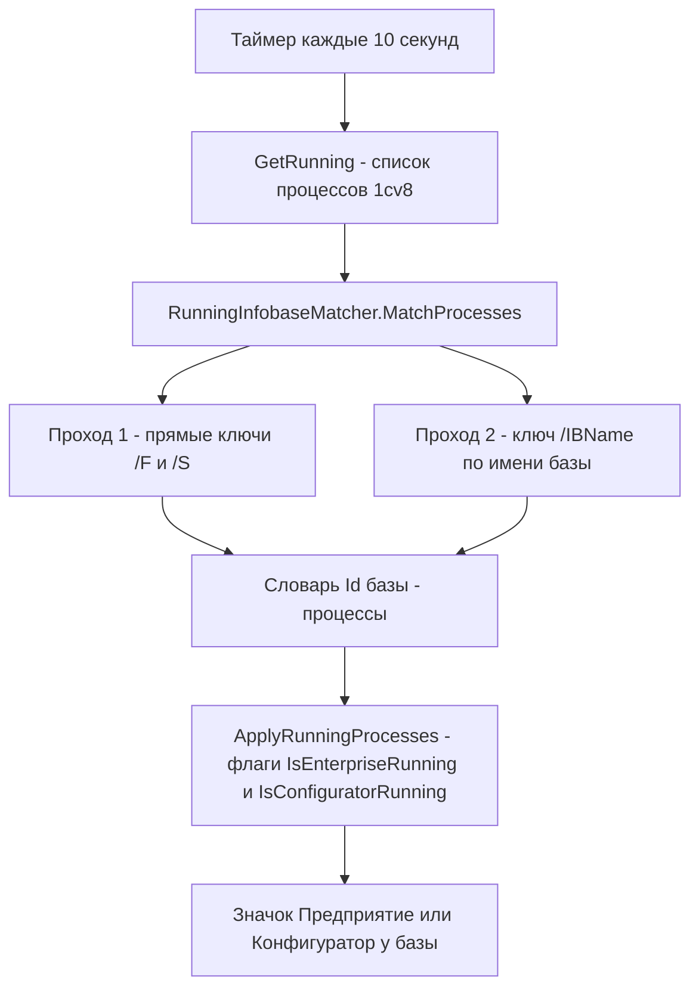

# План исправлений по issues #115, #107, #103 — v1.0.1.46

Проект: **Workspace1C** (sivatorov/Workspace1C, ветка `main`, рабочая папка `g:/h/Workspace1C`).
Текущая версия **1.0.1.45** → следующая **1.0.1.46** (меняется только последнее число).
Платформы: Windows/WPF + Linux/Avalonia 11 (.NET 10). Код в этом плане **не меняется** — документ описывает точки изменений для режима реализации.

Источники: `_issues_to_work_2026-11-09.md` (полные тексты issues #115, #107, #103), анализ кода `Workspace1C/` от 2026-11-09. Issue #107 уже частично исправлялся в v1.0.1.38 (см. `plan-issues-105-107-v100138.md`) — в этой итерации закрываются два остатка.

---

## Общая сводка

| Issue | Суть | Основные файлы | Платформа |
|---|---|---|---|
| #115 | Старая ссылка на Инфостарт в окне «О программе» | `SettingsWindow.xaml`, `SettingsWindow.Avalonia.cs` | WPF + Avalonia |
| #107 | Тёмная тема: тёмный текст кнопок в «Выбор родительской группы»; hover не-дефолтных кнопок — рамка вместо заливки | `GroupPickerWindow.xaml`, `TagPickWindow.xaml`, `LightTheme.xaml`, `DarkTheme.xaml`, `Controls.axaml` | WPF + Avalonia |
| #103 | Значок «Предприятие» не появляется для серверных баз при запуске отладки из Конфигуратора | `RunningInfobaseMatcher.cs`, `RunningInfobaseMatcherTests.cs` | Windows + Linux |

---

## Issue #115 «В окне О программе старая ссылка на Инфостарт»

### Текущее состояние (по коду)

Старый URL `https://infostart.ru/1c/tools/2764888/` встречается в коде приложения в **трёх местах** (поиск `2764888` по решению):

1. WPF, раздел «О программе» окна «Настройки» — [`Workspace1C/Views/SettingsWindow.xaml:2897`](Workspace1C/Views/SettingsWindow.xaml:2897): `TextBlock` с видимым текстом ссылки и `Tag="https://infostart.ru/1c/tools/2764888/"` (строка 2899), обработчик `OnAboutLink_Click` читает `Tag` → **менять и текст, и Tag**.
2. Avalonia, тот же раздел — [`Workspace1C/Views/SettingsWindow.Avalonia.cs:4924`](Workspace1C/Views/SettingsWindow.Avalonia.cs:4924): `LinkBlock(..., "https://infostart.ru/1c/tools/2764888/")` — `infostart` используется и как кликабельный элемент, и хранится в поле окна (проверить при реализации, что в `SettingsWindow.Avalonia.cs` нет второго использования переменной/строки — поиск по `2764888` в файле).

Вне приложения (те же `2764888`, но уже в форме `/1c/articles/…` — старый номер публикации, а не старый путь):

3. [`README.md:1164`](README.md:1164), [`README.md:1166`](README.md:1166), [`README.md:1281`](README.md:1281) — ссылки на публикацию `/1c/articles/2764888/`.
4. [`package/linux/deb/copyright:9`](package/linux/deb/copyright:9) — юридическая ссылка на публикацию.

### Изменения

1. **Приложение (обязательно):** заменить `https://infostart.ru/1c/tools/2764888/` → `https://infostart.ru/1c/articles/2825056/`:
   - `SettingsWindow.xaml` — в `Text` (строка 2897) и в `Tag` (строка 2899);
   - `SettingsWindow.Avalonia.cs` — в аргументе `LinkBlock` (строка 4925).
2. **README/копирайт (рекомендуется, отдельным коммитом или тем же):** обновить ссылки на новую статью `/1c/articles/2825056/` в `README.md` (3 места) и `package/linux/deb/copyright` (1 место). Решение согласуется с содержанием issue (пользователь просит ссылаться на новую статью); `INFOSTART_PUBLICATION.md` — исходник старой публикации, не трогать.

### Проверка

- Запустить приложение, открыть «Настройки» → «О программе» на WPF и на Linux/Avalonia: текст и клик ведут на `https://infostart.ru/1c/articles/2825056/`.
- `grep -r "2764888"` по каталогу `Workspace1C/` — 0 вхождений.

### Риски

Минимальные. Единственный нюанс — обработчик `OnAboutLink_Click` (WPF) берёт URL из `Tag`: если заменить только видимый текст, ссылка останется старой, поэтому менять оба атрибута.

---

## Issue #107 «Неисправленные огрехи в тёмной теме» (комментарий ArtyoZ от 2026-11-09)

Два пункта:
- **(a)** окно «Выбор родительской группы»: текст на кнопках «Отмена»/«Выбрать» тёмный, должен быть светлым;
- **(b)** унифицировать hover не-дефолтных (вторичных) кнопок: только рамка (как в «Настройка информационной базы»), без заливки (как сейчас в «Назначить теги»).

### (a) Тёмный текст кнопок в «Выбор родительской группы»

#### Текущее состояние (по коду) — причина найдена

- Кнопка «Отмена» — [`Workspace1C/Views/GroupPickerWindow.xaml:280-288`](Workspace1C/Views/GroupPickerWindow.xaml:280): стиль локальный `OutlinedButton` (BasedOn `SecondaryButton`), но **иконка и текст жёстко перекрашены** `Foreground="{DynamicResource ButtonTextBrush}"` (строки 283 и 286).
- Кисть `ButtonTextBrush` в [`Workspace1C/Themes/DarkTheme.xaml:94`](Workspace1C/Themes/DarkTheme.xaml:94) ссылается на `ButtonTextColor`, который в **обеих** темах равен `#000000` ([`DarkTheme.xaml:22`](Workspace1C/Themes/DarkTheme.xaml:22), [`LightTheme.xaml:22`](Workspace1C/Themes/LightTheme.xaml:22) — цвет задуман для кнопок со СВЕТЛОЙ подложкой, например `FilterToggleButton`).
- Итог: в тёмной теме кнопка «Отмена» имеет тёмный фон карточки (`CardBackgroundBrush`) и **чёрный** текст/иконку — текст не читается. Это и есть репорт.
- Кнопка «Выбрать» — [`GroupPickerWindow.xaml:270-279`](Workspace1C/Views/GroupPickerWindow.xaml:270): стиль `PrimaryButton` (BasedOn `ModernButton`), текст/иконка с `Foreground="{DynamicResource TextOnAccentBrush}"`. Сама кисть в тёмной теме белая (`#FFFFFF`), но `ThemeManager` пересчитывает `TextOnAccentBrush` по WCAG (≥ 4.5:1) под пользовательский акцент — при светлом акценте текст становится тёмным. Проверить на скрине ArtyoZ/в `ThemePreviewWindow`; при подтверждении — зафиксировать поведение и/или убрать локальные переопределения (см. шаги).
- Avalonia-версия окна — [`Workspace1C/Views/GroupPickerWindow.Avalonia.cs:430`](Workspace1C/Views/GroupPickerWindow.Avalonia.cs:430): кнопки строятся кодом с `SecondaryButtonTextBrush` ([`Controls.axaml:17`](Workspace1C/Themes/Controls.axaml:17) = `TextPrimaryColor`, светлый в тёмной теме) — **скорее всего корректна**, но включить окно в чек-лист ручной проверки.

#### Изменения (a)

1. [`GroupPickerWindow.xaml:280-288`](Workspace1C/Views/GroupPickerWindow.xaml:280): **удалить** `Foreground="{DynamicResource ButtonTextBrush}"` у `PackIcon` (строка 283) и у `TextBlock` (строка 286) — содержимое наследует `Foreground` стиля `SecondaryButton` = `TextPrimaryBrush` (светлый в тёмной теме, [`DarkTheme.xaml:179`](Workspace1C/Themes/DarkTheme.xaml:179)).
2. [`GroupPickerWindow.xaml:270-279`](Workspace1C/Views/GroupPickerWindow.xaml:270): убрать явные `Foreground="{DynamicResource TextOnAccentBrush}"` у `PackIcon` (строка 274) и `TextBlock` (строка 277) — наследование от `ModernButton` даёт тот же цвет, но устраняет локальные дубли (контракт issue #26: жёсткие Foreground в окнах запрещены). Цвет «Выбрать» после этого не изменится — пункт (a) для него сводится к проверке контраста на скрине пользователя (см. «Проверка»).
3. Страж-тест (source-scan): в `GroupPickerWindow.xaml` не должно быть `ButtonTextBrush` внутри блоков кнопок футера.

### (b) Hover не-дефолтных кнопок: рамка вместо заливки

#### Текущее состояние (по коду)

- **Эталон пользователя** — «Настройка информационной база» ([`ConnectionSettingsWindow.xaml`](Workspace1C/Views/ConnectionSettingsWindow.xaml)): вторичные кнопки используют стиль `SecondaryButton`, у которого hover в тёмной теме даёт едва заметную подложку `ItemHoverBrush` + акцентную рамку ([`DarkTheme.xaml:196-199`](Workspace1C/Themes/DarkTheme.xaml:196)) — визуально «просто рамочка».
- **Антипример** — «Назначить теги» ([`TagPickWindow.xaml:81-90`](Workspace1C/Views/TagPickWindow.xaml:81)): кнопка «Отмена» построена на **акцентном** `ModernButton` с подменой `Background=ItemHoverBrush`; hover такого шаблона заливает кнопку `AccentHoverBrush` ([`DarkTheme.xaml:161-163`](Workspace1C/Themes/DarkTheme.xaml:161)) — явная заливка, на которую жалуется ArtyoZ.
- Тот же анти-паттерн `Style="ModernButton" Background="{DynamicResource ItemHoverBrush}"` разбросан по десяткам окон (полный инвентарь — ниже); это «вторичные кнопки, построенные на акцентном стиле», у всех заливка при наведении.
- Avalonia: `SecondaryButton` ([`Controls.axaml:104-140`](Workspace1C/Themes/Controls.axaml:104)) на hover меняет и фон (`SecondaryButtonHoverSurfaceBrush`), и контур (строки 127–130).

#### Изменения (b)

1. **Глобально, WPF** — стиль `SecondaryButton` в обеих темах:
   - [`LightTheme.xaml:196-199`](Workspace1C/Themes/LightTheme.xaml:196) и [`DarkTheme.xaml:196-199`](Workspace1C/Themes/DarkTheme.xaml:196): в триггере `IsMouseOver` **удалить** сеттер `Background = ItemHoverBrush`, оставить только `BorderBrush = AccentBrush` — hover становится «только рамкой» в обеих темах.
   - Состояние `IsPressed` (заливка `SidebarHoverBrush`, [`DarkTheme.xaml:200-202`](Workspace1C/Themes/DarkTheme.xaml:200)) **оставить** — нажатие требует тактильного отклика; претензия была только к hover.
2. **Глобально, Avalonia** — [`Controls.axaml:127-130`](Workspace1C/Themes/Controls.axaml:127): в селекторе `^:pointerover /template/ Border#PART_Surface` удалить сеттер `Background` (оставить только `BorderBrush` = `SecondaryButtonHoverOutlineBrush`). Ключ `SecondaryButtonHoverSurfaceBrush` останется в ресурсах — использовать его для `:pressed` (заменить `SecondaryButtonPressedSurfaceBrush` или оставить как есть; решить при реализации, сохранив паритет pressed с WPF).
3. **Точечно, окно из скриншота** — [`TagPickWindow.xaml:81-90`](Workspace1C/Views/TagPickWindow.xaml:81): «Отмена» переводится с `ModernButton + Background=ItemHoverBrush` на `SecondaryButton` (сохранить `IsCancel`, ширину 110; иконку ✖ перекрасить на `TextSecondaryBrush` — уже так). Кнопка «ОК» остаётся дефолтной акцентной `ModernButton`.
4. **Аудит-хвост (механическая мигация)** — остальные «вторичные кнопки на ModernButton» перевести на `SecondaryButton` (то же поведение hover-рамки автоматически). Инвентарь по результатам поиска `ModernButton` + `ItemHoverBrush` в `Workspace1C/Views/*.xaml`:
   - `BaseSelectionWindow.xaml:52-73`, `BatchOperationsWindow.xaml:110-115, 173-175, 288-307`, `MassLoadCfWindow.xaml:107-111, 177-179, 197-199, 274-293`, `ClusterImportWindow.xaml:86-196`, `ClusterMigrationWindow.xaml:86-278`, `ConnectionReplaceWindow.xaml:111-206`, `NetworkDiagnosticsWindow.xaml:58-95`, `MaintenanceCenterWindow.xaml:201-220`, `RepositoryBrowserWindow.xaml:74-148`, `RepositoryBatchUpdateWindow.xaml:60-101`, `ServerMonitorWindow.xaml:248-927`, `ProcessInspectorWindow.xaml:120-137`, `ServicesWindow.xaml:52-186`, `ServiceGroupPickerWindow.xaml:28-30`, `ServerEditWindow.xaml:103-110`, `RacInfobaseCreateWindow.xaml:145-152`, `ScriptTokenPickerWindow.xaml:94-95`, `UsageStatisticsWindow.xaml:118`, `JobDetailsWindow.xaml:32`, `WhatsNewWindow.xaml:15` (`DialogButton`), `NameInputWindow.xaml:56`, `LoginWindow.xaml:75`, `LicenseDetailsWindow.xaml:49`, `ContextMenuEditorWindow.xaml:70`, `TrayMenuEditorWindow.xaml:69`, `UtilitiesMenuEditorWindow.xaml:70`, `ProfilesPanel.xaml:155`, `MainWindow.xaml` (панель действий).
   - Правило миграции: кнопка **не по умолчанию** (не IsDefault, не главное действие) → `SecondaryButton`; главное/подтверждающее действие окна остаётся `ModernButton` без подмены Background. Окна, где кнопка `ModernButton + ItemHoverBrush` — фактически главное действие (например «Подключить» в `RepositoryBrowserWindow`), по усмотрению оставить `ModernButton` (hover-заливка акцентом для дефолтной кнопки — норма контракта #26).
   - Avalonia-аналоги окон, строящих кнопки кодом (`ModalWindowBase.BuildButtons`, `DialogCancelButton` в `Controls.axaml:161`) — уже на `SecondaryButton`, не трогать.
   - Если объём аудит-хвоста покажется рискованным для одного релиза — допустимо ограничиться пп. 1–3 (глобальный стиль + окно из скриншота), а мигацию хвоста зафиксировать в issue как следующий шаг; но пп. 1–3 уже устраняют расхождение, на которое указан скрин.

### Тесты (`Workspace1C.Tests`)

- Новый `Issue107DarkButtonsTests.cs` (source-scan по образцу `Issue79ScheduledJobsResilienceTests.cs`/`ButtonThemeBindingTests.cs`):
  - в `GroupPickerWindow.xaml` нет `ButtonTextBrush` (страж регрессии (a));
  - в триггере `IsMouseOver` стиля `SecondaryButton` в `LightTheme.xaml`/`DarkTheme.xaml` нет сеттера `Background` (страж (b), WPF);
  - в `Controls.axaml` селектор `^:pointerover /template/ Border#PART_Surface` темы `SecondaryButton` не задаёт `Background` (страж (b), Avalonia);
  - в `TagPickWindow.xaml` кнопка отмены использует `SecondaryButton`.
- Прогон существующих `AccentColorIssue26Tests`, `ButtonThemeBindingTests`, `ThemeContrastRegressionTests`, `Issue26*` — без регрессий.

### Риски

- Удаление hover-заливки меняет ощущение от **всех** вторичных кнопок в обеих темах (в светлой теме заливка была заметнее) — это и есть запрошенная унификация, но упомянуть в CHANGELOG и приложить скрины до/после в комментарий issue.
- Массовая миграция «ModernButton → SecondaryButton» может изменить ширину/паддинги кнопок в отдельных окнах (у `SecondaryButton` свой MinHeight 36, Padding 14,9) — при миграции сохранять локальные размеры (`Height`/`Padding`/`MinWidth`) явно, как сделано в `GroupPickerWindow.xaml:119-123`.
- Кнопка «Выбрать» (a): если тёмный текст на акценте у ArtyoZ — результат WCAG-пересчёта `ThemeManager` для его светлого акцента, «фикс» сломает контраст. Решение: проверить с его акцентом (попросить скрин настроек/схемы), при подтверждении обсудить в issue — возможно, для тёмной темы нужен нижний порог светлоты акцента (отдельная задача, в этот релиз не включать без подтверждения).

---

## Issue #103 «Значок запущенного Предприятия не появляется на серверных базах при отладке из Конфигуратора» (комментарий RafaIS от 2026-11-09)

### Как работает отслеживание сейчас

Монитор запущенных баз — [`Workspace1C/ViewModels/MainViewModel.Running.cs`](Workspace1C/ViewModels/MainViewModel.Running.cs):

1. **Сбор процессов** (Windows): WMI `Win32_Process WHERE Name LIKE '1cv8%'` с `Name, CommandLine, ProcessId` — [`Workspace1C/Services/RunningInfobasesService.Windows.cs:22-40`](Workspace1C/Services/RunningInfobasesService.Windows.cs:22); Linux — обход `/proc/[pid]/cmdline` для exe с префиксом `1cv8` — [`Workspace1C/Services/RunningInfobasesService.Linux.cs:41-43`](Workspace1C/Services/RunningInfobasesService.Linux.cs:41). Сбор идентичен для файловых и серверных баз — **сбор не причина**.
2. **Сопоставление** — [`Workspace1C/Services/RunningInfobaseMatcher.cs`](Workspace1C/Services/RunningInfobaseMatcher.cs):
   - **Проход 1** (строки 55–64): прямые ключи — файловая база `/F <путь>` (`MatchesValue`, строки 109–116), клиент-серверная `/S <сервер>\<база>` (`MatchesServerValue`, строки 129–148; порт у сервера игнорируется, регистр не важен);
   - **Проход 2** (строки 66–83): для процессов без прямых ключей — ключ `/IBName` (запуск отладки из Конфигуратора, добавлен в v1.0.1.35 по этому же issue) с матчингом по имени базы; **только если имя базы уникально** в списке (`uniqueByName`, строки 67–70);
   - Классификация режима — [`Workspace1C/Models/RunningKind.cs:36-57`](Workspace1C/Models/RunningKind.cs:36): `1cv8c` → всегда Предприятие; `1cv8` без DESIGNER → Предприятие.
3. Пользователь подтверждает: на **файловых** базах значок при отладке появляется (проход 2 работает), на **4 серверных** (локальный и внешний сервер, запуск отладки из Конфигуратора) — нет, стабильно в v1.0.1.36–v1.0.1.45.

### Диагностика: почему проходы 1–2 не срабатывают для серверных баз

Командная строка клиента, порождённого Конфигуратором при «Начать отладку» (F5), зависит от того, как инфобаза зарегистрирована у Конфигуратора. Известные формы:

| Форма cmdline | Проход 1 | Проход 2 | Комментарий |
|---|---|---|---|
| `1cv8c.exe ENTERPRISE /S сервер\имя` | ✅ | — | обычный запуск — работает |
| `1cv8c.exe ENTERPRISE /IBName Имя` | — | ✅ | файловые базы при отладке — работает |
| `1cv8c.exe ENTERPRISE /IBConnectionString "Srvr=...;Ref=...;"` | ❌ | ❌ | **не разбирается совсем** — вероятная причина бага |
| `/IBName`, но имя неуникально в списке Workspace1C | — | ❌ | защита от ложных срабатываний отсекает |

**Вероятная причина (основная гипотеза):** при отладке серверной ИБ Конфигуратор передаёт клиенту подключение ключом **`/IBConnectionString "Srvr="<сервер>";Ref="<имя>";..."`** (строка соединения целиком, а не пара `/S сервер\база` и не `/IBName`). Ни один из двух проходов [`RunningInfobaseMatcher.cs`](Workspace1C/Services/RunningInfobaseMatcher.cs) эту форму не разбирает:
- `TryExtractValue(cmdline, "S", …)` не найдёт `/S` (есть только `Srvr=` внутри значения другого ключа);
- `/IBName` отсутствует.

Файловые базы при отладке Конфигуратор запускает через `/IBName` (имя из списка) — поэтому там значок есть. Это объясняет системность (4 из 4 серверных баз, обе разрядности сервера, обе версии 1.0.1.36/1.0.1.45).

**Дополнительные кандидаты (проверить на диагностическом шаге):**
- сервер в `/S` задан как `Srvr="tcp://host:port"` — `NormalizeServerHost` ([`RunningInfobaseMatcher.cs:210-217`](Workspace1C/Services/RunningInfobaseMatcher.cs:210)) снимает только `:port`, но не префикс `tcp://`;
- `/IBName` есть, но имя базы в Workspace1C неуникально (например, одинаковые имена на локальном и внешнем сервере — у RafaIS как раз пары серверов) — проход 2 молча отсекает;
- значение `/IBName` совпадает не с `Name` списка, а с `DatabaseName` (внутреннее имя в кластере) либо наоборот.

**Диагностический шаг (обязательный, до правок):** в «Служебные → Инспектор процессов» ([`Workspace1C/Views/ProcessInspectorWindow.xaml`](Workspace1C/Views/ProcessInspectorWindow.xaml), данные — `GetRunningDetails()`, [`RunningInfobasesService.Windows.cs:75-110`](Workspace1C/Services/RunningInfobasesService.Windows.cs:75)) уже видны полные командные строки. Запустить отладку серверной базы из Конфигуратора, зафиксировать реальную cmdline клиента (в комментарий issue попросить скрин/текст у RafaIS, если локально не воспроизводится). По результату выбрать набор парсеров из шагов ниже (шаг 2 обязателен в любом случае).

### Изменения

1. **Новый проход 0/парсер `/IBConnectionString`** в [`RunningInfobaseMatcher.cs`](Workspace1C/Services/RunningInfobaseMatcher.cs):
   - извлечь значение ключа `/IBConnectionString` (учет кавычек; значение — строка вида `Srvr="host[:port]";Ref="имя";` — разбивать по `;`, затем `ключ=значение` со снятием кавычек);
   - для `ConnectionType.ClientServer`: сравнить `Srvr` с `Connection.Server` (через `NormalizeServerHost`, дополненный снятием префиксов `tcp://`/`hostname протокола`) и `Ref` с `Connection.DatabaseName` (регистр не важен);
   - для `ConnectionType.File`: сравнить `File="путь"` с `Connection.FilePath` через `PathsEqual` — закрывает и файловый вариант `/IBConnectionString`;
   - вставить в `MatchesCommandLine` (перед/после `/IBName`-ветки — в `MatchProcesses` второй проход: сперва `/IBConnectionString`, затем `/IBName`).
2. **Усиление `NormalizeServerHost`** ([`RunningInfobaseMatcher.cs:210-217`](Workspace1C/Services/RunningInfobaseMatcher.cs:210): снимать префиксы `tcp://`, при сравнении хоста игнорировать порт с обеих сторон (сейчас порт снимается только у «сервера базы» — сверить симметрию с cmdline-значением).
3. **Ослабление прохода `/IBName` для серверных баз (по результатам диагностики):** если имя неуникально, но все базы-тёзки — клиент-серверные и cmdline содержит уточнение (`/S`, `Srvr=` в `/IBConnectionString`) — сопоставлять по паре «имя + сервер»; если уточнения нет — не сопоставлять (защита остаётся).
4. **Опционально (только если шаги 1–3 не подтвердятся диагностикой):** третий проход по `rac session list` для несопоставленных клиент-серверных баз — инфраструктура есть (`IRacClient`, резолвер баз в кластере из [`BatchOpsPreparationService.cs`](Workspace1C/Services/BatchOpsPreparationService.cs)), но вызов rac в цикле каждые 10 секунд нежелателен: выполнять с отдельным редким интервалом (60–120 с) и кэшем. Включать в релиз только при подтверждённой необходимости.
5. Локализация не требуется (изменения без новых строк).

### Тесты (`Workspace1C.Tests`)

Расширить [`Workspace1C.Tests/RunningInfobaseMatcherTests.cs`](Workspace1C.Tests/RunningInfobaseMatcherTests.cs) (18 существующих тестов не должны сломаться):

- `MatchesCommandLine` / `MatchProcesses` для cmdline `1cv8c.exe ENTERPRISE /IBConnectionString "Srvr=""server1"";Ref=""trade"";"` (экранированные кавычки 1С) — серверная база сопоставляется;
- то же с портом и протоколом: `Srvr="tcp://server1:1541"` против базы `server1` и `server1:1541`;
- файловый вариант: `File="C:\Bases\ib";` сопоставляется с файловой базой;
- не сопоставляется: `Srvr` совпадает, `Ref` нет; `Ref` совпадает на другом сервере;
- `/IBName` при неуникальном имени + `/IBConnectionString` с уточняющим сервером — сопоставляется (если принято решение п. 3);
- регресс: `/IBConnectionString` не ломает существующие прямые ключи (приоритет `/S`).

### Риски

- **Форма cmdline не подтверждена офлайн** — обязателен диагностический шаг (инспектор процессов) до/вместо части правок; если реальная форма отличается (например `/IBName` с неуникальным именем), достаточно п. 3 без нового парсера.
- Разбор `/IBConnectionString` со вложенными кавычками (экранирование `""` в 1С) — покрыть юнит-тестами на «рваные» строки.
- Расширение матчиng-а повышает риск ложных срабатываний (значок на чужой базе) — правило: сравнение по паре «сервер + имя», а не по одному имени (кроме уже существующего строгого `/IBName`-прохода).

---

## Версия, CHANGELOG, README

1. **[`Workspace1C/Workspace1C.csproj:62-65`](Workspace1C/Workspace1C.csproj:62)**: `Version`/`AssemblyVersion`/`FileVersion`/`InformationalVersion`: `1.0.1.45` → `1.0.1.46` (только последнее число, все четыре строки).
2. **[`CHANGELOG.md`](CHANGELOG.md)**: новая секция `## 1.0.1.46` вверху, три пункта:
   - «О программе»: ссылка на публикацию Infostart обновлена на новую статью (issue #115);
   - Тёмная тема: светлый текст кнопок в окне «Выбор родительской группы»; hover вторичных кнопок унифицирован — только рамка, без заливки; окно «Назначить теги» переведено на общий контракт вторичной кнопки (issue #107);
   - Значок «Предприятие» при запуске отладки из Конфигуратора: сопоставление процессов расширено разбором `/IBConnectionString` (серверные базы) (issue #103).
3. **[`README.md`](README.md)**: обновить ссылки на публикацию (`/1c/articles/2764888/` → `/1c/articles/2825056/`, строки 1164, 1166, 1281 — синхронно с issue #115); если в README есть блок «последние изменения/версия» — дополнить пунктом 1.0.1.46 по образцу предыдущих релизов.
4. Скрипт сборки/релиза: по сложившейся практике создать `_build_v100146.ps1` на основе `_build_v100145.ps1` (вне скоупа плана, выполняется на этапе релиза).

---

## Чек-лист проверки релиза

- [ ] `dotnet build` (WPF) и `dotnet build -f net10.0-linux` (Avalonia) — без ошибок.
- [ ] `dotnet test` (Workspace1C.Tests, ~5900+ тестов) — без регрессий; новые тесты `Issue107DarkButtonsTests`, расширенные `RunningInfobaseMatcherTests` — зелёные.
- [ ] WPF, тёмная тема: окно «Выбор родительской группы» — текст/иконки «Отмена» и «Выбрать» светлые.
- [ ] WPF, обе темы: «Назначить теги» — hover «Отменить» = рамка; «Настройка информационной базы» — вид не изменился; окно «Настройки» — визуальная регрессия отсутствует.
- [ ] Linux/Avalonia: те же окна — паритет с WPF.
- [ ] «О программе» (WPF и Avalonia): ссылка ведёт на https://infostart.ru/1c/articles/2825056/.
- [ ] Диагностика #103: инспектором процессов зафиксирована реальная cmdline клиента при отладке серверной базы; после правок значок «Предприятие» появляется на серверной базе, запущенной по F5 из Конфигуратора (файловая база — регресс отсутствует, обычный запуск `/S` — регресс отсутствует).
- [ ] `grep -r "2764888"` в `Workspace1C/` — пусто; в корне — только осознанные места (если README обновлён — пусто везде, кроме `INFOSTART_PUBLICATION.md`).
