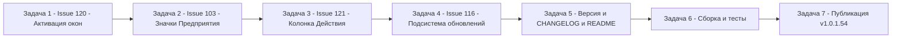

# План релиза v1.0.1.54 — issues #120, #103, #121, #116

- Дата плана: 2026-11-11
- Базовая версия: **1.0.1.53** (см. [`Workspace1C.csproj`](Workspace1C/Workspace1C.csproj:62), запись [1.0.1.53] в [CHANGELOG.md](CHANGELOG.md:14))
- Целевая версия: **1.0.1.54** (бамп ТОЛЬКО последнего числа, единая версия на весь батч)
- Отчёт-источник отбора issues: [`.tmp_issues_work_plan_2026-11-11.md`](.tmp_issues_work_plan_2026-11-11.md)
- Ограничения плана: комментарии/закрытие issues, commit/push, правки кода — вне этого плана.

---

## Сводка задач (порядок выполнения)

| № | Задача | Issue | Сложность |
|---|--------|-------|-----------|
| 1 | Активация запущенных окон Конфигуратора/Предприятия | #120 | средняя |
| 2 | Значки Предприятия: треугольник в кружке (синий/оранжевый) | #103 | низкая |
| 3 | Колонка «Действия»: ширина, выравнивание, единый стиль иконок | #121 | средняя |
| 4 | Доработка подсистемы обновлений (6 пунктов) | #116 | высокая |
| 5 | Версия 1.0.1.54 + CHANGELOG.md + README.md | — | низкая |
| 6 | Сборка, тесты, подготовка артефактов | — | — |
| 7 | Публикация релиза v1.0.1.54 | — | — |

Порядок обоснован: #120 и #103 — починка сломанной функциональности (баг-репорты
«не работает ничего»), #121 и #103 делаются в одном визуальном стиле (чип-кружок +
подсветка при выделении), поэтому идут рядом; #116 — независимый крупный блок.

---

## Задача 1. Issue #120 — активация уже открытых окон Конфигуратора/Предприятия

### Текущее состояние кода (v1.0.1.52 уже частично реализовано)

Механика активации из v1.0.1.52:
- [`OneCWindowActivator.Windows.cs`](Workspace1C/Services/OneCWindowActivator.Windows.cs:48) —
  `GetWindows(infobase, kind)` (EnumWindows, фильтр по PID процессов базы через
  [`RunningInfobaseMatcher`](Workspace1C/Services/RunningInfobaseMatcher.cs) и
  [`RunningKindClassifier`](Workspace1C/Models/RunningKind.cs:32)), `Activate(handle)`;
  Linux-версия [`OneCWindowActivator.Linux.cs`](Workspace1C/Services/OneCWindowActivator.Linux.cs:22)
  возвращает пустой список (no-op).
- [`MainViewModel.Running.cs`](Workspace1C/ViewModels/MainViewModel.Running.cs:196) —
  `TryActivateConfiguratorWindow`, `GetRunningWindowsSafe`, `ActivateRunningWindow`,
  `ActivateWindowByHandle` + [RunningWindowPlanner.cs](Workspace1C/Services/RunningWindowPlanner.cs).
- WPF-чипы: [`MainWindow.Events.cs`](Workspace1C/Views/MainWindow.Events.cs:503) —
  `OnEnterpriseChip_MouseLeftButtonDown` / `OnConfiguratorChip_MouseLeftButtonDown`
  (разметка: [`MainWindow.xaml`](Workspace1C/Views/MainWindow.xaml:1902) и далее).
- Avalonia-чипы: [`MainWindow.Avalonia.Tree.cs`](Workspace1C/Views/MainWindow.Avalonia.Tree.cs:426),
  клики — там же строки 495–513; двойной щелчок —
  [`LeveledTreeView.Avalonia.cs`](Workspace1C/Controls/LeveledTreeView.Avalonia.cs:527).
- Конфигуратор: активация вместо запуска —
  [`MainViewModel.Launch.cs`](Workspace1C/ViewModels/MainViewModel.Launch.cs:247),
  [`MainViewModel.Commands.cs`](Workspace1C/ViewModels/MainViewModel.Commands.cs:684),
  [`MainViewModel.Avalonia.Launch.cs`](Workspace1C/ViewModels/MainViewModel.Avalonia.Launch.cs:70).

### Замечания репортера RafaIS (последний комментарий, 2026-11-11 05:35)

1. **Клик по значку-индикатору ничего не делает** — курсор меняется на руку, реакции нет.
2. **Двойной щелчок по строке запускает НОВУЮ сессию Предприятия**, а должен
   сначала искать запущенный экземпляр и активировать его; запускать новый —
   только если запущенного нет.
3. Значки-индикаторы делать кликабельными НЕ нужно (сумятица); консенсус:
   **индикаторы рисовать прямо на кнопках запуска** в колонке «Действия»
   (в связке с #121).

### Что сделать

1. **Диагностика неработающего клика по чипу (WPF):**
   - проверить hit-testing чипа «Предприятие» в
     [`MainWindow.xaml`](Workspace1C/Views/MainWindow.xaml:1902): `Background` чипа —
     `CardBackgroundBrush` через Style триггеры; если фон прозрачный/перекрыт соседом
     в `StackPanel` строки, `MouseLeftButtonDown` не срабатывает — проверить
     `Background="{x:Null}"` и z-order, `e.Handled` у родительских обработчиков строки;
   - проверить, что монитор процессов реально выставляет `IsEnterpriseRunning`
     ([`MainViewModel.Running.cs`](Workspace1C/ViewModels/MainViewModel.Running.cs:95) →
     [`RunningInfobaseMatcher`](Workspace1C/Services/RunningInfobaseMatcher.cs)): у RafaIS
     клик мог «не работать» именно потому, что чип скрыт/не виден из-за несрабатывания
     матчера для тонкого клиента (1cv8c) или серверных баз (`/S"server/base"`);
   - в обработчике клика [`MainWindow.Events.cs:503`] при пустом списке окон
     (`windows.Count == 0`) сейчас ничего не происходит (планер возвращает None) —
     добавить fallback-сообщение/журнал, чтобы «ничего не происходит» стало диагностируемым.
2. **Двойной щелчок по строке = сначала активация, потом запуск:**
   - WPF: [`MainWindow.Events.cs`](Workspace1C/Views/MainWindow.Events.cs:576)
     `ActivateInfobaseByDoubleClickAction` — для действия «Предприятие» перед
     `LaunchEnterpriseCommand` попытаться `ActivateRunningWindow(ib, RunningKind.Enterprise)`
     (планирование через [`RunningWindowPlanner.cs`](Workspace1C/Services/RunningWindowPlanner.cs),
     несколько окон — меню выбора как в `OpenRunningWindowPicker`);
     учесть настройку двойного щелчка (Global/Конфигуратор/Ничего,
     `MainViewModel.ResolveDoubleClickAction`) — активация выполняется только для
     действия «Предприятие» и только когда `IsEnterpriseRunning`;
   - Avalonia: [`LeveledTreeView.Avalonia.cs`](Workspace1C/Controls/LeveledTreeView.Avalonia.cs:527) —
     та же логика перед `vm.LaunchEnterpriseCommand.Execute(null)`.
3. **Кнопка запуска Предприятия — всегда новая сессия** (без изменений), индикатор
   занятости переносится на кнопку (совместно с задачей 3 / #121).
4. Avalonia/Linux: активация окон не поддержана — graceful fallback на запуск
   (уже учтено в [`MainViewModel.Running.Avalonia.cs`](Workspace1C/ViewModels/MainViewModel.Running.Avalonia.cs:22)).
5. Локализация ru/en — при добавлении диагностических сообщений: ключи `Main.RunningWindow.*`.

### Файлы для изменения

- [`Workspace1C/Views/MainWindow.Events.cs`](Workspace1C/Views/MainWindow.Events.cs:503)
- [`Workspace1C/Views/MainWindow.xaml`](Workspace1C/Views/MainWindow.xaml:1899)
- [`Workspace1C/Controls/LeveledTreeView.Avalonia.cs`](Workspace1C/Controls/LeveledTreeView.Avalonia.cs:527)
- [`Workspace1C/Views/MainWindow.Avalonia.Tree.cs`](Workspace1C/Views/MainWindow.Avalonia.Tree.cs:495)
- [`Workspace1C/Services/RunningWindowPlanner.cs`](Workspace1C/Services/RunningWindowPlanner.cs) — при необходимости расширение плана действий
- [`Workspace1C/Services/RunningInfobaseMatcher.cs`](Workspace1C/Services/RunningInfobaseMatcher.cs) — при выявлении проблем матчинга
- локализация ru/en (`Workspace1C/Localization/`)

**Тесты:** сторож-тесты на `RunningWindowPlanner` (сценарий «окно найдено → активация
при двойном щелчке»); юнит-тест матчера для тонкого клиента/серверных баз.

---

## Задача 2. Issue #103 — значки Предприятия: треугольник в кружке (синий/оранжевый)

### Текущее состояние

Договорённость (7OH, 2026-11-10): значков остаётся два — Конфигуратор без изменений
(ключ в кружке); Предприятие — треугольник в кружке: **синий при запуске с отладкой**
(`/DEBUG`), **оранжевый без отладки**, кружок всегда + подсветка занятости.

Сейчас:
- WPF: чип «Предприятие» — `PackIcon Kind="Play"` **всегда синий** (InfoBrush),
  независимый янтарный маркер отладки — `Ellipse` рядом
  ([`MainWindow.xaml`](Workspace1C/Views/MainWindow.xaml:1902–1949),
  комментарий v1.0.1.49/v1.0.1.50);
- Avalonia: значок — `Path` в
  [`MainWindow.Avalonia.Tree.cs`](Workspace1C/Views/MainWindow.Avalonia.Tree.cs:426–466),
  цвет через [`RunningChipBrushConverter`](Workspace1C/Converters/Avalonia/RunningChipBrushConverter.Avalonia.cs);
- признак отладки в модели: `Infobase.IsEnterpriseDebugRunning`
  ([`Infobase.cs`](Workspace1C/Models/Infobase.cs:271), ставится в
  [`MainViewModel.Running.cs`](Workspace1C/ViewModels/MainViewModel.Running.cs:105) через
  [`RunningInfobaseMatcher.HasDebugKey`](Workspace1C/Services/RunningInfobaseMatcher.cs:53)) —
  уже есть и работает.

### Что сделать

1. **WPF** ([`MainWindow.xaml`](Workspace1C/Views/MainWindow.xaml:1922)):
   - заменить `PackIcon Kind="Play"` на треугольник (Path с геометрией «Play»-треугольника
     или `PackIcon Kind="Play"` оставлен как глиф, но перекрасить): цвет по
     `IsEnterpriseDebugRunning` — синий (InfoBrush) при отладке, **оранжевый
     (WarningBrush)** без отладки; кружок-чип (Border 18×18) остаётся всегда;
   - убрать отдельный янтарный `Ellipse`-маркер отладки (строка ~1946) — цвет
     значка теперь сам кодирует отладку; tooltip «запущено с отладкой»
     (`Infobase.DebugRunningTooltip`) перенести на чип при `IsEnterpriseDebugRunning`;
   - триггеры Hung/Critical (красный чип + белый глиф) сохраняются без изменений
     (подсветка занятости).
2. **Avalonia** ([`MainWindow.Avalonia.Tree.cs`](Workspace1C/Views/MainWindow.Avalonia.Tree.cs:426)):
   - то же: цвет enterprise-значка привязать к `IsEnterpriseDebugRunning`
     (конвертер или множественная привязка), убрать отдельный маркер отладки, если он есть;
   - проверить, что значок — треугольник, а не Play-глиф с кружком.
3. Проверить `Infobase.EnterpriseDebugMarkerHex`
   ([`Infobase.cs`](Workspace1C/Models/Infobase.cs)) — если больше не нужен, убрать;
   `RunningModesTooltip` ([`Infobase.cs`](Workspace1C/Models/Infobase.cs:251)) обновить
   под новую кодировку (упоминание отладки остаётся).
4. Локализация: tooltip отладки остаётся, при необходимости скорректировать текст
   («Предприятие запущено с отладкой / без отладки»).

### Файлы для изменения

- [`Workspace1C/Views/MainWindow.xaml`](Workspace1C/Views/MainWindow.xaml:1902)
- [`Workspace1C/Views/MainWindow.Avalonia.Tree.cs`](Workspace1C/Views/MainWindow.Avalonia.Tree.cs:426)
- [`Workspace1C/Models/Infobase.cs`](Workspace1C/Models/Infobase.cs:271) — tooltip/маркер
- [`Workspace1C/Converters/Avalonia/RunningChipBrushConverter.Avalonia.cs`](Workspace1C/Converters/Avalonia/RunningChipBrushConverter.Avalonia.cs) — при необходимости
- локализация ru/en (ключ `Infobase.DebugRunningTooltip`)

**Тесты:** сторож-тест на разметку (наличие привязки `IsEnterpriseDebugRunning` у
enterprise-значка, отсутствие отдельного Ellipse-маркера); юнит-тест
`RunningInfobaseMatcher.HasDebugKey` уже есть — расширить при необходимости.

---

## Задача 3. Issue #121 — колонка «Действия»: ширина, выравнивание, единый стиль

### Текущее состояние

- WPF: [`MainWindow.xaml`](Workspace1C/Views/MainWindow.xaml:792–802) — `ActionsColumn`
  (3 ColumnDefinition: для строк, заголовка и группы; дефолт 170 через `ColumnVis`
  ConverterParameter, `MinWidth` 120), сплиттер `ActionsSplitter`
  ([`MainWindow.xaml`](Workspace1C/Views/MainWindow.xaml:1081)); ширина хранится в
  `MainViewModel.ActionsColumnWidth` (поиск по `MainViewModel.Display.cs`/`Tools.cs`).
  Кнопки строки — в шаблоне строки `MainWindow.xaml` (после колонки «Режим запуска»),
  выравнивание — центр.
- Avalonia: [`MainWindow.Avalonia.Tree.cs`](Workspace1C/Views/MainWindow.Avalonia.Tree.cs:613) —
  `ActionsPanel` с кнопками `RowActionButton` (Play/Wrench/Broom + иные),
  [`RowActionButton`](Workspace1C/Views/MainWindow.Avalonia.Tree.cs:891) — стиль
  `IconButton`, выравнивание `Center`, значок `IconHelper.MakeIcon` 15px,
  `TextSecondaryBrush`/явный цвет.

### Замечания репортера (описание issue, комментариев нет)

1. Колонку невозможно сузить — слишком широкая, много пустого места ради максимум
   трёх иконок.
2. Иконки выровнять по левому краю (или настройка «середина/лево»).
3. Единый стиль иконок: кружок вокруг + подсветка при выделении строки — как у
   индикаторов запущенного Конфигуратора/Предприятия.

### Что сделать

1. **Сужение колонки:**
   - WPF: проверить `ColumnVis`-конвертер и обработчик перетаскивания
     `ActionsSplitter` — уменьшить минимум (120 → ~64–80, по трём иконкам),
     дефолт 170 → ~110–120; убедиться, что сохранённая в настройках ширина
     (`ActionsColumnWidth`) корректно клампится при загрузке;
   - Avalonia: проверить соответствующий ширина/минимум у `ActionsPanel`-колонки.
2. **Выравнивание по левому краю:**
   - WPF: кнопки в шаблоне строки → `HorizontalAlignment="Left"`, панель кнопок —
     `HorizontalAlignment="Left"` с небольшим Margin;
   - Avalonia: `RowActionButton` `HorizontalAlignment.Center` → `Left`
     ([`MainWindow.Avalonia.Tree.cs`](Workspace1C/Views/MainWindow.Avalonia.Tree.cs:915));
     рассмотреть настройку «середина/лево» только если левое выравнивание
     спорно — по умолчанию лево (просьба репортера).
3. **Единый стиль иконок (кружок + подсветка при выделении):**
   - обернуть каждую кнопку действия в круглый чип-кружок (как `BuildRunningChip`
     [`MainWindow.Avalonia.Tree.cs`](Workspace1C/Views/MainWindow.Avalonia.Tree.cs:939)):
     фон `CardBackgroundBrush`, обводка `BorderBrushColor`; при выделении строки
     фон/обводка чипа меняются (триггер `IsSelected` строки — WPF DataTrigger /
     Avalonia :pointerover / псевдоклассы темы);
   - значки действий: Play (Предприятие), Wrench (Конфигуратор), Broom (очистка кэша),
     и прочие кнопки колонки — все приводятся к этому стилю; цвет значка —
     вторичный, у удаления — красный (как сейчас);
   - согласовать с #120: индикатор запуска рисуется на кнопке запуска — кнопка
     «Предприятие» при `IsEnterpriseRunning` подсвечивается (оранжевый/синий
     треугольник по договорённости #103), клик по подсвеченной кнопке сохраняет
     прежнее поведение запуска; переход к окну — по чипу в строке (после задачи 1)
     или по кнопке — финализировать по итогам обсуждения в issue.
4. Локализация: при добавлении настройки выравнивания — ключи `Settings.Columns.*`.

### Файлы для изменения

- [`Workspace1C/Views/MainWindow.xaml`](Workspace1C/Views/MainWindow.xaml:792) — колонка, сплиттер, кнопки строки (WPF)
- [`Workspace1C/Views/MainWindow.Avalonia.Tree.cs`](Workspace1C/Views/MainWindow.Avalonia.Tree.cs:613) — `ActionsPanel`, `RowActionButton` (Avalonia)
- [`Workspace1C/ViewModels/MainViewModel.cs`](Workspace1C/ViewModels/MainViewModel.cs) + партиалы (`ActionsColumnWidth`, кламп значений)
- темы [`Workspace1C/Themes/LightTheme.xaml`](Workspace1C/Themes/LightTheme.xaml) /
  [`Workspace1C/Themes/DarkTheme.xaml`](Workspace1C/Themes/DarkTheme.xaml) — стили чипа кнопок действий (если выносится в тему)
- локализация ru/en

**Тесты:** сторож-тесты разметки (MinWidth колонки, выравнивание Left); юнит-тест
клампа `ActionsColumnWidth` при загрузке настроек.

---

## Задача 4. Issue #116 — доработка подсистемы обновлений (6 пунктов)

### Текущее состояние

- Режимы обновления: [`AppUpdateMode.cs`](Workspace1C/Models/AppUpdateMode.cs),
  [`UpdateService.cs`](Workspace1C/Services/UpdateService.cs:254) /
  [`UpdateService.Avalonia.cs`](Workspace1C/Services/UpdateService.Avalonia.cs:305) —
  `CheckForUpdatesAsync`, `CheckForUpdatesManualAsync`, `ApplyInterval`,
  `ApplyUpdateMode`.
- Периодичность: `AppSettings.UpdateCheckIntervalMinutes`
  ([`AppSettings.cs`](Workspace1C/Models/AppSettings.cs:394), фиксированный список
  `UpdateCheckIntervals` {0, 60, 360, 1440} + `NormalizeUpdateInterval`), UI —
  один ComboBox «Интервал»: WPF [`SettingsWindow.xaml.cs`](Workspace1C/Views/SettingsWindow.xaml.cs:787)
  и [`SettingsWindow.xaml`](Workspace1C/Views/SettingsWindow.xaml) (UpdateIntervalComboBox),
  Avalonia [`SettingsWindow.Avalonia.cs`](Workspace1C/Views/SettingsWindow.Avalonia.cs:453–478).
- Эталон «как в заданиях»: [`ScheduledTaskEditViewModel.cs`](Workspace1C/ViewModels/ScheduledTaskEditViewModel.cs:77) —
  `RepeatIntervalValueText` (число) + `RepeatIntervalUnit` (минуты/часы/дни).
- Подвал главного окна: WPF [`MainWindow.Updates.cs`](Workspace1C/Views/MainWindow.Updates.cs:55)
  (`InitializeFooterUpdateState`, `RefreshFooterUpdateState` — три состояния:
  скрыт / синие стрелки синхронизации / жирные красные «!!!`), элементы
  `FooterUpdateIcon`/`FooterUpdateSyncIcon`/`FooterUpdateExclaim` в
  [`MainWindow.xaml`](Workspace1C/Views/MainWindow.xaml); Avalonia
  [`MainWindow.Avalonia.cs`](Workspace1C/Views/MainWindow.Avalonia.cs:2293–2330) —
  `_footerUpdateIcon` StackPanel с `TextBlock Text="!!!"` (строка ~2319) и
  [`RefreshFooterUpdateState`](Workspace1C/Views/MainWindow.Avalonia.cs:2454).
- «Что нового»: [`WhatsNewWindow.xaml.cs`](Workspace1C/Views/WhatsNewWindow.xaml.cs) (WPF,
  RichTextBox) / [`WhatsNewWindow.Avalonia.cs`](Workspace1C/Views/WhatsNewWindow.Avalonia.cs);
  источник сводки — [`WhatsNewService.cs`](Workspace1C/Services/WhatsNewService.cs:73)
  (KnownVersions только `1_0_1_12` + fallback на body GitHub-релиза
  [`GetGithubReleaseNotesAsync`](Workspace1C/Services/WhatsNewService.cs:91)).
- Окно подтверждения обновления: [`UpdateAvailableWindow.xaml.cs`](Workspace1C/Services/UpdateAvailableWindow.xaml.cs)
  (SizeToContent="Height", комментарии о ресайзе строк 94, 448); Avalonia-подтверждение —
  [`MaterialMessageWindow.Avalonia.cs`](Workspace1C/Services/MaterialMessageWindow.Avalonia.cs:32).
- Локализация подвала: ключи `Main.Footer.*`.

### Что сделать (по пунктам из issue)

1. **Периодичность проверки «как в заданиях»** — поле «Интервал» (число) + список
   периодичности (минуты/часы/дни):
   - WPF: переделать блок `UpdateIntervalComboBox` в
     [`SettingsWindow.xaml`](Workspace1C/Views/SettingsWindow.xaml) +
     [`SettingsWindow.xaml.cs`](Workspace1C/Views/SettingsWindow.xaml.cs:787) на
     TextBox + ComboBox единиц (паттерн окна заданий
     [`ScheduledTaskEditWindow.xaml.cs`](Workspace1C/Views/ScheduledTaskEditWindow.xaml.cs));
   - Avalonia: [`SettingsWindow.Avalonia.cs`](Workspace1C/Views/SettingsWindow.Avalonia.cs:453) — то же;
   - модель: расширить [`AppSettings.cs`](Workspace1C/Models/AppSettings.cs:394) парой
     «значение + единица» (или оставить хранение в минутах `UpdateCheckIntervalMinutes`
     и конвертировать value×unit — рекомендуемый вариант для совместимости, миграция
     старых значений 60/360/1440);
   - применить через `UpdateService.ApplyInterval(...)`
     ([`MainViewModel.Tools.cs`](Workspace1C/ViewModels/MainViewModel.Tools.cs:2752),
     [`MainViewModel.Avalonia.cs`](Workspace1C/ViewModels/MainViewModel.Avalonia.cs:432));
   - поправить компоновку (настройка «почти не видна» — замечание 7OH): блок рядом
     с режимом обновления, не в глубине «Общих» настроек.
2. **Скролл «Что нового» колёсиком:**
   - WPF [`WhatsNewWindow.xaml.cs`](Workspace1C/Views/WhatsNewWindow.xaml.cs): если текст
     в RichTextBox/ScrollViewer не скроллится колесом (контент меньше области или
     события глотаются) — добавить обработку `PreviewMouseWheel` с прокруткой;
   - Avalonia [`WhatsNewWindow.Avalonia.cs`](Workspace1C/Views/WhatsNewWindow.Avalonia.cs):
     проверить/включить `ScrollViewer` для блока описания.
3. **Иконка вместо надписи «!! Обновить»** (красный «!!» в логах = серьёзные ошибки):
   - WPF [`MainWindow.Updates.cs`](Workspace1C/Views/MainWindow.Updates.cs:90) +
     разметка подвала [`MainWindow.xaml`](Workspace1C/Views/MainWindow.xaml): заменить
     красные `FooterUpdateExclaim` («!!!») на **значок «внимание» (восклицательный
     знак в треугольнике) в основном акцентном цвете**; tooltip сохраняется
     (`Main.Footer.UpdateAvailableTooltip`);
   - Avalonia [`MainWindow.Avalonia.cs`](Workspace1C/Views/MainWindow.Avalonia.cs:2319):
     заменить `TextBlock "!!!"` на тот же глиф-треугольник (`IconHelper` / Path);
   - проверить, не осталось ли текстовой ссылки «Обновить» в подвале/локализации
     (ключи `Main.Footer.*`) — заменить значком с подсказкой.
4. **Растягивание окон обновления:**
   - [`UpdateAvailableWindow.xaml.cs`](Workspace1C/Services/UpdateAvailableWindow.xaml.cs:94):
     убрать растягивание по вертикали окна подтверждения перезапуска
     (ResizeMode.CanResize → ширина-only: `CanResize` + фиксация высоты через
     MinHeight=MaxHeight, т.к. SizeToContent="Height" конфликтует с ресайзом);
   - проверить, что область текста «Что нового» следует за размером окна
     (Anchorable/`*`-строки в разметке);
   - Avalonia: [`MaterialMessageWindow.Avalonia.cs`](Workspace1C/Services/MaterialMessageWindow.Avalonia.cs) —
     та же фиксация высоты.
5. **Пустой список изменений после обновления** — investigate + fix:
   - после обновления окно «Что нового» показывает пустой список: проверить
     [`WhatsNewService.cs`](Workspace1C/Services/WhatsNewService.cs:73) —
     `KnownVersions` содержит только `1_0_1_12`, fallback
     `GetGithubReleaseNotesAsync` ищет body релиза текущего тега; если релиз ещё
     не опубликован на GitHub на момент показа окна — список пуст;
   - исправить: fallback-порядок — body релиза предыдущей версии →
     локальная CHANGELOG-сводка (заголовок секции новой версии из
     [CHANGELOG.md](CHANGELOG.md:14), если файл рядом с exe) → сообщение-заглушка
     «Изменения — на странице релиза» с кнопкой открытия;
   - гарантировать, что окно никогда не показывается с пустым содержимым
     (не показывать вовсе, если сводку получить не удалось).
6. Локализация ru/en: новые/изменённые ключи `Settings.General.UpdateInterval*`,
   `WhatsNew.*`, `Main.Footer.*`.

### Файлы для изменения

- [`Workspace1C/Models/AppSettings.cs`](Workspace1C/Models/AppSettings.cs:394) — интервал (value+unit, миграция)
- [`Workspace1C/Views/SettingsWindow.xaml`](Workspace1C/Views/SettingsWindow.xaml) + [`Workspace1C/Views/SettingsWindow.xaml.cs`](Workspace1C/Views/SettingsWindow.xaml.cs:787)
- [`Workspace1C/Views/SettingsWindow.Avalonia.cs`](Workspace1C/Views/SettingsWindow.Avalonia.cs:453)
- [`Workspace1C/ViewModels/MainViewModel.Tools.cs`](Workspace1C/ViewModels/MainViewModel.Tools.cs:2752), [`Workspace1C/ViewModels/MainViewModel.Avalonia.cs`](Workspace1C/ViewModels/MainViewModel.Avalonia.cs:432) — ApplyInterval
- [`Workspace1C/Views/MainWindow.Updates.cs`](Workspace1C/Views/MainWindow.Updates.cs:90) + [`Workspace1C/Views/MainWindow.xaml`](Workspace1C/Views/MainWindow.xaml) — подвал WPF
- [`Workspace1C/Views/MainWindow.Avalonia.cs`](Workspace1C/Views/MainWindow.Avalonia.cs:2293) — подвал Avalonia
- [`Workspace1C/Views/WhatsNewWindow.xaml.cs`](Workspace1C/Views/WhatsNewWindow.xaml.cs), [`Workspace1C/Views/WhatsNewWindow.Avalonia.cs`](Workspace1C/Views/WhatsNewWindow.Avalonia.cs) — скролл, пустой список
- [`Workspace1C/Services/WhatsNewService.cs`](Workspace1C/Services/WhatsNewService.cs) — fallback сводки
- [`Workspace1C/Services/UpdateAvailableWindow.xaml.cs`](Workspace1C/Services/UpdateAvailableWindow.xaml.cs), [`Workspace1C/Services/MaterialMessageWindow.Avalonia.cs`](Workspace1C/Services/MaterialMessageWindow.Avalonia.cs) — ресайз
- [`Workspace1C/Services/UpdateService.cs`](Workspace1C/Services/UpdateService.cs) / [`Workspace1C/Services/UpdateService.Avalonia.cs`](Workspace1C/Services/UpdateService.Avalonia.cs) — при необходимости ApplyInterval под value+unit
- локализация ru/en

**Тесты:** юнит-тесты конверсии value+unit ↔ минут и миграции старых значений;
тест fallback-порядка `WhatsNewService` (нет релиза → заглушка, не пустое окно);
сторож-тесты разметки подвала (глиф «внимание» вместо «!!!»).

---

## Задача 5. Версия 1.0.1.54 + CHANGELOG.md + README.md

### Место изменения версии

- [`Workspace1C/Workspace1C.csproj`](Workspace1C/Workspace1C.csproj:62) — строки 62–65:
  `<Version>1.0.1.53</Version>`, `<AssemblyVersion>1.0.1.53</AssemblyVersion>`,
  `<FileVersion>1.0.1.53</FileVersion>`, `<InformationalVersion>1.0.1.53</InformationalVersion>`
  → **все четыре заменить на `1.0.1.54`** (увеличивается ТОЛЬКО последнее число).
- Версия нигде больше в коде не захардкожена — отображение идёт через
  [`VersionInfo.Display()`](Workspace1C/VersionInfo.cs:17) из атрибута сборки.

### CHANGELOG.md

Добавить запись **в начало** файла (после строки 12 `---`), по образцу [1.0.1.53]
([CHANGELOG.md](CHANGELOG.md:14)):

```markdown
## [1.0.1.54] — 2026-11-11

### Исправлено

- **Активация открытых окон Конфигуратора/Предприятия (issue #120)** — починен клик
  по индикатору запущенного Предприятия; двойной щелчок по строке активирует
  запущенный экземпляр вместо запуска нового (запуск — только если не запущено).

### Изменено

- **Значки Предприятия приведены к договорённости (issue #103)** — треугольник
  в кружке: синий при запуске с отладкой (/DEBUG), оранжевый без отладки;
  подсветка занятости сохранена. Значок Конфигуратора не изменён.
- **Колонка «Действия» (issue #121)** — колонку можно сузить, иконки выровнены
  по левому краю, единый стиль иконок (кружок + подсветка при выделении).
- **Подсистема обновлений (issue #116)** — периодичность проверки «как в заданиях»
  (интервал + единица), значок «внимание» вместо красных «!!» рядом с версией,
  скролл «Что нового» колёсиком, фикс растягивания окон обновления по вертикали,
  исправлен пустой список изменений после обновления.
```

(финальный текст уточнить по фактически выполненным пунктам; в issue не комментировать.)

### README.md

- [README.md](README.md:3) — бейдж версии: `Версия-1.0.1.53` → `Версия-1.0.1.54`;
- [README.md](README.md:11) — «актуальная версия — **1.0.1.53**» → **1.0.1.54**;
- при необходимости кратко упомянуть новые доработки в соответствующих разделах
  README (в стиле упоминания 1.0.1.53 на строке 207).

---

## Задача 6. Сборка и тесты

1. Юнит-тесты: `dotnet test` в [`Workspace1C.Tests/`](Workspace1C.Tests) —
   прогон перед бампом версии и после (более 5 500 тестов, по README).
2. Сборка Windows: `dotnet build` / publish-скрипт [`Workspace1C/build-windows-single-file.ps1`](Workspace1C/build-windows-single-file.ps1)
   (артефакты в `publish/` — игнорируются git).
3. Сборка Linux: [`Workspace1C/build-linux-single-file.ps1`](Workspace1C/build-linux-single-file.ps1)
   / [`Workspace1C/build-linux-single-file.sh`](Workspace1C/build-linux-single-file.sh);
   пакеты — скрипты [`package/linux/`](package/linux) (AppImage/deb).
4. Проверить версию в собранном бинарнике (заголовок окна: `v1.0.1.54`).
5. Ручной smoke-тест пунктов: клик по чипу, двойной щелчок, значки Предприятия,
   ширина колонки «Действия», интервал обновлений, подвал, «Что нового».

---

## Задача 7. Публикация релиза v1.0.1.54

1. Коммит изменений (код + версия + CHANGELOG.md + README.md + план-файл).
2. Тег **v1.0.1.54** на коммите.
3. GitHub Release с тегом `v1.0.1.54`: описанием — CHANGELOG-секция
   (важно для fallback «Что нового» в [`WhatsNewService`](Workspace1C/Services/WhatsNewService.cs:91)
   — body релиза используется как источник сводки), attach артефактов
   (Windows single-file exe, Linux binaries/AppImage/deb).
4. После публикации: issues #120, #103, #121, #116 — комментарии с версией
   исправления и закрытие (отдельная задача, не в рамках этого плана).

---

## Диаграмма потока релиза



> Замечание: задачи 1–4 логически независимы, но #103 и #121 визуально связаны
> (единый стиль чипов) — выполнять последовательно, чтобы сверить стиль.

---

## Выполнено

### Issue #120 — активация открытых окон Конфигуратора/Предприятия (2026-11-11)

- **Двойной щелчок при запущенном Предприятии теперь активирует открытый экземпляр**
  (главная жалоба репортера «запускает новую сессию»):
  - WPF: [`MainWindow.Events.cs`](Workspace1C/Views/MainWindow.Events.cs) —
    `ActivateInfobaseByDoubleClickAction` при действии «Предприятие» и
    `IsEnterpriseRunning` вызывает новую `ActivateRunningEnterpriseOrLaunch`:
    одно окно — активировать, несколько — меню выбора (`OpenRunningWindowPicker`),
    окон нет — fallback на обычный запуск. Та же логика распространяется на
    клавишу Enter (issue #328);
  - Avalonia: [`LeveledTreeView.Avalonia.cs`](Workspace1C/Controls/LeveledTreeView.Avalonia.cs) —
    `ActivateInfobaseLikeDoubleClick` + `ActivateRunningEnterpriseOrLaunch`
    (перечисление окон вне UI-потока, применение решения через `Dispatcher.UIThread.Post`);
  - планирование — новый чистый метод
    [`RunningWindowPlanner.PlanEnterpriseDoubleClick`](Workspace1C/Services/RunningWindowPlanner.cs).
- **Чипы-индикаторы сделаны НЕ нажимными** (консенсус обсуждения: «нажимные
  значки вносят сумятицу», индикаторы переносятся на кнопки запуска — визуально
  в рамках #121):
  - WPF: из [`MainWindow.xaml`](Workspace1C/Views/MainWindow.xaml) убраны
    `MouseLeftButtonDown`-обработчики чипов и `Cursor="Hand"`; обработчики
    `OnEnterpriseChip_MouseLeftButtonDown` / `OnConfiguratorChip_MouseLeftButtonDown`
    удалены из [`MainWindow.Events.cs`](Workspace1C/Views/MainWindow.Events.cs);
  - Avalonia: убраны `Tapped`-обработчики чипов в
    [`MainWindow.Avalonia.Tree.cs`](Workspace1C/Views/MainWindow.Avalonia.Tree.cs),
    пикер окон переименован в статический `ShowRunningWindowPicker` и переиспользуется
    двойным щелчком строки.
- **Диагностика «клик ничего не делает»**: при установленном флаге запущенного
  режима и пустом списке окон (matcher процессов не распознал клиент / WMI
  недоступен / устаревший флаг монитора) пишется запись в журнал —
  `MainViewModel.LogRunningWindowMiss` в
  [`MainViewModel.Running.cs`](Workspace1C/ViewModels/MainViewModel.Running.cs),
  вызывается из `TryActivateConfiguratorWindow` и обоих путей двойного щелчка.
  На Linux лог не пишется (перечисление окон не поддержано — graceful fallback).
- **Повторный запуск Конфигуратора** (кнопка/двойной щелчок/Enter/трей/палитра)
  активирует открытое окно — уже реализовано в v1.0.1.52
  (`TryActivateConfiguratorWindow`), поведение сохранено.
- Кнопка «Предприятие» по-прежнему запускает НОВУЮ сессию (несколько экземпляров
  легитимны); визуальный перенос индикатора занятости на кнопку — задача 3 (#121).
- **Тесты**: [`Workspace1C.Tests/Issue120RunningWindowTests.cs`](Workspace1C.Tests/Issue120RunningWindowTests.cs) —
  новые `PlanEnterpriseDoubleClick`-сценарии, сторож-тесты «чипы не нажимные»
  (WPF-разметка и Avalonia), «двойной щелчок пытается активировать до запуска»
  на обеих платформах, диагностика пустого списка окон. Все 6155 тестов пройдены.
- Сборка Windows (WPF) и Linux (Avalonia, `-p:ForceLinux=true`) — без ошибок.

### Issue #103 — значки Предприятия: треугольник в кружке, синий/оранжевый (2026-11-11)

- **Цвет значка Предприятия кодирует отладку** (договорённость 7OH из обсуждения
  issue: значков остаётся два, Конфигуратор не изменён):
  - WPF: [`MainWindow.xaml`](Workspace1C/Views/MainWindow.xaml) — глиф
    `PackIcon Kind="Play"` (треугольник) в кружке-чипе 18×18: базовый цвет
    **оранжевый** (WarningBrush) при обычном запуске, **синий** (InfoBrush)
    по триггеру `IsEnterpriseDebugRunning` (запуск с /DEBUG); триггеры
    Hung/Critical (белый значок на красном чипе) сохранены и идут после
    триггера отладки — подсветка занятости приоритетнее;
  - Avalonia: [`MainWindow.Avalonia.Tree.cs`](Workspace1C/Views/MainWindow.Avalonia.Tree.cs) —
    цвет глифа через новый мульти-конвертер
    [`EnterpriseGlyphBrushConverter`](Workspace1C/Converters/Avalonia/EnterpriseGlyphBrushConverter.Avalonia.cs)
    (статус отклика + `IsEnterpriseDebugRunning`; «@WarningBrush|@InfoBrush»);
    та же приоритизация подсветки занятости.
- **Отдельный янтарный маркер отладки удалён на обеих платформах** (v1.0.1.49/
  v1.0.1.50 — Ellipse/кружок рядом с чипом): цвет значка теперь сам кодирует
  отладку. Из модели [`Infobase.cs`](Workspace1C/Models/Infobase.cs) убрана
  неиспользуемая константа `EnterpriseDebugMarkerHex`.
- **Подсказка «запущено с отладкой»** (`Infobase.DebugRunningTooltip`) переехала
  с маркера на сам чип Предприятия: WPF — DataTrigger на чипе (перекрывает
  унаследованную `RunningModesTooltip` при /DEBUG), Avalonia — подписка
  `UpdateEnterpriseDebugTooltip` (включается/снимается по изменению флага).
  Суффикс «под отладкой» в `RunningModesTooltip` сохранён.
- Кружок-чип (18×18, CardBackground с обводкой) и красная подсветка зависшего
  процесса (Hung/Critical → ErrorBrush + белый глиф) — без изменений, как у
  Конфигуратора.
- **Тесты**: новый [`Workspace1C.Tests/Issue103EnterpriseGlyphTests.cs`](Workspace1C.Tests/Issue103EnterpriseGlyphTests.cs) —
  сторож-тесты WPF-разметки (цвет по флагу отладки, порядок триггеров, маркер
  удалён, подсказка на чипе, Конфигуратор не изменён), source-гварды Avalonia
  (MultiBinding с `IsEnterpriseDebugRunning`, маркер удалён, подсказка на чипе),
  юнит-тест логики `EnterpriseGlyphBrushConverter` (Linux-конфигурация:
  оранжевый/синий/белый при Hung/Critical) и проверки модели (`RunningModesTooltip`
  с суффиксом отладки, уведомления `PropertyChanged`). Устаревшие проверки
  маркера в [`V100149IssuesTests.cs`](Workspace1C.Tests/V100149IssuesTests.cs) /
  [`V100150IssuesTests.cs`](Workspace1C.Tests/V100150IssuesTests.cs) сняты
  (функциональность заменена). Прогон: WPF-конфигурация 6161/6162 пройдено
  (единственный флейк `Validate_OwnHotkeyWhenEditing_IsAllowed` вне зоны
  изменений, изолированно проходит); Linux-конфигурация тестов 6063/6078
  (15 исторических Windows-only тестов реестра/путей платформ — вне зоны
  изменений); все тесты #103 — пройдены на обеих конфигурациях.
- Сборка Windows (WPF) и Linux (Avalonia, `-p:ForceLinux=true`) — без ошибок.

### Issue #121 — колонка «Действия»: ширина, выравнивание, единый стиль иконок (2026-11-11)

- **Колонку можно сузить** (главная жалоба репортера «невозможно сузить — много
  пустого места ради максимум трёх иконок»):
  - минимум ширины 120 → **80** (общая константа
    [`AppSettings.ActionsColumnMinWidth`](Workspace1C/Models/AppSettings.cs) —
    частичный `MainViewModel` разделён по платформам (#if WINDOWS/LINUX), поэтому
    константа в общей модели настроек); под три круглые кнопки-чипа 22 px;
  - дефолт 170 → **120** (`ConverterParameter` у трёх `ColumnDefinition` колонки
    «Действия» в [`MainWindow.xaml`](Workspace1C/Views/MainWindow.xaml) — заголовок,
    группа, база; Avalonia — [`MainWindow.Avalonia.Columns.cs`](Workspace1C/Views/MainWindow.Avalonia.Columns.cs));
  - сохранённая ширина клампится к минимуму при загрузке настроек
    ([`MainViewModel.cs`](Workspace1C/ViewModels/MainViewModel.cs) — WPF,
    [`MainWindow.Avalonia.Columns.cs`](Workspace1C/Views/MainWindow.Avalonia.Columns.cs) — Avalonia);
  - минимум держат обработчики перетаскивания:
    [`MainWindow.Columns.cs`](Workspace1C/Views/MainWindow.Columns.cs) (WPF) и
    [`MainWindow.Avalonia.Columns.cs`](Workspace1C/Views/MainWindow.Avalonia.Columns.cs) (Avalonia).
- **Иконки выровнены по левому краю колонки** (просьба репортера):
  - WPF: панели кнопок строки и группы `HorizontalAlignment="Left"` + отступ 6
    ([`MainWindow.xaml`](Workspace1C/Views/MainWindow.xaml));
  - Avalonia: [`RowActionButton`](Workspace1C/Views/MainWindow.Avalonia.Tree.cs)
    `HorizontalAlignment.Left`; собственная панель
    [`ActionsPanel`](Workspace1C/Views/MainWindow.Avalonia.Controls.cs) больше не
    центрирует содержимое — кнопки пакуются от левого края колонки.
- **Единый стиль иконок: круглый чип-кружок + подсветка при выделении строки**
  (консистентно с индикаторами запуска из #101/#103):
  - WPF: новые стили `RowActionChip` (Border 22×22, CornerRadius 11, фон
    CardBackgroundBrush + обводка BorderBrushColor; выделенная строка — акцентная
    обводка по `TreeViewItem.IsSelected`) и `RowActionChipButton`; все пять кнопок
    колонки (Play/Wrench/Broom строки, Pencil/Delete группы) обёрнуты в чипы;
  - Avalonia: тот же кружок в [`RowActionButton`](Workspace1C/Views/MainWindow.Avalonia.Tree.cs)
    (UiMetrics.Scaled(22)); кисти подложки — новый мульти-конвертер
    [`RowActionChipBrushConverter`](Workspace1C/Converters/Avalonia/RowActionChipBrushConverter.Avalonia.cs)
    (статус + выделение строки; суффикс «-plain» для кнопок без индикации занятости);
  - **индикатор занятости перенесён на кнопку запуска Предприятия** (совместно с #120/#103):
    не запущено — значок вторичного цвета; запущено — оранжевый (обычный запуск) /
    синий при /DEBUG; зависший процесс (Hung/Critical) — белый значок на красном чипе.
    WPF — триггеры разметки; Avalonia — мульти-конвертер
    [`RowActionGlyphBrushConverter`](Workspace1C/Converters/Avalonia/RowActionGlyphBrushConverter.Avalonia.cs)
    (`IsEnterpriseRunning`/`EnterpriseRunningStatus`/`IsEnterpriseDebugRunning`);
  - кисти Конфигуратора и очистки кеша — вторичные, у значков групп без изменений
    (Pencil вторичный, Delete красный ErrorBrush).
- **Тесты**: новый [`Workspace1C.Tests/Issue121ActionsColumnTests.cs`](Workspace1C.Tests/Issue121ActionsColumnTests.cs) —
  11 тестов: source-гварды WPF-разметки (дефолт 120/минимум 80/кламп загрузки,
  стиль чипа с подсветкой выделения, обёртка всех кнопок колонки в чипы, левое
  выравнивание, триггеры индикатора на кнопке Предприятия), source-гварды Avalonia
  (чипы/левое выравнивание/кламп/привязки конвертеров), юнит-тест логики обоих
  конвертеров (Linux-конфигурация: вторичный/оранжевый/синий/белый значок,
  обводка по выделению, «-plain» игнорирует статус) и проверка константы
  минимума. Тесты #103 (`Issue103EnterpriseGlyphTests`) и #120
  (`Issue120RunningWindowTests`) не затронуты и проходят.
- Прогон: WPF-конфигурация 6172/6173 (единственный падающий — разный тест
  от запуска к запуску: `PlatformUpdateViewModelTests`/`Issue119DeleteCacheTests`/
  `UtilitiesMenuResolverTests`/`Issue92BatchDesignerPreparationTests` — test-order
  флейки, каждый изолированно проходит); Linux-конфигурация 6078/6093 (те же
  15 исторических Windows-only тестов реестра/путей платформ — вне зоны изменений).
  Все тесты #121/#120/#103 — пройдены на обеих конфигурациях.
- Сборка Windows (WPF) и Linux (Avalonia, `-p:ForceLinux=true`) — без ошибок.
