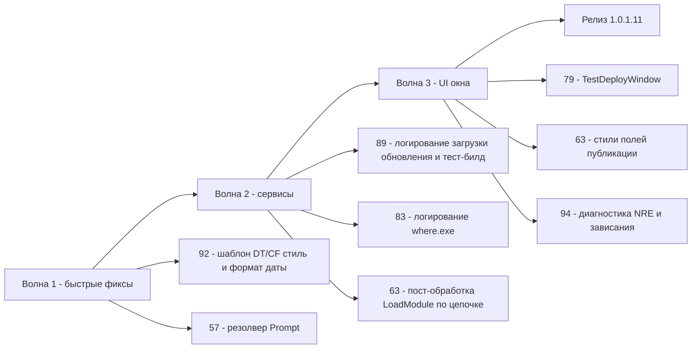

# План исправлений v1.0.1.11 — issues #57, #63, #79, #83, #89, #92, #94

**Дата:** 2026-10-31
**Текущая версия:** 1.0.1.10 ([`CHANGELOG.md`](CHANGELOG.md:14), [`Workspace1C.csproj`](Workspace1C/Workspace1C.csproj:62))
**Следующая версия:** **1.0.1.11** (увеличение последнего числа)
**Источники требований:** [`_issues_to_work_2026-10-31.md`](_issues_to_work_2026-10-31.md) (полные тексты issues и комментарии 7OH), машиночитаемые данные — [`.tmp_issues_list.json`](.tmp_issues_list.json)
**Шаблон плана:** [`plan-issues-v10018.md`](plan-issues-v10018.md) (состав во многом совпадает — там же предыстория правок 1.0.1.6–1.0.1.8 по этим issue)

> **Статус реализации (2026-10-31, v1.0.1.11):** все правки кода выполнены и описаны в разделе 11; полный набор тестов — 5278, зелёный; сборка Windows + Linux выполнена ([_build_v100111.ps1](_build_v100111.ps1) → `publish\out-1.0.1.11\`, FileVersion 1.0.1.11); версия обновлена ([csproj](Workspace1C/Workspace1C.csproj:62), [CHANGELOG.md](CHANGELOG.md), [README.md](README.md)); сообщение коммита — [_commit_msg_v100111.txt](_commit_msg_v100111.txt); тексты комментариев к issues — `_issue{57,63,79,83,89,92,94}_comment_v10011.md`. Остались внешние шаги: git commit/push, GitHub release v1.0.1.11, публикация комментариев, Telegram-новость (канал id `-1004425443528`, по образцу `_send_telegram_v100110.ps1`).
>
> Замечания по ходу реализации: (1) в реальном сценарии #57 у базы Prompt с заданным пользователем (`IsDefault` = Prompt+пустой пользователь) — фильтр применён независимо от непустого пользователя; (2) тест `PostProcessApacheConfAfterPublish_CreatesBak_RewritesFile` сделан независимым от машины — на машине сборки существует реальный `C:\Apache24\conf\httpd.conf`, который fallback-ветка подключала в include-цепочку; (3) `DateTime.ToString` не бросает FormatException на не-спецификаторах («QQQ») — невалидный формат распознаётся по буквальному развороту; (4) сброс фокуса #94 реализован через перенос фокуса на окно (`this.Focus()`) — статический `FocusManager.GetFocusManager` недоступен в Avalonia 11.3.

---

## 1. Сводка и приоритеты

| # | Суть (остаток после 1.0.1.10) | Приоритет | Группа | Оценка объёма |
|---|-------------------------------|-----------|--------|----------------|
| #89 | Linux: обновление скачивает верный ассет, но установка падает («в temp только .etag») | **Критично** | Сервисы/обновление | средний (диагностика + логирование + фикс) |
| #57 | Общая авторизация не передаётся для баз с режимом Prompt («Запрашивать имя и пароль») | Высокий | Сервисы/запуск | малый (один фильтр резолвера + аудит вызовов + тесты) |
| #63 | Публикация: дубль `LoadModule _1cws_module` с учётом include-цепочки; поля окна залиты цветом фона | Высокий | Сервисы/публикация + UI | средний |
| #79 | TestDeployWindow: «каракули» вывода ibcmd, кнопка-дубль, кнопка «Поставить из профиля», автоподстановка имени БД СУБД | Высокий | UI/тест-деплой | средний |
| #94 | Linux: зависание окна Свойств после вкладки «Идентификатор» + NRE | Высокий | UI/Linux | средний (диагностика + фикс) |
| #83 | ring: логировать вывод `where.exe ring` / `which ring`; вкладка «не найдено» при работающем ring | Средний | Сервисы/лицензии | малый–средний |
| #92 | Выгрузка DT/CF: шаблон имени чёрный на тёмном; настраиваемый формат даты + подсказка | Обычный | UI/массовые операции | малый |

**Все 7 issues в один релиз — реалистично.** Объёмных фич нет: #92 и #79 — доработки уже реализованного в 1.0.1.8 функционала; #57 — точечная правка резолвера; #83 — логирование. Два пункта с неопределённостью (#89 и #94) — диагностические: если первопричина не воспроизводится, допускается промежуточный ответ в issue с диагностическим билдом (см. раздел 10).

---

## 2. Ключевой контекст по кодовой базе

- Каждое окно существует в **двух вариантах**: WPF XAML (`*.xaml` + `*.xaml.cs`, Windows) и **Avalonia, построенная в коде** (`*.Avalonia.cs`, Linux). Любая правка разметки требует зеркальной правки в `.Avalonia.cs`.
- Модальные диалоги Avalonia показываются синхронно через `Dispatcher.PushFrame` ([`ModalWindowBase.ShowDialogSync`](Workspace1C/Views/ModalWindowBase.cs:311)) — источник класса «зависаний» (issue #94).
- `ProcessRunner.RunAsync` имеет параметр `outputEncoding` (добавлен в 1.0.1.8 для webinst, issue #63) — пригодится для «каракулей» ibcmd (#79).
- Локализация — ключи в [`ru.json`](Workspace1C/Localization/Languages/ru.json) / [`en.json`](Workspace1C/Localization/Languages/en.json).
- Диагностические категории журнала: `CM_BASE_RUN`, `CM_PUBLISH`, `CM_RAC`, `CM_UPDATES` ([`TraceFlagsFormat.cs`](Workspace1C/Services/TraceFlagsFormat.cs)) — новые записи писать только через них.

---

## 3. Issue #89 — Linux: «Не удалось установить обновление» (КРИТИЧНО)

**URL:** https://github.com/sivatorov/Workspace1C/issues/89

### Факты из последнего комментария 7OH (1.0.1.9)
- Выбор ассета теперь **корректный**: лог `Выбран точный ассет … Workspace1C-linux-x64 (53304099 байт)` и `Загрузка обновления v1.0.1.9: URL=…/Workspace1C-linux-x64`.
- Итог — ошибка `Не удалось установить обновление`; во временной папке **только** `Workspace1C.v1.0.1.9.new.etag` — сам `.new`-файл отсутствует.

### Анализ кода
- Загрузка: [`DownloadNewBinaryAsync`](Workspace1C/Services/UpdateService.Avalonia.cs:835). `dest = Workspace1C.<версия>.new`; `.etag` пишет [ParallelDownloader](Workspace1C/Services/ParallelDownloader.cs:381) **до** скачивания сегментов.
- Признак «в temp только .etag» означает: **загрузка не завершилась** — все пути (многопоточный и однопоточный fallback) закончились неудачей, а `catch` в [`DownloadNewBinaryAsync`](Workspace1C/Services/UpdateService.Avalonia.cs:968) **молча** удаляет `dest` и возвращает `null` — в журнале после строки «Загрузка обновления…» нет ни одной записи о причине. Это главная проблема диагностики.
- Вероятные первопричины (гипотезы для проверки):
  1. **Range-загрузка не проходит**: GitHub-ассет отдаётся через redirect на S3; `ParallelDownloader.ProbeAsync` возвращает `null` (нет `Accept-Ranges`/206) — тогда fallback; а в fallback однопоточная загрузка падает (таймаут `_http.Timeout` покрывает только до начала чтения — задаётся `CancellationTokenSource(_http.Timeout)`, для 53 МБ на медленном канале может не хватить).
  2. **Несовпадение размера** после склейки (`size != accepted`) → `TryDelete(dest)` молча (строка 943–948).
  3. Исключение диска/прав во временном каталоге.

### Изменения
| Файл | Что менять |
|------|------------|
| [`UpdateService.Avalonia.cs`](Workspace1C/Services/UpdateService.Avalonia.cs) `DownloadNewBinaryAsync` (строки ~936–973) | В ветках неудачи (несовпадение размера, валидация, `catch`) — запись в журнал `CM_UPDATES`: причина, фактический размер против ожидаемого, текст исключения, путь `dest`/`.etag`. |
| Там же | При неудаче удалять и `.etag` (сейчас остаётся мусор — именно его и видит пользователь). |
| Там же | Увеличить/отделить таймаут чтения тела от `_http.Timeout` (таймаут на весь файл, а не на старт ответа), логировать остаток времени. |
| [`ParallelDownloader.cs`](Workspace1C/Services/ParallelDownloader.cs) `TryDownloadAsync` (~356) | Возвращать **причину** неудачи (probe без Range / размер ≠ ожидаемому / ошибка сегмента / склейка) — хотя бы через `out string? failureReason` или перегрузку с логированием `CM_UPDATES`; в коде `UpdateService` — логировать причину перед fallback. |
| [`UpdateService.cs`](Workspace1C/Services/UpdateService.cs) (WPF-ветка, аналогичный код ~376+) | Зеркально: логирование причин неудачи загрузки, чистка `.etag`. |
| [`.github/workflows/release.yml`](.github/workflows/release.yml) | Проверить наличие `workflow_dispatch` + `prerelease` (добавлялось в 1.0.1.8) — нужен для тестового билда ниже. |

### Тестовый билд для проверки (просьба 7OH от 2026-10-30)
- Собрать Linux-бинарник с пониженной/отдельной версией и опубликовать **prerelease** (механизм из [`plan-issues-v10018.md`](plan-issues-v10018.md), раздел 3) — 7OH проверит фиксы не дожидаясь релиза, журналом `CM_UPDATES` снимем причину.

### Критерии готовности
- В журнале `CM_UPDATES` при любой неудаче загрузки есть конкретная причина (не «пусто»).
- При неудаче во временной папке не остаётся `.etag`.
- 7OH подтвердил успешную установку обновления на Linux (или предоставил журнал, по которому причина найдена и устранена).

### Риски и вариант «частично»
- Причину без Linux-воспроизведения не гарантировать. Допустимый промежуточный ответ в issue: диагностический prerelease с полным логированием + просьба прислать журнал; фикс по результату — в следующем релизе.

---

## 4. Issue #57 — Общая авторизация не передаётся для баз с режимом Prompt

**URL:** https://github.com/sivatorov/Workspace1C/issues/57

### Факты из последнего комментария 7OH (2026-10-31)
- Общая авторизация: режим Credentials + «Автоматический вход» + логин.
- База `[Demo 27]` (креды в свойствах базы, «Вход автоматически») — работает: `источник=режим базы, режим=Credentials`.
- База `[Demo 27 File]` («Запрашивать имя и пароль» в свойствах базы) — **не** подставляется: лог `источник=режим базы, режим базы=Prompt, пользователь=задан`, окно логина платформы.
- Требование (комментарий от 2026-10-30T16:08): «передать общий логин\пароль в командную строку», если у базы режим Prompt, а общая авторизация режима задана с кредами.

### Анализ кода
- Шаг 1 резолвера [`InfobaseAuthResolver.Resolve`](Workspace1C/Services/InfobaseAuthResolver.cs:140) возвращает раздельную авторизацию режима базы как есть, если она не `IsDefault` и не подпадает под фильтр «Windows/Credentials с пустым пользователем» (строки 143–147). Явно выбранный режим **Prompt** (строка лога `источник=режим базы, режим базы=Prompt`) возвращается на шаге 1 с `AuthenticationMode.Prompt` → в [`BuildArguments`](Workspace1C/Services/OneCLauncher.Arguments.Shared.cs:232) ничего не подставляется, общие креды (шаг 3) недостижимы.
- Логика 7OH: Prompt у базы = «платформа спросит сама, если ничего не передать», т.е. при наличии общей авторизации режима с кредами — общие креды нужно передать (неверные креды платформа всё равно переспросит — «но это уже не проблема стартера»).

### Изменения
| Файл | Что менять |
|------|------------|
| [`InfobaseAuthResolver.cs`](Workspace1C/Services/InfobaseAuthResolver.cs) (шаг 1, строки 143–147) | Расширить фильтр «считать незаданной»: добавить случай `ma.AuthenticationMode == AuthenticationMode.Prompt && commonCredentials` — тогда при наличии общих кредов режима база с Prompt переходит к шагу 3 и получает общий логин/пароль. Без общих кредов поведение прежнее (Prompt остаётся Prompt). Обновить XML-комментарии шага 1 и doc-блок перегрузки (строки 207–240). |
| [`OneCLauncher.Arguments.Shared.cs`](Workspace1C/Services/OneCLauncher.Arguments.Shared.cs) `BuildArguments` (~232–250) | Проверить: после попадания на шаг 3 `источник=общая режима` передаются `/N`/`/P` — существующая диагностика CM_BASE_RUN уже напишет источник; при необходимости добавить в лог факт передачи кредов. |
| Аудит всех потребителей резолвера | Убедиться, что правка автоматически действует во **всех** местах формирования командной строки с паролем базы (требование 7OH «по всему коду сразу»): [`OneCLauncher.Arguments.*`](Workspace1C/Services/OneCLauncher.Arguments.Shared.cs), [`CliCommands.cs`](Workspace1C/Services/CliCommands.cs), [`ExplorerCommandLine.cs`](Workspace1C/Services/ExplorerCommandLine.cs), [`MainViewModel.Launch.cs`](Workspace1C/ViewModels/MainViewModel.Launch.cs), COM-коннектор, ibcmd/скрипты — все они должны получать креды через `InfobaseAuthResolver.Resolve`, а не читать `Infobase.Connection.Password` напрямую. Прямые чтения пароля мимо резолвера — заменить/зафиксировать найденное. |

### Тесты
- [`Workspace1C.Tests/Issue57WindowsAuthOverrideTests.cs`](Workspace1C.Tests/Issue57WindowsAuthOverrideTests.cs), [`Issue57CommonAuthSourceTests.cs`](Workspace1C.Tests/Issue57CommonAuthSourceTests.cs): новые кейсы:
  - modeAuth=`Prompt` + общая Credentials → источник `CommonMode`, в аргументах `/N "общий"` `/P "…"`;
  - modeAuth=`Prompt` без общих кредов → режим Prompt, аргументов `/N` нет;
  - modeAuth=`Credentials` с непустым пользователем → по-прежнему приоритет базы (регресс).

### Критерии готовности
- Запуск базы с «Запрашивать имя и пароль» при заданной общей авторизации («Автоматический вход») передаёт общий логин/пароль; в журнале `CM_BASE_RUN` — `источник=общая режима`.
- Общий аудит прямых использований пароля базы описан в комментарии к issue.

### Сложность
Малая правка резолвера + аудит вызовов; средний объём тестов. Высокий приоритет.

---

## 5. Issue #63 — Публикация: дубль LoadModule с учётом include-цепочки + поля окна

**URL:** https://github.com/sivatorov/Workspace1C/issues/63

Из четырёх пунктов 1.0.1.8–1.0.1.10 осталось (последний комментарий 7OH от 2026-10-31):

### 5.1 Дубль `LoadModule _1cws_module` — проверять по цепочке include-файлов
- **Проблема:** [`WebPublishConfPostProcessor.DeduplicateLoadModule`](Workspace1C/Services/WebPublishConfPostProcessor.cs) схлопывает дубликаты **только в выбранном файле алиаса**. Основная строка `LoadModule _1cws_module` обычно в `httpd.conf` (другой файл цепочки) — и webinst всё равно дописывает её в файл алиаса. 7OH: «проверять дубль с цепочкой файлов. Если LoadModule _1cws_module фигурировало ранее в файле, отличном от выбранного для публикации — то в файле алиаса подчистить».
- **Изменения:**
  | Файл | Что менять |
  |------|------------|
  | [`WebPublishConfPostProcessor.cs`](Workspace1C/Services/WebPublishConfPostProcessor.cs) | Новая чистая функция `StripLoadModuleIfPresentInChain(aliasConfText, chainTexts)` / расширение `DeduplicateLoadModule`: если `LoadModule _1cws_module` встречается в **любом** файле include-цепочки (основной conf + include-файлы, текст которых передаётся извне) — удалить строку из файла алиаса (все вхождения). |
  | [`WebPublishViewModel.cs`](Workspace1C/ViewModels/WebPublishViewModel.cs) `PostProcessApacheConfAfterPublish` (~860–940) | Передать в пост-обработку тексты include-графа выбранного инстанса (список файлов уже есть — `_confTargetPaths` / [`ApacheConfIncludeParser`](Workspace1C/Services/ApacheConfIncludeParser.cs)); логировать `CM_PUBLISH` факт удаления. |
- **Тесты:** расширить `WebPublishConfPostProcessTests` кейсом «LoadModule есть в httpd.conf (chain), webinst дописал в алиас → строка удалена из алиаса»; фикстуры [_27conf_extracted/](_27conf_extracted/).
- **Критерий:** после публикации в файле алиасов нет строки `LoadModule _1cws_module`, если она есть в цепочке; подтверждение 7OH.

### 5.2 Поля окна публикации залиты цветом фона
- **Проблема (комментарий 7OH от 2026-10-24, в сводке задачи — актуально):** поля окна выглядят как readonly — залиты цветом фона, без контраста/окантовки, хотя доступны для правки.
- **Изменения:**
  | Файл | Что менять |
  |------|------------|
  | [`WebPublishWindow.xaml`](Workspace1C/Views/WebPublishWindow.xaml) + [`WebPublishWindow.xaml.cs`](Workspace1C/Views/WebPublishWindow.xaml.cs) | Проверить, что все TextBox/ComboBox получили `ModernTextBox`/`ModernComboBox` (а не readonly-серый стиль); фон/окантовка — из темы. |
  | [`WebPublishWindow.Avalonia.cs`](Workspace1C/Views/WebPublishWindow.Avalonia.cs) | Зеркально: поля, построенные в коде, — `.Styled(ControlThemes.ModernTextBox)` и т.п. |
- **Критерий:** в тёмной и светлой теме все поля окна читаемы и явно редактируемы (обе платформы).
- **Сложность:** малая (правка стилей).

### 5.3 Выбор файла алиасов 1c8Aliases* по умолчанию — уже сделано
- Реализовано в 1.0.1.10: [`DefaultConfTargetIndex`](Workspace1C/ViewModels/WebPublishViewModel.cs:448) — «файл webinst по умолчанию — конфиг алиасов 1С»; 7OH подтвердил («Прям огонь — супер», «Огромное спасибо»). В релиз не входит; упомянуть в комментарии к issue как уже работающее.

### Сложность раздела
Средняя. Порядок: 5.1 (код + тесты) → 5.2 (стили).

---

## 6. Issue #79 — Развернуть тестовую копию (TestDeployWindow)

**URL:** https://github.com/sivatorov/Workspace1C/issues/79

### Остаток проблем (по комментариям 7OH до 2026-10-31)

**6.1 Ошибка «TargetType TextBox не соответствует PasswordBox»** — исправлено в 1.0.1.8+: [`ApplyModernStyles`](Workspace1C/Views/TestDeployWindow.cs:765) больше не назначает стиль PasswordBox (комментарий «issue #79, 7OH 2026-10-29»), тот же паттерн в [`SettingsSyncWindow.ApplyModernStyles`](Workspace1C/Views/SettingsSyncWindow.cs:257). В релизе 1.0.1.11 — только убедиться, что ошибки в журнале больше нет, и зафиксировать в комментарии к issue.

**6.2 «Каракули» в окне учётных данных ibcmd**
- Вывод ibcmd на русской Windows — OEM cp866, читается как UTF-8 (та же причина, что у webinst в #63).
- **Изменения:** [`IbcmdService.RunAsync`](Workspace1C/Services/IbcmdService.cs:281) — передавать в `ProcessRunner.RunAsync` кодировку cp866 на Windows по образцу [`WebPublishService.WebinstOutputEncoding`](Workspace1C/Services/WebPublishService.cs:220) (вынести общий хелпер или продублировать фабрику кодировки; переименовать в общую `ConsoleOutputEncoding` при целесообразности).
- **Критерий:** вывод ibcmd в окнах/журнале — читаемый русский текст.

**6.3 Кнопка-дубль внизу окна**
- 7OH (2026-10-30): «Кнопка внизу первая является дублем и не нужна — "Учетные данные ИБ для ibcmd"» (открывает то же окно свойств базы, что и кнопка «Свойства исходной базы» в начале окна).
- **Изменения:** убрать кнопку из футера [`TestDeployWindow.cs`](Workspace1C/Views/TestDeployWindow.cs) (блок построения футера) и [`TestDeployWindow.Avalonia.cs`](Workspace1C/Views/TestDeployWindow.Avalonia.cs); проверить привязанные обработчики и ключи локализации.

**6.4 Кнопка «Поставить из профиля» для учётных данных СУБД/ibcmd**
- 7OH: «Логичнее иметь кнопку — поставить из профиля, как для логина и пароля базы… И тогда или из профиля готовые данные или вручную. А выполнять работу по тому, что на форме».
- **Изменения:**
  | Файл | Что менять |
  |------|------------|
  | [`TestDeployViewModel.cs`](Workspace1C/ViewModels/TestDeployViewModel.cs) | Команда/метод заполнения полей профиля СУБД (сервер СУБД, пользователь СУБД, пароль, тип СУБД) из существующего профиля (`ProfileService` / механизм профилей ibcmd, по аналогии с `_fillCredentialsButton` «Подставить из базы», [`TestDeployWindow.cs:62`](Workspace1C/Views/TestDeployWindow.cs:62)). |
  | [`TestDeployWindow.cs`](Workspace1C/Views/TestDeployWindow.cs) / [`TestDeployWindow.Avalonia.cs`](Workspace1C/Views/TestDeployWindow.Avalonia.cs) | Кнопка «Поставить из профиля» рядом с полями СУБД; подпись — новый ключ локализации `TestDeploy.FillFromProfile` (ru/en). |

**6.5 Автоподстановка имени БД СУБД**
- 7OH (2026-10-28): «В поле "Имя базы данных СУБД" можно подставлять как минимум такое же имя, как "Имя базы на сервере"».
- **Изменения:** в [`TestDeployViewModel`](Workspace1C/ViewModels/TestDeployViewModel.cs) — при вводе имени тестовой базы на сервере подставлять то же значение в поле «Имя базы данных СУБД» (если поле ещё пустое; не затирать пользовательский ввод).

### Критерии готовности
- Окно открывается без исключений стиля; вывод ibcmd читаем; кнопка-дубль отсутствует; есть кнопка «Поставить из профиля»; имя БД СУБД подставляется автоматически.

### Сложность
Средняя (5.1–6.2 малые, 6.4–6.5 — UI-механика). Всё реально в релиз 1.0.1.11.

---

## 7. Issue #83 — ring: логировать вывод where.exe / which ring

**URL:** https://github.com/sivatorov/Workspace1C/issues/83

### Факты из последнего комментария 7OH (2026-10-31)
- `where.exe ring` в консоли находит `C:\Program Files\1C\1CE\components\1c-enterprise-ring-…\ring.cmd`.
- Из приложения: «в логе пусто, а на экране опять "не найдено"». Прямая просьба: **в лог писать вывод `where.exe ring`**.

### Анализ кода
- [`FindRingInPathAsync`](Workspace1C/Services/RingLicenseService.cs:545) запускает `where.exe ring` через `ProcessRunner`, но при неудаче **молча** возвращает `null` — вывод утилиты поиска в журнал не попадает. Успешный fallback-поиск вне PATH (реестровый PATH, каталоги 1С) уже добавлен ([`~767-793`](Workspace1C/Services/RingLicenseService.cs:767)), но ветка «PATH-проверка не удалась» не диагностируется.
- Подозрение: PATH **процесса** приложения не содержит каталог ring (установка ring после запуска приложения / PATH процесса отличается от консоли). Реестровый поиск должен был найти `…\components\…` — если не нашёл, причина станет видна из логирования.

### Изменения
| Файл | Что менять |
|------|------------|
| [`RingLicenseService.cs`](Workspace1C/Services/RingLicenseService.cs) `FindRingInPathAsync` (~545–570) | Логировать в `CM_RAC`: код выхода, **stdout и stderr** `where.exe ring` / `which ring` (усечение до разумной длины), найденный путь. При null — результат всех проверок. |
| Там же, fallback-поиск (~700–793) | Убедиться, что кандидаты включают **ring.cmd и ring.bat** (у 7OH — именно `ring.cmd`); логировать список каталогов, где реально искали, и найденные файлы `ring*`. |
| Там же | Если ring найден по реестровому PATH, но не в PATH процесса — запуск по полному пути без перезапуска (уже реализовано — проверить, что `.cmd` корректно запускается через `ToLaunchCommand`/shell). |

### Тесты
- Юнит-тест на парсинг вывода `where.exe` (несколько строк → первая; пусто → null) — чистая функция.

### Критерии готовности
- В журнале `CM_RAC` при «не найдено» виден вывод `where.exe ring` и перечень проверенных каталогов; по логу можно объяснить расхождение с консолью пользователя. Вкладка «Лицензии» работает у 7OH.

### Сложность
Малая–средняя. В основном диагностика (в духе рекомендации из [`plan-issues-v10018.md`](plan-issues-v10018.md): не гадать, а логировать).

---

## 8. Issue #92 — Выгрузка DT/CF: контраст шаблона + формат даты

**URL:** https://github.com/sivatorov/Workspace1C/issues/92

### 8.1 Шаблон имени файла — чёрный на тёмном в тёмной теме
- **Причина (найдено по коду):** в Avalonia-варианте поле шаблона построено **без** тематического стиля — [`BatchOperationsWindow.Avalonia.cs:127`](Workspace1C/Views/BatchOperationsWindow.Avalonia.cs:127): `new TextBox { Width = 260, … }` без `.Styled(ControlThemes.ModernTextBox)`.
- **Изменения:**
  | Файл | Что менять |
  |------|------------|
  | [`BatchOperationsWindow.Avalonia.cs`](Workspace1C/Views/BatchOperationsWindow.Avalonia.cs:127) | Добавить `.Styled(ControlThemes.ModernTextBox)` полю шаблона; проверить поле каталога и другие поля окна. |
  | [`BatchOperationsWindow.xaml`](Workspace1C/Views/BatchOperationsWindow.xaml) (WPF) | Проверить, что поле шаблона наследует `ModernTextBox` из темы (не голый TextBox). |

### 8.2 Настраиваемый формат даты + подсказка
- 7OH: «А формат даты задать можно? Если да — хотелось бы сразу с форматом и в подсказку добавить — как пользоваться».
- **Изменения:**
  | Файл | Что менять |
  |------|------------|
  | [`BatchOperationsService.cs`](Workspace1C/Services/BatchOperationsService.cs) (`DefaultDumpTemplate`, `BuildDumpFilePath`) | Токен `{Дата}` — использовать формат из настройки `ExportTimestampFormat` ([`AppSettings.cs:740`](Workspace1C/Models/AppSettings.cs:740), уже есть окно настроек «Формат даты в имени файла выгрузки»); поддержка токена `{Дата:<формат>}` (например `{Дата:yyyy-MM-dd}`) — произвольный формат в самом шаблоне. |
  | [`BatchOperationsViewModel.cs`](Workspace1C/ViewModels/BatchOperationsViewModel.cs) (`Template`, ~206) | Предпросмотр итогового имени файла по шаблону (если ещё нет) — живая подстановка на первой базе. |
  | [`ru.json`](Workspace1C/Localization/Languages/ru.json) / [`en.json`](Workspace1C/Localization/Languages/en.json) | Расширить подсказку `BatchOps.TemplateHint`: токены `{Имя}`, `{Дата}` (формат из настроек), `{Дата:<формат>}` с примерами. |
- **Тесты:** расширить [`BatchOperationsTests.cs`](Workspace1C.Tests/BatchOperationsTests.cs): токен с форматом, дефолтный формат из настроек, невалидный формат → fallback.

### Критерии готовности
- Поле шаблона читаемо в тёмной теме (обе платформы); формат даты настраивается (глобально и/или в шаблоне); подсказка описывает токены.

### Сложность
Малая. Хороший кандидат на первую волну.

---

## 9. Issue #94 — Linux: зависание «Отмена» окна Свойств после вкладки «Идентификатор»

**URL:** https://github.com/sivatorov/Workspace1C/issues/94

### Факты (трассировка `cm_modal_trace.log` от 7OH, 2026-10-31)
```
BuildCancelActionButton.Click: окно ConnectionSettingsWindow - Close()
OnClosing: Cancel=False (дважды)
ShowDialogSync. OnVisibilityChanged: окно ConnectionSettingsWindow скрыто без закрытия - снимаю кадр
ShowDialogSync: ВЫХОД, closed=False, hiddenWithoutClose=True, DialogResult=False, IsVisible=False
OnClosing: Cancel=False … (повторы — «зависание»)
```
Плюс из терминала: `System.NullReferenceException … at Workspace1C.ConnectionSettingsWindow…` (стектрейс в issue усечён).

### Анализ
- Закрытие через [`BuildCancelActionButton`](Workspace1C/Views/ModalWindowBase.cs:1045) → `Close()`; `ShowDialogSync` ([`ModalWindowBase.cs:311`](Workspace1C/Views/ModalWindowBase.cs:311)) завершается по `Closed`, но здесь окно **скрылось без закрытия** (`hiddenWithoutClose=True`) — поток ShowDialogSync вышел с `closed=False`, а окно осталось видимым/полу-живым: повторные `OnClosing` — «зависание» для пользователя.
- «Скрыто без закрытия» + NRE: вероятно, исключение в обработчике закрытия/переключения вкладки «Идентификатор» ([`ConnectionSettingsWindow.Avalonia.cs`](Workspace1C/Views/ConnectionSettingsWindow.Avalonia.cs), вкладка строится лениво; double-click «Произвольные поля» открывает `NameInputWindow` синхронно — вложенный PushFrame, ~строка 1424) приводит к принудительному `Hide()`/срыву закрытия. NRE нужно поймать с полным стектрейсом.

### Изменения (диагностика → фикс)
| Шаг | Файл | Что делать |
|-----|------|------------|
| 1 | [`ModalWindowBase.cs`](Workspace1C/Views/ModalWindowBase.cs), [`ConnectionSettingsWindow.Avalonia.cs`](Workspace1C/Views/ConnectionSettingsWindow.Avalonia.cs) | Диагностика (гейт CM_MODAL_TRACE уже есть): расширить трассировку — логировать NRE с полным стеком в журнал приложения (сейчас исключение уходит в терминал и теряется); трассировать `Hide()`/`OnVisibilityChanged` источники. |
| 2 | — | Тестовый Linux-бинарник → воспроизведение/у 7OH → получить стек NRE. |
| 3 | [`ConnectionSettingsWindow.Avalonia.cs`](Workspace1C/Views/ConnectionSettingsWindow.Avalonia.cs) | Устранить NRE (по стеку; кандидаты: обработчик вкладки «Идентификатор» обращается к контролу, отсутствующему при закрытии; `NameInputWindow`/фокус ListBox). Перед `Close()` — сброс фокуса/завершение редактирования, `Dispatcher.UIThread.Post(Close)` как запасной путь. |
| 4 | [`ModalWindowBase.cs`](Workspace1C/Views/ModalWindowBase.cs) `ShowDialogSync` | Guard: если кадр завершён, а окно `IsVisible=false` и `closed=false` (`hiddenWithoutClose`) — не считать диалог активным повторно; принудительно завершить `Close()` (или `DialogResult=False` зафиксировать) — чтобы «скрытое» окно не пережило кадр. |

### Критерии готовности
- «Отмена» закрывает окно Свойств после посещения любой вкладки (включая «Идентификатор») на Linux; NRE отсутствует или обработан с записью в журнал.
- Подтверждение 7OH на тестовой/релизной сборке.

### Риски
- Не фиксить вслепую — сначала стек NRE. Допустимый промежуточный ответ в issue: диагностический билд + просьба прислать полный стек из терминала/журнала.

---

## 10. Порядок выполнения (волны)



- **Волна 1** — #92 (малый), #57 (резолвер + тесты): быстрые, хорошо тестируются.
- **Волна 2** — #89 (критично, диагностика), #83 (логирование), #63.1 (пост-обработка + тесты).
- **Волна 3** — #79 (окно), #63.2 (стили), #94 (диагностика + фикс).

**Один релиз — реалистично.** Пункты с неопределённым исходом (#89, #94) можно оформить частично: выпустить 1.0.1.11 с логированием/гардами и ответить в issue диагностическим prerelease-билдом, а окончательный фикс — в 1.0.1.12 после журналов от 7OH.

---

## 11. Чек-лист

### Волна 1
- [ ] #92: `BatchOperationsWindow.Avalonia.cs:127` — `.Styled(ControlThemes.ModernTextBox)` (и остальные поля окна)
- [ ] #92: `BatchOperationsWindow.xaml` — проверка стиля поля шаблона (WPF)
- [ ] #92: токен `{Дата:<формат>}` + формат из `ExportTimestampFormat` (`BatchOperationsService.cs`)
- [ ] #92: подсказка `BatchOps.TemplateHint` (ru/en) + предпросмотр имени
- [ ] #92: тесты `BatchOperationsTests` (токен с форматом, fallback)
- [ ] #57: `InfobaseAuthResolver` — фильтр «Prompt + общие креды → шаг 3» (шаг 1, строки 143–147)
- [ ] #57: аудит всех потребителей резолвера (запуск, CLI, проводник, COM, ibcmd) — пароль только через резолвер
- [ ] #57: тесты Issue57* — Prompt-кейсы (с общими кредами / без / регресс Credentials)
- [ ] Общий: `dotnet test` зелёный (Windows + Linux-сборка `-p:ForceLinux`)

### Волна 2
- [ ] #89: `DownloadNewBinaryAsync` (WPF+Avalonia) — логирование всех веток неудачи в `CM_UPDATES` (причина, размеры, исключение)
- [ ] #89: удаление `.etag` при неудаче
- [ ] #89: таймаут чтения тела отдельным `CancellationTokenSource` (не `_http.Timeout`)
- [ ] #89: `ParallelDownloader.TryDownloadAsync` — причина null (probe/Range/размер/сегмент/склейка) + логирование
- [ ] #89: тестовый prerelease-билд для 7OH, инструкция в issue
- [ ] #83: `FindRingInPathAsync` — логировать вывод `where.exe ring` / `which ring` (stdout/stderr/код)
- [ ] #83: fallback — кандидаты ring.exe/ring.cmd/ring.bat + лог перечня каталогов
- [ ] #83: юнит-тест парсинга вывода where
- [ ] #63.1: `WebPublishConfPostProcessor` — удаление `LoadModule _1cws_module` из файла алиаса, если строка есть в include-цепочке
- [ ] #63.1: `WebPublishViewModel.PostProcessApacheConfAfterPublish` — передача текстов цепочки + лог `CM_PUBLISH`
- [ ] #63.1: тесты (фикстуры `_27conf_extracted/`)
- [ ] Общий: `dotnet test`, Linux-сборка

### Волна 3
- [ ] #79: `IbcmdService.RunAsync` — кодировка cp866 на Windows (по образцу `WebPublishService.WebinstOutputEncoding`)
- [ ] #79: убрать кнопку-дубль «Учётные данные ИБ для ibcmd» (WPF + Avalonia)
- [ ] #79: кнопка «Поставить из профиля» + локализация `TestDeploy.FillFromProfile` (ru/en)
- [ ] #79: автоподстановка «Имя базы данных СУБД» из «Имя базы на сервере»
- [ ] #79: проверить отсутствие стилевого исключения в 1.0.1.10 (вопрос в issue 7OH — на какой версии был последний репорт)
- [ ] #63.2: стили полей окна публикации (WebPublishWindow.xaml + Avalonia) — контраст в тёмной/светлой теме
- [ ] #94: расширенная трассировка + полный стек NRE в журнал (тестовый Linux-билд)
- [ ] #94: фикс NRE по стеку + guard `hiddenWithoutClose` в `ShowDialogSync`
- [ ] Общий: `dotnet test`, Linux-сборка, ручная проверка UI на обеих платформах

### Релиз 1.0.1.11
- [ ] Версия → **1.0.1.11**: [`Workspace1C.csproj:62-65`](Workspace1C/Workspace1C.csproj:62) — `Version`, `AssemblyVersion`, `FileVersion`, `InformationalVersion` ([`VersionInfo.cs`](Workspace1C/VersionInfo.cs) читает атрибут автоматически — править не нужно)
- [ ] [`CHANGELOG.md`](CHANGELOG.md) — раздел `## [1.0.1.11] — <дата>` (по образцу `## [1.0.1.10]`)
- [ ] [`README.md`](README.md) — бейдж версии (строка 3) и упоминание актуальной версии (строка 11); при наличии значимых фич — блок в списке изменений (строка ~205)
- [ ] Полный прогон тестов: Windows + Linux
- [ ] Сборка Windows + Linux по образцу [`_build_v100110.ps1`](_build_v100110.ps1) → скрипт `_build_v100111.ps1` (лог `_build_v100111.log` / `_publish_100111.log`)
- [ ] Тег `v1.0.1.11` → релизная сборка (release.yml) либо ручная публикация; ассеты `Workspace1C.exe` + `Workspace1C-linux-x64` в релизе
- [ ] Комментарии в issues (файлы по образцу `_issueNN_comment_v100110.md`): #57, #63, #79, #83, #89, #92, #94 — кратко: что сделано, что проверить, просьба прислать логи (#89 — `CM_UPDATES`, #94 — полный стек NRE)
- [ ] Telegram-новость: скрипт по образцу [`_send_telegram_v100110.ps1`](_send_telegram_v100110.ps1) → `_send_telegram_v10011.ps1` (канал id `-1004425443528`), ответ `OK: message sent (message_id=…)`

---

## 12. Открытые вопросы к реализации

1. **#89**: согласовать формат тестового prerelease для 7OH (тег/имя ассета) — комментарием в issue; без журнала `CM_UPDATES` причину установки не гарантировать.
2. **#94**: нужен полный стектрейс NRE — запросить у 7OH или получить на тестовом билде; guard в `ShowDialogSync` добавлять независимо от найденной причины (защита класса зависаний).
3. **#57**: подтвердить в комментарии, что при неверных общих кредах платформа сама покажет окно логина (по комментариям 7OH это ожидаемое поведение).
4. **#79**: уточнить в комментарии, что стилевая ошибка PasswordBox уже исправлена в 1.0.1.8+ — попросить подтвердить на актуальной версии, «каракули» ibcmd устраняются кодировкой cp866.
5. **#63**: порядок пост-обработки — сначала дедуп/чистка LoadModule, затем подстановка переменных (сохранить поведение 1.0.1.10); бэкап `.bak` перед записью — не убирать.
