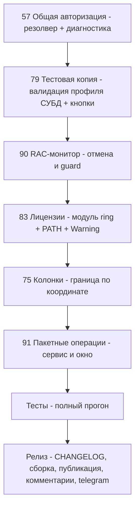

# План релиза 1.0.1.7 — issues #57, #79, #90, #83, #75, #91

Дата плана: 2026-10-30. Текущая версия: **1.0.1.6** (Workspace1C.csproj:62-65, CHANGELOG.md:14).
Новая версия: **1.0.1.7** (увеличен только последний сегмент).
Источник анализа: `_issues_analysis_v10017.md`, `_issues_full_v10017.json` (6 issues, все — последние комментарии не от sivatorov).

---

## 0. Резюме

| # | Issue | Тип | Приоритет | Объём |
|---|-------|-----|-----------|-------|
| 57 | Общая авторизация не подставляется | баг (регресс/неработающий фикс 1.0.1.6) | 1 | средний |
| 79 | «Развернуть тестовую копию»: «заполните профиль» + неверная кнопка | баг | 2 | средний |
| 90 | RAC-лог после закрытия «Серверы 1С» | баг | 3 | малый |
| 83 | Лицензии: «Module license is not registered», пустая вкладка | баг/UX | 4 | средний |
| 75 | «Серверы 1С — колонки»: смещённая зона захвата | баг/UX | 5 | малый-средний |
| 91 | Массовые операции: .dt / .cf / внешние обработки по списку баз | feature | 6 | большой |

Порядок работ: 57 → 79 → 90 → 83 → 75 → 91 → релиз-инфраструктура.
Платформы: везде, где возможно, исправление выполняется в кроссплатформенном коде
(services/VM) и дублируется в WPF- и Avalonia-окнах.

---

## 1. Issue #57 — «добавить общую авторизации»: фикс 1.0.1.6 не сработал

### Симптом (7OH, 30.10 13:24)
- Общая авторизация задана и для Предприятия, и для Конфигуратора; у базы «выключена
  насильная авторизация». Запуск базы — «не подставляет ничего».
- В логе только `[CM_BASE_RUN] Запущена база «Demo 27 File» (Configurator, клиент=Auto, арх=Auto)`
  — записи диагностики источника авторизации (обещанной в 1.0.1.6) нет, «в диспетчере, в логах — пусто».

### Релевантный код
- [`InfobaseAuthResolver.Resolve`](Workspace1C/Services/InfobaseAuthResolver.cs:110) — приоритеты:
  1) раздельная авторизация режима (EnterpriseAuth/ConfiguratorAuth, если не `IsDefault`);
  2) Connection (креды с пользователем; Windows — только если нет общих Credentials);
  3) общая авторизация режима; 4) Prompt.
- [`OneCLauncher.Arguments.Shared.cs:180-188`](Workspace1C/Services/OneCLauncher.Arguments.Shared.cs) —
  вызов резолвера + диагностика `CM_BASE_RUN` («Авторизация запуска …: режим=…, пользователь=…»).
- Загрузка общих авторизаций в статику лаунчера:
  [`MainViewModel.cs:510-514`](Workspace1C/ViewModels/MainViewModel.cs),
  [`MainViewModel.Avalonia.cs:784-786`](Workspace1C/ViewModels/MainViewModel.Avalonia.cs) —
  **присваивается один раз при загрузке настроек**; Avalonia дополнительно обновляет в сеттерах.
- Запись, которую видел пользователь: [`MainViewModel.Launch.cs:272`](Workspace1C/ViewModels/MainViewModel.Launch.cs).

### Диагноз (гипотезы, проверяются в п.1.1)
- **Г1 (основная): «Windows-режим без пользователя» считается заданным.**
  `InfobaseAuthSettings.IsDefault` — проверяется только «Запрос + пустые реквизиты». Если у базы
  раздельная авторизация (EnterpriseAuth/ConfiguratorAuth) выставлена в режим «Windows» с пустым
  пользователем («выключена насильственная авторизация» так и выглядит в настройках), шаг 1
  возвращает Windows и общая Credentials никогда не доходит (режим ОС на шаге 1 не участвует
  в правке 1.0.1.6 — она касается только шага 2/Connection).
- **Г2: статика `OneCLauncher.Common*Authorization` не заполнена** в момент запуска (запуск до
  загрузки настроек; путь запуска в обход MainViewModel — CLI/проводник/скрипты в отдельном
  контексте), либо общий флаг задан, но резолв получил null.
- **Г3: путь запуска не проходит через `BuildArguments`** (нет записи диагностики в логе — значит
  вызов резолвера не выполнялся либо пользователь не развернул все записи CM_BASE_RUN).

### План изменений
1. **Этап 0 — диагностика/воспроизведение:**
   - юнит-тест на сценарий пользователя: база `Connection.Windows` + `EnterpriseAuth`/`ConfiguratorAuth`
     в режиме `Windows` с пустым пользователем + общие Credentials → ожидается общая Credentials;
     зафиксировать текущее поведение (упадёт/зелёный — подтвердит Г1);
   - проверить `InfobaseAuthSettings.IsDefault` ([Models/InfobaseAuthSettings]) — уточнить, считает ли
     «Windows с пустым пользователем» дефолтом.
2. **Фикс в [`InfobaseAuthResolver.Resolve`](Workspace1C/Services/InfobaseAuthResolver.cs:116-134):**
   «дефолтными» считаются не только «Запрос+пусто», но и **режим Windows с пустым пользователем** —
   такие раздельные авторизации не перекрывают общую Credentials (правило шага 2 из 1.0.1.6
   распространяется и на шаг 1). Явные Credentials с пользователем по-прежнему высший приоритет.
3. **Диагностика CM_BASE_RUN — дополнить запись** в
   [`OneCLauncher.Arguments.Shared.cs:186`](Workspace1C/Services/OneCLauncher.Arguments.Shared.cs):
   добавить **источник** (шаг резолвера: «режим базы»/«база»/«общая режима»/«общая legacy»/«запрос»)
   и режим авторизации базы (`Connection.AuthenticationMode`). Для этого `Resolve` возвращает источник
   через `out` (новая перегрузка/структура, старые перегрузки сохраняются для совместимости).
4. **Гарантировать заполнение статики** `OneCLauncher.Common*Authorization`: единая точка
   (`OneCLauncher.EnsureCommonAuthLoaded(settings)` или ленивое чтение из настроек), вызывается и из
   WPF-, и из Avalonia-пути, включая CLI/проводник/скрипты (Г2).
5. Сквозная проверка всех мест использования пароля (аудит-комментарий в
   [`InfobaseAuthResolver.cs:24-44`](Workspace1C/Services/InfobaseAuthResolver.cs)) — убедиться, что
   everywhere вызывается обновлённый резолвер (COM, ibcmd, DesignerBatch, TestDeploy, скрипты).
6. **Тесты** (Workspace1C.Tests): расширить тесты резолвера (сценарий пользователя + все комбинации
   Windows/Credentials/Prompt на шаге 1-2-3); тест на источник в диагностике (формат записи CM_BASE_RUN).

### Риски
- Изменение семантики «Windows без пользователя» может изменить поведение тех, кто осознанно
  ставит общий Windows у раздельной авторизации: перекрытие общей Credentials — это и есть цель,
  но требуется CHANGELOG-описание. Легаси-поведение для Credentials-баз не меняется.
- Новая out-структура резолвера — обновить все вызовы (компилятор подскажет, риск низкий).

---

## 2. Issue #79 — мастер «Развернуть тестовую копию»

### Симптом (7OH, 30.10 12:16, после 1.0.1.5)
- Все поля заполнены, галка «Использовать авторизацию информационной базы» стоит; при запуске —
  ошибка «заполните профиль»; снятие галочки/ручная подстановка не помогли.
- Кнопка «Учётные данные для ibcmd…» открывает те же «Свойства исходной базы», а не то окно,
  где можно исправить то, о чём просит ошибка.

### Диагноз
- «заполните профиль» = [`Ibcmd.NeedDbmsProfile`](Workspace1C/Services/IbcmdService.cs:111)
  («Для клиент-серверной базы нужен профиль СУБД»): выгрузка источника идёт движком ibcmd
  ([`TestDeployService.DumpAsync`](Workspace1C/Services/TestDeployService.cs:280-293) →
  `IbcmdService.DumpAsync`), а для клиент-серверной базы `IbcmdService.BuildConnectionArguments`
  требует профиль СУБД ([DbmsBackupService]) — он у пользователя не заполнен. Это **не креды ИБ**,
  поэтому галки и «Подставить из базы» не помогают.
- Валидация [`TestDeployPlanner.Validate`](Workspace1C/Services/TestDeployService.cs:62-72) профиль
  СУБД не проверяет — ошибка приходит только на шаге «Выгрузка» (после старта операции).
- Кнопка «Учётные данные для ibcmd…»
  ([TestDeployWindow.cs:427-437](Workspace1C/Views/TestDeployWindow.cs),
  [TestDeployWindow.Avalonia.cs:352-358](Workspace1C/Views/TestDeployWindow.Avalonia.cs)) вызывает
  `OpenBaseProperties()` — свойства базы. Окно профиля СУБД существует:
  [`DbmsBackupWindow`](Workspace1C/Views/DbmsBackupWindow.cs) + [`DbmsBackupViewModel`].

### План изменений
1. **Пред-валидация в мастере:** в `TestDeployPlanner.Validate` (или в `TestDeployService` до старта)
   добавить проверку: движок = ibcmd, источник клиент-серверный (`Connection.Type == ClientServer`),
   профиль СУБД отсутствует → ошибка ДО старта с понятным текстом: «Для выгрузки через ibcmd
   нужен профиль СУБД (сервер, база, пользователь СУБД). Заполните его кнопкой …». Новые ключи
   локализации `TestDeploy.NeedDbmsProfile*` (ru/en), покрытие —
   `LocalizationCoverageServicesTests`.
2. **Кнопка «Учётные данные для ibcmd…»:** разделить на две:
   - «Учётные данные ИБ для ibcmd…» → свойства исходной базы (как сейчас, `OpenBaseProperties`);
   - «Профиль СУБД для ibcmd…» → `DbmsBackupWindow`/`DbmsBackupViewModel` для исходной базы
     (создать VM от source, открыть модально, после закрытия — перечитать профиль в валидации).
     Обе платформы: WPF `TestDeployWindow.cs`, Avalonia `TestDeployWindow.Avalonia.cs`.
3. **Подсказка к ошибке:** текст `TestDeploy.IbcmdCredentialsHint`
   (добавляется в [`TestDeployService.cs:92-95`](Workspace1C/Services/TestDeployService.cs)) дополнить
   упоминанием профиля СУБД и кнопки мастера.
4. **Автоподстановка:** убедиться, что при `UseInfobaseAuth = true` креды резолвятся общим резолвером
   ([`IbcmdService.ResolveUser`](Workspace1C/Services/IbcmdService.cs:148)) — уже так; при отсутствии
   явных кредов и `Prompt` — писать в мастер предупреждение (не блокирующее), что ibcmd потребует
   логин/пароль ИБ.
5. **Тесты:** расширить [`Issue79TestDeployWindowTests.cs`](Workspace1C.Tests/Issue79TestDeployWindowTests.cs)
   (наличие/назначение обеих кнопок) и [`TestDeployTests.cs`](Workspace1C.Tests/TestDeployTests.cs)
   (пред-валидация профиля СУБД: серверная база без профиля → ошибка до старта; файловая/с профилем — проходит).

### Риски
- `DbmsBackupViewModel` проектируется под окно «Резервные копии СУБД» — проверить, что его можно
  открыть автономно для произвольной базы (параметры конструктора); при необходимости лёгкий рефакторинг.
- Изменение текста существующей кнопки — обновить локализационные тесты.

---

## 3. Issue #90 — RAC-логи после закрытия окна «Серверы 1С»

### Симптом (7OH, 30.10 12:25)
Окно открыто → выключена галка автообновления → окно закрыто. RAC-команды
(process/session/connection/lock/infobase summary list) продолжают сыпаться в лог.

### Релевантный код
- Таймер автообновления: [`ServerMonitorViewModel.cs:2344-2367`](Workspace1C/ViewModels/ServerMonitorViewModel.cs)
  (`StartAutoRefresh`/`StopAutoRefresh`, `Dispose() => StopAutoRefresh()`).
- Окно останавливает VM при закрытии:
  [ServerMonitorWindow.xaml.cs:212-218](Workspace1C/Views/ServerMonitorWindow.xaml.cs),
  [ServerMonitorWindow.Avalonia.cs:169-175](Workspace1C/Views/ServerMonitorWindow.Avalonia.cs).
- `SetAutoRefreshEnabled(false)` → `StopAutoRefresh()`
  ([ServerMonitorViewModel.cs:1725-1738](Workspace1C/ViewModels/ServerMonitorViewModel.cs)).
- НО: выполняющийся `Refresh()` (цепочка rac-команд по всем вкладкам +
  лицензии, [ServerMonitorViewModel.cs:2040-2091](Workspace1C/ViewModels/ServerMonitorViewModel.cs))
  **не отменяется** ни выключением галки, ни `Dispose`: задачи уже запущены и дорабатывают;
  после успеха — `StartAutoRefresh()` при `IsAutoRefreshEnabled` (п.2089) — не перезапустит
  (галка выключена), но длинный цикл rac-вызовов продолжается.
- Возможный второй источник фоновых rac-вызовов: [`ServerAlertsService`](Workspace1C/Services/ServerAlertsService.cs:104-107)
  (таймер раз в минуту, при включённых правилах) — его записи неотличимы от монитора в логе.

### План изменений
1. **CancellationToken в ServerMonitorViewModel:** все rac-загрузки `Refresh()` идут под токен;
   `SetAutoRefreshEnabled(false)` и `Dispose()` отменяют токен → выполняющийся цикл rac-команд
   прекращается сразу (последовательные вызовы проверяют токен между вкладками).
2. **Guard от возрождения:** поле `_disposed` в VM — `StartAutoRefresh()` после `Dispose()` игнорирует
   вызов (защита от гонки «Refresh завершился после закрытия окна» в п.2089).
3. **Диагностика источника:** rac-запуски в логе CM_RAC помечать источником
   (`MONITOR` — окно, `ALERTS` — [`ServerAlertsService`]); для [`RacClient`]
   (Workspace1C/Services/RacClient.cs) добавить необязательный тег источника/или помечать на уровне
   вызова. Это позволит по следующему репорту точно назвать виновника.
4. **ServerAlertsService:** проверить, что rac-вызовы выполняются только при включённых правилах
   (сейчас так — `settings.Rules.Where(r => r.Enabled)`), лицензии — только при заданном пороге;
   убедиться, что сервис с выключенными настройками не делает rac-вызовов вовсе.
5. **Тесты:** [`ServerMonitorViewModelTests.cs`](Workspace1C.Tests/ServerMonitorViewModelTests.cs) —
   (а) `SetAutoRefreshEnabled(false)` отменяет выполняющийся Refresh (fake rac-клиент со счётчиком
   вызовов); (б) после `Dispose()` ни один rac-метод не вызывается; (в) повторный `StartAutoRefresh`
   после Dispose — no-op.

### Риски
- Отмена токена должна аккуратно обрабатываться в UI (`OperationCanceledException` уже ловится,
  [ServerMonitorViewModel.cs:2093](Workspace1C/ViewModels/ServerMonitorViewModel.cs)) — статус
  «Отменено» не должен появляться в закрытом окне (проверка `_disposed` перед обновлением свойств).

---

## 4. Issue #83 — вкладка «Лицензии» (ring)

### Симптом (7OH, 30.10 12:04, после 1.0.1.5/1.0.1.6)
- `RING: ring (PATH) — утилита лицензий недоступна: Module "license" is not registered in the
  command registry` — ring есть, но **без модуля лицензий**; сообщение видно только в логе, на
  вкладке его нет.
- После установки модуля ring: `RING: утилита ring не найдена в PATH (where.exe ring / which ring)`
  — и вкладка пустая: «ни ошибок, ни данных».

### Релевантный код
- [`RingLicenseService.GetInstalledLicensesAsync`](Workspace1C/Services/RingLicenseService.cs:310-372):
  кандидаты `ring (PATH)` → `ring (bin платформы)`/licensetool; ошибки утилиты пишутся в лог (INFO),
  наверх уходит `Warning` только когда **все кандидаты исчерпаны** и каталог лицензий пуст
  (`BuildUnavailableMessage`, [RingLicenseService.cs:379-396](Workspace1C/Services/RingLicenseService.cs)).
- `FindRingInPathAsync` ([RingLicenseService.cs:482+](Workspace1C/Services/RingLicenseService.cs)) —
  `where.exe ring`/`which ring` в момент запроса.
- Вкладка: [`ServerMonitorWindow`](Workspace1C/Views/ServerMonitorWindow.Avalonia.cs:436) — вкладка
  «Лицензии» строится в окне; предупреждение `RingLicenseResult.Warning` — проверить доведение до UI
  (тест [`Issue83LicenseTabTests.cs`](Workspace1C.Tests/Issue83LicenseTabTests.cs)).

### Диагноз
- **«not registered»:** ring отвечает ошибкой в stdout с кодом успеха/не-успеха — парсер не распознаёт
  лицензии, цикл кандидатов продолжается, в итоге Warning про «не найдена утилита ring» — текст
  вводит в заблуждение (утилита-то есть, модуля нет).
- **«не найдена в PATH» после установки модуля:** приложение запущено давно — `PATH` процесса
  зафиксирован на старте; установка ring обновляет системный PATH, но работающий процесс его не
  видит → `where.exe ring` (унаследованный PATH) не находит. Либо ring установлен в каталог,
  не входящий в PATH, а модуль — в каталог bin платформы (кандидат bin тоже не найден).
- **Пустая вкладка:** при `licenses.Count == 0` и `Warning != null` вкладка должна показывать
  предупреждение — по репорту не показывает (не доводится до UI либо перезаписывается статусом).

### План изменений
1. **Распознавание «Module "license" is not registered»** в `RingLicenseService`: если вывод любого
   кандидата содержит маркер (регистронезависимо) — прекращать перебор кандидатов и возвращать
   `RingLicenseResult { Warning = <текст про отсутствие модуля> }`: «Установленный ring не содержит
   модуль лицензий. Установите модуль ring license (однократно: `<ring> module install license` /
   см. документацию 1С) и нажмите „Обновить“.» Новый ключ локализации (ru/en) или константа —
   по образцу `BuildUnavailableMessage` (internal для тестов).
2. **PATH устарел:** в `BuildUnavailableMessage`/предупреждении добавить вторую подсказку:
   «Если утилита установлена недавно — перезапустите Workspace 1C: программа видит PATH,
   зафиксированный при запуске». Опционально (если дёшево): перед `where.exe` дополнить PATH
   процесса типовыми каталогами (`%ProgramFiles%\1cv8\…\bin`, каталог bin найденного rac) —
   candidate «ring (bin платформы)** уже покрывает кейс bin; убедиться, что `FindRacExecutable`
   не кэширует промах навсегда (см. [OneCPlatformLocator.cs:108-134](Workspace1C/Services/OneCPlatformLocator.cs)
   — cache lock) и пере-поиск возможен после установки платформы.
3. **Вкладка «Лицензии» показывает Warning всегда**, когда список пуст: WPF и Avalonia — явная
   строка-предупреждение на вкладке (не в статус-строке), состояние «вкладка пустая без объяснений»
   исключить. Зафиксировать тестом.
4. **Тесты:** расширить [`Issue83LicenseTabTests.cs`](Workspace1C.Tests/Issue83LicenseTabTests.cs) +
   [`LicenseTests.cs`](Workspace1C.Tests/LicenseTests.cs): (а) вывод «Module "license" is not
   registered» → предупреждение про модуль, перебор кандидатов прекращён; (б) ring в PATH не найден
   → текст с подсказкой о перезапуске; (в) вкладка отображает Warning при пустом списке.

### Риски
- Маркер ошибки ring локализуется 1С-ом (вероятно, только английский вариант) — сравнивать по
  подстроке `is not registered in the command registry`; при отсутствии совпадений остаётся текущее
  поведение (регресс исключён).

---

## 5. Issue #75 — «Серверы 1С — колонки»: смещённая зона захвата

### Симптом (7OH, 30.10 12:09, после 1.0.1.5)
- «Двойная стрелка» (граница колонок): двигаются колонки **справа от правой**, сама правая не
  двигается (ожидается: правая и все дальше).
- «Палец» (курсор левее границы): двигаются все колонки справа (ожидается поведение первого случая).
- Ctrl-режим работает корректно.

### Релевантный код
- WPF: перехват драга на гриде —
  [ServerMonitorWindow.xaml.cs:457-534](Workspace1C/Views/ServerMonitorWindow.xaml.cs):
  зона = правые `HeaderResizeHotZone` (~24 px) заголовка **или** клик по штатной ручке
  (`PART_RightHeaderGripper`); индекс = `grid.Columns.IndexOf(header.Column)`.
- Семантика: [`ServerMonitorColumnWidthsStore.ApplyDragMoveBlock`](Workspace1C/Services/ServerMonitorColumnWidthsStore.cs:165-176)
  (меняет ширину левой колонки границы, остальные сдвигаются блоком) и
  `ApplyDragResizePair` (:189-204, Ctrl). Аналогично Avalonia:
  [ServerMonitorWindow.Avalonia.cs:980-1040](Workspace1C/Views/ServerMonitorWindow.Avalonia.cs).
- Диагностика уже встроена: `CM_COLUMNS: старт перетаскивания границы колонки {index}`
  ([ServerMonitorWindow.xaml.cs:587-592](Workspace1C/Views/ServerMonitorWindow.xaml.cs)).

### Диагноз (главная гипотеза — off-by-one при распознавании границы)
- Граница A|B визуально лежит на стыке заголовков: клик в зоне «правые 24 px заголовка A»
  распознаётся верно (index=A), но клик по выступу штатной ручки/левой кромке заголовка B даёт
  `header = B` и `index = B` → двигается граница B|C («сама правая (A) не двигается, движется всё
  правее»). «Палец» — клик в левой зоне заголовка B (курсор-рука/ручка), тот же эффект.
- Требуется: индекс границы определять **по координате X клика относительно грида** (какая граница
  ближе: левый край колонки index), а не по заголовку, который оказался под курсором; левая кромка
  заголовка B в пределах половины hot-zone должна трактоваться как граница A|B (index=A).

### План изменений
1. **Единое определение границы по координате** (WPF + Avalonia): в
   `OnColumnPreviewMouseLeftButtonDown`/PointerPressed вычислить `x = e.GetPosition(grid).X`,
   по фактическим ширинам колонок найти колонку `i`, чей правый край ближайший к `x` (допуск
   ±`HeaderResizeHotZone/2`); стартовать драг с `index = i`. Ветку Thumb оставить как форс-мажор,
   но индекс тоже пересчитывать по координате центра ручки.
2. **Зона захвата:** левые ~8 px заголовка B (выступ ручки A) не должны стартовать драг B|C —
   покрытие достигается п.1; для страховки запретить старт драга при клике в левой половине
   заголовка, если `x` дальше `HeaderResizeHotZone/2` от его левой границы и не в правой зоне
   (поведение «палец» — сортировка/без действия, не драг).
3. **Диагностика:** в `CM_COLUMNS`-лог старта добавить `x`, `width(header)`, режим (Thumb/зона/координата)
   — чтобы следующий репорт закрывался одним логом.
4. **Проверка семантики с автором issue:** в комментарии к issue уточнить ожидаемое поведение
   «двойной стрелки» (расширение левой колонки со сдвигом блока правых — текущая «1С»-семантика
   `ApplyDragMoveBlock`) — если 7OH ожидает resize пары, это параметр, а не баг.
5. **Тесты:** [`ServerMonitorColumnWidthsTests.cs`](Workspace1C.Tests/ServerMonitorColumnWidthsTests.cs) —
   чистая функция `ResolveDragBoundary(widths, x)` (новая, static, тестируемая): клик у стыка A|B →
   index=A в обеих ситуациях (правая зона A / левая кромка B); регресс «палец» — координата в центре
   заголовка → драг не стартует. Avalonia-паритет: та же функция используется обоими окнами.

### Риски
- Изменение распознавания может задеть «работающий сейчас» сценарий Ctrl-режима — параметр
  (`index`) остаётся тем же, меняется только его вычисление; тесты на `ApplyDragResizePair`
  не затрагиваются.

---

## 6. Issue #91 — массовые операции по списку баз (feature)

Запрос (aepkugesi, без комментариев):
1. выгрузка списка баз в `*.dt`;
2. загрузка конфигурации из `*.cf` по списку баз;
3. загрузка внешних отчётов/обработок по списку баз.

### Решение по объёму: включить п.1 и п.2 полностью, п.3 — отложить
- **П.1 и п.2 дёшевы**: вся механика уже есть —
  [`IbcmdService.DumpAsync/RestoreAsync`](Workspace1C/Services/IbcmdService.cs:195-199) (файловые и
  серверные базы), [`IbcmdService.ConfigSave/ConfigLoad/ConfigApply`](Workspace1C/Services/IbcmdService.cs:172-174)
  (загрузка .cf в конфигурацию), DesignerBatch-путь DumpIB/RestoreIB/LoadCfg из
  [`OneCLauncher.DesignerBatch`](Workspace1C/Services/OneCLauncher.DesignerBatch.cs); авторизация —
  общий резолвер (после фикса #57). Окно-каркас с чекбоксами по списку баз — образцы:
  [`DetectConfigurationsWindow`](Workspace1C/Views/DetectConfigurationsWindow.xaml.cs) (WPF) /
  [`DetectConfigurationsWindow.Avalonia.cs`](Workspace1C/Views/DetectConfigurationsWindow.Avalonia.cs).
- **П.3 откладывается**: «дополнительные отчёты и обработки» — это данные внутри ИБ (БСП),
  пакетная загрузка требует программного доступа к ИБ (COM/HTTP-сервис/обработка-загрузчик),
  отдельный крупный цикл. В релизе: частичное закрытие issue (2 из 3 пунктов) с честным комментарием.

### План изменений
1. **Общий сервис [`BatchOperationsService`]** (новый, `Workspace1C/Services/BatchOperationsService.cs`,
   кроссплатформенный, тестируемый без процессов — планировщик):
   - вход: список `Infobase` + операция (`DumpDt(directory)` / `LoadConfig(cfPath)`) + опции
     (движок: Auto/Ibcmd/DesignerBatch, креды — через `InfobaseAuthResolver`);
   - выполняет последовательно с логом по каждой базе, отчёт «база → статус/ошибка/файл»;
     отмена через CancellationToken; пароль не попадает в лог (`IbcmdService.Mask`/`SensitiveDataMasker`);
   - для ibcmd-операций на серверных базах — требование профиля СУБД (переиспользовать пред-валидацию
     из #79), файловые — `--db-path`.
2. **Окно «Пакетные операции»** (WPF `BatchOperationsWindow.xaml.cs` + Avalonia
   `BatchOperationsWindow.Avalonia.cs`, по образцу DetectConfigurationsWindow):
   - таблица баз с чекбоксами (фильтр по группе/выделению), выбор операции, путь к каталогу .dt /
     файлу .cf, кнопка «Выполнить», прогресс по каждой базе, итоговый журнал;
   - запуск из меню «Утилиты» (каталог утилит — по образцу регистрации прочих окон) и из
     контекстного меню группы баз.
3. **Локализация:** ключи `BatchOps.*` (ru/en), проверка `LocalizationCoverageServicesTests`.
4. **Тесты:** `BatchOperationsPlannerTests` (план операций для файловых/серверных/веб-баз, ошибки
   до старта), `TestDeployTests`-стиль для цикла (fake-движки), `Issue79…`-стиль для окна.
5. **Документация:** раздел в README (кратко) — опционально, по стилю предыдущих фич.

### Риски
- DesignerBatch-путь по многим базам — длительные операции (по одной базе — минуты): обязательно
  отмена и последовательность, не параллель (конфликт bat-файлов конфигуратора).
- Linux: COM недоступен — только ibcmd; для серверных баз без профиля СУБД — понятная ошибка в строке отчёта.

---

## 7. Порядок работ (последовательность)

Правки #57 и #79 связаны (общий резолвер), их вести вместе; #91 — последней (фича, не блокирует баги).

---

## 8. Файлы к изменению (сводно)

| Область | Файлы |
|---|---|
| #57 | Workspace1C/Services/InfobaseAuthResolver.cs, Workspace1C/Services/OneCLauncher.Arguments.Shared.cs, Workspace1C/ViewModels/MainViewModel.cs (синхронизация статики), Workspace1C/ViewModels/MainViewModel.Avalonia.cs |
| #79 | Workspace1C/Services/TestDeployService.cs (TestDeployPlanner.Validate), Workspace1C/Views/TestDeployWindow.cs, Workspace1C/Views/TestDeployWindow.Avalonia.cs, локализация (TestDeploy.*) |
| #90 | Workspace1C/ViewModels/ServerMonitorViewModel.cs, Workspace1C/Views/ServerMonitorWindow.xaml.cs / .Avalonia.cs (проброс отмены), Workspace1C/Services/RacClient.cs (тег источника), Workspace1C/Services/ServerAlertsService.cs |
| #83 | Workspace1C/Services/RingLicenseService.cs, Workspace1C/Views/ServerMonitorWindow.xaml.cs / .Avalonia.cs (вкладка лицензий) |
| #75 | Workspace1C/Views/ServerMonitorWindow.xaml.cs, Workspace1C/Views/ServerMonitorWindow.Avalonia.cs, Workspace1C/Services/ServerMonitorColumnWidthsStore.cs (чистая функция границы) |
| #91 | НОВЫЕ: Workspace1C/Services/BatchOperationsService.cs, Workspace1C/Views/BatchOperationsWindow.cs / .Avalonia.cs (+ViewModel), локализация; меню «Утилиты» |
| Версия | Workspace1C/Workspace1C.csproj (4 тега версии → 1.0.1.7) |

Тесты (Workspace1C.Tests): расширяемые — Issue79TestDeployWindowTests, TestDeployTests,
ServerMonitorViewModelTests, Issue83LicenseTabTests, LicenseTests, ServerMonitorColumnWidthsTests;
новые — тесты резолвера #57 (источник), BatchOperations*Tests.

---

## 9. Релиз-инфраструктура и чеклист

### 9.1 Сборка (по образцу `_build_v10016.ps1` / `_publish_v10016.cmd`)
1. Скопировать `_build_v10016.ps1` → `_build_v10017.ps1`: `$Version='1.0.1.7'`,
   лог `_publish_10017.log`, out `publish\out-1.0.1.7\`. Скрипт:
   - Windows: `Workspace1C\build-windows-single-file.ps1 -Configuration Release` →
     `Workspace1C\dist\win-x64\Workspace1C.exe` (WPF, net10.0-windows, self-contained single-file);
   - Linux: `Workspace1C\build-linux-single-file.ps1 -Configuration Release` →
     `Workspace1C\dist\linux-x64\Workspace1C` (Avalonia, кросс-компиляция);
   - проверка FileVersion == 1.0.1.7, копирование в `publish\out-1.0.1.7\` под релизными именами
     `Workspace1C.exe` и `Workspace1C-linux-x64` (контракт [.github/workflows/release.yml]).
2. Скопировать `_publish_v10016.cmd` → `_publish_v10017.cmd` (обёртка вызова ps1).
3. **Перед сборкой:** в `Workspace1C/Workspace1C.csproj` обновить 4 тега
   (`Version`/`AssemblyVersion`/`FileVersion`/`InformationalVersion`) → `1.0.1.7`.
4. Юнит-тесты перед сборкой: `dotnet test Workspace1C.Tests` — все зелёные (в 1.0.1.6 их 5 123).
5. Linux-пакеты (опционально, на Linux-машине/WSL): `package/linux/appimage.sh` и
   `package/linux/deb/build-deb.sh` — версию берут автоматически из `InformationalVersion` csproj;
   артефакты: `package/linux/out/Workspace1C-1.0.1.7-x86_64.AppImage`,
   `package/linux/deb/out/workspace-1c_1.0.1.7_amd64.deb`.

### 9.2 Документация
6. **CHANGELOG.md** — новая секция `## [1.0.1.7] — <дата>` сверху, по образцу 1.0.1.6:
   пункты по #57 (фикс резолвера + источник в CM_BASE_RUN), #79 (валидация профиля СУБД, кнопки),
   #90 (остановка RAC-монитора), #83 (модуль ring, PATH, предупреждение на вкладке),
   #75 (граница колонок), #91 (новое: «Пакетные операции» — выгрузка .dt и загрузка .cf по списку
   баз, часть 3 — внешние отчёты/обработки — в работе) со ссылками на файлы.
7. **README.md** — обновить, если фича #91 добавляет раздел (по стилю предыдущих фич).
8. **`_rel_notes_v10017.md`** — заметки релиза по образцу `_rel_notes_v10016.md`
   (заголовок, платформы, ссылка на tag v1.0.1.7, пункты, блок «Тесты»).

### 9.3 Публикация
9. GitHub release tag `v1.0.1.7`: assets `Workspace1C.exe`, `Workspace1C-linux-x64`
   (из `publish\out-1.0.1.7\`); текст — из `_rel_notes_v10017.md`. Проверить соответствие
   `.github/workflows/release.yml` (имена ассетов — контракт автообновления).
10. Автообновление: старые версии подтянут релиз (на Linux — защищено валидацией ELF из 1.0.1.6).

### 9.4 Комментарии к issues (после публикации)
11. Ответить в каждом issue по образцу `_issue*_comment_v10016.md` (link на файлы, версия,
    просьба проверить): #57, #79, #90, #83, #75; в #91 — отчёт «выполнены пункты 1-2 (выгрузка .dt
    по списку, загрузка .cf по списку), пункт 3 (внешние отчёты/обработки) — отдельным релизом».

### 9.5 Telegram
12. `_telegram_msg_v10017.txt` — по образцу `_telegram_msg_v10016.txt` (краткие буллеты по 6 issues).
13. `_send_telegram_v10017.ps1` — копия `_send_telegram_v10016.ps1` с новым текстом; отправка.

### 9.6 Финальный чеклист релиза
- [ ] Версия 1.0.1.7 в csproj (4 тега)
- [ ] Все 6 issues: код + тесты, `dotnet test` зелёный
- [ ] CHANGELOG.md, README.md (если нужно), `_rel_notes_v10017.md`
- [ ] `_build_v10017.ps1`/`_publish_v10017.cmd` — сборка Windows+Linux, артефакты в `publish\out-1.0.1.7\`
- [ ] GitHub release v1.0.1.7 + 2 ассета
- [ ] Комментарии в issues #57/#79/#90/#83/#75/#91
- [ ] Telegram-анонс
- [ ] Мониторинг реакций: issue с последним комментарием не от sivatorov вернётся в следующий цикл

---

## 10. Открытые вопросы к владельцу (решить до старта реализации)

1. **#57:** подтвердить ожидаемую семантику: общие Credentials должны перекрывать и раздельную
   авторизацию базы в режиме «Windows с пустым пользователем» (Г1) — да/нет.
2. **#79:** кнопка «Профиль СУБД для ibcmd…» открывает существующее окно «Резервные копии СУБД»
   (DbmsBackupWindow) — приемлемо ли, или нужно отдельное мини-окно с полями СУБД прямо в мастере?
3. **#75:** ожидаемое поведение обычного перетаскивания границы — текущая «1С»-семантика
   (левая колонка меняет ширину, правые сдвигаются блоком) или resize смежной пары? Уточнить у 7OH
   в комментарии к issue (влияет на п.5.4).
4. **#91:** подтвердить разбиение: в 1.0.1.7 — выгрузка .dt + загрузка .cf по списку; внешние
   отчёты/обработки — следующий цикл.
