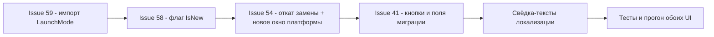

# План правок для релиза 1.0.0.68 — issues #59, #58, #54, #41

Версия программы: 1.0.0.67 → **1.0.0.68** (увеличивается только последнее число, [`VersionInfo.cs`](Workspace1C/VersionInfo.cs)).
Обе платформы: WPF (Windows) и Avalonia (Linux). Для каждой правки правятся файлы `*.xaml`/`*.xaml.cs` и/или `*.Avalonia.cs` + общий C#-код.
Юнит-тесты: проект `Workspace1C.Tests` (xUnit), стандарт — **не менее двух тестов на каждый фикс**.

---

## Issue #59 «Слетает режим запуска» (автор 7OH, без комментариев)

### Диагноз

Режим запуска ИБ (`Infobase.LaunchMode`) не «слетает» при сохранении: цепочка
правка → `InfobaseEditor.ApplyEdits` → `Save()` ([`MainViewModel.Commands.cs`](Workspace1C/ViewModels/MainViewModel.Commands.cs:299)) корректно
пишет значение в `infobases.json`. Значение теряется на **импорте из ibases.v8i при старте/синхронизации**:

1. [`IbasesV8iEntry.ToInfobase()`](Workspace1C/Services/IbasesV8iEntry.cs:521) превращает `App`/`DefaultApp` в `LaunchMode` через
   `MapLaunchMode()` (строка 548), который **всегда** возвращает непустую строку: если в файле нет распознанного
   режима (`Auto`, пусто, нестандартные токены штатного стартера «1CV8»/«1cv8c»/«1cv8s»), результат — «Автоматический».
2. [`IbasesV8iImporter.Import()`](Workspace1C/Services/IbasesV8iImporter.cs:169) для существующей базы делает
   `if (!string.IsNullOrWhiteSpace(imported.LaunchMode)) existing.LaunchMode = imported.LaunchMode;` — условие
   истинно всегда (п.1), поэтому при стартовой синхронизации/импорте заданный пользователем «Толстый клиент»
   затирается на «Автоматический».
3. Сценарий пользователя сходится: пока приложение открыто — значение в памяти и в `infobases.json` на месте;
   после перезапуска импорт из реального ibases.v8i (чей `App=Auto`, т.к. штатный стартер не понимает токенов
   приложения и/или не выполнялась выгрузка) перезаписывает режим. Аналогичная слепая перезапись есть и в
   [`StartManagerImporter`](Workspace1C/Services/StartManagerImporter.cs:346).

### Затрагиваемые файлы и характер правки

| Файл | Что менять |
|---|---|
| [`IbasesV8iEntry.cs`](Workspace1C/Services/IbasesV8iEntry.cs) | 1) `MapLaunchMode(app, defaultApp)` → возвращать `string?` (null = явного режима в файле нет); 2) `MapSingleLaunchMode` дополнить токенами штатного стартера: `"1cv8"` → «Толстый клиент», `"1cv8c"` → «Тонкий клиент», `"1cv8s"` → «Веб-клиент» (регистр уже нормализуется `ToLowerInvariant`); 3) `ToInfobase()` использует `MapLaunchMode(...) ?? "Автоматический"`; 4) добавить публичное свойство `bool HasExplicitLaunchMode` (true, когда `App` или `DefaultApp` дают не-null). |
| [`IbasesV8iImporter.cs`](Workspace1C/Services/IbasesV8iImporter.cs) | В ветке «существующая база» заменить условие перезаписи: `if (entry.HasExplicitLaunchMode) existing.LaunchMode = imported.LaunchMode;` (для новых баз поведение не меняется). |
| [`StartManagerImporter.cs`](Workspace1C/Services/StartManagerImporter.cs) | Та же защита при переносе `LaunchMode` из импортированной записи (строки ~345-347): не перезаписывать, если в файле нет явного режима запуска. |
| [`IbasesV8iExporter.cs`](Workspace1C/Services/IbasesV8iExporter.cs) | **Не менять** в рамках минимального фикса (токены `ThickClient/ThinClient/WebClient/Auto` обратно читаются приложением). Опционально (на усмотрение): выравнивание с токенами стартера — отдельной задачей, т.к. меняет контракт файла и требует обновления существующих тестов экспортёра. |
| [`VersionInfo.cs`](Workspace1C/VersionInfo.cs) | Не правится (версия — отдельная задача релиза, ниже). |

Логика полностью платформенно-нейтральная (общий C#), отдельных правок WPF/Avalonia не требует.

### Юнит-тесты (добавить в `Workspace1C.Tests.IbasesV8iImporterTests` или новый файл `LaunchModePreservationTests.cs`)

1. **Импорт не затирает режим базы, если в файле нет явного режима**: в темповый `ibases.v8i` запись с
   `App=Auto; DefaultApp=Auto`; существующая база с `LaunchMode="Толстый клиент"` → после `IbasesV8iImporter.Import`
   режим остаётся «Толстый клиент».
2. **Импорт применяет явный режим из файла**: запись `App=1CV8` (токен штатного стартера) → у существующей и
   у новой базы `LaunchMode == "Толстый клиент"`.
3. (Регрессия) **Круговая сериализация приложения**: экспорт базы с «Толстый клиент» (`App=ThickClient`) →
   импорт обратно → режим сохраняется «Толстый клиент».
4. (Опция) **StartManagerImporter** не затирает режим пустым значением.

---

## Issue #58 «Новинки программы» (автор 7OH, без комментариев)

### Диагноз

Механизм «Новинок» уже реализован и работает по наличию неразмещённых пунктов с флагом `IsNew`
([`UtilitiesMenuResolver.cs`](Workspace1C/Services/UtilitiesMenuResolver.cs:36), группа «Новинки программы»
`GroupNewItems`, issue #4): группа видна только при наличии новинок, галочка видимости зафиксирована
(`CanToggleVisibility=false`) — это «так и должно быть», менять не требуется.

Причина, почему «Миграция между кластерами 1С» не попала в «Новинки»: в каталоге
[`UtilitiesMenuCatalog.cs`](Workspace1C/Services/UtilitiesMenuCatalog.cs:447) пункт `ClusterMigration` объявлен
**без `isNew: true`** (в отличие от `Services`/`NotificationChannels`). Поэтому `CollectNewItems` его не видит,
группа «Новинки» не появляется, а в редакторе структуры пункт «нигде не находится» только потому, что его нет
и в «Новинках», и он уже присутствует в сохранённой пользовательской компоновке (или отсутствует вовсе — тогда
`EnsureNewItemsGroup` нечего добавить).

Про «по версии добавления»: текущий дизайн использует статический признак `IsNew` в каталоге (заданный подход
issue #4), а не число-версию. Для закрытия issue достаточно выставить флаг; вводить `SinceVersion` (автоснятие
флага через N релизов) можно отдельной задачей — в плане не требуется.

### Затрагиваемые файлы и характер правки

| Файл | Что менять |
|---|---|
| [`UtilitiesMenuCatalog.cs`](Workspace1C/Services/UtilitiesMenuCatalog.cs:447) | У записи `new("ClusterMigration", ...)` добавить параметр `isNew: true` (в конец списка аргументов конструктора). |
| [`UtilitiesMenuResolver.cs`](Workspace1C/Services/UtilitiesMenuResolver.cs) | Без изменений — механизм уже корректный, фикс только в данных каталога. |
| [`MainWindow.UtilitiesMenu.cs`](Workspace1C/Views/MainWindow.UtilitiesMenu.cs:44) / [`MainWindow.Avalonia.Tree.cs`](Workspace1C/Views/MainWindow.Avalonia.Tree.cs:1732) | Без изменений — построители уже вызывают `EnsureNewItemsGroup`. |
| [`UtilitiesMenuEditorViewModel.cs`](Workspace1C/ViewModels/UtilitiesMenuEditorViewModel.cs) | Без изменений. |

### Юнит-тесты (в `UtilitiesMenuLayoutTests` / `UtilitiesMenuResolverTests`)

1. **`ClusterMigration` помечен как новинка**: `UtilitiesMenuCatalog.Find("ClusterMigration")!.IsNew == true`.
2. **`CollectNewItems` находит `ClusterMigration`**, если он отсутствует в пользовательской компоновке
   (например, компоновка без этого ItemId) — пункт входит в список новинок.
3. **`EnsureNewItemsGroup` создаёт/пополняет видимую группу «Новинки»** с `ClusterMigration`, когда новинка
   не размещена (видимость группы `true`).
4. (Инвариант) Каждый пункт каталога с `IsNew == false` присутствует в **стандартной** компоновке
   (защита от регрессий «новинка навсегда потеряна»).

---

## Issue #54 «Массовые действия над выбранными базами» (последний комментарий 7OH 13:43)

### Диагноз и требования

В 1.0.0.66 смену платформы встроили в окно «Замена строк подключения…» (галочка «Сменить платформу»).
По комментарию 7OH:

1. **Вернуть инструмент «Замена строк подключения» как был** — без смены платформы, с прежним названием
   пункта меню и окна.
2. **Добавить новый пункт в контекстное подменю «Для выделенных (N)…» — «Сменить платформу»**:
   открывает отдельное окно выбора платформы из списка установленных, по «ОК» заменяет платформу у
   выделенных баз (с сохранением undo «Отменить последнюю замену»).

Сейчас смена платформы прошита в:
[`ConnectionReplaceViewModel.cs`](Workspace1C/ViewModels/ConnectionReplaceViewModel.cs:186) (свойства `ChangePlatform`,
`SelectedPlatform`, `InstalledPlatformVersions`, `CanSelectPlatform`, сборка `PlatformReplaceRule`,
суммирование в `ApplyPlan`, суффикс сводки), в окнах
[`ConnectionReplaceWindow.xaml`](Workspace1C/Views/ConnectionReplaceWindow.xaml) / [`ConnectionReplaceWindow.Avalonia.cs`](Workspace1C/Views/ConnectionReplaceWindow.Avalonia.cs:74)
(чекбокс + ComboBox), в пунктах меню «Утилиты» и «Для выделенных» + локализация
([`ru.json`](Workspace1C/Localization/Languages/ru.json:49), [`ru.json`](Workspace1C/Localization/Languages/ru.json:210), [`ru.json`](Workspace1C/Localization/Languages/ru.json:2462)).

Чистые помощники планировщика ([`ConnectionReplacementPlanner.PlanPlatform/ApplyPlatform`](Workspace1C/Services/ConnectionReplacementPlanner.cs:273),
`PlatformReplaceRule`, `ConnectionReplaceUndoEntry.BeforePlatform/AfterPlatform`, `MergeUndoEntries`) —
**оставить и переиспользовать**: они нужны новому окну и уже покрыты тестами. Модель отката
`MainViewModel.ApplyConnectionReplace/UndoLastConnectionReplace`
([`MainViewModel.ConnectionReplace.cs`](Workspace1C/ViewModels/MainViewModel.ConnectionReplace.cs:53)) тоже переиспользуется как есть.

### Затрагиваемые файлы и характер правки

| Файл | Что менять |
|---|---|
| [`ConnectionReplaceViewModel.cs`](Workspace1C/ViewModels/ConnectionReplaceViewModel.cs) | **Откат к «чистой» замене строк подключения**: удалить `ChangePlatform`, `SelectedPlatform`, `InstalledPlatformVersions`, `CanSelectPlatform`, `_lastPlatformRule`, сборку `BuildPlatformRule`, вызовы `PlanPlatform`/`ApplyPlatform`, суффикс `Summary.PlatformSuffixFormat`, параметр конструктора `installedPlatformVersions`; убрать зависимость от `PlatformReplaceRule` (класс остаётся в Services для нового окна). Удалить/адаптировать связанные тесты VM. |
| [`ConnectionReplaceWindow.xaml`](Workspace1C/Views/ConnectionReplaceWindow.xaml) | Удалить блок «Сменить платформу» + «Версия платформы»; вернуть прежний заголовок окна. |
| [`ConnectionReplaceWindow.Avalonia.cs`](Workspace1C/Views/ConnectionReplaceWindow.Avalonia.cs:74) | То же: убрать чекбокс `ConnectionReplace.ChangePlatform` и ComboBox `ConnectionReplace.PlatformLabel`. |
| [`MainWindow.Events.cs`](Workspace1C/Views/MainWindow.Events.cs:1139) | `OnBatchConnectionReplace_Click`/`OnUtilitiesConnectionReplace_Click`: убрать передачу `installedPlatformVersions`; добавить обработчик нового пункта (п. ниже). |
| [`MainWindow.Avalonia.Tree.cs`](Workspace1C/Views/MainWindow.Avalonia.Tree.cs:2463) | Аналог для Avalonia. |
| [`MainWindow.ContextMenu.cs`](Workspace1C/Views/MainWindow.ContextMenu.cs:322) | В `PopulateBatchOperationsMenu` добавить пункт «Сменить платформу» (после «Замены строк подключения») → новый обработчик. |
| [`MainWindow.Avalonia.Tree.cs`](Workspace1C/Views/MainWindow.Avalonia.Tree.cs:2288) | То же в `PopulateRowAvaloniaBatchMenu`. |
| **Новый** [`ViewModels/PlatformChangeViewModel.cs`](Workspace1C/ViewModels) | Чистый VM (без платформенных зависимостей, как соседние): принимает кандидатов (выделенные базы), `InstalledPlatformVersions` (из `MainViewModel.InstalledPlatformVersions`), `SelectedPlatform` (автовыбор первой), сводку «Будет изменено N баз», команду «Сменить» → `ConnectionReplacementPlanner.ApplyPlatform(...)` + колбэк `onApplied` (тот же, что у замены строк). Опционально себя — предпросмотр не нужен (операция простая), но допустим список «старая → новая» для каждой базы. |
| **Новый** [`Views/PlatformChangeWindow.xaml`](Workspace1C/Views) + `.xaml.cs` + [`Views/PlatformChangeWindow.Avalonia.cs`](Workspace1C/Views) | Тонкое окно: ComboBox установленных платформ, сводка по выделенным, «OK»/«Отмена»; после «OK» — `ApplyPlatformCommand`, закрытие. |
| [`MainViewModel.BatchCommands.cs`](Workspace1C/ViewModels/MainViewModel.BatchCommands.cs) / [`MainViewModel.ConnectionReplace.cs`](Workspace1C/ViewModels/MainViewModel.ConnectionReplace.cs) | Метод-обёртка для кандидатов уже есть (`GetConnectionReplaceCandidates(Scope.BatchSelected)`); персистентность/undo — существующий `ApplyConnectionReplace`; новых методов не требуется (при необходимости — тонкий фасад `OpenPlatformChangeForBatch()`). |
| [`ru.json`](Workspace1C/Localization/Languages/ru.json) / [`en.json`](Workspace1C/Localization/Languages/en.json) | 1) Вернуть прежние: `Main.BatchConnectionReplace` → «Заменить строки подключения…», `Main.UtilitiesConnectionReplace` → «Заменить строки подключения…», `ConnectionReplace.Title` → «Заменить строки подключения…» (как до 1.0.0.66); 2) удалить `ConnectionReplace.ChangePlatform`, `ConnectionReplace.PlatformLabel`, `ConnectionReplace.Summary.PlatformSuffixFormat` (или оставить неиспользуемыми — предпочтительно удалить); 3) добавить новые ключи `PlatformChange.Title` («Сменить платформу»), `PlatformChange.PlatformLabel`, `PlatformChange.SummaryFormat`, `PlatformChange.ApplyButton`, `PlatformChange.EmptyList` (нет установленных платформ), `Main.BatchChangePlatform` («Сменить платформу» для контекстного меню). |
| [`ConnectionReplaceWindow.xaml.cs`](Workspace1C/Views/ConnectionReplaceWindow.xaml.cs:67) | Конвертер `FieldDisplayText` для платформы (`IsPlatformChange`) удалить/упростить, если после отката строк-платформ не будет. |

### Юнит-тесты

1. **`ConnectionReplacementPlannerTests`** (дополнить): `ApplyPlatform` только меняет `PlatformVersion` и
   возвращает записи отката с заполненными `BeforePlatform/AfterPlatform`; `Undo(entries)` возвращает прежнюю
   версию. (Часть уже покрыта — проверить и дополнить до пары.)
2. **`ConnectionReplaceViewModelTests`** (обновить): предпросмотр и применение «Замены строк подключения»
   больше не содержат строк с `IsPlatformChange`, `ChangePlatform` отсутствует (проверка через отсутствие
   членов/поведения); сводка без `PlatformSuffixFormat`.
3. **Новый `PlatformChangeViewModelTests`**: (а) «Сменить» по «ОК» применяет выбранную версию ко всем
   кандидатам и формирует undo-записи; (б) пустой список установленных платформ / пустой выбор кандидатов
   → команда недоступна; (в) сводка показывает число баз.
4. **`ConnectionReplaceLocalizationTests`** (обновить): прежние названия меню/окна («Заменить строки
   подключения…»), новые ключи `PlatformChange.*` и `Main.BatchChangePlatform` присутствуют в обоих языках.
5. (Опция) **Тест пункта меню**: в тестах контекстного меню (если есть разметочный тест `PopulateBatchOperationsMenu`)
   — новый пункт «Сменить платформу» присутствует в блоке «Для выделенных».

---

## Issue #41 «Миграция баз» (последний комментарий 7OH 14:00, 4 пункта)

### 4.1 Кнопки «Импорт»/«Миграция» — растягивание на ширину колонки

**Причина**: кнопки лежат в горизонтальном `StackPanel` — `HorizontalAlignment=Stretch` в нём не работает
(ширина равна содержимому), поэтому обе кнопки сжимаются.

| Файл | Что менять |
|---|---|
| [`ServerMonitorWindow.xaml`](Workspace1C/Views/ServerMonitorWindow.xaml:352) | Заменить `StackPanel` на `Grid` с двумя столбцами `Width="*"` (равные доли), кнопки `HorizontalAlignment="Stretch"`, отступ 6px между столбцами (ColumnDefinition.Margin или Padding у второй кнопки). |
| [`ServerMonitorWindow.Avalonia.cs`](Workspace1C/Views/ServerMonitorWindow.Avalonia.cs:1119) | Аналогично: `Grid` с двумя `ColumnDefinition(Star)`, кнопки со `Stretch`, `ColumnSpacing=6` (Avalonia Grid поддерживает ColumnSpacing) или маржин второго столбца. |

**Тесты**: чистого unit-теста на разметку нет; покрыть можно существующим паттерном
`SettingsWindowXamlResourcesTests`/`ButtonThemeBindingTests` — assert, что в XAML кнопки «Импорт»/«Миграция»
находятся в `Grid` (а не `StackPanel`) и не имеют фиксированной `Width`. Для Avalonia — тест на отсутствие
`Width`/наличие `Stretch` в коде построения (выделить построение нижней панели в отдельный метод, если требуется).

### 4.2 Сервер источника не подставляется в поле «Сервер 1С»

**Причина**: в окне миграции ComboBox сервера связан **односторонне**: `SelectionChanged → _vm.SelectedSourceServer`
([`ClusterMigrationWindow.Avalonia.cs`](Workspace1C/Views/ClusterMigrationWindow.Avalonia.cs:96)), обратной
подстановки из VM в ComboBox нет. При открытии из «Серверы 1С» `_vm.SelectedSourceServer = initialSourceServer`
выставляется (строка 285), «Подключиться» работает (кластеры грузятся, автовыбор кластера — сервер уже выбран
на уровне VM), но элемент списка в поле не подсвечивается → пользователь видит пустой ComboBox.
В WPF-версии ([`ClusterMigrationWindow.xaml.cs`](Workspace1C/Views/ClusterMigrationWindow.xaml.cs:56) + XAML) — проверить
тип привязки `SelectedItem` (текущий XAML может использовать односторонний `SelectionChanged`), и при необходимости
синхронизировать так же.

| Файл | Что менять |
|---|---|
| [`ClusterMigrationWindow.Avalonia.cs`](Workspace1C/Views/ClusterMigrationWindow.Avalonia.cs:96) | Связать ComboBox двусторонне: `_sourceServerCombo.Bind(ComboBox.SelectedItemProperty, new Binding("SelectedSourceServer", BindingMode.TwoWay))` (аналогично для приёмника); либо в `OnVmPropertyChanged` по `SelectedSourceServer`/`SelectedTargetServer` выставлять `SelectedItem`. |
| [`ClusterMigrationWindow.xaml`](Workspace1C/Views/ClusterMigrationWindow.xaml) / `.xaml.cs` | Привести к тому же поведению: `SelectedItem="{Binding SelectedSourceServer, Mode=TwoWay}"` (и приёмник). |

**Тесты**: поведение — в `ClusterMigrationViewModelTests`: установка `SelectedSourceServer` в конструкторе VM
сохраняется и не сбрасывается (уже есть «открытие с сервером» — дополнить проверкой выбора умолчаний).
Проверка двухсторонней привязки ComboBox — тестом разметки WPF (аналог `SettingsWindowXamlResourcesTests`):
`SelectedItem` комбобокса сервера источника имеет `Mode=TwoWay`.

### 4.3 Сводка «сколько выделено / сколько будет перенесено»

**Текущее состояние**: `CheckedCount` пересчитывается только в массовых операциях
(`ApplySourceBases/ApplyTargetStatuses/SelectAll/SelectNone`), а при переключении галочки отдельной строки
родительский VM **не уведомляется** — `ClusterMigrationRow` ([`ClusterMigrationRow.cs`](Workspace1C/ViewModels/ClusterMigrationRow.cs:54))
не имеет обратной связи с VM. Сводки как единого текста нет, окно показывает только подсказки
(`MigrateHint`).

| Файл | Что менять |
|---|---|
| [`ClusterMigrationViewModel.cs`](Workspace1C/ViewModels/ClusterMigrationViewModel.cs) | 1) Подписаться на `row.PropertyChanged` в `BuildRow` (раскомментировать/добавить) и по `IsChecked` вызывать пересчёт `CheckedCount/HasCheckedInTarget/CanMigrate/MigrateHint`; 2) добавить свойство `SelectionSummaryText` («Выделено: N из M · будет перенесено: N» — ключ `ClusterMigration.Summary.SelectedFormat`, с учётом `HasCheckedInTarget` — сообщение «требуется обновить статусы»); обновлять при изменении чеклиста и галочек; 3) `NotifyCheckedState()` — единый метод уведомлений. |
| [`ClusterMigrationWindow.xaml`](Workspace1C/Views/ClusterMigrationWindow.xaml) | Строка-сводка под чеклистом: `Text="{Binding SelectionSummaryText}"`. |
| [`ClusterMigrationWindow.Avalonia.cs`](Workspace1C/Views/ClusterMigrationWindow.Avalonia.cs) | Тот же `TextBlock`, привязанный к `SelectionSummaryText` (рядом с кнопками «Выделить все/Снять все»). |
| [`ru.json`](Workspace1C/Localization/Languages/ru.json) / `en.json` | Ключи `ClusterMigration.Summary.SelectedFormat` (+ при необходимости `ClusterMigration.Summary.InTargetPending`). |

**Тесты** (`ClusterMigrationViewModelTests`): (а) после загрузки баз (все галочки) `SelectionSummaryText ==
«Выделено: N из N …»`; (б) при снятии галочки у строки вручную `CheckedCount`/сводка обновляются, а
`CanMigrate` следует за состоянием; (в) после «Получить статусы» сводка учитывает исключённые базы.

### 4.4 Кросс-потоковая ошибка `InvalidOperationException` на «Мигрировать»

**Причина**: в [`MigrateAsync()`](Workspace1C/ViewModels/ClusterMigrationViewModel.cs:796) после
`await ... ConfigureAwait(false)` продолжение выполняется в пуле потоков. Прямо из фонового потока меняются
`ProgressIndex/CurrentBaseName/Result/StatusText/MigrationCompleted` (строки 878-920). Окно подписано на
`_vm.PropertyChanged` ([`ClusterMigrationWindow.xaml.cs`](Workspace1C/Views/ClusterMigrationWindow.xaml.cs:101),
[`ClusterMigrationWindow.Avalonia.cs`](Workspace1C/Views/ClusterMigrationWindow.Avalonia.cs:301)): обработчики
`UpdateCommandStates()` (трогает `Button.IsEnabled`, `ProgressBar`, `ProgressText`) и `OnMigrationCompleted()`
(показывает `MessageBox`/диалог, ставит `DialogResult`, `Close()`) выполняются в фоновом потоке →
`InvalidOperationException: Вызывающий поток не может получить доступ к данному объекту…`,
логируется как «Ошибка миграции баз между кластерами 1С» (строка 930).

| Файл | Что менять |
|---|---|
| [`ClusterMigrationViewModel.cs`](Workspace1C/ViewModels/ClusterMigrationViewModel.cs:878) | 1) Построение результата и все уведомления, которые читает окно, выполнять на UI-потоке через существующий `Dispatch(...)`: обернуть в `Dispatch` обновления прогресса в цикле (накопить локально или по итерации) и финальный блок `Result/StatusText/MigrationCompleted = true`; при этом внутри цикла не трогать UI-объекты напрямую (только свойства VM). 2) Строго: продолжение после цикла — `await Task.Yield()`/маршалинг не требуется, если весь финал в `Dispatch`; переменные-аккумуляторы (`migrated`, `addedInfobases`) — локальные, безопасны. 3) Аналогично при ошибках: `ErrorMessage`/`StatusText` финального `catch` тоже через `Dispatch` (или, как минимум, `MigrationCompleted` — главный триггер окна). |
| [`ClusterMigrationWindow.xaml.cs`](Workspace1C/Views/ClusterMigrationWindow.xaml.cs:101) | Опциональная страховка: в `OnVmPropertyChanged` для случаев, не связанных с `MigrationCompleted`, при необходимости — перепроверка `Dispatcher.CheckAccess` (но основной фикс — в VM, чтобы PropertyChanged приходил из UI-потока). |

**Тесты** (`ClusterMigrationViewModelTests`): (а) вызов `MigrateAsync` с `dispatchToUi`-колбэком, эмулирующим
маршалинг на UI-поток (как в реальных окнах), завершается без исключений, `MigrationCompleted == true`,
`Result` содержит список перенесённых баз; (б) `dispatchToUi == null` (тестовый режим) — миграция с ошибкой
`FailCreate` оставляет `ErrorMessage` заполненным и `MigrationCompleted == false` (регрессия существующего
теста); (в) прогресс: `ProgressIndex/ProgressTotal/CurrentBaseName` выставляются через диспетчер (счётчик
вызовов колбэка). Также проверить, что существующий тест «миграция выполнена» не зависит от потока.

---

## Порядок выполнения

1. **Issue #59** — самый рискованный (меняет контракт импорта): правки `IbasesV8iEntry`,
   `IbasesV8iImporter`, `StartManagerImporter` + тесты. Платформенно-нейтрален, делать первым и изолированно.
2. **Issue #58** — одна строка в каталоге + тесты; независима, можно параллельно с #59.
3. **Issue #54** — самый объёмный: откат VM/окон/локализации + новое окно `PlatformChange*` + пункты меню
   в обоих контекстных меню + тесты (сначала откат и прогон старых тестов, затем новое окно).
4. **Issue #41** — четыре независимых подправки: кнопки (разметка WPF/Avalonia), привязка ComboBox сервера,
   сводка выделения (VM + окна + локализация), кросс-поток в `MigrateAsync` (VM) + тесты.
5. **Финализация**: прогон `Workspace1C.Tests`, ручные проверки на обеих платформах (Windows WPF, Linux
   Avalonia), обновление `_rel_notes_v100068.md` и `CHANGELOG.md`, bump версии в [`VersionInfo.cs`](Workspace1C/VersionInfo.cs)
   до 1.0.0.68.

## Связь с версией 1.0.0.68

- Все четыре issue входят в релиз **1.0.0.68**: 7OH — автор #59, #58, #41 и финального комментария #54,
  фиксы ожидаются «как договорились» именно в этом окне.
- Версия меняется только последним числом (`1.0.0.67` → `1.0.0.68`), правка `VersionInfo.cs` — в шаге
  финализации, вместе с релизными заметками (`_rel_notes_v100068.md`), поскольку `release_notes_*.md` и
  `plans/` исключены из git (см. `.codeassistantignore`).
- Порядок фиксов внутри релиза не влияет на функциональность (правки независимы), но #59 рекомендуется
  выпускать первым в рамках одной ветки релиза, т.к. он чинит данные пользователей.