# План правок для релиза 1.0.0.69 — issues #60, #57, #54, #41

Версия программы: **1.0.0.69** (последний тег v1.0.0.68; версия увеличивается только последним числом).
Обе платформы: WPF (Windows) и Avalonia (Linux). Для каждой правки правятся файлы `*.xaml` / `*.xaml.cs` / `*.axaml` и/или `*.Avalonia.cs` + общий C#-код.
Юнит-тесты: проект `Workspace1C.Tests` (xUnit), стандарт — **не менее двух тестов на каждый фикс**.

---

## 0. Стратегия версии и структура коммитов (согласовано с пользователем)

**Единый релиз v1.0.0.69**: сначала коммит незакоммиченных фич (9 инструментов «Утилиты → Операции», версия в [`Workspace1C.csproj`](Workspace1C/Workspace1C.csproj:62) уже 1.0.0.69, секция `[1.0.0.69]` в [`CHANGELOG.md`](CHANGELOG.md:14) уже есть), затем — по одному коммиту на каждый фикс issues. Всё выходит в одном релизе 1.0.0.69.

Обоснование: правило «версию увеличивать только последнее число» соблюдается (68 → 69); незакоммиченная v1.0.0.69 не выпускалась; один цикл сборки×2 платформы, один релиз GitHub и один пост в Telegram; исправления (7OH ждёт их) доходят до пользователей раньше; история остаётся читаемой за счёт отдельных коммитов по issues.

| Коммит | Состав |
|---|---|
| C1 | Незакоммиченные фичи v1.0.0.69 (9 инструментов, тесты, локализации, AppServices) — «v1.0.0.69: девять новых инструментов меню Утилиты → Операции» |
| C2 | Issue #60 «Цвет иконки поиска» — фикс + тесты + CHANGELOG |
| C3 | Issue #54 «Массовые действия: закрытие окна по Esc» — фикс + тесты + CHANGELOG |
| C4 | Issue #41 «Миграция баз» — сервер-подстановка + поля «Тип СУБД/Сервер СУБД» + тесты + CHANGELOG |
| C5 | Issue #57 «Раздельная общая авторизация по режимам» — фикс + тесты + CHANGELOG |
| C6 | Финализация: `_rel_notes_v100069.md`, актуализация README (бейдж/описания), проверка всех четырёх версий в csproj |

Версия в [`Workspace1C.csproj`](Workspace1C/Workspace1C.csproj:62) уже 1.0.0.69 (`Version/AssemblyVersion/FileVersion/InformationalVersion`) — её не меняем на протяжении работ, только проверяем в C6. README-бейдж уже 1.0.0.69. Issues самим **не закрываем** — только комментируем после фиксов (шаблоны `_issue*_comment.md` из прошлых релизов).

---

## 1. Issue #60 «Цвет иконки поиска» (автор 7OH, 0 комментариев; коммит C2)

### Диагноз
Скриншот и текст: «иконка поиска должна быть такого же цвета, как и крестик; в светлой теме оба тёмные, в тёмной — рассинхрон».

- **WPF** [`MainWindow.xaml`](Workspace1C/Views/MainWindow.xaml:372): иконка `Magnify` задана БЕЗ явного `Foreground` (наследует цвет окна: в светлой теме — тёмный, в тёмной — светлый) и с `Opacity="0.7"`. Крестик (строки 384-385) — `PackIcon Kind="Close"` с явным `Foreground="{DynamicResource TextSecondaryBrush}"` без прозрачности → в тёмной теме иконка поиска «белёсая», крестик — серый (рассинхрон).
- **Avalonia** [`MainWindow.Avalonia.cs`](Workspace1C/Views/MainWindow.Avalonia.cs:1342): иконка поиска уже `IconHelper.MakeIcon("IconSearch", 16, "TextSecondaryBrush")`, крестик (строка 1364) — `MakeIcon("IconClose", 12, "TextSecondaryBrush")` → уже синхронны, правка кода не требуется.

### Затрагиваемые файлы и характер правки

| Файл | Что менять |
|---|---|
| [`MainWindow.xaml`](Workspace1C/Views/MainWindow.xaml:372) | У иконки поиска (PackIcon Magnify в поле поиска): добавить `Foreground="{DynamicResource TextSecondaryBrush}"` и убрать `Opacity="0.7"` (цвет один-в-один с крестиком; при необходимости оставить `IsHitTestVisible="False"`). |
| [`MainWindow.Avalonia.cs`](Workspace1C/Views/MainWindow.Avalonia.cs:1342) | Без изменений кода (обе иконки уже используют `TextSecondaryBrush`). |

### Юнит-тесты (новый файл `Workspace1C.Tests/Issue60SearchIconColorTests.cs`, паттерн разметочных тестов — как [`Issue41WindowLayoutTests.cs`](Workspace1C.Tests/Issue41WindowLayoutTests.cs) / `ButtonThemeBindingTests`)

1. **WPF**: в `MainWindow.xaml` у `PackIcon Kind="Magnify"` (первая строка поля поиска) присутствует `Foreground="{DynamicResource TextSecondaryBrush}"` и отсутствует `Opacity="0.7"`.
2. **WPF-инвариант**: иконка поиска и крестик очистки используют одну и ту же кисть — оба фрагмента содержат `TextSecondaryBrush`.
3. **Avalonia**: в `MainWindow.Avalonia.cs` фрагменты иконки поиска (`"IconSearch", 16, "TextSecondaryBrush"`) и крестика (`"IconClose", 12, "TextSecondaryBrush"`) используют одну кисть.

---

## 2. Issue #54 «Массовые действия: окно «Сменить платформу» закрывается по Esc» (последний комментарий 7OH 19:05; коммит C3)

### Требование
«Окошко отдельное есть. Закрытие по ESC бы ещё добавить. А можно это как правило добавить, чтобы для всех новых форм применялось?»

### Диагноз
- **WPF** [`PlatformChangeWindow.xaml`](Workspace1C/Views/PlatformChangeWindow.xaml:46) и `.xaml.cs`: окно наследует `Window`, кнопка «Отмена» **без** `IsCancel="True"`, `PreviewKeyDown` не подписан → Esc не закрывает окно.
- **Avalonia** [`PlatformChangeWindow.Avalonia.cs`](Workspace1C/Views/PlatformChangeWindow.Avalonia.cs:23): наследует `ModalWindowBase`, у которого `OnKeyDown` по Esc вызывает `CloseAsCancel()` ([`ModalWindowBase.cs`](Workspace1C/Views/ModalWindowBase.cs:713)) — закрытие по Esc уже есть (общее правило для всех диалогов есть).

«Правило для всех новых форм»: на WPF общего базового класса нет (в отличие от Avalonia, где он есть — `ModalWindowBase`), поэтому добавляем его.

### Затрагиваемые файлы и характер правки

| Файл | Что менять |
|---|---|
| **Новый** [`Views/EscClosableWindow.cs`](Workspace1C/Views) | Базовый класс WPF-диалогов (`public abstract class EscClosableWindow : Window`): в конструкторе подписать `PreviewKeyDown` — при `Key.Escape` без модификаторов: `DialogResult = false; Close(); e.Handled = true;`. Инвариант «сначала подсказка, потом окно» обеспечивает существующий глобальный перехватчик [`ToolTipCloser`](Workspace1C/Views/ToolTipCloser.cs:728) (первый Esc с открытым тултипом помечает событие обработанным — наш обработчик на этом Esc не вызовется; второй Esc уже закрывает окно). |
| [`PlatformChangeWindow.xaml.cs`](Workspace1C/Views/PlatformChangeWindow.xaml.cs:14) | Наследовать от `EscClosableWindow` вместо `Window`; `OnCancel_Click` остаётся (вызывается кнопкой). |
| [`PlatformChangeWindow.xaml`](Workspace1C/Views/PlatformChangeWindow.xaml:46) | Кнопке `CancelButton` добавить `IsCancel="True"` (резервный штатный путь закрытия по Esc, согласованно с другими WPF-окнами). |
| [`PlatformChangeWindow.Avalonia.cs`](Workspace1C/Views/PlatformChangeWindow.Avalonia.cs:87) | Без изменений (Esc даёт `ModalWindowBase`); при желании — `IsCancel = true` у cancelButton для проверки, что не ломает поведение (не обязательно). |

### Юнит-тесты (доп. в `Workspace1C.Tests` — новый `Issue54EscapeCloseTests.cs`)

1. **WPF**: наследование — `typeof(PlatformChangeWindow).BaseType == typeof(EscClosableWindow)`.
2. **WPF (разметочный)**: кнопка `x:Name="CancelButton"` в `PlatformChangeWindow.xaml` имеет `IsCancel="True"`.
3. **Avalonia**: в `PlatformChangeWindow.Avalonia.cs` объявление — «PlatformChangeWindow : ModalWindowBase» (проверка строки/наследования через рефлексию заголовка файла), т.е. закрытие по Esc унаследовано от общего правила.
4. (Опция) Assert, что `EscClosableWindow` подписывает `PreviewKeyDown` (через рефлексию поля-делегата или публичный тестовый хук — на усмотрение исполнителя; можно ограничиться разметочными тестами 1-3).

---

## 3. Issue #41 «Миграция баз» (последний комментарий 7OH 19:12; коммит C4)

Требования 7OH:
1. «При запуске Миграции из Серверы 1С — текущий сервер, как в Импорте, не подставляется, хотя его кластер подставлен».
2. «Странная ошибка» при создании базы (rac не принимает СУБД): «Возможно нужны Тип СУБД и Сервер СУБД (можно в одну строку выше пользователя и пароля расположить)».

### 3.1 Автоподстановка сервера-источника (как в «Импорте»)

**Причина**: окно миграции (WPF [`ClusterMigrationWindow.xaml.cs`](Workspace1C/Views/ClusterMigrationWindow.xaml.cs:56) и Avalonia) выставляет `_vm.SelectedSourceServer = initialSourceServer` «как есть». `ManagementServer` — class без переопределённого `Equals` ([`ManagementServer.cs`](Workspace1C/Models/ManagementServer.cs:10)); `initialSourceServer` из окна «Серверы 1С» (выбранная запись или `ConnectedServer` со свежим `Id`) по ссылке не равен ни одному элементу `AvailableSourceServers` (список из `IServerListStore().Load()`), поэтому `SelectedItem` не находится в ComboBox → поле пустое. Кластер при этом подставляется, т.к. выбирается по `Id` (`SelectedValue`).
В «Импорте» работает: [`ClusterImportViewModel.InitializeFromServer`](Workspace1C/ViewModels/ClusterImportViewModel.cs:303) сопоставляет сервер со списком по Id: `AvailableServers.FirstOrDefault(s => s.Id == server.Id) ?? server`.

| Файл | Что менять |
|---|---|
| [`ClusterMigrationViewModel.cs`](Workspace1C/ViewModels/ClusterMigrationViewModel.cs) | Добавить публичный метод `SetInitialSource(ManagementServer? server, Guid? clusterId)`: если сервер задан — `SelectedSourceServer = AvailableSourceServers.FirstOrDefault(s => string.Equals(s.Id, server.Id, StringComparison.OrdinalIgnoreCase)) ?? server;` (сеттер уже запускает `StartConnectSource()`); затем, если `clusterId` задан — `SelectedSourceClusterId = clusterId`. Учесть: если `clusterId` задан, а автозагрузка кластеров к моменту присвоения ещё не прошла — положиться на существующий механизм `StartConnectSource`/автовыбора (не вводить новых гонок; при необходимости — повторить присвоение в колбэке загрузки кластеров по образцу импорта `_requestedClusterId`). |
| [`ClusterMigrationWindow.xaml.cs`](Workspace1C/Views/ClusterMigrationWindow.xaml.cs:56) | Заменить прямое присваивание (строки 56-61) на `_vm.SetInitialSource(initialSourceServer, initialSourceClusterId);`. |
| [`ClusterMigrationWindow.Avalonia.cs`](Workspace1C/Views/ClusterMigrationWindow.Avalonia.cs:60) | Там же, где сейчас присваивается сервер (хвост конструктора) — вызвать `_vm.SetInitialSource(initialSourceServer, initialSourceClusterId)`. |

### 3.2 Поля «Тип СУБД» и «Сервер СУБД» на форме миграции

**Причина**: [`ClusterMigrationService.BuildCreateRequest`](Workspace1C/Services/ClusterMigrationService.cs:53) копирует `Dbms`/`DbServer` из записи источника; `RacClient.CreateInfobaseAsync` требует непустые `Dbms` и `DbServer` ([`RacClient.cs`](Workspace1C/Services/RacClient.cs:580)). Для кластера-приёмника на другом сервере СУБД (например, отдельный PostgreSQL-хост) значения из источника не подходят → «странная ошибка».

| Файл | Что менять |
|---|---|
| [`ClusterMigrationViewModel.cs`](Workspace1C/ViewModels/ClusterMigrationViewModel.cs) | Новые свойства `string Dbms` (одно из [`RacDbms`](Workspace1C/Models/RacDbms.cs:10): `MSSQLServer/PostgreSQL/IBMDB2/OracleDatabase`) и `string DbServer` с `OnPropertyChanged` + пересчётом; приватный флаг `_dbDetailsTouched`. После успешной `LoadSourceBases` (или `ApplySourceBases`), пока `!_dbDetailsTouched`, автозаполнить: `Dbms = NormalizeDbms(firstRow.Source.Dbms)` (как [`RacInfobaseCreateWindow.xaml.cs`](Workspace1C/Views/RacInfobaseCreateWindow.xaml.cs:92) — регистронезависимо, неизвестное → MSSQLServer), `DbServer = firstRow.Source.DbServer`. Сеттеры выставляют флаг touched. |
| [`ClusterMigrationService.cs`](Workspace1C/Services/ClusterMigrationService.cs:53) | `BuildCreateRequest(source, dbUser, dbPassword, string overrideDbms = "", string overrideDbServer = "")`: `Dbms = FirstNonEmpty(overrideDbms, source.Dbms)`, `DbServer = FirstNonEmpty(overrideDbServer, source.DbServer)` (перегрузку оставить для тестов/совместимости). |
| [`ClusterMigrationViewModel.cs`](Workspace1C/ViewModels/ClusterMigrationViewModel.cs:938) | В `MigrateAsync` передать `Dbms`/`DbServer` VM в `BuildCreateRequest`. |
| [`ClusterMigrationWindow.xaml`](Workspace1C/Views/ClusterMigrationWindow.xaml) | Новая строка сетки между «Опциями» (Row=2) и «Учётными данными СУБД» (Row=3): «Тип СУБД» — ComboBox (`ItemsSource` = 4 значения `RacDbms`, `SelectedItem="{Binding Dbms, Mode=TwoWay}"`), «Сервер СУБД» — TextBox (`Text="{Binding DbServer, UpdateSourceTrigger=PropertyChanged}"`); нижние строки сдвинуть (3→4, 4→5, 5→6). |
| [`ClusterMigrationWindow.axaml`](Workspace1C/Views/ClusterMigrationWindow.axaml) + [`ClusterMigrationWindow.Avalonia.cs`](Workspace1C/Views/ClusterMigrationWindow.Avalonia.cs:237) | Та же строка «Тип СУБД + Сервер СУБД» (над строкой DbUser/DbPassword): ComboBox с ItemsSource + TwoWay-привязкой `Dbms`, TextBox `DbServer`. |
| [`ru.json`](Workspace1C/Localization/Languages/ru.json) / [`en.json`](Workspace1C/Localization/Languages/en.json) | Ключи `ClusterMigration.Dbms` («Тип СУБД») и `ClusterMigration.DbServer` («Сервер СУБД»); при желании переиспользовать существующие `ServerMonitor.Infobase.Dbms/DbServer` — на усмотрение исполнителя, но предпочтительнее собственные ключи `ClusterMigration.*`. |

### Юнит-тесты (#41)

1. **`ClusterMigrationViewModelTests`**: `SetInitialSource` с сервером, чей `Id` есть в `availableServers` (другой экземпляр) → `SelectedSourceServer` ссылочно равен экземпляру из списка.
2. **`ClusterMigrationViewModelTests`**: `SetInitialSource` с сервером вне списка (новый `Guid`) → `SelectedSourceServer` = переданный экземпляр; `SelectedSourceClusterId` установлен; `CanMigrate`/`MigrateHint` пересчитаны.
3. **`ClusterMigrationServiceTests`** (или новый): `BuildCreateRequest` с переданными `dbms/dbServer` → они в запросе; с пустыми → значения `source.Dbms/DbServer`.
4. **`ClusterMigrationViewModelTests`**: после `LoadSourceBases` `Dbms`/`DbServer` автозаполнены из первой базы (нормализованный тип); если пользователь изменил `Dbms` до этого — значение не перезаписывается.
5. **`ClusterMigrationViewModelTests`**: `MigrateAsync` передаёт VM-`Dbms/DbServer` в запрос создания (через фейк `IRacClient` — проверка полученного `RacInfobaseCreateRequest`).
6. **Разметочный** (доп. `Issue41WindowLayoutTests` или `Issue60`-паттерн): WPF XAML содержит ComboBox с привязкой `Dbms` и TextBox `DbServer` в строке выше полей пользователя/пароля; Avalonia — фрагменты `Dbms`/`DbServer` привязок в `.axaml`/коде.

---

## 4. Issue #57 «Общая авторизация: раздельная по режимам» (последний комментарий 7OH 19:16; коммит C5)

Интерпретация согласована: **раздельная ОБЩАЯ авторизация по режимам запуска** — отдельные общие учётные данные для «1С:Предприятие» и для «Конфигуратор» (fallback по режиму).

### Текущая реализация
- [`AppSettings.cs`](Workspace1C/Models/AppSettings.cs:268): один `CommonAuthorization` на все ИБ.
- [`InfobaseAuthResolver.Resolve`](Workspace1C/Services/InfobaseAuthResolver.cs:40): 1) раздельная авторизация режима базы (`EnterpriseAuth`/`ConfiguratorAuth`, не `IsDefault`) → 2) авторизация базы (`Connection`) → 3) общая `commonAuth` → 4) «запрос платформы».
- Потребители: [`OneCLauncher.Arguments.Shared.cs`](Workspace1C/Services/OneCLauncher.Arguments.Shared.cs:23) (статик `CommonAuthorization`), [`OneCComConnector.cs`](Workspace1C/Services/OneCComConnector.cs:1034).
- UI: блок «Общая авторизация» [`SettingsWindow.xaml`](Workspace1C/Views/SettingsWindow.xaml:1985) и [`SettingsWindow.Avalonia.cs`](Workspace1C/Views/SettingsWindow.Avalonia.cs:674): радио «Запрос/Автоматический вход/Аутентификация ОС» + логин/пароль; сеттер `MainViewModel.CommonAuthorization` синхронизирует статик ([`MainViewModel.cs`](Workspace1C/ViewModels/MainViewModel.cs:269)).

### Предлагаемая архитектура (обратно совместимая)

| Файл | Что менять |
|---|---|
| [`AppSettings.cs`](Workspace1C/Models/AppSettings.cs:268) | Оставить `CommonAuthorization` как «общая для обоих режимов» (legacy/умолчание). Добавить `InfobaseAuthSettings? CommonEnterpriseAuth` и `InfobaseAuthSettings? CommonConfiguratorAuth` (по образцу `CommonAuthorization`; null/`IsDefault` = не задана). |
| [`InfobaseAuthResolver.cs`](Workspace1C/Services/InfobaseAuthResolver.cs:78) | Шаг 3) разделить по режиму: для Enterprise — `CommonEnterpriseAuth`, при её незаданности — legacy `CommonAuthorization`; для Configurator — `CommonConfiguratorAuth`, затем legacy. Расширить сигнатуру `Resolve` (вместо одного `commonAuth` — обёртка/пара: enterprise, configurator, legacy). Цепочка: своя авторизация режима → Connection → раздельная общая для режима → legacy общая → запрос платформы. |
| [`OneCLauncher.Arguments.Shared.cs`](Workspace1C/Services/OneCLauncher.Arguments.Shared.cs:23) | Вместо одного статика `CommonAuthorization` — два: `CommonEnterpriseAuthorization` / `CommonConfiguratorAuthorization` (+ legacy `CommonAuthorization` для перехода, или заменить с обновлением всех вызовов). Вызовы в [`OneCComConnector.cs`](Workspace1C/Services/OneCComConnector.cs:1034) и в `Arguments.Shared` (строка 157) обновить на выбор по режиму. |
| [`MainViewModel.cs`](Workspace1C/ViewModels/MainViewModel.cs:269) + [`MainViewModel.Avalonia.cs`](Workspace1C/ViewModels/MainViewModel.Avalonia.cs:97) | Свойства `CommonEnterpriseAuth`/`CommonConfiguratorAuth` с синхронизацией статиков лаунчера; учёт legacy-поля при загрузке/сохранении ([`MainViewModel.Launch.cs`](Workspace1C/ViewModels/MainViewModel.Launch.cs:696)). |
| [`SettingsWindow.xaml`](Workspace1C/Views/SettingsWindow.xaml:1985) | Блок «Общая авторизация» расширить: две группы («1С:Предприятие» / «Конфигуратор»), каждая — радио «Запрос/Автоматический вход/Аутентификация ОС» + логин/пароль; подсказка про legacy «если раздельная не задана — используется общая». |
| [`SettingsWindow.Avalonia.cs`](Workspace1C/Views/SettingsWindow.Avalonia.cs:674, 3387) | Те же два набора полей (строятся кодом) + чтение/запись в VM. |
| [`SettingsWindow.xaml.cs`](Workspace1C/Views/SettingsWindow.xaml.cs:214) / `SettingsWindow.Avalonia.Display.cs` | Заполнение и видимость полей для двух наборов; общие хелперы `UpdateCommonAuthFieldsVisibility` вынести в переиспользуемую функцию. |
| Локализация ru/en | Ключи `Settings.CommonAuth.GroupTitleEnterprise` / `GroupTitleConfigurator` (или секция с параметром режима), переиспользовать `ModePrompt/ModeCredentials/ModeOs/Login/Password/Hint`. |

### Юнит-тесты (#57; классы `CommonAuthResolverTests` / `CommonAuthLaunchArgsTests` / `CommonAuthComTests` дополнить)

1. **Резолвер**: при неуказанных раздельных общих, но заданном legacy `CommonAuthorization` — для обоих режимов используется он (регрессия текущего поведения).
2. **Резолвер**: задан `CommonEnterpriseAuth` (не `IsDefault`) → для `Enterprise` применяется он, `CommonConfiguratorAuth` игнорируется; для `Configurator` — свой.
3. **Резолвер**: задан только `CommonConfiguratorAuth` → Enterprise падает на legacy/запрос.
4. **Launcher-аргументы**: сборка аргументов Enterprise использует Enterprise-общие учётные данные (`/N /P`); Configurator — свои.
5. **COM**: `OneCComConnector` строка подключения строится с учётными данными по режиму.
6. **AppSettings/миграция**: загрузка старого `settings.json` с только `CommonAuthorization` не ломается; сохранение пишет три поля (заданные — только заполненные).

---

## 5. Issues #53 и #52 — только проверка (правок не требуется)

- **#53** «Перемещать выбранную базу в группу через контекстное меню» — финальный комментарий 7OH «Да — теперь "Для выделенных" и для одной базы показывается». Включить в ручное QA релиза (обе платформы), без правок и комментария.
- **#52** «Запоминать выбранную вкладку» — комментарий 7OH «Сохраняет». Аналогично — только QA.
- **#26, #55** — исключены (последний комментарий — автор репозитория), в работе не участвуют.

---

## 6. Порядок pipeline (каждый пункт — ОТДЕЛЬНАЯ новая задача)

```mermaid
flowchart LR
    A[Коммит C1 - незакоммиченные фичи v1.0.0.69] --> B[Задача code - issue 60]
    B --> C[Задача code - issue 54]
    C --> D[Задача code - issue 41]
    D --> E[Задача code - issue 57]
    E --> F[Задача - комментарии к issues]
    F --> G[Задача - версия CHANGELOG README финализация]
    G --> H[Задача - сборка Windows и Linux]
    H --> I[Задача - push и релиз GitHub]
    I --> J[Задача - пост в Telegram канала -1004425443528]
```

1. **Задача «code: C1 — фичи»** (одна, отдельная): закоммитить незакоммиченную работу v1.0.0.69 (весь `Workspace1C/`, `Workspace1C.Tests/`, локализации, AppServices) как есть — версия уже 1.0.0.69; убедиться, что тесты зелёные. CHANGELOG/README уже актуализированы под фичи — не трогать.
2. **Задача «code: issue #60»** — правки по §1 + тесты + запись в CHANGELOG (подраздел «Исправлено» секции [1.0.0.69]).
3. **Задача «code: issue #54»** — правки по §2 + тесты + CHANGELOG.
4. **Задача «code: issue #41»** — правки по §3 (3.1 и 3.2) + тесты + CHANGELOG.
5. **Задача «code: issue #57»** — правки по §4 + тесты + CHANGELOG. До выпуска 1.0.0.69 выполняется после #60/#54/#41 (изоляция регрессий), но код независим.
6. **Задача «комментарии к issues»** — после коммитов фиксов, ДО релиза: подготовить `_issue60_comment.md`, `_issue54_comment.md`, `_issue41_comment.md`, `_issue57_comment.md` (по шаблону прошлых релизов) и опубликовать как комментарии в GitHub (issues НЕ закрывать). Черновики текстов — в Приложении ниже.
7. **Задача «финализация версии/CHANGELOG/README»** — `_rel_notes_v100069.md` (по образцу [`_rel_notes_v100067.md`](_rel_notes_v100067.md)); CHANGELOG: секция [1.0.0.69] полная (Добавлено — фичи, Исправлено — #60/#54/#41/#57); README: бейдж и «актуальная версия» уже 1.0.0.69 — проверить, дополнить описания где требуется; проверить четыре тега версии в csproj; прогнать `dotnet test` полным набором.
8. **Задача «сборка»** — Windows: [`build-windows-single-file.ps1`](Workspace1C/build-windows-single-file.ps1) → `dist/win-x64/Workspace1C.exe`; Linux: [`build-linux-single-file.sh`](Workspace1C/build-linux-single-file.sh) на Linux или кросс-сборка `FORCE_LINUX=1` → `dist/linux-x64/Workspace1C`. Результат — ОДИН исполняемый файл на платформу (+ ручные smoke-проверки, включая QA по #53/#52).
9. **Задача «push и релиз GitHub»** — `git push` ветки, создание тега `v1.0.0.69`, GitHub Release с `_rel_notes_v100069.md` и двумя приложенными файлами.
10. **Задача «Telegram»** — headless-команда собранного exe: `& $env:W1C_EXE --telegram-send --text "…"` в чат/канал **-1004425443528** (см. [`docs/telegram-dev-bridge.md`](docs/telegram-dev-bridge.md)) — текст: вышел v1.0.0.69, кратко фичи + исправления issues #60/#57/#54/#41, ссылка на релиз.

---

## Приложение. Черновики комментариев к issues (оформляются в задаче «комментарии»)

**#60** (первый комментарий):
> Исправлено в версии 1.0.0.69 (Windows и Linux): иконка поиска в главном окне теперь использует ту же кисть, что и крестик очистки (`TextSecondaryBrush`) — в светлой и тёмной темах цвета совпадают (раньше на WPF иконка наследовала цвет окна и в тёмной теме «белела», а крестик оставался серым). На Avalonia иконка уже использовала ту же кисть — добавлены разметочные тесты, фиксирующие синхронность. Реализовано на обеих платформах.

**#54**:
> Исправлено в версии 1.0.0.69 (Windows и Linux): окно «Сменить платформу» закрывается по Esc. Для новых диалоговых форм добавлено общее правило: на WPF — базовый класс `EscClosableWindow` (закрытие по Esc без модификаторов с сохранением инварианта «сначала подсказка, потом окно»), окно «Сменить платформу» переведено на него; на Avalonia это правило уже даёт общий `ModalWindowBase`, от которого окно наследуется. Добавлены тесты на наследование и разметку.

**#41**:
> Исправлено в версии 1.0.0.69 (Windows и Linux):
> 1. При запуске миграции из окна «Серверы 1С» текущий сервер теперь подставляется в поле «Сервер 1С» источника — как в «Импорте»: выбранный сервер сопоставляется с записями справочника по идентификатору, а не по ссылке объекта.
> 2. На форму миграции вынесены поля «Тип СУБД» и «Сервер СУБД» (одной строкой выше логина/пароля): автозаполняются из первой загруженной базы источника и передаются в rac при создании базы в кластере-приёмнике — перенос корректно работает, когда кластеры используют разный сервер СУБД (прежняя «странная ошибка» создания базы устранена).
> Добавлены юнит-тесты (автоподстановка сервера, поля СУБД, запрос создания).

**#57**:
> Исправлено в версии 1.0.0.69 (Windows и Linux): добавлена раздельная общая авторизация по режимам запуска — отдельные общие учётные данные для «1С:Предприятие» и для «Конфигуратор» (в окне настроек два блока «Общая авторизация»). Цепочка выбора: своя авторизация режима → авторизация базы → раздельная общая для режима → прежняя общая (для обоих режимов, обратная совместимость) → запрос платформы. Настройки хранятся в `settings.json` (`CommonEnterpriseAuth`/`CommonConfiguratorAuth` при сохранении). Реализовано на обеих платформах, добавлены юнит-тесты резолвера/аргументов запуска/COM.