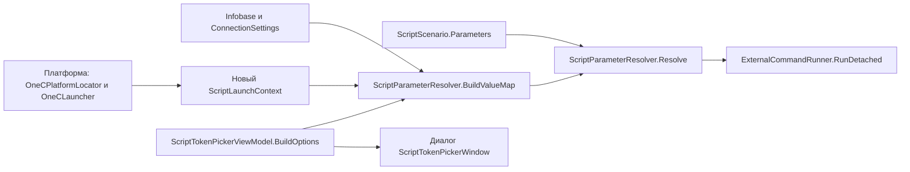
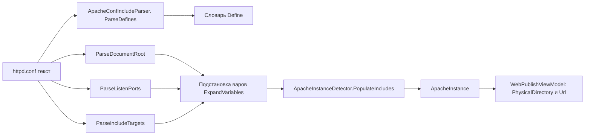
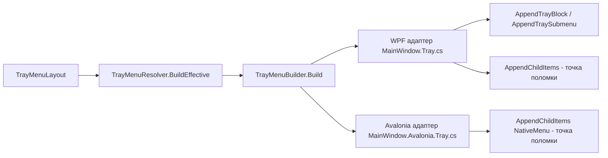
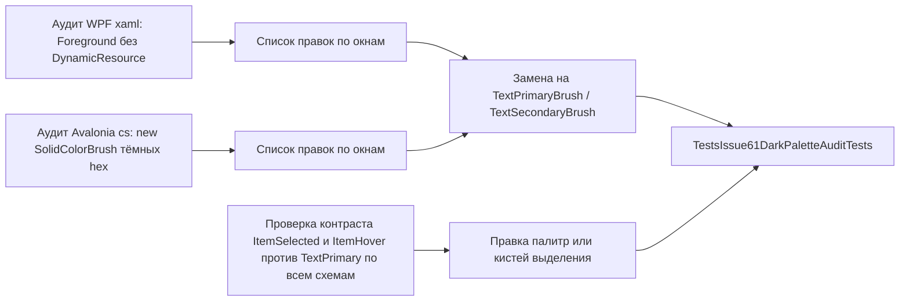
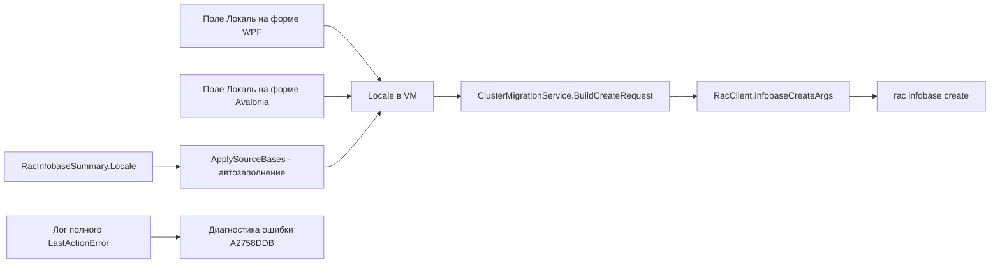

# План исправлений для версии v1.0.0.73

Репозиторий: https://github.com/sivatorov/Workspace1C
Рабочая копия: `g:/Yandex.Disk/h/Workspace1C` (ветка `main`)
Текущая версия: **v1.0.0.72** → целевая: **v1.0.0.73**

Issues, требующие доработки (последний комментарий `7OH` содержит новые требования; issues **не закрываем**):

| Issue | Название | Последний комментарий 7OH |
|-------|----------|---------------------------|
| #67 | Подстановки для сценариев | 2026-10-25T14:21:42Z — «Больше похоже на добавление в список 5 полей, а не ВСЕХ доступных полей структуры. Результата нет… Запрошенных в первом сообщении полей тоже нет» |
| #63 | Доработка публикации баз | 2026-10-25T14:24:46Z — «…а переменные из файла кто подставлять будет сейчас? Порт после имени публикации в подсказке — так и не подставлен» |
| #62 | Правка меню трея | 2026-10-25T14:12:53Z — «Блоки, добавленные в группу, перестают функционировать» |
| #61 | Цвета заголовков в темной версии | 2026-10-25T14:15:05Z — «…и темные заголовки и светлое на светлом выделение» |
| #41 | Миграция баз | 2026-10-25T14:26:17Z — «Поле с локалью на поле не замечено. А ошибка пока всё та же» |

Подтверждённые «работает» (#52, #53, #54) и issue с последним комментарием автора (#57, #55, #26) в объём v1.0.0.73 **не входят**.

---

## Принципы плана

1. **Двухплатформенность.** Для каждой правки указывается WPF (Windows) и Avalonia (Linux):
   - чистая логика (сервисы, парсеры, ViewModel) — общая, покрывается юнит-тестами;
   - представления — парные файлы `*.xaml` / `*.xaml.cs` (WPF) и `*.Avalonia.cs` / `*.axaml` (Avalonia).
2. **Тесты-стражи.** После каждой правки добавляются/расширяются юнит-тесты в `Workspace1C.Tests/` (чистые функции) и разметочные/исходниковые проверки (по образцу `Issue61TitleColorsTests`, `Issue41WindowLayoutTests`, `TrayMenuGroupMoveTests`).
3. **Обратная совместимость.** Не ломать старые конфиги, файлы компоновок, XML-языки локализации ru/en.
4. Issues не закрываются в этой версии (фиксируем только факт исправлений в комментариях и release notes).

---

## 1. Issue #67 — «Подстановки для сценариев»

### 1.1. Контекст и корень проблемы

В v1.0.0.72 реализовано: рефлексия по свойствам базы, ключи `%connection.user%`, `%connection.type%`, `%connection.port%`, `%id%`, `%имягруппы%`, диалог «Выбрать…» ([`ScriptTokenPickerViewModel.cs`](Workspace1C/ViewModels/ScriptTokenPickerViewModel.cs), [`ScriptTokenPickerWindow.xaml`](Workspace1C/Views/ScriptTokenPickerWindow.xaml)). Пользователь по-прежнему сообщает:

1. **«Запрошенных в первом сообщении полей тоже нет»** — четыре токена из описания issue НЕ реализованы:
   - `%full_launch_config%` — полная строка запуска для режима «Конфигуратор»,
   - `%full_launch_enterprise%` — полная строка запуска для режима «Предприятие»,
   - `%full_exe_name%` — полный путь к `1cv8.exe`,
   - `%platform_version%` — версия платформы (например `8.5.4.1878`).
2. **«Результата нет»** — сценарий, в параметрах которого встречаются эти токены, выполняет подстановку с `leaveUnknown=true` ([`ScriptParameterResolver.Resolve`](Workspace1C/Services/ScriptParameterResolver.cs:219)) — неизвестный токен остаётся в строке как литерал, команда не работает.
3. **«В выборе нет того, что есть в файле настроек»** — диалог собирается из статического списка [`ScriptScenarioEditViewModel.AvailableTokens`](Workspace1C/ViewModels/ScriptScenarioEditViewModel.cs:38) + динамической карты [`ScriptParameterResolver.BuildValueMap`](Workspace1C/Services/ScriptParameterResolver.cs:86); отсутствующих токенов там просто нет, поэтому пользователь не видит ни своих токенов из параметров сценария, ни их значений.
4. **«Больше похоже на добавление в список 5 полей»** — в диалоге список ограничен статически объявленными подсказками; динамические ключи карты (рефлексия) добавляются, но без человекочитаемых названий и не на первом месте — пользователь воспринимает это как «5 добавленных полей».

### 1.2. Где формируются подстановки (карта изменений)



- **Ключевые места, где вызывается `BuildValueMap`:**
  - [`MainViewModel.Scripts.cs:87`](Workspace1C/ViewModels/MainViewModel.Scripts.cs:87) (WPF);
  - [`MainViewModel.Avalonia.Scripts.cs:81`](Workspace1C/ViewModels/MainViewModel.Avalonia.Scripts.cs:81) (Avalonia);
  - [`ScriptScenarioEditViewModel.cs:187`](Workspace1C/ViewModels/ScriptScenarioEditViewModel.cs:187) (превью/живая подсказка);
  - [`ScriptTokenPickerViewModel.cs:141,155`](Workspace1C/ViewModels/ScriptTokenPickerViewModel.cs:141) (диалог);
  - `ScriptParameterResolver.BuildActionCommandLine` для пользовательских действий ([`ScriptParameterResolver.cs:436`](Workspace1C/Services/ScriptParameterResolver.cs:436)) — туда же пробросить контекст платформы.

### 1.3. Конкретные правки

#### 1.3.1. Новый контекст запуска платформы — `ScriptLaunchContext` (чистый record)

Файл: новый `Workspace1C/Services/ScriptLaunchContext.cs` (или вложенный в `ScriptParameterResolver.cs`).

```csharp
public sealed record ScriptLaunchContext(
    string? ExePath,            // %full_exe_name%: полный путь к 1cv8.exe / 1cv8
    string? PlatformVersion,    // %platform_version%: 8.5.4.1878 (чистая версия, без «(64)»)
    string? EnterpriseCommandLine,  // %full_launch_enterprise%: exe + аргументы, в кавычках
    string? ConfiguratorCommandLine // %full_launch_config%: exe + аргументы Конфигуратора
);
```

Сборка контекста — статический помощник `ScriptLaunchContextResolver.Resolve(Infobase?)` (общий для обеих платформ), который:

1. резолвит каталог `bin` через [`OneCPlatformLocator.ResolveBinDirectory`](Workspace1C/Services/OneCPlatformLocator.cs:21);
2. находит exe через `FindInBinDir(binDir, "1cv8")` (платформенное расширение уже учтено в [`FindInBinDir`](Workspace1C/Services/OneCPlatformLocator.cs:54));
3. версию — из каталога (имя подкаталога версии) либо через `PlatformVersionService.ResolveVersionBinDirectory`, чистит суффикс разрядности (`ParseVariant`);
4. полные строки запуска — собирает через существующие статические сборщики аргументов [`OneCLauncher.BuildConnectionArgument`](Workspace1C/Services/OneCLauncher.Arguments.cs:19)/`BuildAuthArgument`/`BuildLaunchArguments` (проверить точное имя; как минимум [`BuildEnterpriseShortcutArguments`](Workspace1C/Services/OneCLauncher.Arguments.Shared.cs:436)) в виде `"<exe>" <аргументы>` — **одна и та же строка, которую подставил бы стартер для текущей базы** в режимах `OneCLaunchMode.Enterprise`/`OneCLaunchMode.Configurator`.

> Важно: `ScriptParameterResolver` остаётся платформенно-нейтральным — он получает уже готовый `ScriptLaunchContext`. Всё платформозависимое (пути, расширения, лаунчер) инкапсулируется в `ScriptLaunchContextResolver`.

#### 1.3.2. `ScriptParameterResolver.BuildValueMap` — новые ключи

Файл: [`Workspace1C/Services/ScriptParameterResolver.cs`](Workspace1C/Services/ScriptParameterResolver.cs)

- В сигнатуру добавить необязательный параметр `ScriptLaunchContext? launchContext = null` (обратная совместимость — все существующие вызовы остаются валидными).
- В конец карты добавить:
  - `map["full_launch_config"] = launchContext?.ConfiguratorCommandLine ?? "";`
  - `map["full_launch_enterprise"] = launchContext?.EnterpriseCommandLine ?? "";`
  - `map["full_exe_name"] = launchContext?.ExePath ?? "";`
  - `map["platform_version"] = launchContext?.PlatformVersion ?? "";`
- Русские алиасы для удобства: `полнаястрокаконфигуратор`, `полнаястрокапредприятие`, `путьплатформы`, `версияплатформы` (опционально).
- `BuildActionCommandLine` (пользовательские действия): добавить тот же необязательный параметр контекста и передавать его в `BuildValueMap`.

#### 1.3.3. Справочник токенов — 4 новые подсказки

Файл: [`Workspace1C/ViewModels/ScriptScenarioEditViewModel.cs`](Workspace1C/ViewModels/ScriptScenarioEditViewModel.cs:38)

В `AvailableTokens` добавить:

```csharp
new ScriptTokenHint("%full_launch_enterprise%", "Script.TokenFullLaunchEnterprise"),
new ScriptTokenHint("%full_launch_config%",    "Script.TokenFullLaunchConfig"),
new ScriptTokenHint("%full_exe_name%",         "Script.TokenFullExeName"),
new ScriptTokenHint("%platform_version%",      "Script.TokenPlatformVersion"),
```

#### 1.3.4. Передача контекста во все точки вызова

- [`MainViewModel.Scripts.cs:87`](Workspace1C/ViewModels/MainViewModel.Scripts.cs:87) и [`MainViewModel.Avalonia.Scripts.cs:81`](Workspace1C/ViewModels/MainViewModel.Avalonia.Scripts.cs:81): `BuildValueMap(infobase, creds, ScriptLaunchContextResolver.Resolve(infobase))`.
- [`ScriptScenarioEditViewModel.BuildExampleCommandLine`](Workspace1C/ViewModels/ScriptScenarioEditViewModel.cs:183): то же (превью совпадает с реальным запуском).
- [`ScriptTokenPickerViewModel`](Workspace1C/ViewModels/ScriptTokenPickerViewModel.cs): `BuildOptions`/`ValueForToken` — та же передача контекста, чтобы в диалоге новые токены показывали значения для «Базы для примера».

#### 1.3.5. Диалог «Выбрать…» — полнота списка и читаемость

- Отсортировать итоговый список так, чтобы «динамические» ключи (рефлексия) шли после статического справочника **сгруппированно и с префиксом-секцией** (например, после статических токенов добавить раздел «Динамические ключи базы», сгруппированный по `connection.` / плоские / `additional_*`).
- В диалоге колонка «Значение» уже есть; дополнительно добавить тултип с полным значением для длинных строк.
- Проверить сценарий «База для примера»: убедиться, что диалог открывается с актуально выбранной базой (в `ScriptScenarioEditWindow`/`ScriptPickWindow` проверяется передача `infobase`).

#### 1.3.6. Локализация

Файлы: `Workspace1C/Localization/ru.xaml(или .resx)` и `en` — ключи `Script.TokenFullLaunchEnterprise`, `Script.TokenFullLaunchConfig`, `Script.TokenFullExeName`, `Script.TokenPlatformVersion`; описание «полная строка запуска, которую подставил бы стартер».

### 1.4. Тесты

| Файл теста | Что проверяем |
|---|---|
| `Workspace1C.Tests/ScriptParameterResolverTests.cs` (расширить) | 4 новых токена подставляются из `ScriptLaunchContext`; пустой контекст → пустые значения; `leaveUnknown` не оставляет новые токены; русские алиасы; `BuildActionCommandLine` принимает контекст |
| `Workspace1C.Tests/ScriptScenarioEditViewModelTests.cs` (расширить) | `AvailableTokens` содержит 4 новых токена; `BuildExampleCommandLine` с контекстом подставляет `%full_exe_name%`/`%platform_version%` |
| `Workspace1C.Tests/ScriptTokenPickerViewModelTests.cs` (расширить) | `BuildOptions` содержит новые токены с корректными значениями; динамические ключи после статических; маскирование пароля не задевает новые токены |
| новый `Workspace1C.Tests/ScriptLaunchContextResolverTests.cs` | Резолвер из набора «версия/каталог bin» собирает ExePath (с платформенным расширением через `#if`), чистую версию, строки запуска Enterprise/Configurator |

### 1.5. Обе платформы

Общий код: `ScriptLaunchContext`, `BuildValueMap`, `AvailableTokens`, диалог (ViewModel — чистый .NET). Представления: [`ScriptTokenPickerWindow.xaml`](Workspace1C/Views/ScriptTokenPickerWindow.xaml) + [`ScriptTokenPickerWindow.Avalonia.cs`](Workspace1C/Views/ScriptTokenPickerWindow.Avalonia.cs) — правки только в коде-построении списка (если разбиение на секции потребует изменения разметки — синхронно в обеих). Вызовы контекста — в обоих `MainViewModel.*.Scripts.cs`.

---

## 2. Issue #63 — «Доработка публикации баз»

### 2.1. Контекст и корень проблемы

В v1.0.0.71/72 парсер научился разбирать `DocumentRoot` и `Listen`, детектор инстансов заполняет [`ApacheInstance.DocumentRoot`](Workspace1C/Models/ApacheInstance.cs:36)/[`ListenPorts`](Workspace1C/Models/ApacheInstance.cs:39). Но в конфиге пользователя пути и порты заданы **директивами `Define`** с подстановкой `${VAR}`:

```
Define SRVROOT "c:/Apache/Apache24"
Define OneCPort "8027"
... DocumentRoot "${SRVROOT}/htdocs/${OneCPort}/demo_27_file"
... Listen 0.0.0.0:${OneCPort}
```

Текущий [`ApacheConfIncludeParser`](Workspace1C/Services/ApacheConfIncludeParser.cs):
- [`ParseDocumentRoot`](Workspace1C/Services/ApacheConfIncludeParser.cs:77) возвращает строку с литералами `${SRVROOT}`/`${OneCPort}` → каталог публикации «c:\Apache\Apache24\conf\${SRVROOT}\htdocs\${OneCPort}\demo_27_file» — программа не сможет создать такой путь («а переменные из файла кто подставлять будет сейчас?»);
- [`ParseListenPorts`](Workspace1C/Services/ApacheConfIncludeParser.cs:107) для `Listen 0.0.0.0:${OneCPort}` не извлекает число → `ListenPorts` пуст → порт в URL не подставлен («Порт после имени публикации в подсказке — так и не подставлен»).

### 2.2. Экосистема кода (карта изменений)



- Точки вызова парсера: [`ApacheInstanceDetector.PopulateIncludes`](Workspace1C/Services/ApacheInstanceDetector.cs:137), вызывается из [`ApacheInstanceDetector.Windows.cs:75`](Workspace1C/Services/ApacheInstanceDetector.Windows.cs:75) и [`ApacheInstanceDetector.Linux.cs:95`](Workspace1C/Services/ApacheInstanceDetector.Linux.cs:95) — конфиг читается из `instance.ConfPath`.
- Потребители полей инстанса: [`WebPublishViewModel.RebuildPhysicalForCurrent`](Workspace1C/ViewModels/WebPublishViewModel.cs:275) (каталог публикации) и [`WebPublishViewModel.Url`](Workspace1C/ViewModels/WebPublishViewModel.cs:152) через [`WebPublishService.LocalUrl`](Workspace1C/Services/WebPublishService.cs:184).

### 2.3. Конкретные правки

#### 2.3.1. `ApacheConfIncludeParser` — Define и подстановка `${VAR}`

Файл: [`Workspace1C/Services/ApacheConfIncludeParser.cs`](Workspace1C/Services/ApacheConfIncludeParser.cs)

- Новый метод `public static IReadOnlyDictionary<string, string> ParseDefines(string? confText)`:
  - строки `Define NAME value` / `Define NAME "value"` (регистр директивы не важен); значение снимается с кавычек; повторное определение перезаписывает; `Define` без значения (`-D`) игнорируется.
- Новый метод `public static string ExpandVariables(string? text, IReadOnlyDictionary<string, string> defines)`:
  - заменяет все вхождения `${Name}` (регистронезависимо к ключам `Define`, Apache сравнивает варианты: `Name`, `NAME`, `${Name}`) на значение; неизвестная переменная остаётся как есть (не роняем парсер);
  - если `defines` пуст и в строке нет `${…}` — возвращает текст без изменений (обратная совместимость и производительность).
- `ParseDocumentRoot(confText, resolveBase)` → сигнатура остаётся прежней, но внутри: сначала `ParseDefines(confText)`, затем `ExpandVariables` для значения директивы **до** резолва пути.
- `ParseListenPorts(confText)` → то же: расширить значение `Listen` перед извлечением порта (например `Listen 0.0.0.0:${OneCPort}` → `0.0.0.0:8027`).
- `ParseIncludeTargets(confText, confDirectory)` → расширить цели Include (маловероятно, но правильно).

#### 2.3.2. `ApacheInstanceDetector.PopulateIncludes` — проброс словаря Define

Файл: [`Workspace1C/Services/ApacheInstanceDetector.cs`](Workspace1C/Services/ApacheInstanceDetector.cs:137)

- Вычислить `var defines = ApacheConfIncludeParser.ParseDefines(confText);`
- Все вызовы парсера выполнять с одним словарём: `ParseDocumentRoot`/`ParseListenPorts`/`ParseIncludeTargets` получают контекст через параметр (добавить необязательный параметр `IReadOnlyDictionary<string,string>? defines = null` в методы парсера, чтобы `ExpandVariables` не пересчитывал `ParseDefines` каждый раз).

#### 2.3.3. Обработка include-файлов (опционально, если Define лежит во включаемых файлах)

`ApacheInstanceDetector.Windows.cs`/`.Linux.cs` при чтении конфига: объединить текст основного conf **и** уже найденных include-файлов (или минимум — использовать defines основного conf; в типовых конфигах `Define` задаётся в начале httpd.conf). В план заложить: если после первичного разбора `DocumentRoot`/`ListenPorts` оказались пустыми/нераскрытыми — повторить разбор на объединённом тексте conf+includes. Это расширяет [`PopulateIncludes`](Workspace1C/Services/ApacheInstanceDetector.cs:137) без ломки текущего поведения.

#### 2.3.4. `WebPublishViewModel` / `WebPublishService`

Правок в MVM/service не требуется, если парсер вернёт раскрытые значения: `PhysicalDirectory` и `Url` уже берут `DocumentRoot`/`ListenPorts`. Только проверить:
- `RebuildPhysicalForCurrent` при `DocumentRoot` с завершающим разделителем — нормализация пути (`Path.Combine` уже корректен);
- тест на URL `http://localhost:8027/demo_27/` после раскрытия `${OneCPort}`.

### 2.4. Тесты

| Файл теста | Что проверяем |
|---|---|
| `Workspace1C.Tests/ApacheConfIncludeParserTests.cs` (расширить) | `ParseDefines` (простые, в кавычках, повторные, регистр, `-D`); `ExpandVariables` (известные/неизвестные, регистр имени, вложенность отсутствует); `ParseDocumentRoot` с `${SRVROOT}`/`${OneCPort}` → «c:/Apache/Apache24/htdocs/8027/demo_27_file»; `ParseListenPorts` с `Listen 0.0.0.0:${OneCPort}` → {8027}, `Listen 80` → {80} |
| `Workspace1C.Tests/ApacheInstanceDetectorTests.cs` (расширить) | `PopulateIncludes` заполняет `DocumentRoot`/`ListenPorts` по конфигу с Define |
| `Workspace1C.Tests/WebPublishIssue63Tests.cs` (расширить) | Инстанс с Define-конфигом: `PhysicalDirectory` = раскрытый путь; `Url` = с портом; совместимость со старыми конфигами без Define |

### 2.5. Обе платформы

Парсер и детектор — чистые, без платформенных зависимостей. `ApacheInstanceDetector.Windows.cs`/`.Linux.cs` — одинаковые правки (чтение conf + вызов `PopulateIncludes`). WPF: `WebPublishWindow.xaml` (без изменений, значения приходят из VM); Avalonia: `WebPublishWindow.Avalonia.cs` — проверка привязок полей.

---

## 3. Issue #62 — «Правка меню трея»

### 3.1. Контекст и корень проблемы

В v1.0.0.72 реализован перенос блоков в пользовательские группы. Пользователь: «Блоки, добавленные в группу, перестают функционировать» (виден блок группы-подменю, внутри заголовки, но содержимое не работает/клики не срабатывают).

**Корень найден.** В адаптерах `AppendChildItems`:

- WPF: [`MainWindow.Tray.cs:474`](Workspace1C/Views/MainWindow.Tray.cs:474) — для каждого ребёнка создаётся `CreateTrayItem(child.Text, TrayIconKind.Group, null)` — **без обработчика клика и без динамического содержимого**. Блок «Службы»/«Избранные» внутри группы превращается в «мёртвый» пункт: `Block` игнорируется, базы/службы не добавляются.
- Avalonia: [`MainWindow.Avalonia.Tray.cs:352`](Workspace1C/Views/MainWindow.Avalonia.Tray.cs:352) — то же самое: `owner.Add(new NativeMenuItem(child.Text))` без `Menu` и без подстановки содержимого.

Сам построитель [`TrayMenuBuilder`](Workspace1C/Services/TrayMenuBuilder.cs) корректно кладёт в `Children` вложенные `Header`/`Submenu`-узлы с `Block` — проблема только в адаптерах верхнего уровня.

### 3.2. Экосистема кода (карта изменений)



### 3.3. Конкретные правки

#### 3.3.1. WPF — `MainWindow.Tray.cs`

- Рефакторинг: `AppendTrayBlock(Forms.ContextMenuStrip menu, TrayMenuItem item)` → добавить перегрузку `AppendTrayBlockTo(Forms.ToolStripItemCollection owner, TrayMenuItem item)` (см. аналогичный код уже в `AppendTraySubmenu`, где `submenu.DropDownItems` используется как owner). Внутренние `menu.Items.Add(...)` заменить на `owner.Add(...)`; `AddTrayBlockStart` работает только для корневого меню — во вложенных подменю разделитель перед блоком ставится по факту непустоты `owner`.
- То же для `AppendTraySubmenu`: извлечь построение в `AppendTraySubmenuTo(owner, item)`.
- `AppendChildItems(owner, item)` — диспетчеризация по `child.Kind`:
  - `Separator` → разделитель;
  - `Header` → `AppendTrayBlockTo(owner, child)` (динамическое содержимое блоков внутри группы теперь работает);
  - `Submenu` → `AppendTraySubmenuTo(owner, child)` (вложенные группы);
  - `Item` → простой пункт (без клика — как сейчас; либо подставить действие, если появится в будущем).
- Проверить, что `IconKey`/иконка группы сохраняются при `CreateTrayItem` для подменю групп внутри групп.

#### 3.3.2. Avalonia — `MainWindow.Avalonia.Tray.cs`

- Тот же рефакторинг: `AppendTrayBlock(NativeMenu owner, ...)`/`AppendTraySubmenu(NativeMenu owner, ...)` уже принимают `owner` (код-адаптер построен на `NativeMenu`), но `AppendChildItems` ([строка 352](Workspace1C/Views/MainWindow.Avalonia.Tray.cs:352)) обходит `child.Kind` только через `IsSeparator`. Расширить диспетчеризацию:
  - `child.Kind == Header` → вызвать блок-адаптер в `owner` (добавление `NativeMenuItemSeparator` + содержимое блоков `Favorites/Recent/Services` через существующие вспомогательные методы `TrayInfobaseItem`, `BuildServicesNativeItem`);
  - `child.Kind == Submenu` → создать `NativeMenuItem(child.Text) { Menu = submenu }` и рекурсивно `AppendChildItems(submenu, child)`;
  - `Separator`/`Item` — по текущей логике.
- Проверить `LayoutSignature` ([`TrayMenuBuilder.LayoutSignature`](Workspace1C/Services/TrayMenuBuilder.cs:134)): сигнатура уже учитывает `Children` через `Build` — после правки адаптеров сигнатура не меняется, меню пересоберётся корректно.

#### 3.3.3. Чистый построитель — (только если потребуется)

Если выяснится, что вложенные блоки нужно различать по «какой именно блок» при построении меню (например, блок «Службы» внутри блока-группы должен оставаться подменю, а не «Блок меню» внутри подменю) — поправить [`TrayMenuBuilder.AppendNode`](Workspace1C/Services/TrayMenuBuilder.cs:148): для стиля `Block` внутри подменю создавать `Submenu` с `Block=Services` (адаптер сам подставит содержимое). Это остаётся на усмотрение реализации — тесты зафиксируют ожидаемую структуру.

### 3.4. Тесты

| Файл теста | Что проверяем |
|---|---|
| `Workspace1C.Tests/TrayMenuGroupMoveTests.cs` (расширить) | Компоновка «группа(подменю) → вложенный блок Favorites/Services» даёт `Submenu.Children` с `Header/Submenu` + корректный `Block`; разделители сохраняются; рекурсия вложенности не теряет `Block` |
| новый `Workspace1C.Tests/TrayMenuNestedAdapterContractTests.cs` (разметочные/исходниковые, по образцу `Issue61TitleColorsTests`) | В `MainWindow.Tray.cs` и `MainWindow.Avalonia.Tray.cs` `AppendChildItems` содержит ветку `child.Kind == Header`/`Submenu` (стражи от регресса «мёртвых пунктов»); WPF-адаптер вызывает перегрузку с `owner` |
| регресс `ContextMenuCatalogTests` и др. меню — не трогаем (проверить запуск набора) | — |

### 3.5. Обе платформы

Логика построения — общая (`TrayMenuBuilder`), адаптеры правятся в обоих файлах параллельно (WPF — WinForms `ContextMenuStrip`, Avalonia — `NativeMenu`). Скриншот пользователя — Windows, но на Linux поведение идентично (`NativeMenuItem` без `Menu` не показывает подменю).

---

## 4. Issue #61 — «Цвета заголовков в темной версии»

### 4.1. Контекст и корень проблемы

Исправления 1.0.0.71/1.0.0.72 (кисть `FavoriteTextBrush`, привязки `TextPrimaryBrush` в [`ServerEditWindow.Avalonia.cs`](Workspace1C/Views/ServerEditWindow.Avalonia.cs), стиль поля в [`ServerEditWindow.xaml`](Workspace1C/Views/ServerEditWindow.xaml)) **не помогли**: пользователь сообщает «по всем (минимум четырём) окнам — чёрное» и добавляет новый дефект — «тёмные заголовки и светлое на светлом выделение».

Вероятные причины:
1. **Жёсткие цвета в коде Avalonia.** Множество окон строится кодом; обнаруженные места с фиксированным тёмным/серым цветом текста:
   - [`MainWindow.Avalonia.Tree.cs:1412`](Workspace1C/Views/MainWindow.Avalonia.Tree.cs:1412) — `text.Foreground = ... ?? "#000000"` (падающий дефолт текста бейджа);
   - заголовки списков/деревьев в код-билде: [`ContextMenuEditorWindow.Avalonia.cs`](Workspace1C/Views/ContextMenuEditorWindow.Avalonia.cs), [`TrayMenuEditorWindow.Avalonia.cs`](Workspace1C/Views/TrayMenuEditorWindow.Avalonia.cs), [`UtilitiesMenuEditorWindow.Avalonia.cs`](Workspace1C/Views/UtilitiesMenuEditorWindow.Avalonia.cs) (заголовки `#94A3B8` — серые, но в тёмной теме контрастные; проверить каждое такое место);
   - окна, собираемые кодом через `AvaloniaUi`/`WpfUi` (см. ниже аудит).
2. **WPF-разметка**: окна с карточками, где заголовки полей не привязаны к `TextPrimaryBrush` (обход разметки дал: большая часть уже привязана, но требуется полный аудит, включая окна с «пятью полями» из issue #63 и новое окно со скриншота 14:15).
3. **«Светлое на светлом выделение».** Кисть выделения строк в тёмной теме: [`ColorScheme.cs`](Workspace1C/Models/ColorScheme.cs) `ItemSelectedColor = "#1E3A5F"` (тёмно-синяя, текст светлый — вроде ок), но у **пользовательских/генерируемых схем** (Graphite/Amber/пользовательская) `ItemSelectedColor` и `TextPrimaryColor` могут оказаться оба светлыми → выделение нечитаемо. Аналогично `ItemHoverColor`.
4. Приоритет динамических ресурсов: проверить, что окна код-билда получают кисти **текущей** темы и обновляются при смене темы (использовать `ThemeBrushes.Bind` как в готовых местах, а не разовый `new SolidColorBrush`).

### 4.2. Карта изменений



### 4.3. Конкретные правки

#### 4.3.1. Аудит (шаг 1 — исследование, обязательное перед правками)

1. Составить полный список окон из скриншотов и комментариев:
   - окно «Изменение сервера» ([`ServerEditWindow.xaml`](Workspace1C/Views/ServerEditWindow.xaml) + [`ServerEditWindow.Avalonia.cs`](Workspace1C/Views/ServerEditWindow.Avalonia.cs));
   - «управление сверткой групп в разных списках» — кнопка «+/−» дерева [`MainWindow.xaml:2197`](Workspace1C/Views/MainWindow.xaml:2197) и окна «Службы»/редакторы групп;
   - «текст в поле прочитать сложно» — поля `ModernTextBox`/пароли;
   - новое окно со скриншота 14:15 (темные заголовки + выделение).
2. Для каждого окна: найти **все** TextBlock/Label с фиксированным `Foreground` (hex/кисть) и заменить на `TextPrimaryBrush`/`TextSecondaryBrush` (WPF `{DynamicResource ...}`, Avalonia `ThemeBrushes.Bind`/`themeBrushKey`).
3. Реестр найденного свести в таблицу в этом плане (в процессе реализации заполняется в `release_notes` и комментарии issue).

#### 4.3.2. Точечные исправления по найденным местам (стартовый список)

Файлы/места (проверить и при необходимости исправить):
- [`MainWindow.Avalonia.Tree.cs:1412`](Workspace1C/Views/MainWindow.Avalonia.Tree.cs:1412) — заменить дефолт `#000000` на кисть темы (передавать `themeBrushKey` = `"TextPrimaryBrush"` по умолчанию).
- Заголовки-пояснения код-билда `#94A3B8` в [`ContextMenuEditorWindow.Avalonia.cs`](Workspace1C/Views/ContextMenuEditorWindow.Avalonia.cs:75), [`TrayMenuEditorWindow.Avalonia.cs`](Workspace1C/Views/TrayMenuEditorWindow.Avalonia.cs:72), [`UtilitiesMenuEditorWindow.Avalonia.cs`](Workspace1C/Views/UtilitiesMenuEditorWindow.Avalonia.cs:76) — на `TextSecondaryBrush` (привязанной кистью) для гарантии контраста в обеих темах.
- Проверить все `new TextBlock` в `AvaloniaUi.Avalonia.cs`/`WpfUi.cs` (общие построители карточек/форм «пять полей») — там уже есть `BoundTextBox` и т.п.; найти места, где заголовок/подпись собирается с фиксированной кистью.
- Стили выбора/выделения строк:
  - [`DarkTheme.xaml`](Workspace1C/Themes/DarkTheme.xaml) и [`LightTheme.xaml`](Workspace1C/Themes/LightTheme.xaml): `ItemHoverBrush`/`ItemSelectedBrush` объявлены через `Color="{DynamicResource ItemHoverColor}"` — проверить контраст палитр;
  - [`ColorScheme.cs`](Workspace1C/Models/ColorScheme.cs): для всех встроенных схем добавить WCAG-проверку «контраст `TextPrimaryColor` против `ItemSelectedColor` ≥ 4.5» и, если схема нарушает, скорректировать значение `ItemSelectedColor` (или ввести отдельную `SelectedTextBrush`=TextPrimary).
- «Светлое на светлом выделение» — проверить триггеры мультивыделения [`MainWindow.xaml:1596-1607`](Workspace1C/Views/MainWindow.xaml:1596): фоны строк `IsBatchSelected`/`pinned` используют кисти темы (не хардкод `#FFF3CD` в тёмной теме).

#### 4.3.3. Тесты-стражи (чтобы эта итерация не повторилась)

Новый файл `Workspace1C.Tests/Issue61DarkPaletteAuditTests.cs` (расширить существующий `Issue61TitleColorsTests`):
- Сканирует все `Workspace1C/Views/*.xaml`: для `TextBlock`/`Label` проверяет, что `Foreground` НЕ задан тёмным hex (`#000000`, `#111827`, `#1C1917`, `#1F2937`, …), кроме белого списка (ошибки `#DC2626`/`#EF4444`, тексты на акцентных кнопках `White`, иконки-акценты).
- Сканирует `Workspace1C/Views/*.cs` (Avalonia-построители): `new SolidColorBrush(Color.Parse("#…"))`, где цвет тёмный и присваивается `Foreground` — вне белого списка → ошибка.
- Проверяет контраст `ItemSelectedColor`/`ItemHoverColor` против `TextPrimaryColor` для всех схем [`ColorScheme`](Workspace1C/Models/ColorScheme.cs) построенно (WCAG-порог).

### 4.4. Тесты

| Файл теста | Что проверяем |
|---|---|
| `Workspace1C.Tests/Issue61TitleColorsTests.cs` (расширить) | Все известные окна (ServerEdit, группа-свёртка, поля, новое окно) имеют тему-привязки |
| новый `Workspace1C.Tests/Issue61DarkPaletteAuditTests.cs` | Автоматический аудит xaml+cs на тёмные форграунды; контраст палитр |
| `Workspace1C.Tests/ColorSchemeThemeTests.cs` (расширить) | WCAG-контраст для каждой схемы |

### 4.5. Обе платформы

- WPF: правки `*.xaml` (замена фиксированных цветов на `{DynamicResource ...}`).
- Avalonia: правки `*.Avalonia.cs`/`*.axaml` (`ThemeBrushes.Bind` вместо `SolidColorBrush`, кисти `TextPrimaryBrush`/`TextSecondaryBrush`).
- Общее: `ColorScheme.cs` — контраст палитр; тесты единые.

---

## 5. Issue #41 — «Миграция баз»

### 5.1. Контекст и корень проблемы

Последний комментарий 7OH (2026-10-25T14:26:17Z): «Поле с локалью на поле не замечено. А ошибка пока всё та же» (+скриншот ошибки создания базы).

История: в 1.0.0.70 добавили и убрали поле «Имя БД»; в 1.0.0.71 — автоперенос db-name из rac; в 1.0.0.72 — автоподстановка db-user из rac. Пользователь ещё в комментарии (id 6396141659) просил: **локаль можно брать из исходной базы, иначе — добавить поле на форму (список выбора, как при добавлении базы)**. В 1.0.0.72 локаль только копируется из `RacInfobaseSummary.Locale` (rac 8.3 и частичные версии 8.5 локаль в «infobase summary list» **не отдают** → `Locale = ""` → `--locale` не передаётся). Поле на форму не добавили — пользователь его «не заметил». Ошибка создания базы осталась той же (код A2758DDB — похоже, серверная ошибка создания ИБ).

Точки кода:
- [`ClusterMigrationService.BuildCreateRequest`](Workspace1C/Services/ClusterMigrationService.cs:72) — собирает запрос; `Locale = source.Locale` (может быть пустым);
- [`RacOutputParser.ToInfobaseSummaries`](Workspace1C/Services/RacOutputParser.cs:771) — колонка locale на 8-й позиции; для коротких таблиц/блочного вывода без ключа — пусто;
- [`RacClient.InfobaseCreateArgs`](Workspace1C/Services/RacClient.cs:574) — `--locale` передаётся только при непустом значении;
- [`ClusterMigrationViewModel.MigrateAsync`](Workspace1C/ViewModels/ClusterMigrationViewModel.cs:956) — сборка запроса `BuildCreateRequest(row.Source!, DbUser, DbPassword, Dbms, DbServer)` (без локали из формы);
- форма [`ClusterMigrationWindow.xaml`](Workspace1C/Views/ClusterMigrationWindow.xaml) / `.axaml` / `.Avalonia.cs` — поля «Тип СУБД»/«Сервер СУБД», «Пользователь СУБД»/«Пароль СУБД», галочки; поля локали нет.

### 5.2. Карта изменений



### 5.3. Конкретные правки

#### 5.3.1. Поле «Локаль» на форме миграции (обязательно)

- **VM** [`ClusterMigrationViewModel.cs`](Workspace1C/ViewModels/ClusterMigrationViewModel.cs):
  - свойство `public string Locale { get; set; } = ""` + `LocaleOptions` из [`RacLocales.Values`](Workspace1C/Models/RacLocales.cs:12) (порядок как при добавлении базы);
  - автозаполнение из первой загруженной базы источника в [`ApplySourceBases`](Workspace1C/ViewModels/ClusterMigrationViewModel.cs:718): `Locale = RacLocales.Normalize(first.Locale)` (по образцу автозаполнения Dbms/DbServer, с флагом «touched» — не перезаписывать после ручного изменения);
  - передача в запрос: `BuildCreateRequest(source, dbUser, dbPassword, Dbms, DbServer, Locale)`.
- **WPF** [`ClusterMigrationWindow.xaml`](Workspace1C/Views/ClusterMigrationWindow.xaml): после строки «Пользователь СУБД/Пароль СУБД» добавить строку-грид с `TextBlock` «Локаль» (`ClusterMigration.Locale`) и `ComboBox` (стиль `ModernComboBox`, `ItemsSource="{Binding LocaleOptions}"`, `SelectedItem="{Binding Locale, Mode=TwoWay}"`).
- **Avalonia** [`ClusterMigrationWindow.axaml`](Workspace1C/Views/ClusterMigrationWindow.axaml) + [`ClusterMigrationWindow.Avalonia.cs`](Workspace1C/Views/ClusterMigrationWindow.Avalonia.cs): та же строка (привязка на `Locale`/`LocaleOptions`), обеспечить тему-контраст полей заголовка (issue #61: `TextPrimaryBrush`).
- Локализация ru/en: ключ `ClusterMigration.Locale`, хинт про автозаполнение из источника.

#### 5.3.2. `ClusterMigrationService.BuildCreateRequest` — локаль

Файл: [`Workspace1C/Services/ClusterMigrationService.cs`](Workspace1C/Services/ClusterMigrationService.cs:72)

- Добавить параметр `string locale = ""` (необязательный, обратная совместимость с тестами).
- Приоритет: `Locale = FirstNonEmpty(locale, source.Locale)`, где `locale` — значение формы (нормализуется `RacLocales.Normalize` до двухбуквенного кода перед передачей в rac; **в rac по документации** `--locale` — двухбуквенные коды, см. [`RacLocales`](Workspace1C/Models/RacLocales.cs)).
- Итог: `RacInfobaseCreateRequest.Locale` всегда непусто (дефолт `"ru"`), `--locale` передаётся всегда.

#### 5.3.3. Диагностика ошибки создания (A2758DDB)

- [`MigrateAsync`](Workspace1C/ViewModels/ClusterMigrationViewModel.cs:956): перед вызовом rac добавить **предварительный расчёт** параметров создаваемой ИБ (имя, dbms, db-server, db-name, db-user, locale) и записать в лог (`_logger?.Info`) — по ошибке станет видно, что именно ушло в rac.
- Сообщение об ошибке [`ClusterMigration.Error.CreateFailedFormat`](Workspace1C/ViewModels/ClusterMigrationViewModel.cs:1069) — сейчас `row.Name + _rac.LastActionError`. Убедиться, что `LastActionError` содержит **полный** текст ошибки rac (в т.ч. код A2758DDB) и имя базы; при необходимости расширить `RacClient`/`RunActionAsync` сбором stderr (не обрезать).
- Добавить «короткий» префлайт-валидатор в `ClusterMigrationService`: `ValidateCreatePreflight(RacInfobaseSummary source, string dbUser, string dbPassword, ...)` — возвращает понятное сообщение, если для клиент-серверной базы не хватает db-user/пароля или db-name пуст (без вызова rac), образец — валидация DbNameEmpty из 1.0.0.70.
- **Исследование корня**: в план включить шаг «воспроизвести ошибку A2758DDB на rac 8.5.4.1878/8.3.x» (может быть: создание ИБ с `CreateDb=false` на сервере СУБД, где БД не существует — тогда нужен `--create-database`; либо неверный db-server для приёмника; либо конфликт с существующей ИБ). На основе результата выбрать фикс: флаг «создать БД, если отсутствует» в окне миграции ИЛИ автопереключение `CreateDb` по результату попытки — решение зафиксировать в комментарии issue.

### 5.4. Тесты

| Файл теста | Что проверяем |
|---|---|
| `Workspace1C.Tests/ClusterMigrationServiceTests.cs` (расширить) | Приоритет локали (форма > источник); нормализация `ru_RU`→`ru`; `--locale` всегда непустой; preflight-валидатор без rac |
| `Workspace1C.Tests/ClusterMigrationViewModelTests.cs` (расширить) | Автозаполнение Locale из первой базы; сохранение ручного выбора (touched); передача локали в запрос; лог параметров при ошибке |
| `Workspace1C.Tests/RacOutputParserTests.cs` (расширить) | `ToInfobaseSummaries`: приём локали из табличного и блочного вывода, отсутствие ключа → пусто |
| новое в `Workspace1C.Tests/RacClientTests.cs` (или существующий) | `InfobaseCreateArgs` с `Locale="ru"` даёт `--locale=ru`, без Locale — `--locale=ru` тоже (дефолт), локаль сохраняется |
| `Workspace1C.Tests/Issue41WindowLayoutTests.cs` (расширить) | Поле «Локаль» присутствует в `ClusterMigrationWindow.xaml` и `.axaml`/`.Avalonia.cs`, привязка `Locale`/`LocaleOptions`, заголовок с кистью темы |

### 5.5. Обе платформы

- Логика — общая (`ClusterMigrationService`, VM).
- Форма: правая строка добавляется в WPF [`ClusterMigrationWindow.xaml`](Workspace1C/Views/ClusterMigrationWindow.xaml) и Avalonia [`ClusterMigrationWindow.axaml`](Workspace1C/Views/ClusterMigrationWindow.axaml) + код-биндинг в [`ClusterMigrationWindow.Avalonia.cs`](Workspace1C/Views/ClusterMigrationWindow.Avalonia.cs).
- Заголовок нового поля — с `TextPrimaryBrush` (целиком относящийся и к issue #61).

---

## 6. Сводная декомпозиция работ (порядок выполнения)

1. **Issue #67** — подстановки сценариев (самый независимый, чистая логика + диалог).
2. **Issue #63** — парсер Apache Define/`${VAR}` (чистая логика + детектор).
3. **Issue #62** — меню трея: адаптеры WPF/Avalonia.
4. **Issue #61** — аудит тем и точечные правки (зависит от готовности окон: после правки #41 добавить строку «Локаль» с темой-привязкой сразу корректно).
5. **Issue #41** — миграция: локаль, preflight, диагностика (частично пересекается с #61 в разметке окна миграции).
6. Локализация ru/en — по мере правок.
7. Юнит-тесты и разметочные стражи — по каждой правке (см. таблицы выше).
8. Release notes `_rel_notes_v100073.md`, комментарии в issues (#67, #63, #62, #61, #41) с пометкой «Исправлено в 1.0.0.73 …», issues **не закрывать**.

### Файлы, которых требуют наибольшие правки (сводно)

| Issue | Основные файлы |
|---|---|
| #67 | [`ScriptParameterResolver.cs`](Workspace1C/Services/ScriptParameterResolver.cs), новый `ScriptLaunchContext`, [`ScriptScenarioEditViewModel.cs`](Workspace1C/ViewModels/ScriptScenarioEditViewModel.cs), [`ScriptTokenPickerViewModel.cs`](Workspace1C/ViewModels/ScriptTokenPickerViewModel.cs), [`MainViewModel.Scripts.cs`](Workspace1C/ViewModels/MainViewModel.Scripts.cs), [`MainViewModel.Avalonia.Scripts.cs`](Workspace1C/ViewModels/MainViewModel.Avalonia.Scripts.cs) |
| #63 | [`ApacheConfIncludeParser.cs`](Workspace1C/Services/ApacheConfIncludeParser.cs), [`ApacheInstanceDetector.cs`](Workspace1C/Services/ApacheInstanceDetector.cs), [`ApacheInstanceDetector.Windows.cs`](Workspace1C/Services/ApacheInstanceDetector.Windows.cs), [`ApacheInstanceDetector.Linux.cs`](Workspace1C/Services/ApacheInstanceDetector.Linux.cs) |
| #62 | [`MainWindow.Tray.cs`](Workspace1C/Views/MainWindow.Tray.cs), [`MainWindow.Avalonia.Tray.cs`](Workspace1C/Views/MainWindow.Avalonia.Tray.cs), при необходимости [`TrayMenuBuilder.cs`](Workspace1C/Services/TrayMenuBuilder.cs) |
| #61 | `Views/*.xaml` и `Views/*.Avalonia.cs` по реестру аудита, [`ColorScheme.cs`](Workspace1C/Models/ColorScheme.cs), [`DarkTheme.xaml`](Workspace1C/Themes/DarkTheme.xaml)/[`LightTheme.xaml`](Workspace1C/Themes/LightTheme.xaml), [`MainWindow.xaml`](Workspace1C/Views/MainWindow.xaml) |
| #41 | [`ClusterMigrationViewModel.cs`](Workspace1C/ViewModels/ClusterMigrationViewModel.cs), [`ClusterMigrationService.cs`](Workspace1C/Services/ClusterMigrationService.cs), [`ClusterMigrationWindow.xaml`](Workspace1C/Views/ClusterMigrationWindow.xaml), [`ClusterMigrationWindow.axaml`](Workspace1C/Views/ClusterMigrationWindow.axaml), [`ClusterMigrationWindow.Avalonia.cs`](Workspace1C/Views/ClusterMigrationWindow.Avalonia.cs), [`RacClient.cs`](Workspace1C/Services/RacClient.cs) |

---

## 7. Риски и открытые вопросы

1. **#67**: точный формат «полной строки запуска» должен совпадать с тем, что стартер реально подставил бы для базы (включая `/F`, `/S`, `/N`, `/P`, параметры из «Параметры запуска», внешние обработки, `DESIGNER`/`ENTERPRISE`). Уточнить при реализации по [`BuildLaunchArguments`](Workspace1C/Services/OneCLauncher.Arguments.Shared.cs) — возможно, потребуется переиспользовать существующую сборку `IOneCLauncher.Launch`.
2. **#63**: Define могут быть в include-файлах; типовые конфиги задают их в основном conf — первичная реализация на основном conf + объединённый повторный разбор включает права.
3. **#62**: вложенность уровней: правило «группа в группе запрещена» уже есть в редакторе; в адаптерах рекурсия должна корректно обрабатывать только допустимые два уровня.
4. **#61**: без фактического скриншота 14:15 возможен альтернативный корень (например, цвет окна `Background` задан светлым хардкодом на тёмной теме). Первым шагом — заполнить реестр аудита и только затем править; тесты-стражи зафиксируют.
5. **#41**: ошибка A2758DDB требует воспроизведения/логов — достоверный фикс возможен после получения полного текста ошибки из `LastActionError`/журнала (`_logger`). План предусматривает диагностические улучшения (полный сбор stderr, лог параметров) как часть релиза.