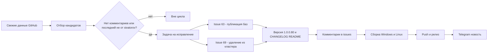

# План исправлений для версии v1.0.0.80

Репозиторий: https://github.com/sivatorov/Workspace1C
Рабочая копия: `g:/h/Workspace1C` (ветка `main`)
Текущая версия: **v1.0.0.79** (релиз опубликован 2026-10-26 17:24 UTC) → целевая: **v1.0.0.80** (увеличиваем ТОЛЬКО последнее число; в [`Workspace1C.csproj`](Workspace1C/Workspace1C.csproj) четыре тега: `Version`/`AssemblyVersion`/`FileVersion`/`InformationalVersion`).

## Правило отбора

Проанализированы **все 6 открытых issues** (данные GitHub API от 2026-10-26 18:10 UTC). В работу берутся только те, где **нет комментариев** или **последний комментарий НЕ от `sivatorov`**. Issues **не закрываем** — только комментарий «Исправлено в 1.0.0.80 …».

| Issue | Название | Последний комментарий | Решение |
|-------|----------|----------------------|---------|
| #69 | Удаление из кластера | @7OH 14:39 «Удаляет, но не каждый раз… этого диалога вообще быть не должно. Тип субд в удаляемой базе явно же прописан?» | **Исправляем** |
| #63 | Доработка публикации баз | @7OH 14:59 (алгоритм: только используемый файл алиасов из Include-строки, `Listen "80${OneCPort}"` → 8027, `DocumentRoot "${SRVROOT}/htdocs/${OneCPort}"` → …/htdocs/27) | **Исправляем** |
| #57 | Общая авторизация | @sivatorov 17:08 (подтверждено пользователем) | вне цикла |
| #55 | Поправить формы и элементы | @sivatorov 17:08 (фикс 1.0.0.79) | вне цикла |
| #41 | Миграция баз | @sivatorov 17:08 (фикс 1.0.0.79) | вне цикла |
| #26 | Акцентные цвета/контрастность | @sivatorov 17:08 (фикс 1.0.0.79) | вне цикла |

## Принципы

1. **Двухплатформенность.** Каждая правка — WPF (Windows) и Avalonia (Linux): чистая логика (сервисы/VM/парсеры) общая + юнит-тесты; представления — парные файлы `*.xaml`/`*.xaml.cs` и `*.axaml`/`*.Avalonia.cs`.
2. **Тесты-стражи.** После каждой правки — юнит-тесты в `Workspace1C.Tests/` по образцу существующих (`Apache27ConfRegressionTests`, `WebPublishIssue63Tests`, `ServerMonitorViewModelTests`, `Issue69DropRetryWindowLayoutTests`).
3. **Обратная совместимость.** Не ломать старые конфиги и локализацию ru/en.
4. **Issues не закрываются** — фиксируем факт в комментариях и release notes.
5. **Версия** увеличивается один раз на цикл: 1.0.0.79 → **1.0.0.80**.
6. **Каждый пункт — в новой задаче** (`new_task`), планирование — в режиме Архитектора.

---

## Задача A (новая задача, режим code): Issue #63 — «Доработка публикации баз»

### Требования (последние комментарии 7OH от 2026-10-26 14:38 и 14:59)

1. «Блин - вообще не то. Зачем мне все файлы алиасов? В файле подключён конкретный файл алиасов — один. Его можно найти в строках с include. Вот его и ожидаем увидеть — только тот, который используется. Тем более после выбора одного — всё равно лажа на экране — папка публикации так и не подставилась корректно, порт тоже».
2. Ожидаемый алгоритм (из комментария 14:59, фикстуры — `TestData/Apache27Conf`):
   - открываем конфиг службы (`httpd27.conf`), запоминаем `Define`;
   - включаем `Include conf/httpd.conf`, запоминаем его `Define`;
   - `DocumentRoot "${SRVROOT}/htdocs/${OneCPort}"` → `c:/Apache/Apache24/htdocs/27`;
   - `Listen "80${OneCPort}"` → порт `8027`;
   - `Include "${SRVROOT}/conf/1c8Aliases${OneCPort}.conf"` → файл `c:/Apache/Apache24/conf/1c8Aliases27.conf` — **единственный** файл алиасов в списке ConfTargets.

### Текущий код

- [`WebPublishViewModel.BuildConfTargets`](Workspace1C/ViewModels/WebPublishViewModel.cs:260) — список: основной конфиг службы + все `IncludeFiles` графа + **fallback `FindAliasFilesNear`** (все `1c8Aliases*.conf` из каталога конфига, `conf\aliases`, `ServerRoot\...`) — это и есть «куча файлов алиасов».
- [`WebPublishViewModel.ApplyCurrentServerDefaults`](Workspace1C/ViewModels/WebPublishViewModel.cs:225) — вызывается при выборе инстанса; при смене `ConfTargetIndex` (выбор файла webinst) каталог публикации/порт/URL, вероятно, не пересчитываются.
- [`ApacheInstanceDetector.PopulateIncludes`](Workspace1C/Services/ApacheInstanceDetector.cs:162) — итеративный граф Include с общим `MergeDefines`; `ParseIncludeTargets` уже раскрывает `${...}`.
- [`ApacheConfIncludeParser.ParseListenPorts`](Workspace1C/Services/ApacheConfIncludeParser.cs:219) — `ExpandVariables("80${OneCPort}")` после `TrimQuotes` должен давать `8027`; проверить на фикстурах.

### Конкретные правки

1. **Только используемый файл алиасов.** В `BuildConfTargets` не добавлять все `1c8Aliases*.conf` через fallback: если в графе Include (после раскрытия переменных) есть файл алиасов — показать только его. Fallback (`FindAliasFilesNear`) использовать только при отсутствии алиасов в графе и ограничить **одним** файлом, совпадающим с Include-строкой конфига службы (например, по имени `1c8Aliases<n>` из `Listen`/`Define OneCPort`).
2. **Регресс-тест на Include с переменными в середине строки** (`${SRVROOT}/conf/1c8Aliases${OneCPort}.conf`) → путь `1c8Aliases27.conf` попадает в `IncludeFiles` и в ConfTargets.
3. **Пересчёт каталога публикации и порта/URL** при выборе инстанса и при смене ConfTarget (файла webinst): каталог — `DocumentRoot` инстанса, порт — из `Listen` (с учётом раскрытия `80${OneCPort}`), URL — `http://localhost:<port>/<name>/`.
4. **Значения по умолчанию — только из конфига службы и его include-графа** (не из дефолтного `httpd.conf`).
5. **Тесты:** `ApacheConfIncludeParserTests` (+`Listen "80${OneCPort}"`, `Include` с литералами+переменными), `Apache27ConfRegressionTests` (реальные `httpd27.conf`/`httpd.conf`/`1c8Aliases27.conf`), `WebPublishIssue63Tests` (в списке ровно один файл алиасов — используемый; каталог `…/htdocs/27`; URL с портом `8027`).

### Риски

- Убрать fallback полностью — на некоторых конфигах (маска `aliases/*.conf` вне графа) файл алиасов пропадёт: сохранить fallback, но только **один** файл, приоритет — Include-графу.
- Не сломать `WebPublishService.Validate` и поток публикации (контракт не меняется).

---

## Задача B (новая задача, режим code): Issue #69 — «Удаление из кластера»

### Требования (последние комментарии 7OH от 2026-10-26 14:32 и 14:39)

1. «Удаляет, но не каждый раз. Диалог появился (с ошибкой блокировки заданий), причём на заднем плане (а должен быть по идее поверх текущего)».
2. «Этого диалога вообще быть не должно. Тип СУБД в удаляемой базе явно же прописан - да?»

### Текущий код

- [`ServerMonitorViewModel.DropSelectedInfobaseAsync`](Workspace1C/ViewModels/ServerMonitorViewModel.cs:717) — цикл повтора; при `answer.BlockScheduledJobs` → `SetScheduledJobsBlockAsync` → при неудаче `ShowWarningOnUi(BlockFailed)` (строка 777) + `continue`.
- [`ServerMonitorViewModel.SetScheduledJobsBlockAsync`](Workspace1C/ViewModels/ServerMonitorViewModel.cs:961) — строит `RacInfobaseUpdateRequest { Dbms = row.Dbms, DbServer = row.DbServer, DbName = row.DbName, ScheduledJobsDeny = true }` из сводки `summary list`.
- [`RacClient.BuildUpdateArgs`](Workspace1C/Services/RacClient.cs:623) — **бросает `ArgumentException("Не указан тип СУБД.")`, если `Dbms` пуст** → блокировка не ставится → «диалог с ошибкой блокировки заданий» (предупреждение + снова диалог повтора).
- [`ServerMonitorViewModel.ShowWarningOnUi`](Workspace1C/ViewModels/ServerMonitorViewModel.cs:1671) — `_dialogs.ShowWarning` без явного Owner активного окна → предупреждение может оказаться «на заднем плане» относительно окна «Серверы 1С».
- WPF-диалог повтора [`ServerMonitorWindow.xaml.cs:78`](Workspace1C/Views/ServerMonitorWindow.xaml.cs:78) — `Owner = this` (окно монитора) — корректно; Avalonia — `ShowSync(this)` — корректно.

### Конкретные правки

1. **Гарантированное получение параметров СУБД перед «infobase update»**: если `row.Dbms/DbServer/DbName` пусты — догрузить через `GetInfobaseInfoAsync` (`infobase info`, метод уже есть) и использовать их для запроса блокировки; не вызывать `BuildUpdateArgs` с пустым `Dbms` (исключение превращается в понятную ошибку).
2. **Не показывать лишний отдельный диалог**: неудачу установки блокировки РЗ показывать строкой в диалоге повтора (или в статус-строке), а не отдельным `ShowWarningOnUi`-окном; цикл повтора отрабатывает как задумано («Повторная попытка удаления не удалась…»).
3. **Диалоги поверх активного окна**: `ShowWarningOnUi`/`_dialogs.ShowWarning` и диалог повтора должны открываться поверх активного окна приложения (WindowOwnerResolver или передача Owner окна монитора серверов) — WPF и Avalonia.
4. **«Удаляет, но не каждый раз»** — проверить поведение после установки блокировки: после успешной блокировки цикл должен сразу продолжить «снять сеансы → drop»; при «не каждый раз» убедиться, что повторная попытка drop выполняется автоматически без лишних диалогов.
5. **Тесты:** `ServerMonitorViewModelTests` (блокировка с пустыми Dbms в summary — параметры догружаются через infobase info; без отдельного предупреждения; цикл не прерывается), `RacClientTests` (update без пустого `--dbms=` → понятная ошибка вместо ArgumentException), `Issue69DropRetryWindowLayoutTests`.

### Риски

- `infobase info` требует креды администратора ИБ для защищённых баз: если догрузка не прошла — аккуратный fallback без исключения.
- Не изменить формат диалога повтора (логин/пароль сохраняются между попытками — уже реализовано в 1.0.0.77).

---

## Задача C (новая задача, режим code): Релизный цикл 1.0.0.80

Выполняется ПОСЛЕ задач A и B (они не меняют версию).

1. **Версия** 1.0.0.79 → **1.0.0.80** в [`Workspace1C.csproj`](Workspace1C/Workspace1C.csproj) (4 тега).
2. **CHANGELOG.md** — раздел `[1.0.0.80]` (Добавлено/Исправлено по #63 и #69, ссылки на файлы, тесты).
3. **README.md** — бейдж версии и текст «актуальная версия — 1.0.0.80».
4. **Комментарии в issues** #63 и #69: «Исправлено в версии 1.0.0.80 (Windows и Linux)…» со ссылкой на релиз. Issues **не закрывать**.
5. **Сборка исполняемых файлов** для Windows (WPF) и Linux (Avalonia) — по образцу релизных циклов 1.0.0.75–1.0.0.79 (single-file, самораспаковывающиеся/без .NET).
6. **Полный прогон юнит-тестов** (`dotnet test`).
7. **Push на GitHub** и **новый релиз** `v1.0.0.80` с артефактами `Workspace1C.exe`, `Workspace1C-linux-x64` (и `Workspace1C`), release notes из CHANGELOG.
8. **Telegram** — новость о релизе в канал **-1004425443528** (по образцу `_send_telegram_v*.ps1`, текст типа `_telegram_msg_v*.txt`).

### Риски

- GitHub Actions может сам публиковать артефакты (как в 1.0.0.77–79) — согласовать порядок загрузки артефактов до создания релиза.
- Сборка Linux (Avalonia) выполняется в CI или локально с .NET 10 SDK — использовать тот же подход, что в прошлых циклах.