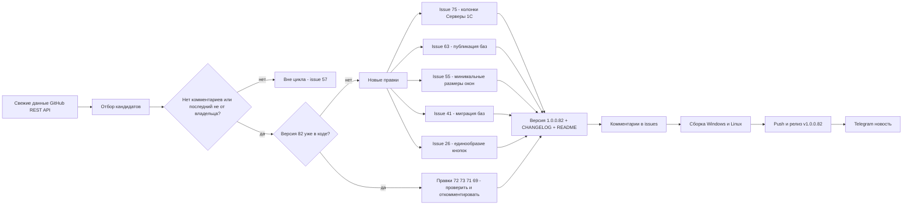
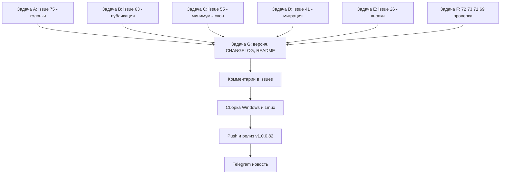

# План исправлений для версии v1.0.0.82

Репозиторий: https://github.com/sivatorov/Workspace1C
Рабочая копия: `g:/h/Workspace1C` (ветка `main`)
Последний опубликованный релиз: **v1.0.0.81** (опубликован 2026-10-27 08:05 UTC).
Рабочая копия **уже нацелена на v1.0.0.82**: в [`Workspace1C.csproj`](Workspace1C/Workspace1C.csproj:62) прописаны четыре тега `Version`/`AssemblyVersion`/`FileVersion`/`InformationalVersion` = `1.0.0.82`, в CHANGELOG уже открыт раздел `[1.0.0.82]` с правками #72, #73, #71 и последними правками #69. Релиз v1.0.0.82 ещё **не выпущен** — все новые правки этого цикла дополняют тот же 1.0.0.82.

## Правило отбора

Проанализированы **все 10 открытых issues** (данные GitHub REST API, собраны 2026-10-27 12:30 UTC — эквивалент `gh issue list --state open --json number,title,body,comments`). В работу берутся те, где **нет комментариев** или **последний комментарий НЕ от владельца** (`sivatorov`/`sivat`). Issues **не закрываем** — только комментарий «Исправлено в 1.0.0.82 …».

| Issue | Название | Комментарии → последний автор | Решение |
|-------|----------|------------------------------|---------|
| #75 | Серверы 1С - колонки | 0 комментариев (создан 27.10 10:42) | **Исправляем** (новая правка) |
| #73 | Запуск х86 из другого места | 0 комментариев | Код **уже в рабочей копии** (1.0.0.82): проверить + комментарий |
| #72 | Мультивыделение в серверы 1С | 0 комментариев | Код **уже в рабочей копии** (1.0.0.82): проверить + комментарий |
| #71 | Ширина 1.0.0.79 | 1 (7OH) | Код **уже в рабочей копии** (1.0.0.82): проверить + комментарий |
| #69 | Удаление из кластера | 14, последний **7OH** 26.10 20:36 | Код по последним 3 комментариям **уже в рабочей копии** (1.0.0.82): проверить + комментарий |
| #63 | Доработка публикации баз | 19, последний **7OH** 26.10 20:31 «А вот файла нужного … нет» | **Исправляем** (правка 1.0.0.80 не сработала у пользователя) |
| #55 | Поправить формы и элементы | 8, последний **ArtyoZ** 27.10 06:19 «зафиксировать минимальные высоту и ширину каждого окна» | **Исправляем** (полный аудит окон) |
| #41 | Миграция баз | 34, последний **7OH** 26.10 20:40 «имя первой базы не показывает… сортировать по имени… не закрывать окно» | **Исправляем** |
| #26 | Акцентные цвета и контрастность | 15, последний **ArtyoZ** 27.10 06:26 «сделать все кнопки единообразными» | **Исправляем** (единый стиль кнопок) |
| #57 | Общая авторизация | 5, последний **sivatorov** 26.10 17:08 (подтверждено) | **ПРОПУСК** — последний комментарий от владельца |

## Принципы

1. **Двухплатформенность.** Каждая правка — WPF (Windows) и Avalonia (Linux): чистая логика (сервисы/VM/парсеры) общая + юнит-тесты; представления — парные файлы `*.xaml`/`*.xaml.cs` и `*.Avalonia.cs`/`*.axaml`.
2. **Тесты-стражи.** После каждой правки — юнит-тесты в `Workspace1C.Tests/` по образцу существующих (`Issue55WindowLayoutTests`, `Issue55AdaptiveLayoutTests`, `Issue41WindowLayoutTests`, `Issue71SettingsWindowLayoutTests`, `Issue63InputBackgroundBrushTests`, `WebPublishIssue63Tests`, `Apache27ConfRegressionTests`, `ThemeContrastRegressionTests`).
3. **Обратная совместимость.** Не ломать старые конфиги (`settings.json`, JSON-макеты колонок), XML-локализации ru/en, пользовательские настройки.
4. **Issues не закрываются** — фиксируем факт исправлений комментариями (`_issue*_comment*.md` по образцу) и release notes.
5. **Версия уже поднята** до 1.0.0.82 в рабочей копии — дополнительно версию НЕ увеличиваем; CHANGELOG-раздел дополняется новыми записями текущего цикла.
6. **Каждый пункт — в отдельной задаче** (`new_task`), планирование — в режиме Архитектора.

---

## Задача A (новая задача, режим code): Issue #75 — «Серверы 1С - колонки» (без комментариев, правки по описанию) · объём L

### Требования (текст описания #75)

1. Колонки во вкладках **Сеансы, Соединения, Блокировки и Рабочие процессы** должны иметь по умолчанию размер, достаточный для отображения самого заголовка и пиктограммы направления сортировки.
2. В текущей реализации это невозможно — нужно включить **горизонтальную прокрутку**, чтобы колонка могла уходить за границу окна (для инструмента это нормально).
3. **Сохранять размеры колонок на каждой вкладке** — желательно, чтобы сохранение переживало закрытие программы.

### Текущий код

- [`ServerMonitorWindow.xaml`](Workspace1C/Views/ServerMonitorWindow.xaml:486) — `TabControl` с четырьмя DataGrid: `SessionsGrid` (строка 504), `ConnectionsGrid` (592), `LocksGrid` (645), `ProcessesGrid` (692). Колонки заданы жёстко: `Width="1.2*"`, `Width="110"`, `Width="150"` и т.д. — часть колонок «звёздные», часть фиксированные; для заголовка+стрелки сортировки ширины недостаточно.
- Сортировка и ручки изменения ширины: [`ServerMonitorWindow.xaml.cs`](Workspace1C/Views/ServerMonitorWindow.xaml.cs:209) (`OnGridSorting`), WPF-шаблон `ColumnHeaderGripper` ([`ServerMonitorWindow.xaml`](Workspace1C/Views/ServerMonitorWindow.xaml:38)); `CanUserResizeColumns="True"` (строки 509, 597).
- Avalonia: [`ServerMonitorWindow.Avalonia.cs`](Workspace1C/Views/ServerMonitorWindow.Avalonia.cs) — те же вкладки/колонки.
- Данные и модели строк: [`ServerMonitorViewModel.cs`](Workspace1C/ViewModels/ServerMonitorViewModel.cs:505) (`SelectedSessions`), модели `RacSessionRow`/`RacConnectionRow`/`RacLockRow`/`RacProcessRow`.
- Готовый паттерн сохранения ширин колонок: [`MainWindow.Columns.cs`](Workspace1C/Views/MainWindow.Columns.cs:1346) (`SaveColumnWidths`), [`MainWindow.Columns.cs`](Workspace1C/Views/MainWindow.Columns.cs:759) (`ApplySavedColumnWidths`), методы `*ColumnWidth` модели (`MainViewModel.UpdateColumnWidths`) — переиспользовать для хранилища размеров.

### Конкретные правки

1. **Минимальные/дефолтные ширины по содержимому заголовка.** Для каждой DataGrid (и её Avalonia-аналога) установить колонкам `MinWidth`/`Width` так, чтобы заголовок + стрелка сортировки помещались (например, `DataGridTextColumn.Width = DataGridLength.SizeToHeader` с `MinWidth` на текст заголовка; в WPF — через `MinWidth` колонки, в Avalonia — `DataGridColumn.MinWidth`). Не использовать «голые» `*` для узких колонок.
2. **Горизонтальная прокрутка.** Убедиться, что у DataGrid доступна горизонтальная прокрутка (`HorizontalScrollBarVisibility="Auto"` у `ScrollViewer` в шаблоне или у контейнера), чтобы колонки могли уходить за границу окна; окно не «схлопывается» и не растягивает колонки насильно.
3. **Сохранение размеров колонок по вкладкам.** Новое хранилище: `ServerMonitorColumnWidths` (например, в `AppSettings`/`settings.json`; по образцу хранения ширин главного списка). Структура: `Dictionary<string, double[]>` по имени вкладки (`Sessions`, `Connections`, `Locks`, `Processes`) → массив фактических ширин колонок. Сохранять при изменении ширины (`ColumnReordering`/`TargetUpdated`/`SizeChanged` грида с дебаунсом), восстанавливать при загрузке/переключении вкладки — WPF и Avalonia.
4. **Синхронизация WPF/Avalonia.** Модель/сервис хранения общий (тестируемый), представления парные.

### Тесты

- `Issue75ServerMonitorColumnsTests` (новый): юнит-тесты хранилища (сохранение/восстановление по вкладкам, отсутствие потери при отсутствии записи), разметочные проверки WPF XAML и Avalonia (у колонок установлены `MinWidth`, грид допускает горизонтальную прокрутку), регресс «сохранённые ширины применяются».

### Риски

- Звёздные колонки (`Width="*"`) в WPF DataGrid не позволяют «уходить за границу» — при переходе на абсолютные ширины по-умолчанию проверить окно на разных DPI/узких экранах.
- Пересечение с #55/#71 (минимальные размеры окна): окно монитора серверов не должно одновременно «запрещать сужение» и «требовать прокрутку» — при сужении окна должна появляться именно горизонтальная прокрутка колонок.
- Avalonia DataGrid vs ListView: проверить фактический контроль в `.Avalonia.cs` и адаптировать API.

---

## Задача B (новая задача, режим code): Issue #63 — «Доработка публикации баз» (последний комментарий НЕ от владельца, 7OH 26.10 20:31) · объём M

### Требования (последний комментарий 7OH 20:31)

«Вроде и я всё расписал (… #issuecomment-6419272270) и в описании изменений всё красиво. А вот **файла нужного и как следствие портов и каталогов — нет**». Правка 1.0.0.80 (в CHANGELOG «в списке ConfTargets только используемый файл алиасов») **не сработала**: пользователь по-прежнему не видит в списке файл `1c8Aliases27.conf`, не подставляется каталог публикации `…\htdocs\27` и порт `8027`.

### Текущий код

- [`WebPublishViewModel.cs`](Workspace1C/ViewModels/WebPublishViewModel.cs) — `BuildConfTargets` (около строки 260), `ApplyCurrentServerDefaults` (225), `FindAliasFilesNear` (fallback).
- [`ApacheInstanceDetector.cs`](Workspace1C/Services/ApacheInstanceDetector.cs) — `PopulateIncludes`, `TryExpandWildcard`, сборка `IncludeFiles`/`DocumentRoot`/`ListenPorts` из конфигов службы.
- [`ApacheConfIncludeParser.cs`](Workspace1C/Services/ApacheConfIncludeParser.cs) — `ParseDefines`/`MergeDefines`/`ExpandVariables`, `ParseDocumentRoot`, `ParseListenPorts`.
- Фикстуры реальных конфигов: `Workspace1C.Tests/TestData/Apache27Conf` (`httpd27.conf`, `httpd.conf`, `1c8Aliases27.conf`) — созданы по архиву пользователя; регресс-тесты [`Apache27ConfRegressionTests.cs`](Workspace1C.Tests/Apache27ConfRegressionTests.cs).

### Конкретные правки

1. **Воспроизвести сценарий 7OH**: конфиг службы `httpd27.conf` с `Include conf/httpd.conf` и `Include "${SRVROOT}/conf/1c8Aliases${OneCPort}.conf"`; ожидание — в `ConfTargets` попадает ровно `1c8Aliases27.conf` (один файл). Если включение с `${...}` в середине пути не резолвится — исправить парсер/детектор (проверить порядок `Define`-графа, кавычки, экранирование `\` в Windows-пути).
2. **Пересчёт каталога публикации и порта/URL при выборе ConfTarget** и при выборе инстанса: `DocumentRoot "${SRVROOT}/htdocs/${OneCPort}"` → `c:/Apache/Apache24/htdocs/27`; `Listen "80${OneCPort}"` → `8027`; URL `http://localhost:8027/<imya>/`. Проверить, что `ApplyCurrentServerDefaults` обновляет каталог/порт при смене ConfTargetIndex, а не только при выборе инстанса.
3. **Fallback «FindAliasFilesNear»** — не должен подмешивать «кучу» файлов алиасов: если в Include-графе найден файл алиасов — показывать только его; fallback — только один файл, согласованный с именем из Include-строки.
4. **Никаких сырых `${...}` в UI** — если переменная не раскрыта, не показывать строку с `${...}` (защита уже была в 1.0.0.76, проверить после правок).

### Тесты

- `WebPublishIssue63Tests`: ConfTargets содержит ровно один файл алиасов (используемый из Include-графа); каталог публикации `…/htdocs/27`; порт/URL `8027`.
- `Apache27ConfRegressionTests` — расширить фикстуры реальным случаем 7OH из комментария 20:31 (если конфиг отличается от присланного архива — запросить у пользователя и зафиксировать как регресс-фикстуру).
- `ApacheConfIncludeParserTests` — Include с переменными в середине пути, `Listen "80${OneCPort}"`, DocumentRoot с `${...}`.

### Риски

- Слишком радикальное ограничение fallback может убрать файл алиасов на конфигурациях без Include-переменных — оставить fallback только при отсутствии файла в графе.
- Не менять контракт `WebPublishService.Validate` и flow публикации.

---

## Задача C (новая задача, режим code): Issue #55 — «Поправить формы и элементы» (последний комментарий НЕ от владельца, ArtyoZ 27.10 06:19) · объём L

### Требования (последний комментарий ArtyoZ 06:19)

«**Не подтверждаю. Проблема актуальна. Нужно зафиксировать минимальные высоту и ширину каждого окна и запретить дальнейшее уменьшение размера окна, если минимумы достигнуты.**» (скриншот «Настройки» 548×720). Ранее в 1.0.0.77/79/82 делались точечные правки (MinWidth в `SettingsWindow.xaml` 960×720 — уже есть, `ConnectionSettingsWindow` 760×780 — запись #71), но пользователь требует **единый аудит всех окон**.

### Текущий код

- Уже исправлено в 1.0.0.82 (issue #71): [`SettingsWindow.xaml`](Workspace1C/Views/SettingsWindow.xaml:14) (`MinWidth=960`, `MinHeight=720`, `HorizontalScrollBarVisibility="Disabled"`), [`ConnectionSettingsWindow.xaml`](Workspace1C/Views/ConnectionSettingsWindow.xaml) (760×780) и их Avalonia-пары — покрыто [`Issue71SettingsWindowLayoutTests.cs`](Workspace1C.Tests/Issue71SettingsWindowLayoutTests.cs).
- Все окна приложения: каталог [`Workspace1C/Views/`](Workspace1C/Views/) — более 120 парных файлов окон (WPF `*.xaml` + Avalonia `*.Avalonia.cs`/`*.axaml`). Аудит по образцу [`Issue55WindowLayoutTests.cs`](Workspace1C.Tests/Issue55WindowLayoutTests.cs), [`Issue55AdaptiveLayoutTests.cs`](Workspace1C.Tests/Issue55AdaptiveLayoutTests.cs).

### Конкретные правки

1. **Полный аудит форм**: пройтись по всем окнам WPF (`Window … MinWidth/MinHeight` в XAML) и Avalonia (`MinWidth/MinHeight` в коде представлений — например, в конструкторах `*.Avalonia.cs`, по образцу [`SettingsWindow.Avalonia.cs`](Workspace1C/Views/SettingsWindow.Avalonia.cs)); убедиться, что ни одно окно нельзя сжать мышкой до обрезания контента.
2. **Запрет сужения ниже минимума**: в WPF это штатное поведение `MinWidth`/`MinHeight` (после фикса #71); в Avalonia — убедиться, что `MinWidth`/`MinHeight` действительно применяются и не обходятся `SizeToContent`/пересчётом раскладки.
3. **Список окон для аудита** (приоритетные, где были жалобы #55/#71): `SettingsWindow`, `ConnectionSettingsWindow`, `ServerMonitorWindow`, `PlatformChangeWindow`, `GroupPickerWindow`, `RacInfobaseCreateWindow`, `RacInfobasePropertiesWindow`, `WebPublishWindow`, `ClusterImportWindow`, `ClusterMigrationWindow`, `ScriptScenarioEditWindow`, `MetadataExplorerWindow` и остальные по каталогу.
4. Проверить, что правки не ломают горизонтальной раскладки вкладок (стратегия #71: «минимальные размеры + запрет сужения», горизонтальная прокрутка вкладок отключена).

### Тесты

- Расширить `Issue55WindowLayoutTests`/`Issue55AdaptiveLayoutTests`: разметочные проверки, что у каждого окна в `Workspace1C/Views/*.xaml` заданы `MinWidth`+`MinHeight`, а в `*.Avalonia.cs` — соответствующие `MinWidth`/`MinHeight`; регресс существующих кейсов (Настройки, Настройка ИБ).
- Отдельный аудит-тест «все окна каталога Views имеют минимумы» (перечислением файлов или конвенцией).

### Риски

- Часть окон намеренно маленькие (диалоги, пикеры) — минимум должен быть меньше дефолтного размера, чтобы окно могло открываться, но не сужаться до «обрезания».
- Дублирование с уже сделанными правками #71/#55 (1.0.0.77–82) — перед правкой сверить CHANGELOG 1.0.0.82, чтобы не переделывать.

---

## Задача D (новая задача, режим code): Issue #41 — «Миграция баз» (последний комментарий НЕ от владельца, 7OH 26.10 20:40) · объём M

### Требования (последний комментарий 7OH 20:40)

1. **Имя первой базы при обработке не показывается** — «первая без имени — просто "1 из 3"... такое впечатление, что имя появляется не при начале обработки, а в конце. Просьба проверить».
2. **Сортировка списка баз по имени сразу** при чтении (просьба).
3. **В конце не закрывать окно** — «при наличии ошибок … спросило про замену строк — я отказался и окно закрылось. А как же ошибки посмотреть? … возможно базы будут раскидываться по разным серверам — чтобы не открывать заново — закрывать окно не надо».

### Текущий код

- [`ClusterMigrationViewModel.cs`](Workspace1C/ViewModels/ClusterMigrationViewModel.cs:505) — `CurrentBaseName`, `ProgressIndex`/`ProgressTotal`, `ProgressText`; `MigrateAsync` (около строки 1005): в начале прогона `CurrentBaseName = string.Empty` (строка 1114), затем в цикле `ProgressIndex = processed; CurrentBaseName = name; ProcessedCount = processed;` (строки 1124–1126) — имя, судя по репорту, устанавливается и сбрасывается в неверном порядке относительно реальной обработки баз.
- [`ClusterMigrationWindow.xaml.cs`](Workspace1C/Views/ClusterMigrationWindow.xaml.cs:144) — `OnMigrationCompleted()`: подытог → `DialogResult = true; Close();` (строки 156–157) — окно закрывается по завершении.
- Сортировка: при загрузке списка баз источника — проверить, где формируется `SourceRows`/`Rows` (метод загрузки в `ClusterMigrationViewModel`); сортировки по Name нет в поиске.

### Конкретные правки

1. **Имя текущей базы показывать ДО начала её обработки**: устанавливать `CurrentBaseName` и `ProgressIndex` непосредственно перед вызовом асинхронной операции по базе (и не сбрасывать в `string.Empty` в середине прогона); погасить UI-сообщение через `PropertyChanged` на UI-поток (существующий `Dispatch` уже есть). Проверить, что для первой базы имя видно сразу («1 из 3: База»).
2. **Сортировка баз по имени** при загрузке/получении списка источника (и, при необходимости, при «Получить статусы»): `OrderBy(Name, StringComparer.OrdinalIgnoreCase)` — стабильно и для русских имён; тесты на порядок.
3. **Не закрывать окно по завершении**: убрать `Close()` из `OnMigrationCompleted` (или закрывать только при полном успехе без ошибок по явному решению); после завершения миграции окно остаётся открытым: ошибки видны в статусах строк, доступна кнопка «Мигрировать» повторно и «Закрыть». Диалог «Заменить строки подключения?» остаётся, но не сопровождается закрытием окна; Avalonia-пара (`ClusterMigrationWindow.Avalonia.cs`) — синхронно.
4. Локализация (ru/en) новых подсказок, если меняется текст статуса.

### Тесты

- `ClusterMigrationViewModelTests`: (а) имя первой базы установлено до начала операции; (б) список баз отсортирован по имени; (в) после миграции с ошибками окно не закрывается (аналог существующего `Migrate_CreateFailure_RefreshesTargetStatusesAutomatically` — добавить проверку `CloseRequested`/флага).
- `Issue41WindowLayoutTests` — при необходимости разметочные.

### Риски

- Закрытие окна по завершении — ожидаемое поведение пользователя ранее; «не закрывать» может накапливать изменённые статусы — убедиться в пересчёте статусов приёмника после каждого прогона (уже есть в 1.0.0.74/76).
- Не сломать поток «успешная миграция → вопрос о замене строк → закрытие» для полностью успешного случая (по желанию закрывать при 0 ошибок).

---

## Задача E (новая задача, режим code): Issue #26 — «Акцентные цвета и контрастность, единообразие кнопок» (последний комментарий НЕ от владельца, ArtyoZ 27.10 06:26) · объём M

### Требования (последний комментарий ArtyoZ 06:26)

«Не подтверждаю. Может проще (и правильнее) **сделать все кнопки единообразными по всему приложению**? А то сейчас в `Настройках` один вариант отображения, в `Сменить платформу` другой, в `Выбор родительской группы` третий… и это я ещё не все формы пересмотрел». (скриншот — кнопки с разным стилем/контрастом).

### Текущий код

- Стили кнопок уже есть, но «разнобой»: [`LightTheme.xaml`](Workspace1C/Themes/LightTheme.xaml:80) (`ModernButton`: акцентный фон), [`DarkTheme.xaml`](Workspace1C/Themes/DarkTheme.xaml:79), `SecondaryButton` ([`DarkTheme.xaml`](Workspace1C/Themes/DarkTheme.xaml:113)), `Avalonia Controls.axaml` и `ThemeManager.cs`/`ThemeManager.Avalonia.cs` (кисти `AccentBrush`, `AccentTextBrush`, `TextOnAccentBrush`, `SidebarTextBrush`).
- Правки контрастности в 1.0.0.79: [`ThemeManager.cs`](Workspace1C/Themes/ThemeManager.cs) (пересчёт `TextOnAccentBrush` по WCAG), [`SettingsWindow.Schemes.cs`](Workspace1C/Views/SettingsWindow.Schemes.cs). Но пользователь не подтвердил — «в разных окнах кнопки выглядят по-разному».
- Разметочные тесты: [`ThemeContrastRegressionTests.cs`](Workspace1C.Tests/ThemeContrastRegressionTests.cs), [`Issue63InputBackgroundBrushTests.cs`](Workspace1C.Tests/Issue63InputBackgroundBrushTests.cs), [`ButtonThemeBindingTests.cs`](Workspace1C.Tests/ButtonThemeBindingTests.cs).

### Конкретные правки

1. **Аудит всех кнопок**: найти в `Views/*.xaml` кнопки с жёсткими `Foreground="White"`, собственными фонами/обводками, локальными стилями — особенно `SettingsWindow.xaml`, `PlatformChangeWindow.xaml`, `GroupPickerWindow.xaml`, `WebPublishWindow.xaml`, `ServerMonitorWindow.xaml`. Перевести их на единые `ModernButton`/`SecondaryButton`/новый `GhostButton` (если нужен контурный вариант) с контрастным текстом (кисти `AccentTextBrush`/`TextOnAccentBrush`).
2. **Единая палитра в обеих темах** (WPF Light/Dark + Avalonia Light/Dark): один набор кнопочных стилей, один набор кистей; `ThemeContrastRegressionTests` распространить на все окна с кнопками (аудит-тест перечислением).
3. **Авалония**: привести `Controls.axaml`/`ThemeManager.Avalonia.cs` к той же системе стилей; проверить кнопки, собранные кодом (`WpfUi.BoundButton` / Avalonia-аналоги).
4. Проверить, что акцентные кнопки в тёмной теме не «тёмно-янтарные с белым текстом» (пользовательские схемы) — текст должен вычисляться контрастно к акценту (существующий механизм 1.0.0.79), а фон всех акцентных кнопок единый.

### Тесты

- `ThemeContrastRegressionTests` (+аудит): каждая кнопка каталога Views использует либо `ModernButton`, либо `SecondaryButton` (нет жёстких `Foreground="White"` на акцентных заливках без `TextOnAccentBrush`), контраст ≥ 4.5:1 — расширить на WPF XAML и Avalonia.
- `ThemeFormLabelTests`/`ButtonThemeBindingTests` — обновить при необходимости.

### Риски

- «Единообразие» не должно стереть различие «основная/вторичная/опасная» кнопки (красная «Удалить», оранжевая акцентная) — сохранить семантику, унифицировать стиль, а не назначение.
- Большой объём правок по ~120 окнам — ограничить первой волной «окна с зафиксированными жалобами + все с кастомными стилями», затем аудит-тест заставит добрать остальные.

---

## Задача F (задача проверки/документации): уже внесённые правки #72, #73, #71, #69 (код в рабочей копии 1.0.0.82) · объём S

Код этих правок уже присутствует в рабочей копии и описан в CHANGELOG `[1.0.0.82]`. Требуется **верификация, при необходимости добить тесты, и комментарии** (issues не закрывать).

| Issue | Что проверяется | Ключевые места |
|-------|-----------------|----------------|
| #72 | Мультивыделение сеансов/соединений: `SelectionMode="Extended"`, `SelectedSessions`/`SelectedConnections`, кнопки действуют на все выбранные | [`ServerMonitorWindow.xaml`](Workspace1C/Views/ServerMonitorWindow.xaml:504), [`ServerMonitorViewModel.cs`](Workspace1C/ViewModels/ServerMonitorViewModel.cs:554) |
| #73 | Приоритет явной разрядности базы перед глобальной «X64», поиск 32-бит в пользовательских каталогах | [`OneCLauncher.cs`](Workspace1C/Services/OneCLauncher.cs:173) (`ResolveArchitecture`), [`OneCLauncher.Linux.cs`](Workspace1C/Services/OneCLauncher.Linux.cs) |
| #71 | Минимальные размеры «Настройки» 960×720 и «Настройка ИБ» 760×780, запрет сужения | [`SettingsWindow.xaml`](Workspace1C/Views/SettingsWindow.xaml:14), [`ConnectionSettingsWindow.xaml`](Workspace1C/Views/ConnectionSettingsWindow.xaml) |
| #69 | Разрыв соединений/сеансов перед каждым дропом, галочка блокировки РЗ при первом запросе, копирование флагов блокировок при миграции | [`ServerMonitorViewModel.cs`](Workspace1C/ViewModels/ServerMonitorViewModel.cs), [`RacInfobaseDropRetryWindow.xaml`](Workspace1C/Views/RacInfobaseDropRetryWindow.xaml), [`ClusterMigrationService.cs`](Workspace1C/Services/ClusterMigrationService.cs), [`RacClient.cs`](Workspace1C/Services/RacClient.cs) |

Действия: прогнать тесты (`ServerMonitorViewModelTests`, `OneCLauncherArchitectureTests`, `Issue71SettingsWindowLayoutTests`, `Issue69DropRetryWindowLayoutTests`, `ClusterMigrationServiceTests`), убедиться, что в `Workspace1C.Tests/` есть соответствующие тестовые классы; при отсутствии — добавить. После выхода релиза — комментарий «Исправлено в 1.0.0.82 (Windows и Linux)…» (шаблон `_issue*_comment_v100082.md`).

---

## Задача G (релизный цикл v1.0.0.82, режим code) — выполняется ПОСЛЕ задач A–F

1. **Версия**: уже `1.0.0.82` в [`Workspace1C.csproj`](Workspace1C/Workspace1C.csproj:62) (4 тега) — не меняем (проверить, что значение актуально).
2. **CHANGELOG.md** — дополнить раздел `[1.0.0.82]` записями по #75, #63, #55, #41, #26 (со ссылками на файлы и тесты); секции #72/#73/#71/#69 уже есть.
3. **README.md** — бейдж версии и текст «актуальная версия — 1.0.0.82» (по образцу прошлых циклов).
4. **Комментарии в issues** (#75, #63, #55, #41, #26, #72, #73, #71, #69): «Исправлено в версии 1.0.0.82 (Windows и Linux)…» со ссылкой на файлы/тесты и релиз. Issues **не закрывать**.
5. **Сборка исполняемых файлов** Windows (WPF) и Linux (Avalonia) — по образцу релизных циклов 1.0.0.75–1.0.0.81 (single-file, self-contained).
6. **Полный прогон тестов** (`dotnet test`) — 4552+ тестов зелёные.
7. **Push на GitHub** и создание **релиза `v1.0.0.82`** с артефактами `Workspace1C.exe`, `Workspace1C-linux-x64` (и `Workspace1C`), release notes из CHANGELOG (release body как `_rel_notes_v100082.md`).
8. **Telegram** — новость о релизе в канал **-1004425443528** (по образцу `_send_telegram_v100081.ps1`, текст `_telegram_msg_v100082.txt`).

### Риски релиза

- GitHub Actions может сам публиковать артефакты — согласовать порядок загрузки ассетов до публикации релиза (как в 1.0.0.77–81).
- Сборка Linux (Avalonia) в CI или локально .NET 10 SDK — использовать подход прошлых циклов.

---

## Очередность задач

## Итоговые deliverable

- Файлы кода и тестов по задачам A–F.
- Обновлённые `CHANGELOG.md`, `README.md`, `Workspace1C.csproj` (версия уже 1.0.0.82).
- Комментарии `_issue*_comment_v100082.md`, тексты `_rel_notes_v100082.md`, `_telegram_msg_v100082.txt`, `_send_telegram_v100082.ps1`.
- Опубликованный релиз `v1.0.0.82` + уведомление в Telegram.
