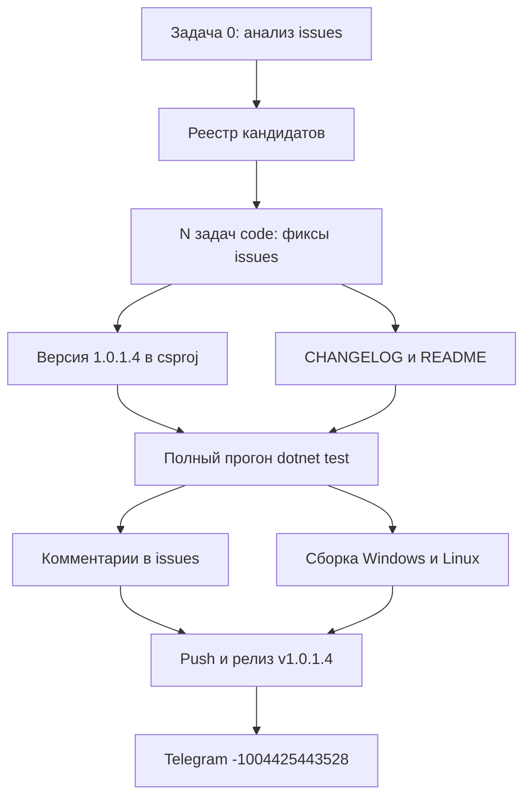

# План обработки GitHub issues — v1.0.1.4

Репозиторий: https://github.com/sivatorov/Workspace1C
Рабочая копия: `g:/h/Workspace1C` (ветка `main`)
Текущая версия: **1.0.1.3** (релиз v1.0.1.3 опубликован) → целевая: **1.0.1.4** (увеличиваем ТОЛЬКО последнее число).

Стратегия цикла (подтверждена пользователем): **один релиз v1.0.1.4 на все исправленные issues цикла** — версия поднимается один раз в конце, в [`CHANGELOG.md`](CHANGELOG.md) — один раздел `[1.0.1.4]`, одна сборка Windows + Linux, один релиз, одно Telegram-сообщение. Комментарий в каждый исправленный issue после фикса и до релиза.

На момент составления плана открыты 14 issues: **#89, #87, #85, #84, #83, #82, #81, #79, #75, #71, #63, #57, #55, #26**. Финальный список кандидатов определяется на этапе A по правилам отбора ниже (по данным о последних комментариях — раздел «Приложение»).

---

## Правила цикла (обязательные)

1. **Issues не закрываются.** После фикса — только комментарий «Исправлено в версии 1.0.1.4 (Windows и Linux): …» (файлы `_issue<NN>_comment_v10014.md`).
2. **Отбор:** обрабатываем только issues **без комментариев** (правки по описанию) или **с последним комментарием НЕ от владельца** `sivatorov` (ориентир — текст последнего комментария). Issues, где последний комментарий оставил владелец (подтверждение правки, вопрос ожидает ответа пользователя), в код-правки не берём.
3. **Версионирование:** только последнее число, один раз за цикл: `1.0.1.3` → `1.0.1.4` в четырёх тегах [`Workspace1C.csproj`](Workspace1C/Workspace1C.csproj:62) (`Version`/`AssemblyVersion`/`FileVersion`/`InformationalVersion`).
4. **Двухплатформенность:** каждая правка — WPF (Windows) и Avalonia (Linux); общая логика (сервисы/парсеры/VM) покрывается юнит-тестами в `Workspace1C.Tests/`; представления — парные файлы `*.xaml`/`*.xaml.cs` и `*.Avalonia.cs`/`*.axaml`.
5. **Обратная совместимость:** не ломать старые конфиги (`settings.json`, `tray_menu_layout.json`), XML/JSON-локализацию ru/en, сценарии.
6. **Каждый этап-правка — отдельная задача** (`new_task`), планирование и анализ — в режиме Архитектора/Ask, реализация — в режиме Code.

---

## Общая схема цикла



---

## Этап A — Анализ открытых issues (режим: Architect / Ask)

**Цель:** получить актуальный список открытых issues, определить кандидатов на исправление и зафиксировать требования по каждому.

Шаги:
1. Получить список открытых issues:
   - `gh api repos/sivatorov/Workspace1C/issues?state=open&per_page=100` (рекомендуется), либо повторный HTTP-запрос к `https://api.github.com/repos/sivatorov/Workspace1C/issues?state=open&per_page=100`.
   - Дамп сохранить как `_issues_raw_v10014.json` (по образцу прошлых `_issues_full.json` / `_issues_raw.json`).
2. Для каждого открытого issue получить комментарии:
   - `gh api repos/sivatorov/Workspace1C/issues/<N>/comments`.
   - Определить автора и текст **последнего** комментария (по `created_at`/`updated_at`).
3. Применить критерии отбора:
   - `comments == 0` → **КАНДИДАТ** (правки по тексту описания + скриншотам);
   - последний комментарий ≠ `sivatorov` → **КАНДИДАТ** (правки по последнему комментарию);
   - последний комментарий = `sivatorov` → **ПРОПУСТИТЬ** (ожидание реакции пользователя либо уже подтверждено);
   - пользователь написал «работает, спасибо» при отсутствии новых замечаний → **ПРОПУСТИТЬ** (при желании — упоминание в CHANGELOG в блоке «Подтверждено»).
4. Для каждого кандидата сформировать карточку: №, название, автор, суть замечания (последний комментарий / описание), файлы кода, которых это касается, и план правок (по образцу разделов плана `plan-issues-70-69-63-61-55-54-v100077.md`).
5. Сформировать итог: `_issues_analysis_v10014.md` (по образцу `_issues_analysis_v100074.md` / `_issues_summary_v100074.md`) со списком кандидатов и статусами «правки по описанию»/«правки по комментариям».
6. Передать в задачи этапа B точечные формулировки: что именно чинить, какой комментарий брать за основу.

Выход: реестр кандидатов; файл плана переименовывается в `plan-issues-<номера-кандидатов>-v10014.md` (номера проставляются по факту).

---

## Этап B — Исправления issues (режим: Code; на каждый issue — отдельная задача)

Порядок задач — в порядке приоритета (сначала свежие/без комментариев, затем по числу комментариев); каждый пункт выполняется в отдельной задаче `new_task` в режиме Code.

Для каждого кандидата внутри задачи:
1. Открыть issue (и скриншоты в нём — через страницу issue, при недоступности анонимной загрузки — `gh api` / локальный скрипт по образцу `_ocr_issue63.ps1`, `screenshots/`).
2. Локализовать код: найти соответствующие файлы (`Workspace1C/Views/`, `Workspace1C/ViewModels/`, `Workspace1C/Services/`).
3. Внести правки **сразу для обеих платформ** (WPF + Avalonia); рефакторинг общей логики — в shared-код с юнит-тестами.
4. Добавить юнит-тесты в `Workspace1C.Tests/` (имена по образцу: `Issue<NN>…Tests.cs`, разметочные/поведенческие тесты-стражи).
5. Обновить локализации `ru.json`/`en.json`, если меняются пользовательские тексты.
6. Дописать в [`CHANGELOG.md`](CHANGELOG.md:14) раздел `## [1.0.1.4] — <дата>` (создать, если ещё нет): пункт про конкретный issue со ссылками на файлы/тесты и меткой «Windows и Linux». Раздел заполняется по мере исправления каждого issue.
7. Коммит на каждую правку: `v1.0.1.4: #<N> <краткое описание>` (с юнит-тестами и локализацией в том же коммите).
8. Прогнать тесты по затронутым областям: `dotnet test Workspace1C.Tests` (фильтр при необходимости).

**Примечания по известным кандидатам (из снимка 2026-10-29, уточняются на этапе A):**
- **#89** «Скачивание EXE на Линукс» (7OH) — **0 комментариев** → кандидат по описанию: автообновление на Linux скачивает `Workspace1C.exe` вместо Linux-файла; проверить [`GitHubReleaseService`](Workspace1C/Services/GitHubReleaseService.cs) и выбор asset'а по ОС.
- **#87** «Загрузка расширения в клиент-серверную базу» (aepkugesi) — фиксился в 1.0.1.3 (уже в [`CHANGELOG.md`](CHANGELOG.md:18)); если после релиза появился комментарий пользователя «всё ещё не работает» → доработать; иначе пропустить и упомянуть в «Подтверждено».
- **#85, #84, #83, #82, #81, #79, #75, #71, #63, #57, #55, #26** — анализируются по последним комментариям (свежие обновления 19:41–19:58 UTC 29.10.2026 у #83/#81/#79/#75/#71/#55/#26 говорят о высокой вероятности новых замечаний пользователей).

---

## Этап C — Версия 1.0.1.4 + CHANGELOG + README (режим: Code)

Одна задача «Финализация версии и документации» — после всех фиксов, ДО комментариев/сборки:

1. **Версия:** [`Workspace1C.csproj`](Workspace1C/Workspace1C.csproj:62) — четыре тега `Version`/`AssemblyVersion`/`FileVersion`/`InformationalVersion`: `1.0.1.3` → **`1.0.1.4`**. (Комментарий ‘«0.3.1.1»…’ в csproj не трогать.)
2. **CHANGELOG.md:** секция `## [1.0.1.4] — <дата>` (дата — день релиза, например 2026-10-30) над `## [1.0.1.3]`, в формате существующих: `### Исправлено / Добавлено` + `### Тесты`, по всем исправленным issues, со ссылками на [`Workspace1C/`](Workspace1C/Workspace1C.csproj:1) файлы и тесты; при наличии подтверждённых пользователем issue — блок «Подтверждено».
3. **README.md:**
   - строка 3: бейдж `Версия-1.0.1.3-1F6FEB` → `Версия-1.0.1.4-1F6FEB`;
   - строка 11: «актуальная версия — **1.0.1.3**» → «**1.0.1.4**»;
   - количество тестов (строка 12) — по факту после прогона.
4. **Контроль:** поиск `1\.0\.1\.3` должен дать только исторические упоминания (CHANGELOG прошлых версий, комментарии в коде); `VersionInfo.cs` не трогаем (версию читает динамически).
5. Коммит: `v1.0.1.4: версия 1.0.1.3 → 1.0.1.4, CHANGELOG и README`.

---

## Этап D — Комментарии в issues (режим: Code)

Одна задача после коммитов фиксов и версии, **до релиза**:
1. Для каждого исправленного issue подготовить файл `_issue<NN>_comment_v10014.md` по образцу [`_issue84_comment_v1001012.md`](_issue84_comment_v1001012.md:1): заголовок «Исправлено в версии **1.0.1.4** (Windows и Linux): …», список правок со ссылками на файлы, перечень тестов, ссылка на релиз (добавляется после публикации или в момент комментария — допускается составить текст заранее, ссылку дописать при публикации).
2. Опубликовать через GitHub CLI:
   - `gh api repos/sivatorov/Workspace1C/issues/<N>/comments -f body@_issue<NN>_comment_v10014.md`
   - либо `gh issue comment <N> --body-file _issue<NN>_comment_v10014.md`.
3. Issues **НЕ закрывать** (не использовать `gh issue close`).

---

## Этап E — Сборка исполняемых файлов (режим: Code; пункты E1 и E2 — две отдельные задачи)

### E1. Windows (WPF, self-contained single-file)
- Локальная сборка по образцу [`_publish_v10013.cmd`](_publish_v10013.cmd:1): `powershell -NoProfile -ExecutionPolicy Bypass -File tools\publish-release.ps1 -Version 1.0.1.4 -Sha <sha>` (создать `_publish_v10014.cmd` с актуальным SHA коммита).
  - Примечание: каталог `tools/` в `.codeassistantignore`; если `tools\publish-release.ps1` недоступен — использовать [`build-windows-single-file.ps1`](Workspace1C/build-windows-single-file.ps1):
    `.\build-windows-single-file.ps1 -Configuration Release` → `Workspace1C/dist/win-x64/Workspace1C.exe`.
- Подготовить артефакт в `dist/release/Workspace1C.exe` (копия из `dist/win-x64/`).
- Контроль: запуск exe, версия в заголовке окна `1.0.1.4`, файл один (single-file).

### E2. Linux (Avalonia, self-contained single-file)
- На Linux-хосте: `./build-linux-single-file.sh Release` в `Workspace1C/` → `Workspace1C/dist/linux-x64/Workspace1C`; копия → `dist/release/Workspace1C-linux-x64` + `chmod +x`.
- При отсутствии Linux-хоста — кросс-сборка на Windows: `./build-linux-single-file.ps1` (использует `-p:ForceLinux=true`, см. [`Workspace1C.csproj`](Workspace1C/Workspace1C.csproj:7)); если кросс-сборка проблематична (ICU/нативные зависимости), доверить Linux-артефакт GitHub Actions (см. этап F — release.yml собирает оба single-file при создании релиза).
- Контроль: `chmod +x`, запуск на Linux или `file Workspace1C-linux-x64` (ELF x86-64).

---

## Этап F — Push и релиз на GitHub (режим: Code)

1. Проверить состояние: `git status`, `git log --oneline -15` — коммиты фиксов, версии и документации в правильном порядке (см. раздел «Порядок коммитов»).
2. Прогнать полный набор: `dotnet test Workspace1C.Tests` — **0 падений**.
3. Push: `git push origin main`.
4. Создать релиз (артефакты из `dist/release/`):
   ```
   gh release create v1.0.1.4 dist/release/Workspace1C.exe dist/release/Workspace1C-linux-x64 --title "Workspace 1C 1.0.1.4" --notes "<текст release notes>"
   ```
   - Текст `--notes` — секция `## [1.0.1.4]` из [`CHANGELOG.md`](CHANGELOG.md) с шапкой «# Workspace 1C 1.0.1.4» (по образцу [`_rel_notes_v10013.md`](_rel_notes_v10013.md:1) и как генерирует [`release.yml`](.github/workflows/release.yml:132)); подготовить файл `_rel_notes_v10014.md`.
   - Имена asset'ов строго: `Workspace1C.exe` (Windows) и `Workspace1C-linux-x64` (Linux) — согласованы с автообновлением [`GitHubReleaseService`](Workspace1C/Services/GitHubReleaseService.cs) (см. комментарий в [`release.yml`](.github/workflows/release.yml:12)).
5. Побочный эффект: событие `release: published` / push тега запустит [`release.yml`](.github/workflows/release.yml:19), который пересоберёт оба файла и перезапишет ассеты (`overwrite`) — допустимо, дублей не создаёт. Проверить статус workflow в Actions.
6. Подождать завершения CI и убедиться, что у релиза оба артефакта.

---

## Этап G — Уведомление в Telegram (режим: Code)

Одна задача после успешного релиза:
1. Подготовить текст `_telegram_msg_v10014.txt` по образцу [`_telegram_msg_v10013.txt`](_telegram_msg_v10013.txt:1): краткая выдержка из CHANGELOG (пункты по issue), «Спасибо всем…», количество тестов, ссылка `https://github.com/sivatorov/Workspace1C/releases/tag/v1.0.1.4`.
2. Подготовить `_send_telegram_v10014.ps1` по образцу [`_send_telegram_v10013.ps1`](_send_telegram_v10013.ps1:1): чтение текста UTF-8 из `_telegram_msg_v10014.txt`, токен из `WORKSPACE1C_TG_BOT_TOKEN` (или `profiles.json` → `notifications.json`), **chat_id жёстко `-1004425443528`**, percent-encoding `[uri]::EscapeDataString`.
3. Запустить и проконтролировать: `powershell -NoProfile -ExecutionPolicy Bypass -File _send_telegram_v10014.ps1` → ответ `OK: message sent (message_id=…)`.
4. Альтернатива (если используется встроенный CLI): `Workspace1C.exe --telegram-send --text "…" --kind info --json` (см. план `plan-release-v100066.md`).

---

## Порядок коммитов (линейная история)

1. `v1.0.1.4: анализ issues, реестр кандидатов` — артефакты `_issues_raw_v10014.json`, `_issues_analysis_v10014.md` (опционально, может остаться локально).
2. По одному коммиту на каждый исправленный issue: `v1.0.1.4: #<N> <описание>` (код + тесты + локализация + CHANGELOG-пункт).
3. `v1.0.1.4: версия 1.0.1.3 → 1.0.1.4, CHANGELOG и README` — финализация (csproj, CHANGELOG, README).
4. `v1.0.1.4: черновики комментариев к issue` — `_issue<NN>_comment_v10014.md` (публикация комментариев после коммитов, до релиза).
5. Сборка/релиз/Telegram — коммитить артефакты по образцу прошлых циклов (`_rel_notes_v10014.md`, `_telegram_msg_v10014.txt`, `_send_telegram_v10014.ps1`, `_publish_v10014.cmd`, `_publish_10014.log`).

---

## Итоговые артефакты цикла (в корне)

- `_issues_raw_v10014.json`, `_issues_analysis_v10014.md`;
- `_issue<NN>_comment_v10014.md` — по числу исправленных issues;
- `_rel_notes_v10014.md`, `_telegram_msg_v10014.txt`, `_send_telegram_v10014.ps1`, `_publish_v10014.cmd`, `_publish_10014.log`;
- релиз `v1.0.1.4` с `Workspace1C.exe` и `Workspace1C-linux-x64`.

---

## Риски и меры

| Риск | Мера |
|------|------|
| Последние комментарии от пользователей содержат новые требования (не баги) | Согласовать с пользователем объём: фикс только описанного, крупные фичи — отдельно |
| Скриншоты в issue недоступны анонимно | Скачивать через `gh api` / локальные скрипты-обёртки (образец [`_ocr_issue63.ps1`](_ocr_issue63.ps1:1)); при недоступности — уточнить у пользователя в комментарии |
| Linux-сборка невозможна локально (нет Linux-хоста) | Полагаться на GitHub Actions ([`release.yml`](.github/workflows/release.yml:79)) — собирает Linux single-file из тега |
| Регресс 5000+ тестов | Полный прогон `dotnet test` перед релизом; тесты-стражи на каждую правку |
| Автообновление ломает пользователей (issue #89) | Проверить соответствие имён asset'ов (`Workspace1C.exe`/`Workspace1C-linux-x64`) контракту `GitHubReleaseService` |
| Потеря незакоммиченных правок | `git status` перед началом и перед каждым этапом; порядок коммитов строго по списку |

---

## Приложение — открытые issues (снимок GitHub API от 2026-10-29, время UTC)

| № | Название | Автор | Comments | Updated | Предварительный вывод |
|---|----------|-------|----------|---------|------------------------|
| 89 | Скачивание EXE на Линукс | 7OH | 0 | 19:35 | **КАНДИДАТ** — без комментариев, правки по описанию |
| 87 | Загрузка расширения конфигурации в клиент-серверную базу | aepkugesi | 1 | 17:42 | Кандидат, если последний комментарий не от владельца |
| 85 | Групповое применение: недоступны команды для групп | leonvlas | 4 | 17:43 | Кандидат, если последний комментарий не от владельца |
| 84 | Стрелки Up/Down в поле поиска командной палитры | ilyabaztard | 1 | 16:08 | Фиксился в 1.0.1.2; проверить последний комментарий |
| 83 | Информация о лицензиях в «Серверы 1С» | 7OH | 5 | 19:58 | Кандидат (свежий комментарий пользователя) |
| 82 | Горячие клавиши для открытия окна программы | ilyabaztard | 3 | 07:42 | Кандидат, если последний комментарий не от владельца |
| 81 | Иконка для «Новинки» | 7OH | 6 | 19:44 | Кандидат (свежий комментарий) |
| 79 | Развернуть тестовую копию | 7OH | 7 | 19:41 | Кандидат (свежий комментарий) |
| 75 | Серверы 1С — колонки | 7OH | 11 | 19:42 | Кандидат (свежий комментарий) |
| 71 | Ширина 1.0.0.79 | RizvanShikhammatov | 12 | 19:45 | Кандидат (свежий комментарий) |
| 63 | Доработка публикации баз | 7OH | 26 | 16:59 | Кандидат (последний комментарий пользователя) |
| 57 | Общая авторизация | ixijixi | 5 | 2026-10-26 | Проверить: возможно «работает» → пропустить |
| 55 | Поправить формы и элементы | ArtyoZ | 12 | 19:52 | Кандидат (свежий комментарий) |
| 26 | Акцентные цвета и контраст в тёмной теме | ArtyoZ | 28 | 19:44 | Кандидат (свежий комментарий) |

> Финальный статус каждого issue подтверждается на этапе A через `gh api repos/sivatorov/Workspace1C/issues/<N>/comments` (последний комментарий и его автор). Issues #87/#84/#26/#55/#75/#79/#81/#83/#71 частично исправлены в 1.0.1.2–1.0.1.3 — перед правкой сверять существующие записи в [`CHANGELOG.md`](CHANGELOG.md) и не дублировать уже сделанное; новые замечания пользователей дорабатываются поверх.
