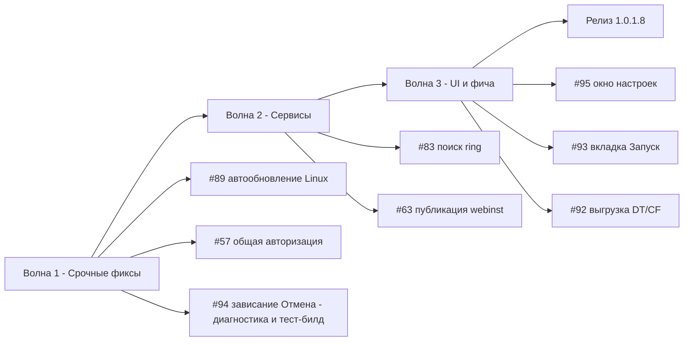

# План исправлений v1.0.1.8 — issues #95, #94, #93, #92, #89, #83, #63, #57

**Дата:** 2026-10-30
**Текущая версия:** 1.0.1.7 ([`CHANGELOG.md`](CHANGELOG.md:14), [`Workspace1C.csproj`](Workspace1C/Workspace1C.csproj))
**Следующая версия:** **1.0.1.8** (увеличение последнего числа)
**Источники требований:** [`_issues_report.md`](_issues_report.md) (тексты issues и последние комментарии пользователей)

---

## 1. Сводка и приоритеты

| # | Суть | Приоритет | Группа | Оценка объёма |
|---|------|-----------|--------|----------------|
| #89 | Linux: автообновление скачивает EXE | **Критично** | Сервисы/обновление | малый (диагностика + точечные правки) |
| #57 | Общая авторизация не передаётся в командную строку | Высокий | Сервисы/запуск | средний (аудит резолвера + тесты) |
| #94 | Linux: зависание «Отмена» после вкладки «Идентификатор» | Высокий | UI/Linux | средний (диагностика + фикс) |
| #83 | ring не находится из процесса (лицензии) | Средний | Сервисы/лицензии | средний (новый подход поиска) |
| #63 | Публикация: кодировка webinst, дубли LoadModule, переменные, 1c8Aliases* по умолчанию | Средний | Сервисы/публикация | средний–крупный |
| #95 | Реорганизация окна настроек (4 под-вкладки, порядок вкладок) | Средний | UI/настройки | крупный (WPF XAML + Avalonia code-built) |
| #93 | Свойства базы: разделение вкладки «Запуск», уменьшение высоты окна | Средний | UI/свойства базы | средний |
| #92 | Массовая выгрузка в DT/CF «Для выделенных…» с шаблоном имени | Обычный | Фича | крупный |

**Все 8 issues в один проход — слишком много.** Предлагается разбиение на 3 волны (см. раздел 11), релиз общий — 1.0.1.8.

---

## 2. Ключевой контекст по кодовой базе (влияет на все UI-issues)

- Каждое окно существует в **двух вариантах**: WPF XAML (`*.xaml` + `*.xaml.cs`, Windows) и **Avalonia, построенная в коде** (`*.Avalonia.cs`, Linux, `#if LINUX`). Любая правка разметки требует зеркальной правки в `.Avalonia.cs` — иначе расхождение платформ.
- Общие стили горизонтальных под-вкладок уже есть: `SettingsSubTabControl` / `SettingsSubTabItem` ([SettingsWindow.xaml:221](Workspace1C/Views/SettingsWindow.xaml:221)) и в Avalonia (`ControlThemes.SettingsSubTabControl`, пример — [SettingsWindow.Avalonia.cs:1853](Workspace1C/Views/SettingsWindow.Avalonia.cs:1853)).
- Модальные диалоги Avalonia показываются синхронно через `Dispatcher.PushFrame` ([ModalWindowBase.ShowDialogSync](Workspace1C/Views/ModalWindowBase.cs:311)) — источник целого класса «зависаний» (issue #94).
- Локализация — ключи `loc:Loc` / `LocalizationManager.T`; новые подписи добавлять ключами в ресурсы (ru/en).

---

## 3. Issue #89 — Автообновление Linux качает EXE (КРИТИЧНО)

### Установленные факты (проверено по API GitHub)
- Последний релиз `v1.0.1.7` содержит **оба** ассета: `Workspace1C-linux-x64` (53 290 915 байт) и `Workspace1C.exe` — ассет Linux **на месте**, публикация работает.
- Код выбора ассета в 1.0.1.7 корректен: [FindAsset](Workspace1C/Services/GitHubReleaseService.cs:305) на Linux ищет точное `Workspace1C-linux-x64`, запасной проход отбрасывает `*.exe` ([IsPlatformAsset](Workspace1C/Services/GitHubReleaseService.cs:415)); Atom-fallback строит URL из Linux-имени.
- Валидация magic-байт ([UpdatePayload.RejectWrongPlatformFile](Workspace1C/Services/UpdatePayload.cs), ELF на Linux) в 1.0.1.6+ карантинит EXE → в 1.0.1.7 EXE **не может быть применён**.

### Вероятные первопричины (гипотезы для проверки)
1. **«Застрявшая» старая версия у пользователя** (до 1.0.1.4): её собственный код обновления выбирает EXE и не умеет карантинить — самолечения нет, нужно однократно обновить вручную. Комментарий в #89 от 16:12 мог быть проверкой именно старой версии.
2. **Отображение в индикаторе загрузок**: в Linux-сервисе имя файла для менеджера фоновых загрузок захардкожено `"Workspace1C.exe"` ([UpdateService.Avalonia.cs:849](Workspace1C/Services/UpdateService.Avalonia.cs:849)) — пользователь видит «Workspace1C.exe» в индикаторе и делает вывод, что качается EXE, даже когда качается ELF.

### Изменения
| Файл | Что менять |
|------|------------|
| [UpdateService.Avalonia.cs:849](Workspace1C/Services/UpdateService.Avalonia.cs:849) | Отображаемое имя загрузки — по платформе: `Workspace1C-linux-x64` (не «Workspace1C.exe»). |
| [UpdateService.Avalonia.cs](Workspace1C/Services/UpdateService.Avalonia.cs) `DownloadNewBinaryAsync` | Перед загрузкой писать в журнал (CM_UPDATES) **полный URL** и ожидаемый размер — следующий репорт диагностируем с первого сообщения. |
| [UpdatePayload.cs](Workspace1C/Services/UpdatePayload.cs) | В сообщение карантина «wrong-platform» добавить текущую версию приложения и совет: «если ваша версия старее 1.0.1.4 — обновитесь вручную». |
| [release.yml](.github/workflows/release.yml) | Добавить `workflow_dispatch` с параметрами `tag` + `prerelease: true` для **тестовых сборок** (см. ниже). |

### Тестовый билд с пониженной версией (просьба 7OH)
- Сборка Linux-бинарника с версией **ниже текущей** (например `1.0.1.7-test1`): публиковать как **prerelease** — GitHub `/releases/latest` prerelease не отдаёт, обычные пользователи не затронуты; 7OH ставит вручную/через отдельный тег.
- Решение: `workflow_dispatch` в release.yml с input `prerelease` (软props/action-gh-release поддерживает `prerelease: true`); либо локальный скрипт по образцу `_build_v10017.ps1` + ручное прикрепление к prerelease. В issue прокомментировать порядок проверки.

### Риски и тесты
- Риски: минимальные (переименование отображаемого имени, логи). Не менять логику FindAsset — она корректна.
- Тесты: дополнить тесты `FindAsset`/`IsPlatformAsset` кейсом «в релизе есть и EXE, и linux-x64 → выбирается linux-x64» (если таких ещё нет); тест отображаемого имени.
- В issue #89 ответить: запросить у 7OH версию приложения и журнал CM_UPDATES за попытку обновления; сообщить про тестовый prerelease.

---

## 4. Issue #57 — Общая авторизация не подставляется (пустой пользователь)

### Анализ
Резолвер [InfobaseAuthResolver.Resolve](Workspace1C/Services/InfobaseAuthResolver.cs:105) корректен для сценария «база Prompt + общая Credentials» (шаг 3). Но:

1. **Шаг 1 пропускает «сломанный» кейс:** раздельная авторизация режима `Credentials` с **пустым пользователем** возвращается как есть ([InfobaseAuthResolver.cs:137-147](Workspace1C/Services/InfobaseAuthResolver.cs:137) — фильтр только для `Windows`+пустой user). Тогда в [BuildArguments](Workspace1C/Services/OneCLauncher.Arguments.Shared.cs:245) `Credentials` без пользователя даёт `authArg = ""` — **в командную строку уходит пустой пользователь**. Это точно совпадает с репортом «откуда пустой пользователь взялся».
2. Синхронизация статиков `CommonEnterpriseAuthorization`/`CommonConfiguratorAuthorization` при запуске через UI/CLI ([MainViewModel.Avalonia.cs:787](Workspace1C/ViewModels/MainViewModel.Avalonia.cs:787), [EnsureCommonAuthLoaded](Workspace1C/Services/OneCLauncher.Arguments.Shared.cs:65)) — перепроверить все точки (WPF + Avalonia), что синхронизируются **три** статика, а не только legacy `CommonAuthorization`.

### Изменения
| Файл | Что менять |
|------|------------|
| [InfobaseAuthResolver.cs](Workspace1C/Services/InfobaseAuthResolver.cs) | Шаг 1: `modeAuth` с `Credentials` и пустым пользователем при наличии общих кредов режима считать незаданной (пропуск к шагу 3) — симметрично правилу для `Windows`. То же — для Connection-варианта на всякий случай (сейчас уже фильтруется непустотой user — оставить). |
| [OneCLauncher.Arguments.Shared.cs:245](Workspace1C/Services/OneCLauncher.Arguments.Shared.cs:245) | Защитная ветка: `Credentials` + пустой `authUser` → не подставлять `/N` c пустым значением; лог уже есть (CM_BASE_RUN) — оставить. |
| MainViewModel (WPF/Avalonia) | Аудит синхронизации трёх статиков общей авторизации при старте и после сохранения настроек. |
| Диагностика | CM_BASE_RUN уже пишет источник и режим — в issue попросить у 7OH строку «Авторизация запуска (Enterprise): …» после фикса. |

### Тесты
- [`Issue57WindowsAuthOverrideTests.cs`](Workspace1C.Tests/Issue57WindowsAuthOverrideTests.cs) / [`Issue57CommonAuthSourceTests.cs`](Workspace1C.Tests/Issue57CommonAuthSourceTests.cs): добавить кейсы:
  - modeAuth=`Credentials` с пустым пользователем + общая Credentials → источник `CommonMode`, /N /P переданы;
  - база Prompt + общая Credentials → передаётся общий логин/пароль (аргументы `/N "…" /P "…"` — проверить через чистую функцию сборки аргументов);
  - Windows-режим базы без общих кредов → `/WA+`.

### Риски
- Изменение приоритета резолвера затрагивает все пути входа (запуск, COM, ibcmd, скрипты) — покрыть регрессионными тестами существующих кейсов (они уже есть в Issue57*).

---

## 5. Issue #94 — Linux: «Отмена» окна Свойств зависает после вкладки «Идентификатор»

### Анализ
Кнопка «Отмена» строится через [BuildCancelActionButton](Workspace1C/Views/ModalWindowBase.cs:1045) (`Click → Close()`), закрытие выходит из вложенного `PushFrame` по событию `Closed` ([ShowDialogSync](Workspace1C/Views/ModalWindowBase.cs:311)). Вкладка «Идентификатор» содержит ListBox «Произвольные поля» с double-click, открывающим `NameInputWindow` синхронно ([ConnectionSettingsWindow.Avalonia.cs:1424](Workspace1C/Views/ConnectionSettingsWindow.Avalonia.cs:1424)) — вложенные PushFrame-ы. Зависание возникает только после посещения вкладки и переживает переключение вкладок → что-то, инициализированное на этой вкладке, блокирует завершение кадра или закрытие окна (кандидаты: активный item-редактор/фокус ListBox, Popup/тултип, подписка double-click, состояние PasswordBox-синхронизации).

### Изменения (диагностика → фикс)
| Шаг | Файл | Что делать |
|-----|------|------------|
| 1 | [ModalWindowBase.cs](Workspace1C/Views/ModalWindowBase.cs), [ConnectionSettingsWindow.Avalonia.cs](Workspace1C/Views/ConnectionSettingsWindow.Avalonia.cs) | Диагностика: трассировка (`ToolTipCloserAvalonia.TraceLog`-стиль, гейт CM) в точках: клик «Отмена» → `Close()` вызван → `Closed` получен → кадр остановлен. Также логировать событие выбора вкладки «Идентификатор». |
| 2 | — | Собрать тестовый Linux-бинарник (см. механизм из #89), воспроизвести у себя/передать 7OH, получить трассировку. |
| 3 | [ConnectionSettingsWindow.Avalonia.cs](Workspace1C/Views/ConnectionSettingsWindow.Avalonia.cs) | Кандидаты фикса (применять по результатам трассировки): перед `Close()` — сброс фокуса, завершение редактирования ListBox, `ToolTipCloserAvalonia.CloseAll()`; закрытие через `Dispatcher.UIThread.Post(Close)`; проверка повторного `ShowDialogSync` (guard `IsVisible` уже есть). |
| 4 | [NameInputWindow.Avalonia.cs](Workspace1C/Views/NameInputWindow.Avalonia.cs) | Проверить вложенный показ: если «Идентификатор» открывался ввод значения — не остаётся ли висящий внутренний кадр/подписка. |

### Тесты
- Чистую логику (если выделим «подготовку окна к закрытию») покрыть юнит-тестом; UI-воспроизведение — через тестовый билд и пользователя (в issue закрепить просьбу проверить тестовую сборку).

### Риски
- Нельзя «слепо» фиксить — 5 правок подряд в #83 показали цену догадок. Порядок: диагностика → тестовый билд → фикс.

---

## 6. Issue #83 — ring не находится из процесса приложения

### Анализ (новый подход — пятая правка «где искать» уже не сработала)
Ключевой факт: `where.exe ring` **в командной строке пользователя** работает, а из процесса приложения — нет. Значит, **PATH процесса приложения отличается от PATH пользовательской консоли** (запуск не из Explorer: автозапуск, планировщик, ярлык с изменённым окружением, stale-PATH при старте процесса). Текущая проверка [FindRingInPathAsync](Workspace1C/Services/RingLicenseService.cs:532) использует `where.exe` **внутри того же процесса** — она честно повторит отсутствие ring в PATH процесса.

### Изменения
| Файл | Что делать |
|------|------------|
| [RingLicenseService.cs](Workspace1C/Services/RingLicenseService.cs) | Новый построитель кандидатов поиска: 1) PATH процесса (как сейчас); 2) **свежий PATH из реестра**: `HKCU\Environment\Path` + `HKLM\...\Session Manager\Environment\Path` (развернуть `REG_EXPAND_SZ`) — это PATH «будущей» консоли пользователя; 3) известные каталоги: `bin` платформы рядом с rac (уже есть), `%LOCALAPPDATA%\1C\1cv8\` и `C:\Program Files\1cv8\<ver>\bin`. По каждому каталогу — `ring.exe`, `ring.cmd`, `ring.bat` (запуск `.cmd/.bat` через `ToLaunchCommand`). |
| Там же | Диагностика CM_RAC: при неудаче логировать **каталоги, по которым искали**, и факт «PATH процесса: N элементов, реестровый PATH: M» — чтобы отличие окружения стало видимым сразу. |
| Там же | Сообщение вкладки дополнить: перечислить проверенные источники PATH; если ring найден по реестровому PATH, но не в PATH процесса — подсказка «перезапустите приложение» остаётся, но теперь запускаем по найденному полному пути **без перезапуска**. |

### Тесты
- Чистая функция «список каталогов → кандидаты ring» — юнит-тесты (без реестра: инъекция списка каталогов); разворачивание `REG_EXPAND_SZ` — на фикстурах.
- Файл теста: [`Issue83RingPathRegistryTests.cs`](Workspace1C.Tests/) (новый).

### Риски
- Запуск по пути из реестра — только существующие каталоги с проверкой `File.Exists`; регресс не затрагивает остальные кандидаты (bin платформы, licensetool на Linux).

---

## 7. Issue #63 — Публикация баз: 4 доработки

### 7.1 Кодировка вывода webinst («каракули»)
- [ProcessRunner](Workspace1C/Services/ProcessRunner.cs:63) жёстко читает вывод как UTF-8; webinst на русской Windows пишет в консольной (OEM, cp866) кодировке.
- **Фикс:** добавить в `ProcessRunner.RunAsync` необязательный параметр `outputEncoding`; `WebPublishService.RunAsync` ([WebPublishService.cs:222](Workspace1C/Services/WebPublishService.cs:222)) передаёт `Encoding.GetEncoding(866)` на Windows (зарегистрировать `System.Text.Encoding.CodePages` — `Encoding.RegisterProvider(CodePagesEncodingProvider.Instance)` в точке инициализации приложения, если ещё не зарегистрирован); на Linux — UTF-8 как сейчас.

### 7.2 Не дублировать `LoadModule _1cws_module`
- Строку пишет сам webinst в `-confpath`. Приложение не контролирует запись, но может **пост-обработать** conf после успешной публикации: если строк `LoadModule _1cws_module` больше одной — схлопнуть дубликаты (оставить первую), с записью в журнал CM_PUBLISH. Чистая функция + юнит-тесты.

### 7.3 Подстановка путей через переменные (`${myDocumentRoot}`)
- После публикации: найти в conf новый блок `Alias "<wsdir>"`; распарсить `Define`-переменные (парсер уже есть — «myDocumentRoot распарсен», [ApacheConfIncludeParser.cs](Workspace1C/Services/ApacheConfIncludeParser.cs)); если **существующие** записи `Alias`/`Directory` используют переменную, чьё значение — точный префикс физического пути нового блока, переписать пути в новом блоке (Alias, Directory, ManagedApplicationDescriptor) на `${имя}`. Замена только при однозначном совпадении префикса + наличии хотя бы одной существующей записи с этой переменной (защита от поломки Apache); всё — в чистую функцию `RewriteAliasBlockWithVariables(confText, wsdir, defines)` + тесты на тексте.
- Оба пост-обработчика (7.2 и 7.3) вызываются из `WebPublishViewModel.RunAsync` после успешного webinst, результат пишется в conf (по одному разу), изменения логируются.

### 7.4 `1c8Aliases*` по умолчанию
- [WebPublishViewModel.cs](Workspace1C/ViewModels/WebPublishViewModel.cs) (построение `ConfTargets`, строки ~378-432): при наличии файла алиаса (`IsAliasFileName` уже реализован) выбирать его в `ConfTarget` **по умолчанию** (и в fallback-ветке), а не основной conf.

### Тесты
- [`WebPublishConfPostProcessTests.cs`](Workspace1C.Tests/) (новый): дедупликация LoadModule; замена путей на `${myDocumentRoot}` (есть Define + существующие записи / нет / неоднозначный префикс); выбор алиаса по умолчанию в VM (если VM тестируема — как в BatchOperationsTests).
- [`_27conf_extracted/1c8Aliases27.conf`](_27conf_extracted/1c8Aliases27.conf) и [httpd27.conf](_27conf_extracted/httpd27.conf) — готовые фикстуры реального конфига 7OH.

### Риски
- Правка conf после webinst может затронуть рабочий Apache — ограничить правки: только новый блок алиаса + только дубликаты LoadModule; бэкап-копия conf (`*.bak`) перед записью.

---

## 8. Issue #95 — Реорганизация окна настроек

### Изменения (WPF: [SettingsWindow.xaml](Workspace1C/Views/SettingsWindow.xaml))
1. **Порядок вкладок верхнего уровня** (сейчас: Платформы 315, Отображение 516, Темы 916, Цветовое 1056, Клавиши 1320, Настройки 1761, Меню Утилиты 2087, ibases.v8i 2165, Базы 2324, Логирование 2714, О программе 2745):
   - новый порядок: **Настройки → Отображение → Темы → Цветовое → Клавиши → Меню Утилиты → Платформы → ibases.v8i → Базы → Логирование → О программе** (Настройки — первая, Платформы — перед ibases.v8i).
2. **Вкладка «Настройки»** (строки 1761-2085): разбить содержимое на горизонтальные под-вкладки (стиль `SettingsSubTabControl`, как во вкладке «Отображение»):
   - **«Поведение и язык»**: GroupBox «Язык» (1774-1788) + блок галочек поведения (1790-1864: AllowMultipleInstances … CatchUpMissedTasks, AfterLaunchActionCombo, RememberWindowLayout, CompactMode);
   - **«Функциональность»**: GroupBox «Режим функциональности» (1965-1984) + GroupBox «Учётные данные ИТС» (1868-1897);
   - **«COM-Коннектор»**: GroupBox шаблона COM-коннектора (1900-1932) + GroupBox таймаута COM (1935-1961, включая `AvailabilityTcpPrecheckCheckBox`);
   - **«Общая авторизация»**: GroupBox CommonAuth (1991-2082).
   - Имена контролов (`x:Name`) не менять — code-behind ([SettingsWindow.xaml.cs](Workspace1C/Views/SettingsWindow.xaml.cs) и частичные классы) продолжит находить их по именам независимо от контейнера.
3. Новые ключи локализации под-вкладок (например `Settings.General.Subtab.Behavior/Functionality/ComConnector/CommonAuth`) — ru + en.

### Avalonia ([SettingsWindow.Avalonia.cs](Workspace1C/Views/SettingsWindow.Avalonia.cs))
- Зеркально: переставить порядок `MainTab(...)`-элементов (`tabGeneral` — стр. 907, `tabPlatforms` — 1185, `tabUtilitiesMenu` — 3357 и др.); внутри `tabGeneral` построить под-TabControl по образцу `displayTabs` (стр. 1853) с 4 под-вкладками, перенеся существующие панели блоков.
- Проверить: восстановление выбранной вкладки/привязку hotkeys-обработчиков (частичные классы SettingsWindow.Avalonia.*.cs), что ничего не ищет вкладки по индексу.

### Тесты
- Добавить [`Issue95SettingsTabsTests.cs`](Workspace1C.Tests/): порядок вкладок (по списку ключей), дефолтная выбранная вкладка = «Настройки», наличие 4 под-вкладок с ожидаемыми наборами контролов (если структура кода позволяет тестировать без рантайма — по фабричным методам).

### Риски
- Самая объёмная правка; регресс — потеря привязок code-behind при переносе блоков (mitigated: имена не менять, прогон полного набора тестов, ручная проверка обеих платформ).

---

## 9. Issue #93 — Свойства базы: разделение вкладки «Запуск», высота окна

### Изменения (WPF: [ConnectionSettingsWindow.xaml:840-1020](Workspace1C/Views/ConnectionSettingsWindow.xaml:840))
1. Внутри вкладки «Запуск» — под-TabControl (стиль по образцу `SettingsSubTabControl`, локальный `ConnSubTabControl`) с двумя под-вкладками:
   - **«Режим запуска клиента»**: 5 RadioButtons-карточек (IsAutoMode … IsWebClient, строки 896-1014) + подсказка `LaunchModeHint`;
   - **«События»**: «Действие по двойному щелчку» (857-859), «Внешняя обработка при запуске» (861-877), «Данные внешней обработки» (878-880), «Команда перед запуском» (882-888), «Команда после запуске» (889-895).
2. **Высота окна**: XAML `Height="800"`/`MinHeight="780"` (стр. 13-14) → снизить (ориентир: Height ≈ 660–700, MinHeight ≈ 620–660 — уточнить при вёрстке так, чтобы кнопка СОХРАНИТЬ была доступна на 1366×768). Bindings не трогать.
3. Проверить сохранённые размеры окон ([WindowSizeStore](Workspace1C/Services/WindowSizeStore.cs)): старые сохранённые высоты ≥ 780 зажимать к новому максимуму/разрешать ресайз вниз (MinHeight теперь меньше — окно сожмётся само).

### Avalonia ([ConnectionSettingsWindow.Avalonia.cs:66-79](Workspace1C/Views/ConnectionSettingsWindow.Avalonia.cs:66))
- Зеркально: `Height=800; MinHeight=780` → новые значения; вкладка «Запуск» (`Tab("IconPlay…", BuildLaunchTab())`) — два под-вкладки по образцу [GroupEditWindow.Avalonia.cs:205](Workspace1C/Views/GroupEditWindow.Avalonia.cs:205).

### Тесты
- [`Issue93LaunchSubtabsTests.cs`](Workspace1C.Tests/): новые ключи локализации существуют; (если есть инфраструктура) MinHeight окна обновлён в обоих вариантах.

### Риски
- Низкие: перенос существующих контролов, не логики. Проверить вручную вкладку на обеих платформах + открытие окна на «маленьких» экранах (issue #55 — минимальные размеры уже гвардятся `ClampWindowToMinSize`).

---

## 10. Issue #92 — Массовая выгрузка в DT/CF из «Для выделенных…»

### Требования (из комментариев 7OH)
1. Пункт в подменю **«Для выделенных (N)…»** — «Выгрузить в DT\CF…».
2. Единое окно: поле **шаблона** имени файла (имя базы, дата/время), поле **папки** (+выбор каталога), **переключатель DT / CF**. Значения шаблона и папки сохраняются между сессиями.
3. После реализации — в блоке «Для выделенных…» подменю «Резервирование» не нужно; единственный нужный пункт «Список выгрузок» перенести на место подменю (проверить текущий состав подменю резервирования при реализации; в [MainWindow.ContextMenu.cs:330](Workspace1C/Views/MainWindow.ContextMenu.cs:330) сейчас прямой пункт RunBackup — уточнить, где подменю).

### Изменения
| Файл | Что делать |
|------|------------|
| [BatchOperationsService.cs](Workspace1C/Services/BatchOperationsService.cs) | Новый `BatchOperationKind.DumpCf` (ibcmd config dump). Шаблон имени: токены `{Имя}`/`{Name}`, `{Дата}`/`{Date}` (по умолчанию `yyyy-MM-dd_HH-mm`), валидация/санитизация (переиспользовать `SanitizeFileName`); чистая функция `BuildDumpFilePath(dir, name, kind, template, timestamp)` с fallback на `имя.dt/.cf`. |
| [BatchOperationsViewModel.cs](Workspace1C/ViewModels/BatchOperationsViewModel.cs) | Поля: Template, Directory, Kind-переключатель (DT/CF), предпросмотр имени для первой базы; персистентность настроек — в настройки приложения ([AppSettings.cs](Workspace1C/Models/AppSettings.cs): `BatchDumpTemplate`, `BatchDumpDirectory`, `BatchDumpKind`) либо в FeatureDataStore-файл; сохранять при выполнении. |
| Новый `BatchDumpWindow` (WPF + Avalonia) | Либо расширить [BatchOperationsWindow](Workspace1C/Views/BatchOperationsWindow.Avalonia.cs) параметрами шаблона/DT-CF — решить на реализации (расширение дешевле двух окон). |
| [MainWindow.ContextMenu.cs:330](Workspace1C/Views/MainWindow.ContextMenu.cs:330) и [MainWindow.Avalonia.Tree.cs:2349](Workspace1C/Views/MainWindow.Avalonia.Tree.cs:2349) | Пункт «Выгрузить в DT\CF…» в блок «Для выделенных (N)…»; при возможности — перенос «Списка выгрузок» из подменю резервирования. |
| [UtilitiesMenuCatalog.cs:559](Workspace1C/Services/UtilitiesMenuCatalog.cs:559) | Существующие пункты «Операции» (BatchDumpDt/BatchLoadCf) могут переиспользовать новое окно с предзаданным видом. |
| [IbcmdService.cs](Workspace1C/Services/IbcmdService.cs) | Команда `config dump` для DumpCf (по образцу существующих dump/load). |

### Тесты
- Расширить [`BatchOperationsTests.cs`](Workspace1C.Tests/BatchOperationsTests.cs): шаблоны (токены, санитизация, коллизии имён/перезапись), `DumpCf`-валидация, персистентность настроек.

### Риски
- ibcmd dump для клиент-серверных баз требует профиль СУБД (уже валидируется); массовая выгрузка CF больших баз — долгая операция: показать прогресс по базам как в существующем окне; последовательное выполнение (не параллель) как сейчас.

---

## 11. Разбиение на волны (предложение)

- **Волна 1** — #89 (критично, малый объём), #57, #94: быстрые пользовательские фиксы; #94 требует тестового Linux-билда — механизм из #89 (workflow_dispatch/prerelease) пригодится и здесь.
- **Волна 2** — #83, #63: сервисные доработки, хорошо тестируются юнит-тестами.
- **Волна 3** — #95, #93, #92: объёмные UI/фича.

Каждая волна = отдельная подзадача (new_task) с этим планом как ТЗ.

---

## 12. Чек-лист

### Волна 1
- [ ] #89: отображаемое имя загрузки по платформе (UpdateService.Avalonia.cs:849)
- [ ] #89: лог CM_UPDATES «URL + размер» перед загрузкой
- [ ] #89: сообщение карантина — версия приложения + подсказка про старые версии
- [ ] #89: release.yml — workflow_dispatch c prerelease для тестовых сборок
- [ ] #89: тестовая Linux-сборка с пониженной версией, инструкция в issue
- [ ] #57: InfobaseAuthResolver — фильтр «Credentials с пустым пользователем» на шаге 1
- [ ] #57: аудит синхронизации 3 статиков общей авторизации (WPF + Avalonia + CLI)
- [ ] #57: тесты Issue57* — новые кейсы
- [ ] #94: трассировка закрытия модального окна (CM-гейт)
- [ ] #94: тестовый Linux-билд, воспроизведение, фикс по трассировке
- [ ] Общий: `dotnet test` зелёный (Windows + `-p:ForceLinux` сборка)

### Волна 2
- [ ] #83: реестровый/известный PATH → кандидаты ring; запуск по полному пути
- [ ] #83: диагностика CM_RAC (каталоги поиска, размеры PATH)
- [ ] #83: тесты Issue83RingPathRegistryTests
- [ ] #63: ProcessRunner — параметр кодировки вывода; webinst → cp866 (Windows)
- [ ] #63: регистрация CodePagesEncodingProvider (если требуется)
- [ ] #63: пост-обработка conf — дедупликация `LoadModule _1cws_module` (+ .bak)
- [ ] #63: пост-обработка conf — подстановка `${…}`-переменных в новый блок алиаса
- [ ] #63: WebPublishViewModel — `1c8Aliases*` по умолчанию в списке conf
- [ ] #63: тесты WebPublishConfPostProcessTests (фикстуры _27conf_extracted)
- [ ] Общий: `dotnet test`, Linux-сборка

### Волна 3
- [ ] #95: SettingsWindow.xaml — порядок вкладок + 4 под-вкладки
- [ ] #95: SettingsWindow.Avalonia.cs — зеркально
- [ ] #95: ключи локализации под-вкладок (ru/en)
- [ ] #95: тесты Issue95SettingsTabsTests
- [ ] #93: ConnectionSettingsWindow.xaml — под-вкладки «Режим запуска»/«События»
- [ ] #93: высота/минимальная высота окна (XAML + Avalonia)
- [ ] #93: проверка WindowSizeStore со старыми размерами
- [ ] #92: BatchOperationsService — DumpCf + шаблон имени файла
- [ ] #92: окно/расширение BatchOperationsWindow (шаблон, папка, DT/CF, сохранение настроек)
- [ ] #92: пункт «Выгрузить в DT\CF…» в «Для выделенных…» (WPF + Avalonia)
- [ ] #92: перенос «Списка выгрузок» из подменю резервирования (по факту проверки)
- [ ] #92: тесты BatchOperationsTests — расширение
- [ ] Общий: `dotnet test`, Linux-сборка, ручная проверка UI на обеих платформах

### Релиз 1.0.1.8
- [ ] Обновить версию: Workspace1C.csproj (InformationalVersion/FileVersion), CHANGELOG.md — раздел `## [1.0.1.8]`
- [ ] Полный прогон тестов (Windows + Linux)
- [ ] Тег `v1.0.1.8` → релизная сборка через release.yml
- [ ] Комментарии в issues: #95, #94, #93, #92, #89, #83, #63, #57 (кратко: что сделано, что проверить)
- [ ] Комментарий в **#26** (тёмная тема/акценты — исправлено в 1.0.1.6, подтверждено 7OH «по обоим пунктам ОК» 2026-10-30; предложить закрытие или ждать реакцию ArtyoZ) — в план изменений не входит
- [ ] Заодно проверить: #91, #87 (зависел от #57 — закрыть после подтверждения фикса), #85, #79, #71, #55 — последний комментарий от sivatorov; комментировать только при изменении статуса

---

## 13. Открытые вопросы к реализации

1. **#92**: где живёт подменю «Резервирование» (комментарий 7OH про «Список выгрузок») — найти при реализации; возможно, речь о подменю в другом месте контекстного меню/меню Утилиты.
2. **#89**: согласовать с 7OH формат тестового prerelease (тег, имя ассета) — комментарием в issue.
3. **#93/#95**: точные значения высоты/минимальной высоты окон — подбираются при вёрстке под 1366×768.
4. **#63**: замена путей на переменные — считать ли её опцией (по умолчанию вкл)? Предлагается: всегда, но только при однозначном совпадении (безопасно и соответствует «как тут заведено»).
