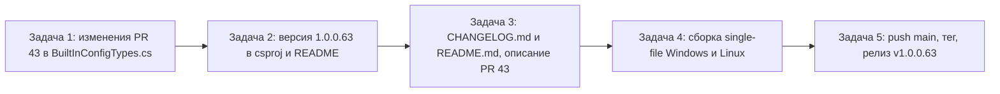

# План: релиз v1.0.0.63 (изменения из PR #43)

> **Решение пользователя (утверждено):** релиз создаётся **вручную** через `gh release create`
> с файлами, собранными локально в Задаче 4. Прогон CI `release.yml` по тегу не является
> обязательным (но не запрещён — при его срабатывании он перезапишет релиз теми же asset'ами).

Репозиторий: `sivatorov/Workspace1C`, ветка `main`, локальный клон `g:/Yandex.Disk/h/Workspace1C`.
Текущий релиз: `v1.0.0.62` (создан `github-actions[bot]` 2026-10-23).

## Цель

1. Внести изменения PR #43 в `Workspace1C/Services/BuiltInConfigTypes.cs`.
2. Поднять версию 1.0.0.62 → 1.0.0.63 (только последнее число).
3. Обновить CHANGELOG.md и README.md.
4. Собрать по одному single-file исполняемому файлу: Windows (WPF) и Linux (Avalonia).
5. Push в `origin/main` и создать релиз v1.0.0.63 с asset'ами `Workspace1C.exe` и `Workspace1C-linux-x64`.

## Собранные факты (исследование)

### PR #43 «Дополнен список типовых» (автор 7OH, head `7OH:main@3d09dd6`)
- Состояние: **open**, не смёржен, `changed_files = 1`, `additions = 10`, `deletions = 16`.
- Меняется **только** `Workspace1C/Services/BuiltInConfigTypes.cs`:
  1. Убрать точки в 5 комментариях (строки текущего файла): «Документооборот ПРОФ.» (76), «Документооборот КОРП.» (100), «Рабочее место кассира.» (225), «Управление нашей фирмой.» (269), «Управление производственным предприятием.» (293).
  2. Блок «Бухгалтерия государственного учреждения» (BGU, строки 326–339): переформатировать две редакции в компактный вид, как в PR.

Точная замена блока BGU (из diff PR #43):
```csharp
                Editions =
                {
                    new OneCConfigEdition { Name = "1.x", Red = "1",
                        UrlOverride = "StateAccounting", },
                    new OneCConfigEdition { Name = "2.x", Red = "2",
                        UrlOverride = "StateAccounting20",
                        IsDefault = true },
                },
```
Примечание: в diff PR у последней редакции запятая после `IsDefault = true }` отсутствует — это валидный C# (последний элемент коллекции). Воспроизвести формат PR без trailing-пробелов.

- Тесты [`Workspace1C.Tests/BuiltInConfigTypesTests.cs`](Workspace1C.Tests/BuiltInConfigTypesTests.cs) проверяют **данные** (Code, ConfigName, Nick, UrlOverride, Red), а не комментарии/формат → изменений тестов не требуется, но прогнать регрессию обязательно.

### Где задаётся версия 1.0.0.62
| Файл | Строки | Действие |
|---|---|---|
| [`Workspace1C/Workspace1C.csproj`](Workspace1C/Workspace1C.csproj:62) | 62–65: `Version`, `AssemblyVersion`, `FileVersion`, `InformationalVersion` | 62 → 63 |
| [`README.md`](README.md:3) | 3: бейдж `Версия-1.0.0.62-1F6FEB` | `1.0.0.62` → `1.0.0.63` |
| [`README.md`](README.md:11) | 11: «актуальная версия — 1.0.0.62» | `1.0.0.62` → `1.0.0.63` |
| [`CHANGELOG.md`](CHANGELOG.md:14) | новая секция `## [1.0.0.63]` над `## [1.0.0.62]` | добавить секцию |

- `Workspace1C/AssemblyInfo.cs` — версии НЕ содержит (только `InternalsVisibleTo`, `ThemeInfo`). **Не менять.**
- `Workspace1C/VersionInfo.cs` — только читает `InformationalVersion`. **Не менять.**
- Упоминания «1.0.0.62» в комментариях исходников (`MainWindow.*.cs`, `ListMinWidthCalculator.cs`, тесты) — **исторические метки**, не трогать.
- `package/linux/appimage.sh` и `package/linux/deb/build-deb.sh` читают версию из `InformationalVersion` csproj автоматически — править не нужно.

### Скрипты сборки (что даёт один файл)
| Скрипт | Платформа | Результат |
|---|---|---|
| [`Workspace1C/build-windows-single-file.ps1`](Workspace1C/build-windows-single-file.ps1) | Windows, WPF, win-x64, self-contained single-file | `Workspace1C/dist/win-x64/Workspace1C.exe` |
| [`Workspace1C/build-linux-single-file.sh`](Workspace1C/build-linux-single-file.sh) | Linux, Avalonia, linux-x64, self-contained single-file | `Workspace1C/dist/linux-x64/Workspace1C` (кросс-сборка из Windows: `FORCE_LINUX=1`) |
| `Workspace1C/build-linux-single-file.ps1` | то же, аналог для Windows (ForceLinux) | `Workspace1C/dist/linux-x64/Workspace1C` |
| `package/linux/appimage.sh` | AppImage (пакет, НЕ один файл) | **не подходит** |
| `package/linux/deb/build-deb.sh` | .deb (пакет) | **не подходит** |

Требования: .NET SDK 10 (≥ 10.0.400).

### CI/CD (GitHub Actions)
- [`/github/workflows/build.yml`](.github/workflows/build.yml) — сборка + `dotnet test` обеих целей на push в main и PR (Windows и Linux).
- [`/github/workflows/release.yml`](.github/workflows/release.yml) — **штатный релизный конвейер**:
  - триггер: push тега `v*` (или `*.*.*`, `*.*.*.*`), событие `release: published`, `workflow_dispatch`;
  - собирает на GitHub runners оба single-file: `Workspace1C.exe` и `Workspace1C-linux-x64`;
  - создаёт/обновляет GitHub Release (softprops/action-gh-release), текст извлекается из секции `## [<версия>]` CHANGELOG.md (если нет `rel_notes_<версия>.md`);
  - имена asset'ов согласованы с автообновлением (`Services/GitHubReleaseService.cs`): Windows — `Workspace1C.exe`, Linux — `Workspace1C` / `Workspace1C-linux-x64`.
- Релиз v1.0.0.62 подтверждает соглашения: asset'ы `Workspace1C.exe` (84 456 948 B) и `Workspace1C-linux-x64` (52 834 085 B), автор — `github-actions[bot]`, имя релиза «Workspace 1C 1.0.0.62».
- `Workspace1C/.github/workflows/` — **устаревшие** копии workflow (имя «Release», ZIP, windows-latest); актуальные — в корне. **Не трогать.**

## Порядок задач (каждая — отдельная new_task)

Задачи выполняются строго последовательно: Задача 1 → Задача 2 → Задача 3 → Задача 4 → Задача 5 (версия в csproj должна быть поднята до сборки, CHANGELOG — до релиза).



---

## Задача 1. Внести изменения PR #43 в BuiltInConfigTypes.cs

**Режим:** code. **Файл:** `Workspace1C/Services/BuiltInConfigTypes.cs`.

Шаги:
1. Убедиться, что `git status` чист и ветка `main` актуальна (`git pull`).
2. Внести 5 правок комментариев (убрать точку в конце):
   - строка 76: `// Документооборот ПРОФ.` → `// Документооборот ПРОФ`
   - строка 100: `// Документооборот КОРП.` → `// Документооборот КОРП`
   - строка 225: `// Рабочее место кассира.` → `// Рабочее место кассира`
   - строка 269: `// Управление нашей фирмой.` → `// Управление нашей фирмой`
   - строка 293: `// Управление производственным предприятием.` → `// Управление производственным предприятием`
3. Заменить блок редакций BGU (строки 326–339) на компактный из PR #43 (см. выше; без лишних trailing-пробелов).
4. Проверить компиляцию обеих конфигураций и регрессию:
   - Windows: `dotnet build Workspace1C/Workspace1C.csproj -c Release`
   - Linux: `dotnet build Workspace1C/Workspace1C.csproj -c Release -p:ForceLinux=true` (кросс-проверка)
   - Тесты: `dotnet test Workspace1C.Tests/Workspace1C.Tests.csproj` (после сборки Windows)
5. Коммит:
   ```
   git add Workspace1C/Services/BuiltInConfigTypes.cs
   git commit -m "Список типовых: правки из PR #43 (убраны точки в комментариях, компактный блок БГУ)"
   ```
6. Не закрывать issues; push выполняется на этапе Задачи 5.

---

## Задача 2. Обновить версию до 1.0.0.63

**Режим:** code. **Изменяются только последние числа.**

Шаги:
1. [`Workspace1C/Workspace1C.csproj`](Workspace1C/Workspace1C.csproj:62), строки 62–65:
   - `<Version>1.0.0.63</Version>`
   - `<AssemblyVersion>1.0.0.63</AssemblyVersion>`
   - `<FileVersion>1.0.0.63</FileVersion>`
   - `<InformationalVersion>1.0.0.63</InformationalVersion>`
2. [`README.md`](README.md:3), строка 3: в Shields-бейдже `Версия-1.0.0.62-1F6FEB` → `Версия-1.0.0.63-1F6FEB` (цвет сохранить).
3. [`README.md`](README.md:11), строка 11: «актуальная версия — **1.0.0.62**» → «**1.0.0.63**».
4. Контроль: поиск по репозиторию `1\.0\.0\.62` должен выдать только исторические комментарии (`MainWindow.*.cs`, `ListMinWidthCalculator.cs`, тесты, CHANGELOG прошлых версий) — их не менять.
5. Коммит:
   ```
   git add Workspace1C/Workspace1C.csproj README.md
   git commit -m "Версия 1.0.0.63"
   ```

---

## Задача 3. CHANGELOG.md и README.md — описание изменений PR #43

**Режим:** code.

Шаги:
1. [`CHANGELOG.md`](CHANGELOG.md:13): после разделителя `---` (строка 12) и перед `## [1.0.0.62]` вставить новую секцию (дата — 2026-10-23) в стиле файла:
   ```markdown
   ## [1.0.0.63] — 2026-10-23

   ### Изменено

   - **Список типовых конфигураций дополнен и поправлен (PR #43, автор 7OH)** —
     из комментариев в [`BuiltInConfigTypes.cs`](Workspace1C/Services/BuiltInConfigTypes.cs)
     убраны точки в конце («Документооборот ПРОФ», «Документооборот КОРП»,
     «Рабочее место кассира», «Управление нашей фирмой», «Управление
     производственным предприятием»); блок редакций «Бухгалтерия государственного
     учреждения» (1.x/2.x, BGU) переформатирован в компактный вид.
   ```
   Итоговая формулировка — на усмотрение исполнителя, но смысл должен отражать PR #43 и автора.
2. README.md: постоянных секций «Что нового по версиям» в README нет — достаточное обновление README — версия из Задачи 2. При желании добавить краткое упоминание типовых в подходящий пункт раздела возможностей.
3. Прогнать `dotnet test Workspace1C.Tests/Workspace1C.Tests.csproj` (регрессия после правок).
4. Коммит:
   ```
   git add CHANGELOG.md README.md
   git commit -m "CHANGELOG и README: изменения v1.0.0.63 (PR #43)"
   ```

---

## Задача 4. Сборка single-file: Windows и Linux

**Режим:** code. **Требуется:** .NET SDK 10 (≥ 10.0.400) — проверить `dotnet --list-sdks`; сборка Windows — только на Windows.

Шаги:
1. Убедиться, что версия в `Workspace1C.csproj` — 1.0.0.63.
2. Windows (WPF, win-x64):
   ```
   cd Workspace1C
   .\build-windows-single-file.ps1 -Configuration Release
   ```
   Результат: `Workspace1C/dist/win-x64/Workspace1C.exe` (один файл, ~84 МБ).
3. Linux (Avalonia, linux-x64):
   - на реальном Linux: `./build-linux-single-file.sh Release`;
   - на Windows (кросс-сборка, без WSL): `.\build-linux-single-file.ps1 -Configuration Release` (эквивалент `FORCE_LINUX=1 ./build-linux-single-file.sh`).
   Результат: `Workspace1C/dist/linux-x64/Workspace1C` (один файл, ~52 МБ).
4. Подготовить итоговые asset'ы (имена согласованы с автообновлением):
   ```
   mkdir -p dist/release
   copy Workspace1C\dist\win-x64\Workspace1C.exe   dist\release\Workspace1C.exe
   copy Workspace1C\dist\linux-x64\Workspace1C     dist\release\Workspace1C-linux-x64
   ```
   ($ chmod +x dist/release/Workspace1C-linux-x64 — для Linux)
5. Контроль: оба файла непустые/запускаемы, в `dist/win-x64` и `dist/linux-x64` нет `.dll`, `.pdb`, папок.
6. Прогнать `dotnet test` (быстрый контроль регрессии перед релизом).
   Артефакты сборки (`dist/`, `publish/`) в git НЕ коммитить (они в ignore).

---

## Задача 5. Push в origin/main и релиз v1.0.0.63

**Режим:** code (или orchestrator, по требованию). **Требуется:** авторизованный `gh` (`gh auth status`) или доступ к API.

Шаги:
1. Проверить состояние: `git status --short`, `git log --oneline -5` (должны быть 3 коммита: PR #43, версия, changelog/readme).
2. Push:
   ```
   git push origin main
   ```
3. Создать и запушить тег **после** push в main:
   ```
   git tag v1.0.0.63
   git push origin v1.0.0.63
   ```
4. **Основной путь (решение пользователя):** создать релиз вручную из локально собранных файлов Задачи 4:
   ```
   gh release create v1.0.0.63 dist/release/Workspace1C.exe dist/release/Workspace1C-linux-x64 --title "Workspace 1C 1.0.0.63" --notes "…секция из CHANGELOG…"
   ```
   Текст `--notes` — секция `## [1.0.0.63]` из CHANGELOG.md (как формирует release.yml: заголовок «# Workspace 1C 1.0.0.63», строка о Windows/Linux, секция изменений, ссылка на CHANGELOG).
5. **Побочный эффект CI:** событие `release: published` запустит `release.yml`, который пересоберёт оба файла и перезапишет релиз теми же asset'ами (`overwrite: true`) — это допустимо и не создаёт дублей. Если прогон CI нежелателен, тег можно не пушить заранее: `gh release create` сам создаст тег `v1.0.0.63` из `main` в момент публикации релиза.
6. Финальная проверка: `gh release view v1.0.0.63 --json tagName,assets --jq '.tagName, .assets[].name'` — ждём `v1.0.0.63`, `Workspace1C.exe`, `Workspace1C-linux-x64`. Убедиться, что релиз — `latest`.
7. Issues НЕ закрывать. PR #43 НЕ закрывать и НЕ мержить через GitHub (изменения перенесены вручную; статус PR — на усмотрение мейнтейнера, по умолчанию оставить как есть).

## Ограничения и риски
- Версия меняется только в последнем числе — в csproj все четыре `<…>Version>1.0.0.62` меняются на `1.0.0.63` согласованно.
- Не использовать `package/linux/appimage.sh` / `build-deb.sh` для задачи «один исполняемый файл».
- Не менять устаревшие `Workspace1C/.github/workflows/*`.
- Артефакты (`dist/`, `publish/`, `rel_notes_*.md`) не попадают в git (проверить ignore).
