# План: обработка открытых issues #51 и #21 (релизы v1.0.0.64 и v1.0.0.65)

Репозиторий: `sivatorov/Workspace1C`, ветка `main`, локальный клон `g:/Yandex.Disk/h/Workspace1C`.
Текущий релиз: `v1.0.0.63` (коммит `7bed1f6`). Версия в `Workspace1C.csproj` — `1.0.0.63`.

## Анализ открытых issues (проверено 2026-10-23 через GitHub API)

| Issue | Название | Комментариев | Последний комментарий | Решение |
|---|---|---|---|---|
| **#51** | Цвет подчеркивания | 0 | — (нет комментариев) | **ОБРАБОТАТЬ** — изменения по описанию |
| **#41** | Миграция баз | 8 | `sivatorov` (2026-10-23 06:45) | ПРОПУСТИТЬ — последний комментарий мой |
| **#30** | README: карта и старый список возможностей | 3 | `sivatorov` (2026-10-22 15:47) | ПРОПУСТИТЬ — последний комментарий мой |
| **#21** | Долгое переключение между вкладками | 37 | `ArtyoZ` (2026-10-23 08:17) | **ОБРАБОТАТЬ** — ориентир на последний комментарий не от меня |

Issues **не закрывать** (по требованию пользователя).

---

## Issue #51 «Цвет подчеркивания» (релиз v1.0.0.64)

### Описание (комментариев нет — работаем по тексту)
- Скриншот (400×66): поле с подчёркиванием, цвет которого не из темы.
- «Возможно это фиксится по аналогии с кнопками» — ранее кнопки переведены на акцентные кисти темы (`AccentBrush`, `AccentHoverBrush`, `AccentPressedBrush`, `TextOnAccentBrush`).
- «Везде по конфигурации, где есть подчеркивание поля — цвет берётся не из темы».
- Требование: автоматически найти все такие поля, исправить, **отписать в issue список исправленных мест для сверки**.

### Что исследовать исполнителю (Задача 1)
1. Найти все места, где задаётся подчёркивание полей ввода/текста:
   - WPF: `TextDecorations.Underline` + жёсткий цвет (`Brushes.Blue`, `Brushes.Green`, `Color.Parse(...)` и т.п.) вместо `AccentBrush`/`TextPrimaryBrush`/`TextSecondaryBrush`.
   - Avalonia: `TextDecorations.Underline` + `new SolidColorBrush(...)` вместо `ThemeBrushes.Bind(..., "AccentBrush")`.
   - Material Design (WPF, `MaterialDesignThemes`): подчёркивание текстовых полей — проверить, откуда берётся цвет (ресурсы `PrimaryColor`/`SecondaryColor`/`AccentBrush`), при необходимости задать через тему.
2. Кандидаты из предварительного поиска (проверить каждый):
   - `Workspace1C/Views/UpdateCheckWindow.xaml.cs:278` — `UrlLink.Foreground = FindResource("AccentBrush") as Brush ?? Brushes.Blue` (fallback `Brushes.Blue` — проверить, срабатывает ли).
   - `Workspace1C/Views/UpdateCheckWindow.Avalonia.cs:390-392` — уже `ThemeBrushes.Bind(..., "AccentBrush")` (проверить).
   - `Workspace1C/Views/SettingsWindow.Avalonia.Schemes.cs:99-101`, `SettingsWindow.Avalonia.cs:3662-3664`, `ManualUpdateWindow.Avalonia.cs:68-70`, `MarkdownRenderer.cs:685,730` — проверить цвета ссылок/подчёркиваний.
   - `Workspace1C/Services/HtmlReportExporter.cs:91-92` — HTML-отчёт (вне темы, не трогать).
3. Найти «поля» (TextField/TextBox) с подчёркиванием: поиск по `Underline` в XAML и коде, по стилям Material Design.
4. Исправить: заменить жёсткие цвета на кисти темы. Где тема не применима (HTML-отчёт) — не трогать.
5. Добавить юнит-тесты на чистую логику (если появится, например, резолвер цвета подчёркивания).
6. Прогнать регрессию: `dotnet test Workspace1C.Tests/Workspace1C.Tests.csproj`.

### Комментарий в issue #51 (после релиза)
Список исправленных мест (файл:строка, что было → что стало) + версия `1.0.0.64` + ссылка на релиз.

---

## Issue #21 «Долгое переключение между вкладками» (релиз v1.0.0.65)

### Последний комментарий (ArtyoZ, 2026-10-23 08:17) — лог v1.0.0.62
- `rowsAlive=33` — стабильно (утечка строк исправлена в 1.0.0.62).
- `compactEntries=4180` — стабильно (метрики компакта не растут).
- `heapAfterGcMb` растёт **40 → 79 МБ за ~100 переключений** — память всё ещё растёт (~0,4 МБ/переключение).
- `vmMs` ~60-70 мс — задержки остаются.
- Текста в комментарии нет — только лог. Вывод: фикс 1.0.0.62 помог частично, но проблема не закрыта.

### Запланированный следующий шаг (из комментария 1.0.0.62, sivatorov)
> «Следующим шагом в плане — **переключение вкладок без пересоздания корней дерева** (сейчас корни заменяются целиком Reset'ом), его сделаю отдельно, если после этой версии задержки останутся.»

### Текущий код (исследовано)
- `Workspace1C/ViewModels/MainViewModel.Avalonia.cs:1049-1099` — `ApplyFilterCore()`:
  - фильтр/«Избранное»/«Недавние»: `GroupNodes.ReplaceItemWise(new[] { _flatNode })` (строка 1083) — плоский узел переиспользуется, но коллекция корней заменяется;
  - «Все»: `GroupNodes.ReplaceItemWise(AllGroupNodes.Where(...).ToList())` (строки 1088-1089).
- `Workspace1C/ViewModels/MainViewModel.Tools.cs:117-119` — аналогичная замена корней.
- `Workspace1C/Collections/ObservableRangeCollection.cs:75-151` — `ReplaceItemWise`: при малом пересечении составов (`kept * 4 < total`) выполняется `ReplaceAll` (Reset) — переход «Все»(N групп) ↔ «Недавние»(1 плоский узел) всегда Reset, т.е. корни дерева пересоздаются целиком.
- WPF-версия: `Workspace1C/ViewModels/MainViewModel.cs` + `MainViewModel.Tools.cs` (тот же механизм).

### Направление исправления (уточнить в Задаче 6)
Цель: при чистом переключении вкладок корни дерева не пересоздаются (нет Reset коллекции `GroupNodes`).
Варианты (выбрать по результатам исследования кода):
1. **Стабильный набор корней**: держать в `GroupNodes` постоянный набор корневых узлов (все группы + плоский узел), а переключение вкладки менять только видимость/содержимое узлов (например, `_flatNode` всегда в коллекции, но скрыт/пуст в режиме «Все»; группы скрыты в плоском режиме). Требует аккуратной работы с видимостью и `ContainsInfobases`.
2. **Минимизация Reset**: переиспользовать существующие корни при пересечении (уже частично есть через `ReplaceItemWise`), но для перехода «Все»↔«Недавние» держать плоский узел и группы в одной коллекции.
3. Комбинированный подход с сохранением текущей диагностики `CM_TREESWITCH`.

Критерий успеха (по логу `CM_TREESWITCH`): `heapAfterGcMb` не растёт при ~60 переключениях, `collReset=0` при чистой смене вкладки, `vmMs` не накапливается.

### Комментарий в issue #21 (после релиза)
Что исправлено, в какой версии (`1.0.0.65`), ссылка на релиз, просьба проверить с `CM_TREESWITCH`.

---

## Общий порядок задач (каждая — отдельная new_task)

Задачи выполняются строго последовательно. Версия поднимается **только последним числом**:
`1.0.0.63 → 1.0.0.64` (issue #51) → `1.0.0.65` (issue #21).

```mermaid
flowchart LR
    A[Задача 1: фикс issue 51] --> B[Задача 2: версия 1.0.0.64]
    B --> C[Задача 3: CHANGELOG и README 1.0.0.64]
    C --> D[Задача 4: сборка single-file Win и Linux]
    D --> E[Задача 5: push, релиз v1.0.0.64, комментарий в issue 51]
    E --> F[Задача 6: фикс issue 21]
    F --> G[Задача 7: версия 1.0.0.65]
    G --> H[Задача 8: CHANGELOG и README 1.0.0.65]
    H --> I[Задача 9: сборка single-file Win и Linux]
    I --> J[Задача 10: push, релиз v1.0.0.65, комментарий в issue 21]
```

---

## Задача 1. Исправить issue #51 «Цвет подчеркивания»

**Режим:** code. **Версия:** остаётся 1.0.0.63 (поднимется в Задаче 2).

Шаги:
1. `git status` — рабочее дерево чистое (кроме untracked `notes.md`, `plan-release-v100063.md`, `plan-release-v100064-v100065.md`).
2. Найти все места с подчёркиванием полей/ссылок, где цвет задан жёстко (не из темы):
   - поиск `Underline` по `Workspace1C/` (XAML и .cs);
   - поиск жёстких цветов рядом с `TextDecorations.Underline` (`Brushes.Blue`, `Brushes.Green`, `Color.Parse`, `#RRGGBB`);
   - проверить Material Design текстовые поля (WPF): откуда берётся цвет подчёркивания.
3. Исправить: заменить жёсткие цвета на кисти темы (`AccentBrush`, `TextPrimaryBrush`, `TextSecondaryBrush`; в Avalonia — `ThemeBrushes.Bind`).
4. Не трогать: `HtmlReportExporter.cs` (HTML вне темы), исторические комментарии.
5. Добавить юнит-тесты на чистую логику (если появится).
6. Регрессия: `dotnet test Workspace1C.Tests/Workspace1C.Tests.csproj`.
7. Коммит: `git add ... && git commit -m "Цвет подчёркивания полей из темы (issue #51)"`.
8. Не закрывать issue, не пушить (push — в Задаче 5).

## Задача 2. Версия 1.0.0.64

**Режим:** code. **Изменяются только последние числа.**

1. `Workspace1C/Workspace1C.csproj:62-65`: `Version`, `AssemblyVersion`, `FileVersion`, `InformationalVersion` → `1.0.0.64`.
2. `README.md:3` (бейдж `Версия-1.0.0.63-1F6FEB`) и `README.md:11` («актуальная версия — 1.0.0.63») → `1.0.0.64`.
3. Контроль: поиск `1\.0\.0\.63` — только исторические упоминания.
4. Коммит: `git commit -m "Версия 1.0.0.64"`.

## Задача 3. CHANGELOG.md и README.md — 1.0.0.64

**Режим:** code.

1. `CHANGELOG.md`: новая секция `## [1.0.0.64] — 2026-10-23` над `## [1.0.0.63]` — описание фикса #51 (цвет подчёркивания полей из темы, список исправленных мест).
2. README: при необходимости краткое упоминание в разделе возможностей.
3. Регрессия: `dotnet test`.
4. Коммит: `git commit -m "CHANGELOG и README: изменения v1.0.0.64 (issue #51)"`.

## Задача 4. Сборка single-file: Windows и Linux (1.0.0.64)

**Режим:** code. **Требуется:** .NET SDK 10 (≥ 10.0.400).

1. Windows: `cd Workspace1C && .\build-windows-single-file.ps1 -Configuration Release` → `Workspace1C/dist/win-x64/Workspace1C.exe`.
2. Linux (кросс-сборка с Windows): `.\build-linux-single-file.ps1 -Configuration Release` → `Workspace1C/dist/linux-x64/Workspace1C`.
3. Подготовить asset'ы: `dist/release/Workspace1C.exe` и `dist/release/Workspace1C-linux-x64` (имена согласованы с автообновлением).
4. Контроль: файлы непустые, без `.dll`/`.pdb` рядом.
5. Артефакты (`dist/`, `publish/`) в git не коммитить.

## Задача 5. Push, релиз v1.0.0.64, комментарий в issue #51

**Режим:** code. **Требуется:** авторизованный `gh`.

1. `git status`, `git log --oneline -5` (3 коммита: фикс, версия, changelog).
2. `git push origin main`.
3. Создать тег `v1.0.0.64` и релиз с asset'ами (по образцу v1.0.0.63: `gh release create v1.0.0.64 dist/release/Workspace1C.exe dist/release/Workspace1C-linux-x64 --title "Workspace 1C 1.0.0.64" --notes ...`; текст — из секции CHANGELOG).
4. Комментарий в issue #51: что исправлено, список мест, версия `1.0.0.64`, ссылка на релиз. **Issue не закрывать.**

---

## Задача 6. Исправить issue #21 «Долгое переключение между вкладками»

**Режим:** code. **Версия:** остаётся 1.0.0.64 (поднимется в Задаче 7).

Шаги:
1. Изучить `ApplyFilterCore` в `MainViewModel.Avalonia.cs` и WPF-аналог (`MainViewModel.cs`), `MainViewModel.Tools.cs`, `ObservableRangeCollection.ReplaceItemWise`.
2. Реализовать переключение вкладок **без пересоздания корней дерева** (см. «Направление исправления» выше). Обе платформы: WPF и Avalonia.
3. Сохранить/адаптировать диагностику `CM_TREESWITCH` (поля `collReset`, `heapAfterGcMb`, `rowsAlive`).
4. Добавить юнит-тесты на чистую логику (например, на стабильность набора корней при смене режима).
5. Регрессия: `dotnet test`.
6. Коммит: `git commit -m "Переключение вкладок без пересоздания корней дерева (issue #21)"`.
7. Не закрывать issue, не пушить.

## Задача 7. Версия 1.0.0.65

**Режим:** code. Аналогично Задаче 2: csproj + README → `1.0.0.65`. Коммит `"Версия 1.0.0.65"`.

## Задача 8. CHANGELOG.md и README.md — 1.0.0.65

**Режим:** code. Секция `## [1.0.0.65] — 2026-10-23` — описание фикса #21. Коммит `"CHANGELOG и README: изменения v1.0.0.65 (issue #21)"`.

## Задача 9. Сборка single-file: Windows и Linux (1.0.0.65)

**Режим:** code. Аналогично Задаче 4.

## Задача 10. Push, релиз v1.0.0.65, комментарий в issue #21

**Режим:** code. Аналогично Задаче 5: push, тег `v1.0.0.65`, релиз, комментарий в issue #21 (что исправлено, версия, ссылка на релиз, просьба проверить с `CM_TREESWITCH`). **Issue не закрывать.**

---

## Контрольные точки

- После Задачи 1: `dotnet test` зелёный.
- После Задачи 4: оба single-file собраны, версия в exe — 1.0.0.64.
- После Задачи 5: релиз v1.0.0.64 на GitHub, комментарий в #51.
- После Задачи 9: оба single-file собраны, версия — 1.0.0.65.
- После Задачи 10: релиз v1.0.0.65 на GitHub, комментарий в #21.
- Issues #51 и #21 остаются **открытыми**.