# План: обработка открытых issues #52, #53, #54, #55, #51, #41, #26 (релиз v1.0.0.66)

Репозиторий: `sivatorov/Workspace1C`, ветка `main`, локальный клон `g:/Yandex.Disk/h/Workspace1C`.
Текущий релиз: `v1.0.0.65`. Версия в [`Workspace1C.csproj`](Workspace1C/Workspace1C.csproj:62) — `1.0.0.65`.
Целевой релиз цикла: **v1.0.0.66** (один релиз на все фиксы).

## Стратегия выпуска (выбрано и согласовано с пользователем)

**Один релиз `v1.0.0.66` на все 7 фиксов сразу.**

Обоснование: прецедент ([`plan-release-v100064-v100065.md`](plan-release-v100064-v100065.md)) делал отдельный
релиз на каждый issue (1.0.0.64 → #51, 1.0.0.65 → #21), однако требование «после каждого изменения изменять
версию и описывать в CHANGELOG и README, после чего сделать исполняемые файлы, выложить на github и сделать
новый релиз» допускает обе трактовки. Пользователь явно выбрал **один релиз v1.0.0.66 на все 7 фиксов**.
Последствия для процесса:

- Версия поднимается **один раз** — `1.0.0.65 → 1.0.0.66` (только последним числом, в конце цикла).
- В `CHANGELOG.md` — **одна** секция `## [1.0.0.66]` со всеми 7 изменениями.
- Сборка single-file (Win + Linux) и релиз — **один раз**.
- Комментарий пишется **в каждый из 7 issues** (что исправлено + версия + ссылка на релиз), issues **не закрывать**.
- Уведомление в Telegram — одно, после релиза.

Порядок обработки issues (от простого к сложному; #41 — крупное перепроектирование — последним):

```mermaid
flowchart LR
    A[Задача 1: issue 52 - запоминание вкладки] --> B[Задача 2: issue 53 - меню для одной базы]
    B --> C[Задача 3: issue 54 - замена строк + платформа]
    C --> D[Задача 4: issue 55 - формы]
    D --> E[Задача 5: issue 51 - цвет подчеркивания]
    E --> F[Задача 6: issue 26 - контраст левой панели]
    F --> G[Задача 7: issue 41 - переработка миграции]
    G --> H[Задача 8: версия 1.0.0.66]
    H --> I[Задача 9: CHANGELOG и README]
    I --> J[Задача 10: сборка single-file Win и Linux]
    J --> K[Задача 11: push, релиз v1.0.0.66]
    K --> L[Задача 12: комментарии в 7 issues]
    L --> M[Задача 13: уведомление в Telegram]
```



| # | Issue | Ориентир | Версия | Режим |
|---|-------|----------|--------|-------|
| 1 | #52 | Запоминать вкладку Все/Избранное/Недавние/Запущенные | 1.0.0.66 | code |
| 2 | #53 | «Для выделенных» виден и для одной базы (без Ctrl) | 1.0.0.66 | code |
| 3 | #54 | Галочка «сменить платформу» + поле выбора в замене строк | 1.0.0.66 | code |
| 4 | #55 | Не обрезать элементы при уменьшении размеров форм | 1.0.0.66 | code |
| 5 | #51 | Подчёркивание поля при активности — цветом из темы (AccentBrush) | 1.0.0.66 | code |
| 6 | #26 | Единый контрастный цвет текста выбранного пункта левой панели | 1.0.0.66 | code |
| 7 | #41 | Переработка миграции по последнему комментарию 7OH | 1.0.0.66 | code |
| — | #30 | **ПРОПУСТИТЬ** (последний комментарий — sivatorov) | — | — |

Issues **не закрывать** (требование пользователя).

---

## Общий скелет каждой Задачи-фикса (Задачи 1–7)

1. `git status` — рабочее дерево чистое (кроме untracked `notes.md`, `plan-*.md`, `_*.md`).
2. Исследование кода (файлы-кандидаты указаны ниже для каждого issue).
3. Реализация: **обе платформы** (WPF `Views/*.xaml` + `*.xaml.cs`; Avalonia `Views/*.Avalonia.cs`); общая логика — в
   `ViewModels/` и `Services/` (чистый .NET, если возможно, — тестируем на обеих платформах).
4. Юнит-тесты в `Workspace1C.Tests/` на чистую логику (fake-сервисы, без сети и UI).
5. Регрессия: `dotnet test Workspace1C.Tests/Workspace1C.Tests.csproj` — зелёная.
6. Коммит на каждый фикс: `git add -A && git commit -m "<описание> (issue #N)"`.
7. Не пушить (push — Задача 11), issue не закрывать.

---

## Задача 1. Issue #52 «Запоминать выбранную вкладку Все / Избранное / Недавние / Запущенные»

### Анализ (файлы-кандидаты)
- [`Models/AppSettings.cs`](Workspace1C/Models/AppSettings.cs:17) — сейчас есть только `ShowFavoritesOnly` (:18) и
  `ShowRunningOnly` (:21); вкладка «Недавние» (Recent) нигде не сохраняется. Добавить единое поле
  `ListMode` (строка/перечисление) ИЛИ расширить набор флагов; сохранить обратную совместимость со старой
  схемой `settings.json` (миграция, как в `AppSettingsThemeMigrationTests`).
- [`Models/ListViewMode.cs`](Workspace1C/Models/ListViewMode.cs:4) — enum `All/Favorites/Recent/Running` — готов.
- WPF: [`ViewModels/MainViewModel.cs`](Workspace1C/ViewModels/MainViewModel.cs:78) (инициализация `_listViewMode = ListViewMode.All`),
  :324-329 (загрузка из настроек), [`ViewModels/MainViewModel.Display.cs`](Workspace1C/ViewModels/MainViewModel.Display.cs:160)
  (setter `ListViewMode`, :165-192), :210-233 (`IsListMode*`), [`ViewModels/MainViewModel.Launch.cs`](Workspace1C/ViewModels/MainViewModel.Launch.cs:591)
  (запись в session snapshot `ShowFavoritesOnly`/`ShowRunningOnly`) — WPF **не** сохраняет вкладку при переключении.
- Avalonia: [`ViewModels/MainViewModel.Avalonia.cs`](Workspace1C/ViewModels/MainViewModel.Avalonia.cs:672) (инициализация
  `_listMode` из `ShowRunningOnly`/`ShowFavoritesOnly`), [`ViewModels/MainViewModel.Avalonia.Display.cs`](Workspace1C/ViewModels/MainViewModel.Avalonia.Display.cs:294)
  (`SetListMode` уже пишет флаги в `_settings`) — дополнить Recent.
- UI переключателя вкладок: WPF [`Views/MainWindow.xaml`](Workspace1C/Views/MainWindow.xaml) (кнопки вкладок), Avalonia
  [`Views/MainWindow.Avalonia.cs`](Workspace1C/Views/MainWindow.Avalonia.cs).

### Шаги
1. Исследовать, где вызывается сохранение настроек (`SaveSettings`/`ScheduleSaveSettings`) и как часто; выбрать
   точку автосохранения выбора вкладки (при переключении или при закрытии/выходе).
2. Добавить поле `ListMode` в `AppSettings` (или unit-перечисление) + миграцию старого поля.
3. WPF: при `ListViewMode` setter записывать `_listMode` в настройки (по выбранной стратегии — автоматически,
   без отдельной галочки); при старте (MainViewModel.cs:324-329) восстанавливать, включая `Recent`.
4. Avalonia: аналогично — `_listMode` пишется/читается на старте (MainViewModel.Avalonia.cs:672-676) и при
   переключении (Display.cs:294-297), расширить на `Recent`.
5. Тесты: `AppSettings` (миграция/дефолт), загрузка-сохранение режима списка (по образцу
   `AppSettingsThemeMigrationTests`, `InfobaseListFilterTests`).
6. Регрессия `dotnet test`.
7. Коммит: `"Запоминание выбранной вкладки списка (issue #52)"`.

---

## Задача 2. Issue #53 «Перемещать выбранную базу в группу через контекстное меню»

### Анализ (файлы-кандидаты)
- WPF разметка: [`Views/MainWindow.xaml`](Workspace1C/Views/MainWindow.xaml:2336) — контекстное меню дерева,
  подменю `BatchOperationsMenu` (`:2376`, `Visibility="Collapsed"`), внутри уже есть пункт `OnBatchMoveToGroup_Click`
  (`:2382`, ключ `Main.BatchMoveToGroup`).
- WPF код: [`Views/MainWindow.Columns.cs`](Workspace1C/Views/MainWindow.Columns.cs:74) — `OnBaseContextMenu_Opened`:
  `batchMenu.Visibility = batchCount > 1 && !restricted ? Visible : Collapsed` (`:93-95`, снова `:105-110`); 
  [`Views/MainWindow.Events.cs`](Workspace1C/Views/MainWindow.Events.cs:1081) — `OnBatchMoveToGroup_Click`.
- Avalonia: [`Views/MainWindow.Avalonia.Tree.cs`](Workspace1C/Views/MainWindow.Avalonia.Tree.cs:2032) — построение
  `batchMenu`, `Opening` (`:2054-2065`): `batchMenu.IsVisible = !restricted && count > 1` (`:2059`);
  `OnBatchMoveToGroupClick` (`:2269`) и `OnBatchAssignTagClick` (`:2039-2041`).
- Логика мультивыделения: [`Services/BatchSelectionHelper.cs`](Workspace1C/Services/BatchSelectionHelper.cs),
  `BatchSelectedCount`/`BatchMenuTitle` в `MainViewModel.Batch.cs`.
- Локализация: `Main.BatchForSelected` (формат с `{0}` — при 1 базе текст «Для выделенных (1)», проверить ключ).

### Ориентир (ArtyoZ)
Пункт «Для выделенных» должен быть **виден всегда, в т.ч. для одной выделенной базы, без Ctrl**.

### Шаги
1. Исследовать `BatchSelectionHelper` и `OnBatchMoveToGroup_Click`: пойдёт ли команда для одной базы без
   мультивыделения (`SelectedInfobase`), не сломается ли `CanExecute`.
2. WPF: в `OnBaseContextMenu_Opened` показывать `batchMenu` при `count >= 1` (и не restricted); убрать условие `> 1`.
   Для одной базы проверить заголовок: «Для выделенных (1)» или просто «Для выделенных» (при необходимости —
   ключ локализации без счётчика).
3. Avalonia: в `Opening` (`:2059`) — `batchMenu.IsVisible = !restricted` (счётчик ≥ 1; либо всегда).
4. Убедиться, что при одной выделенной базе без Ctrl команды блока работают по `SelectedInfobase`.
5. Тесты: `BatchSelectionHelperTests` (существующий), при добавлении чистой логики заголовка — новый тест.
6. Регрессия `dotnet test`.
7. Коммит: `"Пункт «Для выделенных» доступен и для одной базы (issue #53)"`.

---

## Задача 3. Issue #54 «Массовые действия: смена платформы в замене строк подключения»

### Анализ (файлы-кандидаты)
- [`ViewModels/ConnectionReplaceViewModel.cs`](Workspace1C/ViewModels/ConnectionReplaceViewModel.cs:19) — поля
  «Найти»/«Заменить на», `SelectedField`, `SelectedScope` (`BatchSelected`), `SelectedMatchMode`; предпросмотр и
  `ApplyCommand`. Добавить: `ChangePlatform` (bool), `SelectedPlatform` (string), список установленных платформ.
- [`Services/ConnectionReplacementPlanner.cs`](Workspace1C/Services/ConnectionReplacementPlanner.cs:69) — чистое
  планирование замены (`ConnectionStringReplaceRule`) — расширить правилом «сменить платформу».
- [`Views/ConnectionReplaceWindow.xaml`](Workspace1C/Views/ConnectionReplaceWindow.xaml:1) (WPF) и
  [`Views/ConnectionReplaceWindow.Avalonia.cs`](Workspace1C/Views/ConnectionReplaceWindow.Avalonia.cs:12) — UI:
  галочка «Сменить платформу» + ComboBox версий платформы (по аналогии с `ConnectionSettingsViewModel.InstalledPlatformVersions`).
- [`ViewModels/MainViewModel.ConnectionReplace.cs`](Workspace1C/ViewModels/MainViewModel.ConnectionReplace.cs) и
  `.Windows.cs` — передача кандидатов, применение замены, undo-история, JSON-бэкап. Смена платформы — это
  `Infobase.PlatformVersion` ([`Models/Infobase.cs`](Workspace1C/Models/Infobase.cs)) для каждой выбранной базы.
- Источник версий: `InstalledPlatformVersions` (`MainViewModel.cs:1152`, `SetInstalledPlatformVersions`).
- Тесты: `ConnectionReplaceViewModelTests`, `ConnectionReplacementPlannerTests`, `ConnectionReplaceLocalizationTests`.

### Ориентир (7OH)
В диалог «Замена строк подключения» для выделенных баз добавить галочку «сменить платформу» + поле выбора
платформы; возможно переименовать пункт меню (уточнить заголовок).

### Шаги
1. Исследовать `ConnectionReplacementPlanner` и `ConnectionReplaceViewModel.ApplyCommand` — механизм применения и
   undo; продумать, где писать платформу (в том же правиле замены или отдельной операцией после замены строк).
2. VM: добавить `ChangePlatform`, `SelectedPlatform`, `InstalledPlatformVersions`; включить в сводку/предпросмотр.
3. WPF/Avalonia окна: галочка + ComboBox (скрыт/неактивен, пока галочка выключена); локализация ключей `ConnectionReplace.*`.
4. Применение: для выделенных баз выставить `PlatformVersion` (через `InfobaseEditor`/напрямую) + пересборка дерева;
   включить в undo-историю.
5. Тесты: план с платформой (правило), применение/откат, предпросмотр.
6. Регрессия `dotnet test`.
7. Коммит: `"Смена платформы в массовой замене строк подключения (issue #54)"`.

---

## Задача 4. Issue #55 «Поправить формы и элементы»

### Анализ (файлы-кандидаты)
- Форма «Настройки» (WPF): [`Views/SettingsWindow.xaml`](Workspace1C/Views/SettingsWindow.xaml) — окно и вкладки
  уже внутри `ScrollViewer` (проверить каждую вкладку), `TabControl` слева (`:323`); проверить, что при сужении
  окна элементы не обрезаются (вертикальная/горизонтальная прокрутка в каждой вкладке).
- Форма «Настройки» (Avalonia): [`Views/SettingsWindow.Avalonia.cs`](Workspace1C/Views/SettingsWindow.Avalonia.cs:101)
  (`Height=720; MinWidth=820; MinHeight=620`) — то же.
- Форма «Настройка информационной базы» (WPF): [`Views/ConnectionSettingsWindow.xaml`](Workspace1C/Views/ConnectionSettingsWindow.xaml:246) —
  сетка «Группа основных параметров»: колонка меток фиксирована `Width="120"` (`:248`), чекбоксы
  «Размер вручную» (`:278-280`) и «Приватная база» (`:288-291`) стоят в этой колонке — метки обрезаются при
  узком окне. Направление: `TextWrapping`/`TextTrimming` меток, увеличение `MinWidth` колонки/окна, перенос
  чекбокса на отдельную строку или колонка `Auto`/растяжение.
- Форма «Настройка информационной базы» (Avalonia): [`Views/ConnectionSettingsWindow.Avalonia.cs`](Workspace1C/Views/ConnectionSettingsWindow.Avalonia.cs:76)
  (`MinWidth=680; MinHeight=680`) — построение секции с чекбоксами в коде.
- Скриншоты по issue #55 — посмотреть через браузер (`browser_action` / `web_fetch`) при необходимости.

### Шаги
1. Посмотреть скриншоты #55; воспроизвести: сузить окна «Настройки» и «Настройка информационной базы» (WPF и Avalonia).
2. WPF `ConnectionSettingsWindow.xaml`: исправить обрезку меток «Размер вручную»/«Приватная база» (перенос текста,
   ширина колонки, минимальная ширина окна).
3. Адаптировать Avalonia `ConnectionSettingsWindow.Avalonia.cs` под тот же результат.
4. Настроить `SettingsWindow` (обе платформы): обеспечить прокрутку/минимумы, чтобы элементы не обрезались при ресайзе.
5. Юнит-тесты: при появлении чистой логики (например, расчёт минимальной ширины) — тест по образцу
   `ListMinWidthCalculatorTests`; в остальном — ручная проверка раскладок.
6. Регрессия `dotnet test`.
7. Коммит: `"Исправление обрезки элементов в формах «Настройки» и «Настройка информационной базы» (issue #55)"`.

---

## Задача 5. Issue #51 «Цвет подчеркивания» (продолжение: подчёркивание полей при активности)

### Контекст
В 1.0.0.64 исправлены ссылки/подчёркивания (комментарий [`_issue51_comment.md`](_issue51_comment.md)). 7OH уточнил:
речь была о **подчёркивании поля при активности** — акцентной полосе снизу текстового поля (см. скриншот #51),
которая должна брать цвет из темы (`AccentBrush`), а не жёсткий синий/оранжевый.

### Анализ (файлы-кандидаты)
- WPF, Material Design: подчёркивание текстовых полей (`materialDesign:TextField`/`TextBox`), цвет при фокусе из
  `PrimaryColor`/`SecondaryColor` Material Design — проверить ресурсы тем и классы
  [`Workspace1C/Themes/`](Workspace1C/Themes/) (словари тем .xaml), настройку MaterialDesign в
  [`App.xaml`](Workspace1C/App.xaml). Направление: привязать цвет активного подчёркивания к кисти
  `AccentBrush` темы (WPF: `DynamicResource`), как уже сделано для кнопок.
- Avalonia: стили `TextBox`/кастомной полосы в [`Workspace1C/Themes/`](Workspace1C/Themes/), `Controls/`
  (`ControlThemes.*`), [`App.axaml`](Workspace1C/App.axaml): подчёркивание при фокусе через
  `ThemeBrushes.Bind(..., "AccentBrush")` (паттерн уже используется: `MarkdownRenderer.cs`,
  `UpdateCheckWindow.Avalonia.cs`).
- Поиск: `Underline`, `AccentBrush`, жёсткие цвета (`Brushes.Blue`, `Color.Parse`, `#RRGGBB`) рядом с полями ввода.
- Тесты: `UnderlineThemeBindingTests` — расширить резолвер цвета подчёркивания.

### Шаги
1. Найти все текстовые поля (WPF Material Design и Avalonia), у которых при фокусе рисуется цветная полоса
   снизу, и определить источник цвета на каждой платформе.
2. WPF: переопределить цвет активного подчёркивания через `AccentBrush` темы (стиль/триггер IsKeyboardFocused).
3. Avalonia: то же через тему (`ThemeBrushes.Bind`).
4. Не трогать `HtmlReportExporter.cs` (HTML вне темы).
5. Тесты: чистый резолвер цвета подчёркивания (по образцу `UnderlineThemeBindingTests`).
6. Регрессия `dotnet test`.
7. Коммит: `"Цвет подчёркивания полей при активности — из темы (issue #51)"`.

---

## Задача 6. Issue #26 «Контрастность текста выбранного пункта левой панели Настроек»

### Контекст
Сохранённые акцентные цвета уже исправлены ранее (тесты [`Workspace1C.Tests/AccentColorIssue26Tests.cs`](Workspace1C.Tests/AccentColorIssue26Tests.cs)).
Осталось: в тёмной теме цвет текста выбранного пункта левой панели «Настройки» почти везде контрастный, но для
пунктов «Резервное копирование» и «Учетные записи» — чёрный (не контрастный) — ArtyoZ, релиз 1.0.0.63.

### Анализ (файлы-кандидаты)
- WPF: [`Views/SettingsWindow.xaml`](Workspace1C/Views/SettingsWindow.xaml:183) — стиль `SettingsTabItem`:
  `Foreground` по умолчанию `TextPrimaryBrush` (:190), при `IsSelected` — `TreeSelectedTextBrush` (:220-226).
  Вкладки «Резервное копирование» ([`Views/SettingsWindow.Profile.cs`](Workspace1C/Views/SettingsWindow.Profile.cs:29)) и
  «Учетные записи» ([`Views/SettingsWindow.Accounts.cs`](Workspace1C/Views/SettingsWindow.Accounts.cs:14)) добавляются
  кодом — проверить, получают ли их `TabItem` стиль `SettingsTabItem` (иначе нет контрастного `Foreground` при выборе).
- Avalonia: [`Views/SettingsWindow.Avalonia.cs`](Workspace1C/Views/SettingsWindow.Avalonia.cs:4157) — `MainTab`
  (стиль `ControlThemes.SettingsTabItem`, `:4159-4160`), `SubTab` (`:3524`); тема SettingsTabItem в
  `ViewModels/`/`Themes/` — проверить триггер `IsSelected` (Foreground = контрастная кисть, аналог
  `TreeSelectedTextBrush`).
- Общая логика контраста: [`Models/ColorScheme.cs`](Workspace1C/Models/ColorScheme.cs) — `ContrastTextHex`/`ContrastRatio`.

### Шаги
1. Воспроизвести в тёмной теме: выбрать «Резервное копирование» и «Учетные записи» — зафиксировать цвет текста (чёрный).
2. Найти, чем отличаются эти 2 вкладки от остальных (добавлены кодом — отсутствует `Style=SettingsTabItem` либо
   иной Foreground).
3. WPF: обеспечить единый контрастный `Foreground` выбранного пункта для ВСЕХ вкладок (в т.ч. созданных кодом);
   при необходимости — уст. стиль при добавлении вкладки.
4. Avalonia: убедиться, что стиль темы `SettingsTabItem` задаёт контрастную кисть при `IsSelected`, и что все
   вкладки (в т.ч. созданные `MainTab`) используют этот стиль.
5. Тесты: если будет общий чистый резолвер «цвет текста для фона» — покрыть (расширить `AccentColorIssue26Tests`).
6. Регрессия `dotnet test`.
7. Коммит: `"Единый контрастный цвет выбранного пункта панели «Настройки» (issue #26)"`.

---

## Задача 7. Issue #41 «Миграция баз» — переработка по последнему комментарию 7OH

### Контекст
Текущая реализация (1.0.0.51 окно, 1.0.0.53 владельцы, 1.0.0.61 доступность) — миграция внутри «Импорта из
кластера». 7OH просит полное перепроектирование: отдельное окно «Миграция между кластерами 1С», разделение
команд импорт/миграция, статусы источника/приёмника.

### Анализ (файлы-кандидаты)
- Окно импорта: [`Views/ClusterImportWindow.xaml`](Workspace1C/Views/ClusterImportWindow.xaml),
  [`Views/ClusterImportWindow.xaml.cs`](Workspace1C/Views/ClusterImportWindow.xaml.cs),
  [`Views/ClusterImportWindow.Avalonia.cs`](Workspace1C/Views/ClusterImportWindow.Avalonia.cs:198) — сейчас кнопки
  «Импортировать» + «Мигрировать» (`BuildImportButton` :382, `BuildMigrateButton` :392); отсюда вызывается
  `ClusterMigrationWindow`. **Убрать** `BuildMigrateButton` и переход к миграции; вернуть «Выделить все» для импорта.
- Окно миграции: [`Views/ClusterMigrationWindow.xaml`](Workspace1C/Views/ClusterMigrationWindow.xaml),
  [`Views/ClusterMigrationWindow.Avalonia.cs`](Workspace1C/Views/ClusterMigrationWindow.Avalonia.cs),
  [`ViewModels/ClusterMigrationViewModel.cs`](Workspace1C/ViewModels/ClusterMigrationViewModel.cs) (сейчас: источник
  приходит из импорта, цели — сервер из справочника без источника, `_dbUser`/`_dbPassword`, `_keepInSource`),
  [`Services/ClusterMigrationService.cs`](Workspace1C/Services/ClusterMigrationService.cs). Всё это переработать под
  **двухпанельный** вид: Источник (Сервер 1С + Подключиться, Кластер + Получить базы, Загружено баз) и Приёмник
  (те же поля, автовыбор кластера; сервера источника/приёмника не пересекаются, но из списков не удалять);
  колонки «Статус источника» → «Статус приемника»; «Загружено баз» под «Кластер».
- Окно «Серверы 1С»: [`Views/ServerMonitorWindow.xaml.cs`](Workspace1C/Views/ServerMonitorWindow.xaml.cs:274)
  (`OnImport_Click` → `_openClusterImport`), [`Views/ServerMonitorWindow.Avalonia.cs`](Workspace1C/Views/ServerMonitorWindow.Avalonia.cs:1073)
  (`importButton`) — разделить кнопку на 2: «Импорт» и «Миграция» (разные диалоги; добавить второй делегат).
- Меню «Утилиты»: [`Services/UtilitiesMenuCatalog.cs`](Workspace1C/Services/UtilitiesMenuCatalog.cs:438) — ключ
  `ClusterImport.MenuItem` («Импорт \ миграция из кластера 1С»): вернуть название «Импорт из кластера 1С»;
  добавить новый пункт «Миграция между кластерами 1С» (новый `UtilitiesMenuCommandKind`, без хоткея) и обработку
  в `MainViewModel.UtilitiesMenu*`/`MainWindow.UtilitiesMenu.cs`.
- rac: [`Services/RacClient.cs`](Workspace1C/Services/RacClient.cs) — инфобазы кластера, `infobase create/drop`,
  статусы «Есть в кластере» (сверка по имени).
- [cosпе]Owner: [`Services/WindowOwnerResolver.cs`](Workspace1C/Services/WindowOwnerResolver.cs) — владелец окна миграции.
- Убрать надпись-подсказку про «атавизм» (поискать по локализации `ClusterImport.*` и в окнах импорта/миграции).

### Требования по комментарию 7OH (чек-лист реализации)
1. Убрать из «Импорта из кластера» кнопку «Мигрировать» и запускаемый ей диалог; вернуть прежнюю логику
   «Выделить все» (для импорта).
2. Убрать надпись-подсказку про «атавизм».
3. В окне «Серверы 1С» разделить кнопку «Импорт \ Миграция» на 2: «Импорт» и «Миграция» (разные диалоги).
4. Команда в «Утилитах» — вернуть название «Импорт из кластера 1С».
5. Новое отдельное окно и команда «Миграция между кластерами 1С» (без хоткея).
6. Раскладка как у «Импорт из кластера»: колонка «Статус» → «Статус источника», новая колонка «Статус приемника»;
   «Загружено баз» под «Кластер»; группа «Источник» (Сервер 1С + Подключиться, Кластер + Получить базы, Загружено
   баз) и группа «Приемник» (те же поля, авто-выбор кластера; сервера не пересекаются — проверять, но из списка
   не удалять).
7. Кнопка «Получить статусы» у приёмника проставляет «Есть в кластере»/пусто по совпадению имени.
8. После получения баз источника — ставить ВСЕ галочки; после получения статусов приёмника — оставлять галки
   только там, где базы нет в приёмнике.
9. Доступность «Мигрировать» менять после изменения галочек; если отмечена строка со статусом «Есть в кластере» —
   кнопка недоступна.
10. Рядом с «Создавать группу по имени кластера» — галочка «Не удалять в старом кластере (копия без удаления)».
11. Ниже в одну линию — логин и пароль СУБД.
12. Кнопки «Импортировать» в новом окне нет. По «Мигрировать» — копирование базы в приёмник и удаление в
    источнике, если скопировано и не стоит «Не удалять»; базы добавляются в новую группу (имя кластера — приёмник).

### Шаги
1. Исследовать текущий поток: `ClusterImportViewModel` → `ClusterMigrationWindow`/`ClusterMigrationViewModel` →
   `RacClient` (`infobase list/create/drop`), ключи утилит и обработчики в `MainViewModel`.
2. Реализовать пп. 1-3 (убрать миграцию из импорта; 2 кнопки в «Серверы 1С»).
3. Реализовать пп. 4-5 (каталог утилит + новый пункт команды + новые обработчики, без хоткея).
4. Переработать `ClusterMigrationViewModel`/окно под двухпанельную раскладку и статусы (пп. 6-12), обе платформы.
5. Тесты: `ClusterMigrationViewModelTests`, `ClusterMigrationServiceTests` (переписать/расширить: статусы,
   доступность «Мигрировать», логика галочек, копия без удаления), тест каталога утилит (UtilitiesMenuResolver).
6. Регрессия `dotnet test`.
7. Коммит: `"Переработка миграции между кластерами 1С (issue #41)"`.

---

## Задача 8. Версия 1.0.0.66

**Режим:** code. Изменяются только последние числа.

1. [`Workspace1C/Workspace1C.csproj`](Workspace1C/Workspace1C.csproj:62) строки 62-65: `Version`,
   `AssemblyVersion`, `FileVersion`, `InformationalVersion` → `1.0.0.66`.
2. [`README.md`](README.md:3) строка 3 (бейдж `Версия-1.0.0.65-1F6FEB`) и строка 11 («актуальная версия —
   1.0.0.65») → `1.0.0.66`.
3. Контроль: поиск `1\.0\.0\.65` — остаются только исторические упоминания.
4. Коммит: `"Версия 1.0.0.66"`.

## Задача 9. CHANGELOG.md и README.md — 1.0.0.66

**Режим:** code.

1. [`CHANGELOG.md`](CHANGELOG.md:14): новая секция `## [1.0.0.66] — 2026-10-23` **над** `## [1.0.0.65]` — описание
   всех 7 изменений (по bullet на issue: #52, #53, #54, #55, #51, #26, #41; для крупных — подпункты).
2. `README.md`: при необходимости краткое упоминание в разделе возможностей (например, про миграцию и вкладки).
3. Регрессия: `dotnet test`.
4. Коммит: `"CHANGELOG и README: изменения v1.0.0.66 (issues #52,#53,#54,#55,#51,#26,#41)"`.

## Задача 10. Сборка single-file: Windows и Linux (1.0.0.66)

**Режим:** code. **Требуется:** .NET SDK 10 (≥ 10.0.400).

1. Windows: `cd Workspace1C && .\build-windows-single-file.ps1 -Configuration Release`
   → `Workspace1C/dist/win-x64/Workspace1C.exe`.
2. Linux (кросс-сборка с Windows): `.\build-linux-single-file.ps1 -Configuration Release`
   → `Workspace1C/dist/linux-x64/Workspace1C`.
3. Подготовить ассеты в `dist/release/`: `Workspace1C.exe` и `Workspace1C-linux-x64`
   (имена согласованы с автообновлением — см. `UpdateDownloadNaming`/`UpdateFileChoice`).
4. Контроль: файлы непустые, рядом нет `.dll`/`.pdb`; версия в собранном exe — 1.0.0.66.
5. Артефакты (`dist/`, `publish/`) в git не коммитить.

## Задача 11. Push, релиз v1.0.0.66

**Режим:** code. **Требуется:** авторизованный `gh`.

1. `git status`, `git log --oneline -12` — коммиты: 7 фиксов + версия + CHANGELOG/README.
2. `git push origin main`.
3. Создать тег и релиз с ассетами:
   `gh release create v1.0.0.66 dist/release/Workspace1C.exe dist/release/Workspace1C-linux-x64
   --title "Workspace 1C 1.0.0.66" --notes "<текст секции CHANGELOG [1.0.0.66]>"`.
4. Контроль: релиз опубликован, файлы прикреплены.

## Задача 12. Комментарии в issues (#52, #53, #54, #55, #51, #26, #41)

**Режим:** code. Issues **не закрывать**.

Шаблон текста комментария (заполнить по каждому issue):

```text
Исправлено в версии 1.0.0.66 (Windows и Linux): <кратко, что именно исправлено>.

<Детали: список ключевых изменений/мест (файл:строка) при необходимости.>

Добавлены юнит-тесты: <TestName>.

Релиз: https://github.com/sivatorov/Workspace1C/releases/tag/v1.0.0.66
```

Примеры адаптации:
- **#52**: «Выбранная вкладка (Все/Избранное/Недавние/Запущенные) запоминается автоматически и
  восстанавливается при запуске; настройка новых пользователей не требуется». Упомянуть WPF и Avalonia.
- **#53**: «Пункт „Для выделенных“ контекстного меню теперь виден и для одной выделенной базы — без Ctrl».
- **#54**: «В окно „Замена строк подключения“ добавлены галочка „Сменить платформу“ и поле выбора версии
  платформы; применяется к выделенным базам, откат поддерживается».
- **#55**: «Исправлено обрезание элементов при уменьшении размеров форм „Настройки“ и „Настройка
  информационной базы“, включая метки чекбоксов „Размер вручную“ и „Приватная база“».
- **#51**: «Подчёркивание полей при активности теперь берёт цвет из темы (AccentBrush); список мест —
  <…>» (по аналогии с комментарием v1.0.0.64).
- **#26**: «Цвет текста выбранного пункта левой панели „Настроек“ единый и контрастный во всех разделах,
  включая „Резервное копирование“ и „Учетные записи“; обе платформы».
- **#41**: «Переработано: отдельное окно „Миграция между кластерами 1С“, раздельные кнопки Импорт/Миграция,
  статусы источника/приёмника, галочки „Получить статусы“ и „Не удалять в старом кластере“, доступность
  „Мигрировать“ по галочкам и статусам».

Каждый комментарий отправляется через `gh issue comment <N> --body-file _issue<N>_comment.md` (подготовить
файлы по образцу [`_issue51_comment.md`](_issue51_comment.md)).

## Задача 13. Уведомление в Telegram

**Режим:** code. После публикации релиза.

1. Определить `W1C_EXE`: путь к **собранному** single-file из Задачи 10:
   - Windows: `$env:W1C_EXE = "g:\Yandex.Disk\h\Workspace1C\Workspace1C\dist\release\Workspace1C.exe"`;
   - Linux (если уведомление отправляется с Linux-машины): `export W1C_EXE=/path/to/dist/release/Workspace1C-linux-x64`.
   Альтернатива: использовать уже собранный exe из релиза или предыдущей версии (любой путь к исполняемому файлу
   Workspace1C, см. [`docs/telegram-dev-bridge.md`](docs/telegram-dev-bridge.md:38)).
2. Получатель **-1004425443528** задаётся в настройках уведомлений профиля (окно «Утилиты → Уведомления:
   Telegram и email», файл `notifications.json`) как канал для dev-уведомлений — команда `--telegram-send`
   отправляет через `TelegramNotificationChannel.SendDevAsync` ([`Services/CliTelegramCommands.cs`](Workspace1C/Services/CliTelegramCommands.cs:23)).
   При необходимости проверить/задать канал заранее (одноразовая настройка).
3. Отправить после релиза:
   `& $env:W1C_EXE --telegram-send --text "Вышла версия Workspace 1C 1.0.0.66: <краткий список из CHANGELOG>. Подробности: https://github.com/sivatorov/Workspace1C/releases/tag/v1.0.0.66" --kind info --json`
4. Контроль: в stdout `{"result":"success","data":{"sent":true}}` (при `--json`); при `send_failed` —
   проверить настройки канала/прокси (`W1C_TELEGRAM_PROXY → HTTPS_PROXY → ...`, [`docs/telegram-dev-bridge.md`](docs/telegram-dev-bridge.md:52)).

---

## Контрольные точки цикла

- После Задачи 7: `dotnet test` зелёный; 7 коммитов фиксов.
- После Задачи 9: версия в csproj 1.0.0.66, README/бейдж/CHANGELOG обновлены, `dotnet test` зелёный.
- После Задачи 10: оба single-file собраны; версия в exe — 1.0.0.66; в `dist/release/` лежат
  `Workspace1C.exe` и `Workspace1C-linux-x64`.
- После Задачи 11: релиз v1.0.0.66 опубликован на GitHub.
- После Задачи 12: комментарии оставлены во всех 7 issues; issues остаются **открытыми**.
- После Задачи 13: уведомление в Telegram-канал отправлено (статус `sent: true`).

## Примечания

- **#30** не обрабатывается (последний комментарий — sivatorov).
- Ни один issue не закрывать: требование пользователя.
- Версия увеличивается **только последним числом**: `1.0.0.65 → 1.0.0.66`.
- Каждая задача выполняется в **новой задаче** (`new_task`, режим code).
