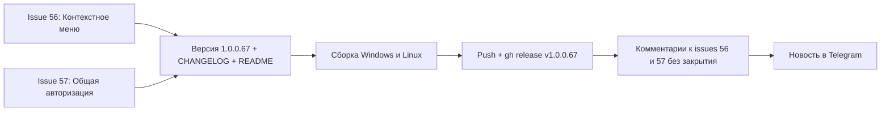

# План релиза v1.0.0.67 (issues #56 и #57)

> Репозиторий: https://github.com/sivatorov/Workspace1C · Локальный workspace: `g:/Yandex.Disk/h/Workspace1C`
> Текущая версия: **1.0.0.66** → целевая: **1.0.0.67** (увеличивается только последнее число, как требует заказчик).
> Issues: **#56 «Правка контекстного меню»**, **#57 «добавить общую авторизацию»** — оба без комментариев, **не закрываются** (только комментарии об исправлении).
> Исполнение — отдельными новыми задачами в mode `code`. Данный файл — техническое задание и карта изменений.

---

## 0. Сводка

| Работа | Новая сущность | Ключевые файлы-образцы | Точки применения |
|---|---|---|---|
| #56 Правка контекстного меню | `ContextMenu*` (модель, каталог, резолвер, store, редактор, окна) | меню «Утилиты»: `UtilitiesMenuLayout` / `UtilitiesMenuCatalog` / `UtilitiesMenuResolver` / `UtilitiesMenuLayoutStore` / `UtilitiesMenuEditorViewModel` / `UtilitiesMenuEditorWindow` | WPF-XAML-меню строки → код; Avalonia `BuildRowContextMenu`; вкладка настроек «Правка меню» |
| #57 Общая авторизация | `AppSettings.CommonAuthorization` + fallback в `InfobaseAuthResolver` + статик `OneCLauncher.CommonAuthorization` | `InfobaseAuthSettings`, `InfobaseAuthResolver`, статические настройки `OneCLauncher.SessionArchitecture` / `DefaultArchitectureMode` | запуск 1С (`BuildArguments`), COM-коннектор (`BuildComConnectString`), окно настроек |

**Зависимости:** #56 и #57 **независимы** (общие только шаги версии/README/CHANGELOG/релиз). Рекомендуемый порядок: сначала #56 (самый объёмный, с переносом WPF-меню в код), затем #57; либо параллельно двумя задачами — конфликтов по файлам почти нет, кроме `AppSettings.cs`, `Localization/Languages/ru.json|en.json`, `SettingsWindow.xaml`/`.Avalonia.cs`.

---

## 1. Issue #56 «Правка контекстного меню»

### 1.1. Суть

Реализовать механизм правки **контекстного меню базы** (ПКМ по строке списка баз в главном окне) по аналогии с готовым редактором меню «Утилиты» (issue #374). В настройках вкладка «Меню Утилиты» переименовывается в «Правка меню» и объединяет оба редактора. Файл компоновки контекстного меню — **`context_menu_layout.json`**.

### 1.2. Текущее состояние (исследовано)

- Меню «Утилиты» — законченный эталонный связный стек:
  - `Models/UtilitiesMenuLayout.cs` — `UtilitiesMenuLayout { SchemaVersion, Root }` + единый узел `UtilitiesMenuNode { Kind("item"|"group"|"separator"), ItemId, GroupId, CustomTitle, IconKey, IconColor, ExternalIconPath, Visible, SeparatorBefore, Children }`;
  - `Services/UtilitiesMenuCatalog.cs` — `UtilitiesMenuCommandKind`, `UtilitiesMenuItem` (метаданные пункта), `UtilitiesMenuCatalog` (каталог `All`/`Find` + группы `GroupNewItems="NewItems"` + темизация иконок), `UtilitiesMenuLayouts.Default()` (стандартная компоновка = текущий вид меню);
  - `Services/UtilitiesMenuResolver.cs` — `Resolve(settings, store)`, `EnsureNewItemsGroup`, `CollectNewItems`, `CollectItemIds`;
  - `Services/UtilitiesMenuLayoutStore.cs` + `Services/IUtilitiesMenuLayoutStore.cs` — файл `utilities_menu_layout.json`, атомарная запись (`*.tmp` + `File.Move`), нормализация битого/ручного файла;
  - `ViewModels/UtilitiesMenuEditorViewModel.cs` — VM редактора (дерево, «вверх/вниз/в группу/в корень», скрытие чекбоксом, группы, разделители, иконки из каталога/файла, сброс, сохранить/загрузить) + `UtilitiesMenuNodeItem` + `UtilitiesGroupEditParams` + `UtilitiesIconOption`;
  - окна `Views/UtilitiesMenuEditorWindow.xaml` / `Views/UtilitiesMenuEditorWindow.Avalonia.cs` + диалог группы;
  - настройка `Models/AppSettings.cs` `UtilitiesMenuEditingEnabled` (settings.json); вкладка настроек в `Views/SettingsWindow.xaml` (строки 1984–2012) и в Avalonia (`Views/SettingsWindow.Avalonia.cs`, строки ~3287/4292);
  - точка регистрации DI — `Services/AppServices.cs` (строка 118);
  - построители меню: WPF `Views/MainWindow.UtilitiesMenu.cs` (динамический `BuildUtilitiesMenu`), Avalonia `MainWindow.Avalonia.Tree.cs` (~1718);
  - локализация: `Localization/Languages/ru.json` (строки 487–491, 1803–1839) и `en.json`.
- **Контекстное меню строки базы**:
  - WPF — **статическая XAML-разметка** (не код!): `Views/MainWindow.xaml` строки 2337–2511 (`ContextMenu` у `LeveledTreeView`, `Opened="OnBaseContextMenu_Opened"`). Динамику наполняют `MainWindow.Columns.cs OnBaseContextMenu_Opened` (заголовок/видимость batch-блока, пометки) и `MainWindow.CustomActions.cs PopulateCustomActionsMenu` (подменю пользовательских действий). Состав: Запуск 1С/Конфигуратор, Выполнить скрипт, Пользовательские действия, В избранное, Закрепить, Добавить базу, блок «Для выделенных (N)», подменю «Обновление и связь»/«Администрирование»/«Резервирование»/«Очистить кэш», Удалить, Найти в списке, Создать ярлык, Копировать строку, Изменить настройки.
  - Avalonia — **уже в коде**: `MainWindow.Avalonia.Tree.cs` `BuildRowContextMenu()` (строка 1993) с той же структурой и `Opening`-динамикой; меню пересобирается при смене настроек/темы/языка (`MainWindow.Avalonia.Events.cs` ~107).
  - Хоткеи и стабилизация выделения завязаны на класс-обработчики `ContextMenu.Opened/Closed` (WPF `MainWindow.Hotkeys.cs`, Avalonia `MainWindow.Avalonia.Events.cs`) — это работает для меню, созданного как кодом, так и XAML, и **не требует изменений** при переходе WPF на код при условии установки `Style`/`DataContext` так же.

### 1.3. Новые файлы (создать)

| # | Файл | Что внутри (по образцу меню «Утилиты») |
|---|---|---|
| 1 | `Workspace1C/Models/ContextMenuLayout.cs` | `ContextMenuLayout { SchemaVersion=1, Root }` + `ContextMenuNode { Kind("item"|"group"|"separator"), ItemId, GroupId, CustomTitle, IconKey, IconColor, ExternalIconPath, Visible, SeparatorBefore, Children }` |
| 2 | `Workspace1C/Services/ContextMenuCatalog.cs` | `enum ContextMenuCommandKind` (все команды ПКМ), класс `ContextMenuItem` (Id, TextKey, DefaultGroup, WpfIconKind, AvaloniaIconKey, IconColor, CommandKind, HotkeyKey, LinuxOnly, IsNew), статический `ContextMenuCatalog` (`All`, `Find`, константы групп `GroupUpdateAndLink/GroupAdministration/GroupBackup/GroupClearCache/GroupTopLevel` + `GroupNewItems`, `GroupTitleKey(...)`, `GroupWpfIconKind(...)`, `GroupAvaloniaIconKey(...)`, `GroupIconColor(...)`), класс `ContextMenuLayouts.Default()` — воспроизводит текущую структуру (см. 1.4) |
| 3 | `Workspace1C/Services/IContextMenuLayoutStore.cs` | интерфейс по образцу `IUtilitiesMenuLayoutStore` (FilePath, Load→`ContextMenuLayout?`, Save) |
| 4 | `Workspace1C/Services/ContextMenuLayoutStore.cs` | реализация: файл `context_menu_layout.json` в каталоге профиля, атомарная запись, нормализация узлов (null-коллекции, `SeparatorBefore` → узел-разделитель, отбрасывание неизвестных ItemId) |
| 5 | `Workspace1C/Services/ContextMenuResolver.cs` | `Resolve(AppSettings?, IContextMenuLayoutStore?)` (off→`Default()`, on→файл или `Default()`), `CollectNewItems`, `EnsureNewItemsGroup`, `CollectItemIds` |
| 6 | `Workspace1C/ViewModels/ContextMenuEditorViewModel.cs` | VM редактора по образцу `UtilitiesMenuEditorViewModel` + `ContextMenuNodeItem` (обёртка узла с Children/Parent/Title/KindLabel/IsVisible/CanToggleVisibility/иконками) + `ContextMenuGroupEditParams` + `ContextMenuIconOption` |
| 7 | `Workspace1C/Views/ContextMenuEditorWindow.xaml` + `.xaml.cs` | окно-редактор (WPF) — дерево + панель операций (по образцу `UtilitiesMenuEditorWindow`) |
| 8 | `Workspace1C/Views/ContextMenuEditorWindow.Avalonia.cs` | окно-редактор (Avalonia) по образцу `UtilitiesMenuEditorWindow.Avalonia.cs` |
| 9 | `Workspace1C/Views/ContextMenuGroupEditWindow.xaml` + `.xaml.cs` + `.Avalonia.cs` | диалог «Правка группы» (имя + иконка) по образцу `UtilitiesGroupEditWindow` |
| 10 | `Workspace1C/Views/MainWindow.ContextMenu.cs` | **(WPF)** код-построитель `BuildRowContextMenu()` + рекурсивный `AppendNodes` + маппинг `ContextMenuCommandKind` → команды/обработчики (перенос из XAML) |

> Иконки «из внешнего файла» и «из каталога» в контекстном меню не требуются (у пунктов уже есть иконки каталога), поэтому редактор контекстного меню **не содержит** блока «Иконки» — упрощённый вариант редактора. Если для симметрии нужен механизм иконок — это опциональное расширение, в ТЗ не включаем (у пунктов ПКМ иконки фиксированы каталогом).

### 1.4. Состав каталога `ContextMenuCatalog.All` (по текущему ПКМ обеих платформ)

Порядок и состав — точно как в дефолтной компоновке WPF XAML (`MainWindow.xaml` 2337–2511) и Avalonia (`BuildRowContextMenu`, 1993–2050, там же batch и Opening-динамика):

1. `LaunchEnterprise` (Main.LaunchEnterprise, хоткей `HotkeyEnterprise`)
2. `LaunchConfigurator` (Main.LaunchConfigurator, `HotkeyConfigurator`)
3. `RunScript` (Script.RunTitle, `HotkeyRunScript`)
4. `CustomActions` — подменю «Пользовательские действия…» (динамическое наполнение в `Opening`/`Opened`); в компоновке видимость/позиция пункта редактируются как у обычного, содержимое всегда динамическое
5. разделитель
6. `ToFavorites` (Main.ToFavorites, `HotkeyFavorite`)
7. `Pin` (Main.Pin, `HotkeyPin`)
8. разделитель
9. `AddBase` (Main.AddBase, `HotkeyAdd`)
10. `BatchOperations` — блок «Для выделенных (N)…» (динамический, виден при эффективном batch-числе ≥ 1; управляется `BatchSelectionHelper`/`OnBaseContextMenu_Opened`)
11. разделитель
12. Группа `GroupUpdateAndLink` «Обновление и связь»: `RefreshConfigInfo` (Main.RefreshConfigInfo), `CheckUpdate` (Updates.CheckTitle, `HotkeyCheckUpdate`), разделитель, `ConfigLink` (Updates.ConfigLink)
13. Группа `GroupAdministration` «Администрирование»: `SessionLock` (SessionLock.Title, `HotkeySessionLock`), разделитель, `RegisterComConnector` (Main.RegisterComConnector; на Linux пункт не строится — платформенный фильтр типа `LinuxOnly`), `NetworkDiagnostics` (Main.NetworkDiagnostics), разделитель, `OpenInfobaseFolder` (Main.OpenCatalog), `CloneBase` (Clone.Title), `CheckIntegrity` (Admin.CheckIntegrity, `HotkeyCheckIntegrity`), разделитель, `LaunchHistory` (Main.LaunchHistory)
14. Группа `GroupBackup` «Резервирование»: `DumpToDt` (Main.DumpToDt), `DumpConfigToCf` (Main.DumpConfigToCf), разделитель, `ShowExportsList` (Restore.Title, `HotkeyExportsList`)
15. Группа `GroupClearCache` «Очистить кэш»: `ClearProgramCache`, `ClearUserCache`, разделитель, `ClearCacheBoth` (хоткей `HotkeyClearCache`)
16. разделитель
17. `Delete` (Main.Delete, `HotkeyDelete`)
18. разделитель
19. `FindInList` (Main.FindInList, `HotkeyFindInList`)
20. `CreateDesktopShortcut` (Main.DesktopShortcut)
21. `CopyConnectionString` (Main.CopyConnectionString)
22. разделитель
23. `EditSettings` (Main.EditSettings, `HotkeyEdit`)

Динамические пункты «Пользовательские действия» и «Для выделенных (N)» нельзя потерять из компоновки (критичны для функции 7 и пакетных операций). Решение: эти два пункта помечаются `Essential=true` — резолвер/редактор гарантируют их наличие в компоновке (видимость по умолчанию true, местоположение — текущее), вести себя в редакторе они могут как обычные пункты.

### 1.5. Изменения существующих файлов

| Файл | Изменение |
|---|---|
| `Models/AppSettings.cs` | добавить `public bool ContextMenuEditingEnabled { get; set; }` рядом с `UtilitiesMenuEditingEnabled` (комментарий — по образцу, упоминание `context_menu_layout.json`) |
| `Services/AppServices.cs` | зарегистрировать `services.AddSingleton<IContextMenuLayoutStore, ContextMenuLayoutStore>();` (блок рядом с `IUtilitiesMenuLayoutStore`) |
| `ViewModels/MainViewModel.cs` | свойство `ContextMenuEditingEnabled` (как `UtilitiesMenuEditingEnabled`, ~232–251), инициализация в конструкторе (~390), сохранение в `SaveSettings()` (~693) |
| `ViewModels/MainViewModel.Avalonia.cs` | свойство `ContextMenuEditingEnabled` через `_settings` (по образцу `UtilitiesMenuEditingEnabled`, ~73–77) |
| `Views/MainWindow.xaml` | **удалить** статический блок контекстного меню (строки 2336–2512) — меню будет строиться кодом; у `LeveledTreeView` сохранить триггеры/стили, добавить комментарий-ссылку на `MainWindow.ContextMenu.cs` |
| `Views/MainWindow.Columns.cs` | адаптировать `OnBaseContextMenu_Opened` (строка 74) под код-меню: ссылаться на создаваемые именованные элементы (batch-подменю, разделители), т.е. хранить ссылки в полях (как в Avalonia) |
| `Views/MainWindow.CustomActions.cs` | `PopulateCustomActionsMenu` — вызывать для подменю `CustomActions` код-меню |
| `Views/MainWindow.Avalonia.Tree.cs` | переписать `BuildRowContextMenu()` на резолвер: `var layout = ContextMenuResolver.Resolve(_vm.Settings, store); EnsureNewItemsGroup; AppendNodes(menu.Items, layout.Root)`. Маппинг `ContextMenuCommandKind` → вызовы/команды — по образцу существующего `BuildUtilitiesMenu` этого же файла (строки ~1718–1991). Сохранить `Opening`-динамику batch/custom-actions только для соответствующих узлов |
| `Views/SettingsWindow.xaml` | вкладка (1984–2012) → «Правка меню»: описание в начале; GroupBox «Меню „Утилиты“» (чекбокс + кнопка „Настроить структуру…“); новая GroupBox «Контекстное меню»: чекбокс `ContextMenuEditingCheck` + кнопка «Настроить структуру…» (`OnContextMenuEdit_Click`). Порядок элементов по требованию issue: первым — общий текст, затем объединённая группа |
| `Views/SettingsWindow.xaml.cs` | новый обработчик `OnContextMenuEdit_Click` (по образцу `OnUtilitiesMenuEdit_Click`, строка 373); применение настройки в сохранении (рядом со строкой 651) |
| `Views/SettingsWindow.Avalonia.cs` | то же в код-интерфейсе: чекбокс `_contextMenuEditingCheck` (по образцу `_utilitiesMenuEditingCheck`, ~4292), применение в `ApplySettings` (~3288), кнопка-обработчик открытия редактора |
| `Localization/Languages/ru.json` | см. 1.6 |
| `Localization/Languages/en.json` | зеркально ru.json |

### 1.6. Ключи локализации

- Изменённые значения (ru):
  - `Settings.TabUtilitiesMenu`: «Меню «Утилиты»» → **«Правка меню»** (заголовок вкладки; ключ сохраняется, меняется текст — fallback локализации не ломается);
  - `Settings.UtilitiesMenu.Hint`: текст расширить — «…Здесь же настраивается структура контекстного меню базы…» (общее описание в начале вкладки).
- Новые (ru + en):
  - `Settings.UtilitiesMenu.GroupTitle` = «Меню „Утилиты“»;
  - `Settings.ContextMenu.GroupTitle` = «Контекстное меню»;
  - `Settings.ContextMenu.EditingEnabled` = «Правка структуры контекстного меню»;
  - `Settings.ContextMenu.EditingEnabledTooltip` = «При включении контекстное меню базы строится по пользовательской компоновке из файла context_menu_layout.json: порядок, видимость, группы пунктов.»;
  - `Settings.ContextMenu.EditButton` = «Настроить структуру…»;
  - `Settings.ContextMenu.Hint` = «Включите правку, чтобы контекстное меню базы строилось по вашей компоновке. Кнопка «Настроить структуру…» открывает редактор: перемещение пунктов, отключение, группировка, разделители, сохранение/загрузка компоновки в файл. Новые пункты программы автоматически попадают в подменю „Новинки программы“.»;
  - `ContextMenu.Editor.*` — комплект по образцу `Utilities.Editor.*` (Title, TreeHeader, KindGroup/KindItem/KindSeparator, CustomGroup, SeparatorLabel, NewGroup, MoveHeader, MoveUpTooltip, MoveDownTooltip, AddGroupTooltip, AddSeparatorTooltip, EditGroupTooltip, DeleteGroupTooltip, GroupDialogTitle, GroupNameLabel, DeleteGroupTitle, DeleteGroupWithItems, DeleteGroupEmpty, MoveToGroupHeader, MoveToGroup, MoveToRoot, MoveToRootTooltip, FileHeader, Save, Load, Reset, Done, Hint) с текстом про «контекстное меню» и `context_menu_layout.json`;
  - `ContextMenu.Submenu.NewItems` = «Новинки программы» (стандартные группы используют существующие ключи `Menu.UpdateAndLink`, `Menu.Administration`, `Menu.Backup`, `Main.ClearCache`).

### 1.7. Юнит-тесты (Workspace1C.Tests)

| Файл | Проверки |
|---|---|
| `ContextMenuCatalogTests.cs` | `Default()` содержит все пункты `Catalog.All` (дефолтная компоновка ≈ каталог, без дублей); иконки/тексты не пусты; `Find` работает; Essential-пункты (`CustomActions`, `BatchOperations`) присутствуют в дефолтной компоновке |
| `ContextMenuResolverTests.cs` | `Resolve(off)` → `Default()`; `Resolve(on, без файла)` → `Default()`; `Resolve(on, файл)` → пользовательская; `EnsureNewItemsGroup` (создание группы при наличии новинок, вставка отсутствующих пунктов, принудительная видимость при наличии новинок и скрытие при отсутствии, перенос группы с сохранением местоположения); Essential-пункты не теряются |
| `ContextMenuLayoutStoreTests.cs` | save→load round-trip; битый JSON → null; атомарная запись (`.tmp` не остаётся); нормализация `SeparatorBefore` → узел-разделитель; отбрасывание узлов с неизвестным `ItemId` |
| `ContextMenuEditorViewModelTests.cs` | построение дерева из компоновки; «вверх/вниз/в группу/в корень»; скрытие пункта; добавление группы/разделителя; правка/удаление группы (с «переместить детей в корень» и без); сброс к стандартной; сохранение → layout эквивалентен дереву; видимость «Новинок» зафиксирована |

### 1.8. Критерии готовности (#56)

- [ ] Вкладка настроек называется «Правка меню»; в начале — общее описание; две группы («Меню „Утилиты“» и «Контекстное меню»); чекбокс «Правка структуры контекстного меню» + кнопка «Настроить структуру…».
- [ ] Редактор структуры контекстного меню открывается с обеих платформ; перемещение/скрытие/группировка/разделители/сброс/сохранение-загрузка работают.
- [ ] Файл `context_menu_layout.json` создаётся в каталоге профиля; битый файл не роняет приложение.
- [ ] При выключенной правке контекстное меню визуально и функционально **идентично** v1.0.0.66 (структура, хоткеи, batch-блок, пользовательские действия, стабилизация выделения).
- [ ] При включённой правке меню строится по компоновке; «Новинки программы» пополняются автоматически.
- [ ] Все новые тесты проходят; WPF и Linux-сборки успешны; ручная проверка ПКМ-меню на Windows и Linux.

---

## 2. Issue #57 «добавить общую авторизацию»

### 2.1. Суть

Настроить **общую авторизацию** для всех информационных баз: если у ИБ задана собственная авторизация (для режима или базы) — использовать её; иначе использовать общую. Применяется при запуске ИБ (1С:Предприятие / Конфигуратор) и при COM-чтении сведений о конфигурации. rac-операции администрирования кластера (импорт, монитор, миграция) — **вне scope** (там своя авторизация администратора из `server_list.json`).

### 2.2. Текущее состояние (исследовано)

- Модель авторизации: `Models/InfobaseAuthSettings.cs` (`AuthenticationMode`, `User`, `Password`, `UseOsAuthentication`, **`IsDefault`** — признак «не задана»); `Models/ConnectionSettings.cs` (`User`/`Password`/`AuthenticationMode`; enum `AuthenticationMode { Prompt, Credentials, Windows }`); `Models/Infobase.cs` (`Connection`, `EnterpriseAuth`, `ConfiguratorAuth`, `ConfiguratorUseEnterpriseAuth`, `Repository`).
- Единый выбор: `Services/InfobaseAuthResolver.cs` `Resolve(infobase, mode, out authMode, out authUser, out authPassword)` — цепочка: `EnterpriseAuth` (для Enterprise) → `ConfiguratorAuth` (для Configurator) → `Connection`. Используется в:
  - `Services/OneCLauncher.Arguments.Shared.cs` `BuildArguments` (строка ~150) — сборка `/N"..." /P"..."`, `/WA+`/`/WA-`; сохранённые ключи подавляются при «Запуске с аутентификацией» (issue #48);
  - `Services/OneCComConnector.cs` `BuildComConnectString` (строка ~1032) — `Usr`/`Pwd` для COM.
- Статические настройки лаунчера — прецедент: `OneCLauncher.SessionArchitecture` и `OneCLauncher.DefaultArchitectureMode` устанавливаются в конструкторе `MainViewModel` (`ViewModels/MainViewModel.cs` строки 420–424) и в сеттерах/сохранении (`MainViewModel.Display.cs` ~507/541). На Avalonia — те же статики + `_settings`.
- Настройки: `AppSettings` (settings.json), загрузка `LoadSettings()` из `IInfobaseRepository`, сохранение WPF `MainViewModel.SaveSettings()` (582–770), Avalonia `SaveSettingsSilently()`/`SaveSettingsSafe()`.
- Окно настроек: вкладка «Настройки» (`Settings.TabGeneral`); вкладка «Авторизация» свойств базы — образец UI-блока авторизации: `ConnectionSettingsViewModel` (радио Prompt/Credentials/Windows + логин/пароль при Credentials, ключи `Connection.ModeLabel`, `Connection.LoginLabel`, `Connection.PasswordLabel` и т.п.).
- Тесты: `Workspace1C.Tests/Etap12AuthTests.cs` (прямой вызов `Resolve`), `Workspace1C.Tests/LaunchWithAuthPromptTests.cs` (прямой вызов `OneCLauncher.BuildArguments`).

### 2.3. Модель хранения

- В `Models/AppSettings.cs`:
  ```
  /// <summary>Общая авторизация для всех ИБ (issue #57): если у базы не задана
  /// собственная (для режима или базы), при запуске подставляются эти
  /// учётные данные. Значения по умолчанию (IsDefault) — авторизация не задана.</summary>
  public InfobaseAuthSettings? CommonAuthorization { get; set; }
  ```
  Сериализуется в `settings.json` в виде объекта `{ AuthenticationMode, User, Password }`. Пароль хранится открыто наряду с паролями ИБ (устоявшийся подход проекта).
- «Задана ли» = `CommonAuthorization is { } a && !a.IsDefault`.

### 2.4. Резолвер

Изменить `Services/InfobaseAuthResolver.cs`:

```
public static void Resolve(Infobase infobase, OneCLaunchMode mode,
    out AuthenticationMode authMode, out string authUser, out string authPassword,
    InfobaseAuthSettings? commonAuth = null)
```

Логика (обратно совместимая + fallback на общую):
1. Enterprise: если `EnterpriseAuth is { } e && !e.IsDefault` → e; иначе шаг 3.
2. Configurator: если `ConfiguratorAuth is { } c && !c.IsDefault` → c; иначе шаг 3. (Флаг `ConfiguratorUseEnterpriseAuth` уже свёрнут в `ConfiguratorAuth` на этапе правки свойств — резолвер не меняется.)
3. **Базовая авторизация (Connection)**: если Connection явно задан (`AuthenticationMode != Prompt || User/Pwd непустые`) → Connection.
4. **Общая авторизация**: если `commonAuth is { } a && !a.IsDefault` → a.
5. Иначе — Prompt с пустыми (прежнее поведение: платформа запросит логин/пароль).

> Поведенческий нюанс (задокументировать в комментарии и CHANGELOG): ранее `EnterpriseAuth != null` использовался, даже если значения дефолтные (Prompt/пусто). Теперь «дефолтный» `EnterpriseAuth` считается незаданным и даёт fallback на Connection → затем на общую. Для пользователей, задавших логин/пароль, поведение не меняется.

### 2.5. Применение при запуске

- В `Services/OneCLauncher.Arguments.Shared.cs` добавить статическое свойство по образцу `SessionArchitecture`:
  ```
  /// <summary>Общая авторизация для всех ИБ (issue #57): fallback при незаданной
  /// авторизации ИБ. Устанавливается из настроек при старте и при сохранении.</summary>
  public static InfobaseAuthSettings? CommonAuthorization { get; set; }
  ```
- В `BuildArguments` (строка ~150) передать его: `InfobaseAuthResolver.Resolve(infobase, mode, out ..., CommonAuthorization);`.
- В `OneCComConnector.BuildComConnectString` (строка ~1032) — передать `OneCLauncher.CommonAuthorization`.
- `MainViewModel` (обе платформы):
  - WPF: поле `_commonAuthorization` (из `settings.CommonAuthorization` в конструкторе, ~391); сеттер свойства `CommonAuthorization` обновляет `OneCLauncher.CommonAuthorization`; сохранение в `SaveSettings()` (`s.CommonAuthorization = _commonAuthorization;`).
  - Avalonia: свойство `CommonAuthorization` через `_settings` с обновлением `OneCLauncher.CommonAuthorization` в сеттере.
- «Запуск с аутентификацией» (issue #48) не затрагивается: `forceAuthPrompt`→`/WA-` имеет приоритет над любым резолвом (строки 155–164 `Arguments.Shared.cs`).

### 2.6. UI (окно настроек)

- WPF `Views/SettingsWindow.xaml`, вкладка «Настройки» (`Settings.TabGeneral`): новая `GroupBox` «Общая авторизация» в конце вкладки:
  - RadioButton «Запрашивать имя и пароль» (`CommonAuthPromptRadio`), «Автоматический вход» (`CommonAuthCredentialsRadio`), «Аутентификация ОС» (`CommonAuthOsRadio`);
  - поля «Логин:» (`CommonAuthUserBox`) и «Пароль:» (`CommonAuthPasswordBox`, PasswordBox), видимость при Credentials;
  - подсказка `Settings.CommonAuth.Hint`;
  - обработчики в `SettingsWindow.xaml.cs`: при открытии — заполнить из `_viewModel.CommonAuthorization`; при сохранении — собрать в VM.
- Avalonia `Views/SettingsWindow.Avalonia.cs`: тот же блок кодом на вкладке «Настройки» (RadioButton + TextBox/PasswordBox + видимость полей через обработчик checked-событий), применение в `ApplySettings`.
- Локализация (ru/en): `Settings.CommonAuth.GroupTitle` = «Общая авторизация», `Settings.CommonAuth.Hint`, режимы/поля — переиспользовать существующие `Connection.ModePrompt`/`Connection.ModeCredentials`/`Connection.ModeOs`/`Connection.LoginLabel`/`Connection.PasswordLabel` (проверить при реализации; при расхождении стиля добавить `Settings.CommonAuth.*`).

### 2.7. Юнит-тесты

| Файл | Проверки |
|---|---|
| `CommonAuthResolverTests.cs` (или расширение `Etap12AuthTests.cs`) | приоритет собственной Enterprise/Configurator/Connection над общей; fallback на общую при незаданной; Prompt, когда нет ни собственной, ни общей; `IsDefault` общей игнорируется; совместимость со старыми вызовами (без параметра) |
| `CommonAuthLaunchArgsTests.cs` | `BuildArguments` с установленным `OneCLauncher.CommonAuthorization` (установить в тесте, сбросить в finally) добавляет `/N"/P"` для дефолтной ИБ; не перекрывает заданную ИБ-авторизацию; при `RequestAuthPrompt` общая авторизация подавляется (`/WA-`); `Windows`-режим общей даёт `/WA+` |
| дополнение COM-тестов | `BuildComConnectString` с общей авторизацией добавляет `Usr=`/`Pwd=` при дефолтной ИБ |

### 2.8. Критерии готовности (#57)

- [ ] Общая авторизация настраивается в окне настроек («Настройки» → «Общая авторизация»), сохраняется в `settings.json` (`CommonAuthorization`).
- [ ] При запуске ИБ с незаданной собственной авторизацией подставляются общие `/N`/`/P` (или `/WA+` для режима ОС); при заданной собственной — собственная.
- [ ] Работает для Предприятия и Конфигуратора, файловых и клиент-серверных ИБ.
- [ ] «Запуск с аутентификацией» выдаёт `/WA-` без общих данных.
- [ ] COM-чтение свойств конфигурации использует ту же общую авторизацию.
- [ ] Новые тесты + `Etap12AuthTests`/`LaunchWithAuthPromptTests` проходят; обе сборки успешны.

---

## 3. Общие шаги релиза (после реализации #56 и #57)

1. **Версия**: `Workspace1C/Workspace1C.csproj` строки 62–65 — `Version`/`AssemblyVersion`/`FileVersion`/`InformationalVersion`: `1.0.0.66` → **`1.0.0.67`**.
2. **CHANGELOG.md**: новый раздел `## [1.0.0.67] — <дата>` с «Добавлено» по #56 и #57 (формат как в записи 1.0.0.66: ссылки на файлы, пометки «Windows и Linux», количество тестов).
3. **README.md**: бейдж (строка 3) и текст «актуальная версия — 1.0.0.66» (строка 11) → **1.0.0.67**.
4. **Сборка**: `build-windows-single-file.ps1` и `build-linux-single-file.ps1` (артефакты в `publish/`, по образцу логов прошлых релизов).
5. **GitHub**: commit + push (сообщение с упоминанием v1.0.0.67 и issues #56, #57); `gh release create v1.0.0.67` с тегом `v1.0.0.67`, приложить exe/linux-бинарник и release notes (по образцу прошлых `_rel_notes_v*.md`).
6. **Комментарии к issues** (`gh issue comment`), НЕ закрывать:
   - #56: реализована правка структуры контекстного меню (вкладка «Правка меню», редактор, `context_menu_layout.json`, «Новинки»), исправлено в 1.0.0.67;
   - #57: добавлена общая авторизация (fallback при незаданной авторизации ИБ), исправлено в 1.0.0.67.
7. **Telegram** (@Workspace1C): новость о 1.0.0.67 (обе функции + ссылка на релиз).

---

## 4. Порядок и зависимости



- Внутри #56 фазы: (1) модели/каталог/резолвер/стор + тесты сервисов; (2) VM редактора + тесты; (3) окна редактора WPF+Avalonia; (4) перестройка контекстного меню WPF (XAML→код) + Avalonia на резолвер; (5) вкладка настроек + локализация; (6) прогон тестов и сборок.
- Внутри #57: (1) `AppSettings.CommonAuthorization`; (2) `InfobaseAuthResolver` + статик + тесты резолвера/аргументов; (3) COM-коннектор; (4) UI настроек WPF+Avalonia + локализация; (5) тесты и сборки.
- Единственные общие файлы задач: `AppSettings.cs`, `Localization/*.json`, `SettingsWindow.xaml(.cs)`/`.Avalonia.cs`. При последовательном выполнении конфликтов нет; при параллельном — мёржить эти файлы.

---

## 5. Риски и митигации

| Риск | Митигация |
|---|---|
| Перенос WPF-контекстного меню из XAML в код (regression: стили `ModernContextMenu`/`ModernMenuItem`, хоткеи, batch-динамика, стабилизация выделения после закрытия меню, ESC-логика) | дефолтная компоновка дословно воспроизводит текущее меню; сохранение `Style`/`DataContext`/`Opened`-обработчика; сравнение меню до/после; ручная проверка Ctrl/Shift-выделения, ПКМ, ESC в меню; юнит-тесты на построитель |
| Расхождение состава пунктов WPF и Avalonia (LinuxOnly, «Зарегистрировать COM-коннектор», SessionLock) | единый каталог с платформенными фильтрами (паттерн `UtilitiesMenuCatalog`); ручной прогон «пункт есть на платформе = есть в меню» на обеих ОС |
| Меню живёт долго — компоновка/новинки могут не подхватиться без перестроения | перестраивать `BuildRowContextMenu` при: старте, смене темы/языка (существующие события), изменении настройки правки; в `Opened`-обработчике перечитывать резолвер (как меню «Утилиты» пересобирается при каждом открытии) |
| `InfobaseAuthResolver` меняется — затронуты COM-чтение и все запуски | параметр со значением по умолчанию `null` (старые вызовы не меняются); при незаданной общей поведение идентично v1.0.0.66; прогон `Etap12AuthTests` + новых тестов; нюанс дефолтного `EnterpriseAuth` задокументировать в CHANGELOG |
| Статик `OneCLauncher.CommonAuthorization` — глобальное состояние в тестах | установка/сброс в `try/finally`; паттерн уже используется (`SessionArchitecture`) |
| Пароль общей авторизации хранится открыто в settings.json | как у паролей ИБ; упомянуть в CHANGELOG и подсказке настройки |
| Расширение вкладки настроек (обе платформы) | только изменение значений существующих ключей + добавление новых; fallback локализации в `LocalizationManager` |

---

## 6. Итоговая декомпозиция задач (для mode code)

### Задача A — Issue #56 (код + тесты + локализация, без версии)
**A1.** Создать `Models/ContextMenuLayout.cs`.
**A2.** Создать `Services/ContextMenuCatalog.cs` (каталог + `Default()`).
**A3.** Создать `Services/IContextMenuLayoutStore.cs` + `Services/ContextMenuLayoutStore.cs`.
**A4.** Создать `Services/ContextMenuResolver.cs`.
**A5.** Создать `ViewModels/ContextMenuEditorViewModel.cs` (+ `ContextMenuNodeItem`, `ContextMenuGroupEditParams`, `ContextMenuIconOption`).
**A6.** Создать окна редактора: `Views/ContextMenuEditorWindow.xaml`/`.xaml.cs`/`.Avalonia.cs` + `Views/ContextMenuGroupEditWindow.*`.
**A7.** `AppSettings.ContextMenuEditingEnabled` + регистрация `IContextMenuLayoutStore` в `AppServices.cs`.
**A8.** WPF: `Views/MainWindow.ContextMenu.cs` (код-построитель) + удаление XAML-блока + адаптация `MainWindow.Columns.cs`/`MainWindow.CustomActions.cs`.
**A9.** Avalonia: `BuildRowContextMenu` на резолвер + каталог; `ContextMenuEditingEnabled` в `MainViewModel.Avalonia.cs`.
**A10.** `MainViewModel.cs` (WPF): свойство + init + `SaveSettings`.
**A11.** Вкладка настроек «Правка меню» (WPF + Avalonia) + локализация ru/en.
**A12.** Тесты: `ContextMenuCatalogTests`, `ContextMenuResolverTests`, `ContextMenuLayoutStoreTests`, `ContextMenuEditorViewModelTests`.

### Задача B — Issue #57 (код + тесты + локализация, без версии)
**B1.** `AppSettings.CommonAuthorization`.
**B2.** `InfobaseAuthResolver.Resolve(..., commonAuth = null)` + статик `OneCLauncher.CommonAuthorization` + применение в `BuildArguments` и `BuildComConnectString`.
**B3.** `MainViewModel` (WPF + Avalonia): свойство, init, сохранение, обновление статика.
**B4.** UI «Общая авторизация» в окне настроек (WPF + Avalonia) + локализация ru/en.
**B5.** Тесты: `CommonAuthResolverTests` (или расширение `Etap12AuthTests`), `CommonAuthLaunchArgsTests`, дополнение COM-тестов.

### Задача C — Релиз v1.0.0.67
**C1.** csproj Version 1.0.0.67; **C2.** CHANGELOG.md; **C3.** README.md (бейдж + текст).
**C4.** Сборка Windows (`build-windows-single-file.ps1`).
**C5.** Сборка Linux (`build-linux-single-file.ps1`).
**C6.** Push + `gh release create v1.0.0.67` + загрузка артефактов.
**C7.** Комментарии к #56 и #57 (без закрытия).
**C8.** Новость в Telegram (@Workspace1C).
