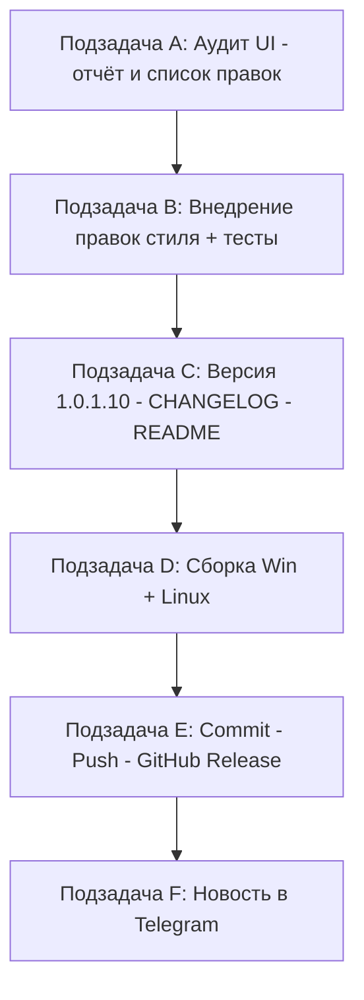

# План: полный аудит UI на стилистическое единство + релиз 1.0.1.10

Проект: **Workspace 1C** (g:/h/Workspace1C), dual-фреймворк UI (WPF + Avalonia).
Текущая версия: **1.0.1.9** ([CHANGELOG.md](../CHANGELOG.md), [Workspace1C.csproj](../Workspace1C/Workspace1C.csproj:62-65)).
Новая версия: **1.0.1.10** (бамп только последнего номера).

## Собранный контекст (результат разведки)

- **UI-слой**: ~70+ окон/модулей. WPF-разметка — `Workspace1C/Views/*.xaml` (MainWindow, SettingsWindow с 12+ partial-классами, CommandPaletteWindow, диалоги клонирования/резервных копий/платформ и т.д.). Avalonia-версии — `*.axaml` (BaseSelectionWindow, CommandPaletteWindow, ClusterImportWindow, DeleteInfobaseWindow, LinkInputWindow, NameInputWindow) и основная масса окон строится кодом в `*.Avalonia.cs`.
- **Темы**: [Workspace1C/Themes/](.) — `ThemeCatalog.cs` (встроенные: light, dark, blue + custom), `LightTheme.axaml/.xaml`, `DarkTheme.axaml/.xaml`, `Controls.axaml`, `ControlDefaults.axaml`, `Icons.axaml` + 5 наборов иконок (Fluent, Glass, MacOS, Material, Outline, WindowsXp), `ThemeManager.cs`, `ThemeBrushes`, `WindowButtonStyle.cs`. Палитры в [design/icons/gen.py](../design/icons/gen.py) (palette_amber/graphite/light/night).
- **Локализация**: `Workspace1C/Localization/Languages/ru.json`, `en.json` — все тексты UI идут через ключи локализации (`LocExtension`).
- **Стилевые тесты** (Workspace1C.Tests, ломать нельзя): `AccentColorIssue26Tests.cs`, `ButtonThemeBindingTests.cs`, `Issue26ButtonUniformityTests.cs`, `Issue26WindowButtonTests.cs`, `Issue26SyncWindowButtonsTests.cs`, `Issue26ContrastToggleZebraGuardTests.cs`, `Issue60SearchIconColorTests.cs`, `Issue61DarkPaletteAuditTests.cs`, `Issue61TitleColorsTests.cs`, `Issue63InputBackgroundBrushTests.cs`, `Issue76RowBackgroundTests.cs`, `IconSetCoverageTests.cs`, `IconSetResolutionTests.cs`, `ColorSchemeThemeTests.cs`, `ColorSchemeGeneratorTests.cs`, `FullThemeSelectionTests.cs`, `FontFamilyResolverTests.cs`, `AppSettingsThemeMigrationTests.cs` и др.
- **Сборка**: [_build_v10019.ps1](../_build_v10019.ps1) — Windows: `Workspace1C/build-windows-single-file.ps1` (WPF, net10.0-windows, self-contained single-file → `dist/win-x64/Workspace1C.exe`), Linux: `Workspace1C/build-linux-single-file.ps1` (Avalonia, кросс-компиляция → `dist/linux-x64/Workspace1C`). Артефакты копируются в `publish\out-1.0.1.10\` как `Workspace1C.exe` и `Workspace1C-linux-x64`. Версия берётся из csproj (проверка FileVersion).
- **Telegram**: референс [_send_telegram_v10019.ps1](../_send_telegram_v10019.ps1) — токен из `$env:WORKSPACE1C_TG_BOT_TOKEN` либо из `%APPDATA%\Workspace1C\profiles\<id>\notifications.json`; chat_id форсируется `-1004425443528`; текст из UTF-8 файла `_telegram_msg_v*.txt`, percent-encoding, `api.telegram.org/bot<token>/sendMessage`. Альтернатива — headless-мост приложения `--telegram-send` ([docs/telegram-dev-bridge.md](../docs/telegram-dev-bridge.md)).
- **GitHub**: релизы по паттерну `_rel_notes_v*.md`, `gh release create v1.0.1.10` с ассетами `Workspace1C.exe` / `Workspace1C-linux-x64`; коммит-сообщения по паттерну `_commit_msg_v10019.txt`.

## Схема выполнения (зависимости)

Строгая последовательность: A → B → C → D → E → F. Параллелить нельзя: D собирает результат B+C, E публикует артефакты D, F ссылается на URL релиза E.

---

## Подзадача A — Аудит UI на стилистическое единство
**Режим:** architect (исследование) с элементами ask/code-анализа. Код не пишется.

**Входные данные:**
- Каталоги `Workspace1C/Views/`, `Workspace1C/Themes/`, `Workspace1C/Controls/`, `Workspace1C/Localization/Languages/*.json`.
- Существующие аудиты как прецедент: `Issue61DarkPaletteAuditTests.cs`, issue #26 (единообразие кнопок), `notes.md`, `plan-issues-*.md`.
- Скриншоты: `screenshots/`, `docs/img/main-window.png`.

**Объём работ:**
1. Составить полный реестр окон/модулей UI (главное окно, окно настроек с вкладками, командная палитра, ~70 диалогов, профили, дерево баз, трей-меню).
2. Для каждого модуля проанализировать 5 аспектов:
   - **Типографика**: шрифты (SettingsWindow.Fonts.cs, FontFamilyResolver), размеры/насыщенность заголовков, метки, отступы.
   - **Палитра**: использование theme-brushes vs хардкод цветов (DynamicResource/StaticResource vs `#RRGGBB`), консистентность Light/Dark/Blue тем, контраст.
   - **Иерархия**: порядок и группировка элементов, отступы, размеры кнопок, единые панели диалогов.
   - **Иконки/символы**: покрытие IconSet (IconSetCoverageTests), единообразие эмодзи vs векторных иконок vs текстовых символов в кнопках/меню.
   - **Тексты/тон**: формулировки кнопок и сообщений («ОК/Да/Закрыть», многоточие у команд, заглавные буквы, термины 1С), полнота локализации ru/en.
3. Греп-поиски: хардкод `#[0-9A-Fa-f]{6}` в xaml/axaml и `*.Avalonia.cs`; `Brushes.` и `Colors.` в коде; прямые строки текста вместо ключей локализации; `FontSize=` вне словарей.
4. Оформить отчёт: таблица нарушений по модулям, приоритизация (критичные/средние/косметика), **конкретный список правок** с указанием файлов и строк.

**Критерии завершения:** отчёт-документ (в `plan-ui-audit-v100110-report.md` или issue) с выводами по 5 аспектам и исчерпывающим, проверяемым списком правок; каждая правка привязана к файлу/окну.

**Результат (result):** путь к отчёту + краткое резюме: количество найденных несоответствий по каждому аспекту, топ-10 приоритетных правок.

---

## Подзадача B — Внедрение правок единого стиля
**Режим:** code.

**Входные данные:** отчёт из подзадачи A; словари тем `Workspace1C/Themes/` как источник истины; тесты из списка выше.

**Объём работ:**
1. Провести правки по списку A, приоритет «сначала общие словари, затем точечные окна»: вынесение хардкод-цветов в theme-brushes, унификация типографики через существующие стили `Controls.axaml`/`ControlDefaults.axaml`, приведение иконок к единому механизму IconSet, правка текстов через ключи `Localization/Languages/ru.json`+`en.json` (оба языка обязательно).
2. Соблюдать dual-фреймворк: каждая правка UI выполняется и в WPF (`*.xaml`/`*.cs`), и в Avalonia (`*.axaml`/`*.Avalonia.cs`) — прецеденты см. в issue #79 (TestDeployWindow.cs + TestDeployWindow.Avalonia.cs).
3. Новые/изменённые ключи локализации — в оба файла ru.json и en.json (тесты LocalizationCoverageServicesTests).
4. Прогнать `dotnet test` (Workspace1C.Tests) — все стилевые тесты (Issue26*, Issue60/61/63/76, IconSet*, ColorScheme*, ButtonThemeBindingTests, FullThemeSelectionTests) зелёные; при добавлении новых стилевых гарантий — добавить/обновить тесты по образцу `AccentColorIssue26Tests.cs`.

**Критерии завершения:** все правки отчёта A внедрены (или осознанно отложены с пометкой), `dotnet build` и `dotnet test` проходят без предупреждений новых регрессий, список изменённых файлов приложен.

**Результат (result):** перечень изменённых файлов по пунктам отчёта A, вывод `dotnet test` (количество тестов, все зелёные), список отложенных пунктов с обоснованием.

---

## Подзадача C — Версия 1.0.1.10 + CHANGELOG + README
**Режим:** code.

**Входные данные:** список изменений из подзадачи B; референсы `_rel_notes_v10019.md`, записи `[1.0.1.9]`/`[1.0.1.8]` в CHANGELOG.md.

**Объём работ:**
1. [Workspace1C/Workspace1C.csproj](../Workspace1C/Workspace1C.csproj:62-65): `Version`, `AssemblyVersion`, `FileVersion`, `InformationalVersion` — все с `1.0.1.9` → `1.0.1.10` (только последний номер).
2. CHANGELOG.md: новая запись `## [1.0.1.10] — <дата>` сверху, стиль как у `[1.0.1.9]` (разделы «Исправлено / Добавлено», «Тесты», ссылки на файлы и аспекты аудита).
3. README.md: обновить упоминания версии/скриншоты при необходимости (проверить grep `1.0.1.9` и «версия»).
4. Проверить, что нигде не осталось старой версии в коде UI (заголовок окна) — поищется на этапе сборки по FileVersion.

**Критерии завершения:** grep `1\.0\.1\.9` в csproj — 0 совпадений; CHANGELOG содержит запись 1.0.1.10 в правильном формате; README согласован.

**Результат (result):** список изменённых файлов, текст записи CHANGELOG для переиспользования в release notes.

---

## Подзадача D — Сборка Windows и Linux
**Режим:** code (терминальная работа).

**Входные данные:** референс [_build_v10019.ps1](../_build_v10019.ps1) (копия под 1.0.1.10: `$Version='1.0.1.10'`, лог `_publish_100110.log`, выход `publish\out-1.0.1.10\`).

**Объём работ:**
1. Создать `_build_v100110.ps1` по образцу `_build_v10019.ps1` (изменить только версию/пути).
2. Запустить его; убедиться: `dist/win-x64/Workspace1C.exe` — FileVersion 1.0.1.10; `dist/linux-x64/Workspace1C` собран; оба файла скопированы в `publish\out-1.0.1.10\` (`Workspace1C.exe`, `Workspace1C-linux-x64`).
3. При несоответствии FileVersion — стоп и возврат к подзадаче C.

**Критерии завершения:** скрипт завершился с `=== DONE ===`, оба артефакта лежат в `publish\out-1.0.1.10\`, FileVersion = 1.0.1.10.

**Результат (result):** лог сборки (`_publish_100110.log`), размеры артефактов, подтверждение версий.

---

## Подзадача E — Commit/Push и GitHub Release
**Режим:** code (git/gh CLI). **НЕ закрывать issues самостоятельно.**

**Входные данные:** референсы `_commit_msg_v10019.txt`, `_rel_notes_v10019.md`, `.github/workflows/release.yml`, артефакты из `publish\out-1.0.1.10\`.

**Объём работ:**
1. Составить `_commit_msg_v100110.txt` по образцу v10019; включить изменённые исходники, csproj, CHANGELOG, README, скрипты сборки; служебные файлы (`_telegram_msg_*`, `_rel_notes_*`, логи) — по устоявшейся практике репозитория.
2. `git add` → `git commit` → `git push`.
3. Составить `_rel_notes_v100110.md` (взять текст из CHANGELOG-записи).
4. `gh release create v1.0.1.10 publish/out-1.0.1.10/Workspace1C.exe publish/out-1.0.1.10/Workspace1C-linux-x64 --title "Workspace 1C 1.0.1.10" --notes-file _rel_notes_v100110.md`.
5. Issues не закрывать и не комментировать без явного поручения пользователя.

**Критерии завершения:** push успешен; релиз v1.0.1.10 существует на github.com/sivatorov/Workspace1C с двумя ассетами; issues не тронуты.

**Результат (result):** хеш коммита, URL релиза, список ассетов.

---

## Подзадача F — Новость в Telegram-канал
**Режим:** code.

**Входные данные:** референс [_send_telegram_v10019.ps1](../_send_telegram_v10019.ps1); [_telegram_msg_v10019.txt](../_telegram_msg_v10019.txt) как образец тона сообщения; [docs/telegram-dev-bridge.md](../docs/telegram-dev-bridge.md) (альтернатива — headless `--telegram-send` собранного бинаря).

**Объём работ:**
1. Составить `_telegram_msg_v100110.txt` — анонс релиза 1.0.1.10: краткий обзор аудита UI и что изменено, ссылка на релиз `https://github.com/sivatorov/Workspace1C/releases/tag/v1.0.1.10`; тон как в прошлых сообщениях.
2. Создать `_send_telegram_v100110.ps1` по образцу v10019 (токен из env/notifications.json, chat_id форс `-1004425443528`, UTF-8, percent-encoding).
3. Отправить; при блокировке сети — использовать прокси-переменную `W1C_TELEGRAM_PROXY` из доки.
4. Убедиться, что сообщение появилось в канале (успешный ответ `message_id`).

**Критерии завершения:** `OK: message sent (message_id=…)`; пост виден в канале.

**Результат (result):** message_id, текст поста.

---

## Контрольные проверки плана

- Правки B не должны ломать стилевые тесты: полный прогон `dotnet test` обязателен до C.
- Версия во всех 4 полях csproj меняется синхронно (сборочный скрипт проверяет FileVersion).
- Dual-фреймворк (WPF + Avalonia) — каждая правка в двух реализациях.
- Локализация ru+en синхронно.
- Issues на GitHub не закрываются в рамках этой задачи.
