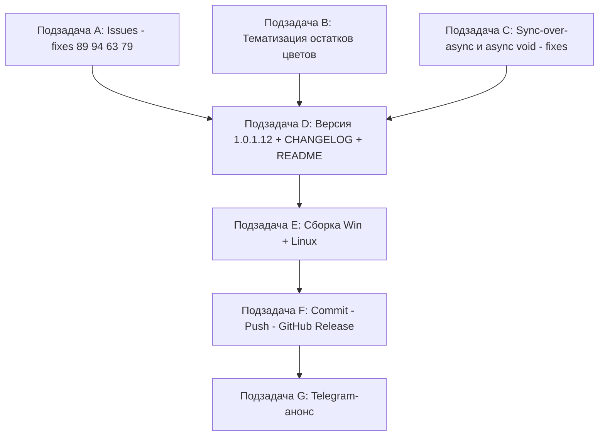

# План выпуска версии 1.0.1.12 (сборка v100112)

Проект: **Workspace 1C** (g:/h/Workspace1C), dual-фреймворк UI (Windows: WPF, Linux: Avalonia).
Текущая версия: **1.0.1.11** ([Workspace1C.csproj:62-65](Workspace1C/Workspace1C.csproj:62),
[CHANGELOG.md:14](CHANGELOG.md:14), [README.md:3](README.md:3)).
Новая версия: **1.0.1.12** — бамп только последнего номера (метка/сборка: `v100112`).

> Примечание: в постановке задача указана как «1.0.0.111 → 1.0.0.112», однако фактически
> в репозитории версия `1.0.1.11` (метка `v100111`, скрипты `_build_v100111.ps1` /
> `_send_telegram_v100111.ps1`). Бамп последнего числа даёт **1.0.1.12** — все 4 свойства
> версии в csproj (`Version`, `AssemblyVersion`, `FileVersion`, `InformationalVersion`)
> меняются синхронно.

---

## 1. Собранный контекст (результат разведки)

- **Структура**: один [Workspace1C.csproj](Workspace1C/Workspace1C.csproj) с условной
  компиляцией (Windows: `net10.0-windows` WPF; Linux: `net10.0` Avalonia, символ `LINUX`).
  Слои: `Models/` (чистые), `Services/` (бизнес-логика + `*.Linux.cs`),
  `ViewModels/` (MVVM, partial-классы MainViewModel), `Views/` (окна: `*.xaml`/`*.xaml.cs`
  WPF и `*.axaml`/`*.Avalonia.cs` Avalonia), `Themes/`, `Localization/Languages/*.json`.
  Тесты: [Workspace1C.Tests](Workspace1C.Tests) — 5264 теста, включая стилевые
  (`SemanticPaletteAuditTests`, `Issue26*`, `Issue61*`, `IconSet*`).
- **Предыдущие планы**: [plan-ui-audit-v100110.md](plan-ui-audit-v100110.md) — аудит UI
  выполнен и выпущен в 1.0.1.10 (тематизация ~90 цветов, типографика, локализация).
  1.0.1.11 закрыл блок задач по issues #57/#63/#79/#83/#89/#92/#94 (см. CHANGELOG).
  **Дублировать уже сделанное нельзя** — план ниже только про остаток.
- **Открытые issues** ([_issues_to_work_2026-10-31.md](_issues_to_work_2026-10-31.md)):
  7 отобранных (#57, #63, #79, #83, #89, #92, #94). Большая часть уже правилась в 1.0.1.11,
  но по последним комментариям 7OH от 2026-10-31 остаются нерешёнными хвосты (см. п.2).
  **Issues не закрываем и не комментируем — это делает пользователь.**
- **Релизный конвейер** (по прецеденту v100110/v100111): скрипт `_build_v1001XX.ps1`
  (сборка Win+Linux single-file → `publish\out-1.0.1.12\`), `_commit_msg_v*.txt`,
  `_rel_notes_v*.md`, `gh release create vX.Y.Z.W` с двумя ассетами,
  `_send_telegram_v*.ps1` (chat_id `-1004425443528`).

---

## 2. Найденные проблемы (анализ кода, UI/UX, производительности)

### 2.1. Баги и antipatterns в коде

| # | Проблема | Где | Приоритет |
|---|----------|-----|-----------|
| A1 | **Linux-автообновление не устанавливается.** Ассет `Workspace1C-linux-x64` выбирается и скачивается верно (проверено 1.0.1.9 на 1.0.1.11-логике), но в конце «Не удалось установить обновление»; в temp остаётся только `.etag` — отсутствует/ломается шаг установки бинарника (замена файла, `chmod +x`, перезапуск) | `Services/UpdateService.Avalonia.cs` и цепочка установки Linux | **Высокий** (issue #89) |
| A2 | **Зависание закрытия модального окна Свойств на Linux** после вкладки «Идентификатор»: трассировка `cm_modal_trace.log` (issue #94) показывает `hiddenWithoutClose=True` и повторные `OnClosing` — в 1.0.1.11 добавлена только диагностика; root cause не устранён | `Views/ConnectionSettingsWindow.Avalonia.cs`, `ShowDialogSync`-мост | **Высокий** |
| A3 | **AsyncRelayCommand.Execute — `async void` без catch**: исключение из задачи не обрабатывается (только `finally`), падение уходит в глобальный обработчик без контекста команды | [RelayCommand.Avalonia.cs:68-84](Workspace1C/ViewModels/RelayCommand.Avalonia.cs:68), [RelayCommand.cs:75](Workspace1C/ViewModels/RelayCommand.cs:75) | Средний |
| A4 | **~74 `async void`-обработчика** в окнах/VM без единообразной обработки ошибок (точечно проверить критичные: `OnCheckAll`, `Run_Click`, `ExecuteRunBackupScenario`, `OnSearchClick`); часть дублируется парно WPF/Avalonia | Views/, ViewModels/ | Средний |
| A5 | **Блокирующее `Dispatcher.Invoke(...).Wait()`** — риск дедлока/заморозки | [PlatformUpdateWindow.Avalonia.cs:183-193](Workspace1C/Views/PlatformUpdateWindow.Avalonia.cs:183) и [:648-658](Workspace1C/Views/PlatformUpdateWindow.Avalonia.cs:648) | Средний |
| A6 | **`gate.Wait()`** — синхронная блокировка в VM | [ServerMonitorViewModel.cs:1164](Workspace1C/ViewModels/ServerMonitorViewModel.cs:1164) | Средний |
| A7 | **sync-over-async в таймерах/фоновых колбэках**: `ProcessDueAsync().GetAwaiter().GetResult()` | [SchedulerService.cs:206](Workspace1C/Services/SchedulerService.cs:206), [SettingsSyncRunner.cs:119](Workspace1C/Services/Sync/SettingsSyncRunner.cs:119) | Средний |
| A8 | **`Thread.Sleep(150)` debounce** с последующим `Dispatcher.Invoke(SaveSettings)` | [MainViewModel.Tools.cs:177-179](Workspace1C/ViewModels/MainViewModel.Tools.cs:177) | Низкий |
| A9 | **Синхронное скачивание в CLI** с таймаутом 20 мин (`GetAwaiter().GetResult()`) — приемлемо для CLI, но отметить/обернуть | [CliCommands.cs:316-323](Workspace1C/Services/CliCommands.cs:316), [CliTelegramCommands.cs:36](Workspace1C/Services/CliTelegramCommands.cs:36) | Низкий |
| A10 | **MCP-обработчик блокирует поток**: `Handler(...).GetAwaiter().GetResult()` | [McpServer.cs:184](Workspace1C/Services/Mcp/McpServer.cs:184) | Низкий |
| A11 | **Блокирующие пакетные операции дизайнера** (`BatchTimeout`-цепочки) вызываются синхронно — проверить, что вызовы всегда из фонового потока, а не из UI | [RepositoryStorageService.cs:115,209,252,297](Workspace1C/Services/RepositoryStorageService.cs:115), [ConfigurationDiffService.cs:175](Workspace1C/Services/ConfigurationDiffService.cs:175), [MetadataExplorerService.cs:137](Workspace1C/Services/MetadataExplorerService.cs:137), [ServerCloneService.cs:85,140](Workspace1C/Services/ServerCloneService.cs:85) | Средний (аудит) |
| A12 | **Аудит-фиксация**: `AvaloniaDialogService.cs:222` (`GetResult` в мосте синхронных диалогов) — осознанный синхронный мост; задокументировать риск дедлока или перевести на безопасный помпинг | [AvaloniaDialogService.cs:222](Workspace1C/Services/AvaloniaDialogService.cs:222) | Низкий |

### 2.2. UI/UX проблемы

| # | Проблема | Где | Приоритет |
|---|----------|-----|-----------|
| U1 | **~115 остатков хардкод-цветов в Avalonia code-build** — после аудита 1.0.1.10 не тематизированы: статусы успеха/ошибки `#16A34A`/`#EF4444`, предупреждения `#F59E0B`/`#D97706`, фиолетовые акценты `#7C3AED`/`#8B5CF6`, служебные `#2E8B57`, `#2E7D32`, `#E53935`, `#1E293B` и др. В тёмной теме и пользовательских схемах выглядят чуждо. Пары окон WPF/Avalonia править синхронно | `Views/*.Avalonia.cs`: ActualReleasesWindow, ConfigTypeEditWindow, ConfigDiffSetupWindow, DetectConfigurationsWindow, CacheCleanWindow, DeleteInfobaseWindow, ProfilesWindow, MaintenanceCenterWindow, ServerMonitorWindow, ServicesWindow, ServiceGroupEditWindow, SettingsWindow.Avalonia.cs, UsageStatisticsWindow, PlatformVersionPickerWindow, FindLostBasesWindow и др. | **Высокий** (продолжение аудита 1.0.1.10) |
| U2 | **Окно «Развернуть тестовую копию» (issue #79)**: (а) при галке «Использовать авторизацию ИБ» блокируются поля и кнопка «Подставить из базы», а ibcmd всё равно требует профиль; (б) дубль кнопки «Учётные данные ИБ для ibcmd»; (в) нужна кнопка выбора/создания профиля СУБД прямо в окне; (г) каракули в выводе ibcmd (кодировка — чинилась в 1.0.1.11, проверить) | `Views/TestDeployWindow.cs` / `TestDeployWindow.Avalonia.cs`, VM | **Высокий** |
| U3 | **Окно публикации (issue #63)**: (а) поле выбора сервера Apache узкое — обрезает надписи (просьба расширить в 1,5 раза); (б) поля редактируемые, но залиты как readonly; (в) выбор файла алиасов `1c8Aliases*` по умолчанию при выборе сервера | `Views/PublicationWindow*` / сервисы Apache | Средний |
| U4 | **Вкладка «Лицензии» сервера (issue #83)**: понятная надпись в UI, когда `ring` не найден или модуль `license` не зарегистрирован (сейчас только журнал); просьба разместить вкладку перед «Информация о кластере» | `Views/ServerMonitorWindow.*` | Средний |
| U5 | **Общая авторизация (issue #57)**: в 1.0.1.11 подстановка для режима Prompt сделана; проверить кейс «Demo 27 File» (Prompt + общая авторизация «Автоматический вход») и что логин попадает в командную строку во всех точках запуска | `Services/InfobaseAuthResolver.cs` + точки запуска | Средний (верификация) |
| U6 | **Массовая выгрузка DT/CF (issue #92)**: сохранение шаблона и папки между вызовами (если ещё не сохраняется); перевод подменю «Резервирование» контекстного меню — вопрос к пользователю, не делать самовольно | `Views/ExportsListWindow.*`, окно массовой выгрузки | Низкий |

### 2.3. Производительность

| # | Проблема | Где |
|---|----------|-----|
| P1 | Sync-over-async на пути UI: A5–A8, A10, A11 (см. таблицу 2.1) — заморозка UI при долгих операциях | Views/, Services/, ViewModels/ |
| P2 | `Thread.Sleep`-поллинги при ожидании файла лога дизайнера (120/80 мс циклы) — приемлемо в фоне, но вынести из UI-потока | [OneCLauncher.DesignerBatch.cs:485-497](Workspace1C/Services/OneCLauncher.DesignerBatch.cs:485), `*.Linux.DesignerBatch.cs` |
| P3 | Автообновление монитора сервера каждые 5 с — уже с кэшем `cluster info`; сохранить выбор/фильтр (сделано), дополнительно не пересоздавать строки без изменений данных (diff-обновление строк `RacJobRow`) | [ServerMonitorViewModel.cs](Workspace1C/ViewModels/ServerMonitorViewModel.cs) |
| P4 | Повторные `Dispatcher.Invoke` на каждый элемент в циклах массовых операций (`MainViewModel.Tools.cs:1596`) — группировать в один Invoke на батч | [MainViewModel.Tools.cs:1595-1605](Workspace1C/ViewModels/MainViewModel.Tools.cs:1595) |

### 2.4. Потенциальный новый функционал (предложения)

- **F1. Ручной запуск регламентного задания rac** и **редактирование расписания**
  (`job schedule set`) — прямое продолжение вкладки «Регламентные задания»
  (ограничения зафиксированы в [ARCHITECTURE.md:146](ARCHITECTURE.md:146)).
- **F2. Экспорт сводки мониторинга сервера** (сессии/лицензии/задания) в файл
  (TXT/CSV) — для отчётов администратора.
- **F3. Диалог «Что нового»** после автообновления: показ верхних пунктов CHANGELOG
  встроенным средством (локализованно, обе платформы).
- **F4. История запусков регламентных заданий глубже последнего** (rac) — при наличии
  данных в выводе утилиты.
- Приоритет в v100112 — **F1** (малый объём, логичное продолжение), остальные — в бэклог
  следующих версий.

---

## 3. Схема выполнения (зависимости)

Последовательность: A, B, C — параллельно (разные файлы, но B и C трогают смежные места
в Views — лучше B → C); затем D → E → F → G строго последовательно.
После каждой кодовой подзадачи — `dotnet test` (все 5264 теста зелёные).

---

## 4. Подзадачи для делегирования

### Подзадача A — Доводка открытых issues (#89, #94, #63, #79, #57)
**Режим:** code. Вход: [_issues_to_work_2026-10-31.md](_issues_to_work_2026-10-31.md),
CHANGELOG-запись 1.0.1.11 (что уже сделано — не дублировать).

1. **#89 (A1)**: довести установку обновления на Linux — после загрузки бинарника:
   атомарная замена файла (rename-схема), `chmod +x`, рестарт процесса; при невозможности
   замены работающего бинаря — понятное сообщение и инструкция ручной замены; диагностика
   в `CM_UPDATES` на каждом шаге установки. Проверить отсутствие «висящих» `.etag` в temp.
2. **#94 (A2)**: по трассе `cm_modal_trace.log` найти root cause зависания закрытия
   `ConnectionSettingsWindow` (Avalonia) после вкладки «Идентификатор»
   (`hiddenWithoutClose=True`); исправить, а не только диагностировать.
3. **#63 (U3)**: расширить поле выбора сервера Apache; редактируемые поля не должны
   выглядеть readonly; файл `1c8Aliases*.conf` из include-цепочки выбирать по умолчанию;
   проверить (по коммент. 20) сценарий «LoadModule-дубль в чужом include-файле».
4. **#79 (U2)**: убрать дубль кнопки учётных данных ibcmd; кнопка профиля СУБД в окне;
   разблокировка «Подставить из базы» при галке авторизации ИБ; верифицировать кодировку
   вывода ibcmd (исправление 1.0.1.11).
5. **#57 (U5)**: верификационный прогон кейса «Prompt-база + общая авторизация» — при
   воспроизведении доделать подстановку кред в командную строку.

**Готово:** перечисленные пункты исправлены на обеих платформах; `dotnet build` + `dotnet test`
зелёные; issues не закрыты (комментарии пишет пользователь).

### Подзадача B — Тематизация остатков хардкод-цветов (продолжение аудита UI)
**Режим:** code. Вход: перечень U1 (п.2.2), словари `Themes/`, тесты
`SemanticPaletteAuditTests.cs`, `Issue61*`, `Issue63*`.

1. Заменить остатки `Color.Parse("#...")` / `Brush.Parse("#...")` в `Views/*.Avalonia.cs`
   на семантические кисти (`SuccessBrush`/`WarningBrush`/`ErrorBrush`/`InfoBrush`/
   `TextSecondaryBrush`/`AccentBrush`/`ZebraRowBrush`…) с fallback, по образцу
   `ConfigDiffResultWindow.Avalonia.cs:200-204`.
2. Синхронно проверить WPF-пары окон (`.xaml`/`.xaml.cs`) — не осталось ли там аналогов
   тех же хардкодов (аудит 1.0.1.10 закрывал WPF шире — сверить пары).
3. Дополнить `SemanticPaletteAuditTests` запрещающим паттерном на новые места (по
   прецеденту теста аудита), не ломая существующие 5264 теста.

**Готово:** grep `Color\.Parse\("#` в `Views/*.Avalonia.cs` даёт только осознанные fallback/
системные цвета (трафик-светофор кнопок окна, оверлеи); тесты зелёные.

### Подзадача C — Устранение блокировок и обработка ошибок асинхронности
**Режим:** code. Вход: перечень A3–A8, A10, A11, P4 (п.2.1, 2.3).

1. `AsyncRelayCommand.Execute` (обе платформы): добавить `catch` — логирование + диалог
   об ошибке (как в глобальном обработчике), сохраняя `IsExecuting`-семантику.
2. [PlatformUpdateWindow.Avalonia.cs](Workspace1C/Views/PlatformUpdateWindow.Avalonia.cs:183):
   убрать `Dispatcher.Invoke(...).Wait()` → `await`/`InvokeAsync` без блокировки.
3. [ServerMonitorViewModel.cs:1164](Workspace1C/ViewModels/ServerMonitorViewModel.cs:1164):
   `gate.Wait()` → асинхронное ожидание (`await gate;` / `TaskCompletionSource`).
4. [SchedulerService.cs:206](Workspace1C/Services/SchedulerService.cs:206),
   [SettingsSyncRunner.cs:119](Workspace1C/Services/Sync/SettingsSyncRunner.cs:119):
   перейти на fire-and-forget с логированием или async-таймер.
5. [MainViewModel.Tools.cs:177-179](Workspace1C/ViewModels/MainViewModel.Tools.cs:177):
   `Thread.Sleep(150)` → `Task.Delay` + `BeginInvoke`.
6. Группировка `Dispatcher.Invoke` в циклах массовых операций (P4) — один Invoke на батч.
7. Не переписывать осознанные синхронные мосты (`AvaloniaDialogService`, CLI-команды) —
   только задокументировать комментариями.

**Готово:** не осталось `GetAwaiter().GetResult()`/`Wait()`/`Thread.Sleep` на пути UI
(кроме задокументированных мостов); тесты зелёные.

### Подзадача D — Версия 1.0.1.12 + CHANGELOG + README
**Режим:** code.

1. [Workspace1C.csproj:62-65](Workspace1C/Workspace1C.csproj:62): `1.0.1.11` → `1.0.1.12`
   во всех 4 свойствах (`Version`, `AssemblyVersion`, `FileVersion`, `InformationalVersion`).
2. [CHANGELOG.md](CHANGELOG.md:14): новая запись `## [1.0.1.12] — 2026-10-31` сверху,
   стиль как у `[1.0.1.11]` (разделы по тематикам, ссылки на файлы, раздел «Тесты»).
3. [README.md](README.md:3): бейдж версии (строка 3), упоминание актуальной версии
   (строка 11), при необходимости — строка 205 (добавить сводку 1.0.1.12).
4. Проверить grep `1\.0\.1\.11` — не осталось в коде UI/заголовках.

**Готово:** csproj/CHANGELOG/README согласованы; текст CHANGELOG-записи переиспользуется
для release notes.

### Подзадача E — Сборка Windows и Linux
**Режим:** code (терминал). Вход: [_build_v100111.ps1](_build_v100111.ps1).

1. Создать `_build_v100112.ps1` (версия `1.0.1.12`, лог `_publish_100112.log`,
   выход `publish\out-1.0.1.12\`).
2. Запустить; проверить FileVersion `1.0.1.12` у `dist/win-x64/Workspace1C.exe` и
   наличие `dist/linux-x64/Workspace1C`; артефакты в `publish\out-1.0.1.12\`.

**Готово:** `=== DONE ===`, два артефакта, FileVersion совпадает.

### Подзадача F — Commit/Push и GitHub Release
**Режим:** code (git/gh CLI). **Issues не закрывать и не комментировать.**

1. `_commit_msg_v100112.txt` по образцу `_commit_msg_v100111.txt`.
2. `git add` (исходники, csproj, CHANGELOG, README, скрипты) → commit → push.
3. `_rel_notes_v100112.md` из CHANGELOG-записи.
4. `gh release create v1.0.1.12 publish/out-1.0.1.12/Workspace1C.exe
   publish/out-1.0.1.12/Workspace1C-linux-x64 --title "Workspace 1C 1.0.1.12"
   --notes-file _rel_notes_v100112.md`.

**Готово:** релиз v1.0.1.12 с двумя ассетами; issues не тронуты.

### Подзадача G — Telegram-анонс
**Режим:** code. Вход: [_send_telegram_v100111.ps1](_send_telegram_v100111.ps1),
[docs/telegram-dev-bridge.md](docs/telegram-dev-bridge.md).

1. `_telegram_msg_v100112.txt` — анонс в тоне прошлых постов, ссылка на релиз.
2. `_send_telegram_v100112.ps1` (chat_id `-1004425443528`, UTF-8, percent-encoding).
3. Отправить (при блокировке сети — прокси `W1C_TELEGRAM_PROXY`).

**Готово:** `OK: message sent (message_id=…)`.

---

## 5. Контрольные проверки плана

- Правки A/B/C не должны ломать стилевые тесты: `dotnet test` обязателен перед D.
- Версия меняется во всех 4 полях csproj синхронно; сборочный скрипт проверяет FileVersion.
- Dual-фреймворк: каждая правка — в паре WPF (`*.xaml`/`*.cs`) + Avalonia (`*.axaml`/`*.Avalonia.cs`).
- Локализация: новые строки — синхронно в `ru.json` и `en.json`.
- Issues на GitHub не закрываются и не комментируются в рамках задачи (делает пользователь).
- План не дублирует выполненное в 1.0.1.10 (аудит UI) и 1.0.1.11 (issues #57/#63/#79/#83/#89/#92/#94
  первая волна) — только доводка и хвосты.
