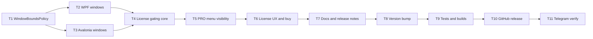

# План Workspace 1C 1.0.1.119: лицензионный гейтинг ПРО в 1.x, адаптивные окна, документация и релиз

Дата анализа: **2026-11-25**. Базовая версия — **1.0.1.118**
([`Workspace1C.csproj:62`](Workspace1C/Workspace1C/Workspace1C.csproj:62)). Целевая версия —
**1.0.1.119**, повышается **однократно** и только последним числом (задача T8).

Документ — самодостаточное ТЗ для задач реализации. Код в нём **не меняется**.
Каждый пункт раздела 6 выполняется **отдельной задачей** (`new_task`, режим `code`).

---

## 0. Принятое решение по ПРО

**Главное требование владельца:** даже в версии 1.x при активации ПРО-лицензии
становятся доступны ПРО-функции. При этом public core остаётся бесплатным, а ключом
закрываются **только новые 2.x-функции**.

### 0.1. Политика 1.0.1.119

| Группа функций | Без ключа | С ключом `major=1` |
|---|---|---|
| **Public core** (`ServerAlerts`, `TelegramBot`, `Mcp`, `ClusterMigration`, `TestDeploy`, `MassLoadCf`) | **доступны** (как в 1.0.1.118) | доступны |
| **Новые 2.x** (`Pipelines`, `MultiBaseQuery`, `EnvironmentDiff`, `AutoTests`, `PerformanceTrends`, `AuditLog`, `CloudBackup`) | недоступны: окно «Лицензия»; в публичной сборке — «только в официальной сборке» | доступны в официальной сборке с `PRO_MODULES` |
| Всё, чего нет в `ProFeature` | доступно | доступно |

`EditionService.Has()` **не меняет** правило 1.x для public core:
`if (Major() < 2 && IsInPublicCore(feature)) return true;` — остаётся.
Для 2.x действует `IsPro && HasProModules`.

### 0.2. Что нужно доработать

- 2.x-пункты должны быть **видны** без ключа (с отметкой «ПРО»), а не исчезать из меню.
- Клик по 2.x-пункту без ключа → окно «Лицензия» с подсветкой функции.
- С ключом `major=1` и официальной сборкой (`PRO_MODULES`) 2.x-функции становятся
  доступны прямо в 1.0.1.119.
- В публичной сборке 2.x-функции физически отсутствуют — показываем
  «только в официальной сборке» и ведём в окно лицензии.
- Public core остаётся бесплатным: тесты [`Issue106FreePublicCoreTests`](Workspace1C/Workspace1C.Tests/Issue106FreePublicCoreTests.cs:76)
  и [`ProLicensingTests`](Workspace1C/Workspace1C.Tests/ProLicensingTests.cs:167) **не ломаем**.

### 0.3. Ключи для 1.x

- [`KeyIssuer.DefaultMajor`](Workspace1C.Pro/tools/LicenseIssuer/KeyIssuer.cs:22) уже равен **1**,
  поэтому `LicenseIssuer issue --machine … --owner …` по умолчанию выпускает ключ для 1.x.
- [`LicenseVerifier`](Workspace1C/Workspace1C/Services/Licensing/LicenseVerifier.cs:78)
  требует `key.Major == programMajor`; для 1.0.1.119 это `major = 1`.
- Ключи с `major = 2` в 1.0.1.119 **не подойдут** — это документируется в инструкции.

### 0.4. Честная оговорка

Public core был и остаётся бесплатным в 1.x. Меняется только видимость и гейтинг
**новых 2.x-функций**: раньше они были скрыты, теперь видны с отметкой «ПРО» и
открываются ключом. Версии до 1.0.1.119 не переделываются.

---

## 1. Задача 1: модальные окна — адаптивный размер

### 1.1. Что уже есть

- Чистая арифметика: [`WindowSizeMath`](Workspace1C/Workspace1C/Services/WindowSizeMath.cs:29)
  (`ClampHeight`, `ClampToWorkArea`, `FitTop`, `FitLeft`).
- Политика диалогов: [`DialogWorkAreaPolicy`](Workspace1C/Workspace1C/Services/DialogWorkAreaPolicy.cs:15)
  — применяется только к четырём редакторам меню, `CloneServerInfobaseWindow`, `NameInputWindow`.
- Avalonia-база: [`ModalWindowBase.ClampWindowToMinSize()`](Workspace1C/Workspace1C/Views/ModalWindowBase.cs:176) —
  зажимает минимум, но не максимум по рабочей области.
- WPF-хелпер: [`WpfUi.SetupWindow()`](Workspace1C/Workspace1C/Views/WpfUi.cs:20) задаёт
  `Width/Height`, `MinWidth = min(width, 640)`, `MinHeight = min(height, 420)` и **не**
  ставит `MaxWidth/MaxHeight` и не клампит по монитору.
- Точечные клампы: `RacInfobasePropertiesWindow`, `SessionLockWindow`, `UpdateCheckWindow`,
  `CloneServerInfobaseWindow`, `NameInputWindow`.

### 1.2. Инвентаризация: проблемные окна

**P** — фиксированная высота > 700 DIP или ширина > 1100 DIP, нет `MaxHeight`/клампа;
**W** — пограничное (нужен `ScrollViewer`/проверка); **OK** — уже адаптивно.

#### WPF (XAML и окна, собранные кодом)

| Окно | Размер (W×H) | Min | Max/кламп | Итог |
|---|---|---|---|---|
| [`MaintenanceCenterWindow.xaml`](Workspace1C/Workspace1C/Views/MaintenanceCenterWindow.xaml:6) | 1080×840 | 760×660 | нет | **P** |
| [`EventLogWindow.cs`](Workspace1C/Workspace1C/Views/EventLogWindow.cs:28) | 1200×760 | 640×420 | нет | **P** |
| [`ExtensionsWindow.cs`](Workspace1C/Workspace1C/Views/ExtensionsWindow.cs:25) | 1180×760 | 640×420 | нет | **P** |
| [`InfobaseUsersWindow.cs`](Workspace1C/Workspace1C/Views/InfobaseUsersWindow.cs:25) | 1240×820 | 640×420 | нет | **P** |
| [`ScheduledJobsWindow.cs`](Workspace1C/Workspace1C/Views/ScheduledJobsWindow.cs:25) | 1280×800 | 640×420 | нет | **P** |
| [`ServerAlertsWindow.cs`](Workspace1C/Workspace1C/Views/ServerAlertsWindow.cs:23) | 1000×760 | 640×420 | нет | **P** |
| [`DbmsBackupWindow.cs`](Workspace1C/Workspace1C/Views/DbmsBackupWindow.cs:24) | 960×760 | 640×420 | нет | **P** |
| [`TechLogWindow.cs`](Workspace1C/Workspace1C/Views/TechLogWindow.cs:23) | 980×720 | 640×420 | нет | **P** |
| [`TechLogAnalysisWindow.cs`](Workspace1C/Workspace1C/Views/TechLogAnalysisWindow.cs:27) | 1100×760 | 640×420 | нет | **P** |
| [`SettingsWindow.xaml.cs`](Workspace1C/Workspace1C/Views/SettingsWindow.xaml.cs:280) | 1100×760 | 960×720 | сохраняет размер, клампа нет | **P** |
| [`CustomActionEditWindow.xaml`](Workspace1C/Workspace1C/Views/CustomActionEditWindow.xaml:7) | 680×740 | 600×620 | нет | **P** |
| [`ScriptScenarioEditWindow.xaml`](Workspace1C/Workspace1C/Views/ScriptScenarioEditWindow.xaml:6) | 660×720 | 560×620 | `MaxHeight=800` | **P** |
| [`ClusterMigrationWindow.xaml`](Workspace1C/Workspace1C/Views/ClusterMigrationWindow.xaml:15) | 1200×700 | 1000×520 | нет | **P** |
| [`ServerMonitorWindow.xaml`](Workspace1C/Workspace1C/Views/ServerMonitorWindow.xaml:7) | 1400×680 | 1120×560 | нет | **P** (ширина) |
| [`PlatformDownloadWindow.xaml`](Workspace1C/Workspace1C/Views/PlatformDownloadWindow.xaml:11) | 980×700 | 760×560 | нет | **P** |
| [`ConnectionSettingsWindow.xaml`](Workspace1C/Workspace1C/Views/ConnectionSettingsWindow.xaml:12) | 900×680 | 760×640 | нет | **P** (MinHeight) |
| [`NotificationChannelsWindow.xaml`](Workspace1C/Workspace1C/Views/NotificationChannelsWindow.xaml:7) | 620×720 | 520×480 | нет | **P** |
| [`ConfigTypeEditWindow.xaml`](Workspace1C/Workspace1C/Views/ConfigTypeEditWindow.xaml:7) | 700×720 | 600×620 | нет | **P** |
| [`RepositoryBrowserWindow.xaml`](Workspace1C/Workspace1C/Views/RepositoryBrowserWindow.xaml:6) | 1180×640 | 900×460 | нет | **P** (ширина) |
| [`BatchOperationsWindow.xaml`](Workspace1C/Workspace1C/Views/BatchOperationsWindow.xaml:6) | 980×680 | 780×520 | нет | **P** |
| [`MassLoadCfWindow.xaml`](Workspace1C/Workspace1C/Views/MassLoadCfWindow.xaml:6) | 980×680 | 780×520 | нет | **P** |
| [`ConnectionReplaceWindow.xaml`](Workspace1C/Workspace1C/Views/ConnectionReplaceWindow.xaml:14) | 1060×620 | 860×440 | нет | **P** (ширина) |
| [`UsageStatisticsWindow.xaml`](Workspace1C/Workspace1C/Views/UsageStatisticsWindow.xaml:7) | 1080×640 | 820×480 | нет | **P** (ширина) |
| [`ProcessInspectorWindow.xaml`](Workspace1C/Workspace1C/Views/ProcessInspectorWindow.xaml:6) | 1080×560 | 820×400 | нет | **P** (ширина) |
| [`WebPublishWindow.cs`](Workspace1C/Workspace1C/Views/WebPublishWindow.cs:24) | 920×660 | 640×420 | нет | **W** |
| [`LicenseWindow.cs`](Workspace1C/Workspace1C/Views/LicenseWindow.cs:19) | 640×620 | 640×420 | нет | **W** |
| [`HowToBuyWindow.cs`](Workspace1C/Workspace1C/Views/HowToBuyWindow.cs:32) | 620×600 | 620×420 | нет | **W** |
| [`DeleteInfobaseWindow.xaml`](Workspace1C/Workspace1C/Views/DeleteInfobaseWindow.xaml:9) | 520×Auto | 520 | нет `MaxHeight` | **W** |
| [`AddEditWindow.xaml`](Workspace1C/Workspace1C/Views/AddEditWindow.xaml:12) | 480×Auto | — | нет `MaxHeight` | **W** |
| [`ActualReleasesWindow.xaml`](Workspace1C/Workspace1C/Views/ActualReleasesWindow.xaml:9) | 860×600 | 680×460 | нет | **OK/W** |
| [`CommandPaletteWindow.xaml`](Workspace1C/Workspace1C/Views/CommandPaletteWindow.xaml:6) | 560×Auto | — | `MaxHeight=520` | OK |
| [`ConfigDiffSetupWindow.xaml`](Workspace1C/Workspace1C/Views/ConfigDiffSetupWindow.xaml:10) | 560×Auto | 440 | `MaxHeight=680` | OK/W |

#### Avalonia (`*.Avalonia.cs`)

| Окно | Размер (W×H) | Min | Итог |
|---|---|---|---|
| [`MaintenanceCenterWindow.Avalonia.cs`](Workspace1C/Workspace1C/Views/MaintenanceCenterWindow.Avalonia.cs:60) | 1080×840 | 760×660 | **P** |
| [`InfobaseUsersWindow.Avalonia.cs`](Workspace1C/Workspace1C/Views/InfobaseUsersWindow.Avalonia.cs:33) | 1240×820 | 900×560 | **P** |
| [`ScheduledJobsWindow.Avalonia.cs`](Workspace1C/Workspace1C/Views/ScheduledJobsWindow.Avalonia.cs:32) | 1280×800 | 900×560 | **P** |
| [`EventLogWindow.Avalonia.cs`](Workspace1C/Workspace1C/Views/EventLogWindow.Avalonia.cs:43) | 1200×760 | 820×480 | **P** |
| [`ExtensionsWindow.Avalonia.cs`](Workspace1C/Workspace1C/Views/ExtensionsWindow.Avalonia.cs:30) | 1180×760 | 860×520 | **P** |
| [`ServerAlertsWindow.Avalonia.cs`](Workspace1C/Workspace1C/Views/ServerAlertsWindow.Avalonia.cs:29) | 1000×760 | 760×560 | **P** |
| [`DbmsBackupWindow.Avalonia.cs`](Workspace1C/Workspace1C/Views/DbmsBackupWindow.Avalonia.cs:30) | 960×760 | 760×560 | **P** |
| [`TechLogWindow.Avalonia.cs`](Workspace1C/Workspace1C/Views/TechLogWindow.Avalonia.cs:25) | 980×720 | 760×520 | **P** |
| [`TechLogAnalysisWindow.Avalonia.cs`](Workspace1C/Workspace1C/Views/TechLogAnalysisWindow.Avalonia.cs:55) | 1100×760 | 800×520 | **P** |
| [`SettingsWindow.Avalonia.cs`](Workspace1C/Workspace1C/Views/SettingsWindow.Avalonia.cs:125) | 1100×760 | 960×720 | **P** |
| [`CustomActionEditWindow.Avalonia.cs`](Workspace1C/Workspace1C/Views/CustomActionEditWindow.Avalonia.cs:68) | 680×760 | 600×640 | **P** |
| [`ScriptScenarioEditWindow.Avalonia.cs`](Workspace1C/Workspace1C/Views/ScriptScenarioEditWindow.Avalonia.cs:88) | 660×720 | 560×620 | **P** |
| [`ClusterMigrationWindow.Avalonia.cs`](Workspace1C/Workspace1C/Views/ClusterMigrationWindow.Avalonia.cs:15) | 1200×700 | 1000×520 | **P** |
| [`ServerMonitorWindow.Avalonia.cs`](Workspace1C/Workspace1C/Views/ServerMonitorWindow.Avalonia.cs:120) | 1400×760 | 1120×560 | **P** |
| [`PlatformDownloadWindow.Avalonia.cs`](Workspace1C/Workspace1C/Views/PlatformDownloadWindow.Avalonia.cs:52) | 980×700 | 760×560 | **P** |
| [`ConnectionSettingsWindow.Avalonia.cs`](Workspace1C/Workspace1C/Views/ConnectionSettingsWindow.Avalonia.cs:78) | 900×680 | 760×640 | **P** |
| [`NotificationChannelsWindow.Avalonia.cs`](Workspace1C/Workspace1C/Views/NotificationChannelsWindow.Avalonia.cs:63) | 620×720 | 520×480 | **P** |
| [`ConfigTypeEditWindow.Avalonia.cs`](Workspace1C/Workspace1C/Views/ConfigTypeEditWindow.Avalonia.cs:54) | 700×720 | 600×620 | **P** |
| [`RepositoryBrowserWindow.Avalonia.cs`](Workspace1C/Workspace1C/Views/RepositoryBrowserWindow.Avalonia.cs:53) | 1180×640 | 900×460 | **P** |
| [`BatchOperationsWindow.Avalonia.cs`](Workspace1C/Workspace1C/Views/BatchOperationsWindow.Avalonia.cs:76) | 980×680 | 780×520 | **P** |
| [`MassLoadCfWindow.Avalonia.cs`](Workspace1C/Workspace1C/Views/MassLoadCfWindow.Avalonia.cs:66) | 980×680 | 780×520 | **P** |
| [`ConnectionReplaceWindow.Avalonia.cs`](Workspace1C/Workspace1C/Views/ConnectionReplaceWindow.Avalonia.cs:43) | 1060×620 | 860×440 | **P** |
| [`UsageStatisticsWindow.Avalonia.cs`](Workspace1C/Workspace1C/Views/UsageStatisticsWindow.Avalonia.cs:42) | 1080×640 | 820×480 | **P** |
| [`ProcessInspectorWindow.Avalonia.cs`](Workspace1C/Workspace1C/Views/ProcessInspectorWindow.Avalonia.cs:74) | 1080×600 | 820×420 | **P** |
| [`WebPublishWindow.Avalonia.cs`](Workspace1C/Workspace1C/Views/WebPublishWindow.Avalonia.cs:27) | 920×660 | 720×480 | **W** |
| [`TestDeployWindow.Avalonia.cs`](Workspace1C/Workspace1C/Views/TestDeployWindow.Avalonia.cs:137) | 720×700 | 640×620 | **P** |
| [`GroupEditWindow.Avalonia.cs`](Workspace1C/Workspace1C/Views/GroupEditWindow.Avalonia.cs:96) | 540×700 | 460×520 | **W** (`MaxHeight=880`) |
| [`LicenseWindow.Avalonia.cs`](Workspace1C/Workspace1C/Views/LicenseWindow.Avalonia.cs:27) | 640×620 | 520×480 | **W** |
| [`HowToBuyWindow.Avalonia.cs`](Workspace1C/Workspace1C/Views/HowToBuyWindow.Avalonia.cs:37) | 620×600 | 520×480 | **W** |
| [`DeleteInfobaseWindow.axaml`](Workspace1C/Workspace1C/Views/DeleteInfobaseWindow.axaml) | 520×Auto | 520 | **W** |

### 1.3. Общий подход

1. **Новый чистый сервис** `Workspace1C/Services/WindowBoundsPolicy.cs`:
   - `record WindowBounds(Width, Height, MinWidth, MinHeight, MaxWidth, MaxHeight, RequiresScrolling)`;
   - `Recommend(designWidth, designHeight, minWidth, minHeight, workWidth, workHeight, margin = 48)`;
   - `MaxWidth = workWidth - margin`, `MaxHeight = workHeight - margin`;
   - потолок по умолчанию для модальных окон — **1200×800 DIP**;
   - `RequiresScrolling = Height + 0.5 < designHeight`.
2. **WPF, единая точка** — новый `Workspace1C/Views/WindowWorkAreaLimiter.cs`:
   - `Attach(Window)` на `SourceInitialized`/`Loaded` определяет монитор
     (`System.Windows.Forms.Screen.FromHandle` + `VisualTreeHelper.GetDpi`, как в
     [`RacInfobasePropertiesWindow.xaml.cs:43`](Workspace1C/Workspace1C/Views/RacInfobasePropertiesWindow.xaml.cs:43));
   - выставляет `MaxWidth/MaxHeight`, клампит `Width/Height`, вызывает `FitTop/FitLeft`;
   - регистрируется глобально в `App` через
     `EventManager.RegisterClassHandler(typeof(Window), FrameworkElement.LoadedEvent, …)`;
   - `WpfUi.SetupWindow` использует `WindowBoundsPolicy.Recommend`.
3. **Avalonia, единая точка** — в [`ModalWindowBase`](Workspace1C/Workspace1C/Views/ModalWindowBase.cs:41)
   добавить `ClampWindowToWorkArea(Window)` (по образцу `ClampWindowToMinSize`):
   `Screens.ScreenFromWindow(...).WorkingArea / Scaling`, вызов в конструкторе и на `Opened`;
   для `MainWindow.Avalonia.cs` — явно.
4. **Контент**: `ScrollViewer` с `VerticalScrollBarVisibility="Auto"`, кнопки — вне
   прокрутки (`Grid`/`DockPanel` с `Auto`-строкой).
5. **Не менять** `WindowSizeMath` и `DialogWorkAreaPolicy.Recommend` по смыслу; никакой
   «компенсации DPI» — DIP уже DPI-независимы.

### 1.4. Целевые стартовые размеры

| Окно | Было | Целевой старт | Max |
|---|---|---|---|
| MaintenanceCenter | 1080×840 | 1080×760 | рабочая область − 48 |
| InfobaseUsers | 1240×820 | 1100×720 | рабочая область − 48 |
| ScheduledJobs | 1280×800 | 1100×720 | рабочая область − 48 |
| EventLog | 1200×760 | 1100×720 | рабочая область − 48 |
| Extensions | 1180×760 | 1100×720 | рабочая область − 48 |
| ServerAlerts | 1000×760 | 960×700 | рабочая область − 48 |
| DbmsBackup | 960×760 | 960×700 | рабочая область − 48 |
| TechLog | 980×720 | 980×680 | рабочая область − 48 |
| TechLogAnalysis | 1100×760 | 1000×700 | рабочая область − 48 |
| Settings | 1100×760 | 1000×720 | рабочая область − 48 |
| CustomActionEdit | 680×740 | 680×680 | рабочая область − 48 |
| ScriptScenarioEdit | 660×720 | 660×680 | рабочая область − 48 |
| ClusterMigration | 1200×700 | 1100×680 | рабочая область − 48 |
| ServerMonitor | 1400×680 | 1200×680 | рабочая область − 48 |
| PlatformDownload | 980×700 | 980×680 | рабочая область − 48 |
| ConnectionSettings | 900×680 | 900×660 | рабочая область − 48 |
| NotificationChannels | 620×720 | 620×660 | рабочая область − 48 |
| ConfigTypeEdit | 700×720 | 700×680 | рабочая область − 48 |
| RepositoryBrowser | 1180×640 | 1100×640 | рабочая область − 48 |
| BatchOperations/MassLoadCf | 980×680 | 980×660 | рабочая область − 48 |
| ConnectionReplace | 1060×620 | 1000×620 | рабочая область − 48 |
| UsageStatistics | 1080×640 | 1000×620 | рабочая область − 48 |
| ProcessInspector | 1080×560 | 1000×560 | рабочая область − 48 |
| TestDeploy | 720×700 | 720×660 | рабочая область − 48 |

Критерий: на **1366×768@100 %** (≈1366×728 DIP) и **1920×1080@125 %** (≈1536×816 DIP)
окно целиком помещается, нижние кнопки видны, вертикальной прокрутки нет; на 1024×600 —
кламп и прокрутка.

### 1.5. Тесты

Новый `Workspace1C.Tests/Issue119AdaptiveWindowTests.cs`:

1. `Policy_ClampsWidthAndHeightToWorkArea`.
2. `Policy_NeverBelowMin`.
3. `Policy_RequiresScrolling_WhenContentHigher`.
4. `Policy_DefaultCeiling_1200x800`.
5. `WpfUi_SetupWindow_AppliesBounds`.
6. `Wpf_GlobalLimiter_Registered`.
7. `Avalonia_ModalWindowBase_ClampsWorkArea`.
8. `NoFixedHeightAbove800_WithoutMaxHeight`.
9. `LongWindows_HaveScrollViewer`.

Не ломать `Issue146WindowHeightTests`, `Issue146DialogSizeTests`, `WindowSizeMath`-тесты.

### 1.6. Риски

- **R1. Уменьшение ширины ломает таблицы** — включать горизонтальный скролл в `DataGrid`,
  не трогать `MinWidth` колонок.
- **R2. Глобальный `Loaded`-хук** — проверить `MainWindow`, сохранённые размеры клампить,
  а не сбрасывать.
- **R3. `SizeToContent="Height"`** — только `MaxHeight`, без фиксированного `Height`.
- **R4. Многомониторность** — монитор по `HWND`/`ScreenFromWindow`, не `SystemParameters.WorkArea`.
- **R5. Linux/Wayland** — при нулевой/неизвестной рабочей области размер не менять.

---

## 2. Задача 2: ПРО — лицензионный гейтинг в 1.0.1.119

### 2.1. Текущее устройство

- Перечень: [`ProFeature`](Workspace1C/Workspace1C/Services/Licensing/ProFeature.cs:10).
- Гейт: [`EditionService.Has()`](Workspace1C/Workspace1C/Services/Licensing/EditionService.cs:65),
  [`ProGate.Ensure()`](Workspace1C/Workspace1C/Services/Licensing/EditionService.cs:152).
- Окно лицензии: [`LicenseWindow`](Workspace1C/Workspace1C/Views/LicenseWindow.cs:11),
  [`LicenseViewModel`](Workspace1C/Workspace1C/ViewModels/LicenseViewModel.cs:41).
- Покупка: [`HowToBuyWindow`](Workspace1C/Workspace1C/Views/HowToBuyWindow.cs:31),
  ключи `Pro.HowToBuy.*` ([`ru.json:4952`](Workspace1C/Workspace1C/Localization/Languages/ru.json:4952)).
- Меню: [`UtilitiesMenuCatalog`](Workspace1C/Workspace1C/Services/UtilitiesMenuCatalog.cs:284),
  [`UtilitiesMenuResolver`](Workspace1C/Workspace1C/Services/UtilitiesMenuResolver.cs:45).

### 2.2. Матрица функций ПРО

| Функция | Где в меню / UI | Гейт в коде | Статус | Без ключа в 1.x | С ключом `major=1` |
|---|---|---|---|---|---|
| `ServerAlerts` | «Утилиты» → «Сервисы ПРО» → «Мониторинг и оповещения» | [`MainViewModel.Features.cs:181`](Workspace1C/Workspace1C/ViewModels/MainViewModel.Features.cs:181), [`ServerAlertsService.cs:130`](Workspace1C/Workspace1C/Services/ServerAlertsService.cs:130) | реализована | **доступна** (public core) | доступна |
| `TelegramBot` | «Утилиты» → «Сервисы ПРО» → «Команды Telegram-бота» | [`MainViewModel.Features.cs:238`](Workspace1C/Workspace1C/ViewModels/MainViewModel.Features.cs:238), [`TelegramBotCommandService.cs:94`](Workspace1C/Workspace1C/Services/TelegramBotCommandService.cs:94) | реализована | **доступна** (public core) | доступна |
| `Mcp` | CLI `--mcp` | [`CliEntryPoint.cs:71`](Workspace1C/Workspace1C/Services/CliEntryPoint.cs:71) | реализована | **доступна** (public core) | доступна |
| `ClusterMigration` | «Утилиты» → «Списки баз» → «Миграция баз между кластерами» | [`MainViewModel.Tools.cs:3518`](Workspace1C/Workspace1C/ViewModels/MainViewModel.Tools.cs:3518) | реализована | **доступна** (public core) | доступна |
| `TestDeploy` | Контекстное меню базы → «Тестовая копия»; планировщик | [`MainViewModel.Commands.cs:2102`](Workspace1C/Workspace1C/ViewModels/MainViewModel.Commands.cs:2102), [`SchedulerService.cs:820`](Workspace1C/Workspace1C/Services/SchedulerService.cs:820) | реализована | **доступна** (public core) | доступна |
| `MassLoadCf` | «Утилиты» → «Списки баз» → «Загрузить .cf по списку»; контекстное меню | [`MainViewModel.Tools.cs:3071`](Workspace1C/Workspace1C/ViewModels/MainViewModel.Tools.cs:3071) | реализована | **доступна** (public core) | доступна |
| `Pipelines` | «Утилиты» → «Сервисы ПРО» → «Конвейеры обслуживания»; планировщик; CLI; MCP | [`PipelineModule.cs:40`](Workspace1C.Pro/src/Pipelines/PipelineModule.cs:40) | только официальная сборка | окно «Лицензия» | доступна |
| `MultiBaseQuery` | «Утилиты» → «Сервисы ПРО» → «Консоль запросов по базам» | `MultiBaseQueryModule.ShowWindow` | только официальная сборка | окно «Лицензия» | доступна |
| `EnvironmentDiff` | «Утилиты» → «Сравнение» → «Сравнение окружения баз» | `EnvironmentDiffModule.ShowWindow` | только официальная сборка | окно «Лицензия» | доступна |
| `AutoTests` | «Утилиты» → «Сервисы ПРО» → «Автотесты»; планировщик | `AutoTestModule.ShowWindow` | только официальная сборка | окно «Лицензия» | доступна |
| `PerformanceTrends` | «Утилиты» → «Сервисы ПРО» → «Тренды производительности»; планировщик | `PerfTrendModule.ShowWindow` | только официальная сборка | окно «Лицензия» | доступна |
| `AuditLog` | «Утилиты» → «Журналы» → «Журнал аудита» | [`AuditModule.cs:47`](Workspace1C.Pro/src/Audit/AuditModule.cs:47) | только официальная сборка | окно «Лицензия» | доступна |
| `CloudBackup` | «Утилиты» → «Резервные копии» → «Копии в S3 и шифрование»; CLI `--decrypt` | [`CloudBackupModule.cs:39`](Workspace1C.Pro/src/CloudBackup/CloudBackupModule.cs:39) | только официальная сборка | окно «Лицензия» | доступна |

### 2.3. Разрывы, которые закрывает 1.0.1.119

| # | Разрыв | Где | Что делаем |
|---|---|---|---|
| G1 | Отметки «ПРО» в меню нет | [`DisplayText()`](Workspace1C/Workspace1C/Services/UtilitiesMenuCatalog.cs:275) | суффикс `Pro.MenuSuffix` при `!Has(feature)` |
| G2 | 2.x-пункты скрыты без лицензии | [`UtilitiesMenuResolver.cs:51`](Workspace1C/Workspace1C/Services/UtilitiesMenuResolver.cs:51) | показывать группу «ПРО» всегда (официальная сборка), placeholder — в публичной |
| G3 | Нет подсказки «требуется ключ» | построители меню | `ToolTip` `Pro.RequiredFormat` |
| G4 | Противоречивый статус в окне лицензии | [`ProFeatureRow`](Workspace1C/Workspace1C/ViewModels/LicenseViewModel.cs:11) | статусы `Available`/`RequiresKey`/`OfficialBuildOnly`/`InDevelopment` |
| G5 | В публичной сборке 2.x — «в разработке» | [`ProFeatures.StatusKey()`](Workspace1C/Workspace1C/Services/Licensing/ProFeature.cs:110) | «только в официальной сборке» |
| G6 | Путь к лицензии в документации неточен | README | актуальный путь и пункт «Как купить ПРО…» |
| G7 | `IsInPublicCore` по порядку enum | [`ProFeature.cs:72`](Workspace1C/Workspace1C/Services/Licensing/ProFeature.cs:72) | явный `HashSet` |
| G8 | Гейт только в командах | `External`-пункты | единый гейт на уровне меню |
| G9 | Ключ `major=1` не документирован | README/PRO-EDITION | явно указать `--major 1` |

### 2.4. Целевое поведение (1.0.1.119)

1. **`EditionService.Has()`** — **не меняется** для public core: в 1.x public core
   доступен без ключа (политика MIT). Для 2.x — `IsPro && HasProModules`.
2. **Ключ 1.x**: `LicenseIssuer issue --major 1` (по умолчанию и так 1); `LicenseVerifier`
   не меняем — `key.Major == 1` для 1.0.1.119.
3. **Меню**: пункты с `RequiredFeature` всегда видны; public core без отметки, 2.x —
   с отметкой « · ПРО» и подсказкой «требуется ключ».
4. **2.x-модули**: в официальной сборке (`HasProModules`) группа «ПРО» видна всегда;
   с ключом пункты работают, без ключа ведут в окно «Лицензия». В публичной сборке —
   placeholder-пункты «только в официальной сборке».
5. **Окно «Лицензия»**: честные статусы; кнопка «Купить» видна без ключа; после
   активации список и метка `★` обновляются без перезапуска.
6. **Единый гейт**: UI — `ProGate.Ensure`, сервисы/CLI — `EditionService.Has`;
   никаких прямых `IsPro` в обработчиках.
7. **`IsInPublicCore`** — явный `HashSet<ProFeature>` (не зависит от порядка enum).
8. **`ProFeatures.IsImplemented`** — для публичной сборки 2.x: «только в официальной сборке».
9. **Документация** — явно: «public core в 1.x бесплатен; новые 2.x-функции требуют
   ключ `major=1` и официальную сборку».

### 2.5. Тесты (новые + сохранить существующие)

Новый `Workspace1C.Tests/Issue119ProVisibilityTests.cs`:

1. `PublicCore_WithoutKey_RemainsAvailableIn1x` — все `IsInPublicCore` → `Has == true`.
2. `New2x_WithoutKey_Unavailable` — все не-public-core → `Has == false`.
3. `New2x_WithKeyAndModules_Available` — `HasProModules=true` + ключ → `Has == true`.
4. `New2x_WithKeyButNoModules_Unavailable` — `HasProModules=false` + ключ → `Has == false`.
5. `ProGate_New2xWithoutKey_ShowsLicenseDialog`.
6. `Menu_New2xWithoutKey_ShowsProSuffixAndTooltip`.
7. `Menu_New2xWithoutKey_DoesNotExecuteExternal`.
8. `Menu_PublicCoreWithoutKey_HasNoProSuffix`.
9. `LicenseRows_Statuses_AreConsistent`.
10. `Localization_HasProVisibilityKeys`.

**Сохранить без изменения ожиданий:** [`Issue106FreePublicCoreTests`](Workspace1C/Workspace1C.Tests/Issue106FreePublicCoreTests.cs:76),
[`ProLicensingTests`](Workspace1C/Workspace1C.Tests/ProLicensingTests.cs:167) (сценарии 1.x
public core), `ContextMenuProBadgeTests` (public core без бейджа), `TitleProMarkTests`,
`AboutLicenseBlock*`, `HowToBuyWindowV100153Tests`.

### 2.6. Риски

- **R1. Случайно закрыть public core.** Любая правка `EditionService.Has` должна
  сохранять ветку `Major() < 2 && IsInPublicCore`; тесты `Issue106*` — страж.
- **R2. Ключи major.** Ключ `major=2` не подойдёт к 1.0.1.119; в инструкции указать
  `--major 1`.
- **R3. Двойное окно лицензии.** Гейт в меню и в команде — проверить, что окно не
  открывается дважды.
- **R4. Публичная сборка.** Placeholder-пункты не должны вызывать несуществующий
  `External`-экшен.
- **R5. Локализация.** Новые ключи — в ru и en одновременно.

---

## 3. Задача 3: документация

### 3.1. CHANGELOG.md

Новый раздел сверху `## [1.0.1.119] — 2026-11-25`:

- **ПРО:** public core в 1.x остаётся бесплатным; новые 2.x-функции требуют ключ
  `major=1` и официальную сборку. Версии до 1.0.1.119 не переделываются.
- **ПРО-витрина:** ключи `major=1`, отметки « · ПРО», подсказки, видимость 2.x,
  честные статусы, пункт «Как купить ПРО…».
- **Окна:** адаптивный размер, потолок 1200×800, прокрутка, уменьшенные стартовые размеры.
- **Документация:** README, PRO-EDITION, `HOW-TO-BUY-PRO.md`.
- **Сборка:** single-file Windows/Linux, версия 1.0.1.119, число тестов.

### 3.2. README.md

- Бейдж `1.0.1.119`, строка версии, число тестов, таблица бинарей
  ([`README.md:3`](Workspace1C/README.md:3), [`README.md:11`](Workspace1C/README.md:11),
  [`README.md:18`](Workspace1C/README.md:18)).
- Раздел «🛒 ПРО-версия» ([`README.md:1982`](Workspace1C/README.md:1982)):
  - public core в 1.x бесплатен; новые 2.x-функции требуют ключ;
  - точный путь: «Утилиты» → «Справка» → «Лицензия…» / «Как купить ПРО…»;
  - ключ для 1.x: `--major 1`; отличие публичной и официальной сборки;
  - пошаговая покупка/активация.
- Раздел про адаптивные окна.

### 3.3. docs/pro/PRO-EDITION.md

- Раздел 1–2: политика 1.0.1.119 (public core бесплатен; 2.x — по ключу).
- Раздел 4: актуальные пункты меню, кнопки, статусы, `--major 1`.
- Раздел 5: 2.x-пункты видны без ключа, но выполняются только с ключом и `PRO_MODULES`.
- Раздел 6: обновить устаревшие упоминания.

### 3.4. Новая инструкция

`Workspace1C/docs/pro/HOW-TO-BUY-PRO.md`:

1. Где взять код компьютера (окно «Лицензия», `--license-info`, «О программе»).
2. Куда отправить (Telegram-канал, Issues).
3. Оплата 2000 ₽, бессрочная лицензия в рамках major.
4. Выпуск ключа для 1.x — `--major 1`.
5. Активация (`--activate`, окно «Лицензия»).
6. Проверка (`--license-info`, `★` в заголовке, статус в «О программе»).
7. Частые проблемы (не тот компьютер, переустановка ОС, ключ 2.x на 1.x).
8. Что остаётся бесплатным.

### 3.5. Релизные файлы

- `Workspace1C/rel_notes_1.0.1.119.md`.
- `Workspace1C/docs/_telegram_msg_v1.0.1.119.txt` — **закоммитить** (workflow ищет
  в `docs/`, [`release.yml:350`](Workspace1C/.github/workflows/release.yml:350)).

---

## 4. Задача 4: версия и сборка

### 4.1. Версия (только после всех правок кода)

[`Workspace1C.csproj:62-65`](Workspace1C/Workspace1C/Workspace1C.csproj:62) — все четыре
поля → `1.0.1.119`. Промежуточные задачи версию **не меняют**.

### 4.2. Полный прогон

```powershell
dotnet test Workspace1C/Workspace1C.Tests/Workspace1C.Tests.csproj -c Release `
  -p:RuntimeIdentifier= -p:SelfContained=false -p:PublishSingleFile=false
```

База — **8043** теста; зафиксировать всего / падений / пропущено, обновить CHANGELOG/README.

### 4.3. Single-file сборки

```powershell
cd Workspace1C/Workspace1C
pwsh ./build-windows-single-file.ps1 -Configuration Release
pwsh ./build-linux-single-file.ps1 -Configuration Release
```

Ожидаемо: один `dist/win-x64/Workspace1C.exe`, один `dist/linux-x64/Workspace1C`,
`FileVersion = 1.0.1.119`, smoke `Workspace1C.exe --list` → код 0.

### 4.4. GitHub Release

1. `git status`; добавить только релизные файлы (не `git add -A`).
2. Коммит, `git push origin main`.
3. `git tag v1.0.1.119`, `git push origin v1.0.1.119`.
4. Дождаться workflow «Публикация релиза» (`windows`, `linux`, `release`).
5. Проверить assets и `FileVersion`; при сбое — `workflow_dispatch` с `tag=v1.0.1.119`.

### 4.5. Telegram

Новость отправляется автоматически шагом «Новость в Telegram»
([`release.yml:334`](Workspace1C/.github/workflows/release.yml:334)):

- секрет `TELEGRAM_BOT_TOKEN` (бот — администратор канала);
- канал фиксирован: `-1004425443528`;
- текст — `docs/_telegram_msg_v1.0.1.119.txt`;
- проверка: HTTP **200**, `"ok":true`, ссылка на релиз;
- fallback:
  `curl -sS "https://api.telegram.org/bot$TG_TOKEN/sendMessage" --data-urlencode "chat_id=-1004425443528" --data-urlencode "text@docs/_telegram_msg_v1.0.1.119.txt"`;
- результат — `Workspace1C/docs/_tg_verify_101119.txt`.

---

## 5. Порядок выполнения и зависимости



- T1 — фундамент; T2/T3 — после T1.
- T4 — ключевая задача политики; после неё T5/T6.
- T8 (версия) — **строго после** T1–T7.
- T9 — после T8; T10 — после T9; T11 — после T10.
- T12 — опционально, отдельный релиз 2.0.0.0.

---

## 6. Декомпозиция: отдельные задачи для режима Code

> Каждая задача — **отдельный** `new_task` в режиме `code`.
> В T1–T7 версия остаётся **1.0.1.118**.

### T1. Инфраструктура адаптивных размеров окон

**Файлы:** новый `Services/WindowBoundsPolicy.cs`; новый `Views/WindowWorkAreaLimiter.cs`;
[`WpfUi.cs`](Workspace1C/Workspace1C/Views/WpfUi.cs:20),
[`ModalWindowBase.cs`](Workspace1C/Workspace1C/Views/ModalWindowBase.cs:41), `App.xaml.cs`;
новый `Workspace1C.Tests/Issue119AdaptiveWindowTests.cs` (пункты 1–4, 6–7).

**Что сделать:** политика с отступом 48 DIP и потолком 1200×800; WPF-лимитер и
глобальная регистрация `Loaded`; `WpfUi.SetupWindow` через политику; Avalonia
`ClampWindowToWorkArea`; тесты.

**DoD:** `dotnet test --filter Issue119AdaptiveWindow` зелёный; WPF/Avalonia компилируются;
`WindowSizeMath`/`Issue146*` зелёные; версия 1.0.1.118.

---

### T2. WPF-окна: адаптивный размер и уменьшение гигантских

**Файлы:** WPF-окна из таблицы 1.2 (XAML и код): `MaintenanceCenterWindow.xaml`,
`EventLogWindow.cs`, `ExtensionsWindow.cs`, `InfobaseUsersWindow.cs`,
`ScheduledJobsWindow.cs`, `ServerAlertsWindow.cs`, `DbmsBackupWindow.cs`,
`TechLogWindow.cs`, `TechLogAnalysisWindow.cs`, `SettingsWindow.xaml.cs`,
`CustomActionEditWindow.xaml`, `ScriptScenarioEditWindow.xaml`,
`ClusterMigrationWindow.xaml`, `ServerMonitorWindow.xaml`, `PlatformDownloadWindow.xaml`,
`ConnectionSettingsWindow.xaml`, `NotificationChannelsWindow.xaml`,
`ConfigTypeEditWindow.xaml`, `RepositoryBrowserWindow.xaml`, `BatchOperationsWindow.xaml`,
`MassLoadCfWindow.xaml`, `ConnectionReplaceWindow.xaml`, `UsageStatisticsWindow.xaml`,
`ProcessInspectorWindow.xaml`, `WebPublishWindow.cs`, `LicenseWindow.cs`,
`HowToBuyWindow.cs`, `DeleteInfobaseWindow.xaml`, `AddEditWindow.xaml`.

**Что сделать:** стартовые размеры по таблице 1.4; `MinHeight` ≤ 560–620 для проблемных;
`ScrollViewer` вокруг длинного контента; кнопки вне прокрутки; для `SizeToContent` —
только `MaxHeight`; тесты 8–9.

**DoD:** на 1366×768@100 % и 1920×1080@125 % всё помещается, кнопки видны, вертикальной
прокрутки нет; на 1024×600 — кламп и прокрутка; WPF Release — 0 ошибок; версия 1.0.1.118.

---

### T3. Avalonia-окна: паритет

**Файлы:** `*.Avalonia.cs` из таблицы 1.2 (30 окон).

**Что сделать:** те же целевые размеры; убрать локальные «магические» `MaxHeight`;
добавить `ScrollViewer`/прокручиваемые списки; source-guard тесты для Avalonia.

**DoD:** Linux-сборка (`-p:ForceLinux=true`) — 0 ошибок; размеры совпадают с WPF;
`Issue119AdaptiveWindow` зелёный; версия 1.0.1.118.

---

### T4. Гейтинг новых 2.x-функций (public core не трогаем)

**Файлы:** [`EditionService.cs`](Workspace1C/Workspace1C/Services/Licensing/EditionService.cs:65)
(только проверка/комментарии, правило 1.x сохранить), [`ProFeature.cs`](Workspace1C/Workspace1C/Services/Licensing/ProFeature.cs:72)
(явный `HashSet`), новый `Workspace1C.Tests/Issue119ProVisibilityTests.cs`.
Тесты `Issue106FreePublicCoreTests.cs` и `ProLicensingTests.cs` **не переписывать** —
они стражи бесплатности public core.

**Что сделать:**
- **сохранить** ветку `if (VersionInfo.Major() < 2 && ProFeatures.IsInPublicCore(feature)) return true;`
  в `EditionService.Has()`;
- `IsInPublicCore` → явный `HashSet<ProFeature>` (не зависит от порядка enum);
- убедиться, что для 2.x `Has()` = `IsPro && HasProModules`;
- тесты: public core без ключа доступен; 2.x без ключа недоступен; 2.x с ключом
  `major=1` и `HasProModules=true` доступен; 2.x с ключом, но без модулей — нет;
- ключи для 1.x — `major=1` (KeyIssuer.DefaultMajor уже 1).

**DoD:** `Issue106FreePublicCoreTests` и `ProLicensingTests` зелёные без изменений
ожиданий; новые тесты 1–4 из 2.5 зелёные; public core без ключа работает; 2.x без
ключа ведёт в окно лицензии; версия 1.0.1.118.

**Риски:** R1–R5 из 2.6.

---

### T5. Витрина 2.x-функций в меню: отметки, подсказки, видимость

**Файлы:** [`UtilitiesMenuCatalog.cs`](Workspace1C/Workspace1C/Services/UtilitiesMenuCatalog.cs:275),
[`UtilitiesMenuResolver.cs`](Workspace1C/Workspace1C/Services/UtilitiesMenuResolver.cs:45),
[`MainWindow.UtilitiesMenu.cs`](Workspace1C/Workspace1C/Views/MainWindow.UtilitiesMenu.cs:396),
[`MainWindow.Avalonia.Tree.cs`](Workspace1C/Workspace1C/Views/MainWindow.Avalonia.Tree.cs:3172),
[`LicenseViewModel.cs`](Workspace1C/Workspace1C/ViewModels/LicenseViewModel.cs:11),
`ru.json`/`en.json`.

**Что сделать:**
- суффикс « · ПРО» и `ToolTip` **только для 2.x-пунктов** (не для public core);
- группа «ПРО» видна всегда в официальной сборке; placeholder — в публичной;
- единый гейт для `External`-пунктов (окно лицензии вместо выполнения);
- честные статусы `ProFeatureRow`;
- локализация ru/en;
- тесты 5–10 из 2.5.

**DoD:** public core без ключа не имеет отметки «ПРО» и работает; 2.x без ключа
помечен «ПРО», клик открывает окно лицензии и не выполняет действие; с ключом 2.x
работает; в публичной сборке 2.x — «только в официальной сборке»; версия 1.0.1.118.

---

### T6. Окно лицензии, покупка и инструкция

**Файлы:** [`LicenseWindow.cs`](Workspace1C/Workspace1C/Views/LicenseWindow.cs:11),
[`LicenseWindow.Avalonia.cs`](Workspace1C/Workspace1C/Views/LicenseWindow.Avalonia.cs),
[`HowToBuyWindow.cs`](Workspace1C/Workspace1C/Views/HowToBuyWindow.cs:31),
[`HowToBuyWindow.Avalonia.cs`](Workspace1C/Workspace1C/Views/HowToBuyWindow.Avalonia.cs),
`SettingsWindow` (блок «О программе»), `ru.json`/`en.json`,
новый `Workspace1C/docs/pro/HOW-TO-BUY-PRO.md`.

**Что сделать:**
- кнопки «Купить»/«Активировать»/«Скопировать код»; «Купить» видна только без ключа;
- пояснение «что даёт ПРО» и «что бесплатно»;
- пункт меню «Как купить ПРО…» (`GroupHelp`, новый `UtilitiesMenuCommandKind.ShowHowToBuy`);
- инструкция `HOW-TO-BUY-PRO.md` (раздел 3.4);
- не ломать `HowToBuyWindowV100153Tests`.

**DoD:** без ключа за 2 клика доходим до кода компьютера и инструкции; с ключом видим
«ПРО» и `★`; тексты ru/en; версия 1.0.1.118.

---

### T7. Документация и релизные заметки (без версии)

**Файлы:** [`CHANGELOG.md`](Workspace1C/CHANGELOG.md),
[`README.md`](Workspace1C/README.md:1982),
[`docs/pro/PRO-EDITION.md`](Workspace1C/docs/pro/PRO-EDITION.md),
`Workspace1C/rel_notes_1.0.1.119.md`,
`Workspace1C/docs/_telegram_msg_v1.0.1.119.txt`,
`plans/plan-v1.0.1.119.md`.

**Что сделать:** разделы 3.1–3.5; версия в текстах — `1.0.1.119`, но `csproj` пока
`1.0.1.118`.

**DoD:** CHANGELOG/README/PRO-EDITION/rel_notes/Telegram-файл согласованы; ссылки на
меню и статусы совпадают с T4–T6; `csproj` не изменён.

---

### T8. Повышение версии до 1.0.1.119

**Файлы:** [`Workspace1C.csproj:62-65`](Workspace1C/Workspace1C/Workspace1C.csproj:62).

**Что сделать:** все четыре поля → `1.0.1.119`; проверить, что `1.0.1.118` не
встречается в `csproj`/README (кроме исторических разделов).

**DoD:** `dotnet build` — 0 ошибок; `FileVersion` = `1.0.1.119`; версия повышена
однократно и только последним числом.

---

### T9. Полный прогон тестов и single-file сборки

**Что сделать:** полный `dotnet test` (база 8043); Windows/Linux single-file; smoke
`--list` = 0; записать размеры/число тестов в README/CHANGELOG.

**DoD:** 0 падений, 0 пропущенных; по одному файлу на платформу; размеры зафиксированы;
версия 1.0.1.119.

---

### T10. Коммит, тег, GitHub Release

**Что сделать:** `git status`; добавить только релизные файлы (не `git add -A`);
коммит; `git push origin main`; `git tag v1.0.1.119`; `git push origin v1.0.1.119`;
дождаться workflow; проверить assets и `FileVersion`; при сбое — `workflow_dispatch`.

**DoD:** GitHub Release `v1.0.1.119` (не prerelease, latest) с двумя assets; workflow
зелёный; размеры совпадают с T9.

---

### T11. Проверка Telegram-анонса

**Что сделать:** проверить шаг «Новость в Telegram»: HTTP 200, `"ok":true`, канал
`-1004425443528`, версия и ссылка; при отсутствии секрета — отправить вручную
(раздел 4.5) и сохранить `docs/_tg_verify_101119.txt`.

**DoD:** сообщение в канале содержит `Workspace 1C 1.0.1.119` и ссылку на релиз;
подтверждение сохранено.

---

### T12 (опционально). Переход на 2.0.0.0

Не выполняется в 1.0.1.119. Если понадобится major 2: те же изменения, но
`Version/AssemblyVersion/FileVersion/InformationalVersion = 2.0.0.0`, ключи `major=2`,
отдельный тег `v2.0.0.0`, отдельный релиз и Telegram-анонс. Политика 1.0.1.119
при этом уже закрывает PRO-функции ключом, поэтому T12 — только смена номера и ключей.

---

## 7. Что нельзя делать в режиме Architect

- **Не менять код** (`*.cs`, `*.xaml`, `*.axaml`, `*.csproj`, `*.json`) — только `*.md`.
- **Не повышать версию** — это T8, только после T1–T7.
- **Не собирать/не прогонять тесты как изменение** — это T9.
- **Не коммитить, не ставить теги, не создавать релизы** — это T10.
- **Не отправлять в Telegram** — это T11.
- **Не менять политику частично**: либо все `ProFeature` закрыты ключом (1.0.1.119),
  либо политика не меняется; «полубесплатно» в новой сборке не оставляем.
- **Не выполнять несколько задач в одной** — каждая T1…T11 отдельным `new_task`.
- **Не использовать `git add -A`** — только явный список файлов.

---

## 8. Итоговый чек-лист релиза 1.0.1.119

- [ ] T1: `WindowBoundsPolicy` + WPF/Avalonia лимитеры, тесты зелёные.
- [ ] T2: WPF-окна адаптивны, гигантские размеры уменьшены, прокрутка есть.
- [ ] T3: Avalonia-паритет, Linux-сборка без ошибок.
- [ ] T4: **все** `ProFeature` закрыты ключом в 1.x; с ключом `major=1` доступны;
      тесты переписаны; CLI/планировщик/контекстное меню проверены.
- [ ] T5: отметки «ПРО» и подсказки только у 2.x, видимость 2.x без ключа,
      честные статусы, единый гейт для `External`.
- [ ] T6: окно лицензии/покупка/инструкция, пункт «Как купить ПРО…».
- [ ] T7: CHANGELOG, README, PRO-EDITION, rel_notes, Telegram-файл; политика
      «public core бесплатен, 2.x по ключу» описана честно.
- [ ] T8: версия `1.0.1.119` во всех четырёх полях.
- [ ] T9: полный прогон (0 падений), Windows/Linux single-file, smoke `--list` = 0.
- [ ] T10: коммит только релизных файлов, push, тег `v1.0.1.119`, GitHub Release,
      два asset'а, `FileVersion` совпадает.
- [ ] T11: Telegram HTTP 200/`ok:true`, канал `-1004425443528`, ссылка на релиз.
- [ ] Ключи для 1.x выпускаются с `major=1`; ключи `major=2` в 1.0.1.119 не работают
      (задокументировано).
- [ ] Public core в 1.x остаётся бесплатным; `Issue106FreePublicCoreTests` и
      `ProLicensingTests` зелёные без изменения ожиданий.
- [ ] 2.x-функции с ключом `major=1` и `PRO_MODULES` доступны в 1.0.1.119.

---

## 9. Статус выполнения

### T1 — выполнена (2026-11-25), версия осталась 1.0.1.118

Добавлено:

- [`Services/WindowBoundsPolicy.cs`](Workspace1C/Workspace1C/Services/WindowBoundsPolicy.cs:1) —
  чистый расчёт: отступ 48 DIP, потолок 1200×800, `RequiresScrolling`;
- [`Views/WindowWorkAreaLimiter.cs`](Workspace1C/Workspace1C/Views/WindowWorkAreaLimiter.cs:1) —
  WPF-лимитер по монитору окна + глобальная регистрация `Loaded` в
  [`App.xaml.cs`](Workspace1C/Workspace1C/App.xaml.cs:40);
- [`Views/WpfUi.cs`](Workspace1C/Workspace1C/Views/WpfUi.cs:20) — `SetupWindow` применяет
  политику и `WindowWorkAreaLimiter.Attach`;
- [`Views/ModalWindowBase.cs`](Workspace1C/Workspace1C/Views/ModalWindowBase.cs:186) —
  `ClampWindowToWorkArea` для всех Avalonia-диалогов; главное окно вызывает явно
  ([`MainWindow.Avalonia.cs`](Workspace1C/Workspace1C/Views/MainWindow.Avalonia.cs:200));
- [`Workspace1C.Tests/Issue119AdaptiveWindowTests.cs`](Workspace1C/Workspace1C.Tests/Issue119AdaptiveWindowTests.cs:1) —
  8 тестов политики и source-guard.

Проверки: `dotnet test --filter Issue119AdaptiveWindow` — **8/8**;
`dotnet test --filter "Issue146|WindowSizeMath|Issue55AdaptiveLayout"` — **199/199**;
WPF Release/Debug и Avalonia/Linux (`-p:ForceLinux=true`) — **0 ошибок**.

### T2 — выполнена (2026-11-25), версия осталась 1.0.1.118

Стартовые размеры WPF-окон приведены к таблице 1.4:

- окна, собранные кодом: `EventLogWindow` 1100×720, `ExtensionsWindow` 1100×720,
  `InfobaseUsersWindow` 1100×720, `ScheduledJobsWindow` 1100×720,
  `ServerAlertsWindow` 960×700, `DbmsBackupWindow` 960×700, `TechLogWindow` 980×680,
  `TechLogAnalysisWindow` 1000×700;
- XAML: `MaintenanceCenterWindow` 1080×760 (MinHeight 660→520),
  `CustomActionEditWindow` 680×680 (MinHeight 620→560),
  `ScriptScenarioEditWindow` 660×680 (MinHeight 620→560),
  `ClusterMigrationWindow` 1100×680, `ServerMonitorWindow` 1200×680,
  `PlatformDownloadWindow` 980×680, `ConnectionSettingsWindow` 900×660,
  `NotificationChannelsWindow` 620×660, `ConfigTypeEditWindow` 700×680
  (MinHeight 620→560), `RepositoryBrowserWindow` 1100×640,
  `BatchOperationsWindow`/`MassLoadCfWindow` 980×660,
  `ConnectionReplaceWindow` 1000×620, `UsageStatisticsWindow` 1000×620,
  `ProcessInspectorWindow` 1000×560, `SettingsWindow` 1000×720.

Дополнительно:

- `DeleteInfobaseWindow` и `AddEditWindow` (`SizeToContent="Height"`) получили
  `MaxHeight` (620/640) без фиксированной высоты;
- горизонтальная прокрутка таблиц включена явно (`ScrollViewer.HorizontalScrollBarVisibility="Auto"`)
  в `MaintenanceCenterWindow`, `RepositoryBrowserWindow`, `UsageStatisticsWindow`,
  `ProcessInspectorWindow`, `ConnectionReplaceWindow` и в общем
  [`WpfUi.Grid`](Workspace1C/Workspace1C/Views/WpfUi.cs:312) — `MinWidth` колонок не менялся;
- длинные формы (`CustomActionEditWindow`, `ScriptScenarioEditWindow`,
  `NotificationChannelsWindow`, `ConfigTypeEditWindow`, `ConnectionSettingsWindow`,
  `PlatformDownloadWindow`, `SettingsWindow`) уже имеют `ScrollViewer` с
  `VerticalScrollBarVisibility="Auto"`, футер — вне прокрутки;
- `MinHeight` окон «Настройки» (720) и «Свойства базы» (640) сохранены: этого
  требуют стражи `Issue55AdaptiveLayoutTests`;
- в [`Issue119AdaptiveWindowTests`](Workspace1C/Workspace1C.Tests/Issue119AdaptiveWindowTests.cs:1)
  добавлены тесты 8–9 (`NoFixedHeightAbove800_WithoutMaxHeight`,
  `LongWindows_HaveScrollViewer`); ожидания стартовых размеров в
  `Issue71SettingsWindowLayoutTests` и `Issue93And95SubtabsTests` синхронизированы.

Проверки: `dotnet test --filter Issue119AdaptiveWindow` — **10/10**;
`dotnet test --filter "Issue146|WindowSizeMath|Issue55AdaptiveLayout"` — **199/199**;
WPF Debug и Release — **0 ошибок**.

### T3 — выполнена (2026-11-25), версия осталась 1.0.1.118

Стартовые размеры Avalonia-окон приведены к таблице 1.4 (паритет с WPF):

- `MaintenanceCenterWindow` 1080×760 (MinHeight 660→520), `InfobaseUsersWindow` 1100×720,
  `ScheduledJobsWindow` 1100×720, `EventLogWindow` 1100×720, `ExtensionsWindow` 1100×720,
  `ServerAlertsWindow` 960×700, `DbmsBackupWindow` 960×700, `TechLogWindow` 980×680,
  `TechLogAnalysisWindow` 1000×700, `SettingsWindow` 1000×720 (MinHeight 720 сохранён —
  страховка `Issue55AdaptiveLayoutTests`), `CustomActionEditWindow` 680×680 (MinHeight 640→560),
  `ScriptScenarioEditWindow` 660×680 (MinHeight 620→560), `ClusterMigrationWindow` 1100×680
  (разметка `.axaml`), `ServerMonitorWindow` 1200×680 (MinWidth 1120 сохранён),
  `PlatformDownloadWindow` 980×680, `ConnectionSettingsWindow` 900×660 (MinHeight 640 сохранён),
  `NotificationChannelsWindow` 620×660, `ConfigTypeEditWindow` 700×680 (MinHeight 620→560),
  `RepositoryBrowserWindow` 1100×640, `BatchOperationsWindow`/`MassLoadCfWindow` 980×660,
  `ConnectionReplaceWindow` 1000×620, `UsageStatisticsWindow` 1000×620,
  `ProcessInspectorWindow` 1000×560, `TestDeployWindow` 720×660 (MinHeight 620→560);
  `WebPublishWindow`, `LicenseWindow`, `HowToBuyWindow` уже соответствуют целям.

Дополнительно:

- убраны локальные «магические» `MaxHeight`, противоречащие политике:
  `CustomActionEditWindow` (850) и `GroupEditWindow` (880) — верхнюю границу задаёт
  `ModalWindowBase.ClampWindowToWorkArea`;
- `DeleteInfobaseWindow.axaml` (`SizeToContent="Height"`) получил `MaxHeight="620"`
  без фиксированной высоты — как WPF после T2;
- длинные формы `CustomActionEditWindow`, `ScriptScenarioEditWindow`, `ConfigTypeEditWindow`
  перестроены на `DockPanel`: `ScrollViewer` (`VerticalScrollBarVisibility="Auto"`) вокруг
  полей, кнопки закреплены `Dock.Bottom` вне прокрутки; `NotificationChannelsWindow`,
  `ConnectionSettingsWindow`, `PlatformDownloadWindow`, `SettingsWindow` уже имели прокрутку
  с футером вне её;
- все 30 целевых окон наследуют `ModalWindowBase`, поэтому `ClampWindowToWorkArea`
  применяется в конструкторе базы — дублирования клампа в окнах нет;
- в [`Issue119AdaptiveWindowTests`](Workspace1C/Workspace1C.Tests/Issue119AdaptiveWindowTests.cs:1)
  добавлены Avalonia source-guard тесты: `Avalonia_WindowSizes_MatchWpfTargets`,
  `Avalonia_NoMagicMaxHeightAbovePolicy`, `Avalonia_LongWindows_HaveScrollViewer`,
  `Avalonia_TargetWindows_DeriveFromModalWindowBase`.

Проверки: `dotnet build Workspace1C/Workspace1C/Workspace1C.csproj -c Release -p:ForceLinux=true` —
**0 ошибок**; `dotnet test --filter Issue119AdaptiveWindow` — **14/14**;
`dotnet test --filter "Issue146|WindowSizeMath|Issue55AdaptiveLayout"` — **199/199**.

### T4 — выполнена (2026-11-25), версия осталась 1.0.1.118

- [`ProFeatures.IsInPublicCore`](Workspace1C/Workspace1C/Services/Licensing/ProFeature.cs:72) —
  явный `HashSet<ProFeature>` (`ServerAlerts`, `TelegramBot`, `Mcp`, `ClusterMigration`,
  `TestDeploy`, `MassLoadCf`), не зависит от порядка enum; новые 2.x-функции в набор не входят.
- [`EditionService.Has()`](Workspace1C/Workspace1C/Services/Licensing/EditionService.cs:73) —
  ветка `VersionInfo.Major() < 2 && IsInPublicCore(feature)` сохранена: public core в 1.x
  бесплатен без ключа. Для новых 2.x действует `IsPro && HasProModules`.
- [`EditionService.HasProModules`](Workspace1C/Workspace1C/Services/Licensing/EditionService.cs:36) —
  добавлено внутреннее тестовое переопределение `HasProModulesOverride` (по умолчанию null,
  используется символ `PRO_MODULES`); поведение сборки не меняется.
- Ключ `major=1` валиден для 1.0.1.119: `LicenseVerifier` сравнивает `key.Major == programMajor`
  и не менялся.
- Проверены точки входа 2.x: меню (`UtilitiesMenuCatalog.RegisterExternal` с `requiredFeature`),
  CLI (`ProCliCommands.ExecuteAsync` → `EditionService.Has`), планировщик
  (`SchedulerService` / `SchedulerExecutors` и гейты модулей), сервисы и обработчики окон
  (`ProGate.Ensure` в модулях ПРО); прямых `IsPro` в обработчиках нет.
- Новый [`Issue119ProVisibilityTests`](Workspace1C/Workspace1C.Tests/Issue119ProVisibilityTests.cs:1) —
  4 теста: `PublicCore_WithoutKey_RemainsAvailableIn1x`, `New2x_WithoutKey_Unavailable`,
  `New2x_WithKeyAndModules_Available`, `New2x_WithKeyButNoModules_Unavailable`.
- Ожидания [`Issue106FreePublicCoreTests`](Workspace1C/Workspace1C.Tests/Issue106FreePublicCoreTests.cs:1)
  и [`ProLicensingTests`](Workspace1C/Workspace1C.Tests/ProLicensingTests.cs:1) не изменялись.

Проверки: `dotnet test --filter Issue119ProVisibility` — **4/4**;
`dotnet test --filter "Issue106FreePublicCore|ProLicensing"` — **33/33**;
`dotnet build Workspace1C/Workspace1C/Workspace1C.csproj -c Release` — **0 ошибок**.

### T5 — выполнена (2026-11-25), версия осталась 1.0.1.118

- [`UtilitiesMenuItem`](Workspace1C/Workspace1C/Services/UtilitiesMenuCatalog.cs:264) —
  `RequiresProKey` (только новые 2.x вне public core без лицензии), суффикс
  `Pro.MenuSuffix` (« · ПРО») в `DisplayText()` и подсказка `Pro.RequiredFormat`
  в `DisplayToolTip()`; public core без отметки.
- [`UtilitiesMenuCatalog.ExecuteExternalGated`](Workspace1C/Workspace1C/Services/UtilitiesMenuCatalog.cs:604) —
  единый гейт `ProGate.Ensure(feature)` перед External-действием: при отказе окно
  «Лицензия» показывает сам гейт, действие не выполняется; WPF/Avalonia-пункты
  используют этот метод (без двойного окна).
- [`UtilitiesMenuResolver.ResolveForDisplay`](Workspace1C/Workspace1C/Services/UtilitiesMenuResolver.cs:45) —
  группа «ПРО» видна всегда: в официальной сборке (`HasProModules`) — реальные 2.x-пункты,
  в публичной — placeholder-пункты «только в официальной сборке» (`Kind = "placeholder"`),
  которые не вызывают External-экшен; 2.x-пункты не исчезают без ключа.
- Построители WPF/Avalonia ([`MainWindow.UtilitiesMenu.cs`](Workspace1C/Workspace1C/Views/MainWindow.UtilitiesMenu.cs:186),
  [`MainWindow.Avalonia.Tree.cs`](Workspace1C/Workspace1C/Views/MainWindow.Avalonia.Tree.cs:2966)) —
  подсказка у закрытых 2.x-пунктов и недоступные placeholder-пункты.
- [`ProFeatures.StatusKey(feature, available)`](Workspace1C/Workspace1C/Services/Licensing/ProFeature.cs:121) —
  честные статусы `Available`/`RequiresKey`/`OfficialBuildOnly`/`InDevelopment`;
  [`ProFeatureRow`](Workspace1C/Workspace1C/ViewModels/LicenseViewModel.cs:28) получил
  `StatusKind` и `HonestStatus`, окно «Лицензия» (`FeaturesText`) показывает честный статус;
  в публичной сборке 2.x — «только в официальной сборке», не «в разработке».
- Локализация ru/en: `Pro.MenuSuffix`, `Pro.FeatureStatus.RequiresKey`,
  `Pro.FeatureStatus.OfficialBuildOnly`; `Pro.RequiredFormat` уточнён («Требуется ключ»).
- Тесты [`Issue119ProVisibilityTests`](Workspace1C/Workspace1C.Tests/Issue119ProVisibilityTests.cs:1)
  дополнены до 11: `ProGate_New2xWithoutKey_ShowsLicenseDialog`,
  `Menu_New2xWithoutKey_ShowsProSuffixAndTooltip`,
  `Menu_New2xWithoutKey_DoesNotExecuteExternal`,
  `Menu_PublicCoreWithoutKey_HasNoProSuffix`,
  `Menu_PublicBuild_ShowsOfficialBuildOnlyPlaceholders`,
  `LicenseRows_Statuses_AreConsistent`, `Localization_HasProVisibilityKeys`.
- [`ProLicensingTests.ActivatedProModules_AppearUnderTools_WhenMoreIsHidden`](Workspace1C/Workspace1C.Tests/ProLicensingTests.cs:207)
  обновлён под новую политику: группа «ПРО» видна до и после активации.

Проверки: `dotnet test --filter Issue119ProVisibility` — **11/11**;
`dotnet test --filter "Issue106FreePublicCore|ProLicensing|ContextMenuProBadge|TitleProMark|AboutLicenseBlock|HowToBuyWindowV100153"` — **64/64**;
`dotnet build Workspace1C/Workspace1C/Workspace1C.csproj -c Release` — **0 ошибок**;
Linux/Avalonia (`-p:ForceLinux=true`) — **0 ошибок**.

### T6 — выполнена (2026-11-25), версия осталась 1.0.1.118

- [`LicenseWindow.cs`](Workspace1C/Workspace1C/Views/LicenseWindow.cs:11) и
  [`LicenseWindow.Avalonia.cs`](Workspace1C/Workspace1C/Views/LicenseWindow.Avalonia.cs:18):
  кнопка «Купить» видна только без ключа; пояснения «что даёт ПРО» и «что остаётся
  бесплатным» (`Pro.License.WhatPro`/`WhatFree`); метка **★** в заголовке и список
  функций обновляются по `EditionService.Changed` без перезапуска; подсветка конкретной
  функции из гейта сохранена (`▶` по `Requested`/`ProFeature?`).
- [`LicenseViewModel.cs`](Workspace1C/Workspace1C/ViewModels/LicenseViewModel.cs:124) —
  публичные `IsPro` и `Refresh()` для обновления окна по событию лицензии.
- [`HowToBuyWindow.cs`](Workspace1C/Workspace1C/Views/HowToBuyWindow.cs:28) и
  [`HowToBuyWindow.Avalonia.cs`](Workspace1C/Workspace1C/Views/HowToBuyWindow.Avalonia.cs:32):
  явная строка `Pro.HowToBuy.MajorNote` про `major=1` для 1.x, шаги покупки/оплаты/
  получения ключа, карточка «что остаётся бесплатным»; официальные контакты
  (Telegram-канал `t.me/Workspace1C`, Issues) и кнопка README сохранены.
- Меню: новый `UtilitiesMenuCommandKind.ShowHowToBuy`, пункт `HowToBuy`
  (`Pro.HowToBuy.MenuItem`, группа `GroupHelp`) в
  [`UtilitiesMenuCatalog.cs`](Workspace1C/Workspace1C/Services/UtilitiesMenuCatalog.cs:15);
  обработчики WPF ([`MainWindow.UtilitiesMenu.cs`](Workspace1C/Workspace1C/Views/MainWindow.UtilitiesMenu.cs:430))
  и Avalonia ([`MainWindow.Avalonia.Tree.cs`](Workspace1C/Workspace1C/Views/MainWindow.Avalonia.Tree.cs:3208))
  открывают `HowToBuyWindow`; пункт добавлен в стандартную компоновку (`GroupHelp`).
- «О программе»: в блок лицензии добавлена ссылка на инструкцию «Как купить ПРО…»
  (`AboutHowToBuyButton` в WPF-разметке и вторая кнопка в Avalonia); статус
  «бесплатная/ПРО», метка ★ и кнопка «Лицензия…» сохранены.
- Локализация ru/en: `Pro.License.WhatProHeader`, `Pro.License.WhatPro`,
  `Pro.License.WhatFreeHeader`, `Pro.License.WhatFree`, `Pro.HowToBuy.MenuItem`,
  `Pro.HowToBuy.MajorNote`; тексты `Pro.HowToBuy.*` и `Pro.HowToBuy` уточнены
  (major-версия, `major=1` для 1.x).
- Новая инструкция
  [`docs/pro/HOW-TO-BUY-PRO.md`](Workspace1C/docs/pro/HOW-TO-BUY-PRO.md:1): где взять
  код компьютера, куда отправить, оплата 2000 ₽ и бессрочность в рамках major, выпуск
  ключа `--major 1`, активация (`--activate`, окно «Лицензия»), проверка (`--license-info`,
  ★, «О программе»), частые проблемы и что остаётся бесплатным.
- Версия в `csproj` не менялась (1.0.1.118); CHANGELOG/README/PRO-EDITION/rel_notes не
  трогались (T7).

Проверки: `dotnet build Workspace1C/Workspace1C/Workspace1C.csproj -c Release` —
**0 ошибок**; Linux/Avalonia (`-p:ForceLinux=true`) — **0 ошибок**;
`dotnet test --filter "HowToBuyWindowV100153|License|ProLicensing|Issue119ProVisibility|AboutLicenseBlock|TitleProMark"`
— **184/184**; дополнительно `UtilitiesMenu|Issue119AdaptiveWindow|Issue106FreePublicCore`
— **190/190**.

### T7 — выполнена (2026-11-25), версия в `csproj` осталась 1.0.1.118

- [`CHANGELOG.md`](Workspace1C/CHANGELOG.md:14) — новый раздел `## [1.0.1.119] — 2026-11-25`:
  политика ПРО (public core бесплатен; 2.x — по ключу `major=1` и официальной сборке;
  версии до 1.0.1.119 не переделываются), ПРО-витрина (отметки « · ПРО», подсказки,
  видимость 2.x, честные статусы, пункт «Как купить ПРО…»), адаптивные окна (потолок
  1200×800 DIP, отступ 48 DIP, прокрутка, уменьшенные стартовые размеры WPF/Avalonia),
  документация (README, PRO-EDITION, HOW-TO-BUY-PRO.md), сборка (single-file
  Windows/Linux, версия 1.0.1.119; число тестов фиксируется в T9).
- [`README.md`](Workspace1C/README.md:3) — бейдж и строка версии `1.0.1.119`, таблица
  бинарей (версия 1.0.1.119, размеры фиксируются в T9), раздел «🛒 ПРО-версия» с политикой
  «public core бесплатен, 2.x — по ключу», точными путями «Утилиты» → «Справка» →
  «Лицензия…» / «Как купить ПРО…», отличием публичной и официальной сборки и пошаговой
  покупкой/активацией; новый раздел «🪟 Адаптивные окна» (1200×800 DIP, 48 DIP, прокрутка,
  1366×768@100 % и 1920×1080@125 %).
- [`docs/pro/PRO-EDITION.md`](Workspace1C/docs/pro/PRO-EDITION.md:1) — политика 1.0.1.119,
  таблица групп функций, актуальные пункты меню/кнопки/статусы, раздел «Ключи для 1.x»
  (`--major 1`, ключ `major=2` не подходит), видимость 2.x без ключа и гейт
  `ExecuteExternalGated`/`ProGate.Ensure`, обновлены устаревшие упоминания.
- [`rel_notes_1.0.1.119.md`](Workspace1C/rel_notes_1.0.1.119.md:1) — релизные заметки по
  образцу 1.0.1.118: окна, ПРО, документация, ссылки и состав бинарей.
- [`docs/_telegram_msg_v1.0.1.119.txt`](Workspace1C/docs/_telegram_msg_v1.0.1.119.txt:1) —
  текст анонса «Workspace 1C 1.0.1.119» для канала `-1004425443528` со ссылкой на релиз
  `https://github.com/sivatorov/Workspace1C/releases/tag/v1.0.1.119`.
- Тексты согласованы с T4–T6: названия окон и групп меню сверены по
  `Localization/Languages/ru.json` (группа «Сервисы», «Журнал регистрации», «Расширения
  конфигурации», «Пользователи информационных баз», «Регламентные задания информационных
  баз», «Серверы 1С»); путь меню — «Утилиты» → «Справка» → «Лицензия…» / «Как купить ПРО…»;
  статусы — «доступна», «требуется ключ», «только в официальной сборке», «в разработке».
- `Workspace1C.csproj` не изменялся (версия осталась 1.0.1.118); коммит, тег, релиз и
  сборка бинарей не выполнялись (T9/T10).

### T8 — выполнена (2026-11-25), версия 1.0.1.119

- [`Workspace1C.csproj:62-65`](Workspace1C/Workspace1C/Workspace1C.csproj:62) — все четыре
  поля повышены однократно и только последним числом (`118` → `119`):
  `<Version>1.0.1.119</Version>`, `<AssemblyVersion>1.0.1.119</AssemblyVersion>`,
  `<FileVersion>1.0.1.119</FileVersion>`, `<InformationalVersion>1.0.1.119</InformationalVersion>`.
  Остальные свойства (RID/SelfContained/PublishSingleFile и т.п.) не менялись.
- В `csproj`, workflow (`.github`) и build-скриптах (`*.ps1`) значения `1.0.1.118` не
  осталось. Совпадения `1.0.1.118` сохранены только в исторических местах: раздел
  CHANGELOG `[1.0.1.118]`, `rel_notes_1.0.1.118.md`, комментарии кода/тестов про issue
  #146/#157 и старые файлы `docs/_comment_*_v101118.md`, `docs/_tg_verify_101118.txt`,
  `docs/_telegram_msg_v1.0.1.118.txt` — они не трогались.
- README, CHANGELOG, `rel_notes_1.0.1.119.md`, `docs/pro/PRO-EDITION.md` и
  `docs/_telegram_msg_v1.0.1.119.txt` уже содержат `1.0.1.119` (T7) — рассинхрона нет,
  правок не потребовалось.
- Код и логика не менялись; single-file publish, коммит, тег и релиз не выполнялись
  (T9/T10).

Проверки:
- `dotnet build Workspace1C/Workspace1C/Workspace1C.csproj -c Release` — **0 ошибок**
  (24 предупреждения, все ранее существовавшие nullable-предупреждения).
- `dotnet msbuild ... -getProperty:Version/-getProperty:AssemblyVersion/-getProperty:FileVersion/-getProperty:InformationalVersion`
  — все четыре свойства = `1.0.1.119`.
- `FileVersion` собранного exe
  `bin/Release/net10.0-windows/win-x64/Workspace1C.exe` = **1.0.1.119**
  (`ProductVersion` = `1.0.1.119+974f041…`).

### T9 — выполнена (2026-11-25), версия 1.0.1.119

Полный прогон `dotnet test Workspace1C/Workspace1C.Tests/Workspace1C.Tests.csproj -c Release
-p:RuntimeIdentifier= -p:SelfContained=false -p:PublishSingleFile=false`:

- первый прогон выявил **8 падений** (5 × `IconSetCoverageTests` — `PackIcon Kind="HelpCircle"`
  в `SettingsWindow.xaml` отсутствовал в наборах иконок; 3 × устаревшие ожидания
  Avalonia-размеров в `Issue71SettingsWindowLayoutTests` и `Issue93And95SubtabsTests`);
- исправления без ослабления проверок: `SettingsWindow.xaml` — `Kind="HelpCircleOutline"`
  (есть во всех наборах, используется и в `MaterialMessageWindow`); ожидания Avalonia
  приведены к фактическим целевым размерам T3 (`SettingsWindow` 1000×720,
  `ConnectionSettingsWindow` 900×660); целевой прогон трёх классов — **89/89**;
- итоговый полный прогон: **всего 8068, пройдено 8068, падений 0, пропущено 0**
  (длительность 3 m 7 s).

Single-file сборки (`Release`, self-contained):

- Windows: `Workspace1C/Workspace1C/dist/win-x64/Workspace1C.exe` — ровно один файл,
  **85 677 916 байт** (81,7 МБ), `FileVersion` = **1.0.1.119**
  (`ProductVersion` = `1.0.1.119+974f041…`); smoke `Workspace1C.exe --list` — код возврата
  **0**, `stderr` пуст;
- Linux: `Workspace1C/Workspace1C/dist/linux-x64/Workspace1C` — ровно один файл,
  **53 965 421 байт** (51,5 МБ); версия сборки **1.0.1.119**
  (`bin/Release/net10.0/linux-x64/Workspace1C.dll`: `FileVersion` = 1.0.1.119,
  `ProductVersion` = `1.0.1.119+974f041…`).

Скрипты запускались через Windows PowerShell (`pwsh` в окружении отсутствует):
`build-windows-single-file.ps1 -Configuration Release` и
`build-linux-single-file.ps1 -Configuration Release` — оба завершились успешно.

Числа тестов и размеры зафиксированы в [`CHANGELOG.md`](Workspace1C/CHANGELOG.md:70)
и [`README.md`](Workspace1C/README.md:11). Версия не менялась (1.0.1.119); коммит, тег,
релиз и Telegram не выполнялись (T10/T11). Следующая задача — **T10**.
