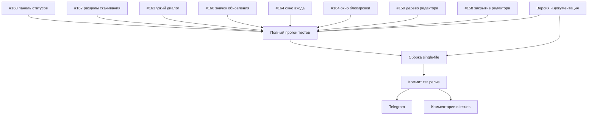

# План релиза Workspace 1C 1.0.1.121: панель статусов, разделы в скачивании платформы, ширина диалога шифрования, кнопка обновления в Linux, размеры окон входа/блокировки, дерево «Утилит», закрытие редактора после ошибки

Дата анализа: **2026-11-25**. Базовая версия — **1.0.1.120**
([`Workspace1C.csproj:62`](Workspace1C/Workspace1C/Workspace1C.csproj:62)). Целевая версия —
**1.0.1.121**, повышается **однократно** и только последним числом.

Документ — самодостаточное ТЗ. Код в нём **не меняется**: правки выполняются отдельными
задачами (`new_task`, режим `code`) по разделу 10.

Исправляются **только** issues: **#168, #167, #166, #164, #163, #159, #158**. Issues
**не закрывать** — после релиза в каждый добавить комментарий с версией 1.0.1.121.
Issues **#153, #143, #139, #136, #134 не трогать** (последний комментарий там — от
sivatorov).

---

## 0. Обязательные ограничения релиза

1. **Issues не закрывать.** Комментарии публикуются после релиза; до этого — никаких
   `gh issue close`.
2. **Паритет WPF (Windows) и Avalonia (Linux).** Любое изменение UI/поведения — в обеих
   оболочках; если баг платформенный, фиксируется причина и проверяется, что вторая
   платформа не регрессировала.
3. **Локализация ru/en.** Новые строки — ключи в
   [`ru.json`](Workspace1C/Workspace1C/Localization/Languages/ru.json:1355) и
   [`en.json`](Workspace1C/Workspace1C/Localization/Languages/en.json:1355) + тест на
   наличие ключа в обоих файлах.
4. **Тесты на каждое исправление.** Новые классы `Issue168StatusBarLayoutTests`,
   `Issue167PlatformDownloadSectionTests`, `Issue163PasswordDialogLayoutTests`,
   `Issue166*`, `Issue164*` (дополнение), `Issue159*` (дополнение), `Issue158*` (новый).
   Существующие стражи не ослаблять; ожидания размеров окон/диалогов обновлять
   осознанно, с комментарием.
5. **CHANGELOG и README.** Запись в [`CHANGELOG.md`](Workspace1C/CHANGELOG.md:14) и
   обновление [`README.md`](Workspace1C/README.md:3) по образцу 1.0.1.120.
6. **Релизные заметки** — `rel_notes_1.0.1.121.md` в корне репозитория (образец —
   [`rel_notes_1.0.1.120.md`](Workspace1C/rel_notes_1.0.1.120.md:1)).
7. **Сборка: ровно один исполняемый файл** на платформу; модули ПРО обязательны
   (`HasProModules=true`), иначе сборка падает до `publish`.
8. **Публикация:** коммит + push `main`, тег `v1.0.1.121` → workflow
   [`.github/workflows/release.yml`](Workspace1C/.github/workflows/release.yml:1)
   собирает Windows/Linux, публикует GitHub Release и отправляет Telegram-анонс в
   `-1004425443528`.
9. **Git-корень** — `g:/h/Workspace1C/Workspace1C`, ветка `main`,
   `origin = https://github.com/sivatorov/Workspace1C`, `gh` авторизован как `sivatorov`.

---

## 1. Issue #166 — «Linux - кнопка обновления»: значок обновления в подвале невидим

### 1.1. Причина (найдена по коду)

В Avalonia-подвале значок создаётся так
([`MainWindow.Avalonia.cs:2708-2713`](Workspace1C/Workspace1C/Views/MainWindow.Avalonia.cs:2708)):

```csharp
_footerUpdateSyncIcon = IconHelper.MakeIcon("IconSync", ..., "@AccentBrush");
_footerUpdateWarningIcon = IconHelper.MakeIcon("IconWarning", ..., "@AccentBrush");
_footerUpdateReadyIcon = IconHelper.MakeIcon("IconCheck", ..., "@SuccessBrush");
```

Третья перегрузка
[`IconHelper.MakeIcon(string, double, string brushKey)`](Workspace1C/Workspace1C/Converters/Avalonia/IconHelper.Avalonia.cs:56)
трактует аргумент как **ключ ресурса-кисти** и делает
`DynamicResourceExtension(brushKey)`
([`ThemeBrushes.Avalonia.cs:36`](Workspace1C/Workspace1C/Themes/ThemeBrushes.Avalonia.cs:36)).
Ключа `@AccentBrush` в ресурсах нет — есть `AccentBrush`; префикс `@` понимает только
[`ThemeBrushes.FromSpec`](Workspace1C/Workspace1C/Themes/ThemeBrushes.Avalonia.cs:77).
Итог: `Path.Fill` не разрешается, геометрия есть, но **заливка отсутствует — значок
не виден**. Версия/подпись видны, потому что используют `SidebarTextBrush`.

Дополнительные дефекты того же блока:

- [`MainWindow.Avalonia.cs:2612-2617`](Workspace1C/Workspace1C/Views/MainWindow.Avalonia.cs:2612)
  создаётся **5** колонок (0–4), а `downloadsPanel` ставится в **колонку 5**
  ([`:2828`](Workspace1C/Workspace1C/Views/MainWindow.Avalonia.cs:2828)) — колонки нет.
  Пока панель скрыта, это не проявляется; при активной загрузке возможно нарушение
  раскладки статус-бара.
- Контейнер `_footerUpdateIcon` — `StackPanel` без `Background`, в отличие от WPF, где
  `Background="Transparent"`
  ([`MainWindow.xaml:3808-3811`](Workspace1C/Workspace1C/Views/MainWindow.xaml:3808)).
  На Linux клик работает только по самим глифам.
- [`RefreshFooterUpdateState`](Workspace1C/Workspace1C/Views/MainWindow.Avalonia.cs:2876)
  глушит исключения и при `UpdateService == null` оставляет `IsVisible=false` — значок
  исчезает навсегда без диагностики.

### 1.2. Правки

- Заменить три вызова на `ThemeBrushes.FromSpec("@AccentBrush")` /
  `ThemeBrushes.FromSpec("@SuccessBrush")` (перегрузка `MakeIcon(string, double, IBrush)`,
  [`IconHelper.Avalonia.cs:81`](Workspace1C/Workspace1C/Converters/Avalonia/IconHelper.Avalonia.cs:81)),
  либо передавать ключи без `@` (`"AccentBrush"`, `"SuccessBrush"`). Предпочтительно —
  `FromSpec`: единый формат с остальными окнами.
- Добавить `_footerUpdateIcon.Background = Brushes.Transparent` и
  `Cursor = Hand` (паритет с WPF), чтобы клик по пустому месту срабатывал.
- Добавить шестую `ColumnDefinition` для `downloadsPanel` (или перенести панель в
  колонку 4 и перестроить индексы), чтобы `Grid.SetColumn(..., 5)` был валиден.
- В `RefreshFooterUpdateState`: перед обращением к сервису выставлять
  `_footerUpdateIcon.IsVisible = true` и `_footerUpdateSyncIcon.IsVisible = true`
  (значок доступен во всех режимах, см.
  [`FooterUpdateIndicatorState.cs:41`](Workspace1C/Workspace1C/Models/FooterUpdateIndicatorState.cs:41)),
  а в `catch` писать `IAppLogger.Warn` (не раскрывая токены), не теряя кнопку.
- Проверить WPF-паритет: `FooterUpdateIcon` уже виден во всех режимах; ничего не менять,
  кроме, при необходимости, общего теста.

### 1.3. Тесты

Новый `Workspace1C.Tests/Issue166FooterUpdateIconTests.cs`:

1. `AvaloniaFooterIcons_UseResolvableBrushes` — source-guard: в
   [`MainWindow.Avalonia.cs`](Workspace1C/Workspace1C/Views/MainWindow.Avalonia.cs:2708)
   нет `MakeIcon(..., "@...")`, используется `FromSpec`/ключ без `@`.
2. `AvaloniaStatusBar_HasColumnForDownloads` — число `ColumnDefinitions.Add` ≥ 6 или
   `Grid.SetColumn(downloadsPanel, ...)` в допустимом диапазоне.
3. `FooterUpdateIcon_IsHitTestVisible` — контейнер имеет прозрачный фон/заливку
   (source-guard WPF и Avalonia).
4. `RefreshFooterUpdateState_DoesNotHideIcon_WhenServiceMissing` — чистая логика/guard:
   при отсутствии сервиса `IsVisible` остаётся `true`.
5. `FooterUpdateIndicatorState_AlwaysVisible` — уже покрыто, не дублировать; проверить,
   что существующие тесты `Issue116*` остаются зелёными.

### 1.4. DoD

- На Linux (Avalonia) в панели статуса **слева от версии** виден значок обновления
  (стрелки/«внимание»/галочка) и по нему работает клик.
- На Windows вид и поведение не изменились.
- Статус-бар корректно раскладывается при активной загрузке.

### 1.5. Риски

- `FromSpec` возвращает `null` при неизвестной кисти — проверить, что `AccentBrush` и
  `SuccessBrush` есть в обеих темах.
- Изменение числа колонок может сместить индикатор загрузок — проверить визуально
  (временно запустить загрузку платформы).

---

## 2. Issue #164 — нормализация размеров окон входа и блокировки

Предыдущая часть issue (запрос пароля, имя учётной записи, `%app_user%`) исправлена в
1.0.1.120 и покрыта [`Issue164AccountPasswordPromptTests`](Workspace1C/Workspace1C.Tests/Issue164AccountPasswordPromptTests.cs:19).
Текущая жалоба 7OH: «При блокировке — куча пустого места под кнопками. При входе — над
полем ввода куча пустого места».

### 2.1. Причина

- **Окно входа WPF**: фиксированная `Height="360"`
  ([`LoginWindow.xaml:10`](Workspace1C/Workspace1C/Views/LoginWindow.xaml:10)), строка
  списка — `Height="*"`
  ([`:27`](Workspace1C/Workspace1C/Views/LoginWindow.xaml:27)). При одной записи список
  скрывается ([`LoginWindow.xaml.cs:108-112`](Workspace1C/Workspace1C/Views/LoginWindow.xaml.cs:108)),
  но `*`-строка продолжает занимать всё свободное место — пустота над полем пароля.
- **Окно входа Avalonia**: `Height = double.NaN` и `MinHeight = 360`
  ([`LoginWindow.Avalonia.cs:102-109`](Workspace1C/Workspace1C/Views/LoginWindow.Avalonia.cs:102)),
  строка списка — `Star` ([`:114`](Workspace1C/Workspace1C/Views/LoginWindow.Avalonia.cs:114)).
  Даже при скрытом списке `MinHeight=360` и `Star`-строка дают большой пустой блок.
- **Окно блокировки**: фиксированная `Height="340"`
  ([`AppLockWindow.xaml:10`](Workspace1C/Workspace1C/Views/AppLockWindow.xaml:10)),
  в режиме смены пароля — жёстко `Height = 430`
  ([`AppLockWindow.xaml.cs:46`](Workspace1C/Workspace1C/Views/AppLockWindow.xaml.cs:46),
  [`AppLockWindow.Avalonia.cs:50-53`](Workspace1C/Workspace1C/Views/AppLockWindow.Avalonia.cs:50)).
  Содержимое — `StackPanel` по высоте меньше окна → пустое место под кнопками.

В проекте уже есть единая политика размеров —
[`DialogWorkAreaPolicy`](Workspace1C/Workspace1C/Services/DialogWorkAreaPolicy.cs:15)
(`DefaultHeight/MinHeight/MaxHeight`, кламп по рабочей области). Окна входа/блокировки
её не используют.

### 2.2. Правки

**Политика.** В [`DialogWorkAreaPolicy.cs`](Workspace1C/Workspace1C/Services/DialogWorkAreaPolicy.cs:46)
добавить профили:

- `Login = new(DefaultHeight: 420, MinHeight: 220, MaxHeight: 560)` — окно по содержимому;
- `AppLock = new(340, 240, 520)`;
- `AppLockChange = new(430, 340, 560)`.

**WPF, окно входа** ([`LoginWindow.xaml`](Workspace1C/Workspace1C/Views/LoginWindow.xaml:10)):

- Убрать фиксированный `Height="360"`; задать `SizeToContent="Height"`, `MinHeight="220"`.
- Строку списка сделать `Height="Auto"`; `ListBox` ограничить `MaxHeight="280"` (при
  нескольких профилях — прокрутка внутри списка, не окна).
- В конструкторе
  ([`LoginWindow.xaml.cs:108`](Workspace1C/Workspace1C/Views/LoginWindow.xaml.cs:108)):
  при одном профиле дополнительно обнулять высоту строки списка
  (`ProfilesListRow.Height = new GridLength(0)`), имя строки задать в XAML.
- `MaxHeight` вычислять по `SystemParameters.WorkArea` через
  `DialogWorkAreaPolicy.Recommend(DialogWorkAreaPolicy.Login, ...)`.

**Avalonia, окно входа** ([`LoginWindow.Avalonia.cs:102`](Workspace1C/Workspace1C/Views/LoginWindow.Avalonia.cs:102)):

- `Height = double.NaN` оставить; `MinHeight`/`MaxHeight` брать из `Login`-профиля и
  клампить по `Screens.ScreenFromWindow(this) ?? Screens.Primary` (как в
  [`UtilitiesMenuEditorWindow.Avalonia.cs:129`](Workspace1C/Workspace1C/Views/UtilitiesMenuEditorWindow.Avalonia.cs:129)).
- Строку списка сделать `GridLength.Auto`; `ListBox.MaxHeight = 280`.
- При одном профиле `_profilesList.IsVisible = false` уже есть — убедиться, что строка
  больше не растягивается (Auto + невидимый элемент = 0).

**WPF, окно блокировки** ([`AppLockWindow.xaml`](Workspace1C/Workspace1C/Views/AppLockWindow.xaml:10)):

- Убрать `Height="340"`; `SizeToContent="Height"`, `MinHeight="240"`.
- В конструкторе ([`AppLockWindow.xaml.cs:42-84`](Workspace1C/Workspace1C/Views/AppLockWindow.xaml.cs:42)):
  вместо `Height = 430` использовать профиль `AppLockChange`; для обычных режимов —
  `AppLock`; `MaxHeight` клампить по рабочей области.

**Avalonia, окно блокировки** ([`AppLockWindow.Avalonia.cs:50`](Workspace1C/Workspace1C/Views/AppLockWindow.Avalonia.cs:50)):

- `Height = double.NaN` (авторазмер по `StackPanel`), `MinHeight`/`MaxHeight` — из
  профиля и кламп по экрану; убрать жёсткие `340`/`430`.

**Общее.** Проверить, что кнопки остаются прижатыми к содержимому (не «висят» внизу
пустого окна), а при 125–150 % масштаба окно не выходит за экран.

### 2.3. Тесты

Дополнить [`Issue164AccountPasswordPromptTests.cs`](Workspace1C/Workspace1C.Tests/Issue164AccountPasswordPromptTests.cs:19)
или новый `Issue164WindowSizeTests.cs`:

1. `WpfLoginWindow_AutoHeight_NoFixedHeight` — в XAML нет `Height="360"`, есть
   `SizeToContent="Height"`, `MinHeight`.
2. `AvaloniaLoginWindow_UsesLoginPolicy` — `Height = double.NaN`, `MinHeight` из
   `DialogWorkAreaPolicy.Login`, нет `MinHeight = 360`.
3. `SingleProfile_ListRowCollapsed` — source-guard обоих окон: при одном профиле строка
   списка не занимает место (WPF — высота строки 0/`Auto`, Avalonia — `Auto`).
4. `WpfAppLockWindow_AutoHeight` — нет `Height="340"`, есть `SizeToContent="Height"`.
5. `AvaloniaAppLockWindow_UsesProfiles` — нет жёстких `340`/`430`, используются профили.
6. `LoginWindow_StillShowsAccountName` — существующие проверки #164 не ослаблены.
7. `DialogWorkAreaPolicy_LoginAndAppLock_ClampToWorkArea` — чистая функция `Recommend`.

### 2.4. DoD

- Окно входа: нет пустого места над полем пароля (одна запись и несколько).
- Окно блокировки: нет пустого места под кнопками, высота по содержимому.
- На 1366×768@100 % и 1920×1080@125 % окна целиком в рабочей области.
- WPF и Avalonia; ru/en (новых строк не требуется).

### 2.5. Риски

- `SizeToContent` + `MaxHeight` в WPF: при очень длинном списке профилей нужен
  `MaxHeight` у `ListBox`, иначе окно вырастет за экран.
- В Avalonia авторазмер при `WindowStartupLocation=CenterScreen` может «прыгнуть» после
  применения темы — проверить на реальной Linux-сборке.

---

## 3. Issue #159 — дерево редактора «Утилит»: иконка и область клика

Открытие редактора (ПКМ/настройки) исправлено в 1.0.1.120
([`UtilitiesMenuEditorWindow.Avalonia.cs:71`](Workspace1C/Workspace1C/Views/UtilitiesMenuEditorWindow.Avalonia.cs:71),
[`Issue159UtilitiesEditorLinuxTests`](Workspace1C/Workspace1C.Tests/Issue159UtilitiesEditorLinuxTests.cs:29)).
Новая жалоба 7OH: «если раскрыть папку — иконка меняется на точку и мышкой просто нажать
на старое место уже нельзя — надо попадать в точку».

### 3.1. Причина

1. **Неверный ключ иконки в Avalonia-дереве.** Строка узла строится через
   [`BuildTreeRow`](Workspace1C/Workspace1C/Views/UtilitiesMenuEditorWindow.Avalonia.cs:229):
   `IconHelper.MakeIcon(node.DisplayIconKey, 16, "TextPrimaryBrush")`. Но
   `DisplayIconKey` — это **PackIcon-ключ каталога** (`Folder`, `Sync`, …), а
   `IconHelper` ожидает **геометрию** `Icon*`
   ([`IconHelper.Avalonia.cs:25`](Workspace1C/Workspace1C/Converters/Avalonia/IconHelper.Avalonia.cs:25)).
   Неизвестный ключ резолвится в запасную `IconFolder`
   ([`ThemeFeatureMap.cs:214-220`](Workspace1C/Workspace1C/Themes/ThemeFeatureMap.cs:214)),
   т.е. у всех узлов показывается одна и та же «папка»/неверный значок. WPF-шаблон
   использует правильный `DisplayIconGeometryKey`
   ([`UtilitiesMenuEditorWindow.xaml:43`](Workspace1C/Workspace1C/Views/UtilitiesMenuEditorWindow.xaml:43)).
   Правильный образец преобразования ключа —
   [`TrayMenuEditorWindow.Avalonia.cs:165-167`](Workspace1C/Workspace1C/Views/TrayMenuEditorWindow.Avalonia.cs:165).
2. **Маленькая область раскрытия/клика.** В теме Avalonia
   [`ModernTreeItem`](Workspace1C/Workspace1C/Themes/Controls.axaml:1411): колонка
   раскрывателя 24 px, `ToggleButton` 20×22 с 16-пиксельным шевроном; контент строки —
   `StackPanel` без фона и без растягивания. После раскрытия узла пользователь видит
   маленький шеврон («точку») и вынужден попадать точно в него; клик по остальной части
   строки не выделяет узел, т.к. прозрачные области `StackPanel` не участвуют в
   hit-test. В WPF та же проблема с текстовым «+»/«−» 22×22
   ([`LightTheme.xaml:1107-1132`](Workspace1C/Workspace1C/Themes/LightTheme.xaml:1107)).

### 3.2. Правки

**Avalonia, строка дерева** ([`UtilitiesMenuEditorWindow.Avalonia.cs:229-263`](Workspace1C/Workspace1C/Views/UtilitiesMenuEditorWindow.Avalonia.cs:229)):

- Иконку строить по `node.DisplayIconGeometryKey` (через
  `UtilitiesMenuCatalog.WpfIconGeometryKey`, как в tray-редакторе), цвет — из
  `DisplayIconColor` (`ThemeBrushes.FromSpec`), видимость — по `HasDisplayIcon`.
- `row.Background = Brushes.Transparent`, `row.HorizontalAlignment = Stretch`,
  `row.MinHeight = 24`, чтобы вся строка была кликабельной и выделяла узел.
- `ContentPresenter` в шаблоне — `HorizontalAlignment="Stretch"`.

**Тема Avalonia** ([`Controls.axaml:1411-1477`](Workspace1C/Workspace1C/Themes/Controls.axaml:1411)):

- Колонку раскрывателя оставить фиксированной (24), `ToggleButton` — на всю высоту
  строки (`VerticalAlignment=Stretch`, `MinHeight=24`), `Background=Transparent`,
  шеврон 16 px по центру; при раскрытии — явная смена геометрии
  (`IconChevronRight` → `IconChevronDown`) или прежний поворот, но без «сжатия» области.
- Убедиться, что `:empty` скрывает только шеврон, не сдвигая контент.

**WPF-паритет** ([`LightTheme.xaml:1089`](Workspace1C/Workspace1C/Themes/LightTheme.xaml:1089)
и [`DarkTheme.xaml:935`](Workspace1C/Workspace1C/Themes/DarkTheme.xaml:935)):

- `ToggleButton` растянуть по высоте строки (22–24 px), `Background=Transparent`;
  `ContentPresenter` — `HorizontalAlignment="Stretch"`; поведение «+»/«−» сохранить.
- Проверить, что дерево редактора — единственное место, где нужен такой размер; общий
  стиль используется и другими деревьями, поэтому изменение должно быть безопасным
  (увеличение области клика, не внешнего вида).

**Диагностика.** Если после правок воспроизводится «иконка-точка», снять скриншот и
проверить `IconHelper.Geometry` для фактического ключа (добавить в лог `CM_DEBUG_ICONS=1`
или временный `Warn` с ключом).

### 3.3. Тесты

Дополнить [`Issue159UtilitiesEditorLinuxTests.cs`](Workspace1C/Workspace1C.Tests/Issue159UtilitiesEditorLinuxTests.cs:29):

1. `EditorTree_UsesGeometryKeyForIcon` — в
   [`UtilitiesMenuEditorWindow.Avalonia.cs`](Workspace1C/Workspace1C/Views/UtilitiesMenuEditorWindow.Avalonia.cs:229)
   используется `DisplayIconGeometryKey`/`WpfIconGeometryKey`, а не `DisplayIconKey`
   напрямую.
2. `EditorTreeRow_IsStretchAndTransparent` — source-guard: `HorizontalAlignment = Stretch`,
   `Background = Brushes.Transparent`, `MinHeight`.
3. `TreeItemExpander_HasFixedColumnAndFullHeightHitArea` — source-guard
   [`Controls.axaml`](Workspace1C/Workspace1C/Themes/Controls.axaml:1411) и
   [`LightTheme.xaml`](Workspace1C/Workspace1C/Themes/LightTheme.xaml:1089): колонка 24/26,
   `ToggleButton` не меньше 22–24 px по высоте, `Background=Transparent`.
4. `ExpandingNode_DoesNotChangeIconKey` — VM: `DisplayIconGeometryKey` не зависит от
   `IsExpanded`.
5. `WpfEditor_UsesGeometryKeyForIcon` — паритет (в XAML уже есть, зафиксировать).

### 3.4. DoD

- В дереве редактора у каждого узла — своя иконка (совпадает с меню и полем выбора).
- Раскрытие/сворачивание не меняет иконку и не уменьшает область клика: клик по строке
  выделяет узел, клик по шеврону раскрывает/сворачивает.
- WPF и Avalonia; регрессий в других деревьях нет.

### 3.5. Риски

- Общая тема `ModernTreeItem` используется в других окнах — возможны визуальные
  изменения; проверить «Настройки», «Редактор трея», дерево платформ.
- Смена иконки на геометрию может «покрасить» иконки иначе — сверять с меню «Утилиты».

---

## 4. Issue #158 — редактор «Утилит» не закрывается после ошибки

Часть issue про «Мои программы» (пустая группа, шестерёнка, строка в редакторе)
исправлена в 1.0.1.120 и покрыта
[`Issue158CustomProgramsLinuxTests`](Workspace1C/Workspace1C.Tests/Issue158CustomProgramsLinuxTests.cs:29);
её нужно сохранить зелёной. Новая жалоба: «После ошибки — окно правки не закрывается
вообще».

### 4.1. Причина

1. [`ModalWindowBase.OnClosing`](Workspace1C/Workspace1C/Views/ModalWindowBase.cs:1066)
   в `catch` пишет в журнал и **пробрасывает исключение дальше**
   ([`:1084`](Workspace1C/Workspace1C/Views/ModalWindowBase.cs:1084)). Любое исключение
   в цепочке `Closing` (биндинг, обработчик, ошибка состояния после неудачного
   сохранения) **отменяет закрытие окна** — оно остаётся на экране навсегда.
2. Сохранение в редакторе:
   - [`UtilitiesMenuEditorViewModel.Save()`](Workspace1C/Workspace1C/ViewModels/UtilitiesMenuEditorViewModel.cs:547)
     глушит ошибку записи пустым `catch` и всё равно вызывает
     `UtilitiesMenuEvents.RaiseLayoutChanged()`, который может бросить исключение
     (перестроение главного окна).
   - WPF [`OnOk_Click`](Workspace1C/Workspace1C/Views/UtilitiesMenuEditorWindow.xaml.cs:127)
     вызывает `SaveCommand.Execute(null)`, затем `DialogResult = true` — исключение
     прерывает закрытие; `DialogResult` вне `ShowDialog` сам по себе бросает
     `InvalidOperationException`.
   - Avalonia [`OnOkClick`](Workspace1C/Workspace1C/Views/UtilitiesMenuEditorWindow.Avalonia.cs:547)
     — та же схема: `SaveCommand.Execute`, затем `DialogResult`/`Close()`.
   - Кнопка «Отмена» в WPF — `IsCancel="True"` (устанавливает `DialogResult=false`,
     что также бросает при немодальном показе).

### 4.2. Правки

- **`ModalWindowBase.OnClosing`**: не пробрасывать исключение — писать в журнал
  (`LogWindowConstructionError`/`IAppLogger`) и продолжать закрытие (`e.Cancel` не
  выставлять). Это гарантирует, что окно всегда можно закрыть. Аналогичную проверку
  сделать для WPF-окон, если есть свой `Closing`.
- **`UtilitiesMenuEditorViewModel.Save`**: сделать `bool TrySave(out Exception? error)`
  (или `SaveResult`), ловить ошибку `_store.Save`, отдельно оборачивать
  `RaiseLayoutChanged`; при ошибке — событие/свойство `LastSaveError` и запись в журнал.
  `SaveCommand` вызывает `TrySave` и не бросает наружу.
- **WPF `OnOk_Click`**: `if (!_vm.TrySave(out var error)) { ShowSaveError(error); return; }`
  затем `try { DialogResult = true; } catch (InvalidOperationException) { Close(); }`.
- **Avalonia `OnOkClick`**: то же; `Close()` только при успехе; при ошибке — диалог
  `IDialogService.ShowError`, окно остаётся открытым и **закрывается кнопкой «Отмена»**.
- **Кнопка «Отмена»**: в WPF заменить `IsCancel="True"` на явный `Click` → `Close()`
  (с сохранением `Esc`-поведения из #160); в Avalonia убедиться, что
  `BuildCancelButton` вызывает `Close()` (уже так) и не зависит от `DialogResult`.
- **Локализация**: при отсутствии добавить ключи
  `Utilities.Editor.SaveFailed` («Не удалось сохранить компоновку меню: {0}») и
  `Utilities.Editor.SaveFailedTitle` в ru/en (существующие `OpenFailed`/`OpenFailedTitle`
  не переиспользовать для ошибки сохранения).
- **Диагностика**: в журнал — тип и сообщение исключения, имя хранилища; без секретов.

### 4.3. Тесты

Новый `Workspace1C.Tests/Issue158UtilitiesEditorCloseTests.cs`:

1. `OnClosing_DoesNotRethrow` — source-guard
   [`ModalWindowBase.cs`](Workspace1C/Workspace1C/Views/ModalWindowBase.cs:1066): в
   `catch` нет `throw;`.
2. `TrySave_StoreThrows_ReturnsFalse_AndReportsError` — VM с хранилищем-заглушкой,
   бросающим исключение: `TrySave` = false, исключение не выходит, `LastSaveError`
   заполнен.
3. `TrySave_LayoutChangedThrows_DoesNotEscape` — заглушка события/подписчика.
4. `WpfOnOk_DoesNotClose_OnSaveError` — source-guard: `TrySave` + `return` до
   `DialogResult`.
5. `AvaloniaOnOk_DoesNotClose_OnSaveError` — аналогично.
6. `CancelButton_ClosesWithoutDialogResult` — source-guard WPF/Avalonia.
7. `Localization_HasSaveFailedKeys` (ru/en).
8. `ExistingCustomProgramsTests_StillGreen` — прогон
   `dotnet test --filter Issue158` (регрессия части 1.0.1.120).

### 4.4. DoD

- При ошибке сохранения показывается понятное сообщение, окно остаётся открытым и
  **закрывается** кнопкой «Отмена»/крестиком/`Esc`.
- После успешного сохранения окно закрывается как раньше.
- Исключение в `Closing` больше не блокирует закрытие (пишется в журнал).
- WPF и Avalonia; существующие тесты #158 зелёные.

### 4.5. Риски

- Отказ от `throw` в `OnClosing` может скрыть реальные ошибки закрытия — компенсировать
  подробным логом и тестом.
- Замена `IsCancel` в WPF может изменить поведение `Esc` — проверить сценарий #160
  (Esc закрывает только верхний диалог).

---

## 5. Issue #168 — «Порядок в панели статусов»: длинные надписи не должны сдвигать версию и кнопки

### 5.1. Причина (найдена по коду)

**WPF** — [`MainWindow.xaml:3752-3944`](Workspace1C/Workspace1C/Views/MainWindow.xaml:3752).
Строка состояния — `Grid` из 6 колонок:

| Колонка | Ширина | Содержимое |
|---|---|---|
| 0 | `*` | `StatusBarInfo` (ИД базы / статус) |
| 1 | `Auto` | `FooterUpdateIcon` + `FooterVersionText` |
| 2 | `Auto` | `SyncMessage` («Обновлено: N, загружено: M», итог синхронизации) |
| 3 | `Auto` | `LongOperationAlarmToggle` + кнопка «Текущая сессия» |
| 4 | `Auto` | кнопка правой панели |
| 5 | `Auto` | индикатор загрузок: текст «Скачивается: … (92 %)», `ProgressBar`, ETA, отмена |

Колонки `Auto` получают полную желаемую ширину текста, `*`-колонка сжимается. Так как
`SyncMessage` (кол. 2) и индикатор загрузок (кол. 5) стоят **правее** версии и части
кнопок, при появлении длинных надписей (в том числе сводки при старте) весь правый
кластер — версия, колокольчик, «Текущая сессия», кнопка панели — уезжает влево.
Именно это и просит исправить 7OH: иконки управления и версия должны оставаться
справа, а длинные информационные надписи — слева от всех кнопок.

**Avalonia** — [`MainWindow.Avalonia.cs:2610-2828`](Workspace1C/Workspace1C/Views/MainWindow.Avalonia.cs:2610).
Та же логика плюс два дефекта:

- создаётся **5** `ColumnDefinition` (0–4), а `downloadsPanel` ставится в колонку **5**
  ([`:2828`](Workspace1C/Workspace1C/Views/MainWindow.Avalonia.cs:2828)) — колонки нет;
- порядок: 0 — `_statusInfo`, 1 — `_syncMessage`, 2 — `footerPanel` (значок + версия),
  3 — `sessionPanel`, 4 — переключатель правой панели; длинный `SyncMessage` в кол. 1
  сдвигает версию и кнопки влево.

### 5.2. Правки

**Общий принцип.** В строке состояния остаётся **одна** `*`-колонка слева — в ней живут
все информационные надписи (обрезаются `TextTrimming=CharacterEllipsis`, полный текст —
в `ToolTip`). Справа — только `Auto`-колонки с иконками и версией; они никогда не
сжимаются и не сдвигаются.

**WPF** ([`MainWindow.xaml:3752-3944`](Workspace1C/Workspace1C/Views/MainWindow.xaml:3752)):

- Колонки: 0 `*` — информационная область; 1 `Auto` — кнопка отмены загрузок
  (`CancelDownloadsCommand`); 2 `Auto` — `FooterUpdateIcon` + `FooterVersionText`;
  3 `Auto` — `LongOperationAlarmToggle` + «Текущая сессия»; 4 `Auto` — правая панель.
- В колонку 0 — вложенный `Grid`/`StackPanel` с горизонтальной раскладкой:
  `StatusBarInfo` (`*`, `TextTrimming`, `MinWidth=0`), `SyncMessage` (`Auto`,
  `MaxWidth=260`, `TextTrimming`, `ToolTip`), панель загрузок (`TextBlock`
  `MaxWidth=360` + `ProgressBar` + ETA). Панель загрузок сохраняет привязку
  `Visibility` к `HasActiveDownloads`.
- Кнопка отмены загрузок остаётся рядом с прогрессом (сразу за информационной
  областью) — это единственный элемент управления внутри левой группы.
- Все прежние `x:Name` (`FooterUpdateIcon`, `FooterVersionText`,
  `LongOperationAlarmToggle`), обработчики и привязки сохранить — на них опираются
  тесты `Issue116*`, `Issue129*`, `Issue131*`, `Issue334*`, `Issue359*`, `Issue360*`.

**Avalonia** ([`MainWindow.Avalonia.cs:2610-2864`](Workspace1C/Workspace1C/Views/MainWindow.Avalonia.cs:2610)):

- Пять колонок: 0 `*` (информация), 1 `Auto` (отмена загрузок), 2 `Auto` (`footerPanel`),
  3 `Auto` (`sessionPanel`), 4 `Auto` (переключатель панели). Убрать
  `Grid.SetColumn(downloadsPanel, 5)`; текст/прогресс/ETA индикатора перенести в
  информационную область колонки 0, кнопку отмены — в колонку 1.
- `_statusInfo`, `_syncMessage`, `downloadsText`: `TextTrimming.CharacterEllipsis`,
  `MaxWidth` (260 / 360), `ToolTip` с полным текстом, контейнер с `MinWidth = 0`.
- `RefreshFooterUpdateState`/`RefreshFooterVersionText` и подписки не менять.

**Проверка визуально:** появление/исчезновение индикатора загрузки и длинного
`SyncMessage` не должно менять `X`-координату `FooterVersionText` и кнопок.

### 5.3. Тесты

Новый `Workspace1C.Tests/Issue168StatusBarLayoutTests.cs`:

1. `WpfStatusBar_InfoLeftOfControls` — source-guard: `StatusBarInfo`/`SyncMessage`/
   индикатор загрузок объявлены до `FooterVersionText` и в колонке 0; версия и кнопки —
   в `Auto`-колонках правее.
2. `WpfStatusBar_InfoColumnIsStar_AndTrims` — первая колонка `*`, у информационных
   текстов есть `TextTrimming` и `MaxWidth`.
3. `AvaloniaStatusBar_HasNoPhantomColumn` — нет `Grid.SetColumn(downloadsPanel, 5)`;
   число колонок ≥ максимального индекса.
4. `AvaloniaStatusBar_FooterIsRightOfInfo` — `Grid.SetColumn(footerPanel, …)` >
   `Grid.SetColumn(_statusInfo, …)`; `sessionPanel`/`toggleBtn` правее.
5. `AvaloniaStatusBar_InfoTextsTrim` — у `_statusInfo`, `_syncMessage`, `downloadsText`
   есть `TextTrimming` и `MaxWidth`.
6. `StatusBar_KeepsBindings` — сохранены `HasActiveDownloads`, `DownloadsStatusText`,
   `ActiveDownloadsProgress`, `DownloadsEtaText`, `CancelDownloadsCommand` (обе
   платформы).
7. `ExistingFooterTests_StillGreen` — прогон `Issue116|Issue129|Issue131|Issue334|Issue359|Issue360`.

### 5.4. DoD

- Версия и все иконки управления стоят справа и **не двигаются** при появлении
  длинных надписей (загрузка, сводка синхронизации, старт приложения).
- Длинный текст обрезается многоточием, полный — в подсказке; отмена загрузки
  доступна рядом с прогрессом.
- WPF и Avalonia; новых строк локализации не требуется.

### 5.5. Риски

- Перенос кнопки отмены загрузок может изменить привычное место клика — проверить
  `ShowDownloadsPicker` (issue #359) и `CancelDownloadsCommand`.
- `MaxWidth` у `SyncMessage` может обрезать важные сообщения — обязателен `ToolTip`
  с полным текстом.
- Изменение разметки строки состояния затрагивает страж-тесты `Issue116*`/`Issue131*`
  (порядок элементов) — обновлять их только при осознанном изменении контракта.

---

## 6. Issue #167 — «Скачивание платформы — разделы»: галочка разрядности и фильтр по разделам страницы

### 6.1. Текущее состояние (найдено по коду)

- Диалог: WPF [`PlatformDownloadWindow.xaml:142-177`](Workspace1C/Workspace1C/Views/PlatformDownloadWindow.xaml:142)
  (строка «Разрядность» — `ComboBox` x64/x86, сразу под ней «Файл дистрибутива»),
  Avalonia [`PlatformDownloadWindow.Avalonia.cs:303-360`](Workspace1C/Workspace1C/Views/PlatformDownloadWindow.Avalonia.cs:303).
- Логика: [`PlatformDownloadViewModel.RepickFile`](Workspace1C/Workspace1C/ViewModels/PlatformDownloadViewModel.cs:656)
  **всегда** фильтрует файлы по разрядности
  ([`PlatformDistributionPicker.FilterByArchitecture`](Workspace1C/Workspace1C/Services/PlatformDistributionPicker.cs:156)),
  затем строит варианты (`BuildOptions`), группы (`PlatformFileGroupViewModel.Build`) и
  типы (`AvailableTypes`). Галочки «фильтровать по разрядности» нет — x86-файлы
  недоступны, пока не переключишь `Is64Bit`.
- «Разделы» страницы **уже парсятся**: [`PlatformReleaseFile.Group`](Workspace1C/Workspace1C/Models/PlatformReleaseFile.cs:24),
  [`OneCPlatformCatalogParser.ExtractGroupHeaders/AssignGroup`](Workspace1C/Workspace1C/Services/OneCPlatformCatalogParser.cs:422),
  [`PlatformFileGroupViewModel`](Workspace1C/Workspace1C/ViewModels/PlatformDownloadViewModel.cs:934).
  Но раздел используется только как заголовок-разделитель внутри списка файлов:
  выбрать раздел и отфильтровать им список нельзя.
- Если разделов на странице нет, у всех файлов `Group = null` — фильтр по разделам
  должен быть скрыт/недоступен (issue: «разделов может не быть»).

### 6.2. Правки

**Чистые помощники** ([`PlatformDistributionPicker.cs`](Workspace1C/Workspace1C/Services/PlatformDistributionPicker.cs:156)):

- `ExtractSections(IReadOnlyList<PlatformReleaseFile>)` → упорядоченный список
  непустых `Group` (trim, без дублей, порядок первого появления на странице);
- `FilterBySection(files, string section)` → файлы выбранного раздела
  (`Group` сравнивается без учёта регистра; пустой раздел — без фильтра).

**ViewModel** ([`PlatformDownloadViewModel.cs`](Workspace1C/Workspace1C/ViewModels/PlatformDownloadViewModel.cs:656)):

- Новые свойства: `FilterByArchitecture` (по умолчанию `true` — сохраняет текущее
  поведение), `AvailableSections` (`IReadOnlyList<string>`), `SelectedSection`,
  `FilterBySection`, `HasSections` (`AvailableSections.Count > 0`).
- `RepickFile` собирает конвейер: все файлы → `FilterByArchitecture` (только при
  включённой галочке) → `FilterBySection` (только при включённой галочке и выбранном
  разделе) → `BuildOptions` / `AvailableTypes` / `PlatformFileGroupViewModel.Build`.
- `AvailableSections` пересчитывается из **сырых** файлов выбранного релиза (список
  разделов не «мигает» при смене галочек). Если выбранный раздел исчез (сменилась
  версия) — `SelectedSection = null`, `FilterBySection = false`.
- Сохранять выбор пользователя, если выбранный файл проходит фильтры; иначе —
  рекомендуемый вариант. `PickedFile = null` при пустом результате (кнопка «Скачать»
  недоступна — существующий `CanDownload`).
- Диагностика в журнал окна: число разделов и файлов после фильтрации
  (новый ключ `PlatformDownload.Status.Filters`, опционально).

**WPF** ([`PlatformDownloadWindow.xaml:142-177`](Workspace1C/Workspace1C/Views/PlatformDownloadWindow.xaml:142)):

- Строка «Разрядность»: `Grid` из трёх колонок — подпись, `ComboBox`, `CheckBox`
  «Только моя разрядность» (`IsChecked="{Binding FilterByArchitecture, Mode=TwoWay}"`,
  `ToolTip` с пояснением). Список файлов фильтруется по x64/x86 **только** при
  установленной галочке.
- Новая строка «Раздел»: `CheckBox` «Фильтровать по разделу» + `ComboBox`
  `ItemsSource="{Binding AvailableSections}"`, `SelectedItem="{Binding SelectedSection}"`,
  `IsEnabled="{Binding FilterBySection}"`; вся строка видима только при
  `HasSections` (`BooleanToVisibilityConverter`).
- Привязки — только к VM (никакой логики в code-behind).

**Avalonia** ([`PlatformDownloadWindow.Avalonia.cs:303-360`](Workspace1C/Workspace1C/Views/PlatformDownloadWindow.Avalonia.cs:303)):

- В `archPanel` добавить `CheckBox` с привязкой к `FilterByArchitecture`.
- После `archPanel` — панель раздела (`CheckBox` + `ComboBox`), `IsVisible` по
  `HasSections`, `ItemsSource`/`SelectedItem` — из VM; подписаться на
  `PropertyChanged` для `AvailableSections`/`HasSections`/`SelectedSection`.
- Паритет поведения с WPF (порядок элементов, подсказки, доступность).

**Локализация** (`ru.json` / `en.json`, ключи обязаны совпадать — страж
[`LocalizationCoverageServicesTests`](Workspace1C/Workspace1C.Tests/LocalizationCoverageServicesTests.cs:125)):

- `PlatformDownload.FilterArchitecture` — «Только моя разрядность» / «Only my architecture»;
- `PlatformDownload.Section` — «Раздел» / «Section»;
- `PlatformDownload.FilterSection` — «Фильтровать по разделу» / «Filter by section»;
- `PlatformDownload.FilterArchitectureTooltip`, `PlatformDownload.FilterSectionTooltip`
  — пояснения (список файлов фильтруется только при установленной галочке).

**Вне scope:** сохранение галочек в `AppSettings` между запусками (не требуется issue);
при необходимости — отдельной задачей.

### 6.3. Тесты

Новый `Workspace1C.Tests/Issue167PlatformDownloadSectionTests.cs`:

1. `ExtractSections_ReturnsOrderedDistinctGroups` — порядок как на странице, дубли
   и `null`/пробелы отброшены.
2. `ExtractSections_EmptyWhenPageHasNoGroups` — все `Group = null` → пустой список.
3. `FilterBySection_KeepsOnlySelectedGroup` — регистронезависимо; пустой раздел —
   без фильтра.
4. `Vm_FilterByArchitectureOff_ShowsBothArchitectures` — x64 и x86 файлы в вариантах.
5. `Vm_FilterByArchitectureOn_FiltersOtherArchitecture` — только выбранная.
6. `Vm_AvailableSections_BuiltFromReleaseInPageOrder`.
7. `Vm_FilterBySection_LimitsOptionsAndPicksFile` — выбранный файл принадлежит разделу.
8. `Vm_NoSections_HasSectionsFalse_AndFilterIgnored`.
9. `Vm_SectionDisappearsOnVersionChange_ResetsFilter` — фильтр снят, выбор не «залип».
10. `WpfDialog_HasArchitectureAndSectionFilters` — source-guard XAML: `CheckBox`
    разрядности, `HasSections`, `AvailableSections`, `FilterBySection`.
11. `AvaloniaDialog_HasArchitectureAndSectionFilters` — то же для code-behind.
12. `Localization_HasFilterKeys` (ru/en, значения непустые).
13. Регрессия: `dotnet test --filter "PlatformDownload|Issue162"` зелёный.

### 6.3.1. Дополнительно проверить

- Linux: на страницах без разделов строка «Раздел» не показывается и не «съедает»
  место; при наличии разделов — фильтрация и снятие фильтра работают без перезагрузки
  каталога.
- Смена версии релиза пересобирает `AvailableSections`.

### 6.4. DoD

- Возле «Разрядность» есть галочка; при снятой галочке в списке файлов доступны и
  x64, и x86, при установленной — только выбранная разрядность.
- Есть выбор раздела с галочкой фильтра; при отсутствии разделов на странице
  элементы скрыты.
- WPF и Avalonia; ru/en; существующие тесты скачивания платформы зелёные.

### 6.5. Риски

- Фильтр по разделу может скрыть единственный подходящий файл — оставлять
  рекомендуемый вариант в списке и понятное сообщение «нет файлов» (существующий
  `PlatformDownload.NoFile`).
- `Group` заполняется эвристикой парсера (`<b>/<strong>`) — на нестандартной вёрстке
  разделы могут не распознаться; фильтр должен корректно скрываться, а не показывать
  пустой список.
- Дубли ключей в JSON — страж паритета ключей ru/en обязателен.

---

## 7. Issue #163 — «Хранение паролей от баз»: узкий диалог запроса и переносы текстов

### 7.1. Причина (найдена по коду и скриншоту 7OH)

Скриншот в комментарии 7OH (17:27) — диалог подтверждения с заголовком
«Учётные записи» (`Profiles.Title`), иконкой-вопросом и кнопками «Да»/«Нет»: это
`IDialogService.Confirm` → [`MaterialMessageWindow`](Workspace1C/Workspace1C/Services/MaterialMessageWindow.xaml:1)
(WPF) / [`MaterialMessageWindowAvalonia`](Workspace1C/Workspace1C/Services/MaterialMessageWindow.Avalonia.cs:20).
Текст — `Secrets.EncryptionEnableConfirm`
([`ru.json:1345`](Workspace1C/Workspace1C/Localization/Languages/ru.json:1345)),
вызывается из [`ProfilesViewModel.cs:325`](Workspace1C/Workspace1C/ViewModels/ProfilesViewModel.cs:325)
и [`ProfilesWindow.Avalonia.cs:455`](Workspace1C/Workspace1C/Views/ProfilesWindow.Avalonia.cs:455).

Причина большой ширины: WPF-окно объявлено как
`SizeToContent="WidthAndHeight"` + `Width="440"` + `MaxWidth="480"`
([`MaterialMessageWindow.xaml:8-10`](Workspace1C/Workspace1C/Services/MaterialMessageWindow.xaml:8)).
При `SizeToContent=WidthAndHeight` ширина окна определяется содержимым: `TextBlock`
сообщения измеряется с бесконечной доступной шириной, `TextWrapping="Wrap"` не
срабатывает, и одна длинная строка (~250 символов) растягивает окно почти на весь
экран. `MaxWidth` в этой комбинации не даёт детерминированного результата.

Дополнительно: сами тексты `Secrets.EncryptionEnableConfirm`,
`Secrets.EncryptionDisableConfirm`, `Secrets.EncryptionEnabledHint`,
`Secrets.UnlockPrompt` длинные и без переносов; Avalonia-версия окна для
не-`fitContent` режима уже имеет фиксированную ширину 440, но длинный текст всё равно
выглядит «простынёй», а `SecretUnlockWindow` (WPF
[`SecretUnlockWindow.cs:35`](Workspace1C/Workspace1C/Views/SecretUnlockWindow.cs:35),
Avalonia [`SecretUnlockWindow.Avalonia.cs:47`](Workspace1C/Workspace1C/Views/SecretUnlockWindow.Avalonia.cs:47))
шириной 480 показывает длинную подсказку.

### 7.2. Правки

**WPF-диалог** ([`MaterialMessageWindow.xaml`](Workspace1C/Workspace1C/Services/MaterialMessageWindow.xaml:8)):

- `SizeToContent="Height"` (вместо `WidthAndHeight`), `Width="480"`,
  `MinWidth="420"`, `MaxWidth="560"` — ширина фиксирована, высота по содержимому.
- `MessageText`: `TextWrapping="Wrap"` + явный `MaxWidth="500"` (не полагаться на
  родителя), `VerticalAlignment="Top"`.
- Проверить, что кнопки (`OkButton`/`CancelButton`) остаются справа и не обрезаются.

**Avalonia-диалог** ([`MaterialMessageWindow.Avalonia.cs:98-140`](Workspace1C/Workspace1C/Services/MaterialMessageWindow.Avalonia.cs:98)):

- Ветка не-`fitContent`: `Width = 480`, `MinWidth = 420`, `MaxWidth = 560`,
  `SizeToContent = SizeToContent.Height` (как сейчас), у `TextBlock` сообщения —
  `TextWrapping = Wrap` + `MaxWidth = 500`.
- Ветка `fitContent` (диалоги обновления, issue #139) — **не менять**.

**Тексты (ru/en)** — ужать и добавить переносы строк (`\n`, без emoji — страж
`UiStrings_ContainNoEmojiOrTextGlyphs`; без упоминаний номеров issue — страж
`Release100185Tests`):

- `Secrets.EncryptionEnableConfirm` →
  «Все сохранённые пароли (баз, ИТС, СУБД, SMTP, обновлений, сценариев) будут
  зашифрованы паролем этой учётной записи.\nПри утере пароля восстановить их
  невозможно.\nПродолжить?» (en — аналогично, 3 строки);
- `Secrets.EncryptionDisableConfirm` → 2 строки: следствие + «Продолжить?»;
- `Secrets.EncryptionEnabledHint` → одна короткая фраза: «Пароли хранятся
  зашифрованными и читаются после ввода пароля этой записи.»;
- `Secrets.UnlockPrompt` → «Пароль учётной записи «{0}» для доступа к сохранённым
  паролям.» (короче, плейсхолдер `{0}` сохранить);
- проверить `Secrets.SaveBlocked`/`Secrets.WrongKey` — при необходимости сократить
  без потери смысла.

**Окно запроса пароля** ([`SecretUnlockWindow.cs`](Workspace1C/Workspace1C/Views/SecretUnlockWindow.cs:35),
[`SecretUnlockWindow.Avalonia.cs`](Workspace1C/Workspace1C/Views/SecretUnlockWindow.Avalonia.cs:47)):

- WPF: `WpfUi.SetupWindow(this, "Secrets.UnlockTitle", 440, 260)` (уже), `MaxWidth`
  ограничить 520; подсказка — `WpfUi.Text` (уже `TextWrapping=Wrap`).
- Avalonia: `Width = 440`, `MinWidth = 400`, `MaxWidth = 520`; подсказка уже с
  `TextWrapping.Wrap` — оставить.
- Логику `Submit`/`TryUnlockPasswordSession` и сообщения об ошибке не менять.

**Паритет и регрессии:** диалог `Confirm` используется во всём приложении — после
правки визуально проверить подтверждения обновления/перезапуска и удаления профиля
на обеих платформах.

### 7.3. Тесты

Новый `Workspace1C.Tests/Issue163PasswordDialogLayoutTests.cs`:

1. `WpfMessageWindow_AutoHeightOnly` — в XAML нет `SizeToContent="WidthAndHeight"`,
   есть `SizeToContent="Height"`, `Width`, `MinWidth`, `MaxWidth`.
2. `WpfMessageWindow_MessageWrapsWithMaxWidth` — `TextWrapping="Wrap"` и `MaxWidth`
   у `MessageText`.
3. `AvaloniaMessageWindow_HasBoundedWidth` — в не-`fitContent` ветке есть `Width`,
   `MinWidth`, `MaxWidth`, `TextWrapping.Wrap`, `MaxWidth` у текста.
4. `Secrets_ConfirmTexts_AreShortAndMultiline` — `EncryptionEnableConfirm`/
   `EncryptionDisableConfirm` содержат `\n`, длина ≤ 200 символов (ru и en).
5. `Secrets_HintAndPrompt_AreShort` — `EncryptionEnabledHint` ≤ 110, `UnlockPrompt`
   ≤ 130 символов; плейсхолдер `{0}` сохранён.
6. `SecretUnlockWindows_HaveBoundedWidth` — WPF 440/520, Avalonia 440/520.
7. `ExistingIssue163Tests_StillGreen` — `dotnet test --filter Issue163`.
8. `ExistingDialogGuards_StillGreen` — `EscCloseWindowsTests`, `Issue26ContrastToggle`,
   `Issue139UpdateDialogSize` (убедиться, что они не фиксируют `WidthAndHeight`).

### 7.4. DoD

- Диалог подтверждения включения/отключения шифрования — узкий (≤ 560 px), текст
  переносится на 2–4 строки, кнопки «Да»/«Нет» на месте.
- Окно запроса пароля учётной записи — узкое, подсказка переносится.
- Прочие подтверждения приложения не растягиваются на весь экран.
- WPF и Avalonia; ru/en; функционал шифрования 1.0.1.120 не изменён.

### 7.5. Риски

- Глобальное изменение размеров `MaterialMessageWindow` затрагивает все диалоги —
  визуальная проверка подтверждений обновления/удаления.
- `\n` в JSON должен быть экранирован (`\\n` в исходнике файла) и отображаться
  переносом в `TextBlock` с `Wrap`.
- Стражи локализации (`UiStrings_ContainNoEmojiOrTextGlyphs`, `Release100185Tests`)
  могут отклонить текст — не использовать emoji и номера issue в значениях.

---

## 8. Версия, документация, релизные заметки

### 8.1. Версия (единственная точка изменения)

[`Workspace1C.csproj:62-65`](Workspace1C/Workspace1C/Workspace1C.csproj:62): заменить
`1.0.1.120` → `1.0.1.121` во всех четырёх полях: `Version`, `AssemblyVersion`,
`FileVersion`, `InformationalVersion`.

Проверить, что в исходниках/скриптах/workflow нет других жёстко заданных `1.0.1.120`
(кроме исторических записей CHANGELOG/rel_notes). Поиск:

```
findstr /s /n /c:"1.0.1.120" Workspace1C\*.csproj Workspace1C\*.ps1 Workspace1C\*.sh Workspace1C\.github\workflows\*.yml
```

### 8.2. CHANGELOG

Добавить **над** разделом 1.0.1.120
([`CHANGELOG.md:14`](Workspace1C/CHANGELOG.md:14)) новый раздел:

```markdown
## [1.0.1.121] — 2026-11-25

### Исправлено

- **Панель статусов (issue #168, Windows и Linux).** Длинные информационные надписи
  (загрузка, сводка обновления, старт приложения) больше не сдвигают версию и иконки
  управления: они остаются справа, текст обрезается многоточием и уходит влево.
- **Скачивание платформы: разделы и разрядность (issue #167, Windows и Linux).**
  Возле разрядности добавлена галочка фильтра x64/x86; появился выбор раздела страницы
  загрузок (сворачиваемые группы) с галочкой фильтрации списка файлов.
- **Диалоги шифрования паролей (issue #163, Windows и Linux).** Тексты подтверждений
  сокращены и переносятся по строкам, окно запроса пароля учётной записи стало узким.
- **Linux: кнопка обновления в панели статуса (issue #166).** Значок обновления снова
  виден слева от версии и кликабелен; исправлена заливка иконки и раскладка статус-бара.
- **Размеры окон входа и блокировки (issue #164, Windows и Linux).** Окна открываются
  по содержимому: над полем пароля и под кнопками блокировки больше нет пустого места;
  высота клампится по рабочей области.
- **Дерево редактора «Утилит» (issue #159, Windows и Linux).** Узлы показывают свои
  иконки; раскрытие папки не уменьшает область клика — строка выделяется целиком.
- **Редактор «Утилит» закрывается после ошибки (issue #158, Windows и Linux).**
  Ошибка сохранения показывается сообщением, окно остаётся открытым и закрывается
  кнопкой «Отмена»/крестиком; исключение при закрытии больше не блокирует окно.

### Сборка

- Single-file сборки Windows (WPF) и Linux (Avalonia), версия **1.0.1.121**.
- Полный прогон тестов: **<N>** тестов, **<N>** пройдено, **0** падений, **0** пропущено.
- Размеры артефактов: Windows — **<...>** байт, Linux — **<...>** байт (заполнить после T11).
```

### 8.3. README

Обновить:

- бейдж версии — [`README.md:3`](Workspace1C/README.md:3) → `1.0.1.121`;
- абзац «актуальная версия» и число тестов — [`README.md:11-12`](Workspace1C/README.md:11);
- таблицу бинарей — [`README.md:16-19`](Workspace1C/README.md:16): размеры/`FileVersion`
  заполнить после сборки;
- раздел изменений выпуска — [`README.md:221-245`](Workspace1C/README.md:221): заменить
  перечень 1.0.1.120 на 7 исправлений 1.0.1.121;
- упоминания «актуальная версия — 1.0.1.120» в разделе ПРО —
  [`README.md:2010`](Workspace1C/README.md:2010), [`README.md:2035`](Workspace1C/README.md:2035).

### 8.4. PRO-доки

- [`docs/pro/PRO-EDITION.md:3-4`](Workspace1C/docs/pro/PRO-EDITION.md:3),
  [`docs/pro/PRO-EDITION.md:19`](Workspace1C/docs/pro/PRO-EDITION.md:19),
  [`docs/pro/PRO-EDITION.md:123-125`](Workspace1C/docs/pro/PRO-EDITION.md:123),
  [`docs/pro/PRO-EDITION.md:269-271`](Workspace1C/docs/pro/PRO-EDITION.md:269) —
  актуальная версия 1.0.1.121.
- [`docs/pro/HOW-TO-BUY-PRO.md:3`](Workspace1C/docs/pro/HOW-TO-BUY-PRO.md:3),
  [`docs/pro/HOW-TO-BUY-PRO.md:41`](Workspace1C/docs/pro/HOW-TO-BUY-PRO.md:41).
- [`docs/pro/RELEASE-SETUP.md:57-58`](Workspace1C/docs/pro/RELEASE-SETUP.md:57),
  [`docs/pro/RELEASE-SETUP.md:74`](Workspace1C/docs/pro/RELEASE-SETUP.md:74) — примеры
  тега обновить на `v1.0.1.121-test1` / `v1.0.1.121`.

### 8.5. Релизные заметки и текст Telegram

- `rel_notes_1.0.1.121.md` в корне репозитория — по структуре
  [`rel_notes_1.0.1.120.md`](Workspace1C/rel_notes_1.0.1.120.md:1): «Исправлено» (7 issue),
  «Сборка» (тесты, размеры, `FileVersion`), «Ссылки» (CHANGELOG, PRO-доки, релиз
  `https://github.com/sivatorov/Workspace1C/releases/tag/v1.0.1.121`, Telegram).
- `docs/_telegram_msg_v1.0.1.121.txt` — по образцу
  [`docs/_telegram_msg_v1.0.1.120.txt`](Workspace1C/docs/_telegram_msg_v1.0.1.120.txt:1):
  заголовок «🚀 Workspace 1C 1.0.1.121 — обновление выпущено», 7 пунктов изменений,
  строка «Скачать: https://github.com/sivatorov/Workspace1C/releases/tag/v1.0.1.121»,
  длина ≤ 4096 символов (workflow отправляет файл как есть).
- Шаблоны комментариев: `docs/_comment_168_v101121.md`, `_167_`, `_166_`, `_164_`,
  `_163_`, `_159_`, `_158_`
  (по образцу [`docs/_comment_165_v101120.md`](Workspace1C/docs/_comment_165_v101120.md:1)).

---

## 9. Сборка, тесты, публикация

### 9.1. Полный прогон тестов

Из git-корня `g:/h/Workspace1C/Workspace1C`:

```
dotnet test Workspace1C.slnx -c Release
```

Ожидание: 0 падений, 0 пропущенных. Зафиксировать число тестов и длительность
(для CHANGELOG/README/rel_notes).

Целевые прогоны по задачам:

```
dotnet test Workspace1C.slnx -c Release --filter "Issue168"
dotnet test Workspace1C.slnx -c Release --filter "Issue167|PlatformDownload"
dotnet test Workspace1C.slnx -c Release --filter "Issue163"
dotnet test Workspace1C.slnx -c Release --filter "Issue166"
dotnet test Workspace1C.slnx -c Release --filter "Issue164"
dotnet test Workspace1C.slnx -c Release --filter "Issue159"
dotnet test Workspace1C.slnx -c Release --filter "Issue158"
dotnet test Workspace1C.slnx -c Release --filter "Issue116|Issue119AdaptiveWindow|Issue146|Issue160|Issue334|Issue359|Issue360"
```

### 9.2. Windows single-file (WPF)

```
cd /d g:\h\Workspace1C\Workspace1C\Workspace1C
powershell -NoProfile -ExecutionPolicy Bypass -File .\build-windows-single-file.ps1 -Configuration Release
```

Скрипт: restore → проверка `HasProModules` **до** publish → `dotnet publish -c Release -r win-x64
--self-contained true -p:PublishSingleFile=true -p:IncludeNativeLibrariesForSelfExtract=true
-p:EnableCompressionInSingleFile=true -p:PublishReadyToRun=false` → удаление всех файлов,
кроме `Workspace1C.exe`
([`build-windows-single-file.ps1:91-118`](Workspace1C/Workspace1C/build-windows-single-file.ps1:91)).

Проверки:

```
Workspace1C\dist\win-x64\Workspace1C.exe --list
Workspace1C\dist\win-x64\Workspace1C.exe --license-info --json
powershell -NoProfile -Command "(Get-Item Workspace1C\dist\win-x64\Workspace1C.exe).VersionInfo | Select FileVersion,ProductVersion"
```

Ожидание: один файл; `--list` код 0; `--license-info --json` → `"proModules": true`;
`FileVersion = 1.0.1.121`.

### 9.3. Linux single-file (Avalonia)

Кросс-сборка из Windows (как в логах
[`docs/_build_linux_101119.log`](Workspace1C/docs/_build_linux_101119.log:1)):

```
cd /d g:\h\Workspace1C\Workspace1C\Workspace1C
set FORCE_LINUX=1
bash ./build-linux-single-file.sh Release
```

(в PowerShell: `$env:FORCE_LINUX="1"; bash ./build-linux-single-file.sh Release`)

Скрипт: restore → `HasProModules` до publish → publish linux-x64 → удаление всего, кроме
`Workspace1C`, `chmod +x` → проверка `--license-info --json`
([`build-linux-single-file.sh:105-160`](Workspace1C/Workspace1C/build-linux-single-file.sh:105)).

Проверки локально: один файл `dist/linux-x64/Workspace1C`; при наличии Linux-окружения —
`xvfb-run -a timeout 15s ./Workspace1C` (в CI выполняется автоматически,
[`release.yml:301-317`](Workspace1C/.github/workflows/release.yml:301)).

### 9.4. Публикация

```
cd /d g:\h\Workspace1C\Workspace1C
git status
git add <явный список файлов: Workspace1C/Workspace1C/**, Workspace1C/Workspace1C.Tests/**, Workspace1C/CHANGELOG.md, Workspace1C/README.md, Workspace1C/rel_notes_1.0.1.121.md, Workspace1C/docs/**, plans/plan-v1.0.1.121.md>
git commit -m "1.0.1.121: #168, #167, #166, #164, #163, #159, #158 — исправления интерфейса и стабильности"
git push origin main
git tag v1.0.1.121
git push origin v1.0.1.121
```

Не использовать `git add -A`; не коммитить `bin/`, `obj/`, `dist/`, логи.

Наблюдение:

```
gh run list --workflow "release.yml" --limit 3
gh run watch <run-id>
gh release view v1.0.1.121 --json tagName,isPrerelease,isLatest,assets
```

Ожидание: jobs `windows`, `linux`, `GitHub Release` — success; ассеты
`Workspace1C.exe` и `Workspace1C-linux-x64`; релиз не prerelease и latest; скачанный
`Workspace1C.exe` имеет `FileVersion = 1.0.1.121`.

### 9.5. Telegram

Штатный путь: шаг «Новость в Telegram»
([`release.yml:406-449`](Workspace1C/.github/workflows/release.yml:406)) отправляет
`docs/_telegram_msg_v1.0.1.121.txt` в `-1004425443528` при наличии секрета
`TELEGRAM_BOT_TOKEN` (в прогонах 1.0.1.119/1.0.1.120 — HTTP 200, `"ok":true`).

Проверка и **дублирование только при недоставке** (чтобы не создать два поста):

```
gh run view <run-id> --log | findstr /c:"Telegram HTTP" /c:"\"ok\""
```

Ручная отправка (если шаг пропущен/упал):

```
cd /d g:\h\Workspace1C\Workspace1C
powershell -NoProfile -ExecutionPolicy Bypass -File .\tools\publish-release.ps1 -Version 1.0.1.121
```

Скрипт идемпотентен по тегу, ждёт появления обоих ассетов и отправляет текст в
`-1004425443528`; токен берётся из `WORKSPACE1C_TG_BOT_TOKEN` или
`notifications.json` активного профиля
([`tools/publish-release.ps1:66-83`](Workspace1C/tools/publish-release.ps1:66)).

Альтернатива без ожидания релиза:

```
Workspace1C\dist\win-x64\Workspace1C.exe --telegram-send --title "Workspace 1C 1.0.1.121" --kind success --text "<текст>" --json
```

Подтверждение: `docs/_tg_verify_101121.txt` (дата/время UTC, run id, HTTP-код,
`ok:true`, `message_id`, `chat_id`, ссылка `https://t.me/Workspace1C/<id>`, текст без
токена) — по образцу
[`docs/_tg_verify_101120.txt`](Workspace1C/docs/_tg_verify_101120.txt:1).

### 9.6. Комментарии в issues (без закрытия)

```
gh issue comment 168 --repo sivatorov/Workspace1C --body-file docs/_comment_168_v101121.md
gh issue comment 167 --repo sivatorov/Workspace1C --body-file docs/_comment_167_v101121.md
gh issue comment 166 --repo sivatorov/Workspace1C --body-file docs/_comment_166_v101121.md
gh issue comment 164 --repo sivatorov/Workspace1C --body-file docs/_comment_164_v101121.md
gh issue comment 163 --repo sivatorov/Workspace1C --body-file docs/_comment_163_v101121.md
gh issue comment 159 --repo sivatorov/Workspace1C --body-file docs/_comment_159_v101121.md
gh issue comment 158 --repo sivatorov/Workspace1C --body-file docs/_comment_158_v101121.md
```

Шаблон: что исправлено → версия **1.0.1.121** → ссылка на релиз
`https://github.com/sivatorov/Workspace1C/releases/tag/v1.0.1.121` → что проверить →
просьба подтвердить. Для #168 — версия и кнопки справа, длинные надписи слева; для
#167 — галочка разрядности и выбор раздела; для #166 — значок слева от версии и клик;
для #164 — окна входа/блокировки и отсутствие пустого места; для #163 — узкий диалог
подтверждения и переносы текста; для #159 — иконка узла и клик по строке/шеврону;
для #158 — закрытие после ошибки. **Issues не закрывать.**

---

## 10. Декомпозиция на задачи `new_task` (режим `code`)

Каждая задача самодостаточна: цель, файлы, требования, тесты, DoD; версию менять
запрещено (кроме T9); issues не закрывать; комментарии в issues — только в T14.

### T1 — #168: порядок элементов панели статусов (WPF + Avalonia)

**Границы.** `Views/MainWindow.xaml` (строка состояния, `:3752-3944`),
`Views/MainWindow.Avalonia.cs` (`BuildStatusBar`, `:2610-2864`), новый
`Issue168StatusBarLayoutTests`.
**Сделать.** §5.2: единственная `*`-колонка со всеми информационными надписями слева;
справа — `Auto`-колонки: отмена загрузок, значок обновления + версия, колокольчик +
«Текущая сессия», правая панель. Убрать `Grid.SetColumn(downloadsPanel, 5)`; добавить
`TextTrimming`/`MaxWidth`/`ToolTip` информационным текстам; сохранить все `x:Name`,
привязки и обработчики.
**Проверки.** `dotnet test --filter "Issue168|Issue116|Issue129|Issue131|Issue334|Issue359|Issue360"`;
визуально: появление индикатора загрузки не двигает версию и кнопки.
**DoD.** §5.4.

### T2 — #167: фильтр по разрядности и разделы в диалоге скачивания платформы

**Границы.** `Services/PlatformDistributionPicker.cs` (`ExtractSections`,
`FilterBySection`), `ViewModels/PlatformDownloadViewModel.cs` (`FilterByArchitecture`,
`AvailableSections`, `SelectedSection`, `FilterBySection`, `HasSections`, `RepickFile`),
`Views/PlatformDownloadWindow.xaml`, `Views/PlatformDownloadWindow.Avalonia.cs`,
локализация ru/en, новый `Issue167PlatformDownloadSectionTests`.
**Сделать.** §6.2: галочка «Только моя разрядность» (по умолчанию включена) и строка
«Раздел» (галочка фильтра + `ComboBox`, видима только при `HasSections`); конвейер
фильтров в `RepickFile`; ключи `PlatformDownload.FilterArchitecture`,
`PlatformDownload.Section`, `PlatformDownload.FilterSection` и подсказки — в оба словаря.
**Проверки.** `dotnet test --filter "Issue167|PlatformDownload|Issue162"`.
**DoD.** §6.4.

### T3 — #163: узкий диалог подтверждения и переносы текстов шифрования

**Границы.** `Services/MaterialMessageWindow.xaml`,
`Services/MaterialMessageWindow.Avalonia.cs` (ветка не-`fitContent`),
`Views/SecretUnlockWindow.cs`, `Views/SecretUnlockWindow.Avalonia.cs`,
`Localization/Languages/ru.json`, `en.json`, новый `Issue163PasswordDialogLayoutTests`.
**Сделать.** §7.2: `SizeToContent=Height` + `Width=480`/`MinWidth=420`/`MaxWidth=560`,
`MaxWidth` у текста сообщения; сократить и разбить на строки
`Secrets.EncryptionEnableConfirm`/`EncryptionDisableConfirm`, сократить
`EncryptionEnabledHint`/`UnlockPrompt`; окна `SecretUnlockWindow` — 440/520.
Логику шифрования и `Submit` не менять.
**Проверки.** `dotnet test --filter "Issue163|EscCloseWindows|Issue26ContrastToggle|Issue139UpdateDialogSize"`;
визуально — подтверждения обновления/удаления профиля на обеих платформах.
**DoD.** §7.4.

### T4 — #166: значок обновления в подвале Avalonia

**Границы.** `Views/MainWindow.Avalonia.cs` (иконки, колонки, `RefreshFooterUpdateState`),
новый `Issue166FooterUpdateIconTests`.
**Сделать.** `FromSpec`/ключи без `@` для `AccentBrush`/`SuccessBrush`; прозрачный фон
контейнера; корректная колонка для `downloadsPanel` (согласовать с T1); не скрывать
значок при недоступном сервисе; логирование в `catch`.
**Проверки.** `dotnet test --filter "Issue166|Issue116"`; сборка Linux; визуальная
проверка значка.
**DoD.** §1.4.

### T5 — #164: размеры окна входа (WPF + Avalonia)

**Границы.** `Services/DialogWorkAreaPolicy.cs` (профили `Login`/`AppLock`/`AppLockChange`),
`Views/LoginWindow.xaml`, `LoginWindow.xaml.cs`, `LoginWindow.Avalonia.cs`, тесты.
**Сделать.** Авторазмер, `MinHeight`/`MaxHeight` по профилю, `Auto`-строка списка и
схлопывание при одном профиле; кламп по рабочей области.
**Проверки.** `dotnet test --filter "Issue164|Issue98ButtonOrder"`.
**DoD.** §2.4 (окно входа).

### T6 — #164: размеры окна блокировки (WPF + Avalonia)

**Границы.** `Views/AppLockWindow.xaml`, `AppLockWindow.xaml.cs`,
`AppLockWindow.Avalonia.cs`, тесты.
**Сделать.** `SizeToContent=Height`/`Height=NaN`, профили `AppLock`/`AppLockChange`,
`MaxHeight` по экрану; убрать жёсткие 340/430.
**Проверки.** `dotnet test --filter "Issue164"`.
**DoD.** §2.4 (окно блокировки).

### T7 — #159: иконка узла и область клика в дереве редактора

**Границы.** `Views/UtilitiesMenuEditorWindow.Avalonia.cs` (`BuildTreeRow`),
`Themes/Controls.axaml` (`ModernTreeItem`), `Themes/LightTheme.xaml` и `DarkTheme.xaml`
(`ModernTreeViewItem`), тесты `Issue159*`.
**Сделать.** Геометрический ключ иконки + цвет; растянутая прозрачная строка; шеврон с
фиксированной колонкой и областью клика на всю высоту; WPF-паритет.
**Проверки.** `dotnet test --filter "Issue159|Issue146|Issue61"`.
**DoD.** §3.4.

### T8 — #158: безопасное закрытие редактора и обработка ошибки сохранения

**Границы.** `Views/ModalWindowBase.cs`, `ViewModels/UtilitiesMenuEditorViewModel.cs`,
`Views/UtilitiesMenuEditorWindow.xaml(.cs)`, `UtilitiesMenuEditorWindow.Avalonia.cs`,
локализация, новый `Issue158UtilitiesEditorCloseTests`.
**Сделать.** `TrySave` без «немого» catch; сообщение об ошибке; закрытие только при
успехе; «Отмена» через `Close()`; убрать `throw;` в `OnClosing`; ключи ru/en.
**Проверки.** `dotnet test --filter "Issue158|Issue159|Issue160"`.
**DoD.** §4.4.

### T9 — версия 1.0.1.121 и документация

**Границы.** `Workspace1C/Workspace1C/Workspace1C.csproj`, `CHANGELOG.md`, `README.md`,
`docs/pro/PRO-EDITION.md`, `docs/pro/HOW-TO-BUY-PRO.md`, `docs/pro/RELEASE-SETUP.md`,
`rel_notes_1.0.1.121.md`, `docs/_telegram_msg_v1.0.1.121.txt`. Код не менять.
**Сделать.** §8 полностью (версия один раз; разделы CHANGELOG по 7 issues; README;
заметки; текст Telegram; шаблоны комментариев для 7 issues).
**Проверки.** `dotnet msbuild Workspace1C\Workspace1C\Workspace1C.csproj -getProperty:Version`
→ `1.0.1.121`; поиск `1.0.1.120` в csproj/скриптах/workflow пуст.
**DoD.** Версия и документы согласованы; заметки и текст Telegram готовы.

### T10 — полный прогон тестов

**Границы.** Только прогон и фиксация чисел (исправления — при регрессиях).
**Сделать.** `dotnet test Workspace1C.slnx -c Release`; зафиксировать число тестов,
длительность, падения; при падении — исправить и повторить.
**DoD.** 0 падений, 0 пропущенных; числа внесены в CHANGELOG/README/rel_notes.

### T11 — сборка single-file Windows и Linux

**Границы.** Только сборка/проверки; числа — в CHANGELOG/README/rel_notes.
**Сделать.** `build-windows-single-file.ps1 -Configuration Release`;
`FORCE_LINUX=1 bash ./build-linux-single-file.sh Release`; smoke `--list`,
`--license-info --json` → `proModules=true`; `FileVersion=1.0.1.121`; размеры.
**DoD.** Ровно два файла; версия и ПРО подтверждены; числа внесены.

### T12 — коммит, push, тег `v1.0.1.121`, GitHub Release

**Границы.** Git/gh; код не менять (кроме исправления сбоя CI с фиксацией причины).
**Сделать.** §9.4: явный список файлов, push `main`, тег, ожидание workflow, проверка
ассетов/`isLatest`/`FileVersion`.
**DoD.** Релиз опубликован, ассеты на месте, версия совпадает.

### T13 — Telegram: проверка и дублирование при необходимости

**Границы.** Только проверка/отправка и `docs/_tg_verify_101121.txt`.
**Сделать.** §9.5: проверить шаг; при недоставке — `tools/publish-release.ps1` или
`--telegram-send`; зафиксировать HTTP/`ok`/`message_id`/ссылку. Не создавать дубль,
если автоматический пост доставлен.
**DoD.** Пост в канале есть, подтверждение сохранено.

### T14 — комментарии в issues #168, #167, #166, #164, #163, #159, #158

**Границы.** Только `gh issue comment`; issues не закрывать.
**Сделать.** §9.6; тексты по шаблонам `docs/_comment_*_v101121.md`.
**DoD.** 7 комментариев опубликованы, issues открыты.

---

## 11. Порядок выполнения и зависимости



T1–T8 независимы по смыслу, но выполняются последовательно (каждый пункт — отдельная
задача `code`); T1 и T4 затрагивают один файл `MainWindow.Avalonia.cs` — T4 выполнять
после T1. T9 — единственная задача, меняющая версию, и должна быть завершена после
T1–T8 и до T11. T10/T11 — после T1–T9. T12 — после зелёных T10/T11. T13/T14 — после T12.

---

## 12. Сводная таблица изменений по файлам

| Issue | Основные файлы |
|---|---|
| #168 | `Views/MainWindow.xaml`, `Views/MainWindow.Avalonia.cs` |
| #167 | `Services/PlatformDistributionPicker.cs`, `ViewModels/PlatformDownloadViewModel.cs`, `Views/PlatformDownloadWindow.xaml`, `Views/PlatformDownloadWindow.Avalonia.cs`, локализация |
| #163 | `Services/MaterialMessageWindow.xaml`, `Services/MaterialMessageWindow.Avalonia.cs`, `Views/SecretUnlockWindow.cs`, `Views/SecretUnlockWindow.Avalonia.cs`, локализация |
| #166 | `Views/MainWindow.Avalonia.cs`, `Converters/Avalonia/IconHelper.Avalonia.cs` (использование), `Models/FooterUpdateIndicatorState.cs` (без изменений) |
| #164 | `Services/DialogWorkAreaPolicy.cs`, `Views/LoginWindow.xaml`, `LoginWindow.xaml.cs`, `LoginWindow.Avalonia.cs`, `Views/AppLockWindow.xaml`, `AppLockWindow.xaml.cs`, `AppLockWindow.Avalonia.cs` |
| #159 | `Views/UtilitiesMenuEditorWindow.Avalonia.cs`, `Themes/Controls.axaml`, `Themes/LightTheme.xaml`, `Themes/DarkTheme.xaml` |
| #158 | `Views/ModalWindowBase.cs`, `ViewModels/UtilitiesMenuEditorViewModel.cs`, `Views/UtilitiesMenuEditorWindow.xaml(.cs)`, `Views/UtilitiesMenuEditorWindow.Avalonia.cs`, локализация |
| Версия/доки | `Workspace1C.csproj`, `CHANGELOG.md`, `README.md`, `docs/pro/*`, `rel_notes_1.0.1.121.md`, `docs/_telegram_msg_v1.0.1.121.txt` |
| Тесты | `Issue168StatusBarLayoutTests.cs`, `Issue167PlatformDownloadSectionTests.cs`, `Issue163PasswordDialogLayoutTests.cs`, `Issue166FooterUpdateIconTests.cs`, `Issue164*` (дополнение), `Issue159UtilitiesEditorLinuxTests.cs` (дополнение), `Issue158UtilitiesEditorCloseTests.cs` |

---

## 13. Риски и меры

| Риск | Мера |
|---|---|
| #168: перенос кнопки отмены загрузок меняет привычное место клика | Проверить `ShowDownloadsPicker` (#359) и `CancelDownloadsCommand`; визуальная проверка |
| #168: `MaxWidth` у `SyncMessage` обрезает важное сообщение | Обязательный `ToolTip` с полным текстом |
| #168: страж-тесты порядка элементов (`Issue116*`, `Issue131*`) | Обновлять осознанно, с комментарием о новом контракте |
| #167: фильтр по разделу скрывает единственный файл | Оставлять рекомендуемый вариант, сообщение «нет файлов» (`PlatformDownload.NoFile`) |
| #167: разделы не распознаны парсером | Фильтр скрывается при `HasSections=false`, пустой список не показывается |
| #163: глобальное изменение размеров `MaterialMessageWindow` | Визуальная проверка подтверждений обновления/удаления профиля на обеих платформах |
| #163: `\n` в JSON и стражи локализации | Экранирование `\n`, без emoji и номеров issue в значениях |
| #166: `FromSpec` не находит кисть в одной из тем | Проверить `AccentBrush`/`SuccessBrush` в Light/Dark; тест на разрешимость ключей |
| #166: смещение индикатора загрузок после смены колонок | Визуальная проверка при активной загрузке; smoke-тест раскладки |
| #164: окно входа «прыгает» после применения темы | Проверить на Linux-сборке; `MinHeight`/`MaxHeight` из профиля |
| #164: длинный список профилей выходит за экран | `MaxHeight` у `ListBox` и кламп по рабочей области |
| #159: изменение общей темы дерева ломает другие окна | Прогон `Issue61*`, `Issue146*`, визуальная проверка «Настроек»/трея |
| #159: иконка всё ещё неверная после смены ключа | Лог фактического ключа/резолва; тест `Geometry` для ключей каталога |
| #158: отказ от `throw` скрывает ошибки закрытия | Подробный лог в `errors.log`; тест `OnClosing_DoesNotRethrow` |
| #158: `IsCancel` → `Close()` меняет поведение Esc | Проверить сценарий #160 (`Issue160EscapeRoutingTests`) |
| Регрессии в 1.0.1.120 | Прогон `Issue116*`, `Issue119AdaptiveWindow`, `Issue146`, `Issue158`, `Issue159`, `Issue160` |
| Сборка без модулей ПРО | `HasProModules` до publish; проверка `proModules=true` в обоих бинарях |
| Telegram-анонс не доставлен/дубль | Проверка лога; ручная отправка только при недоставке; `docs/_tg_verify_101121.txt` |
| Рассинхрон версии | T9 — единственная точка смены; поиск `1.0.1.120` в релизных файлах |

---

## 14. Общий DoD релиза 1.0.1.121

1. Все 7 issues (#168, #167, #166, #164, #163, #159, #158) исправлены, покрыты
   тестами `IssueNNN*`, паритет WPF/Avalonia, локализация ru/en (наборы ключей
   совпадают).
2. Полный прогон тестов — 0 падений, 0 пропущенных; стражи `Issue116*`,
   `Issue119AdaptiveWindow`, `Issue131*`, `Issue139*`, `Issue146*`, `Issue158*`,
   `Issue159*`, `Issue160*`, `Issue334*`, `Issue359*`, `Issue360*` не ослаблены.
3. Собраны ровно два single-file бинаря (Windows WPF, Linux Avalonia) с `PRO_MODULES`;
   `proModules=true`; `FileVersion`/`InformationalVersion` = `1.0.1.121`.
4. CHANGELOG, README, `docs/pro/*`, `rel_notes_1.0.1.121.md`,
   `docs/_telegram_msg_v1.0.1.121.txt` обновлены; числа тестов и размеры заполнены.
5. Релиз `v1.0.1.121` опубликован (не prerelease, latest), ассеты на месте, версия
   скачанного exe совпадает.
6. Новость в Telegram-канале `-1004425443528` доставлена; подтверждение —
   `docs/_tg_verify_101121.txt`; дублей нет.
7. Комментарии в issues #168, #167, #166, #164, #163, #159, #158 опубликованы;
   issues **не закрыты**.
